**麻省理工学院开放课程（MIT OpenCourseWare）**

**微积分（Calculus）**

吉尔伯特·斯特朗（Gilbert Strang）

**微积分**

吉尔伯特·斯特朗　著

麻省理工学院

韦尔斯利–剑桥出版社（Wellesley–Cambridge Press）

通信地址：Box 812060, Wellesley, MA 02482。

**微积分　第三版**

吉尔伯特·斯特朗

麻省理工学院

韦尔斯利–剑桥出版社

通信地址：Box 812060, Wellesley, MA 02482。

# 前言


我想帮你学会微积分。这门学科很美，核心思想也没那么难。说到底，一切都在于两个不同函数之间的关系。先看两个重要的例子：

| 函数（1） | 函数（2） |
| --- | --- |
| 汽车行驶的路程 | 汽车的速率 |
| 函数图像的高度 | 函数图像的斜率 |

**函数（2）告诉我们函数（1）变化得有多快。**路程变化的快慢取决于速率；高度变化的快慢取决于斜率。登山时也能看到同样的关系：函数（1）可以是山的高度，函数（2）则是山坡的陡峭程度。函数（1）里的高度和路程，都是“不断累加的总量”，把来自函数（2）的变化加起来。

最清楚的例子是**速率恒定**的情形。这时，路程均匀增加。你若以每小时 50 英里或每小时 80 千米的速率行驶，3 小时后，你知道走了多远。我可以把 3 乘 50，或者把 3 乘 80，写出答案。我可以用代数写出公式，它允许任意恒定速率 $s$ 和任意行驶时间 $t$：

**以恒定速率 $s$ 行驶时间 $t$，所经过的路程 $f$ 为**

$$
f=st.
$$

速率恒定、斜率恒定时，用不着微积分：

**若 $s$ 表示斜率，$x$ 表示水平方向的距离，则竖直方向上升的距离为 $y=sx$。**

这些规则是从函数（2）求函数（1）。反过来，也能从函数（1）求函数（2）：要速率或斜率，把乘法换成除法就是：

$$
\text{速率 }s=\frac{\text{路程 }f}{\text{行驶时间 }t},
\qquad
\text{斜率 }s=\frac{\text{竖直方向上升的距离}}{\text{水平方向的距离}}.
$$

从路程求速率，这是**微分学**；已知速率 $s$ 求路程 $f$，这是**积分学**。

速率恒定时，代数足够。可一旦 $s$ 不断变化，我们时而加速、时而减速，光靠乘除就不行了！**我们需要一种新思想——这正是微积分的核心。**


微分学从函数（1）得到函数（2）：知道每个时刻走了多少路，就能还原速率表上的信息。

积分学走的是反方向。“积分”把一小段一小段的路程加起来，得到总路程，也就还原了函数（1）。

| 函数（1） | 函数（2） |
| --- | --- |
| $f(t)$ 或 $y(x)$ | 它的“导数” $s$，即 $\mathrm{d}f/\mathrm{d}t$ 或 $\mathrm{d}y/\mathrm{d}x$ |

函数（2）中的导数就是函数（1）的**变化率**。本书将解释导数符号 $\mathrm{d}f/\mathrm{d}t$ 和 $\mathrm{d}y/\mathrm{d}x$ 的含义。

## 变化的速率与变化的斜率

让我朝微积分的真正问题迈出第一步：$s$ 不再恒定。这时，函数（1）的图像不再是一条直线。速率和图像的斜率会变化，但只在每小时变化一次。从这些数中，你可以看出规律：

| 量 | 数值序列 | 运算 |
| --- | --- | --- |
| 路程 | $0,\ 1,\ 4,\ 9,\ 16$ | 将相邻的路程值相减，得到函数（2） |
| 速率 | $1,\ 3,\ 5,\ 7$ | 将速率相加，得到函数（1） |

从（1）到（2），做减法：$4-1=3$，$9-4=5$。3 和 5 分别是第二、第三小时内的速率数值。

从（2）到（1），做加法：$1+3+5=9$。单程里程表把第一、二、三小时走的路程累加起来。加与减互为逆运算。

微积分的关键，是在“连续时间”里看出同样的规律。每小时、甚至每分钟看一次总量或变化量，还不够。路程和速率可能**每时每刻都在变**。这时，光靠加减就不行了。**微积分的核心思想，是连续变化。**

像（1）与（2）这样的成对关系还有很多，不只有汽车、函数图像和山坡。这正是微积分重要的原因。函数是连续变化的，不只是以有限步长变化；这也是微积分区别于算术和代数的地方。

## 重要的函数

让我再说一遍从（1）到（2）这一步的正确名称。知道了路程、高度或函数 $f(x)$，微积分就能求出速率（速度）、斜率和导数。这就是微分学：由函数（1）求函数（2）。求出我们所需例子的斜率（导数），还需要时间。

我终于明白：真正不可或缺的函数，其实没那么多！我的基本清单上只有五种 $y(x)$ 或 $f(t)$ 的重要形式：

$$
x^n,\qquad \sin x,\qquad \cos x,\qquad e^x,\qquad \ln x.
$$

对这些路程函数来说，速率（斜率）一直在变。用总路程除以总时间，只得到一个数：平均速率。微积分求的是每个时刻的速率——从路程的完整记录，还原出速率的完整记录。


你的汽车有速率表，显示导数；有单程里程表，显示总里程。两者包含相同的信息，只是记录方式不同。凭速率记录，我们能还原丢失的单程里程表，反过来也一样。一个黑匣子就够了，我们能还原另一个：

**导数（速率表）告诉我们路程怎么变。**

**积分（里程表）把一点一滴的变化攒起来，得到路程。**

这就是微积分的全貌，细节都在书里。我们需要例子、公式和法则，更想看到——也的确需要看到——应用：这门学科到底怎么用。

## 视频讲座

本书配有一套 17 讲的视频，题为“微积分要点”（Highlights of Calculus），放在麻省理工学院开放课程网站 ocw.mit.edu 上，所有人都能免费观看。我希望能帮助世界各地的学生和老师。

[微积分要点视频讲座](https://ocw.mit.edu/resources/res-18-005-highlights-of-calculus-spring-2010/)

此刻，我还无法知道这些视频的所有用法（我的网站 [math.mit.edu/~gs](https://math.mit.edu/~gs) 会尽量及时更新）。ocw.mit.edu 的开放课程网站是这个计划的核心：它收录了麻省理工学院近 2000 门课程的讲义和阅读材料，大班课还配有视频。线性代数讲座已有 200 万人观看（真让人吃惊）。18.06 的这些视频能帮助复习（任何时候都可以！）。此外还有后续课程 18.085“计算科学与工程”。

计划之一，是把这些微积分视频放进 ocw.mit.edu 的“高中精选课程”（Highlights for High School）栏目。这些要点讲解，比横跨几个学期的完整课程 18.01–18.02 更短。我最初的想法是：读一本长达 1000 页的微积分书，一定很容易迷路。（本书没那么长，可要学的东西仍然很多。）这些视频讲解的内容远远超出你正在读的这一页，帮助你抓住微积分的主要思想。

“微积分要点”里的许多想法，会在第 0 章再次出现并展开。另外，MATLAB 的创建者克利夫·莫勒（Cleve Moler）和我合作，围绕新近出版的《微分方程与线性代数》（Differential Equations and Linear Algebra，[math.mit.edu/dela](https://math.mit.edu/dela)）录了一长串短视频。链接如下：

[与 Gilbert Strang 和 Cleve Moler 近距离学习微分方程](https://ocw.mit.edu/resources/res-18-009-learn-differential-equations-up-close-with-gilbert-strang-and-cleve-moler-fall-2015/)

## 指数函数 $y=e^x$

有一个函数，我想单独说说。它是微积分造出来的（代数里见不到它，因为造它要用极限），就是 $y=e^x$。新增的第 0.3 节要回答的一个重要问题，正是怎样把它造出来。

我现在的答案，不在通常那四五种方法之列。那些定义 $e^x$ 的办法，在我看来都相当间接、微妙。我将试一种直接的做法，只用幂函数 $x^n$。读到书中那一处时，$y=1,x,\ldots,x^n$ 的斜率已经知道了。我们要找那个神奇的函数 $y=e^x$：**它等于自身的斜率。**这时，函数（1）就等于函数（2）！看看你觉得这种方法怎么样。

## 目录

| 章／节 | 标题 | 原书页码 |
|---|---|---:|
| 第0章 | 微积分要点 | |
| 0.1 | 距离与速率／高度与斜率 | 1 |
| 0.2 | $y=x^2$ 与 $y=x^n$ 的变化斜率 | 9 |
| 0.3 | 指数函数 $y=e^x$ | 15 |
| 0.4 | 视频概要与练习题 | 23 |
| 0.5 | 图像与图形计算器 | 45 |
| 第1章 | 微积分导论 | |
| 1.1 | 速度与距离 | 51 |
| 1.2 | 暂不使用极限的微积分 | 59 |
| 1.3 | 瞬时速度 | 67 |
| 1.4 | 圆周运动 | 73 |
| 1.5 | 三角学复习 | 80 |
| 1.6 | 一千个光点 | 85 |
| 第2章 | 导数 | |
| 2.1 | 函数的导数 | 87 |
| 2.2 | 幂与多项式 | 94 |
| 2.3 | 斜率与切线 | 102 |
| 2.4 | 正弦和余弦的导数 | 109 |
| 2.5 | 乘积、商与幂的求导法则 | 116 |
| 2.6 | 极限 | 123 |
| 2.7 | 连续函数 | 131 |


| 章／节 | 标题 | 原书页码 |
|---|---|---:|
| 第3章 | 导数的应用 | |
| 3.1 | 线性近似 | 138 |
| 3.2 | 最大值与最小值问题 | 143 |
| 3.3 | 二阶导数：弯曲与加速度 | 153 |
| 3.4 | 图像 | 160 |
| 3.5 | 抛物线、椭圆和双曲线 | 170 |
| 3.6 | 迭代 $x_{n+1}=F(x_n)$ | 179 |
| 3.7 | 牛顿法与混沌 | 187 |
| 3.8 | 中值定理与洛必达法则 | 197 |
| 第4章 | 用链式法则求导 | |
| 4.1 | 链式法则 | 204 |
| 4.2 | 隐函数求导与相关变化率 | 211 |
| 4.3 | 反函数及其导数 | 216 |
| 4.4 | 反三角函数 | 223 |
| 第5章 | 积分 | |
| 5.1 | 积分的思想 | 229 |
| 5.2 | 原函数 | 234 |
| 5.3 | 求和与积分 | 240 |
| 5.4 | 不定积分与换元 | 249 |
| 5.5 | 定积分 | 254 |
| 5.6 | 积分性质与平均值 | 260 |
| 5.7 | 基本定理及其应用 | 267 |
| 5.8 | 数值积分 | 275 |
| 第6章 | 指数与对数 | |
| 6.1 | 概述 | 284 |
| 6.2 | 指数函数 $e^x$ | 292 |
| 6.3 | 科学与经济学中的增长和衰减 | 299 |
| 6.4 | 对数 | 310 |
| 6.5 | 可分离变量方程，包括逻辑斯谛方程 | 317 |
| 6.6 | 用幂替代指数函数 | 326 |
| 6.7 | 双曲函数 | 336 |


| 章／节 | 标题 | 原书页码 |
|---|---|---:|
| 第7章 | 积分技巧 | |
| 7.1 | 分部积分 | 342 |
| 7.2 | 三角积分 | 348 |
| 7.3 | 三角换元 | 355 |
| 7.4 | 部分分式 | 362 |
| 7.5 | 反常积分 | 367 |
| 第8章 | 积分的应用 | |
| 8.1 | 用切片求面积与体积 | 373 |
| 8.2 | 平面曲线的长度 | 383 |
| 8.3 | 旋转曲面的面积 | 388 |
| 8.4 | 概率与微积分 | 391 |
| 8.5 | 质量与矩 | 399 |
| 8.6 | 力、功与能量 | 406 |
| 第9章 | 极坐标与复数 | |
| 9.1 | 极坐标 | 412 |
| 9.2 | 极坐标方程与图像 | 416 |
| 9.3 | 极坐标曲线的斜率、弧长与面积 | 421 |
| 9.4 | 复数 | 425 |
| 第10章 | 无穷级数 | |
| 10.1 | 几何级数 | 433 |
| 10.2 | 收敛判别法：正项级数 | 440 |
| 10.3 | 收敛判别法：一般级数 | 448 |
| 10.4 | $e^x,\sin x,\cos x$ 的泰勒级数 | 452 |
| 10.5 | 幂级数 | 458 |
| 第11章 | 向量与矩阵 | |
| 11.1 | 向量与点积 | 466 |
| 11.2 | 平面与投影 | 476 |
| 11.3 | 叉积与行列式 | 486 |
| 11.4 | 矩阵与线性方程组 | 496 |
| 11.5 | 线性代数 | 507 |


| 章／节 | 标题 | 原书页码 |
|---|---|---:|
| 第12章 | 沿曲线的运动 | |
| 12.1 | 位置向量 | 517 |
| 12.2 | 平面运动：抛体与摆线 | 525 |
| 12.3 | 曲率与法向量 | 531 |
| 12.4 | 极坐标与行星运动 | 537 |
| 第13章 | 偏导数 | |
| 13.1 | 曲面与等值曲线 | 545 |
| 13.2 | 偏导数 | 549 |
| 13.3 | 切平面与线性近似 | 554 |
| 13.4 | 方向导数与梯度 | 565 |
| 13.5 | 链式法则 | 574 |
| 13.6 | 极大值、极小值与鞍点 | 582 |
| 13.7 | 约束与拉格朗日乘子 | 592 |
| 第14章 | 多重积分 | |
| 14.1 | 二重积分 | 599 |
| 14.2 | 换用更合适的坐标 | 607 |
| 14.3 | 三重积分 | 616 |
| 14.4 | 柱坐标与球坐标 | 622 |
| 第15章 | 向量微积分 | |
| 15.1 | 向量场 | 631 |
| 15.2 | 曲线积分 | 637 |
| 15.3 | 格林定理 | 646 |
| 15.4 | 曲面积分 | 657 |
| 15.5 | 散度定理 | 667 |
| 15.6 | 斯托克斯定理与场的旋度 | 674 |
| 第16章 | 微积分之后的数学 | |

## 致读者

我希望你能从这本书学会微积分。在这里，我还要承认，我期待的不止于此。如果你觉得讲解清楚、目的也清楚，那就说明你看到的不只是方程，还有思想。这样，这本书就值得写，这门课也就成功了。

我想说，这门学科是有生命的。只要还有问题要解决，数学就会继续生长，它并没有被包进某个巨大的公式里！我们想知道赢得佛罗里达彩票的概率（第 2 章）；能看懂心电图的含义（第 3 章），也能看出我们处在人口 S 形曲线的什么位置。没有必要假装数学拥有一切答案。本书实际上讲述的是一个思想的生命历程，而这个历程还没有结束。

数学大部分讲的是模式和函数。1.6 节的图像里有一种模式，我不懂；$x^2,x^3,x^n$ 的斜率里也有模式，这种你会懂。它们随着 $x$ 改变而改变。每个函数都包含一段完整的增长或衰减历史。模式有时清楚，有时隐藏，我们的目标就是找到它。

读者应当知道，微积分并非一路轻松愉快。这是要下功夫的：你必须解题，还得认真思考。正如我的一位学生所说：“天哪，我还得读那些文字。”我想这是真的，也希望这些文字都切中要点。这本书尽量不浪费你的时间：目标不是把材料“讲完”，而是把它揭开、讲清楚。说到底，教授一门学科，就是教会一个人。

整整一年保持热情并不容易，大概不可能。但数学比大多数人想象的更活跃、更令人愉快。这本书写得心情愉快，目的严肃——希望你读得开心。

### 一点小奖励

解答中可能仍混入了一些错误。1952 年，我纠正了十处错误，乔治·托马斯奖了我十枚一角硬币，我至今留着。这里把奖励提高到 $e$ 美元。应该是 $e^t$，不过那可能会呈指数增长。更重要的是：欢迎所有建议。本书也好，视频也好，涉及哪一部分都请写信告诉我。

# 公式速查表（书前）


## 导数

$$
\begin{aligned}
\text{和：}\quad &(u+v)'=u'+v',\\
\text{乘积：}\quad &(uv)'=uv'+vu',\\
\text{商：}\quad &\left(\frac uv\right)'=\frac{vu'-uv'}{v^2},\\
\text{幂：}\quad &(u^n)'=nu^{n-1}u',\\
\text{链式：}\quad &\frac d{dx}z(y(x))=\frac{dz}{dy}\frac{dy}{dx},\\
\text{反函数：}\quad &\frac{dx}{dy}=\frac1{dy/dx}.
\end{aligned}
$$

| 函数 | 导数 | 函数 | 导数 |
|---|---|---|---|
| $\sin x$ | $\cos x$ | $e^{cx}$ | $ce^{cx}$ |
| $\cos x$ | $-\sin x$ | $b^x$ | $b^x\ln b$ |
| $\tan x$ | $\sec^2x$ | $\ln x$ | $1/x$ |
| $\cot x$ | $-\csc^2x$ | $\sin^{-1}x$ | $1/\sqrt{1-x^2}$ |
| $\sec x$ | $\sec x\tan x$ | $\tan^{-1}x$ | $1/(1+x^2)$ |
| $\csc x$ | $-\csc x\cot x$ | $\sec^{-1}x$ | $1/(\lvert x\rvert\sqrt{x^2-1})$ |

## 极限与连续性

$$
\frac{\sin x}{x}\to1,\qquad\frac{1-\cos x}{x}\to0,\qquad\frac{1-\cos x}{x^2}\to\frac12.
$$

- $a_n\to0$：所有 $n>N$ 都有 $|a_n|<\varepsilon$。
- $a_n\to L$：所有 $n>N$ 都有 $|a_n-L|<\varepsilon$。
- $f(x)\to L$：$0<|x-a|<\delta$ 时有 $|f(x)-L|<\varepsilon$。
- $f(x)\to f(a)$：当极限 $L=f(a)$ 时，函数在 $a$ 连续。
- $\displaystyle\frac{f(x)-f(a)}{x-a}\to f'(a)$：$a$ 处导数。
- $\displaystyle\frac{f(x)-f(a)}{x-a}=f'(c)$：中值定理。
- $\displaystyle\frac{f(x+\Delta x)-f(x)}{\Delta x}\to f'(x)$：$x$ 处导数。
- $\displaystyle\frac{f(x+\Delta x)-f(x-\Delta x)}{2\Delta x}\to f'(x)$：中心差分。
- $\displaystyle\lim\frac{f(x)}{g(x)}=\lim\frac{f'(x)}{g'(x)}$：用于 $0/0$ 型的洛必达法则。

## 极大值与极小值

临界点：$f'(x)=0$、导数不存在处，或端点。

- 极小值判据：$f'(x)=0$ 且 $f''(x)>0$。
- 极大值判据：$f'(x)=0$ 且 $f''(x)<0$。
- 拐点：$f''(x)=0$。
- 牛顿法：$\displaystyle x_{n+1}=x_n-\frac{f(x_n)}{f'(x_n)}$。
- 迭代 $x_{n+1}=F(x_n)$：若不动点 $x^*=F(x^*)$ 满足 $|F'(x^*)|<1$，迭代趋向这个不动点。

二维驻点：$\partial f/\partial x=0$，$\partial f/\partial y=0$。

$$
\begin{array}{ll}
\text{极小值：}&f_{xx}>0,\quad f_{xx}f_{yy}>f_{xy}^2;\\
\text{极大值：}&f_{xx}<0,\quad f_{xx}f_{yy}>f_{xy}^2;\\
\text{鞍点：}&f_{xx}f_{yy}<f_{xy}^2.
\end{array}
$$

二维牛顿法求增量：

$$
\begin{cases}
g+g_x\Delta x+g_y\Delta y=0,\\
h+h_x\Delta x+h_y\Delta y=0.
\end{cases}
$$

## 代数

$$
\frac{x/a}{y/b}=\frac{bx}{ay},\qquad x^{-n}=\frac1{x^n},\qquad\sqrt[n]x=x^{1/n},
$$
$$
(x^2)(x^3)=x^5,\qquad(x^2)^3=x^6,\qquad x^2/x^3=x^{-1}.
$$

二次方程与根：

$$
ax^2+bx+c=0\quad\Rightarrow\quad x=\frac{-b\pm\sqrt{b^2-4ac}}{2a},
$$
$$
x^2+2Bx+C=0\quad\Rightarrow\quad x=-B\pm\sqrt{B^2-C}.
$$

配方：

$$
ax^2+bx+c=a\left(x+\frac b{2a}\right)^2+c-\frac{b^2}{4a}.
$$

部分分式：

$$
\frac{cx+d}{(x-a)(x-b)}=\frac A{x-a}+\frac B{x-b}.
$$

错误：

$$
\frac a{b+c}\ne\frac ab+\frac ac,\qquad\sqrt{x^2+a^2}\ne x+a.
$$

## 微积分基本定理

$$
\frac d{dx}\int_a^xv(t)\,dt=v(x),\qquad
\int_a^b\frac{df}{dx}\,dx=f(b)-f(a).
$$
$$
\frac d{dx}\int_{a(x)}^{b(x)}v(t)\,dt
=v(b(x))b'(x)-v(a(x))a'(x).
$$
$$
\int_0^by(x)\,dx=\lim_{\Delta x\to0}\Delta x[y(\Delta x)+y(2\Delta x)+\cdots+y(b)].
$$

## 圆、直线与平面

$$
x=r\cos\omega t,\qquad y=r\sin\omega t,\qquad\text{速率 }\omega r.
$$

直线：$y=mx+b$，或 $y-y_0=m(x-x_0)$。

平面：$ax+by+cz=d$，或 $a(x-x_0)+b(y-y_0)+c(z-z_0)=0$。法向量为 $a\mathbf i+b\mathbf j+c\mathbf k$，平面到原点距离为 $|d|/\sqrt{a^2+b^2+c^2}$。

空间直线：

$$
(x,y,z)=(x_0,y_0,z_0)+t(v_1,v_2,v_3),
\qquad
\frac{x-x_0}{v_1}=\frac{y-y_0}{v_2}=\frac{z-z_0}{v_3}.
$$

投影：

$$
\mathbf p=\frac{\mathbf b\cdot\mathbf a}{\mathbf a\cdot\mathbf a}\mathbf a,
\qquad |\mathbf p|=|\mathbf b|\cos\theta.
$$


## 三角恒等式

$$
\begin{aligned}
\sin^2x+\cos^2x&=1,\\
\tan^2x+1&=\sec^2x\quad\text{（除以 $\cos^2x$）},\\
1+\cot^2x&=\csc^2x\quad\text{（除以 $\sin^2x$）},\\
\sin2x&=2\sin x\cos x\quad\text{（倍角）},\\
\cos2x&=\cos^2x-\sin^2x=2\cos^2x-1=1-2\sin^2x,\\
\sin(s\pm t)&=\sin s\cos t\pm\cos s\sin t,\\
\cos(s\pm t)&=\cos s\cos t\mp\sin s\sin t,\\
\tan(s+t)&=\frac{\tan s+\tan t}{1-\tan s\tan t}.
\end{aligned}
$$

余弦定理：$c^2=a^2+b^2-2ab\cos\theta$。正弦定理：$a/\sin A=b/\sin B=c/\sin C$。

$$
a\cos\theta+b\sin\theta=\sqrt{a^2+b^2}\cos\left(\theta-\tan^{-1}\frac ba\right).
$$
$$
\begin{aligned}
\cos(-x)&=\cos x,&\sin(-x)&=-\sin x,\\
\sin(\pi/2\pm x)&=\cos x,&\cos(\pi/2\pm x)&=\mp\sin x,\\
\sin(\pi\pm x)&=\mp\sin x,&\cos(\pi\pm x)&=-\cos x.
\end{aligned}
$$

## 三角积分

$$
\int\sin^2x\,dx=\frac{x-\sin x\cos x}{2}
=\int\frac{1-\cos2x}{2}\,dx=\frac x2-\frac{\sin2x}{4},
$$
$$
\int\cos^2x\,dx=\frac{x+\sin x\cos x}{2}
=\int\frac{1+\cos2x}{2}\,dx=\frac x2+\frac{\sin2x}{4}.
$$
$$
\int\tan^2x\,dx=\tan x-x,\qquad
\int\cot^2x\,dx=-\cot x-x.
$$
$$
\int\sin^nx\,dx=-\frac{\sin^{n-1}x\cos x}{n}+\frac{n-1}{n}\int\sin^{n-2}x\,dx,
$$
$$
\int\cos^nx\,dx=\frac{\cos^{n-1}x\sin x}{n}+\frac{n-1}{n}\int\cos^{n-2}x\,dx,
$$
$$
\int\tan^nx\,dx=\frac{\tan^{n-1}x}{n-1}-\int\tan^{n-2}x\,dx,
$$
$$
\int\sec^nx\,dx=\frac{\sec^{n-2}x\tan x}{n-1}+\frac{n-2}{n-1}\int\sec^{n-2}x\,dx.
$$
$$
\begin{aligned}
\int\tan x\,dx&=-\ln|\cos x|,\\
\int\cot x\,dx&=\ln|\sin x|,\\
\int\sec x\,dx&=\ln|\sec x+\tan x|,\\
\int\csc x\,dx&=\ln|\csc x-\cot x|=-\ln|\csc x+\cot x|,\\
\int\sec^3x\,dx&=\tfrac12\sec x\tan x+\tfrac12\ln|\sec x+\tan x|.
\end{aligned}
$$
$$
\int\sin(px)\sin(qx)\,dx=\frac{\sin((p-q)x)}{2(p-q)}-\frac{\sin((p+q)x)}{2(p+q)},
$$
$$
\int\cos(px)\cos(qx)\,dx=\frac{\sin((p-q)x)}{2(p-q)}+\frac{\sin((p+q)x)}{2(p+q)},
$$
$$
\int\sin(px)\cos(qx)\,dx=-\frac{\cos((p-q)x)}{2(p-q)}-\frac{\cos(p+q)}{2(p+q)}.
$$

## 分部积分

$$
\begin{aligned}
\int\ln x\,dx&=x\ln x-x,\\
\int x^n\ln x\,dx&=\frac{x^{n+1}\ln x}{n+1}-\frac{x^{n+1}}{(n+1)^2},\\
\int x^ne^x\,dx&=x^ne^x-n\int x^{n-1}e^x\,dx,\\
\int e^{cx}\sin kx\,dx&=\frac{e^{cx}}{c^2+k^2}(c\sin kx-k\cos kx),\\
\int e^{cx}\cos kx\,dx&=\frac{e^{cx}}{c^2+k^2}(c\cos kx+k\sin kx),\\
\int x\sin x\,dx&=\sin x-x\cos x,\\
\int x\cos x\,dx&=\cos x+x\sin x,\\
\int x^n\sin x\,dx&=-x^n\cos x+n\int x^{n-1}\cos x\,dx,\\
\int x^n\cos x\,dx&=x^n\sin x-n\int x^{n-1}\sin x\,dx,\\
\int\sin^{-1}x\,dx&=x\sin^{-1}x+\sqrt{1-x^2},\\
\int\tan^{-1}x\,dx&=x\tan^{-1}x-\tfrac12\ln(1+x^2).
\end{aligned}
$$

## 含 $x^2,a^2$ 的积分及判别式 $D=b^2-4ac$

$$
\int\frac{dx}{x^2+a^2}=\frac1a\tan^{-1}\frac xa,
\qquad
\int\frac{dx}{a^2-x^2}=\frac1{2a}\ln\left|\frac{x+a}{x-a}\right|=\frac1a\tanh^{-1}\frac xa.
$$
$$
\int\frac{dx}{\sqrt{x^2+a^2}}=\ln|x+\sqrt{x^2+a^2}|,
\qquad
\int\frac{dx}{\sqrt{a^2-x^2}}=\sin^{-1}\frac xa.
$$
$$
\int\sqrt{x^2+a^2}\,dx=\frac x2\sqrt{x^2+a^2}+\frac{a^2}{2}\ln|x+\sqrt{x^2+a^2}|,
$$
$$
\int\sqrt{a^2-x^2}\,dx=\frac x2\sqrt{a^2-x^2}+\frac{a^2}{2}\sin^{-1}\frac xa.
$$
$$
\int\frac{dx}{x\sqrt{x^2-a^2}}=\frac1a\cos^{-1}\frac ax,
\qquad
\int\frac{dx}{x\sqrt{x^2+a^2}}=\frac1a\ln\left|\frac{\sqrt{x^2+a^2}-a}{x}\right|.
$$
$$
\int\frac{dx}{ax^2+bx+c}=
\begin{cases}
\dfrac1{\sqrt D}\ln\left|\dfrac{2ax+b-\sqrt D}{2ax+b+\sqrt D}\right|,&D>0,\\[6pt]
\dfrac2{\sqrt{-D}}\tan^{-1}\dfrac{2ax+b}{\sqrt{-D}},&D<0,\\[6pt]
-\dfrac2{2ax+b},&D=0.
\end{cases}
$$
$$
\int\frac{dx}{\sqrt{ax^2+bx+c}}
=\frac1{\sqrt a}\ln|2ax+b+2\sqrt a\sqrt{ax^2+bx+c}|,
$$
$$
\int\frac{dx}{\sqrt{ax^2+bx+c}}
=\frac1{\sqrt{-a}}\sin^{-1}\frac{-2ax-b}{\sqrt D}\quad(a<0).
$$

## 定积分

$$
\int_0^\infty x^ne^{-x}\,dx=n!=\Gamma(n+1),\qquad
\int_0^\infty e^{-a^2x^2}\,dx=\frac{\sqrt\pi}{2a},
$$
$$
\int_0^1x^m(1-x)^n\,dx=\frac{m!n!}{(m+n+1)!},
$$
$$
\int_0^\infty\frac{\sin^2x}{x^2}\,dx
=\int_0^\infty\frac{\sin x}{x}\,dx=\frac\pi2.
$$
$$
\int_0^{\pi/2}\sin^nx\,dx=\int_0^{\pi/2}\cos^nx\,dx=
\begin{cases}
\dfrac12\dfrac34\cdots\dfrac{n-1}{n}\dfrac\pi2,&n\text{ 为偶数},\\[6pt]
\dfrac23\dfrac45\cdots\dfrac{n-1}{n},&n>1\text{ 为奇数}.
\end{cases}
$$

# 第 0 章　微积分要点

## 0.1 路程与速率／高度与斜率


微积分研究函数。第一句话我就用了“函数”这个词，因为缺了它，我们就没法往前走。别的词也一样，学起来有两条路：给它下定义，再把它用起来。

我相信，先看函数的例子，再用“函数”这个词去解释它们，学起来又快又管用。下面先给三个例子：

| 名称 | 表达式 |
| --- | --- |
| 线性函数 | $y(x)=2x$ |
| 平方函数 | $y(x)=x^2$ |
| 指数函数 | $y(x)=2^x$ |

头一点：它们并不相同！三个公式里，2 与 $x$ 的结合方式差得很远。我把它们的图像画出来（这是理解函数的好办法），你就能看到：$x$ 为正时，三个函数都在递增，斜率都为正。

输入 $x$ 增大，也就是向右移动；输出 $y$ 也增大，图像往上走。三个函数的增长速率各不相同。


图内文字：Line，直线；Parabola，抛物线；Exponential，指数曲线。


起点 $x=0$ 附近，第一个函数增长最快，可另外两个很快就追上来。$x=2$ 时，三条图像等高，都是 $y=4$。过了这一点，第二条图像 $y=x^2$ 开始领先。到 $x=3$，平方函数升到 $y=3^2=9$，第三条图像却还只有 $y=2^3=8$。

别被眼前的情形骗了，最后赢的是指数函数。$x=4$ 时它追平平方函数——$4^2$ 和 $2^4$ 都是 16。再往后，$y=2^x$ 超过 $y=x^2$，一路领先。到 $x=10$，第三条图像已升到 $y=2^{10}=1024$，平方函数才 $y=10^2=100$。

这三条图像，一条直线、一条抛物线、一条指数曲线。直线的增长速率恒定；抛物线的增长速率越变越大；指数曲线的增长速率本身也按指数规律增大。我特意点出这几条，是因为微积分的核心就在研究增长速率。

微分学的全部要义，就是找出函数的增长速率，再用上这条信息。所以这里同时有两个函数：原来的函数，和它的增长速率。在我沿着这条要紧的路往下走之前，让我先给函数 $y(x)$ 一个用得上的定义：

**函数具有输入 $x$ 和输出 $y(x)$；它给每一个 $x$ 指定唯一一个 $y$。**

输入 $x$ 取自函数的“定义域”（domain）。前面的图里，定义域是所有满足 $x\geq0$ 的数。输出 $y$ 组成函数的“值域”（range）。前两个函数 $y=2x$ 和 $y=x^2$，值域都是所有满足 $y\geq0$ 的数。可对 $y=2^x$ 来说，定义域取 $x\geq0$ 时，值域只有 $y\geq1$。

这些例子太重要，所以让我也让 $x$ 取负值。三个函数的图像如下。严格说，这已经是新的函数了：定义域扩到了全体实数 $x$。注意，三者的值域也各不相同：

- $y=2x$ 的值域是全体实数。
- $y=x^2$ 的值域是全体非负实数，即 $y\geq0$。
- $y=2^x$ 的值域是全体正实数，即 $y>0$。


关于函数，再补一句，微积分就可以开场了。描述函数最常用的办法有三种，我们都见过了：

1. 给出公式，由 $x$ 求 $y$。例如 $y(x)=2x$。
2. 给出图像，显示 $x$（横向距离）和 $y$（竖向距离）。
3. 给出输入与输出的配对：$x$ 在定义域里，$y$ 在值域里。


往抽象里说，“函数”就是所有这些输入—输出有序对组成的集合。也可以说：函数是一条规则，它给定义域里的每个输入 $x$ 指定值域里的一个输出 $y$。

这件事，学别的词时也常碰到。论逻辑，定义该排在前面；可真学起来，先看用这个词的例子，反而能把定义理解得更透。学别的词大概如此，学微积分大概也如此。例子给出一般想法，定义说得更精确。两头合起来，才算弄对。

本书开头说“微积分研究函数”。现在，我得更新这句话。

### 成对的函数

**微积分研究成对的函数。**不妨把它们叫作函数（1）和函数（2）。前面三条图像——$y=2x$、$y=x^2$、$y=2^x$——就是函数（1）的三个例子。接着我们讨论了它们的增长速率。**函数（1）的增长速率，就是函数（2）。**第一个任务，就是求一个函数的增长速率。微分学从函数（1）的公式出发，目标是得出函数（2）的公式。

让我马上说说微积分是怎么运作的。要算 $x$ 一变、$y$ 变多快，有两条路：

**方法 1（极限）：**写出

$$
\frac{y\text{ 的变化量}}{x\text{ 的变化量}}=\frac{\Delta y}{\Delta x},
$$

再求这个比值在 $\Delta x\to0$ 时的极限。

**方法 2（法则）：**运用法则，从已知的增长速率得到新的增长速率。

每遇到一个新函数 $y(x)$，先看看能不能照某条法则，从已知函数把它造出来。学微积分，重要的一课就是认清从已有函数造新函数的各种路子。认清了，再套相应的增长速率法则。

假设新函数没法由已知函数造出来（$2^x$ 不是由 $2x$ 或 $x^2$ 造出来的），那就必须直接求它的增长速率。我说的“直接”，是指计算一个极限，它就是函数（2）。极限是什么、怎么算，本书都会讲。

还是先从例子入手——这几乎总是最好的办法。我将给出眼下这三个函数的增长速率 $\mathrm{d}y/\mathrm{d}x$：

|  | 线性函数 | 平方函数 | 指数函数 |
| --- | --- | --- | --- |
| 函数（1） | $y=2x$ | $y=x^2$ | $y=2^x$ |
| 函数（2） | $\mathrm{d}y/\mathrm{d}x=2$ | $\mathrm{d}y/\mathrm{d}x=2x$ | $\mathrm{d}y/\mathrm{d}x=2^x\ln2$ |

线性函数 $y=2x$ 的增长速率恒为 $\mathrm{d}y/\mathrm{d}x=2$。本节先迈最容易的第一步，也正好借机把增长速率和图像的斜率接上：竖向距离比横向距离，$2x/x$，得 2。

第 0.2 节再往前一步：平方函数 $y=x^2$ 的增长速率 $\mathrm{d}y/\mathrm{d}x=2x$，是个线性函数。（这一步要用到极限，也就是微积分的地基。）然后就可以请出最初的两条法则：

- **常数倍法则：**$Cy(x)$ 的增长速率等于 $y(x)$ 的增长速率乘以常数 $C$。
- **和的法则：**$y_1+y_2$ 的增长速率等于这两个函数增长速率之和。


第一条法则说，$y=5x^2$ 的增长速率是 $10x$，也就是把 $2x$ 乘上常数因子 $C=5$。第二条法则说，$y_1+y_2=5x^2+2x$ 的增长速率是 $10x+2$。注意，我们顺手就把 $5x^2$ 看成了一个增长速率已知的函数 $y_1$。两条合起来，$y_1$ 与 $y_2$ 的任意“线性组合”的增长速率就都求得出：

**$C_1y_1+C_2y_2$ 的增长速率，是相同系数下的组合**

$$
C_1\frac{\mathrm{d}y_1}{\mathrm{d}x}+C_2\frac{\mathrm{d}y_2}{\mathrm{d}x}.
$$

换句话说，从函数（1）走到函数（2），这一步是线性的。$y=x^2-x$ 的斜率是 $\mathrm{d}y/\mathrm{d}x=2x-1$。法则简单，却极要紧。

最后，第 0.3 节讲指数函数 $y=2^x$ 和 $y=e^x$。头一件事是弄清它们的含义：“2 的 $\pi$ 次幂”到底指什么？$2^3=8$、$2^4=16$，这我们懂；可怎么让 2 自乘 $\pi$ 次？

碰到 $e^x$，就见到了微积分的一项伟大创造。这函数有个了不起的性质：$\mathrm{d}y/\mathrm{d}x=y$，斜率等于函数值。这要用到奇妙的数 $e$。此前的代数里从没见过它——只有取到适当的极限，它才出现。

所以，开头这几节要算出三种基本函数的增长速率。现在可以来看 $y=2x$ 了。

### 图像的斜率

**斜率等于竖向变化量除以横向变化量。**我现在想的是函数 $y(x)$ 的图像。“横向距离”是输入从 $x_1$ 到 $x_2$ 的变化量 $x_2-x_1$；“竖向距离”是输出从 $y_1$ 到 $y_2$ 的变化量 $y_2-y_1$。$y_2-y_1$ 比 $x_2-x_1$ 大得多时，斜率就大，图像也陡。用 $y$ 的变化量除以 $x$ 的变化量，正合我们平常对斜率的理解：

$$
\text{平均斜率}
=\frac{y\text{ 的变化量}}{x\text{ 的变化量}}
=\frac{y_2-y_1}{x_2-x_1}
=\frac{\Delta y}{\Delta x}. \tag{1}
$$

我引入了很有用的希腊字母 $\Delta$（delta），专门表示变化量。从 $x_1$ 到 $x_2$，我们走一步 $\Delta x$；对应地，图像高度 $y(x)$ 变了 $\Delta y=y_2-y_1$。$\Delta y$ 比 $\Delta x$，就是从 $x_1$ 到 $x_2$ 的平均斜率。斜率说的就是图像有多陡。

关键在于：我必须说“平均”，因为斜率可能沿途变化。$y=x^2$ 的图像，斜率就在不断增大。$x_1=1$ 与 $x_2=2$ 之间，$y=x^2$ 的平均斜率是多少？拿 $\Delta y$ 除以 $\Delta x$：

$$
\begin{aligned}
x_1=1&\text{ 时， }y_1=1,\\
x_2=2&\text{ 时， }y_2=4,\\
\text{平均斜率}&=\frac{4-1}{2-1}=\frac{\Delta y}{\Delta x}=3.
\end{aligned}
$$

换成 $x_1=0$ 与 $x_2=2$，答案就不同了，不是 3。$x^2$ 这张图，正是微积分要对付的问题：斜率会变，速率也会变。

图像 $y=2x$ 的斜率恒定：竖向变化量 $\Delta y$ 与横向变化量 $\Delta x$ 之比，永远是 2：

$$
\text{恒定斜率}\qquad
\frac{\Delta y}{\Delta x}
=\frac{y_2-y_1}{x_2-x_1}
=\frac{2x_2-2x_1}{x_2-x_1}=2.
$$

这里的数学简单，让我有机会强调这些词语和思想：

**函数（1）＝图像的高度；函数（2）＝图像的斜率。**


图内文字：Constant slope，恒定斜率；Changing slope，变化的斜率。左图的比值为 $2/1$ 或 $4/2$；右图的比值为 $3/1$ 或 $4/2$。

函数（1）取 $y=Cx$ 时，比值 $\Delta y/\Delta x$ 恒等于 $C$。线性函数的斜率是常数。汽车以恒定速率行驶，得到的也是同一对函数：

**函数（1）＝行驶路程＝$Ct$；函数（2）＝汽车的速率＝$C$。**

函数（1）画成图像，变化率就是斜率。函数（1）量的是行驶路程，变化率就是速率（或速度）；函数（1）量的是我们的身高，变化率就是身高的增长速率。

第一点：函数到处都是。到了微积分里，函数成对出现——函数（2）就是函数（1）的变化率。

第二点：函数（1）和函数（2）的计量单位不同。这很自然：

$$
\left(\text{速率，单位为英里/小时}\right)
\times\left(\text{时间，单位为小时}\right)
=\left(\text{路程，单位为英里}\right),
$$

$$
\left(\text{增长速率，单位为英寸/年}\right)
\times\left(\text{时间，单位为年}\right)
=\left(\text{高度，单位为英寸}\right).
$$

时间按秒算、路程按米算，速率自然就是米每秒。三个量里选定两个的单位，第三个就跟着定了。函数（2）总少不了一次除法：$\Delta y$ 除以 $\Delta x$，或者路程除以时间。

接下来才是微积分里精细又扎手的地方。我们要某一点的斜率，也要某一时刻的速率。时间间隔为零，变化率又是什么？

在同一个点上，横向变化量 $\Delta x=0$，竖向变化量也 $\Delta y=0$。形式上，比值就成了 $0/0$。微积分的巧思，就在于给这个式子一个有用的意思。


### 整体图景

微积分把函数（1）和函数（2）连起来：**函数（2）是函数（1）的变化率。**

| 函数（1） | 函数（2） |
| --- | --- |
| 行驶路程 $f(t)$ | 速率 $s(t)=\mathrm{d}f/\mathrm{d}t$ |
| 图像高度 $y(x)$ | 斜率 $s(x)=\mathrm{d}y/\mathrm{d}x$ |

函数（2）告诉你函数（1）变得有多快。

**关键关系：**

$$
\text{恒定速率 }s=\frac{\text{路程 }f}{\text{时间 }t},
\qquad
\text{恒定斜率 }s=\frac{\text{竖向变化量}}{\text{横向变化量}}.
$$

函数（1）和函数（2）的图像摆在一起：$f$ 是不断变长的路程，$s$ 是恒定的速率。


$$
f\text{ 图像的斜率}
=\frac{\text{竖向变化量}}{\text{横向变化量}}
=\frac{st}{t}=s,
$$

$$
s\text{ 图像下的面积}=\text{矩形面积}=st=f.
$$

现在让汽车倒着开回来：

- 速率为负。
- 路程降到零。
- $s(t)$ 图像“下方”的面积为零。


图内文字 This area is negative：这部分面积为负。


**速率不断增大的例子：**这时，路程的图像越来越陡。

$$
f=10t^2,\qquad s=20t.
$$


速率变化时，光靠代数就不够了；$s=f/t$ 是错的。

不过下面两条关系照样成立：

$$
s\text{ 图像下的面积}
=\text{三角形面积}
=\frac12(t)(20t)=10t^2=f,
$$

$$
s=f\text{ 图像的斜率}
=\frac{\mathrm{d}f}{\mathrm{d}t}
=f\text{ 的“导数”}.
$$

当 $f$ 递增时，斜率 $s$ 为正。

当 $f$ 递减时，斜率 $s$ 为负。

当 $f$ 取得最大值或最小值时，斜率 $s$ 为零。

任意函数 $f(t)$ 与 $f(t)+10$ 的图像，在每个 $t$ 处斜率都相同。

要从 $\mathrm{d}f/\mathrm{d}t$ 还原函数（1），也就是 $f$，知道起点高度 $f(0)$ 会大有帮助。


### 练习题

1. 画一张函数 $f(t)$ 的图像：先升、再降、又升。再画一张与之相符的斜率图像。


2. 世界人口 $f(t)$ 起先增长缓慢，如今增长迅速，往后又会慢慢放缓——我们希望如此，也预期如此。它也许会同某个极限靠拢，大约 120 亿或 140 亿。画出 $f(t)$ 及其斜率 $s(t)=\mathrm{d}f/\mathrm{d}t$ 的图像。

3. 设 $t\leq1$ 时 $f(t)=2t$，而 $t\geq1$ 时 $f(t)=3t+2$。描述斜率函数 $s(t)$ 的图像。比较图像下方截至 $t=3$ 的面积与 $f(3)$。

4. 画出 $f(t)=\cos t$ 的图像，再随手勾出它的斜率图像。哪些角度 $t$ 上斜率为零？（$f(t)$ 的图像“平坦”时，斜率为零。）

5. 设 $f(t)$ 的图像像大写字母 W。描述它的斜率函数 $s(t)=\mathrm{d}f/\mathrm{d}t$ 的图像。$s$ 图像下方的总面积是多少？

6. 火车以恒定速率 $s$ 跑了路程 $f$。车厢里一名乘客以步行速率 $S$ 向前走了路程 $F$。这名乘客一共走了多远？速率是多少？（距离以车站为参照。）

## 0.2 $y=x^2$ 与 $y=x^n$ 的变化斜率


三个例子里，第二个是 $y=x^2$。沿着曲线往上走，斜率也在变。平均斜率仍然是 $\Delta y/\Delta x$，可那还不是我们最终要的东西。微分学有两个关键问题，非回答不可：

**“某一点处的斜率”究竟是什么意思？又该怎么算？**

我的视频讲座“整体图景：导数”讲的也是这些问题。学微积分的人，很快都会撞上同一个疑问：单看某一个时刻，什么变化都没发生，那“变化率”是什么意思？这个问题问得好。

答案分两步。先由代数给出 $\Delta y/\Delta x$，再由微积分求出 $\mathrm{d}y/\mathrm{d}x$。$\mathrm{d}y$ 和 $\mathrm{d}x$ 是无穷短的步长，形式上就像是在看 $0/0$。试图定义 $\mathrm{d}y$、$\mathrm{d}x$ 和 $0/0$，并不明智，我也不会这么做。管用的办法，是看清一点：$\Delta y$ 与 $\Delta x$ 的比值本身定义得清清楚楚，而这两个数可以变得非常小。**若这个比值 $\Delta y/\Delta x$ 趋于一个极限，我们就有了完整的答案：**

**在 $x$ 处的斜率，是下列比值在 $\Delta x\to0$ 时的极限：**

$$
\frac{\Delta y}{\Delta x}
=\frac{y(x+\Delta x)-y(x)}{\Delta x}.
$$

横向跨过去，从 $x$ 到 $x+\Delta x$，距离就是 $\Delta x$；竖向升上去，是从 $y(x)$ 到 $y(x+\Delta x)$。让我展示 $y=x^2$ 时，代数怎样直接给出 $\Delta y/\Delta x$：

$$
\frac{\Delta y}{\Delta x}
=\frac{(x+\Delta x)^2-x^2}{\Delta x}
=\frac{x^2+2x\Delta x+(\Delta x)^2-x^2}{\Delta x}
=2x+\Delta x.
$$

注意这一步计算！“首项” $x^2$ 与 $-x^2$ 相消了。关键项是 $2x\Delta x$：$\Delta y$ 的主要部分，正是靠这个“一阶项”撑起来的。本例中的“二阶项”为 $(\Delta x)^2$。除以 $\Delta x$ 之后，它仍然很小；步长 $\Delta x$ 趋于零时，$(\Delta x)^2/\Delta x$ 也就趋于零。

**取极限 $\Delta x\to0$，就得到一点处的斜率 $\mathrm{d}y/\mathrm{d}x$。**除以 $\Delta x$ 后，一阶项留了下来，更高阶的项趋于零：

$$
\text{一点处的斜率}\qquad
\frac{\mathrm{d}y}{\mathrm{d}x}
=\lim_{\Delta x\to0}\frac{\Delta y}{\Delta x}
=\lim_{\Delta x\to0}(2x+\Delta x)=2x.
$$

代数给出的是 $\Delta y/\Delta x$；到了极限这一步，微积分给出 $\mathrm{d}y/\mathrm{d}x$。看看图，这几步的几何意思就清楚了。竖向变化量比横向变化量，$\Delta y/\Delta x$，就是图上两点之间的斜率。取极限时，两点合到一处；$\Delta y/\Delta x$ 于是趋于单独一点处的斜率 $\mathrm{d}y/\mathrm{d}x$。


前两幅图里，连接两点的彩色线段叫“弦”。它们一步步逼近第三幅图中的那条彩色直线——那条线只在一处碰到曲线。这就是曲线的“切线”。 微分学的想法，就落在这一句上：

$$
\text{切线的斜率}=\text{曲线的斜率}
=\text{函数（2）}=\frac{\mathrm{d}y}{\mathrm{d}x}=2x.
$$

要找这条切线的方程，还得回到代数。选定一个具体的 $x_0$；在 $x$ 轴上这个位置的正上方，图的高度是 $y_0=x_0^2$。图在该点的切线斜率是 $\mathrm{d}y/\mathrm{d}x=2x_0$。**我们要的，是经过该点、斜率等于这个值的直线方程。**

$$
\text{切线方程}\qquad y-y_0=(2x_0)(x-x_0). \tag{1}
$$

把 $x=x_0$、$y=y_0$ 代进去，方程变成 $0=0$。这说明该点满足方程，确实在直线上。再看，直线的斜率与曲线的斜率 $2x_0$ 相同。两边同除以 $x-x_0$，就看得很直接：

$$
\frac{\text{竖向变化量}}{\text{横向变化量}}
=\frac{y-y_0}{x-x_0}=2x_0,
$$

这正是所需的斜率 $\mathrm{d}y/\mathrm{d}x$。

让我再说一遍：$y=x^2$ 的图是弯的，切线是直的。在相切点附近，这条直线贴着曲线，贴得尽可能近。切线给出了非线性函数 $y=x^2$ 的线性近似：

$$
\text{线性近似}\qquad
y\approx y_0+(2x_0)(x-x_0)
=y_0+\frac{\mathrm{d}y}{\mathrm{d}x}(x-x_0). \tag{2}
$$

我只是把式（1）里的 $y_0$ 移到了右边。然后用了表示“近似相等”的符号 $\approx$，因为用等号就错了：曲线是弯的。

后面会用到的一点：这种弯曲，与 $y=x^2$ 的二阶导数有关。


### 二阶导数

一阶导数就是斜率 $\mathrm{d}y/\mathrm{d}x=2x$。**二阶导数，是斜率函数的斜率。**碰巧，$2x$ 的斜率上一节已经求过了：很容易，就是常数 2。注意，“斜率的斜率”这个符号写作 $\mathrm{d}^2y/\mathrm{d}x^2$：

$$
\frac{\mathrm{d}y}{\mathrm{d}x}=2x
\quad\text{的斜率为}\quad
\frac{\mathrm{d}^2y}{\mathrm{d}x^2}=2. \tag{3}
$$

换成平常的话：一阶导数 $\mathrm{d}y/\mathrm{d}x$ 说明函数 $y(x)$ 变化得有多快；二阶导数说明我们是在加速，还是在减速。 $y=x^2$ 这个例子显然在加速：图越来越陡，曲线在弯曲，切线也跟着陡起来。

再看 $x=0$ 左边，$x$ 取负值时的 $y=x^2$。图一路降向零，斜率显然是负的，可曲线照样向上弯！代数与这张图一致：在 $x=0$ 左侧，斜率 $\mathrm{d}y/\mathrm{d}x=2x$ 为负，二阶导数 $\mathrm{d}^2y/\mathrm{d}x^2=2$ 仍然是正的。

经济学家或投资者，三个量都要看。$y(x)$ 说明经济处在什么水平；$\mathrm{d}y/\mathrm{d}x$ 说明它朝哪边走——短期看，走势贴着切线；真正透露较长期预测的，是 $\mathrm{d}^2y/\mathrm{d}x^2$。我写下这几句话时，经济衰退已近尾声——但愿如此。$\mathrm{d}y/\mathrm{d}x$ 一直为负，叫我遗憾；$\mathrm{d}^2y/\mathrm{d}x^2$ 近来为正，又叫我高兴。

### 路程、速度与加速度

开车是 $y(x)$、$\mathrm{d}y/\mathrm{d}x$ 和 $\mathrm{d}^2y/\mathrm{d}x^2$ 的好例子。函数 $y$ 是行驶的距离，它的变化率（一阶导数）是速度；速度的变化率（二阶导数）是加速度。踩着油门，这三个量都会为正。踩着刹车，距离和速度大概仍然为正，加速度却是负的：速度在往下掉。那么，倒着车踩刹车，又是怎么回事？

- 速度为负——车正在后退。
- 速度在增大（没那么负了）。
- 加速度为正（速度在增大）。

视频讲座提到，汽车制造商不懂微积分。仪表盘上的里程表不会朝零倒退（倒车时它应该倒退）。速率表不会降到零以下（它应该会）。至于加速度，我的车上根本没有表。宇宙飞船有加速度计，飞机大概也有。常听说宇航员或试飞员要承受好几个 $g$。地球引力之下，自由落体的通常加速度就是一个 $g$。俯冲的飞机和起飞的火箭，二阶导数都很大；火箭可能几乎还没动，却已经在拼命加速。

这个运动例子还有一点很管用：自变量的字母，自然该用 $t$，而不是 $x$。距离是时间的函数。图的斜率仍是竖向变化量除以横向变化量，只是此处对应的比值换成了距离的变化量除以时间的变化量：

$$
\text{从 }t\text{ 到 }t+\Delta t\text{ 的平均速度}
\quad\frac{\Delta y}{\Delta t}
=\frac{y(t+\Delta t)-y(t)}{\Delta t},
$$

$$
t\text{ 时刻的速度（瞬时速度）}
\quad\frac{\mathrm{d}y}{\mathrm{d}t}
=\lim_{\Delta t\to0}\frac{\Delta y}{\Delta t}.
$$


“变化率”和“增长速率”这两个词，容易让我们想到 $t$；“斜率”则容易让我们想到 $x$。但微积分并不在意我们使用什么字母。若把行驶距离画成时间的函数，横向的 $x$ 轴便成为 $t$ 轴；图的斜率就成为速度——这里用 velocity 比 speed 更准确。

下面介绍一个微积分教材中不常见的概念：**二阶差分**。一阶差分 $\Delta y=y(t+\Delta t)-y(t)$，我们已经知道，它是 $y$ 的变化量。二阶差分 $\Delta^2y$ 是 $\Delta y$ 的变化量：

$$
\begin{aligned}
\Delta^2y
&=\bigl(y(t+\Delta t)-y(t)\bigr)
-\bigl(y(t)-y(t-\Delta t)\bigr),\\
\frac{\Delta^2y}{(\Delta t)^2}
&\longrightarrow\frac{\mathrm{d}^2y}{\mathrm{d}t^2}.
\end{aligned} \tag{4}
$$

$\Delta^2y$ 化简得 $y(t+\Delta t)-2y(t)+y(t-\Delta t)$。除以 $(\Delta t)^2$，就能近似算出加速度。取 $\Delta t\to0$ 的极限，这个比值成为二阶导数 $\mathrm{d}^2y/\mathrm{d}t^2$。

### $y=x^n$ 的斜率

$y=x^2$ 的斜率是 $\mathrm{d}y/\mathrm{d}x=2x$。接下来，我要算 $y=x^3$、$y=x^4$，以及后面各次幂 $y=x^n$ 的斜率。第 2.2 节还会再求一次 $x^n$ 的增长速率，不过有两个理由，让我们提前把这些导数找出来：

1. 规律很简单：每个幂函数 $y=x^n$ 的斜率都是 $\mathrm{d}y/\mathrm{d}x=nx^{n-1}$。
2. 这样，下一节就能介绍 $y=e^x$。这个奇妙的函数满足 $\mathrm{d}y/\mathrm{d}x=y$。

当然，$y=x^2$ 也合这条规律。指数降 1，由 $n=2$ 变成 $n-1=1$；再拿 $n=2$ 去乘这个低一次的幂，就得到 $nx^{n-1}=2x$。

**$y=x^3$ 的斜率是 $\mathrm{d}y/\mathrm{d}x=3x^2$。**看看 $3x^2$ 怎样从 $\Delta y/\Delta x$ 里冒出来：

$$
\frac{\Delta y}{\Delta x}
=\frac{(x+\Delta x)^3-x^3}{\Delta x}
=\frac{x^3+3x^2\Delta x+3x(\Delta x)^2+(\Delta x)^3-x^3}{\Delta x}. \tag{5}
$$

把 $x^3$ 与 $-x^3$ 消掉，再除以 $\Delta x$：

$$
\text{平均斜率}\qquad
\frac{\Delta y}{\Delta x}=3x^2+3x\Delta x+(\Delta x)^2.
$$

步长 $\Delta x$ 趋于零，极限值 $\mathrm{d}y/\mathrm{d}x$ 就是 $3x^2$，也就是 $nx^{n-1}$。

要把这条规律推广到 $n=4,5,6,\ldots$，唯一麻烦的地方是展开 $(x+\Delta x)^n$。$n=3$ 时，我们已经在式（5）里把它乘开过。展开式的第一项总是 $x^n$。我们断言，下一项——也就是 $\Delta y$ 中关于 $\Delta x$ 的“一阶项”——为 $nx^{n-1}\Delta x$。把它除以 $\Delta x$，答案就出来了：$y(x)=x^n$ 的导数 $nx^{n-1}$。

这一项 $nx^{n-1}\Delta x$ 是怎么看出来的？前面的乘法已经表明，$n=2$ 和 3 时，相应的项正是 $2x\Delta x$ 和 $3x^2\Delta x$。从 $n=3$ 可以推到 $n=4$：

$$
\begin{aligned}
(x+\Delta x)^4
&=(x+\Delta x)^3(x+\Delta x)\\
&=(x^3+3x^2\Delta x+\cdots)(x+\Delta x).
\end{aligned}
$$

乘开以后，前两项是 $x^4$ 和 $4x^3\Delta x$，正是我们想要的样子。用同样的办法，可以从每一个 $n$ 推到下一个 $n$，这就叫“归纳法”。各次幂 $x^4,x^5,\ldots,x^n$ 的导数分别是 $4x^3,5x^4,\ldots,nx^{n-1}$。


第 2.2 节会给出一个略有不同的证明。讲“乘积法则”的那段视频还解释了另一种办法：把 $x^{n+1}$ 看成 $x^n$ 与 $x$ 的乘积，套用 $y_1y_2$ 的斜率法则：

$$
\text{乘积法则}\qquad
(y_1y_2)\text{ 的斜率}
=y_2(y_1\text{ 的斜率})+y_1(y_2\text{ 的斜率}). \tag{6}
$$

取 $y_1=x^n$、$y_2=x$，$y_1y_2=x^{n+1}$ 的正确斜率就出来了：

$$
x(x^n\text{ 的斜率})+x^n(x\text{ 的斜率})
=x(nx^{n-1})+x^n(1)=(n+1)x^n. \tag{7}
$$

同样，也可以让 $n$ 一步一步往上加。不久还会看到一个真正有价值的事实：这个导数公式适用于所有幂函数 $y=x^n$。指数 $n$ 可以是负数、分数，乃至任意数；其斜率 $\mathrm{d}y/\mathrm{d}x$ 都为 $nx^{n-1}$。

把 $x$ 的不同次幂组合起来，任意“多项式”的斜率都能求。例如，$y=x+x^2/2+x^3/3$。根据和的求导法则，逐项计算：

$$
\frac{\mathrm{d}}{\mathrm{d}x}
\left(x+\frac{x^2}{2}+\frac{x^3}{3}\right)=1+x+x^2.
$$

斜率的斜率为 $\mathrm{d}^2y/\mathrm{d}x^2=1+2x$，四阶导数则为零！


函数（1）给出每个 $x$ 处的高度 $y$。要问的是 $x$ 处的“瞬时斜率”；这一斜率 $s(x)$ 记作 $\mathrm{d}y/\mathrm{d}x$，它就是函数（2）。

**关键：**当 $\Delta x\to0$ 时，

$$
\frac{\Delta y}{\Delta x}
=\frac{y(x+\Delta x)-y(x)}{\Delta x}
=\frac{\text{竖向变化量}}{\text{横向变化量}}
\longrightarrow\frac{\mathrm{d}y}{\mathrm{d}x}.
$$

要算函数 $y=x^3$ 的瞬时斜率 $\mathrm{d}y/\mathrm{d}x$，先求 $x$ 与 $x+\Delta x$ 之间的平均斜率：

$$
\text{平均斜率}=\frac{\Delta y}{\Delta x}
=\frac{(x+\Delta x)^3-x^3}{\Delta x}.
$$

写出 $(x+\Delta x)^3=x^3+3x^2\Delta x+3x(\Delta x)^2+(\Delta x)^3$。减去 $x^3$，再除以 $\Delta x$：

$$
\frac{\Delta y}{\Delta x}
=\frac{3x^2\Delta x+3x(\Delta x)^2+(\Delta x)^3}{\Delta x}
=3x^2+3x\Delta x+(\Delta x)^2.
$$

当 $\Delta x\to0$，便得到 $\mathrm{d}y/\mathrm{d}x=3x^2$。一般公式为

$$
\frac{\mathrm{d}}{\mathrm{d}x}(x^n)=nx^{n-1}.
$$

$y=Cx^n$ 的斜率为 $Cnx^{n-1}$；例如，$y=7x^2$ 的斜率就是 $\mathrm{d}y/\mathrm{d}x=14x$。

$$
y\text{ 乘以 }C
\ \Longrightarrow\ \Delta y\text{ 乘以 }C
\ \Longrightarrow\ \frac{\mathrm{d}y}{\mathrm{d}x}\text{ 乘以 }C.
$$


**一个漂亮的事实：**$y=\sin x$ 的斜率为 $\mathrm{d}y/\mathrm{d}x=\cos x$。看图就知道，这很合理。起点处的斜率为 1，后面再予以证明。


图内文字：$y=\sin x$；slope $=\cos x$，即斜率等于 $\cos x$。

- 正弦曲线上升时，余弦函数的值大于零。
- 正弦曲线到最高点，平了；这时余弦函数在第一个标记点处取零。
- 正弦曲线下降时，余弦函数的值在两个标记点之间小于零。
- 正弦曲线到最低点，又平了；这时余弦函数在第二个标记点处回到零。

### 练习题

1. 对于 $y=2x^3$，从 $x=1$ 到 $x=2$ 的平均斜率 $\Delta y/\Delta x$ 是多少？
2. $y=2x^3$ 在 $x=1$ 处的瞬时斜率是多少？$\mathrm{d}^2y/\mathrm{d}x^2$ 是多少？
3. $y=x^n$ 的导数为 $\mathrm{d}y/\mathrm{d}x=nx^{n-1}$。当 $y(x)=1/x=x^{-1}$ 时，$\mathrm{d}y/\mathrm{d}x$ 是多少？
4. 对于 $y=x^{-1}$，从 $x=1/2$ 到 $x=1$ 的平均斜率 $\Delta y/\Delta x$ 是多少？
5. $y=x^{-1}$ 在 $x=1/2$ 处的瞬时斜率是多少？
6. 假设 $y(x)$ 的图像不断上升，在 $x=1$ 处达到最大值，然后在 $x>1$ 时转为下降。

   **6A.** 在 $x<1$ 和 $x>1$ 时，$\mathrm{d}y/\mathrm{d}x$ 分别是什么符号？

   **6B.** 在 $x=1$ 处的瞬时斜率是多少？

7. 若 $y=\sin x$，写出任意点 $x$ 处差商 $\Delta y/\Delta x$ 的表达式。我们稍后会看到，这个差商趋近于 $\cos x$。

## 0.3 指数函数 $y=e^x$


微积分造出的伟大函数，是指数函数 $y=e^x$。引入它的方式不止一种，本书第 6.2 节就提到了五种。这里，我讲目前自己最喜欢的一种：利用 $x^n$ 的导数——这是我们最先学到的东西。

每种方法都绕不开一个“取极限的步骤”。所以，奇妙的数 $e=2.7\ldots$ 在代数里始终不出现（$e$ 不是分数）。问题在于这个极限在哪里取，而我的答案，从下面这个非凡的事实开始：**当 $y=e^x$ 是函数（1）时，它也是函数（2）。**

**指数函数 $y=e^x$ 满足方程**

$$
\frac{\mathrm{d}y}{\mathrm{d}x}=y.
$$

**函数值等于自身图像的斜率。**这是我们头一回遇到微分方程：它把一个未知函数 $y$ 和它的导数连在一起。运气不错，$\mathrm{d}y/\mathrm{d}x=y$ 正是最重要的微分方程——别的方程都想照着它的样子来。

我还要再加一个条件，把 $y=2e^x$、$y=8e^x$ 这样的解排除掉。一旦 $y=e^x$ 满足方程，任意常数倍 $Ce^x$ 也都满足。（$C=2$ 或 $C=8$ 会同时出现在 $\mathrm{d}y/\mathrm{d}x=y$ 的两边，正好约去。）$x=0$ 时，$e^0$ 应当是正数 $e$ 的“零次幂”，而所有零次幂都是 1。所以，我们要求 $y=e^x$ 在 $x=0$ 时等于 1：

**$y=e^x$ 是方程 $\mathrm{d}y/\mathrm{d}x=y$ 的解，在 $x=0$ 时从 $y=1$ 开始。**

解方程之前，先看看它说的是什么。$y$ 在 $x=0$ 时从 1 起步，斜率也是 1，于是 $y$ 往上走。$\mathrm{d}y/\mathrm{d}x$ 也跟着涨，始终等于 $y$——$y$ 就涨得更快。函数值越高，图像越陡。这就是“指数增长”的意思。

### 引入 $e^x$

指数增长其实很平常，也合情合理。银行给你的存款计息，利息和存款金额成正比。利息一进本金，余额就高了；下一次的利息，又按更高的余额算。你的财富就这样一步一步，按“几何级数”往上长。

本节末尾，我会回到连续复利：利息不再一年加一次，而是每一刻都在加。“连续”这个词，其实是在提醒你：该用微积分了。从每年、每月、每天、每秒，走到每一刻，中间都要取一次极限。利息不会因此变成无穷多，但它确实会按指数增长。

我也会讲讲引入 $e^x$ 的其他路子。这么重要的问题，本来就有许多答案！我喜欢下面的式（1），因为每个幂函数 $x^n$ 的导数我们都知道。把式（1）各项分别求导，居然又回到了 $e^x$——真是奇妙。于是，这个和满足 $\mathrm{d}y/\mathrm{d}x=y$，还正好从我们想要的 $y(0)=1$ 出发。

难处在于，这个和把所有的幂 $x^n$ 都收了进来，是个无穷级数。等我一步一步推下去，你就会看到：这些幂次一个都不能少。至于这个无穷级数，我先请你相信这些运算都成立：把级数加起来，得到 $e^x$；把各项的导数加起来，又能看出 $e^x$ 的斜率还是 $e^x$。对我来说，只用 $x^n$ 就能办成这件事，这个好处实在太大。


### 构造 $y=e^x$

下面我一步一步解 $\mathrm{d}y/\mathrm{d}x=y$。开始时，$y=1$ 意味着 $\mathrm{d}y/\mathrm{d}x=1$：

$$
\begin{array}{c|c|c}
\text{开始}&\text{修改 }y&\text{修改 }\mathrm{d}y/\mathrm{d}x\\
y=1&y=1+x&y=1+x\\
\mathrm{d}y/\mathrm{d}x=1&\mathrm{d}y/\mathrm{d}x=1&\mathrm{d}y/\mathrm{d}x=1+x
\end{array}
$$

第一次修改后，$y=1+x$ 的导数确实是 $\mathrm{d}y/\mathrm{d}x=1$。但接着我必须修改 $\mathrm{d}y/\mathrm{d}x$，让它保持等于 $y$。而且我还不能停下来：

$$
\begin{array}{c}
y=1+x,\quad \mathrm{d}y/\mathrm{d}x=1+x\\
\Downarrow\\
\text{把 }y\text{ 更新为 }1+x+\frac12x^2\\
\Downarrow\\
\text{再把 }\mathrm{d}y/\mathrm{d}x\text{ 更新为 }1+x+\frac12x^2.
\end{array}
$$

多出来的 $\tfrac12x^2$，正好在导数里补上了所需的 $x$。可为了让导数等于 $y$，导数里也得有 $\tfrac12x^2$。这样一来，又需要一个新项，它的导数正好是 $\tfrac12x^2$。

这个新项就是 $x^3/6$。$x^n$ 的导数是 $nx^{n-1}$，所以我必须除以 $n$（使约分正确）。$x^3/6$ 的导数是 $3x^2/6=\tfrac12x^2$，正合需要。再往下是 $x^4/24$：

$$
\frac{x^3}{6}=\frac{x^3}{(3)(2)(1)}
\quad\text{的斜率为}\quad\frac{x^2}{(2)(1)},
$$

$$
\frac{x^4}{24}=\frac{x^4}{(4)(3)(2)(1)}
\quad\text{的斜率为}\quad
\frac{4x^3}{(4)(3)(2)(1)}=\frac{x^3}{6}.
$$

规律越来越清楚了：$x^n$ 这一项，要除以 $n$ 的阶乘，也就是 $n!=n(n-1)\cdots1$。前五个阶乘依次是 $1,2,6,24,120$。**$x^n/n!$ 求导，正好得到前面那一项 $x^{n-1}/(n-1)!$**——因子 $n$ 约掉了。只要一直不停，这个无穷多项的和就确实满足 $\mathrm{d}y/\mathrm{d}x=y$：

$$
y(x)=e^x
=1+x+\frac12x^2+\frac16x^3+\cdots+\frac1{n!}x^n+\cdots. \tag{1}
$$

往这个级数里代入 $x=10$，无穷多项加起来，会是一个有限的数 $e^{10}$ 吗？会的。$n!$ 比 $10^n$ 增长快得多（或者任意其他 $x^n$）。所以，当 $n\to\infty$ 时，“指数级数”里的项 $x^n/n!$ 会变得非常小。数学分析可以证明：这个级数的和，也就是 $y=e^x$，确实满足 $\mathrm{d}y/\mathrm{d}x=y$。

**附注 1。**让我回顾一个你知道的级数：

$$
1+\frac12+\frac14+\frac18+\cdots=2.
$$

如果我把 $1/2$ 换成 $x$，就成了几何级数 $1+x+x^2+x^3+\cdots$，它的和是 $1/(1-x)$。 这是数学里最重要的级数，可到了 $x=1$ 就出问题：无穷和 $1+1+1+1+\cdots$ 不“收敛”。

我要强调一句：$e^x$ 的级数总能放心使用。因为幂 $x^n$ 除以的是增长极快的阶乘 $n!$。在进一步学习收敛与发散之前，先认识这个例子，很值得。

**附注 2。**$e^x$ 的级数还可以这样看：从 $x^n$ 出发，一连求 $n$ 次导。先得 $nx^{n-1}$，再得 $n(n-1)x^{n-2}$。最后，$n$ 阶导数是 $n(n-1)(n-2)\cdots1\,x^0$，也就是 $n!$。再除以这个数，$x^n/n!$ 的 $n$ 阶导数就等于 1。

再看 $e^x$：不管求几阶导，结果还是 $e^x$，在 $x=0$ 时全都等于 1。这个级数在起点 $x=0$ 处，把函数 $e^x$ 的每一阶导数都对上了。


**在指数级数中令 $x=1$，**就得到奇妙的数 $e^1=e$：

$$
e=1+1+\frac12+\frac16+\frac1{24}+\frac1{120}+\cdots. \tag{2}
$$

前三项加起来是 2.5，前五项已经接近 2.71。可无论加多少项，都到不了 2.72。再多加一些——要加多少项呢？——就能超过 2.71828。可以断定，$e$ 不是分数。它在代数里从不出现，却是微积分的关键常数。

### 相乘时指数相加

我们写 $e^2$，就像写 $3^2$ 一样自然。可 $e$ 乘 $e$，真的等于 $e^2$ 吗？到目前为止，$e$ 和 $e^2$ 都还是把 $x=1$、$x=2$ 代进无穷级数算出来的。美妙的地方在于：对每个 $x$，这个级数给出的确实就是“数 $e$ 的 $x$ 次幂”。$x=-1$ 时得到 $e^{-1}$，也就是 $1/e$：

$$
e^{-1}=\frac1e
=1-1+\frac12-\frac16+\frac1{24}-\frac1{120}+\cdots.
$$

把 $1/e$ 的这个级数乘以 $e$ 的级数，乘出来就是 1。

最好的办法，是直接看一般的乘积 $e^x e^X$。指数相加法则说，结果应当是 $e^{x+X}$；级数也得给出同样的答案。当 $x=1$、$X=-1$ 时，这条法则把 $e^1e^{-1}$ 变成 $e^0$。

$$
\text{指数相加}\qquad (e^x)(e^X)=e^{x+X}. \tag{3}
$$

到目前为止，我们只从无穷级数认识 $e^x$ 和 $e^X$。要证明这条重要法则，可以把两个级数乘起来，再认出结果正是 $e^{x+X}$ 的级数。先开个头，把 $e^x$ 与 $e^X$ 的各项相乘，希望得到 $e^{x+X}$：

$$
\begin{aligned}
e^x&=1+x+\tfrac12x^2+\tfrac16x^3+\cdots,\\
e^X&=1+X+\tfrac12X^2+\tfrac16X^3+\cdots,\\
(e^x)(e^X)&=1+x+X+\tfrac12x^2+xX+\tfrac12X^2+\cdots.
\end{aligned} \tag{4}
$$

一眼就能看到 $x+X$。你能在式（4）里找出 $\tfrac12(x+X)^2$ 吗？不难：

$$
\frac12(x+X)^2=\frac12(x^2+2xX+X^2),
$$

恰好对上二次项。三次项要多算几步，不过照样成立：

$$
\frac16(x+X)^3
=\frac16x^3+\frac36x^2X+\frac36xX^2+\frac16X^3,
$$

和式（4）里接下来的各项对得上。

到了 $x+X$ 的更高次幂，就得动用二项式定理——或者，先对数学规律抱一份适当的信任。$e^x$ 与 $e^X$ 相乘时，$x^nX^m$ 的系数为 $(1/n!)(1/m!)$。再到 $e^{x+X}$ 的级数里找同一项：

$$
\frac{(x+X)^{n+m}}{(n+m)!}
\quad\text{包含}\quad
\frac{x^nX^m}{(n+m)!}\frac{(n+m)!}{n!m!}
=\frac{x^nX^m}{n!m!}. \tag{5}
$$


这个二项式系数 $(n+m)!/(n!m!)$，精明的赌徒也认得。它数的是：从 $n+m$ 张 A 里选出 $n$ 张，有多少种选法。4 张 A 里选 2 张，共有 $4!/(2!2!)=6$ 种。换成数学家的说法，就是从四个位置 $xxxx$ 里挑两个位置放 $x$，共有 6 种挑法。这个 6，就是 $(x+X)^4$ 中 $x^2X^2$ 的系数。

这个系数 6 出现在四次项中，还要除以 $4!$，得到 $1/4$。另一边，$e^x$ 与 $e^X$ 相乘时，$\tfrac12x^2$ 乘以 $\tfrac12X^2$，得到的系数也是 $1/4$。所有项都对得上，不过这里不再逐一展开；我们接受 $(e^x)(e^X)=e^{x+X}$ 已经得到验证。

**附注。**还有一种办法，借 $\mathrm{d}y/\mathrm{d}x=y$ 来说明乘法法则。从 $x=0$、$y=1$ 出发，顺着这个方程走；走到 $x$，函数值就是 $e^x$。再往前走 $X$，就到了 $e^{x+X}$。

注意，后一段从 $e^x$ 而不是从 1 开始，因此后一段里的 $e^X$ 要乘以初始值 $e^x$。所以 $e^x e^X$ 必须等于 $e^{x+X}$。这就是用微分方程证明指数相加法则的办法。就我个人而言，把级数乘开、逐项对上，就已经很让人满意了。

这条法则马上给出 $e^x e^x=e^{x+x}=e^{2x}$。再乘一次 $e^x$，得到 $(e^x)^3=e^{2x+x}=e^{3x}$。于是，重复相乘 $(e^x)^n=(e^x)(e^x)\cdots(e^x)$ 的新法则就出来了：

$$
\text{指数相乘}\qquad (e^x)^n=e^{nx}. \tag{6}
$$

对 $n=1,2,3,\ldots$，这很容易看出来；接着可以推广到 $n=-1,-2,-3,\ldots$。它对所有数 $x$ 和 $n$ 都成立。

最后一句里的“所有数”很要紧。微积分要真正发展起来，就得跟所有指数打交道，不能只停在整数或分数上。无穷级数（1）为每个 $x$ 定义了 $e^x$，我们已经走上这条路了。图像如下：**函数（1）＝函数（2）＝$e^x=\exp(x)$。**


图内关系：$y=e^x$，$\mathrm{d}y/\mathrm{d}x=e^x$，$e^0=1$，$e^{\ln2}=2$，$(e^x)(e^X)=e^{x+X}$，$(e^x)^n=e^{nx}$，$e^{\ln y}=y$。


### 指数函数 $2^x$ 与 $b^x$

我们知道 $2^3=8$、$2^4=16$，可 $2^\pi$ 到底是什么意思？一种办法，是拿 $3.14=314/100$ 来代替 $\pi$，先求个近似。只要指数是分数，就暂时用不着微积分：

$$
\text{分数次幂}\qquad
2^{314/100}=\left(2^{1/100}\right)^{314},
$$

也就是先求 2 的正 100 次方根，再取它的 314 次幂。

可它只是“接近”$2^\pi$。再说，到了微积分里，我们还要知道曲线 $y=2^x$ 的斜率。好办法是把 $2^x$ 与 $e^x$ 联系起来，因为后者的斜率已知，仍是 $e^x$。所以，问题就变成把 2 与 $e$ 联系起来。

关键的数是 **2 的自然对数**，记作 $\ln2$。它回答的是：$e$ 的几次幂等于 2？这个次数就是它。$e^x$ 的图像上，专门标出了它：

$$
e^{\ln2}=2.
$$

$\ln2$ 大约是 $7/10$，计算器能给出精确得多的值。在 $y=e^x$ 的图像上，$x$ 轴上的 $\ln2$ 对应 $y$ 轴上的 2。

这个例子里，我们先定下输出 $y=2$，再反过来找输入 $x=\ln2$。方向正好和“已知 $x$ 求 $y$”相反。“对数关系 $x=\ln y$ 是指数关系 $y=e^x$ 的逆关系。”第 4.3 节和两讲视频会解释这个想法；反函数并不总是这么简单。

现在，$2^x$ 对每个 $x$ 都有意义了。有了满足 $2=e^{\ln2}$ 的 $\ln2$，就可以把两边同时取 $x$ 次幂：

$$
2=e^{\ln2},\qquad 2^x=e^{x\ln2}. \tag{7}
$$

$e$ 的所有次幂，都已经由无穷级数定义好了。新函数 $2^x$ 也按指数规律增长，只是没有 $e^x$ 那么快，因为 2 小于 $e$。如果我把 $x$ 轴拉开，$y=2^x$ 也许就能有与 $e^x$ 一样的图像。这种拉伸使斜率乘上常数因子 $\ln2$。算一下：

$$
\frac{\mathrm{d}}{\mathrm{d}x}2^x
=\frac{\mathrm{d}}{\mathrm{d}x}e^{x\ln2}
=(\ln2)e^{x\ln2}=(\ln2)2^x.
$$

对任意正数 $b$，同样的办法给出函数 $y=b^x$。先找自然对数 $\ln b$，让 $b=e^{\ln b}$；这个数为正或为负。再把两边同时取 $x$ 次幂：

$$
b=e^{\ln b},\qquad b^x=e^{x\ln b},\qquad
\frac{\mathrm{d}}{\mathrm{d}x}b^x=(\ln b)b^x. \tag{8}
$$

当 $b=e$——最理想的选择——时，$\ln b=\ln e=1$。当 $b=e^n$ 时，$\ln b=\ln(e^n)=n$。**“对数就是指数。”**由于级数为每个 $x$ 都定义了 $e^x$，这个指数可以是任意数。

我还想提一句欧拉的伟大公式 $e^{ix}=\cos x+i\sin x$。指数 $ix$ 成了虚数；你知道 $i^2=-1$。在 $90^\circ$ 和 $180^\circ$，也就是 $x=\pi/2$ 和 $x=\pi$ 时，老老实实代入 $\cos x+i\sin x$，就得到两个惊人的事实：

$$
e^{i\pi/2}=i,\qquad e^{i\pi}=-1. \tag{9}
$$

这些等式可不是凭空“虚构”出来的——它们来自 $e^x$ 的那个伟大级数。


### 连续复利

还有一条不同而重要的路，也能得到 $e$ 和 $e^x$：它不从无穷级数出发。我们用许多小步来解关键方程 $\mathrm{d}y/\mathrm{d}x=y$。步长趋于零时——极限总是躲不掉！——小步的近似解就变成精确解 $y=e^x$。

我可以用两种语言来讲这个想法；每走一步，都乘以 $1+\Delta x$：

1. **复利。**每过一段 $\Delta x$，就把利息加进 $y$。下一步从更大的金额起步，$y$ 便按指数规律增长。
2. **有限差分。**用一小步的差商 $\Delta Y/\Delta x$，代替连续模型里的导数：

$$
\frac{\mathrm{d}y}{\mathrm{d}x}=y
\quad\longrightarrow\quad
\frac{Y(x+\Delta x)-Y(x)}{\Delta x}=Y(x),
\qquad Y(0)=1. \tag{10}
$$

这就是欧拉近似法。$\Delta x\to0$ 时，$Y(x)$ 趋于 $y(x)$。

让我算一算：把一年分成 12 个月，再分成 365 天，复利各是多少。年利率为 100%，初始金额 $Y(0)$ 是 1 美元。只在年末计息一次，便得到 $Y(1)=2$ 美元。

改成每月计息，每次拿年利率 100% 的 $1/12$，一共 12 次。于是 $Y$ 每月乘 $1+1/12$；换句话说，你每有 1 美元，银行就加上 $1/12$ 美元。乘上 12 次，最终金额从 2 美元涨到 2.61 美元：

$$
\text{12 个月后}\qquad Y(1)=\left(1+\frac1{12}\right)^{12}=2.61\quad\text{（美元）}.
$$

再看每日计息。最初的 1 美元，要连续乘 $1+1/365$，一共 365 次：

$$
\text{365 天后}\qquad Y(1)=\left(1+\frac1{365}\right)^{365}=2.71\quad\text{（美元，接近 }e\text{）}.
$$

很少有银行按分钟计息，更没人把一年切成 $N=31\,536\,000$ 秒来算。这样得到的金额，比 2.71 美元也多不到 1 美分。不过，不少银行愿意采用连续复利，也就是取 $N\to\infty$ 的极限。一年之后，你会得到 $e$ 美元：

$$
\left(1+\frac1N\right)^N\longrightarrow e=2.718\ldots
\qquad(N\to\infty). \tag{11}
$$

你也可以按 100% 的年利率投资 $x$ 年。把这段时间分成 $N$ 步，每步就是 $x/N$ 年；银行每步都乘 $1+x/N$。其中的 1 保住你已有的余额，$x/N$ 则加上这一步的利息。走完 $N$ 步，结果就接近 $e^x$：

$$
\left(1+\frac{x}{N}\right)^N\longrightarrow e^x
\qquad(N\to\infty). \tag{12}
$$

最后，我把利率换成 $a$，投资时间仍为 $x$ 年。微分方程从 $\mathrm{d}y/\mathrm{d}x=y$ 变成 $\mathrm{d}y/\mathrm{d}x=ay$。指数函数照样能解，只不过解换成了 $y=e^{ax}$：

$$
\frac{\mathrm{d}y}{\mathrm{d}x}=ay
\quad\text{的解为}\quad y(x)=e^{ax}. \tag{13}
$$


把级数 $e^{ax}=1+ax+\tfrac12(ax)^2+\cdots$ 写出来，再求导：

$$
\frac{\mathrm{d}}{\mathrm{d}x}(e^{ax})
=a+a^2x+\cdots
=a(1+ax+\cdots)=ae^{ax}. \tag{14}
$$

$e^{ax}$ 求导，会多带出一个因子 $a$；所以 $y=e^{ax}$ 满足 $\mathrm{d}y/\mathrm{d}x=ay$。

### 指数函数 $y=e^x$

我们要找一个函数：它的导数 $\mathrm{d}y/\mathrm{d}x$ 等于它自己，记作 $y(x)$。这是一个微分方程！初始条件是：$x=0$ 时 $y=1$。

**无穷级数：**

$$
y(x)=1+x+\frac{x^2}{2!}+\frac{x^3}{3!}+\cdots+\frac{x^n}{n!}+\cdots.
$$

**逐项求导：**

$$
\frac{\mathrm{d}y}{\mathrm{d}x}
=0+1+x+\frac{x^2}{2!}+\cdots+\frac{x^{n-1}}{(n-1)!}+\cdots.
$$

一项一项对下来，$\mathrm{d}y/\mathrm{d}x$ 与 $y$ 完全一致。取极限这一步，就是把这个级数加起来。$n!=n(n-1)\cdots1$ 比 $x^n$ 增长快得多，所以各项会变得很小。

当 $x=1$ 时，$y(1)$ 这个数就叫 $e$。把 $x=1$ 代进级数，得到

$$
e=1+1+\frac12+\frac16+\frac1{24}+\cdots=2.71828\ldots.
$$

**目标：**说明对每个 $x$，$y(x)$ 都等于 $e^x$；级数给出的是 $e$ 的幂。

检查级数守不守指数相加法则，例如 $e^2e^3=e^5$。把 $e^x$ 与 $e^X$ 的级数直接相乘，就得到 $e^{x+X}$：

$$
\left(1+x+\tfrac12x^2\right)
\left(1+X+\tfrac12X^2\right)
$$

给出的正是 $e^{x+X}$ 开头那几项

$$
1+(x+X)+\tfrac12(x+X)^2+\cdots.
$$

完整级数里更高的那些项，也照样吻合。这个级数对**每一个** $x$ 都给出 $e^x$，不只适用于整数。

**检验：**

$$
\frac{\mathrm{d}e^x}{\mathrm{d}x}
=\lim_{\Delta x\to0}\frac{e^{x+\Delta x}-e^x}{\Delta x}
=e^x\left(\lim_{\Delta x\to0}\frac{e^{\Delta x}-1}{\Delta x}\right)=e^x.
$$

确实如此！**第二条关键法则：**对每个 $x,n$，$(e^x)^n=e^{nx}$。

另一种引入 $e^x$ 的办法，用的是连乘，而不是无穷求和。从 1 美元开始，按年利率 $x$ 每日计息；连续乘 $1+x/365$，一共 365 次，年末就有 $(1+x/365)^{365}$ 美元。若一年计息 $n$ 次，年末金额就是

$$
\left(1+\frac{x}{n}\right)^n\longrightarrow e^x
\qquad(n\to\infty).
$$

我们是在 $n$ 个小步长 $\Delta x$ 上解 $\Delta Y/\Delta x=Y$；取极限后，解就满足 $\mathrm{d}y/\mathrm{d}x=y$。


### 练习题

1. $x^{10}/10!$ 的导数是什么？$x^9/9!$ 的导数又是什么？
2. 怎样看出 $n\to\infty$ 时 $x^n/n!$ 会变小？从 $x/1$ 和 $x^2/2$ 开始，它们可能很大，但接着依次乘以 $x/3,x/4,\ldots$，这些因子会变小。
3. 为什么 $1/e^x$ 与 $e^{-x}$ 相同？分别利用式（3）和式（6）说明。
4. 为什么 $e^{-1}=1-1+\tfrac12-\tfrac16+\cdots$ 介于 $1/3$ 与 $1/2$ 之间？由此便有 $2<e<3$。
5. 你能解满足 $y(0)=3$ 的方程 $\mathrm{d}y/\mathrm{d}x=y$ 吗？为什么 $y=3e^x$ 是正确答案？注意，3 是乘在 $e^x$ 前面的。
6. 你能解满足 $y(0)=1$ 的方程 $\mathrm{d}y/\mathrm{d}x=5y$ 吗？为什么 $y=e^{5x}$ 是正确答案？注意，5 在指数中！
7. 当 $\Delta x$ 趋于零时，为什么 $(e^{\Delta x}-1)/\Delta x$ 趋于 1？利用 $e^{\Delta x}$ 的级数说明。
8. 只需将 $y=e^x$ 的图像关于 $45^\circ$ 直线 $y=x$ 对称，画出 $x=\ln y$ 的图像。记住，$y$ 始终为正，而 $x=\ln y$ 可以为负。
9. $1+\ln2+\tfrac12(\ln2)^2+\tfrac1{3!}(\ln2)^3+\cdots$ 的精确和是多少？
10. 若把 $\ln2$ 换成 0.7，前面列出的四项之和是多少？
11. 根据欧拉公式 $e^{ix}=\cos x+i\sin x$，$e^{2\pi i}$ 是什么数？
12. $(1+1/10)^{10}$ 与 $e$ 相差多少？
13. 当 $N\to\infty$ 时，$(1+1/N)^{2N}$ 的极限是多少？

## 0.4 视频讲座概要与练习题（上）


这一节，是写给同时看“微积分要点”视频讲座的读者的。我写下这些话时，前五讲刚在 ocw.mit.edu 发布。第 0.1、0.2、0.3 节已经把其中三讲详细讲过；另外两讲，概要和练习题先列在本节开头：

4. 最大值、最小值与二阶导数。
5. 积分的整体图景。

第 5 讲让大家尝一口积分学。第二组视频要往微分学深处走——也就是计算和运用导数的那些法则。这会儿，第二组视频还在剪辑师手里：我写黑板，镜头就拉近；要看整体，镜头再拉远。我只向麻省理工学院开放课程团队借了一台摄像机，架在一间空教室里。反正我也不擅长看着听众；没人看着，反倒轻松！

我希望把计划为视频配套的概要和练习题印在这里，能对大家有帮助。主题如下：

6. 正弦与余弦的导数。
7. 乘积与商的求导法则。
8. 求 $f(g(x))$ 斜率的链式法则。
9. 反函数与对数。
10. 增长速率与对数坐标图。
11. 线性近似与牛顿法。
12. 描述增长的微分方程。
13. 描述运动的微分方程。
14. 幂级数与欧拉公式。
15. 六个函数、六条法则、六个定理。

最后一讲把微分学的理论收个总，其余各讲解释具体步骤。下面先看最大值与最小值那一讲写下的开头几行。

### 4. 最大值、最小值与二阶导数

要找函数 $y(x)$ 的最大值与最小值，先解 $\mathrm{d}y/\mathrm{d}x=0$，找出斜率为零的点 $x^*$，再逐点检验，看它是否可能给出极小值或极大值。

**例：**$y(x)=x^3-12x$，导数是 $\mathrm{d}y/\mathrm{d}x=3x^2-12$。解 $3x^2=12$，得 $x^*=2$ 和 $x^*=-2$。这两点处，

$$
y(2)=8-24=-16\quad\text{（极小值）},
$$

$$
y(-2)=-8+24=16\quad\text{（极大值）}.
$$


为什么 $x^*=2$ 是极小值点？看二阶导数

$$
\frac{\mathrm{d}}{\mathrm{d}x}\left(\frac{\mathrm{d}y}{\mathrm{d}x}\right)
=\frac{\mathrm{d}^2y}{\mathrm{d}x^2}=6x.
$$

在 $x^*=2$ 处，二阶导数为正，一阶导数递增，斜率由负转正。图像向上弯，所以 $x^*=2$ 是极小值点。

在 $x^*=-2$ 处，二阶导数为负，一阶导数递减，斜率由正转负。图像向下弯，所以 $x^*=-2$ 是极大值点。

要求 $y(x)=\sin x+\cos x$ 的最大值，可以用

$$
\frac{\mathrm{d}y}{\mathrm{d}x}=\cos x-\sin x.
$$

当 $\cos x=\sin x$ 时斜率为零，在 $x^*=45^\circ=\pi/4$ 弧度。这一点上，

$$
y=\sin\frac\pi4+\cos\frac\pi4
=\frac{\sqrt2}{2}+\frac{\sqrt2}{2}=\sqrt2.
$$

二阶导数是 $\mathrm{d}^2y/\mathrm{d}x^2=-\sin x-\cos x$，在 $x^*=\pi/4$ 处为负。图像向下弯，这一点给出极大值。

$\mathrm{d}^2y/\mathrm{d}x^2>0$，图像向上弯；$\mathrm{d}^2y/\mathrm{d}x^2<0$，图像向下弯。弯曲方向在拐点处改变，那里的二阶导数为零。

哪个 $x^*$ 能让 $y=(x-1)^2+(x-2)^2+(x-6)^2$ 最小？展开就得到

$$
y=(x^2-2x+1)+(x^2-4x+4)+(x^2-12x+36).
$$

在最小值点 $x^*$ 处，

$$
\frac{\mathrm{d}y}{\mathrm{d}x}=2x-2+2x-4+2x-12=0.
$$

于是 $6x^*=18$，$x^*=3$。最小值点正是 1、2、6 的平均数。

解最大值、最小值应用题，关键在给变量 $x$ 选一个合适的含义。


#### 练习题

1. 哪个 $x^*$ 让 $y(x)=x^2+2x$ 最小？解 $\mathrm{d}y/\mathrm{d}x=0$。
2. 求 $y(x)=x^2+2x$ 的二阶导数。它大于零，所以抛物线向上弯曲。
3. 求 $y(x)=2+6x-x^2$ 的最大高度。解 $\mathrm{d}y/\mathrm{d}x=0$。
4. 求二阶导数，说明上一题的抛物线向下弯曲。
5. 对 $y(x)=x^4-2x^2$，证明在 $x=-1,0,1$ 处一阶导数为零。求 $y(-1),y(0),y(1)$，再用二阶导数的符号判别极大与极小。
6. 解释为什么极小值点处有 $\mathrm{d}y/\mathrm{d}x=0$ 且 $\mathrm{d}^2y/\mathrm{d}x^2>0$。
7. 图像在 ______ 处，从向下弯曲（$\mathrm{d}^2y/\mathrm{d}x^2<0$）变为向上弯曲（$\mathrm{d}^2y/\mathrm{d}x^2>0$）。这一点上，二阶导数为零。$y=\sin x$ 有这样的点吗？
8. 设 $x+X=12$，$xX$ 的最大值是多少？这就是求 $y=x(12-x)=12x-x^2$ 的最大值。找出斜率 $\mathrm{d}y/\mathrm{d}x=12-2x$ 为零的位置；此时 $xX$ 是多少？

### 5. 积分的整体图景

**核心问题：**由导数 $\mathrm{d}y/\mathrm{d}x$ 还原原函数 $y(x)$；由速率记录求累计行驶的路程；已知从起点算起的函数（2）——斜率，求函数（1）——高度。

**最省事的办法：认出 $\mathrm{d}y/\mathrm{d}x$ 是哪个已知函数的导数。**

若 $\mathrm{d}y/\mathrm{d}x=x^3$，它的原函数就是 $y(x)=\tfrac14x^4+C$，也就是函数（1）。若 $\mathrm{d}y/\mathrm{d}x=e^{2x}$，则 $y=\tfrac12e^{2x}+C$。

积分学是微分学的逆过程。记号

$$
y(x)=\int\frac{\mathrm{d}y}{\mathrm{d}x}\,\mathrm{d}x
$$

意思是把沿途的斜率信息一点点攒起来，还原 $y(x)$。积分像求和，求导像作差。


| 累积值 | $y_0$ | $y_1$ | $y_2$ | $y_3$ | $y_4$ |
| --- | --- | --- | --- | --- | --- |
| 相邻差值 |  | $y_1-y_0$ | $y_2-y_1$ | $y_3-y_2$ | $y_4-y_3$ |

注意中间项会相消：$(y_1-y_0)+(y_2-y_1)=y_2-y_0$，这正是高度的变化量。把差值先除以步长 $\Delta x$，再乘回去，结果仍是

$$
\frac{y_1-y_0}{\Delta x}\Delta x+
\frac{y_2-y_1}{\Delta x}\Delta x=y_2-y_0.
$$

让 $\Delta x\to0$，和式就变成积分，给出终点与起点的高度差：

$$
\int\frac{\mathrm{d}y}{\mathrm{d}x}\,\mathrm{d}x
=y_{\rm end}-y_{\rm start}.
$$

**微积分基本定理：**

$$
\int\frac{\mathrm{d}y}{\mathrm{d}x}\,\mathrm{d}x=y(x)+C.
$$

积分把求导倒回去，还原 $y(x)$；两者互为逆运算。

**微积分基本定理的相反顺序：**

$$
\frac{\mathrm{d}}{\mathrm{d}x}\int_0^x s(t)\,\mathrm{d}t=s(x).
$$

关键问题：积分 $\int_0^x s(t)\,\mathrm{d}t$ 到底是什么意思？把一小段一小段的 ______ 加起来。

**例：**$s(t)=6t$ 表示速率和斜率都随时间增加。求 $y(t)$。

**方法 1：**$y=3t^2$ 的导数正好是所需的 $6t$。这是最省事的办法！

**方法 2：**$s(t)=6t$ 图像下方是个三角形，面积是 $3t^2$。从 0 到 $t$，底为 $t$、高为 $6t$，面积就是 $\tfrac12t(6t)$。多数形状没这么好算，面积得靠对 $s(t)$ 或 $s(x)$ 积分。

**方法 3（根本方法）：**把时间切成小段，每段近似按恒定速率算，再把路程加起来。在一步 $\Delta t$ 内，路程接近 $s(t^*)\Delta t$；$t^*$ 是这一步的起点，$s(t^*)$ 是起始速率。这段时间里速率仍略有变化，所以结果不精确。等 $\Delta t\to0$，和式趋于积分，总路程就精确了。


每一小步都对应一个瘦高的矩形：$s(t^*)\Delta t=\text{高}\times\text{底}=\text{矩形面积}$；$t^*$ 是这一步的起点。把所有的 $s(t^*)\Delta t$ 加起来，就是所有矩形的总面积。$\Delta t\to0$ 时，矩形渐渐填满三角形。$s(t)$ 的积分给出图像下方的精确面积 $y(t)$。


**基本定理：**面积函数 $y(t)$ 的导数，正是要找的 $s(t)$。

理由：$\Delta y$ 是 $t$ 到 $t+\Delta t$ 之间、$s(t)$ 图像下方那条窄带的面积；$\Delta t$ 是这个窄“矩形”的底，$\Delta y/\Delta t$ 是这个窄“矩形”的高度。底 $\Delta t\to0$，这个高度就趋于 $s(t)$。


#### 练习题

1. 哪些函数 $y(t)$ 的导数恒为 $s(t)=7$？
2. 从 0 到 $t$，$s(t)=7$ 图像下方的面积是多少？
3. 从 $t=0$ 到 2，求积分 $\int_0^2 7\,\mathrm{d}t=\underline{\qquad}$。
4. 哪个函数 $y(t)$ 的导数为 $s(t)=7+6t$？
5. 从 $t=0$ 到 2，求面积，即 $\int_0^2(7+6t)\,\mathrm{d}t$。
6. 在 $t=2$ 这一时刻，$\mathrm{d}(\text{面积})/\mathrm{d}t$ 是多少？
7. 从 0 到 $t$，曲线 $s=e^t$ 下方的面积**不是** $y=e^t$。当 $t$ 很小时，面积应很小，但错误答案 $e^t$ 并不小！
8. 正确面积为 $y=e^t-1$。斜率 $\mathrm{d}y/\mathrm{d}t$ 为 ______，现在初始面积 $y(0)$ 为 ______。
9. 求和也一样。注意 $(y_1-y_0)+(y_2-y_1)+(y_3-y_2)=\underline{\qquad}$ 里的 $y_0$。把 $\Delta y=(\Delta y/\Delta t)\Delta t$ 累加，极限就是对 $(\mathrm{d}y/\mathrm{d}t)\mathrm{d}t$ 积分。从 0 到 $t$，$s(t)$ 下方的面积为 $y(t)-y(0)$。


### 6. 正弦与余弦的导数

本讲要说明的是

$$
\frac{\mathrm{d}}{\mathrm{d}x}\sin x=\cos x,
\qquad\frac{\mathrm{d}}{\mathrm{d}x}\cos x=-\sin x.
$$

角 $x$ 必须用弧度来量：$2\pi$ 弧度就是一圈，也就是 $360^\circ$。半径取 1，绕圆一周（$2\pi$ 弧度），弧长为 $2\pi$；绕 $x$ 弧度，弧长就是 $x$。


正弦曲线在 $x=0$ 处的斜率是 1，整条曲线的斜率则是 $\cos x$：在 $x=0,\pi/2,\pi$ 处分别为 $1,0,-1$。余弦曲线的斜率是 $-\sin x$：在 $x=0,\pi/2,\pi$ 处分别为 $0,-1,0$。

难处在于

$$
\frac{\Delta y}{\Delta x}=\frac{\sin(x+\Delta x)-\sin x}{\Delta x}
$$

它不像 $\bigl((x+\Delta x)^2-x^2\bigr)/\Delta x$ 那样容易化简。有个好办法：先从 $x=0$ 下手，证明 $\sin\Delta x/\Delta x\to1$。

画个含角 $\Delta x$ 的直角三角形，一眼就能看出 $\sin\Delta x\leq\Delta x$。


图内文字：straight piece，直线段；curved arc，圆弧。直线段最短；这一段的长为 $\sin\Delta x$，弧长为 $\Delta x$，半径 $r=1$。

**思路：**用 $\sin\Delta x/\Delta x<1$ 和 $\sin\Delta x/\Delta x>\cos\Delta x$ 两边一夹，把这个比值逼向 1。

要证后一个不等式，也就是 $\tan\Delta x>\Delta x$，换一个更大的三角形来看：


图内文字：Angle，角；Full angle，周角。三角形面积 $\tfrac12(1)(\tan\Delta x)$ 比扇形面积 $\frac{\Delta x}{2\pi}\times\text{整圆面积}=\tfrac12\Delta x$ 大。


夹逼不等式

$$
\cos\Delta x<\frac{\sin\Delta x}{\Delta x}<1
$$

就说明 $\sin\Delta x/\Delta x$ 趋于 1。又由 $(\sin\Delta x)^2/(\Delta x)^2<1$，可得

$$
\frac{1-\cos\Delta x}{\Delta x}(1+\cos\Delta x)<\Delta x.
$$

于是 $(1-\cos\Delta x)/\Delta x\to0$，余弦曲线在原点的斜率为零。

要别的 $x$ 处的斜率，得用三角恒等式

$$
\sin(x+\Delta x)=\sin x\cos\Delta x+\cos x\sin\Delta x.
$$

我们需要的增量是 $\Delta y=\sin(x+\Delta x)-\sin x$，再除以 $\Delta x$：

$$
\frac{\Delta y}{\Delta x}
=(\sin x)\frac{\cos\Delta x-1}{\Delta x}
+(\cos x)\frac{\sin\Delta x}{\Delta x}.
$$

让 $\Delta x\to0$，取极限，得到

$$
\frac{\mathrm{d}y}{\mathrm{d}x}=(\sin x)(0)+(\cos x)(1)=\cos x.
$$

同理，对 $y=\cos x$ 用 $\cos(x+\Delta x)$ 的公式，一样得到 $\mathrm{d}y/\mathrm{d}x=-\sin x$。

#### 练习题

1. $y=\sin x$ 在 $x=\pi$ 和 $x=2\pi$ 处的斜率是多少？
2. $y=\cos x$ 在 $x=\pi/2$ 和 $x=3\pi/2$ 处的斜率是多少？
3. $(\sin x)^2$ 的斜率为 $2\sin x\cos x$，$(\cos x)^2$ 的斜率为 $-2\cos x\sin x$，所以两者之和的斜率为零。为什么？
4. $y=\sin x$ 的二阶导数，即导数的导数，是什么？
5. 在哪些角 $x$ 处，$y=\sin x+\cos x$ 的斜率为零？
6. 下面是正弦和余弦的无穷级数；此外 $e^{ix}=\cos x+i\sin x$：

$$
\sin x=\frac{x}{1}-\frac{x^3}{3\cdot2\cdot1}
+\frac{x^5}{5\cdot4\cdot3\cdot2\cdot1}-\cdots
\quad\text{（只含奇次幂）},
$$

$$
\cos x=1-\frac{x^2}{2\cdot1}
+\frac{x^4}{4\cdot3\cdot2\cdot1}-\cdots
\quad\text{（只含偶次幂）}.
$$

7. 对正弦级数求导，看出余弦级数。
8. 对余弦级数求导，看出正弦级数的相反数。
9. 这些级数说明，小角度时 $\sin x\approx x$、$\cos x\approx1-\tfrac12x^2$。把这两个近似式代进去，检查 $(\sin x)^2+(\cos x)^2$ 接近 1。


### 7. 乘积与商的求导法则

**目标：**已知 $\mathrm{d}f/\mathrm{d}x$ 和 $\mathrm{d}g/\mathrm{d}x$，求 $y=f(x)g(x)$ 的导数。

**思路：**把 $\Delta y=f(x+\Delta x)g(x+\Delta x)-f(x)g(x)$ 拆成含 $\Delta f$ 与 $\Delta g$ 的两块：

$$
\Delta y=f(x+\Delta x)[g(x+\Delta x)-g(x)]
+g(x)[f(x+\Delta x)-f(x)].
$$

于是

$$
\frac{\Delta y}{\Delta x}
=f(x+\Delta x)\frac{\Delta g}{\Delta x}
+g(x)\frac{\Delta f}{\Delta x}.
$$

**乘积法则：**

$$
\frac{\mathrm{d}y}{\mathrm{d}x}
=f(x)\frac{\mathrm{d}g}{\mathrm{d}x}
+g(x)\frac{\mathrm{d}f}{\mathrm{d}x}.
$$

**例：**$y=x^2\sin x$，由乘积法则得 $\mathrm{d}y/\mathrm{d}x=x^2\cos x+2x\sin x$。


图里两块无阴影区域合起来就是 $\Delta y=f(x+\Delta x)\Delta g+g(x)\Delta f$：上方那块面积为 $(f(x)+\Delta f)\Delta g$，侧边那块面积为 $g(x)\Delta f$。

**例：**取 $f(x)=x^n$、$g(x)=x$，则 $y=x^{n+1}$，

$$
\frac{\mathrm{d}y}{\mathrm{d}x}
=x^n\frac{\mathrm{d}x}{\mathrm{d}x}
+x\frac{\mathrm{d}x^n}{\mathrm{d}x}
=x^n+xnx^{n-1}=(n+1)x^n.
$$

$x^n$ 的导数对了，$x^{n+1}$ 的导数也就跟着对了。

**商的法则：**若 $y=f(x)/g(x)$，则

$$
\frac{\mathrm{d}y}{\mathrm{d}x}
=\frac{g(x)\,\mathrm{d}f/\mathrm{d}x-f(x)\,\mathrm{d}g/\mathrm{d}x}{g(x)^2}.
$$

**例：**

$$
\frac{\mathrm{d}}{\mathrm{d}x}\left(\frac{\sin x}{\cos x}\right)
=\frac{\cos x(\cos x)-\sin x(-\sin x)}{\cos^2x}
=\frac1{\cos^2x}=\sec^2x.
$$

这就是 $\tan x$ 的导数；计算中用到了 $\cos^2x+\sin^2x=1$。

**例：**

$$
\frac{\mathrm{d}}{\mathrm{d}x}\left(\frac1{x^4}\right)
=\frac{x^4\cdot0-1\cdot4x^3}{x^8}=-\frac4{x^5},
$$

这也对得上 $nx^{n-1}$ 的形式。

**证明商的法则：**

$$
\Delta y=\frac{f(x+\Delta x)}{g(x+\Delta x)}-\frac{f(x)}{g(x)}
=\frac{f+\Delta f}{g+\Delta g}-\frac fg
=\frac{g(f+\Delta f)-f(g+\Delta g)}{g(g+\Delta g)}
=\frac{g\Delta f-f\Delta g}{g(g+\Delta g)}.
$$

再除以 $\Delta x$，让 $\Delta x\to0$，商的求导法则就出来了。


#### 练习题

1. 用乘积法则求 $y=(x^3)(x^4)$ 的导数，化简并解释。
2. 用乘积法则求 $y=(x^2)(x^{-2})$ 的导数，化简并解释。
3. 用商的法则求 $y=\cos x/\sin x$ 的导数。
4. 用商的法则说明 $y=\sin x/x$ 在 $x=0$ 处取得最大值，斜率为零。
5. 同时用乘积法则与商的法则，求 $y=x\sin x/\cos x$ 的导数。
6. 当 $\mathrm{d}g/\mathrm{d}x=0$、$\mathrm{d}^2g/\mathrm{d}x^2>0$ 时，$g(x)$ 在该点取得极小值，图像向上弯。$y=1/g(x)$ 在同一点取得极大值；证明 $\mathrm{d}y/\mathrm{d}x=0$ 且 $\mathrm{d}^2y/\mathrm{d}x^2<0$。

### 8. 求 $f(g(x))$ 斜率的链式法则

由 $y=g(x)$、$z=f(y)$ 复合出 $z=f(g(x))$。比如 $y=x^5$、$z=y^4$，就得到 $z=(x^5)^4=x^{20}$。

平均斜率满足

$$
\frac{\Delta z}{\Delta x}
=\frac{\Delta z}{\Delta y}\frac{\Delta y}{\Delta x},
$$

把 $\Delta y$ 约掉就行。到了瞬时斜率，对应的就是**链式法则**：

$$
\frac{\mathrm{d}z}{\mathrm{d}x}
=\frac{\mathrm{d}z}{\mathrm{d}y}\frac{\mathrm{d}y}{\mathrm{d}x},
$$

看上去就像把 $\mathrm{d}y$ 约掉了。最后答案里，务必把 $y$ 换回 $g(x)$。

**例：**$z=y^4=(x^5)^4$，$\mathrm{d}z/\mathrm{d}y=4y^3$，$\mathrm{d}y/\mathrm{d}x=5x^4$。于是

$$
\frac{\mathrm{d}z}{\mathrm{d}x}=(4y^3)(5x^4)=20y^3x^4
=20(x^5)^3x^4=20x^{19}.
$$

验算：$z=x^{20}$ 的导数确实是 $20x^{19}$。

1. 求 $z=\cos(4x)$ 的导数。令 $y=4x$、$z=\cos y$，于是 $\mathrm{d}z/\mathrm{d}x=\underline{\qquad}$。
2. 求 $z=(1+4x)^2$ 的导数。令 $y=1+4x$、$z=y^2$，于是 $\mathrm{d}z/\mathrm{d}x=\underline{\qquad}$。检验：$(1+4x)^2=1+8x+16x^2$，故导数为 ______。


#### 练习题（续）

3. 求 $h(x)=(\sin3x)(\cos3x)$ 的导数。先用乘积法则，再对每个因子用链式法则：

$$
\begin{aligned}
\frac{\mathrm{d}h}{\mathrm{d}x}
&=(\sin3x)\frac{\mathrm{d}}{\mathrm{d}x}(\cos3x)
+(\cos3x)\frac{\mathrm{d}}{\mathrm{d}x}(\sin3x)\\
&=(\sin3x)(\text{链式法则结果})
+(\cos3x)(\text{链式法则结果})=\ ?
\end{aligned}
$$

4. 难题挑战：求 $z(x)=f(g(x))$ 的二阶导数。

一阶导数是 $\mathrm{d}z/\mathrm{d}x=(\mathrm{d}z/\mathrm{d}y)(\mathrm{d}y/\mathrm{d}x)$，即一个关于 $y(x)$ 的函数乘上一个关于 $x$ 的函数。用乘积法则：

$$
\frac{\mathrm{d}^2z}{\mathrm{d}x^2}
=\frac{\mathrm{d}z}{\mathrm{d}y}\frac{\mathrm{d}}{\mathrm{d}x}\left(\frac{\mathrm{d}y}{\mathrm{d}x}\right)
+\frac{\mathrm{d}y}{\mathrm{d}x}\frac{\mathrm{d}}{\mathrm{d}x}\left(\frac{\mathrm{d}z}{\mathrm{d}y}\right)
=\frac{\mathrm{d}z}{\mathrm{d}y}\frac{\mathrm{d}^2y}{\mathrm{d}x^2}
+\frac{\mathrm{d}y}{\mathrm{d}x}\frac{\mathrm{d}^2z}{\mathrm{d}y^2}\frac{\mathrm{d}y}{\mathrm{d}x}.
$$

注意，后一项里 $\mathrm{d}y/\mathrm{d}x$ 出现了两次！拿 $y=x^5$、$z=y^4=x^{20}$ 验算：一阶导数为 $20x^{19}$，二阶导数为 $380x^{18}$。按上式计算：

$$
(4y^3)(20x^3)+(5x^4)(12y^2)(5x^4).
$$

把 $y=x^5$ 代回去，系数 $80+300=380$，没错。

### 9. 反函数与对数

函数给每个输入 $x$ 指定一个输出 $y=f(x)$。一一函数则让不同的输入得到不同的输出。到了反函数，输入换成 $y$，输出就是 $x=f^{-1}(y)$。

**例：**若 $y=f(x)=x^5$，则 $x=f^{-1}(y)=y^{1/5}$。

**关键：**若 $y=ax+b$，解出 $x=(y-b)/a$，反函数就出来了。注意

$$
x=f^{-1}(f(x)),\qquad y=f(f^{-1}(y)).
$$

链式法则会把 $f^{-1}$ 与 $f$ 的导数连起来。

微积分里那个了不起的函数是 $y=e^x$，它的反函数是自然对数 $x=\ln y$。记住，$x$ 就是 $y=e^x$ 里的指数。由 $e^xe^X=e^{x+X}$，得

$$
\ln(yY)=\ln y+\ln Y.
$$

指数相加，对数也相加，例如 $\ln(e^2e^3)=5$。由 $(e^x)^n=e^{nx}$，又得 $\ln(y^n)=n\ln y$。


底数也可以从 $e$ 换成 10，得到新函数 $y=10^x$。它的反函数是以 10 为底的对数，记作 $\log$：$x=\log y$。于是 $\log100=2$、$\log(1/100)=-2$、$\log1=0$。

不久我们就会求出自然对数那个漂亮的导数：

$$
\frac{\mathrm{d}}{\mathrm{d}y}\ln y=\frac1y.
$$

换个字母，也可以写成 $\mathrm{d}(\ln x)/\mathrm{d}x=1/x$。

#### 练习题

1. 若 $y=50x$，反函数 $x=f^{-1}(y)$ 是什么？
2. 若 $y=x^4$，反函数是什么？为什么限定 $x\geq0$？
3. 画一个递增函数 $y=f(x)$ 的图像，让不同的 $x$ 对应不同的 $y$。把图像翻转、交换坐标轴，就能看到 $x=f^{-1}(y)$。
4. 下图中，两个 $x$ 对应同一个 $y$，没有 $f^{-1}(y)$。


图内文字：$f(x)$ 不是一一函数；$f^{-1}(y)$ 不是函数。

5. $y=1/e$ 的自然对数 $\ln(e^{-1})$ 是多少？$\ln\sqrt e$ 是多少？
6. $\ln1$ 是多少？以 10 为底的 $\log1$ 又是多少？
7. $(e^2)^{50}$ 的自然对数是多少？$(10^2)^{50}$ 的常用对数是多少？
8. 我认为 $\ln y=(\ln10)(\log y)$，因为 $y$ 有两种写法：$y=e^{\ln y}$，又有 $y=10^{\log y}=e^{(\ln10)(\log y)}$。解释最后这几步。
9. 再把底数从 $e$、10 换成 2：$y=2^x$ 就意味着 $x=\log_2y$。$\log_232$ 和 $\log_22$ 分别是多少？为什么 $\log_2e>1$？

## 0.4 视频讲座概要与练习题（下）


### 10. 增长速率与对数坐标图

$x$ 越来越大时，这些函数的增长由慢到快，排成一列：

| 对数增长 | 多项式增长 | 指数增长 | 阶乘增长 |
| --- | --- | --- | --- |
| $\log x$ | $x,x^2,x^3$ | $2^x,e^x,10^x$ | $x!,x^x$ |

取 $x=1000=10^3$，则 $\log x=3$。可以使用 $x!\approx x^x/e^x$：

| $\log1000$ | $x,x^2,x^3$ | $2^x,e^x,10^x$ | $x!,x^x$ |
| --- | --- | --- | --- |
| $3$ | $10^3,10^6,10^9$ | $10^{300},10^{434},10^{1000}$ | $10^{2566},10^{3000}$ |

为什么 $1000^{1000}=10^{3000}$？碰到大数，对数最好使。**对数就是指数！**比如 $\log10^9=9$；而 $\log\log x$ 的增长极慢。上表右面几列的数各取对数，依次为 $3,6,9$；$300,434,1000$；$2566,3000$。

$$
\text{多项式增长}\ll\text{指数增长}\ll\text{阶乘增长}.
$$

碰上负幂和负指数，函数都衰减到零：$1/x^2=x^{-2}$ 可比指数函数 $1/e^x=e^{-x}$ 慢多了。

对数刻度把 $x=1,10,100$ 画成等间距——**刻度里没有零！**

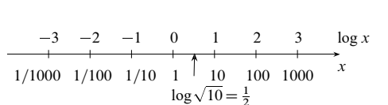

图中 $\log x=-3,-2,-1,0,1,2,3$ 依次对应 $x=1/1000,1/100,1/10,1,10,100,1000$；顺带还有 $\log\sqrt{10}=1/2$。

问：要是标出 $x=1,2,4,8$，会看到什么？答：照样等间距！

**双对数图**的横轴、纵轴都取对数刻度。若 $y=Ax^n$，怎样从图上读出 $A,n$？把 $\log x$ 作横坐标、$\log y$ 作纵坐标，图像就是一条直线

$$
\log y=\log A+n\log x.
$$

这条直线的斜率，就是指数 $n$。

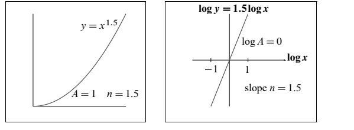

图里画的是 $y=x^{1.5}$，此处 $A=1$、$n=1.5$：$\log y=1.5\log x$，截距是 $\log A=0$，斜率是 $n=1.5$。

碰上 $y=Ab^x$，就改用半对数图：横轴取 $x$，纵轴取 $\log y$，同样得到直线 $\log y=\log A+x\log b$。


**一种新问题：**$\Delta x\to0$ 时，$\Delta f/\Delta x$ 逼近 $\mathrm{d}f/\mathrm{d}x$ 的速度有多快？误差

$$
E=\frac{\Delta f}{\Delta x}-\frac{\mathrm{d}f}{\mathrm{d}x}
\approx A(\Delta x)^n
$$

里的 $n$ 是多少？通常的单侧差商

$$
\frac{f(x+\Delta x)-f(x)}{\Delta x}
$$

只给出 $n=1$；换成中心差商

$$
\frac{f(x+\Delta x)-f(x-\Delta x)}{2\Delta x}
$$

就能拿到 $n=2$。中心差分比单侧差分好得多：误差一个约为 $(\Delta x)^2$，一个约为 $\Delta x$。

**小项目：**取 $f(x)=e^x$，在 $x=0$ 处把两种误差比一比。画出 $\log E$ 对 $\log\Delta x$ 的图像，应当看到斜率 1 或 2。

#### 练习题

1. 当 $x$ 很大时，$x^{100}$ 比 $e^x$ 增长得快，还是慢？
2. 当 $x$ 很大时，$100\ln x$ 比 $x$ 增长得快，还是慢？
3. 对足够大的 $n$，把 $1/n$、$n\log n$、$n^{1.1}$、$10^n/n!$ 从小到大排好。
4. 对足够大的 $x$，把 $2^{-x}$、$e^{-x}$、$1/x^2$、$1/x^{10}$ 从小到大排好。
5. 描述 $y=10x^5$ 的双对数图。为什么图上找不到 $x=0$ 对应的 $y=0$？直线的斜率是多少？它与纵轴相交时，$x=$______、$y=$______，此时 $\log x=0$、$\log y=$______；与横轴相交时，$x=$______、$y=1$，此时 $\log x=$______、$\log y=0$。
6. 画出 $y=10e^x$ 的半对数图，也就是 $\log y$ 对 $x$ 的图像；它会是一条直线。
7. 上一题那条直线在 $x=0$ 处的 $\log y$ 是多少？斜率又是什么？


### 11. 线性近似与牛顿法

从 $x=a$ 出发，高度 $f(a)$ 和斜率 $f'(a)$ 都已知。**关键思想：**当 $x$ 靠近 $a$ 时，

$$
f'(a)\approx\frac{f(x)-f(a)}{x-a}.
$$

切线斜率正是 $f'(a)$，从中解出 $f(x)$，便得到

$$
f(x)\approx f(a)+(x-a)f'(a).
$$

$\approx$ 表示“近似相等”；在 $x=a$ 附近，曲线就贴着这条直线走。

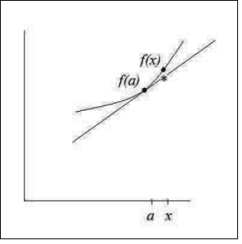

**例 1：**$f(x)=e^x$。在 $a=0$ 处，$f(0)=1$、$f'(0)=1$ 都已知。沿着切线近似，得到 $e^x\approx1+(x-0)\cdot1=1+x$——这正是 $e^x$ 级数里的线性部分。

**例 2：**$f(x)=x^{10}$，$f'(x)=10x^9$。在 $a=1$ 处，$f(1)=1$、$f'(1)=10$。于是在 $x=1$ 附近，$x^{10}\approx1+(x-1)10$。取 $x=1.1$，便算出 $(1.1)^{10}\approx1+1=2$。

**牛顿法：**要找的是让 $f(x)=0$ 近似成立的 $x$。还是从上面的差商近似出发，$f(a)$ 和 $f'(a)$ 照样已知。令函数值为零，就能解出

$$
x-a\approx-\frac{f(a)}{f'(a)}.
$$

牛顿法拿切线与横轴的交点，去近似曲线与横轴的交点。

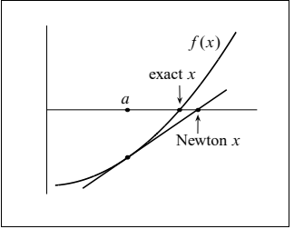

图内文字：exact $x$，精确根；Newton $x$，牛顿法得到的近似根。


**牛顿法的例子：**解 $f(x)=x^2-1.2=0$。

1. 取 $a=1$，得 $f(a)=1-1.2=-0.2$，$f'(a)=2a=2$。切线与横轴交于 $x-1=-(-0.2)/2$，于是牛顿法给出 $x=1.1$。
2. 想要更好的近似，就从 $a=1.1$ 再来一次。此时 $f(a)=1.1^2-1.2=0.01$、$f'(a)=2.2$。新的切线给出 $x-1.1=-0.01/2.2$。这个 $x$ 的平方，已经非常接近 1.2。

#### 练习题

1. $y=f(a)+(x-a)f'(a)$ 的图像是一条 ______。在 $x=a$ 处，高度 $y=$______，斜率 $\mathrm{d}y/\mathrm{d}x=$______；这条直线与 $f(x)$ 的图像在 $x=a$ 处 ______。取 $f(x)=x^2$、$a=3$，线性近似便是 $y=$______。
2. 当 $x-a=$______ 时，上式中的 $y=0$。牛顿法让切线与横轴相交，而不是曲线。取 $f(x)=x^3-8.12$、$a=2$，先算 $f(a)=$______、$f'(a)=3a^2=$______。牛顿法给出 $x-2=-f(a)/f'(a)=$______。所得 $x=2.01$ 近似满足 $x^3=8.12$；实际上 $(2.01)^3=$______。

### 12. 描述增长的微分方程

$$
\frac{\mathrm{d}y}{\mathrm{d}t}=cy,
\qquad\text{通解 }y(t)=Ae^{ct},
$$

这里 $A$ 是任意常数。给定初始值 $y(0)$，就有 $y(t)=y(0)e^{ct}$，也就是取 $A=y(0)$。

再添一个常数源项 $s$，方程变成

$$
\frac{\mathrm{d}y}{\mathrm{d}t}=cy+s.
$$

$s>0$ 表示储蓄流进来，$s<0$ 表示支出，$cy$ 是利息。通解是

$$
y(t)=-\frac sc+Ae^{ct}.
$$

任取一个 $A$，都得到一个解。$y=-s/c$ 是常数解：此时 $cy+s=0$、$\mathrm{d}y/\mathrm{d}t=0$、$A=0$，支出与利息收入恰好平衡。再挑 $A$ 去满足初值，得到

$$
y(t)=-\frac sc+\left(y(0)+\frac sc\right)e^{ct}.
$$


现在加入来自竞争的非线性项 $sP^2$。拿世界人口作例子，用 $P(t)$ 表示人口，考虑新方程

$$
\frac{\mathrm{d}P}{\mathrm{d}t}=cP-sP^2,
$$

其中 $c$ 是出生率减去死亡率。这个方程叫“逻辑斯谛方程”；$P^2$ 则反映个体之间两两相争。

要把它化回线性方程，就令 $y=1/P$。于是

$$
\frac{\mathrm{d}y}{\mathrm{d}t}
=-\frac{\mathrm{d}P/\mathrm{d}t}{P^2}
=\frac{-cP+sP^2}{P^2}
=-\frac cP+s=-cy+s.
$$

这一换，方程里不再有 $y^2$，代价是系数变成了 $-c$。把旧解里的 $c$ 换成 $-c$，便得到

$$
y(t)=\frac sc+Ae^{-ct}
=\frac sc+\left(y(0)-\frac sc\right)e^{-ct}.
$$

$t=0$ 时，代回去正好得到 $y(0)$。当 $t\to\infty$、$e^{-ct}\to0$ 时，取极限得 $y(\infty)=s/c$、$P(\infty)=c/s$。人口沿着一条 S 形曲线往上走，越来越靠近 $c/s$。

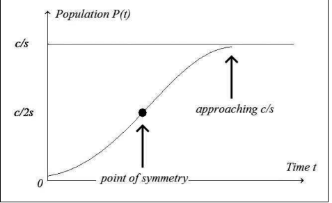

图内文字：Population，人口；Time，时间；approaching $c/s$，趋近 $c/s$；point of symmetry，对称中心。

到了 $P=c/(2s)$，$P''=0$，曲线出现拐点，弯曲方向由向上转为向下。检验一下：

$$
\frac{\mathrm{d}^2P}{\mathrm{d}t^2}
=\frac{\mathrm{d}}{\mathrm{d}t}(cP-sP^2)
=(c-2sP)\frac{\mathrm{d}P}{\mathrm{d}t},
$$

它在 $P=c/(2s)$ 处正好为零。**在这个模型中**，世界人口会趋近 $c/s\approx120$ 亿。现在人口约为 70 亿，试试用 Google 搜索“World population”。


#### 练习题

下面的练习改用 $\mathrm{d}y/\mathrm{d}t=cy-s$：带负号的 $s$ 是支出率，不再表示储蓄流入率。

1. 当 $\mathrm{d}y/\mathrm{d}t=0$ 时，常数解是 $y=$______。此时利息收入正好抵掉支出：$cy=s$。
2. 通解是 $y(t)=s/c+Ae^{ct}$。为什么 $A=y(0)-s/c$？
3. 若从 $y(0)>s/c$ 出发，财富为什么会奔向正无穷？若从 $y(0)<s/c$ 出发，又为什么会奔向负无穷？
4. $\mathrm{d}y/\mathrm{d}t=s$ 的通解是 $y(t)=st+A$。满足给定初值 $y(0)$ 的解是哪一个？
5. 若 $\mathrm{d}P/\mathrm{d}t=-sP^2$、$y=1/P$，请解释为什么 $\mathrm{d}y/\mathrm{d}t=s$。这是纯竞争模型。再证明 $t\to\infty$ 时 $P(t)\to0$。
6. 若 $\mathrm{d}P/\mathrm{d}t=cP-sP^4$，求 $y=1/P^3$ 所满足的线性方程。

### 13. 描述运动的微分方程

$y(t)$ 的微分方程里，可以同时出现 $\mathrm{d}y/\mathrm{d}t$ 和 $\mathrm{d}^2y/\mathrm{d}t^2$。比如下面几个，$C,D$ 取任意常数都行：

$$
y''=-y\quad\text{有解}\quad y=C\cos t+D\sin t,
$$

$$
y''=-\omega^2y\quad\text{有解}\quad y=C\cos\omega t+D\sin\omega t.
$$

现在再把一阶导数加进来，看看怎么解。方程

$$
m\frac{\mathrm{d}^2y}{\mathrm{d}t^2}
+2r\frac{\mathrm{d}y}{\mathrm{d}t}+ky=0
$$

里面有一项阻尼 $2r\,\mathrm{d}y/\mathrm{d}t$。不妨试 $y=e^{\lambda t}$，代进去得到

$$
m\lambda^2e^{\lambda t}+2r\lambda e^{\lambda t}+ke^{\lambda t}=0.
$$

两边约去 $e^{\lambda t}$，剩下关于 $\lambda$ 的关键方程 $m\lambda^2+2r\lambda+k=0$。再用求根公式，

$$
\lambda=\frac{-r\pm\sqrt{r^2-km}}m.
$$

两个根记作 $\lambda_1,\lambda_2$。这个微分方程的解是 $y=Ce^{\lambda_1t}+De^{\lambda_2t}$。特殊情形 $r^2=km$ 会给出重根，这时解里得补上一个因子 $t$：$y=Ce^{\lambda_1t}+Dte^{\lambda_1t}$。


**例 1：**$y''+6y'+8y=0$。这里 $m=1$、$2r=6$、$k=8$，所以 $\lambda=-3\pm\sqrt{9-8}$，即 $\lambda_1=-2$、$\lambda_2=-4$。

$$
y=Ce^{-2t}+De^{-4t}.
$$

这是过阻尼，不振荡。

**例 2：**改为 $k=10$。此时 $\lambda=-3\pm\sqrt{9-10}$，即 $\lambda_1=-3+i$、$\lambda_2=-3-i$。虚部管振荡，实部 $-3$ 管衰减。解为

$$
y=Ce^{(-3+i)t}+De^{(-3-i)t}.
$$

用 $e^{it}=\cos t+i\sin t$，得到

$$
y=(C+D)e^{-3t}\cos t+(C-D)e^{-3t}\sin t.
$$


**例 3：**改为 $k=9$，重根是 $\lambda=-3,-3$。解为 $y=Ce^{-3t}+Dte^{-3t}$，多出来的正是因子 $t$。

#### 练习题

1. 对 $y''=4y$，求形如 $y=Ce^{at}+De^{bt}$ 的解；$a,b$ 是多少？
2. 对 $y''=-4y$，求形如 $y=C\cos\omega t+D\sin\omega t$ 的解；$\omega$ 是多少？
3. 对 $y''=0y$，一个解为 $y=Ce^{0t}$，另一个是什么？
4. 将 $y=e^{\lambda t}$ 代入 $2y''+3y'+y=0$，求 $\lambda_1,\lambda_2$（实数）。
5. 将 $y=e^{\lambda t}$ 代入 $2y''+5y'+3y=0$，求 $\lambda_1,\lambda_2$（复数）。
6. 将 $y=e^{\lambda t}$ 代入 $y''+2y'+y=0$，求 $\lambda_1,\lambda_2$（相等的数）。此时 $y=Ce^{\lambda_1t}+Dte^{\lambda_1t}$；两根一相等，因子 $t$ 就冒出来了。


### 14. 幂级数与欧拉公式

在 $x=0$ 处，$x^n$ 的 $n$ 阶导数等于 $n!$，别的阶导数在该点都是零。把 $f$ 在零点的各阶导数分别乘上 $x^n/n!$，级数就能和函数逐阶对上：

$$
f(x)=f(0)+f'(0)\frac{x}{1}+f''(0)\frac{x^2}{2}
+\cdots+f^{(n)}(0)\frac{x^n}{n!}+\cdots.
$$

这就是**泰勒级数**。

**例 1：**$f(x)=e^x$ 的各阶导数在 $x=0$ 处全是 1，于是

$$
e^x=1+1\frac{x}{1}+1\frac{x^2}{2}+\cdots+1\frac{x^n}{n!}+\cdots.
$$

**例 2：**$f=\sin x$，一路求导：$f'=\cos x$、$f''=-\sin x$、$f'''=-\cos x$。在零点，这些值按 $0,1,0,-1,0,1,0,-1,\ldots$ 周而复始。于是

$$
\sin x=x-\frac{x^3}{3!}+\frac{x^5}{5!}-\cdots.
$$

级数里只剩奇次幂，正好对上 $\sin(-x)=-\sin x$。

**例 3：**$f=\cos x$ 在零点的值排成 $1,0,-1,0,1,0,-1,0,\ldots$，所以

$$
\cos x=1-\frac{x^2}{2!}+\frac{x^4}{4!}-\cdots.
$$

只剩偶次幂；这也对得上 $\mathrm{d}(\cos x)/\mathrm{d}x=-\sin x$。

虚数单位满足 $i^2=-1$、$i^3=-i$。用这些关系算 $e^{ix}$：

$$
\begin{aligned}
e^{ix}
&=1+ix+\frac{(ix)^2}{2!}+\frac{(ix)^3}{3!}+\cdots\\
&=\left(1-\frac{x^2}{2!}+\cdots\right)
+i\left(x-\frac{x^3}{3!}+\cdots\right)\\
&=\cos x+i\sin x.
\end{aligned}
$$

这就是**欧拉公式**。

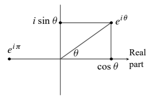

图内文字 Real part 即实部。图中的关系是

$$
e^{i\theta}=\cos\theta+i\sin\theta,
\qquad e^{i\theta}+e^{-i\theta}=2\cos\theta.
$$

$e^{i\pi}=-1$，一个式子把四个重要的数串在了一起。

再补两个幂级数，都是相应函数的泰勒级数：

$$
\frac1{1-x}=1+x+x^2+x^3+\cdots
\quad\text{（几何级数）},
$$

$$
-\ln(1-x)=\frac{x}{1}+\frac{x^2}{2}+\frac{x^3}{3}+\frac{x^4}{4}+\cdots
\quad\text{（几何级数逐项积分）}.
$$


### 15. 总结：六个函数、六条法则、六个定理

| 积分 | 六个函数 | 导数 |
| --- | --- | --- |
| $x^{n+1}/(n+1)$，$n\ne-1$ | $x^n$ | $nx^{n-1}$ |
| $-\cos x$ | $\sin x$ | $\cos x$ |
| $\sin x$ | $\cos x$ | $-\sin x$ |
| $e^{cx}/c$ | $e^{cx}$ | $ce^{cx}$ |
| $x\ln x-x$ | $\ln x$ | $1/x$ |
| 斜坡函数 | 阶跃函数 | 狄拉克 $\delta$ |

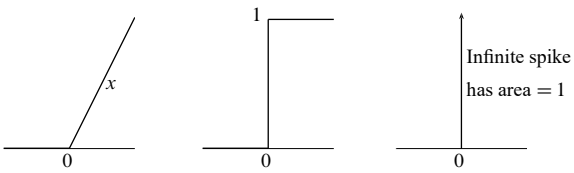

图内文字：无限高的尖峰，面积为 1。

#### 微分学的六条法则

1. **和：**$af(x)+bg(x)$ 的导数是 $a\,\mathrm{d}f/\mathrm{d}x+b\,\mathrm{d}g/\mathrm{d}x$。
2. **乘积：**$f(x)g(x)$ 的导数是 $f(x)\,\mathrm{d}g/\mathrm{d}x+g(x)\,\mathrm{d}f/\mathrm{d}x$。
3. **商：**$f(x)/g(x)$ 的导数是 $\bigl(g\,\mathrm{d}f/\mathrm{d}x-f\,\mathrm{d}g/\mathrm{d}x\bigr)/g^2$。
4. **链式：**$f(g(x))$ 的导数是 $(\mathrm{d}f/\mathrm{d}y)(\mathrm{d}y/\mathrm{d}x)$，其中 $y=g(x)$。
5. **反函数：**$x=f^{-1}(y)$ 的导数是 $\mathrm{d}x/\mathrm{d}y=1/(\mathrm{d}y/\mathrm{d}x)$。
6. **洛必达法则：**当 $x\to a$ 时 $f(x)\to0$、$g(x)\to0$，那么 $f(x)/g(x)$ 呢？如果以下极限存在，

$$
\lim_{x\to a}\frac{f(x)}{g(x)}
=\lim_{x\to a}\frac{f'(x)}{g'(x)}.
$$

通常它就是 $f'(a)/g'(a)$。

#### 微积分基本定理

若 $f(x)=\int_a^x s(t)\,\mathrm{d}t$，那么积分的导数就是 $f'(x)=s(x)$。反过来，若 $f'(x)=s(x)$，导数的积分则是

$$
\int_a^b s(x)\,\mathrm{d}x=f(b)-f(a).
$$

两部分都假定 $s$ 连续。

#### 连续函数的取值定理

设 $f(x)$ 在闭区间 $a\leq x\leq b$ 上连续，那么它在该区间一定取到最大值 $M$ 和最小值 $m$，而且 $m$ 与 $M$ 之间的每个值都取得到，一个也不跳过。


#### 中值定理

若 $f(x)$ 在 $a\leq x\leq b$ 上有导数，那么对 $a$ 与 $b$ 之间的某个 $c$，有

$$
\frac{f(b)-f(a)}{b-a}=f'(c).
$$

“在某个时刻 $c$，瞬时速度等于平均速度。”

#### 泰勒级数

在展开点 $x=a$ 处，让各阶导数 $f^{(n)}=\mathrm{d}^nf/\mathrm{d}x^n$ 逐一匹配：

$$
f(x)=f(a)+f'(a)(x-a)+\tfrac12f''(a)(x-a)^2+\cdots
=\sum_{n=0}^{\infty}\frac{f^{(n)}(a)}{n!}(x-a)^n.
$$

只截到 $(x-a)^n$ 这一项，剩下的余项是

$$
\frac{f^{(n+1)}(c)}{(n+1)!}(x-a)^{n+1},
$$

其中 $c$ 落在 $a$ 与 $x$ 之间。$n=0$ 时，它就是中值定理。 当 $a=0$ 时形式最干净：$f(x)=\sum_{n=0}^{\infty}f^{(n)}(0)x^n/n!$。

#### 二项式定理与帕斯卡三角形

$$
\begin{aligned}
(1+x)&=1+x,\\
(1+x)^2&=1+2x+x^2,\\
(1+x)^3&=1+3x+3x^2+x^3,\\
(1+x)^4&=1+4x+6x^2+4x^3+x^4.
\end{aligned}
$$

这正是 $p=1,2,3,4$ 时 $f(x)=(1+x)^p$ 的泰勒展开。各阶导数依次是

$$
(1+x)^p,\quad p(1+x)^{p-1},\quad
p(p-1)(1+x)^{p-2},\quad\ldots;
$$

在零点，它们的值依次是 $1,p,p(p-1),\ldots$。再除以 $n!$，就得到泰勒系数，也就是二项式系数：

$$
\frac{f^{(n)}(0)}{n!}
=\frac{p(p-1)\cdots(p-n+1)}{n(n-1)\cdots1}
=\frac{p!}{(p-n)!n!}=\binom pn.
$$

当 $p=n$ 时，级数到 $x^n$ 就停；对于其他 $p$，则是无穷级数：

$$
(1+x)^p
=1+px+\frac{p(p-1)}{2\cdot1}x^2
+\frac{p(p-1)(p-2)}{3\cdot2\cdot1}x^3+\cdots.
$$


#### 练习题

1. 验证 $y=x\ln x-x$ 的导数确实是 $\mathrm{d}y/\mathrm{d}x=\ln x$。
2. “符号函数”是

$$
S(x)=\begin{cases}1,&x\geq0,\\-1,&x<0.\end{cases}
$$

哪个斜坡函数 $F(x)$ 能满足 $\mathrm{d}F/\mathrm{d}x=S(x)$？$F$ 就是 $S$ 的积分。那么为什么 $\mathrm{d}S/\mathrm{d}x=2\delta(x)$，也就是零点处一块面积为 2 的无限尖峰？

3. 用洛必达法则求 $x\to0$ 时 $(2x+3x^2)/(5x+7x^2)$ 的极限。$x\to\infty$ 时又如何？
4. 当 $f(0)=0$ 时，洛必达法则给出 $\lim_{x\to0}f(x)/x=$______，其中 $g(x)=x$。
5. 求导好比作差，积分好比求和。先说“和的差”：若 $f_n=s_1+s_2+\cdots+s_n$，$f_n-f_{n-1}$ 是多少？再看“差的和”：$(f_1-f_0)+(f_2-f_1)+\cdots+(f_n-f_{n-1})$ 是多少？这两条就是“差分微积分”的基本定理。
6. 在 $0\leq x\leq1$ 上画一个不连续函数，让它取不到最大值。
7. 对 $f(x)=x^2$，哪个位于 1 与 5 之间的 $c$ 满足 $(f(5)-f(1))/(5-1)=f'(c)$？
8. 若你在马萨诸塞州收费高速公路上的平均速率是 75，那么至少在某一刻，速率表读数会是 ______。
9. 求 $\sqrt{1+x}$ 在 $x=0$ 处的前三个泰勒系数 $A,B,C$：$(1+x)^{1/2}=A+Bx+Cx^2+\cdots$。
10. 求 $f=1/(1+x)$ 在 $x=0$ 处的泰勒级数，即二项式级数（$p=-1$）。

## 0.5 函数图像与图形计算器


本书开头就说：“微积分研究函数。”函数由 $y=x+x^2$ 这样的公式给出时，我们已经会求斜率，连斜率的斜率也会求。可要是手里只有一张大致的函数图像，能指望的，也只是一张大致的斜率图像。不过，在微积分的应用里，图像的价值可太大了！

本节要从 $y(x)$ 的图像里，提取几样基本信息：增长速率（也就是斜率）、极小值与极大值、弯曲方向，还有面积。这些信息很大一部分，只靠一个正号或负号就能表示。$y(x)$ 在递增吗？它的斜率在递增吗？图像下方的面积在增加吗？每一种情形，都对应某个量大于零。这三个量依次是 $\mathrm{d}y/\mathrm{d}x$、$\mathrm{d}^2y/\mathrm{d}x^2$ 和 $y(x)$ 本身。

其中某个量恰好为零时，情形总是格外值得注意。幸好数学发明了零——我们还真少不了它。

本节围绕两个主题展开：

1. **没有 $y(x)$ 公式的图像。**给你一张图，就照着它画出别的图：斜率 $\mathrm{d}y/\mathrm{d}x$、二阶导数 $\mathrm{d}^2y/\mathrm{d}x^2$、图像下方的面积函数 $A(x)$。还能看出这些函数在哪里为正、在哪里为负，尤其能找出一阶导数、二阶导数或函数值为零的点。
2. **由计算器或计算机画出的图像。**这时 $y(x)$ 的公式已经握在手里。屏幕上的图形能帮我们猜出链式法则、反函数求导法则和洛必达法则。这几条法则要到后面章节才讲，面向所有人的“微积分要点”视频里也有解释。一个具体目标，是看出 $2^x$ 的导数与 $2^x$ 成正比。

本节能有这么大改进，多亏本杰明·戈尔茨坦（Benjamin Goldstein）提出的想法。

### 不给公式的图像


1. 设上图是某个函数 $y(x)$ 的图像。

   a. 在哪些 $x$ 处，$y(x)$ 取得局部极小值？

   b. 在哪些 $x$ 处，$y(x)$ 取得局部极大值？

   c. 在哪些 $x$ 处，图像有拐点？给出估计。

2. 换个问法：假设上图是 $y(x)$ 的导数 $\mathrm{d}y/\mathrm{d}x$ 的图像，回答关于原函数 $y(x)$ 的问题。

   a. 在哪些 $x$ 处，原函数取得局部极小值？

   b. 在哪些 $x$ 处，原函数取得局部极大值？

   c. 在哪些 $x$ 处，原函数的图像有拐点？

3. 再换一种：假设上图是二阶导数 $\mathrm{d}^2y/\mathrm{d}x^2$ 的图像，也就是斜率的斜率。下面若有问题回答不了，请说明原因。

   a. 在哪些 $x$ 处，原函数取得局部极小值？

   b. 在哪些 $x$ 处，原函数取得局部极大值？

   c. 在哪些 $x$ 处，原函数的图像有拐点？

4. 对下面第二幅图，回答同样的九个问题。


5. 下表给出一辆汽车在若干时刻的速度：

| 时间 | 0 | 5 | 10 | 15 | 20 | 25 | 30 | 35 |
| --- | --- | --- | --- | --- | --- | --- | --- | --- |
| 速度 | 45 | 40 | 30 | 40 | 45 | 40 | 30 | 25 |

   a. 是否存在某个时刻 $t$，汽车的加速度 $\mathrm{d}^2y/\mathrm{d}t^2=0$？说明理由。

   b. 若 $y(t)$ 表示汽车的位置，是否曾有某个时刻满足 $\mathrm{d}^3y/\mathrm{d}t^3=0$？说明理由。位置的三阶导数有时叫“加加速度”（jerk），因为它表示运动的颠簸程度；这对过山车设计者很重要。

   c. 回答 a、b 时，你对 $y(t)$，尤其是对 $\mathrm{d}y/\mathrm{d}t$ 作了哪些假设？这些假设合理吗？


### 在计算器上观察链式法则

**a.** 在计算器上画出 $Y_1=\sin(X)$，再画出它的斜率 $Y_2=\operatorname{nDeriv}(Y_1,X,X)$。确认处在弧度模式，并选好适合三角函数的视窗。

1. $Y_2$ 看起来像什么函数？
2. 把 $Y_1$ 改成 $\sin(2X)$。这回 $Y_2$ 看起来像什么函数？把真正的导数画出来，检验你的猜测。
3. 最后，把 $Y_1$ 改成 $\sin(3X)$。这次 $Y_2$ 看起来像什么？
4. 猜一猜：若 $k$ 为常数，$\sin(kx)$ 的导数是 ______。

**b.** 这些函数都是复合函数，可以写成 $Y=f(g(x))$。对 $\sin(kx)$ 来说，外层函数 $f(x)=$______，内层函数 $g(x)=$______。

**c.** 到目前为止，内层函数都是线性的——可它不必是。令 $Y=\sin\sqrt x$。猜一猜：当 $g(x)=\sqrt x$ 时，$\mathrm{d}Y/\mathrm{d}x=$______。画出 $Y$ 的图像，与数值导数的图像比较，检验你的猜想。

**d.** 现在推广一步。设 $g(x)$ 是任意函数，若 $y=\sin(g(x))$，则 $\mathrm{d}y/\mathrm{d}x=$______。

**e.** 正弦函数在这儿并不特殊。只要函数是由外层、内层复合起来的，就能用链式法则。先预测下列导数，再用计算器画出数值导数，比比看：

1. $y=(2x+4)^3$，$\mathrm{d}y/\mathrm{d}x=$______。
2. $y=\cos^2x=(\cos x)^2$，$\mathrm{d}y/\mathrm{d}x=$______。
3. $y=\cos(x^2)$，$\mathrm{d}y/\mathrm{d}x=$______。
4. $y=[\sin(x^2+1)]^3$，$\mathrm{d}y/\mathrm{d}x=$______。

### 微积分中的计算

可用于微积分课程的软件很多，而且还在不断变好。用哪一种，或者用不用，取决于费用、便利程度和目的。更难的问题是：怎么用。下面几页列出一些目标，也希望借例子说明，怎样让计算工具帮着学。

对微积分来说，**计算机最大的好处，是能画出图形。**你看到的不只是公式，还有函数的图像。$f(x)$ 什么时候到最大值、最小值或零点，你看得见；它的导数，也能单独画出来。当然，这些说法并非百分之百可靠——随便输几个函数，大家立刻就会发现。可图形的好处在于能调：画面不满意，换一个视窗就是。正因如此，它才成了认识这门学科的强大工具。

这就是计算机绘图：数值计算与图形处理合在一起，图像和数值一起给你。计算机让你真正动手，和函数打交道。定义域和值域不再只是抽象概念——它们由你来选。请让我举几个例子。


**例 1：**当 $x=3$ 时，$x^3=3^x$ 当然成立。这两条图像还会再次相交吗？

到这儿为止，除了 $x$ 取好算的数，我们对 $3^x$ 的含义还不甚了了。（计算机也一样。）代 $x=2$ 和 $x=4$ 试试，两处都是 $x^3$ 更小：$2^3<3^2$，$4^3=64<3^4=81$。要是 $x^3$ 始终小于 $3^x$，这事我们总该知道——毕竟它们都是数学里的基本函数。

计算机能给出数值答案，也能给出图形答案。一条指令解 $x^3=3^x$；另一条指令把两个函数一起画出来，信息更多。屏幕证明了一个我们先前没有注意到的逻辑（或数学）事实：两条图像既然相交过一次，就一定会再相交一次——因为在 2 和 4 两处，$3^x$ 都更高。放大一看，交点大约在 2.5 附近。精确的那个数，我倒不太在意；我在意的是它的位置：在 $x=3$ 之前，不是之后。

这么基本的例子，也能引出几条认识：

1. 不必动用超级计算机。
2. 不必写高深的程序。
3. 不必全弄明白，也能做数学。

第三点听着不太妙，换个说法：**数学可以在做的过程中学。**教微积分最难的一关，是让学生从看客变成下场动手的人，计算机让这件事成为可能。

**例 2（心算）：**比较 $x^2$ 与 $2^x$。$x=2$ 时两者相等；另一个交点在哪？在 2 之前，还是之后？

这题可以心算，因为答案碰巧是个整数：4。现在换条路走：$2^4=4^2$ 这样的巧事还会再发生吗？机器能告诉我们哪些关于整数的事？也许它能画出 $x^b=b^x$ 的解。我向 Mathematica 要一个公式，想把 $x$ 表成 $b$ 的函数，程序却把原方程原样奉还。这一次，输入 HELP 的是机器，而不是用户。

不过，数学不会就此没辙。我为微积分自豪。第 6.4 节末尾新添了一道练习，说明这样的整数解不会再有。

**例 3：**求一个数 $b$，让 $x^b=b^x$ 只有一个解，就是 $x=b$。

$b=3$ 时，第二个解小于 3；$b=2$ 时，第二个解是 4，大于 2。$b$ 从 2 挪到 3，中间必然出现一个特殊的“重合点”：两条图像只是相切，并不穿过。对这个特殊的 $b$——也只对这个值——曲线 $x^b$ 从不高于 $b^x$。

这个特殊值，可以用计算机绘图找出来。从许多方面看，它就是微积分的“中心点”。两条曲线只相碰、不穿过，所以在重合点相切，斜率相同。微积分本来就是为研究斜率而生的。$x^2$ 的斜率我们已经知道，$x^b$ 的斜率很快也会知道；最后还能求出 $b^x$ 的斜率，认出微积分里最重要的那个数。

关键在于：它可以先靠实验发现。

**例 4：**画出 $y(x)=e^x-x^e$，找到最小值点，在 $x=e$ 附近放大。利用两个函数的导数，证明此处 $\mathrm{d}y/\mathrm{d}x=0$。再往下试，还能求出二阶导数；你能看出它在 $x=e$ 处为什么大于零吗？


下一个例子由唐·斯莫尔（Don Small）提出：解 $x^4-11x^3+5x-2=0$。第一件工具是代数——试着把多项式因式分解。二次式上这招很灵，次数再高就难上加难。就算计算机的代数比我们强，因式分解通常也不是首选。实际上有两条好路子：

1. **数学方法：**用导数，按牛顿法求解。
2. **图形方法：**把函数画出来，再放大细看。

两种方法都交给计算机去做，也都各有隐患。牛顿法快，可快也意味着它可能很快失手——虽然它通常出色得很。绘图也快，但解可能落在视窗之外。在标准横向视窗 $[-10,10]$ 里，这个函数只有一个零点。图像看着像要远离横轴，数学却再一次预言还有第二个交点。所以，得先缩小视图、把范围放开，再放大局部。

**缩放是绘图里最有用的功能。**我们不仅选择定义域和值域，还改变它们。视窗由四个数控制：可以是 $A\leq x\leq B$、$C\leq y\leq D$；可以是一对对角顶点的坐标 $(A,C)$、$(B,D)$；也可以是中心 $(a,b)$ 和缩放系数 $c,d$。最快的办法，是点一下缩放框的两个对角点——除非中心不动、只需给出缩放系数；用默认系数还要更快。第 3.4 节会讲居中变换和缩放变换：它们改的是屏幕上的画面，对应的却是函数内部的变量变换。

**例 5：**求出 $x^4-11x^3+5x-2=0$ 的全部实数解。

**例 6：**把 $y=\cos40x$ 和 $y=x\sin(1/x)$ 的图像反复缩小、放大，说说你看到了什么。

**例 7：**$x\to0$ 时，$y=(\tan x-\sin x)/x^3$ 趋于什么？$x$ 一小再小，机器终究分不清 $\tan x$ 与 $\sin x$，可能干脆给出 $y=0$。你能不能足够靠近零，看出 $x\to0$ 时 $y$ 的极限？

### 符号计算

在符号计算里，答案可以是数值、图像，也可以是公式。$y=x^2$ 的导数，屏幕上是“$2x$”；$\sin t$ 的导数是“$\cos t$”；$b^x$ 的斜率，程序也知道。计算机不再只是把数往公式里代，它直接拿公式做运算。它在微积分学习里该占什么位置，值得我们想一想。

某种意义上，符号计算很接近我们自己动手做的事——也许太接近了：我们有可能只会摆弄符号。有高级语言、有足够的计算力，计算机就能印出 $\sin(x^2)$ 的导数。那为什么还要学链式法则？因为数学比“拿公式做代数”更深一层，它讲的是思想。

我要把话说清楚：**数学不是公式，不是计算，甚至不是证明，而是思想。**符号和图像是它的语言。教材、教师、计算机，可以一起来教。计算机不应让人感到畏惧，就像这本书和你的老师一样；你可以按自己的节奏学。你要做的，是在动手中理解。


**例 8：**计算机代数系统转眼就能算出 $100!=100\cdot99\cdot98\cdots1$。这个数有 158 位，这里不把它全写出来；最后 24 位全是零。$10!=3628800$ 有七位，末尾两个零。在 10 和 100 之间，甚至更大的范围里，有些问题看着简单，真要做却得有想法：

1. $N!$ 大约有多少位十进制数字？
2. $N!$ 的末尾恰好有多少个零？

问题 1：$N=100$ 时，计算机显示的位数比 $N$ 还多。位数不会超过 $N^2$，因为 $N$ 个因子，每个都不超过 $N$ 位。$2N$ 是个紧得多的候选上界——可它成立吗？$N!$ 的位数总小于 $2N$ 吗？

问题 2：$10!$ 末尾的两个零不难解释：一个来自因子 10，另一个来自 $5\times2$——10 本身也就是 $5\times2$。那 $100!$ 末尾的 24 个零，你能解释吗？纸牌游戏二十一点里的一招，在这里也用得上：数一数因子 5。

难题：$200!$ 的末尾有多少个零？

**微积分中的写作。**请允许我强调一下写作的分量。答案如果只是一个数，最要紧的东西就被我们整个错过了。一页报告，对老师和学生都更费劲，却也更有价值。写完整句子，就非把自己的想法理清不可——而你自身的一部分也融入其中。

我建议来一个二选一的写作练习。能用计算机绘图的，就把前面的例 1–4 做一遍，写份报告；没有计算机的，就从书里挑一段你觉得该讲得更清楚的话，把它改清楚，再补上例子。开头点出核心思想，中间解释，结尾换个说法再回到它。思想就像曲面，从许多角度看都行。

数学可以靠交谈和写作来学——它是人的活动。我们的目标是教与学，不是考试。

# 第 1 章　微积分导论

## 1.1 速度与距离


微积分教材最恰当的开头，就是微积分本身。本章一开头就直奔两个问题——当初发明这门学科，就是为了解决它们。你会看到问题是什么，也会看到答案里重要的一部分。其他章节还留着许多好内容——何不现在就开始？

先从每个开车的人都熟悉的例子讲起。这是正在发生的微积分——开车的人亲眼看得见。例子就是速率表与里程表的关系：一个测速率（或速度），另一个测已经跑过的路程。用 $v$ 表示速度，$f$ 表示汽车走了多远。两个仪表并排装在仪表板上：

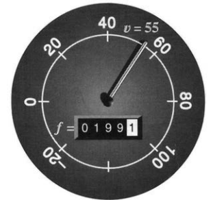

**图 1.1** 某一时刻的速度 $v$ 与总距离 $f$。

注意，$v$ 和 $f$ 的单位不一样。距离 $f$ 用千米或英里计量——说“英里”省事些；速度 $v$ 用千米每小时或英里每小时计量。速度的单位里有时间，距离的单位里没有。所以，凡是从 $f$ 算 $v$ 的公式，都要把距离除以时间。

**微积分的核心问题，是 $v$ 与 $f$ 之间的关系。**


知道 $f$，能不能求出 $v$？反过来呢？怎么求？只要手里有汽车从头到尾的完整速度记录，总行程就应当算得出来。换句话说，速率表记录完整、里程表却丢了，那份里程信息也能找回来。一个不用微积分的办法，是装一只新里程表，按原来的速率把整段路重开一遍。这听着就累，微积分也许省事。可要点在于：信息本来就在。只要关于 $v$ 的事全知道，就一定有办法求出 $f$。

反过来，已知 $f$，又怎样？手里有完整的距离记录，能不能还原完整的速度记录？原则上可以再开一趟车，把原来的行程重演一遍，一路读出速度。不过，显然也该有更好的办法。

整个微积分都建立在 $v$ 与 $f$ 的关系上。我们在这里提的问题，不是先开个玩笑，笑完了，书再认真，数学才开始。恰恰相反：我现在就是认真的，数学已经开始了。我们要从距离记录求出速度，这叫**求导**，是微分学的核心思想；也想从速度的完整历史算出距离，这叫**积分**，是积分学的目标。

求导从 $f$ 到 $v$，积分从 $v$ 到 $f$。先看几对能直接算、也容易看懂的函数。

### 恒定速度

假设速度固定为 $v=60$ 英里/小时，$f$ 就按这个恒定速率往上加。两小时后，$f=120$ 英里；四小时后，$f=240$ 英里；$t$ 小时后，$f=60t$。我们说 $f$ 随时间线性增加，它的图像是一条直线。

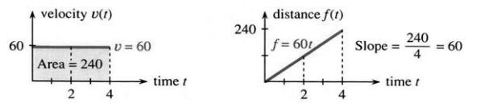

**图 1.2** 恒定速度 $v=60$ 与线性增加的距离 $f=60t$。图内文字：velocity 为速度，distance 为距离，time 为时间，Area 为面积，Slope 为斜率。

这个例子里，汽车一上来就达到给定速度，不花一点时间加速；速度是个“阶跃函数”。距离也从零开始——车是新的。这样安排，两张图都尽可能简单：一张是水平线 $v=60$，一张是斜直线 $f=60t$。它们的关系只需要代数，不需要微积分：

**若 $v$ 恒定，且 $f$ 从零开始，则 $f=vt$。**

反过来也成立：$f$ 线性增加，$v$ 就恒定。除以时间，就得到斜率。$t_1=2$ 小时时，$f_1=120$ 英里；$t_2=4$ 小时时，$f_2=240$ 英里。两处的比值 $f/t$ 都是 60 英里/小时。从几何上看，速度就是距离图像的斜率：

$$
\text{斜率}=\frac{\text{距离变化量}}{\text{时间变化量}}
=\frac{vt}{t}=v.
$$


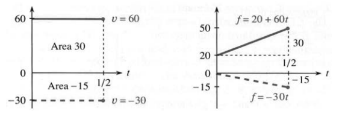

**图 1.3** 直线 $f=20+60t$ 的斜率为 60，直线 $f=-30t$ 的斜率为 $-30$。图中 Area 表示面积。

$f$ 图像的斜率给出 $v$ 的图像。图 1.3 还展示了两种可能：

1. 初始值从 0 挪到 20，距离公式便由 $60t$ 变成 $20+60t$。算距离变化量时，常数 20 正好抵消，所以斜率还是 60。
2. 当 $v$ 为负时，$f$ 的图像往下走。汽车倒车，$f=-30t$ 的斜率就是 $v=-30$。

我想，速率表大概不会显示负数。可倒车时盯着它看，实在不太安全。丰田那边说，车速够快时，仪表量的是“绝对值”：速度为 $-30$，显示 $+30$。至于里程表，据我所知，它只会停住不动；它本该往回走。[原注 1]

### 速度与距离：斜率与面积

怎样由 $v$ 算出 $f$？问题的要害，是从图像上看出 $f=vt$。我们想从 $v$ 的图像出发，去发现 $f$ 的图像。奇妙的是，求斜率的反面竟是求面积。

**距离 $f$ 等于 $v$ 图像下方的面积。**$v$ 恒定时，下方那块区域是矩形，高为 $v$、宽为 $t$，面积就是 $vt$。靠算面积从 $v$ 走到 $f$，这就是积分。我们由此瞥见了微积分的两个核心事实：

> **1A**　$f$ 图像的斜率给出速度 $v$；$v$ 图像下方的面积给出距离 $f$。

这当然不是一眼就能看出来的——我犹豫了很久，才决定在第一节就写下它。要理解它，最好的办法是先多看几个例子。微积分的全部要害，正是要处理并不恒定的速度；从这会儿起，$v$ 要取不同的值了。

**例（前进与返回）：**有一种运动，你一听就懂。汽车以速度 $V$ 前进，再以相同速率返回——说得更准确些，返回时速度是 $-V$。前进一直持续到 $t=3$，返回持续到 $t=6$，汽车就回到出发的地方。两段走完，总距离为 $f=0$。

**原注 1：**电影《Ferris Bueller’s Day Off》中确有这样的情节：主人公借用了父亲的跑车，增加了里程。回家后，他把车架起来，挂倒挡运行。我忘了这样是否奏效。


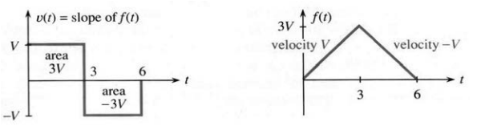

**图 1.4** 速度 $+V$ 与 $-V$ 分别对应前进与返回，最终 $f(6)=0$。图内 $v(t)=\text{slope of }f(t)$ 表示速度等于距离图像的斜率；area 表示面积。

$v$ 图像上是两个速度 $+V$ 和 $-V$。$f$ 起初按斜率 $+V$ 往上爬，达到 $3V$；接着汽车往回开，$f$ 按斜率 $-V$ 往下掉，到 $t=6$ 回到零。

想想这意味着什么：$v$ 图像“下方”的总面积竟然是零！负速度把距离图像往下拉，也就是斜率为负；车正在后退。**$v$ 图像在横轴下方的面积，算作负值。**

### 函数

这个往返的例子，正好帮我们弄懂一个极要紧的概念：函数。机会难得，就趁现在把它讲清楚。

**数 $v(t)$ 是函数 $v$ 在时刻 $t$ 的值。**

时间 $t$ 是输入，对应的速度 $v(t)$ 是输出。$v(t)$ 读作“$v$ 在 $t$ 处的值”；$v(2)$ 就是 $t=2$ 时的速度。往返例子里，$v(2)=+V$、$v(4)=-V$。函数装着整段历史，像个记忆库，每个时刻的 $v$ 都有记录。

把往返运动写成公式，很简单：

$$
v(t)=\begin{cases}
+V,&0<t<3,\\
?,&t=3,\\
-V,&3<t<6.
\end{cases}
$$

右边给出了求 $v(t)$ 的规则：把输入 $t$ 转成输出 $+V$ 或 $-V$。速度依赖于时间。这时函数是“不连续”的：指针在 $t=3$ 猛地一跳，速度在那个瞬间没有定义，也没有 $v(3)$。你也许认为跳变时速度该为零，可那样会惹麻烦：$f$ 的图像有一个折角，没法给出它在那里的斜率。

这道题里还有第二个函数，即距离。$f(t)$ 背后的原则一样：$f(t)$ 是时刻 $t$ 的距离。它是向前的净距离，规则同样在 $t=3$ 处改变。前进时 $f(t)=Vt$；返回那半段，公式里得先算一步：

$$
f(t)=\begin{cases}
Vt,&0\leq t\leq3,\\
V(6-t),&3\leq t\leq6.
\end{cases}
$$

切换的那一刻，两行都在给规则。这本来可能造成矛盾，可这里两者一致：$f(3)=3V$。[原注 2] $f$ 连续——$v$ 跳，$f$ 却不跳。$t>3$ 之后，$-Vt$ 把 $f$ 往下拉；到 $t=6$，第二条规则正确地给出 $f(6)=0$。

**原注 2：**每个输入时刻 $t$ 只能对应一个函数值 $f(t)$ 或 $v(t)$。


还有一点也该注意：先有图像，后有公式。图像把每个时刻的 $f$ 与 $v$ 都告诉你，有时比公式还清楚。函数值也可以用表格、方程或一组指令给出。某种意义上，所有函数都是规则，说明在时刻 $t$ 怎样得到 $f$。了解一个函数，还包括了解它的全部输入与输出，也就是定义域和值域。

**定义域是输入的集合，值域是输出的集合。**

$f$ 的定义域是所有 $0\leq t\leq6$，值域是所有 $0\leq f(t)\leq3V$；$v$ 的值域里只有 $+V$ 与 $-V$。

这里先提一句，后面还会重复：每个“线性”函数都能写成 $f(t)=vt+C$。图像是一条直线，$v$ 是斜率；常数 $C$ 让直线上下平移，好经过任何想要的初始点。

### 小结：关于函数的进一步说明

让我把这个例子引出的想法归拢一下：我们有两个函数 $v,f$，一个表示速度，一个表示距离。每个函数都有定义域、值域，尤其有图像。看 $f$ 的图像，我们研究斜率，它跟 $v$ 一致；看 $v$ 的图像，我们研究面积，它跟 $f$ 对应。微积分成对地产生函数，而一本教材开头最能帮上忙的，就是多展示这样的函数对。

$$
\begin{aligned}
\text{输入 }t&\longrightarrow\text{函数 }f\longrightarrow\text{输出 }f(t),\\
\text{输入 }2&\longrightarrow\text{函数 }v\longrightarrow\text{输出 }v(2),\\
\text{输入 }7&\longrightarrow f(t)=2t+6\longrightarrow f(7)=20.
\end{aligned}
$$

左边输入属于定义域，右边输出属于值域。

**关于函数定义的说明。**符号 $f(t)$ 背后的思想，对数学至关重要，单靠文字难以说透。按定义，函数是一条规则：给定义域中的每个元素，指定值域中的一个元素。也可以把函数定义成有序对 $(t,f(t))$ 的集合，其中同一个输入 $t$ 不会出现两次；叫“有序对”，是因为先写 $t$，再写 $f(t)$。两个定义都正确，可似乎都太静态了。

实际要紧的是其中活的部分：从数 $t$ 得到数 $f(t)$。我们读图、代入公式、解方程、运行程序。输入 $t$ 被“映射”为输出 $f(t)$，后者随 $t$ 改变。微积分研究变化率，这个变化率就是另一个函数 $v$。

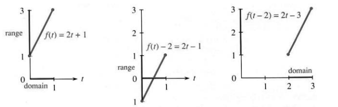

**图 1.5** 从 $f$ 中减去 2，影响值域；把自变量改成 $t-2$，影响定义域。图内 range 为值域，domain 为定义域。


初学的时候，分清 $f(t)-2$ 与 $f(t-2)$ 并不容易，也不是自然而然就会的。它们都是由原函数造出来的新函数。$f(t)-2$ 把每个函数值都减去 2，整幅图像往下移；$f(t-2)$ 则把输入时间减去 2，图像往右移。图 1.5 从 $f(t)=2t+1$ 出发，把两种平移都画了出来。而 $f(t-2)=2(t-2)+1=2t-3$。

改变图形计算器的视窗，屏幕上的图像也会跟着动。你可以选任意矩形 $A\leq t\leq B$、$C\leq f(t)\leq D$，屏幕就显示对应的那一部分。不过计算器上函数本身没变，变的是坐标轴的显示范围；我们这里的示意图正好相反：坐标轴不动，改的是函数。

还有两种基本变换。数学总在造新函数——它干的就是这件事。除了加减，还可以把函数值乘以 2，得到图 1.6 中的 $2f(t)$；也可以不平移时间，而把时间加快，得到 $f(2t)$。一切都以两倍速度发生，用时减半。在计算器上，它们对应沿 $f$ 轴或 $t$ 轴缩放。缩放的事，我们很快会再谈。

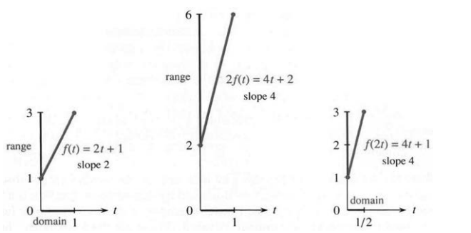

**图 1.6** 距离加倍，或时间进程加快一倍，都会使斜率加倍。图内 slope 为斜率，range 为值域，domain 为定义域。

### 1.1 习题

每节都有通读填空题，让你自己把本节提纲理一遍，比光读小结更主动。这也许是记住重要思想最好的办法。

从 $f(0)=0$ 出发，以恒定速度 $v$ 运动，距离函数为 $f(t)=$【a】。若 $f(t)=55t$，则 $v=$【b】；若 $f(t)=55t+1000$，速度仍为【c】，初值 $f(0)=$【d】。不论哪种情形，$v$ 都是 $f$ 图像的【e】。当【f】为负时，【g】的图像往下走，此时 $v$ 图像中的面积按【h】计算。

从 $f(0)=0$ 前进到 $f(2)=10$，速度为【i】；再返回到 $f(4)=0$，速度为【j】。距离函数在 $0\leq t\leq2$ 为 $f(t)=5t$，随后为【k】，而不是 $-5t$。两段斜率分别是【l】和【m】；$f(3)=$【n】。截至 $t=1.5$，$v$ 图像下方的面积为【o】。$f$ 的定义域是时间区间【p】，值域是距离区间【q】，$v(t)$ 的值域只有【r】。

$f(t)=3t+1$ 在 $t=2$ 处的值为 $f(2)=$【s】。19 等于 $f($【t】$)$。差 $f(4)-f(1)=$【u】是距离的变化量，而 $4-1$ 是【v】的变化量。两者之比为【w】，即图像的【x】。$f(t)+2$ 的公式为 $3t+3$，而 $f(t+2)$ 为【y】。它们与 $f$ 具有相同的【z】；$f(t)+2$ 的图像向【A】平移，$f(t+2)$ 的图像向【B】平移。$f(5t)$ 的公式为【C】，$5f(t)$ 为【D】，斜率由 3 变为【E】。


函数所有输入构成其【F】，所有输出构成其【G】。$f(t)=7+3(t-2)$ 和 $f(t)=vt+C$ 都是【H】；图像是【I】，斜率分别为【J】与【K】。若 $v=$【L】、$C=$【M】，它们就是同一个函数。

**为每幅距离图画出相应的速度图。**

1. 使用下图的 1a、1b。
2. 使用下图的 2a、2b。

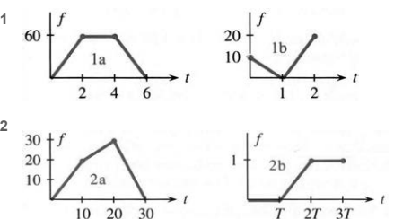

3. 写出第 2 题各速度 $v(t)$ 的三段公式；2a 的第一段为 $0<t<10$ 时 $v(t)=2$。
4. 图 1b 的第一段是 $0\leq t\leq1$ 时 $f(t)=10-10t$，写出第二段的公式。
5. 对图 2a 的中间一段，求 $f(15)$、$f(12)$ 和 $f(t)$。
6. 对图 2b，求 $f(1.4T)$。若 $T=3$，$f(4)$ 是多少？
7. 求图 1a 中 $t=0$ 到 $t=5$ 的平均速率。$t=5$ 时的速率是多少？
8. 求图 1b 中 $t=0$ 到 $t=2$ 的平均速率。从 $t=1/2$ 到 $t=$______，平均速率为零。
9. **推荐：**汽车以速度 $v=20$ 前进，在 $f=4$ 处撞上砖墙。给出碰撞前后 $v(t)$ 与 $f(t)$ 的两段公式，并画图。
10. 在以下情形中，画出合理的 $v(t)$、$f(t)$ 示意图：a. 驾驶者倒车，停下换挡，然后快速前进；b. 看到警车后减速到 55；c. 换挡不平顺，汽车的速度分次跃升；d. 驾驶者等待交通灯变绿。
11. 银行账户按初始余额 $f(0)$ 计单利。下图中各账户的年利率是多少？

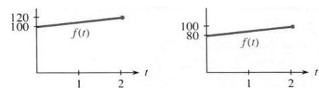

12. 地球人口每年增加 1 亿，1990 年初始人口为 52 亿。画出 $f(t)$ 并求 $f(2000)$。

**为每幅速度图画出距离图。从 $t=0$ 时 $f=0$ 开始，标出距离值。**

13–14. 使用下面两行速度图。

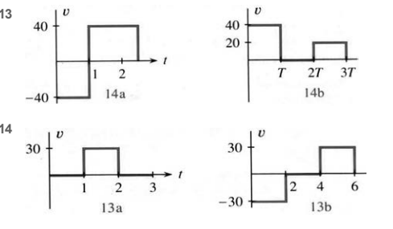

15. 写出第 14 题 $v(t)$ 的公式，14a 从 $0<t<1$ 时 $v=-40$ 开始。分别求截至 $t=2.5$ 和 $t=3T$ 的平均速度。
16. 写出第 13 题中 $v(t)$ 图像下方面积 $f(t)$ 的三段公式。
17. 图 14a 的第一段为 $0\leq t\leq1$ 时 $f(t)=-40t$。求另一段公式，该段在 $t=2$ 经过 $f=0$。
18. 若 $0<t<2$ 时 $v(t)=8$，$2\leq t\leq3$ 时 $f(t)=20+t$，画出速度图和距离图。
19. 草绘 $y=\sqrt x$、$y=\sqrt{x-4}$ 和 $y=\sqrt x-4$。它们是“半条抛物线”，起点处的斜率无穷大。
20. 制作 $x$ 本年鉴的成本为 $1200+30x$ 美元，收入为 $40x$ 美元，收支平衡点在哪里？成本线斜率为 ______，即每多制作一本的成本；若该斜率超过 ______，就无法收支平衡。
21. 若 $f(0)=0$，图 14a、14b 中距离函数的定义域和值域分别是什么，即所有可能的 $t$ 和 $f(t)$ 是什么？
22. 图 14b 中 $v(t)$ 的值域是什么？为什么图 14a 的 $v(t)$ 定义域不包含 $t=1$？

**第 23–28 题讨论线性函数 $f(t)=vt+C$，求常数 $v,C$。**

23. 哪个线性函数满足 $f(0)=3$、$f(2)=-11$？
24. 求两个定义域为 $0\leq t\leq2$、值域为 $1\leq f(t)\leq9$ 的线性函数。
25. 求满足 $f(1)=4$、斜率为 6 的线性函数。
26. 哪些函数满足 $f(t+1)=f(t)+2$？
27. 求满足 $f(t+2)=f(t)+6$ 且 $f(1)=10$ 的线性函数。
28. 求唯一满足 $f(2t)=4f(t)$ 的 $f=vt$。证明每个 $f=\tfrac12at^2$ 都有此性质。要在两倍时间内走过 ______ 倍的距离，必须加速。


29. 在 $|t|\leq2$ 上草绘 $f(t)=|5-2t|$，求各段斜率和值域。
30. 在 $2\leq t\leq5$ 上草绘 $f(t)=4-t-|4-t|$，求斜率和值域。
31. 设速度在 $T$ 之前为 8，此后为 $-2$。从零出发，什么时候 $f$ 返回零？给出 $v(t)$、$f(t)$ 的公式。
32. 设 $T=4$ 之前速度为 3，且 $f(0)=0$。之后改用什么速度，才能使 $f(7)=30$？给出 $v(t)$、$f(t)$ 的公式。
33. 哪个函数 $F(C)$ 把摄氏温度 $C$ 换算为华氏温度 $F$？斜率为 ______，表示每 $1^\circ\mathrm C$ 相当于多少华氏度。
34. 哪个函数 $C(F)$ 把华氏温度换算为摄氏温度？斜率是多少？
35. 哪个函数把以克计的重量 $w$ 换算为以千克计的重量 $f(w)$？解释斜率的含义。
36. **（1989 年 3 月的报纸）**事故十小时后，酒精检测读数为 0.061。血液中的酒精每小时消除 0.015。事故时的读数是多少？再过多久会降至 0.04（海岸警卫队规定的上限）？驾驶者通常的限值为 0.10%。

**第 37–42 题：在 $0\leq t\leq5$ 内，哪些点可属于 $f(t)$ 的定义域？用这个定义域求值域。**

37. $f(t)=\sqrt{t-1}$。
38. $f(t)=1/\sqrt{t-1}$。
39. $f(t)=|t-4|$。
40. $f(t)=1/(t-4)^2$。
41. $f(t)=2^t$。
42. $f(t)=2^{-t}$。
43. a. 画出定义域为 $0\leq t\leq2$ 的 $f(t)=\tfrac12t+3$；再给出下列函数的公式和图像：b. $f(t)+1$；c. $f(t+1)$；d. $4f(t)$；e. $f(4t)$。
44. a. 画出阶跃函数 $U(t)$：$t<0$ 时为 0，$t\geq0$ 时为 1；再画出 b. $U(t)+2$；c. $U(t+2)$；d. $3U(t)$；e. $U(3t)$。
45. a. 画出 $-1\leq t\leq1$ 上的 $f(t)=t+1$；求以下函数的定义域、值域、斜率与公式：b. $2f(t)$；c. $f(t-3)$；d. $-f(t)$；e. $f(-t)$。
46. 若 $f(t)=t-1$，$2f(3t)$、$f(1-t)$、$f(t-1)$ 分别是什么？
47. 对往返运动的例子（图 1.4），求 $f(T/2)$ 和 $f(3T/2)$，检验它们与 $v$ 图像“下方”的面积相符。
48. 求以下输入输出步骤对应的 $f_1(t)$、$f_2(t)$：

   （1）内部值＝输入值乘以 3；输出值＝内部值加 3。

   （2）内部值 $\leftarrow$ 输入值加 6；输出值 $\leftarrow$ 内部值乘以 3。

   **原注：**BASIC、FORTRAN，以及微积分本身，使用等号而非左箭头；但在某些方面，箭头 $\leftarrow$ 或赋值符号 $:=$ 更好。指令 $t\leftarrow t+6$ 表示新 $t$ 等于旧 $t$ 加 6，并不是方程 $t=t+6$。

49. 计算机可以做加法和乘法。从数 1 和名为 $t$ 的输入开始，列出得到以下输出的指令：$f_1(t)=t^2+t$；$f_2(t)=f_1(f_1(t))$；$f_3(t)=f_1(t+1)$。
50. 用不超过 50 个词解释什么是函数。

**最后几题较有挑战性，但可以完成。**

51. 若 $f(t)=3t-1$、$0\leq t\leq2$，给出以下六个函数的公式、定义域和斜率：a. $f(t+2)$；b. $f(t)+2$；c. $2f(t)$；d. $f(2t)$；e. $f(-t)$；f. $f(f(t))$。
52. 对 $f(t)=vt+C$，求以下函数的公式与斜率：a. $3f(t)+1$；b. $f(3t+1)$；c. $2f(4t)$；d. $f(-t)$；e. $f(t)-f(0)$；f. $f(f(t))$。
53. **最难：**往返函数为 $0\leq t\leq3$ 时 $f(t)=2t$，$3\leq t\leq6$ 时 $f(t)=12-2t$。画出 $f(f(t))$，写出四段公式。先试 $t=1.5$ 和 $t=3$。
54. a. 为什么字母 X 不能作为函数图像？b. 哪些大写英文字母可以作为函数图像？c. 画出它们的斜率图像。

## 1.2 不用极限的微积分


下一页要揭开的，是微积分背后最要紧的想法之一。先只谈数——函数和斜率，可以往后放。这些数一点也不特殊，怎么选都行。真正要紧的，是看相邻两数差了多少。

$$
\begin{array}{c|rrrrrr}
f&0&2&6&7&4&9\\
\text{相邻差 }v&&2&4&1&-3&5
\end{array}
$$

这些差分别是 $2-0=2$、$6-2=4$、$7-6=1$ 等；注意 $4-7=-3$，是个负数。$f$ 里的数可升可降，$v$ 里的差也就有正有负。把这些差统统加起来，微积分背后的思想就冒出来了：

$$2+4+1-3+5=9.$$

差的和是 9，恰好就是 $f$ 的最后一个数。这是碰巧，还是永远如此？要是早点收手，只加 $2+4+1$，落到的就是 $f$ 里的 7。换一个例子，再试试这个猜想：

$$
\begin{array}{c|rrrrrr}
f&1&3&7&8&5&10\\
v&&2&4&1&-3&5
\end{array}
$$

每个 $f$ 都加了 1，差却纹丝不动。差的和仍是 9，可最后一个 $f$ 已经变成 10——可见“总和等于最后一个 $f$”这个猜想不成立。这回第一个 $f$ 是 1，答案 9 等于 $10-1$，也就是末项减首项。那把中间项换掉，又会怎样？

$$
\begin{array}{c|rrrrr}
f&1&5&12&7&10\\
v&&4&7&-5&3
\end{array}
$$

差加起来是 $4+7-5+3=9$，还是 $10-1$。不管挑哪些 $f$、挑多少个，差的和都只认首末两项。若这总成立，中间项相消必定有个清楚的理由：

$$
(5-1)+(12-5)+(7-12)+(10-7)=10-1.
$$

5、12、7 两两相消，只剩下 $10-1$。微积分的关键，就在这里！

> **1B**　相邻 $f$ 的差之和等于 $f_{\rm last}-f_{\rm first}$，即末项减首项。

**例 1：**数 $f=2,3,4,5,6,7$ 一个接一个地线性增加，差 $v=1,1,1,1,1$ 始终不变。差的和是 5，与 $7-2$ 对得上。看见 $v$，就想到恒定速度；看见 $f$，就想到直线 $f=vt+C$。本例 $v=1$，初值为 2，对应的直线就是 $f=t+2$。

**例 2：**数 $f=0,1,4,9,16$ 都是平方数，差 $v=1,3,5,7$ 则线性增加。$1+3+5+7=4^2=16$。有个漂亮的事实：前 $j$ 个正奇数加起来，总等于 $j^2$。$v$ 是正奇数，$f$ 是完全平方数。


**附注。**字母 $j$ 正好用来点明我们在看 $f$ 里的第几个数。本例第零项是 $f_0=0$，第 $j$ 项是 $f_j=j^2$。用公式代替一串数，正是代数的一部分。差也能编号：$v_1=1$，第 $j$ 个差就是第 $j$ 个正奇数 $v_j=2j-1$，比如 $v_4=8-1=7$。差从 $j=1$ 起编号比较合适，因为没有第零个奇数 $v_0$。

有了这套记号，$v_j=f_j-f_{j-1}$。像 $j,j-1$ 这样的下标，你迟早会习惯，晚点再说也不要紧。要紧的是：所有 $v$ 加起来，等于末项减首项。下面就把 $v$ 和斜率、$f$ 和面积接上。


**图 1.7** $v=1,3,5,7$ 线性增加；对应的距离值 $f=0,1,4,9,16$ 是平方数。

图 1.7 把例 2 画得很自然。$f$ 的图像**分段线性**：把各个数对应的点用直线段连起来。$v$ 的图像**分段常数**：每一段里，差都保持不变。这让人想起前面那组距离—速度图：距离是斜线段，速度是水平线段。

先看斜率：

$$
f\text{ 图像的斜率}
=\frac{\text{竖向变化量}}{\text{横向变化量}}
=\frac{f\text{ 的变化量}}{t\text{ 的变化量}}=v.
$$

每一段里，时间变化量都是 1，$f$ 的变化量正是那个叫 $v$ 的差，所以斜率就是 $v/1=v$。一到分段点 $t=1,2,3,\ldots$，斜率猛地一跳，$f$ 的导数在那里没有定义。图中用竖线把 $v$ 的各段接起来，这种画法其实大可商榷；真正要紧的是：在两个分段点之间，$f(t)$ 的斜率等于 $v(t)$。

再看面积：**$v$ 图像下方的总面积，等于 $f_{\rm last}-f_{\rm first}$。**

阶梯下面全是矩形。每个矩形底为 1、高为对应的 $v$，所以面积数值也等于 $v$；把所有 $v$ 加起来，就是总面积。

其实起止时刻随便挑，不一定是 $0,1,2,3,4$。假设就停在 $t=3.5$：最后一个矩形高为 7，只算它的一半，总面积是

$$1+3+5+\tfrac12\cdot7=12.5.$$

结果仍等于 $f_{\rm last}-f_{\rm first}=12.5-0$。因为 $t=3.5$ 正落在最后一段的中点，$f$ 也就停在 9 与 16 的正中间，即 12.5。


> **1C**　各个 $v$ 是 $f(t)$ 的斜率；$v$ 图像下方的面积等于 $f(t_{\rm end})-f(t_{\rm start})$。

这正是微积分基本定理——而我们只用了代数，没碰曲线，也没做极限计算。眼下还限定在分段线性的 $f$ 与分段常数的 $v$；到第 5 章，这个限制就会取消。

图 1.7a 还顺带提示了 $1+3+5+7=4^2$ 的一个证明：虚线下方的三角形，与四个矩形的总面积一样大。三角形面积是 $\tfrac12\cdot4\cdot8=4^2$。若有 $j$ 个矩形，面积就是 $\tfrac12\cdot j\cdot2j=j^2$。

接下来的例子，展示另外几种规律：$f,v$ 可以指数增长，也可以围着零来回振荡。我希望你喜欢它们，但我不认为你必须学会它们。它们像 $2^t,\sin t,\cos t$，只不过是一步一步地变。这样，你光靠代数，就能先认识微积分里那些重要函数。等速度连续变化、$f$ 的图像弯成曲线，就该微积分上场了。

最后一个例子是所得税——它是真的按档跳。再往后，第 1.3 节要讲曲线的斜率；对付曲线，关键一步是取极限，也正是这一步，把我们带出代数、带进微积分。

### 指数增长的速度与距离

从 $f=1,2,4,8,16$ 开始。这是 2 的幂，头一项就是零次幂 $2^0=1$，所以初值是 1，不是 0。走 $j$ 步，就攒下 $j$ 个因子 2，即 $f_j=2^j$。请分清 $2j,j^2,2^j$：一个线性增长，一个二次增长，一个指数增长。到 $j=10$，三者分别是 $20,100,1024$，指数那一项早就把另外两个甩在后面。

$f=1,2,4,8,16$ 的差，恰好是 $v=1,2,4,8$——还是同样漂亮的数。$f$ 是 2 的幂，$v$ 也是。只是第一个差编号为 $v_1$，公式 $v_j=2^{j-1}$ 就与 $f_j=2^j$ 差了一点；$v_1=2^0=1$。每个数的零次幂都是 1，不过 $0^0$ 没有意义。


**图 1.8** 速度与距离按指数增长（2 的幂）。两图使用相同的数，但 $f$ 分段线性，$v$ 分段常数，因此外观不同。

微积分在哪儿登场？它研究光滑的曲线 $f(t)=2^t$。人口、银行存款、国债，都离不开指数增长；辨认它的办法是看速度是否与函数值成正比，即 $v(t)$ 与 $f(t)$ 成正比。


**说明。**$2^t$ 比 $t^2$ 难捉摸。$f=t^2$ 的斜率是 $v=2t$，与 $t$ 成正比，而不是与 $t^2$ 成正比；$f=2^t$ 的斜率是 $v=c2^t$，常数 $c=0.693\ldots$ 要等到第 6 章才求得出，它就是 2 的自然对数。第 37 题会用计算器估它；要紧的是，它是个常数。

### 振荡的速度与距离

速度先是 $V$、再变成 $-V$，这样一去一回，是最简单的振荡。$f$ 的图像先沿直线上升，再沿直线下降。图 1.9 给出另一种回到零点的振荡，路线更有意思。

这回 $f$ 取 $0,1,1,0,-1,-1,0$。因为 $f_6=0$，运动又回到起点，可以一遍遍重来。相邻的差 $v$ 是 $1,0,-1,-1,0,1$，加起来为零，与末项减首项对得上。它的振荡模式与 $f$ 一样可以重复，只是时间上错开了一截。

$f$ 的图像粗略地像正弦曲线，$v$ 的图像更粗略地像余弦曲线。自然界的波形本是光滑曲线，这里却被“数字化”了——像电子表那样一格一格地跳。模拟转数字，带来了计算机革命；同样的革命，正在 CD 播放器上发生。数字信号，关或开、0 或 1，似乎每回都赢。

分段函数到 $t=6$ 就重新开始，普通正弦、余弦则在 $t=2\pi$ 处重复。重复的运动叫周期运动，这里的周期分别是 6 与 $2\pi$。角度若按度算，周期是转一整圈的 360；换成弧度，周期就是 $2\pi$。我们几乎总用弧度：弧度数等于度数乘以 $2\pi/360$。钟表的周期是 12 小时；若还显示上午、下午，周期就是 ______。


**图 1.9** 分段常数的“余弦”与分段线性的“正弦”，两者都重复出现。

### 短时间的高速运动

下一辆车只猛跑一小会儿。速度一直是 $V$，直到距离达到 $f=1$，然后戛然而止。$f$ 先以斜率 $V$ 直线上升，再以零斜率水平延伸：

$$
v(t)=\begin{cases}V,&\text{停止时刻 }T\text{ 之前},\\0,&T\text{ 之后},\end{cases}
\qquad
f(t)=\begin{cases}Vt,&0\leq t\leq T,\\1,&t\geq T.\end{cases}
$$

注意一般时刻 $t$ 与特定停车时刻 $T$ 的区别。距离函数的定义域是 $t\geq0$，值域是 $0\leq f\leq1$。图 1.10 把三辆车摆在一起比：Jeep、Corvette 和 Maserati。速度各不相同，却都跑到 $f=1$，所以三个速度图下方的面积都是 1。每个矩形高为 $V$，底为 $T=1/V$。


**图 1.10** 短时间高速运动满足 $V_MT_M=V_CT_C=V_JT_J=1$。阶跃函数的斜率无穷大。图内 EQUAL AREAS 为面积相等，EQUAL DISTANCES 为距离相等，step function 为阶跃函数，delta function 为狄拉克冲激。

**选读说明。**人自然会想：速度越来越快，斜率也就越来越陡。$f$ 用越来越短的时间冲到 1，极端情形就成了阶跃函数，图像看上去直上直下。这就是单位阶跃 $U(t)$：直到 $t=0$ 都为零，在 $t>0$ 时立刻跳到 $U=1$。

阶跃函数的斜率是什么？除了跳跃点，处处为零。在跳跃的那一刻，即 $t=0$，斜率无穷大。我们没有普通的速度 $v(t)$，而是有一个使汽车跳跃的冲激。图像是单独一点 $t=0$ 上的一根尖峰，通常记作 $\delta$——所以阶跃函数的斜率叫作“delta 函数”。这根无限尖峰下方的面积是 1。

delta 函数的理论，你在这里完全不必操心！微积分研究曲线，不研究跳跃。

最后一个例子，用斜率和变化率讲税是怎么算的。请特别分清税率、税档和总税额：税率是 $v$，税档划在收入 $x$ 上，总税额是 $f$。

**例 3：所得税是分段线性的，斜率为税率 0.15、0.28、0.31。**

假设你单身，应税收入为 $x$ 美元（1040 表第 37 行，扣除所有扣除额之后）。下面是美国税务部门 **1991 年**的说明：

- 若 $x$ 不超过 20,350 美元，税额是 $x$ 的 15%。
- 若 $20,350\leq x\leq49,300$，税额是 3,052.50 美元，再加上超出 20,350 美元那部分的 28%。
- 若 $x$ 超过 49,300，税额是 11,158.50 美元，再加上超出 49,300 美元那部分的 31%。

第一档是 $0\leq x\leq20,350$，第二档是 $20,350\leq x\leq49,300$。税务部门从不使用 $\leq$ 这个符号，但我认为用在这里没问题。我们知道它的意思。最高一档是 $x\geq49,300$，边际税率 31%，但**只有落进这一档的收入，才按这个税率计税。**

图 1.11 画出税率、税档和应纳税额。这些是边际税率，不是平均税率。总税额除以总收入，那才是平均税率；0.28 或 0.31 说的是每多赚一美元、要多缴多少税，也就是 $x$ 处的斜率。税额像面积、像距离，一点一点累起来；税率像斜率、像速度，取决于你站在什么位置。新闻媒体常常分不清这两样。

问：最高档那条直线的方程是什么？答：这一档从 $x=49,300$、$f(x)=11,158.50$ 起步，斜率是 0.31。知道直线上一点、又知道斜率，方程就到手了。这一点值得着重强调。


**图 1.11** 税率为 $v$，总税额为 $f$；税档边界对应折点。图内 tax to pay 为应纳税额，tax rate 为税率，slope 为斜率，area 为面积，up/across 为竖向变化量除以横向变化量。

> **1D**　最高档的税额为 $f(x)=11,158.50+0.31(x-49,300)$ 美元，即前 49,300 美元的税额，加上超出部分的税额。

第 2.3 节会为一般直线介绍“点斜式”；这里先看这个具体例子。11,158.50 是从哪儿来的？它是中间税档末端处的税额，也是最高税档起点处的税额。

图中还顺带画了距离与速度的例子。$t=2$ 时，$f(2)=40$ 英里；从这以后，速度是 60 英里/小时。所以，$f$ 图上那条斜率为 60 的直线是

$$
f(t)=\text{初始距离}+\text{新增距离}=40+60(t-2).
$$

起点是 $(2,40)$；新速度乘上多出来的时间 $t-2$。点斜式就这么好懂。下面借几条说明，把本节回顾一遍。

**核心思想：**随便取一列数 $f$，把相邻的差记作 $v$；差加起来，就等于末项减首项。

**下标：**数列是 $f_0,f_1,\ldots$，第一个差是 $v_1=f_1-f_0$，一般的差是 $v_j=f_j-f_{j-1}$。一求和，中间各项就相消：

$$
v_1+v_2+\cdots+v_j
=(f_1-f_0)+(f_2-f_1)+\cdots+(f_j-f_{j-1})=f_j-f_0.
$$

**例子：**取 $f_j=j,j^2,2^j$，$v_j$ 就分别是常数 1、奇数 $2j-1$、指数项 $2^{j-1}$。

**函数：**把 $f$ 的各点连成分段线性函数，斜率 $v$ 便是分段常数函数。从任意起点走到终点，$v$ 下方的面积都是 $f(t_{\rm end})-f(t_{\rm start})$。

**单位：**距离用英里，速度用英里每小时；税额用美元，税率是“缴的美元数／赚的美元数”，所以是个像 0.28 那样不带量纲的比率。

### 1.2 习题

#### 通读填空

从 $f=1,6,2,5$ 出发，差是 $v=$【a】，差的和是【b】，等于末项减【c】。6 和 2 对答案没有影响，因为在 $(6-1)+(2-6)+(5-2)$ 里，它们【d】。连接 $f(0)=1$ 与 $f(1)=6$ 的直线，斜率是【e】，方程是 $f(t)=$【f】。

在单位时间点，距离是 $1,5,25$，对应的速度是【g】，它们是 $f$ 图像的【h】。税额图的斜率就是税【i】。若 $f(t)$ 是邮寄 $t$ 盎司或 $t$ 克邮件的费用，斜率就是每【k】的【j】。距离为 $0,1,4,9$ 时，速度是【l】。前 $j$ 个正奇数之和为 $f_j=$【m】，所以 $f_{10}=$【n】，$v_{10}=$【o】。


分段线性的“正弦”斜率为【p】，拼出分段【q】的“余弦”。两者的【r】都是 6，所以对每个 $t$，$f(t+6)=$【s】。速度 $1,2,4,8,\ldots$ 满足 $v_j=$【t】，此时 $f_0=1$、$f_j=$【u】。$1+2+4+8+16=$【v】，$2^j-2^{j-1}=$【w】。以速度 $V$ 短暂跑到时刻 $T$，距离为【x】。若 $f(T)=1$，增大 $V$，持续时间就成了 $T=$【y】。$V$ 趋于无穷时，$f$ 趋于【z】函数；速度趋于【A】函数，集中在 $t=0$，积分为【B】。阶跃函数的斜率是【C】。

**第 1–4 题讨论数列 $f$ 与相邻差 $v$。**

1. 由 $f=0,2,7,10$ 求差 $v$ 及其和。再写一列 $f$，让它的差与这组相同。对 $f=0,3,12,10$，差的和仍是 ______。
2. 从 $f=1,3,2,4$ 出发，画分段线性的 $f$ 和对应的 $v$。哪些面积加起来等于 $4-1$？若下一项是 11，下一段 $v$ 下方的面积是多少？
3. 由 $v=1,2,1,0,-1$、$f_0=3$ 求 $f$ 并画图。$f$ 在 $v=$______ 时取到最大值；若 $v=1,2,1,-1$，最大值又在哪里？
4. 对 $f=1,b,c,7$ 求 $v_1,v_2,v_3$ 及其和，再对 $f=a,b,c,7$ 和 $f=a,b,c,d$ 各做一遍。

**第 5–11 题讨论线性函数与恒定斜率。**

5. 写出 a. $f(t)=1.1t$；b. $f(t)=1-2t$；c. $f(t)=4+5(t-6)$ 的斜率。再分别算 $f(6),f(7)$，确认差正好等于斜率。
6. 若 $f(t)=5+3(t-1)$、$g(t)=1.5+2.5(t-1)$，求 $h(t)=f(t)-g(t)$，再求三个函数的斜率。
7. 若 $t<5$ 时 $v=2$、$t>5$ 时 $v=3$：a. 已知 $f(0)=0$，求两段的公式；b. 检验 $f(10)$ 是否等于速度图里截至 10 的两个矩形面积之和。
8. 若 $t<1/10$ 时 $v=10$，此后 $v=0$，从 $f(0)=1$ 出发，求两段的公式。
9. 若 $g(t)=2t+1$、$f(t)=4t$，求 $g(3),f(g(3)),f(g(t))$。复合函数的斜率与这两个函数的斜率有什么关系？
10. 对相同函数求 $f(3),g(f(3)),g(f(t))$。把 $t$ 换成 $4t$ 后，距离增长速度变为原来的 ______ 倍，速度乘以 ______。
11. 对第 5 题的各函数算 $f(6),f(8)$，检验 $v=(f(8)-f(6))/(8-6)$，也就是函数变化量除以时间变化量。

**第 12–18 题基于例 3 的所得税问题。**

12. 应税收入为 10,000、30,000、50,000 美元时，税额分别是多少？
13. 第二税档中的 $f(x)$ 是什么？11,158.50 与税表其他数字有什么关系？
14. 假设把收入为 $x$ 的已婚夫妇当作两个各有 $x/2$ 应税收入的单身者，写出税额 $F(x)$。（实际并不这样做。）
15. 在 15% 税档中，若 5% 的州税可从应税收入扣除，综合税率不是 20%，而是 ______。考虑额外 100 美元的税额。
16. 分段线性函数连续，意味着每段终点值与下一段起点值相等。若 $t\leq1$ 时 $f=5t$，$t>1$ 时速度为 2，分别定义后半段使函数 a. 连续；b. 不连续。c. 构造使用 15%、28% 两种税率的税额函数，使跨过分档点多赚一美元反而受损。
17. 税额抵免与应税收入扣除的区别，是 $f(x)-c$ 与 $f(x-d)$ 的区别。抵免 1000 美元和扣除 1000 美元，哪一个更有利？为什么？当 $f(x)=0.15x$ 时草绘两个图像。
18. 平均税率 $a(x)=f(x)/x$ 是从原点到 $(x,f(x))$ 的斜率。草绘 $a$；平均税率低于边际税率，是因为 ______。

**第 19–30 题练习下标与差分 $v_j=f_j-f_{j-1}$。**

19. 求 $v_1,v_2,v_3$ 和 $v_j,f_j$ 的公式：a. $f=1,3,5,7,\ldots$；b. $f=0,1,0,1,\ldots$；c. $f=0,1/2,3/4,7/8,\ldots$。
20. 已知 $f_0=0$，求 $f_1,f_2,f_3,f_j$：a. $v=1,2,4,8,\ldots$；b. $v=-1,1,-1,1,\ldots$。
21. 下图左侧嵌套正方形的面积为 $1^2,2^2,3^2,\ldots$。L 形带状部分的面积是多少？图形如何说明 $1+3+5+7=4^2$？
22. 分别用矩形与三角形计算下图右侧阶梯下的面积，证明 $1+2+\cdots+j=\tfrac12j^2+\tfrac12j$。求 $1+2+\cdots+100$。


23. 若 $v=1,3,5,\ldots$，则 $f_j=j^2$；若 $v=1,1,1,\ldots$，则 $f_j=$______。相加求 $2+4+\cdots+2j$，再除以 2 求 $1+2+\cdots+j$。比较第 22 题。
24. 判断正误：对的说明理由，错的举出反例。a. $f$ 递增则 $v$ 也递增；b. $v$ 递增则 $f$ 也递增；c. $f$ 周期则 $v$ 周期；d. $v$ 周期则 $f$ 周期。
25. 对 $f(t)=t^2$，算 $f(99),f(101)$，再求其间函数增量与时间增量之比。
26. 对 $f(t)=t^2+t$，重复上一题。
27. 若 $f_j=j^2+j+1$，求 $v_j$。
28. 若 $v$ 每步增加 4，先举例、再用代数证明二阶差分 $f_{j+1}-2f_j+f_{j-1}=4$。
29. 若 $f_0=0$，$v=1,\tfrac12,\tfrac12,\tfrac14,\tfrac14,\tfrac14,\tfrac14,\ldots$，哪个 $j$ 满足 $f_j=5$？
30. 证明 $a_j=f_{j+1}-2f_j+f_{j-1}$ 总等于 $v_{j+1}-v_j$。若 $v$ 是速度，$a$ 表示 ______。

**第 31–34 题讨论周期性的 $f,v$，类似正弦与余弦。**

31. 对离散“正弦”$f=0,1,1,0,-1,-1,0$，求 $a_1=f_2-2f_1+f_0$、$a_2=f_3-2f_2+f_1$ 和 $a_3$。比较 $a_j$ 与 $f_j$。
32. 若数列 $v$ 的周期为 6，$w$ 的周期为 10，则逐项和 $v_1+w_1,v_2+w_2,\ldots$ 的周期是什么？
33. 从 $f_0=0$ 出发，对 $v=1,-1,-1,1$ 画 $f$。若 $v$ 周期为 4，求 $f(12),f(13),f(100.1)$。
34. 当 $v=1,2,1,0$ 时，画从 $f_0=0$ 到 $f_4=4$ 的 $f$。若 $v$ 周期为 4，求 $f(12),f(14),f(16)$。为什么 $f$ 没有周期 4？

**第 35–42 题讨论指数型数列。**

35. 求 $f=1,3,9,27$ 的差，预测 $v_4,v_j$。代数给出 $3^j-3^{j-1}=(3-1)3^{j-1}$。
36. 求 $1+2+4+\cdots+32$ 和 $1+\tfrac12+\tfrac14+\cdots+\tfrac1{32}$。
37. 估计 $f(t)=2^t$ 在零点的斜率。用计算器依次求 $(2-1)/1$、$(2^{0.1}-1)/0.1$、$(2^{0.01}-1)/0.01$、$(2^{0.001}-1)/0.001$。
38. 设 $f_0=1$，且 $v_j=2f_{j-1}=v_j$，求 $f_4$。
39. a. 由 $f=1,1/2,1/4,1/8$ 求 $v_1,v_2,v_3$ 并预测 $v_j$；b. 检验 $f_3-f_0=v_1+v_2+v_3$ 和 $f_j-f_{j-1}=v_j$。
40. 设 $v_j=r^j$。证明 $f_j=(r^{j+1}-1)/(r-1)$ 满足 $f_0=1$ 和 $f_j-f_{j-1}=v_j$，因此它就是几何级数部分和 $1+r+\cdots+r^j$。
41. 由 $f_j=(-1)^j$ 求 $v_j$，再求 $v_1+\cdots+v_j$。
42. 估计 $f(t)=e^t$ 在零点的斜率。使用知道 $e$ 的计算器（否则取 $e=2.78$）。分别计算 $(e-1)/1$、$(e^{0.1}-1)/0.1$、$(e^{0.01}-1)/0.01$。

**第 43–47 题讨论在零点从 0 跳到 1 的阶跃 $U(t)$。**

43. 画 $U(t-1)$、$U(t)-2$、$U(3t)$、$4U(t)$，再画 $f(t)=4U(3t-1)-2$。
44. 画方波 $U(t)-U(t-1)$。若它是速度，画距离；若它是距离，画速度。
45. 两次短暂高速运动都走过距离 10：$v=$______，持续到 $t=0.001$；$v=V$，持续到 $t=$______。$V\to\infty$ 时，$f(t)$ 的极限为 ______。
46. 画阶梯函数 $U(t)+U(t-1)+U(t-2)$；其斜率是三个 ______ 函数之和。
47. 若允许阶跃，哪些像 L 一样的大写字母可以表示函数图像？L 的斜率是一个负 delta 函数；画出其他字母的斜率。
48. 写子程序 FINDV，输入 $f_0,f_1,\ldots,f_N$，输出 $v_1,\ldots,v_N$，尽可能附图形输出。以 $f_j=2j,j^2,2^j$ 测试。
49. 写子程序 FINDF，输入 $v_1,\ldots,v_N$ 与 $f_0$，输出 $f_0,f_1,\ldots,f_N$。默认 $f_0=0$，尽可能附图。以 $v_j=j$ 测试。
50. 对 FINDF 的输出再用 FINDV，会返回什么？反过来又会返回什么？注意初值 $f_0$。
51. 将 $2j,j^2,2^j,\sqrt j$ 按从小到大排列：a. $j$ 较大，取 9；b. $j$ 较小，取 $1/9$。
52. 从 1970 年起，你家庭成员的平均年龄 $A(t)$ 是分段线性函数。它连续还是会跳跃？斜率是什么？尽力画出图像。

## 1.3 瞬时速度


我们已经走到微积分为之诞生的核心问题面前。两个问题方向相反——希望你早就看出它们要来了：

1. 速度一直在变，怎么算出走了多远？
2. $f(t)$ 的图像不是直线时，斜率又是什么？

从速度求距离，从距离求速度，两个方向都要走通——只是没法在一节里全办到。微积分也许是门好课，可它不是魔术。第一步，让速度以最均匀的方式变化。

**问题 1：**设每个时刻的速度为 $v(t)=2t$，求 $f(t)$。

物理学家会说，加速度恒为 2。司机一踩油门，车就加速，速率表的指针稳稳往上爬；距离也一路增加，而且越来越快。若 $t$ 以秒计、$v$ 以英尺每秒计，则 $f$ 以英尺计。10 秒后速率是 20 英尺/秒；44 秒后是 88 英尺/秒，也就是 60 英里/小时。加速度倒是清楚，可车到底跑了多远？

**问题 2：**已知时刻 $t$ 的行驶距离为 $f(t)=t^2$，求速度 $v(t)$。

图 1.12 右侧，$f(t)=t^2$ 是一条抛物线。曲线从零开始，这时车是新的：$t=5$ 时距离为 25，$t=10$ 时到了 100。

人们常说，速度就是距离除以时间。可速度在变的时候，这招还灵吗？$100/10=10$ 给出前十秒的平均速度；$121/11$ 给出前十一秒的平均速度。那么，**瞬时速度**——恰在 $t=10$ 那一刻速率表上的读数——又该怎么求？


**图 1.12** 速度 $v=2t$ 是线性函数，距离 $f=t^2$ 是二次函数。图内 distance/area 为距离/面积，time 为时间；割线斜率 $2t+h$ 趋于 $v=2t$，距离增量为 $(t+h)^2-t^2=2th+h^2$。

我希望你看出了问题。车越快，每秒走得越远，$t^2$ 的图像也就越陡。10 到 11 秒的平均速度可以当作 $t=10$ 时速度的近似——但也只是近似。平均值本身很好算。


$$
f(10)=100,\qquad f(11)=121,
$$

$$
\text{平均速度}=\frac{f(11)-f(10)}{11-10}
=\frac{121-100}{1}=21.
$$

这一秒里汽车走了 21 英尺，平均速率就是 21 英尺/秒。车还在加速，所以这一秒刚开始时的速率小于 21。

几何上，平均值是一条直线的斜率，不是曲线在某一点的斜率。这条直线连接图 1.12 曲线上的两个点。求平均值，就像假设车以恒定速度跑完同一段路：问题退回最简单的情形，只需用距离变化量除以时间变化量：

$$
\text{平均速度}=\frac{f\text{ 的变化量}}{t\text{ 的变化量}}. \tag{1}
$$

**微积分与法律。**你 1 点驶上高速公路，3 点从 150 英里外驶出，平均速率 75 英里/小时。警察凭这个能不能开罚单，我不好说。你可以问法官：“我到底是什么时候开到 75 的？”警察只好承认不知道具体时刻，但会明确觉得，你一定曾在某个时刻开到过 75。[原注]

回到核心问题：求 $t=10$ 时的 $v(10)$。接下来一秒的平均速度是 21；也可以只算 10.0 到 10.5 这半秒的平均速度：

$$
\frac{f(10.5)-f(10.0)}{10.5-10.0}
=\frac{10.5^2-10^2}{0.5}
=\frac{110.25-100}{0.5}=20.5.
$$

这更接近 $t=10$ 时的速度，可还是不够精确。

要得到 $v(10)$，就得把时间间隔一再缩短。这是第 2 章的地基，也是微分学的关键：在曲线上取越来越近的两点，求它们连线的斜率；两点无限靠近时，这个斜率的极限就是单点处的斜率。

用代数来算：从 10 到稍后的 $10+h$，平均速度是多少？距离从 $10^2$ 增到 $(10+h)^2$，时间增加 $h$，于是

$$
v_{\rm ave}
=\frac{(10+h)^2-10^2}{h}
=\frac{100+20h+h^2-100}{h}=20+h. \tag{2}
$$

这和前面的算法对得上：$h=1$ 时平均速度是 21；$h=1/2$ 时是 20.5；若间隔只有百万分之一秒，平均速度就是 $20+1/1,000,000$，离 20 只差一丝。

**结论：$t=10$ 时速度为 $v=20$；这也正是曲线在该点的斜率。**它与图 1.12 左侧的速度图吻合。

**原注：**这是我们头一回碰到那个备受嫌弃的“中值定理”。法官要是能证明它，你可就没辙了。几张 $v$ 图和 $f$ 图会把情形搅乱。


现在说明：两幅图在每一时刻都对得上——若 $f(t)=t^2$，则 $v(t)=2t$。这是微积分的关键一步。先用文字说一遍：取 $t+h$ 时的距离，减去 $t$ 时的距离，再除以 $h$，就是平均速度：

$$
v_{\rm ave}
=\frac{f(t+h)-f(t)}h
=\frac{(t+h)^2-t^2}h
=\frac{t^2+2th+h^2-t^2}h=2t+h. \tag{3}
$$

前面 $t=10$ 时得到 $20+h$，这里一般化为 $2t+h$。速度在变，平均值自然依赖步长 $h$。可一旦 $h$ 趋于零，平均值就越来越贴近 $t$ 时的速度 $2t$。

> **1E**　当 $h$ 趋于零时，平均速度 $2t+h$ 趋于 $v(t)=2t$。

**附注。**计算（3）说明：微积分离不开代数。要得到整幅速度图，时间就得当变量，用字母 $t$ 表示。具体时刻 10、具体步长 1，确实只用数字也能算；但代数让我们跳出个别例子。任意 $t$ 与 $t+h$ 之间的平均值都是 $2t+h$，随时可以代回数字，验算代数有没有出错。

还有一步，是代数给不了的：微积分要求平均值的极限。$h$ 缩到零，曲线上的两点靠拢，“区间平均速度”就变成“某时刻的速度”。一般的极限理论并不简单，这里暂时用不上，其实也没那么难。本例的极限一眼可见：$h\to0$ 时，$2t+h\to2t$。

本节还剩下什么？问题 2——由距离求速度——已经答完；问题 1 还欠着：若 $v=2t$，距离是什么？这是反方向的积分问题。微积分基本定理说，不必从头再来：若 $f$ 的斜率给出 $v$，$v$ 下方的面积就能还原 $f$。里程表读数 $f=t^2$ 给出了速率表读数 $v=2t$。根据基本定理，$2t$ 图像下方的面积应当是 $t^2$。不过我们确实还没有证明任何基本定理，所以最好稳妥一些——亲手把面积算出来。

幸运的是，这块面积就是个三角形，底为 $t$、高为 $2t$，于是

$$
\text{面积}=\tfrac12(\text{底})(\text{高})
=\tfrac12(t)(2t)=t^2. \tag{4}
$$

**例 1：**把图像沿时间轴平移：汽车直到 $t=1$ 才出发。此前 $v=f=0$；出发后 $v=2(t-1)$、$f=(t-1)^2$。公式里多出一个延迟量 1，图 1.13 显示它的影响。

**例 2：**把加速度从 2 换成另一个常数 $a$，速度便由 $2t$ 变成 $at$。**加速度就是速度图像的斜率！**距离也与 $a$ 成正比，只是别漏了因子 $1/2$：

$$
\text{加速度 }a\quad\longleftrightarrow\quad
\text{速度 }v=at\quad\longleftrightarrow\quad
\text{距离 }f=\tfrac12at^2.
$$

若 $a=1$，则 $v=t$、$f=\tfrac12t^2$——这是微积分里最著名的函数对之一。若 $a$ 取重力加速度 $g$，$v=gt$ 便是自由落体的速度。


**图 1.13** 延迟后的速度与距离，以及 $v=at+b$ 与 $f=\tfrac12at^2+bt$ 的函数对。

速度与质量无关（伽利略在比萨斜塔做过试验）。比起速度 $v=gt$，他也许更容易看到距离 $f=\tfrac12gt^2$。不管怎样，这都是物理学里最著名的一对函数。

**例 3：**设 $f(t)=3t+t^2$。从 $t$ 到 $t+h$ 的平均速度为

$$
v_{\rm ave}=\frac{3(t+h)+(t+h)^2-3t-t^2}{h}.
$$

距离变化量里多出 $3h$，来自 $3(t+h)-3t$；再除以 $h$，速度就多出 3。距离添了一项 $3t$，速度便添了常数 3。如果伽利略是把一个重物抛出去，而不是让它落下，初速度 $v_0$ 就会给距离添上一项 $v_0t$。

### 随时间变化的函数

一条直线的斜率不难懂：把 $f$ 的变化量除以 $t$ 的变化量就是了；第 2 章改用 $y$ 与 $x$。经验表明，真正难的是看出直线移动时，斜率怎样变化。

图 1.14a 中，连接曲线上 A、B 两点的直线是一条割线，它的斜率就是平均速度。微积分要做的事，是让 B 沿曲线向 A 靠拢。


**图 1.14** 直线的斜率与曲线的斜率；两辆车的速度图；右侧哪条是 $v$、哪条是 $f$？图内 secant line 为割线，speed 为速率，car C/D 为车 C/D。

**问题 1：**$f$ 的变化量，也就是 B 比 A 高出的那一点，会怎样？答：趋于零；$t$ 的变化量同样趋于零。


**问题 2：**B 靠近 A 时，直线的斜率是增是减？答：这回我不直接回答——这个问题太重要了。另画一条割线，让 B 再靠近 A 一些，自己比较斜率。

这个问题由华盛顿大学的史蒂夫·蒙克（Steve Monk）提出，班上 57% 的学生答对了。要是直接给公式让他们求斜率，答对的恐怕会有 97%。图 1.14b 问的是反方向：已知速度，而不是距离。微积分要同时回答关于两个函数的问题。

**问题 3：**$t=3/4$ 时哪辆车更快？答：C 的速率更大，D 的加速度更大。

**问题 4：**若两车同时同地出发，D 在最后一段是否正在追上 C？从 $t=1/2$ 到 1，两车是更近还是更远？答：这次超过一半的学生答错了。你不会答错，但你能看出他们为什么会错。你得盯着速度图，在心里画出距离图。C 比 D 快时，两车的距离 ______。

再强调一次：两车一起出发，却没有停在同一处。$t=1$ 时它们速度相同，距离并不相同；在那之前，C 一直更快。真该把两车的距离图画出来，看清楚曲线是怎么弯的。

这些问题还点明了一件事：求速度或斜率，与求距离或面积，是两桩不同的任务。

1. 想求某一时刻 $f$ 图像的斜率，不必知道全部过去。
2. 想求截至某一时刻 $v$ 图像下方的面积，却得掌握整段时间的记录。

只要一小段局部的距离记录，就足以确定 $v(t)$：B 向 A 靠拢，斜率问题是局部的，只由 A 附近的函数行为决定。反过来，一小段速度记录却不足以还原总距离，还得知道此前的里程；否则只能算出这一段的增量。

### 1.3 习题

#### 通读填空

从 $f(2)=100$ 到 $f(6)=200$，平均速度为【a】。若 $f(t)=\tfrac14t^2$，则 $f(6)=$【b】，$f(8)=$【c】，其间平均速度为【d】，两个端点的瞬时速度为【e】和【f】。

由 $f(t)$ 与 $f(t+h)$ 求平均速度，公式为【g】。若 $f=t^2$，则平均速度为【h】；从 1 到 1.1 的平均速度为【i】。瞬时速度是平均速度的【j】。若 $f=\tfrac12at^2$，则 $v=$【k】，加速度为【l】。

在 $f(t)$ 的图像上，A、B 间的平均速度是【m】的斜率。A 处速度通过【n】得到，B 处速度通过【o】得到。速度为正时，距离【p】；速度增加时，汽车【q】。

1. 求 $t=5$ 到 $t=8$ 的平均速度：a. $f=6t$；b. $f=6t+2$；c. $f=\tfrac12at^2$；d. $f=t-t^2$；e. $f=6$；f. $v=2t$。
2. 对以上函数算 $[f(t+h)-f(t)]/h$，再求 $h\to0$ 的极限。
3. 若里程记录为 $f(t)=t^2+t$，时间以小时计、距离以英里或千米计，求以下区间平均速率：a. 1 到 2；b. 1 到 1.1；


   c. 1 到 $1+h$；d. 1 到 0.9，注意此时 $h=-0.1$。

4. 对同一函数，求 a. 0 到 1；b. 0 到 $1/2$；c. 0 到 $h$ 的平均速率。
5. 求第 3(c) 题答案在 $h\to0$ 时的极限。该极限说明什么？
6. 在第 4(c) 题的答案中令 $h=0$，画出 $f=t^2+t$ 并标明原点处斜率。
7. 画 $v(t)=1+2t$，由几何求 0 到 $t$ 的面积，再求这个面积函数 $f(t)$ 的斜率。
8. 画 $v(t)=3-2t$ 及其面积函数 $f(t)$。
9. 判断正误：a. $f>0$ 则 $v>0$；b. $f$ 递增则 $v$ 递增；c. $f>0$ 则 $v$ 递增；d. $v>0$ 则 $f$ 递增。
10. 若 $f=6t^2$，求 $f$ 图与 $v$ 图的斜率。$v$ 图的斜率是 ______。
11. 若 $f=t^2$，求 0.9 到 1.1 的平均速度，再求 $t-h$ 到 $t+h$ 的平均速度。
12. a. 对 $f=\tfrac12at^2$，证明 $t-h$ 到 $t+h$ 的平均速度恰等于 $t$ 处速度；b. $v=at$ 在这一区间的面积恰为底 $2h$ 乘以 ______。
13. 已知 $v=20t$，分别在 $f(0)=12$ 和 $f(1)=12$ 的条件下求 $f(t)$。
14. 对任意距离曲线判断正误：a. AB 连线斜率是两时刻之间的平均速度；b. 割线斜率总比曲线斜率小；c. $f(t)$ 与 $F(t)$ 一起出发又一起结束时，平均速度相等；d. $v(t)$ 与 $V(t)$ 一起开始又一起结束时，距离增量相等。
15. 在合适单位下，跳起再落下的高度为 $y=2t-t^2$。a. 画抛物线与其斜率；b. 求滞空时间和最大高度；c. 证明有一半时间高度超过 $3/4$。篮球运动员看似“悬停”，部分原因就在 c。
16. 在 0 到 1 上画 $f=t^2$、$g=f(t)-2$、$h=f(2t)$，并求各自速度。
17. **推荐：**速度先升后降：$t\leq3$ 时 $v=2t$，$t\geq3$ 时 $v=12-2t$。画分段抛物线 $f(t)$，检验 $f(6)$ 等于速度图下方的面积。
18. 设 $t\leq2$ 时 $v=t$，$t\geq2$ 时 $v=2$，画截至 $t=3$ 的距离图。
19. 从 $t=0$ 到 4，速度线性变化。分别画 a. 从 0 到 2；b. 从 $-1$ 到 1；c. 从 $-2$ 到 0 所对应的 $f(t)$。
20. **推荐：**设速度为第 1.2 节的分段线性“正弦”。（在图 1.8 中，它表示距离。）求 0 到 $t=1,2,3,4,5,6$ 的面积，标出对应 $f$，再画完整分段抛物线。
21. 在 $0\leq t\leq2$ 上画 $f(t)=|1-t^2|$，求 $v(t)$ 的三段公式。
22. 对下列速度，画截至 $t=2$ 的距离图：a. $v=1-t$；b. $v=|1-t|$；c. $v=(1-t)+|1-t|$。
23. $f=t^2-3t$ 何时达到 10？求从 0 到该时刻的平均速度及该时刻瞬时速度。
24. 若 $f=\tfrac12at^2+bt+c$，求 $v$ 与 $v$ 的斜率。当 $a=b=c=1$ 时，何时 $f=41$？
25. 若 $f=t^2$、$v=2t$，则 $f(4t)$ 的速度是 $v(4t)$、$4v(t)$ 还是 $4v(4t)$？
26. 若 $f=t-t^2$，求 $v(t)$ 与 $f(3t)$。后者斜率是 $v(3t)$、$3v(t)$ 还是 $3v(3t)$？
27. 对 $f=t^2$，求从 0 到 $t$ 的平均速度 $v_{\rm ave}(t)$，并画出它与 $v(t)$。
28. 已知从零到 $t$ 的平均速度，如何求距离 $f(t)$？设 $f(0)=0$。

## 1.4 圆周运动


这一节要认识一对全新的距离与速度函数：三角学里的正弦和余弦。写下“三角学”三个字时，我问自己：到底需要知道多少？我们只用到一个最基本的直角三角形，两条直角边是 $\cos t$、$\sin t$，斜边为 1；还要用到关键恒等式

$$\cos^2t+\sin^2t=1,$$

它就是勾股定理 $a^2+b^2=c^2$：两条直角边的平方和等于斜边的平方；右边的 1，其实就是 $1^2$。眼下不需要别的。没学过三角学也不要紧——重要的一部分，现在就能补上。

正弦、余弦那上下起伏的图像，你大概认得。我们要找出它们的斜率，先不碰 $\sin(x+y)$ 与 $\cos(x+y)$ 的公式，留到后面作代数推导时再用。这里只要基础知识。[原注 1] 再说，一个三角形能有多复杂？

**说明。**你也许以为三角学只归测量员和导航员用——他们整天跟三角形打交道嘛。完全不是！它更广阔的用武之地是旋转、振动和振荡。正弦、余弦描述起绕圆或上下往复的周期运动来，竟如此顺手，实在奇妙。


**图 1.15** 随角 $t$ 改变，函数图像表示直角三角形各边的变化。radians 为弧度。

我们的目标，是再给一个靠直观就能求出速度的例子。微积分大体上是常识的延伸；这一回，连延伸都用不着。我们将求出正弦曲线的斜率。直线 $f=vt$ 容易，抛物线 $f=\tfrac12at^2$ 难一些；新例子同样来自天天看得见的运动。先看圆周运动：已知位置，求速度。

**一个小球沿半径为 1 的圆运动。**圆心在 $x=0,y=0$（原点）。$x,y$ 坐标满足 $x^2+y^2=1^2$，使球保持在圆周上。图 1.16a 用半径与水平正方向的夹角来确定位置。让这个角的弧度数等于时间 $t$，球就以恒定速率逆时针转。到时刻 1，它走到 1 弧度；转完一整圈是 $t=2\pi$，不是 360。

球从 $x$ 轴正半轴、角为零处出发。时刻 $t$，它在

$$x=\cos t,\qquad y=\sin t.$$

**原注 1：**正弦和余弦太重要，因此我在第 1.5 节增加了三角学复习。不过，本节的概念可能比公式更有价值。


三角学的好处就在这里。小球从最右到最左，再返回；余弦在 1 与 $-1$ 之间来回摆，正弦也一样，从 $\sin0=0$ 起步。到 $t=\pi/2$，高度升到 1，余弦为零，球到达顶点 $(0,1)$；到 $t=\pi$，位置是 $(-1,0)$；到 $t=2\pi$，回到 $(1,0)$，正好一圈。


**图 1.16** 速率为 1 的圆周运动：角为 $t$，高度为 $\sin t$，竖直速度为 $\cos t$。图内 ball 为小球，radius 为半径，vertical distance 为竖直距离，vertical velocity 为竖直速度。

关键在半径是 1：圆周长 $2\pi r=2\pi$。球用时间 $2\pi$ 走完 $2\pi$ 的路，速率自然是 1。可我们还要速度——速度不光有大小，还有方向。

**度与弧度。**一周为 $360^\circ$ 或 $2\pi$ 弧度，因此

$$
1\text{ 弧度}=\frac{360}{2\pi}\text{ 度}\approx57.3^\circ,
$$

$$
1^\circ=\frac{2\pi}{360}\text{ 弧度}\approx0.01745\text{ 弧度}.
$$

用弧度，就是为了躲开这些换算因子：时刻 $t$ 走到 $t$ 弧度，速率恰好是 1。若同一时刻只走到 $t$ 度，速率就约为 0.01745，得熬到 360 才转完一圈。我们不能接受把圆分成 360 份（谁分的？），弄出这些数字。

要检查角度模式与弧度模式的区别，验证 $\sin1^\circ\approx0.017$，而 $\sin1\approx0.84$。

### 小球的速度

时刻 $t$，球往哪儿走？微积分看的是 $t$ 到 $t+h$ 这一小段；若球拴在绳上，最直观的办法是想松手的一瞬：运动方向沿着圆的切线。一旦没有力把它拉在圆周上，球就沿切线飞出去。月球靠引力；链球靠指向圆心的拉力，一松手就飞，何时松手是门手艺。我曾在麻省理工学院亲眼见朋友被链球砸中——他活了下来，扔链球的那位却退出了田径队。微积分让 $t$ 与 $t+h$ 对应的两点靠拢，得到的也是同一条切线方向。

图 1.16b 的“速度三角形”和位置三角形一模一样，只是转了 $90^\circ$。斜边沿切线，指向球的运动方向，长度就是速率 1。角 $t$ 还在，不过换成了与竖直方向的夹角。**位置的竖直分量是 $\sin t$，速度的竖直分量是 $\cos t$。**这是看图看出来的，不是套公式算出来的。本节后面全靠它，先在几个特殊点上验一验。


起始时 $t=0$，球竖直向上，高度为零，向上的速度为 1。到 $t=\pi/2$，球在顶端，高度为 1，竖直速度为零；那一瞬它既不往上也不往下。

水平速度带负号：球一开始向左。横坐标是 $\cos t$，水平速度就是 $-\sin t$。三角学有一半藏在这幅图里（好的那一半）；也能看出 $\sin^2t+\cos^2t=1$ 对位置和速度都成立。

**平面几何的用武之地：**两个直角三角形全等。球处的角 $t$ 等于圆心角 $t$；看球处三个相邻角拼成 $180^\circ$，就明白了。

### 振荡：上下运动

现在借圆周运动，研究沿 $y$ 轴的直线运动。物体不再绕圆，只在 $y=1$ 与 $y=-1$ 之间上下振荡。它是“小球的影子”，稍后细说。

我们不希望速度在 $+1$ 与 $-1$ 之间猛地翻转，像台球在两堵墙之间不减速地弹来弹去。若两墙相距 2，球到 $t=4$ 回到起点，位置图就是第 1.2 节那种折线、锯齿形。

我们想要的是平滑：先减速到零，再反过来慢慢加速。物体拴在弹簧上，弹簧把它往回拉；拉到最长时速度归零，随后变为负值，沿反方向走过同样的距离。**简谐运动**是最重要的往复运动，就像 $f=vt$ 和 $f=\tfrac12at^2$ 是重要的单向运动模型。


**图 1.17** 小球的圆周运动与物体，即小球投影的简谐运动。mass 为物体，ball 为小球；turn 为转向，up/down 为向上/向下。

怎么描述它？让物体始终和圆上的小球保持同一高度。小球过顶部时，物体在最高点停住、开始下落；小球过底部时，物体在最低点停住、向上返回。走到中间高度，速率为 1。

图 1.17a 显示物体在某个时刻 $t$ 的位置。高度为 $y=f(t)=\sin t$，与小球同高。这个高度在 $f=1$ 与 $f=-1$ 间振荡。


可物体不是匀速运动。球的速率始终是 1，物体的速率却在变。周期仍是 $2\pi$，但一圈之内它不停加速、减速。要求它的速度，就是求正弦位置曲线的斜率。

### 正弦曲线的斜率

最高、最低处，即 $t=\pi/2,3\pi/2$，小球改变方向，$v=0$，正弦曲线的斜率也为零。[原注 2] 在零点，球竖直向上，斜率为 1；在 $t=\pi$，球和投影物体都向下，速度为 $-1$。物体在中间最快，在最高或最低处最慢——实际上，它停住了。速度三角形给出每个时刻 $t$ 的 $v$。

要求物体的竖直速度，看球的竖直速度就行。两者始终同高，竖直速度自然一样。从圆周运动已经知道，这个速度是 $v=\cos t$。

图 1.18 右侧，$f=\sin t$ 给出高度；左侧，$v=\cos t$ 给出速度，也就是高度曲线的斜率。高度和速度（红线）一起振荡，但相位不同，就像位置三角形和速度三角形差了一个直角。三角学里最著名的两个函数，竟在微积分里配成了一对：**正弦曲线的斜率由余弦曲线给出。**

$$f(t)=\sin t\quad\Longrightarrow\quad v(t)=\cos t.$$

**坦白一句：**我们没按标准办法算斜率。前面是比较 $(t+h)^2$ 与 $t^2$，除以 $h$，再让 $h$ 变小；对正弦也能照做：

$$
\text{平均速度}
=\frac{\sin t\text{ 的变化量}}{t\text{ 的变化量}}
=\frac{\sin(t+h)-\sin t}{h}. \tag{1}
$$

这就要用到下面才介绍的 $\sin(t+h)$ 公式。$h\to0$ 时，这个比值应当趋于 $\cos t$——事实正是如此。正弦、余弦走的还是 $t^2,2t$ 那条路；我们抄的近路，是看圆周运动的投影。


**图 1.18** $f=\sin t$ 对应 $v=\cos t$；$f=\cos t$ 对应 $v=-\sin t$。前一对为红色，后一对为黑色。

**原注 2：**这看似简单，后来你会看到它非常重要：极大或极小处斜率为零，曲线变平。


**问题 1：**球若快一倍，时刻 $t$ 就走到角 $2t$，会怎样？答：速率是 2，周期只剩 $\pi$。位置是 $(\cos2t,\sin2t)$。速度仍沿切线，但落在角 $2t$ 处，所以含 $\cos2t$ 与 $-\sin2t$；速度三角形也大了一倍，于是竖直速度是 $2\cos2t$，水平速度是 $-2\sin2t$。留意这两个因子 2！

**问题 2：**$t=0$ 到 $\pi/2$ 之间，余弦曲线下方的面积是多少？若肯接受微积分基本定理，这就能答：求面积与求斜率互逆。正弦的斜率是余弦，所以余弦下的面积就是正弦的增量。虽然还没有理由相信它，我们还是先用起来：从 $\sin0=0$ 到 $\sin(\pi/2)=1$，增量是 1。微积分的力量正在于此——换别的办法，没法这么快求出这块面积。

### 余弦曲线的斜率

我忍不住再揭一对距离与速度，而且不费吹灰之力。这次位置取余弦，把计时起点挪到圆顶：原来的 $t=\pi/2$ 现在成了零。图 1.18 的虚线标出新起点；运动还是同一个运动，只是两个函数都作了 $\pi/2$ 的时间平移。

新位置函数是余弦，新速度函数是负正弦。余弦曲线的斜率随正弦曲线的负值变化。这又是一对著名函数，与第一对互为孪生：

$$f(t)=\cos t\quad\Longrightarrow\quad v(t)=-\sin t.$$

看球左右运动也能猜到：水平方向的距离是 $\cos t$，水平速度是 $-\sin t$。这一对函数补完了本章的微积分内容，后面还附一份三角学复习。把思路拢一拢：

| $v$ | $f$ |
| --- | --- |
| 速度 | 距离 |
| 距离曲线的斜率 | 速度曲线下方的面积 |
| 短时间平均速度的极限 | 许多短时间内总距离的极限 |
| $f$ 的导数 | $v$ 的积分 |

**微分学由 $f$ 求 $v$；积分学由 $v$ 求 $f$。**恒定速度时 $f=vt$；恒定加速度时 $v=at$、$f=\tfrac12at^2$；简谐运动里则有 $v=\cos t$、$f=\sin t$。目标之一是把这张清单拉长，那需要微积分的工具；更重要的目标，是真正用上这些思想。

本章结束前，还想聊聊这本书和这门课。它比一般教材更有个人色彩，希望你喜欢。我写的，很接近当面讲给你听的话。


句子先在嘴上成形，再落到纸上。[原注 3] 微积分是活的，还在长，也该这样教。

计算机带来了新东西。数值计算用有限步长 $h$，并不真的去走无穷小的极限；就算给不出精确的斜率或面积，它也能飞快算出近似值，能解决的问题一下子多了许多。我们能登上月球，是因为位置和速度算得足够准。月球轨道有正弦和余弦，航天器从 $v=at$、$f=\tfrac12at^2$ 开始。只有计算机能把大气、太阳引力以及航天器质量的变化考虑进去。

**现代数学把精确公式和近似计算拧在一起。**哪一面都不能偏废；我希望你能用数值“看见”代数推出来的结果，习题会帮你两头都练。

这门课起步很快：没有先抽象地讲集合、函数或极限，而是从催生这些概念的具体问题下手。你已经见过距离函数，也见过平均速度的极限。后面还会有更多函数、更多极限，以及它们的定义；但尽早啃重要例子，最要紧。要学的东西还很多，不过课已经真正开始了。

**原注 3：**电视节目中，你马上能感到话语是否鲜活；写作也一样。

### 1.4 习题

#### 通读填空

单位圆上角为 $t$ 的球，坐标为 $x=$【a】、$y=$【b】；到 $t=$【c】完成一周。速率为【d】，速度沿【e】方向，它与从圆心引出的半径【f】。竖直速度为【g】，水平速度为【h】。

与球同高的上下运动物体，高度为【i】，称为简【j】运动；速度为【k】。$t=\pi/2$ 时，高度为【l】，速度为【m】。若加快到 $f=\sin2t$，速度为【n】。位于球正下方或正上方的水平投影有 $f=\cos t$，$v=$【o】。当 $f$ 对应距离、面积、积分时，$v$ 对应【p】、【q】、【r】。

1. 球以速率 1 沿单位圆运动：a. 五周用时多久？b. $t=3\pi/2$ 时在哪里？c. $t=22$ 时大致在哪里？
2. 对同一运动，求 $t=2\pi/3$ 时的精确坐标；若此时沿切线飞出，何时会碰到 $x$ 轴？
3. 球沿半径 4 的圆运动，时刻 $t$ 到达角 $t$。求 a. 坐标；b. 速率与已走路程；c. 竖直、水平速度。
4. 对半径 $R$ 的圆，求时刻 $t$、角 $t$ 对应的坐标；画速度三角形，求两个速度分量。
5. 球从零角度出发，以速率 3 绕单位圆运动。求时刻 $t$ 的 a. 角度；b. 坐标；c. 两个速度分量，最后一问较难。
6. 若另一球始终在第 5 题小球前方 $\pi/2$ 弧度处，求其角度、坐标与竖直速度。
7. 物体沿 $x$ 轴运动，始终位于原来小球正下方或正上方。位置 $x=f(t)$ 是什么？求 $t=\pi/4$ 时的 $x,v$，画出截至 $\pi$ 的图像。


8. 新的水平投影物体，会与原来的竖直投影物体相遇吗？时刻 $t$ 两者相距多远？
9. 画 $f(t)=\cos3t$、$\cos2\pi t$、$2\pi\cos t$，标清时间轴。每个函数多久重复一次？
10. 画 $f=\sin(t+\pi)$、$v=\cos(t+\pi)$；这一振荡与哪种圆周运动的小球同高？
11. 画 $f=\sin(\pi/2-t)$、$v=-\cos(\pi/2-t)$；对应小球从哪里出发、朝哪个方向转动？
12. 画 $f=\sin t+\cos t$，估计最大高度和达到它的时刻；再算 $f^2$ 检验。
13. 你要以多大速率跑过这个圆，才能再次与球相遇？球的速率为 1。
14. 小球经过单位圆顶部时，另一个物体从顶部落下。要在底部相遇，恒定加速度 $a$ 应为多少？

**第 15–18 题由 $f=\sin t$ 的变化求 $v=\cos t$ 下的面积。**

15. 从 0 到 $\pi$。
16. 从 0 到 $\pi/6$。
17. 从 0 到 $2\pi$。
18. 从 $\pi/2$ 到 $3\pi/2$。
19. $f=\sin4t$ 给出 $v=4\cos4t$，解释这两个 4。
20. $f=2\cos3t$ 给出 $v=-6\sin3t$，解释 $-6$。
21. $v=\cos4t$ 给出距离曲线 $f=\tfrac14\sin4t$，解释 $1/4$。
22. $v=5\sin5t$ 给出什么距离？
23. 由 $v=\cos t$ 求正弦曲线在 $t=\pi/3$ 的斜率，再用 $[\sin(\pi/2)-\sin(\pi/3)]/[\pi/2-\pi/3]$ 求平均斜率。
24. 正弦曲线在零点的斜率为 1。计算 $t=1,0.1,0.01,0.001$ 时的平均斜率 $\sin t/t$。

**标准运动 $x=\cos t,y=\sin t$：①逆时针，②半径 1，③从 $(1,0)$ 出发，④速率 1。对第 25–30 题分别确定这四项。**

25. $x=\cos3t,\ y=-\sin3t$。
26. $x=3\cos4t,\ y=3\sin4t$。
27. $x=5\sin2t,\ y=5\cos2t$。
28. $x=1+\cos t,\ y=\sin t$。
29. $x=\cos(t+1),\ y=\sin(t+1)$。
30. $x=\cos(-t),\ y=\sin(-t)$。

**标准振荡 $x=0,y=\sin t$：①上下运动，②在 $-1$ 与 1 之间，③从 $(0,0)$ 出发，④竖直速度为 $\cos t$。对第 31–36 题确定对应四项。**

31. $x=\cos t,\ y=0$。
32. $x=0,\ y=\sin5t$。
33. $x=0,\ y=2\sin(t+\theta)$。
34. $x=\cos t,\ y=\cos t$。
35. $x=0,\ y=-2\cos(t/2)$。
36. $x=\cos^2t,\ y=\sin^2t$。
37. 若单位圆上的球在时刻 $t$ 到达 $t$ 度，求其位置、速率和竖直速度。
38. 选 $k$ 使 $x=\cos kt,y=\sin kt$ 到 $t=1$ 完成一周，求速率和竖直速度。
39. 投手开始投球前若不停顿，就会被判投手犯规。美国联盟从数学上判定，向后与向前的运动之间总有一次停止，即使时间短得看不见。（因此不算犯规。）这是真的吗？

## 1.5 三角学复习


三角学从直角三角形讲起。三角形的大小不如角重要。盯住一个角——就叫它 $\theta$——看三条边 $x,y,r$ 之间的比值：把三角形放大或缩小，比值都不变。三条边，六个比值，这就是三角学的六个基本函数。


**图 1.19** 对着角 $\theta$：邻边是 $x$，对边是 $y$，斜边是 $r$。

| 函数 | 定义 | 倒数函数 | 定义 |
| --- | --- | --- | --- |
| 余弦 | $\cos\theta=x/r=\text{邻边}/\text{斜边}$ | 正割 | $\sec\theta=r/x=1/\cos\theta$ |
| 正弦 | $\sin\theta=y/r=\text{对边}/\text{斜边}$ | 余割 | $\csc\theta=r/y=1/\sin\theta$ |
| 正切 | $\tan\theta=y/x=\text{对边}/\text{邻边}$ | 余切 | $\cot\theta=x/y=1/\tan\theta$ |

这六个比值并不彼此独立：右边三个直接来自左边三个；正切呢，就是正弦除以余弦：

$$\tan\theta=\frac{\sin\theta}{\cos\theta}=\frac{y/r}{x/r}=\frac yx.$$

注意，英文 tangent 一词，可指角的正切，也可指圆的切线、函数图像的切线——同一个词，三处用法。当 $\theta$ 的余弦趋于零时，$\theta$ 的正切趋于无穷。边 $x$ 变成零，$\theta$ 趋近 $90^\circ$，三角形变得无限陡。而 $90^\circ$ 的正弦，正是 $y/r=1$。

三角形有个根本的局限：锐角它最拿手，推广到 $180^\circ$ 也还能用，再往后就不行了——$240^\circ$ 的角，塞不进三角形。于是转向圆。


**图 1.20** 圆上的三角函数。比较 $2\sin\theta$、$\sin2\theta$、$\tan\theta$，周期分别是 $2\pi,\pi,\pi$。

角从 $x$ 轴正半轴量起，逆时针为正。$90^\circ$ 向上，$180^\circ$ 朝左，$360^\circ$ 与零度同向，$450^\circ$ 与 $90^\circ$ 同向。每个角在半径为 $r$ 的圆上定出一点：坐标可以为负，半径却为正。点绕圆走一圈，六个比值描出六条图像。余弦的波形和正弦一样，只挪了 $90^\circ$。

转向圆，还带来另一个变化：度退场，弧度上场。整圆周长是 $2\pi r$；走到角 $\theta$ 处，弧长是 $r\theta$。我们就拿这个倍数 $\theta$ 来量角。半圈走下来，弧长是 $\pi r$。


于是半周角就是 $\pi$ 弧度，也就是 $180^\circ$；四分之一周是 $\pi/2$ 弧度，也就是 $90^\circ$。**到角 $\theta$ 为止，弧长为 $r\theta$。**

取 $r=1$，事情最简单：弧长就等于 $\theta$。$45^\circ$ 是一周的八分之一，即 $2\pi/8$ 弧度，弧长也是 $2\pi/8$。同样地，

$$360^\circ=2\pi\text{ 弧度},\quad1^\circ=\frac{2\pi}{360}\text{ 弧度},\quad1\text{ 弧度}=\frac{360}{2\pi}\text{ 度}.$$

顺时针转，角取负值。$-\pi/3=-60^\circ$，就是朝反方向转过六分之一圈。角换成 $-\theta$ 时，半径不变，横坐标不变，只有纵坐标变号，因为当 $+\theta$ 在轴上方时，$-\theta$ 在轴下方。$y$ 的这一变化影响 $y/r$ 和 $y/x$，却不影响 $x/r$。于是

$$
\cos(-\theta)=\cos\theta,\qquad
\sin(-\theta)=-\sin\theta,\qquad
\tan(-\theta)=-\tan\theta.
$$

余弦是偶函数，不变；正弦、正切是奇函数，变号。

同一个点，也可沿逆时针走六分之五圈到达，那就是 $300^\circ$，方向与 $-60^\circ$ 一致。角度相差 $2\pi$，$x,y,r$ 不变，六个函数便都以 $2\pi$ 为周期。绕五圈、一百圈，给角加上 $10\pi$ 或 $200\pi$，函数值照旧重复。

**例：**算出 $\theta=2\pi/3$ 处的六个三角函数值（同终边角 $-4\pi/3$ 也一样）。图 1.20a 中 $r=1$，于是

$$
\cos\theta=\frac xr=-\frac12,\quad\sin\theta=\frac yr=\frac{\sqrt3}{2},\quad\tan\theta=\frac yx=-\sqrt3,
$$

$$
\sec\theta=-2,\quad\csc\theta=\frac2{\sqrt3},\quad\cot\theta=-\frac1{\sqrt3}.
$$

这几个数，正好说明四个函数的大小范围：

$$|\cos\theta|\leq1,\quad|\sin\theta|\leq1,\quad|\sec\theta|\geq1,\quad|\csc\theta|\geq1.$$

正切、余切可以取任意值，只要 $\cot\theta=1/\tan\theta$。

正切 $-\sqrt3$ 是正弦除以余弦，正割 $-2$ 是余弦的倒数；两者平方是 3 和 4，正好差 1。这并非偶然。六个函数的平方之间，藏着三条关键恒等式：

$$
\cos^2\theta+\sin^2\theta=1,\qquad
1+\tan^2\theta=\sec^2\theta,\qquad
\cot^2\theta+1=\csc 2\theta.
$$

一切都来自勾股公式 $x^2+y^2=r^2$。除以 $r^2$，得到 $(x/r)^2+(y/r)^2=1$，也就是 $\cos^2\theta+\sin^2\theta=1$。除以 $x^2$，得到第二条恒等式 $1+(y/x)^2=(r/x)^2$。除以 $y^2$，得到第三条。全书都要用到它们，第一条尤其必须牢记。

### 距离与和角公式

求两点之间的距离，还是靠勾股定理。图 1.21a 里两点由坐标给出，再添一点，就补成直角三角形。


底边的水平距离用不着帮助，就是 $x_2-x_1$（或者 $|x_2-x_1|$，因为距离不能为负）。侧边的竖直距离是 $|y_2-y_1|$。勾股定理立刻给出

$$d=\sqrt{(x_2-x_1)^2+(y_2-y_1)^2}. \tag{1}$$


**图 1.21** 两点间距离，以及两个单位圆中相等的弦长。

把距离公式用到两个一模一样的圆上，就能求出 $\cos(s-t)$。（角相减很重要。）图 1.21b 中

$$d^2=(x\text{ 的变化量})^2+(y\text{ 的变化量})^2=(\cos s-\cos t)^2+(\sin s-\sin t)^2. \tag{2}$$

图 1.21c 是同一个圆、同一个三角形，只是整体转过一个角度；同一个距离，于是满足

$$d^2=(\cos(s-t)-1)^2+\sin^2(s-t). \tag{3}$$

把两式平方展开，凡是碰上余弦平方加正弦平方，就换成 1。两式相等，于是

$$1+1-2\cos s\cos t-2\sin s\sin t=1+1-2\cos(s-t).$$

消去共同项，约去 $-2$，差角与和角公式就到手了：

$$\cos(s-t)=\cos s\cos t+\sin s\sin t, \tag{4}$$

$$\cos(s+t)=\cos s\cos t-\sin s\sin t. \tag{5}$$

最简单的情形是 $t=0$。这时 $\cos t=1$，$\sin t=0$。两式退化成 $\cos s=\cos s$。一般情况下，把式（4）里的 $t$ 换成 $-t$，余弦不动、正弦变号，就得到式（5）。再取 $s=t$，便得那个用得很勤的倍角公式：

$$\cos2t=\cos^2t-\sin^2t=2\cos^2t-1=1-2\sin^2t. \tag{6}$$

我一直在用 $\cos^2t+\sin^2t=1$，让正弦和余弦来回转换。

正弦这边，也还欠一套差角、和角与倍角公式。要得到它们，得让正弦和余弦直接挂钩，而不只是两者的平方。


回到最初那个直角三角形：比值 $y/r$，既是角 $\theta$ 的正弦，又是余角 $\pi/2-\theta$ 的余弦：

$$\sin\theta=\cos(\pi/2-\theta),\qquad\cos\theta=\sin(\pi/2-\theta). \tag{7}$$

两个角加起来正好是一个直角，所以互余。第 19 题就靠这条联系，把余弦的公式搬成正弦的公式：

$$\sin(s-t)=\sin s\cos t-\cos s\sin t, \tag{8}$$

$$\sin(s+t)=\sin s\cos t+\cos s\sin t, \tag{9}$$

$$\sin2t=\sin(t+t)=2\sin t\cos t. \tag{10}$$

公式还能再写，但我打算就停在这十条。三角学里的恒等式多得数不清，根子在于六个函数都出自同一个直角三角形——比值和勾股定理，可以反复改写。而微积分要用的公式，你已经见过了。[原注] 第 2 章靠它们求导，第 5 章靠它们积分。这门课还有个习惯：总要添点自己的东西——一个让角趋于零的极限。微积分的精髓，就在这个极限里。

**十条公式的回顾。**图 1.22 里，$d^2=(0-1/2)^2+(1-\sqrt3/2)^2$。取 $s=\pi/2,t=\pi/3$，逐条对一遍：

$$
\begin{aligned}
\cos\frac\pi6&=\cos\frac\pi2\cos\frac\pi3+\sin\frac\pi2\sin\frac\pi3,\\
\sin\frac\pi6&=\sin\frac\pi2\cos\frac\pi3-\cos\frac\pi2\sin\frac\pi3,\\
\cos\frac{5\pi}6&=\cos\frac\pi2\cos\frac\pi3-\sin\frac\pi2\sin\frac\pi3,\\
\sin\frac{5\pi}6&=\sin\frac\pi2\cos\frac\pi3+\cos\frac\pi2\sin\frac\pi3,\\
\cos\frac{2\pi}3&=\cos^2\frac\pi3-\sin^2\frac\pi3,\\
\sin\frac{2\pi}3&=2\sin\frac\pi3\cos\frac\pi3,\\
\cos\frac\pi6&=\sin\frac\pi3=\frac{\sqrt3}2,\\
\sin\frac\pi6&=\cos\frac\pi3=\frac12.
\end{aligned}
$$


**问题 1：**画 $y=\sin2x$、$y=2\sin\pi x$、$y=\tfrac12\cos2\pi x$、$y=\sin x+\cos x$ 的图像，各标三个点。

**问题 2：**六个函数里，哪几个在哪些角处为无穷？

**问题 3：**在 $0\leq t\leq2\pi$ 上，手绘草图或用计算机画出 $t\sin t$ 与 $\sin4t\sin t$。

**原注：**微积分常把式（6）改写为 $\cos^2t=\tfrac12(1+\cos2t)$ 和 $\sin^2t=\tfrac12(1-\cos2t)$。


### 1.5 习题

#### 通读填空

从一个【a】三角形开始：六个基本函数是各边的【b】。余弦 $x/r$ 和【c】小于 1；正割 $r/x$ 和【d】大于 1；【e】和【f】可取任意值。由三角形换成【g】，便为所有角 $\theta$ 定义了这六个函数。

角 $\theta$ 用【h】来量。整圆是【i】，弧长 $2\pi r$；到角 $\theta$ 处的弧长是【j】。六个函数都以【k】为周期。方向一改成顺时针，角以及【l】、【m】都变号；余弦不变，所以它是【n】函数。

由勾股定理得到 $\sin^2\theta+\cos^2\theta=1$、【o】、【p】，只要分别除以 $r^2$、【q】、【r】。点 $(2,5)$ 与 $(3,4)$ 的距离是【s】。从 $(1,0)$ 到 $(\cos(s-t),\sin(s-t))$ 的距离，给出 $\cos(s-t)=$【t】；改变 $t$ 的符号，得 $\cos(s+t)=$【u】；令 $s=t$，得 $\cos2t=$【v】或【w】。于是 $\tfrac12(1+\cos2t)=$【x】。

1. 三个角都是 $60^\circ$ 的三角形里，说明为什么 $\sin30^\circ=1/2$。
2. 把 $\pi,3\pi,-\pi/4$ 换算成度，把 $60^\circ,90^\circ,270^\circ$ 换算成弧度。0 与 $2\pi$ 之间，哪些角与 $480^\circ$、$-1^\circ$ 同终边？
3. 画出 0 到 $2\pi$ 的 $\tan\theta,\cot\theta$ 图像，求最小正周期。
4. 说明 $\cos2\theta$、$\cos^2\theta$ 都有周期 $\pi$，画在同一图上。
5. 在 $\theta=3\pi/2$ 处算出六个函数，再核对 $\cos^2\theta+\sin^2\theta$、$\sec^2\theta-\tan^2\theta$、$\csc 2\theta-\cot^2\theta$。
6. 制表写出六个函数在 $0,\pi/4,\pi/3,\pi/2,\pi$ 处的值。
7. 圆面积是 $\pi r^2$。角 $\theta$ 的扇形面积是多少？它占整圆面积的 ______。
8. 求 $(1,0)$ 到 $(0,1)$ 的长度：a. 沿直线；b. 四分之一单位圆；c. 圆心在 $(1/2,1/2)$ 的半圆。
9. 求 $(1,0)$ 到 $(1/2,\sqrt3/2)$ 的直线距离 $d$，用圆说明 $6d<2\pi$。
10. 求图 1.22 中的 $d^2$，再用计算器算 $12d$；为什么它接近而小于 $2\pi$？
11. 判断下列等式是否成立：

   a. $\dfrac{\sin\theta}{1-\cos\theta}=\dfrac{1+\cos\theta}{\sin\theta}$。

   b. $\dfrac{\sec\theta+\csc\theta}{\tan\theta+\cot\theta}=\sin\theta+\cos\theta$。

   c. $\cos\theta-\sec\theta=\sin\theta\tan\theta$。

   d. $\sin(2\pi-\theta)=\sin\theta$。

12. 化简 $\sin(\pi-\theta)$、$\cos(\pi-\theta)$、$\sin(\pi/2+\theta)$、$\cos(\pi/2+\theta)$。
13. 从 $\cos(2t+t)$ 的公式出发，用 $\cos t$ 表示 $\cos3t$。
14. 从 $\sin(2t+t)$ 的公式出发，用 $\sin t$ 表示 $\sin3t$。
15. 把式（4）、（5）相加再除以 2，得 $\cos s\cos t$ 的公式；再求类似的 $\sin s\sin t$ 公式。
16. 若 $i^2=-1$，证明 $(\cos t+i\sin t)^2=\cos2t+i\sin2t$。
17. 把 $\cos\theta,\sec\theta$ 画在同一图上，求两者相等的所有点。
18. 求 0 到 $2\pi$ 之间所有满足 $\sin(s+t)=\sin s+\sin t$ 的 $s,t$。
19. 互余的角满足 $\sin\theta=\cos(\pi/2-\theta)$。把 $\sin(s+t)$ 写成 $\cos(\pi/2-s-t)$，在式（4）中用 $\pi/2-s$ 代替 $s$，推出式（9）。
20. 若式（9）成立，如何证明式（8）？
21. 取 $s=t=\pi/4$，检查式（4）、（5）、（8）、（9）。
22. 用式（5）、（9）求 $\tan(s+t)$ 的公式。

**第 23–28 题求出满足方程的每个 $\theta$。**

23. $\sin\theta=-1$。
24. $\sec\theta=-2$。
25. $\sin\theta=\cos\theta$。
26. $\sin\theta=\theta$。
27. $\sec^2\theta+\csc^2\theta=1$。
28. $\tan\theta=0$。
29. 选一个正确的相位角 $\phi$，把 $\cos\theta+\sin\theta$ 写成 $\sqrt2\sin(\theta+\phi)$：先使 $\theta=0$ 时两边相等，再将两边平方检查。
30. 把 $a\sin x+b\cos x$ 写成 $A\sin(x+\phi)$。由式（9）说明 $a=A\cos\phi$、$b=A\sin\phi$；把两式平方相加，得 $A=$______；再相除，得 $\tan\phi=b/a$。
31. 三角形底边从 $O=(0,0)$ 到 $P=(a,0)$，第三点为 $Q=(b\cos\theta,b\sin\theta)$。$OP,OQ$ 有多长？用距离公式证明 $PQ$ 的长度 $d$ 满足余弦定理 $d^2=a^2+b^2-2ab\cos\theta$。
32. 补上第四点 $R=(a+b\cos\theta,b\sin\theta)$ 成平行四边形，求另一条对角线 $OR$ 的长度平方。

## 1.6 千点光芒


下图画的是 $y=\sin n$，和 $y=\sin x$ 很不一样。$\sin x$ 是连续曲线，到 $x=10,000$ 为止，已经上下振荡了 $10,000/(2\pi)$ 次；约 1591 个周期挤在一起，几乎看不清。$\sin n$ 则只从这条曲线上挑出 10,000 个离散点——不知怎的，这些点看上去像落在四十多条不同的正弦曲线上。

第二幅图只画前 1000 个点。它们看着不像落在正弦曲线上，多数人会看到六边形。**可它们就是同样的一千个点！**很难相信两幅图是一回事，不过我已经知道该怎么看：把第二幅图斜过来，从侧面以很小的角度看。现在第一幅图就出现了——我相信你能看到“菱形”。这个小角度压缩了横轴，使比例回到第一幅图的比例。


我们平时不大琢磨比例，看地图时却天天在用；计算机放大、缩小，也是在改比例。眼睛看到的形状，取决于哪些点显得“近”。一万个点的图里像是冒出了正弦曲线，于是有几个问题：

1. 哪些点靠近 $(0,0)$？
2. 一共有多少条正弦曲线？
3. 从 $(0,0)$ 向上走的中间那条曲线，在哪里再次回到零？

一个点“靠近 $(0,0)$”，实际上就是指 $\sin n$ 接近零。$\sin1$ 显然不算（1 是一弧度！）。事实上，$\sin1$ 在纵轴上 0.84 的高度，处于第七条正弦曲线的起点。同样，$\sin2$ 是 0.91，$\sin3$ 是 0.14。（3 和 0.14 这两个数让我们想到 $\pi$：$\sin3=\sin(\pi-3)$，而 $\sin0.14$ 接近 0.14。）同样，$\sin4,\sin5,\ldots,\sin21$ 都没有特别靠近零。

头一个明显靠近零的是 $\sin22$：$22/7$ 接近 $\pi$，所以 22 接近 $7\pi$：

$$\sin22=\sin(7\pi-22)\approx\sin(-0.01)\approx-0.01.$$

这是 $(0,0)$ 右侧第一个略低于零的点。在图 1 中能看到它，图 2 中看得更清楚——它开启了一条向下的曲线。下一个靠近零的点是 $\sin44$，因为 44 略大于 $14\pi$：

$$44\approx14\pi+0.02,\qquad\sin44\approx\sin0.02\approx0.02.$$

点 $(44,\sin44)$ 开启了中间那条上升曲线，再下一个是 $(88,\sin88)$。


现在我们知道了一些情况：一共有 44 条曲线，起始高度分别接近 $\sin0,\sin1,\ldots,\sin43$。其中 22 条起先向上，22 条起先向下。我最初只找到 42 条，因此感到困惑。原因是 $\sin11=-0.99999$、$\sin33=0.9999$——它们太贴近最底和最顶，看不出各自的曲线。$\sin11$ 接近 $-1$，是因为 $\sin22$ 接近零。几乎不可能沿着同一条曲线越过顶部；往下走时，它已不是你以为的那条曲线。

中间那条曲线上的点位于 $n=0,44,88$ 以及每一个 $44N$ 处。它在哪儿回到零？换句话说，$44N$ 什么时候非常接近 $\pi$ 的倍数？我们知道 44 是 $14\pi+0.02$，更准一点是 $14\pi+0.0177$。于是把 0.0177 乘到达到 $\pi$：

$$
\text{如果 }N=\frac\pi{0.0177},\qquad
\text{那么 }44N=(14\pi+0.0177)N=14\pi N+\pi.
$$

这给出 $N=177.5$。在这一点，$44N=7810$。这是这条正弦曲线的半周期。$\sin7810$ 很接近零。

沿着中间那条正弦曲线走，就能看到它在 7810 上方回到零。这条曲线上的实际点位于 $n=44\cdot177$ 与 $n=44\cdot178$，正弦值分别略高于和略低于零。中间是 $n=7810$。中间那条正弦曲线的方程是

$$y=\sin\left(\frac{\pi x}{7810}\right),$$

它的周期是 15,620，超出了图的范围。

**问：**中间那条曲线上的第四个点，看上去和从 $\sin3$ 往下走的第四个点相同。这个“双点”是怎么回事？

**答：**$4\cdot44=176$。上升曲线上的点是 $(176,\sin176)$，下降曲线上的点是 $(179,\sin179)$，两个正弦值只差约 0.00003。

第二幅图把这个双点分开了。看 176 与 179 上方、一个六边形的中心。你可以沿着这条正弦曲线走遍图 2。

只剩一个小问题：图 2 为什么有六边形？我不知道。问题出在你的眼睛。为了弄懂这些六边形，道格·哈丁（Doug Hardin）不光在正弦曲线上画点，也在直线上画。图 3 画的是 $y$ 等于 $n/(2\pi)$ 的小数部分。随后他又复制一份，翻转后叠到原图上，便得到了带有六边形的图 4。图 3 和图 4 在下一页。


这叫**莫尔条纹**（Moiré pattern）。把图 3 复制到透明片上，在原图上方慢慢转动，就能看到奇妙的六边形。它们是周期图案叠加干涉的结果；在这里，$44/7,25/4,19/3$ 都接近 $2\pi$。印刷时套色网屏一对不齐，就会冒出这种花样，让印刷师傅头疼；电视图像里的竖纹也可能来自它。织布时，移动的莫尔图案还会晃得操作人员眼花。它在工程和光学里也有用处——不过我们该回微积分了。

# 第2章 导数

## 2.1 函数的导数


本章从导数的定义讲起。第1章已经有两个例子：距离为 $t^2$ 时，速度是 $2t$；$f(t)=\sin t$ 时，我们得到 $v(t)=\cos t$。现在，这个速度就叫 $f(t)$ 的**导数**。接下来要给出更正式的定义、看更多例子，先认识新符号：$f'$ 与 $df/dt$。

> **2A** 在时刻 $t$，导数 $f'(t)$（也记作 $df/dt$ 或 $v(t)$）定义为
> $$f'(t)=\lim_{\Delta t\to0}\frac{f(t+\Delta t)-f(t)}{\Delta t},\tag{1}$$

右端的比值，是短时间间隔 $\Delta t$ 上的平均速度；左端的导数，是步长 $\Delta t$（读作“德尔塔 $t$”）趋于零时，这个比值的极限。

别急，一块一块看清。时刻 $t+\Delta t$ 的距离是 $f(t+\Delta t)$，时刻 $t$ 的距离是 $f(t)$。两者一减，得到的就是这段时间里的**距离变化量**，常记作 $\Delta f$：
$$\Delta f=f(t+\Delta t)-f(t).$$
**平均速度就是比值 $\Delta f/\Delta t$——距离变化量除以时间变化量。**

平均速度的极限若存在，它就是导数：
$$\frac{df}{dt}=\lim_{\Delta t\to0}\frac{\Delta f}{\Delta t}.\tag{2}$$
这个简洁的记号是莱布尼茨发明的：$\Delta f/\Delta t$ 趋于 $df/dt$。别看“极限”这两个字平平常常，它背后藏着一整个过程——本课程会帮你把它弄明白。

注意，$\Delta f$ 不是 $\Delta$ 乘 $f$！它是 $f$ 的变化量。同样，$\Delta t$ 也不是 $\Delta$ 乘 $t$：它是时间步长，可正可负，最终变得很小。想用一个字母表示步长，就把 $\Delta t$ 换成 $h$。

式 (1)、(2) 右端的比值，是平均速度。在 $f(t)$ 的图像上，纵向变化量除以横向变化量，就是平均斜率 $\Delta f/\Delta t$。左端的 $df/dt$ 是瞬时速度，也就是时刻 $t$ 处的斜率——这就是导数（此时 $\Delta t$ 和 $\Delta f$ 缩到零）。回头再看 $f(t)=t^2$ 的那次计算。


$$\frac{\Delta f}{\Delta t}=\frac{f(t+\Delta t)-f(t)}{\Delta t}
=\frac{t^2+2t\Delta t+(\Delta t)^2-t^2}{\Delta t}=2t+\Delta t.\tag{3}$$

关键在这里：这些变形必须在 $\Delta t$ 趋于零之前做完。**过早令 $\Delta t=0$，什么也得不到。**比值会变成没有意义的 $0/0$。$\Delta f$ 与 $\Delta t$ 得一起趋于零，不能各走各的。此时比值是平均速度 $2t+\Delta t$。

再说一遍：先把 $(t+\Delta t)^2$ 展开，减去 $t^2$，再除以 $\Delta t$。这几步做完，才能令 $\Delta t\to0$；极限就是导数 $2t$。

式 (1)、(2) 里有几样新东西：有的容易，却很重要；有的相当深刻。函数的概念、极限的定义，后面还要细说。这里先把常用的记号连同读法讲清楚。

| 记号 | 读法或含义 |
|---|---|
| $f(t)$ | “$f$ 在 $t$ 处的值”，即函数 $f$ 在时刻 $t$ 的函数值 |
| $\Delta t$ | “德尔塔 $t$”，从时刻 $t$ 向前或向后的时间步长 |
| $f(t+\Delta t)$ | “$f$ 在 $t+\Delta t$ 处的值” |
| $\Delta f$ | “德尔塔 $f$”，即变化量 $f(t+\Delta t)-f(t)$ |
| $\Delta f/\Delta t$ | “德尔塔 $f$ 除以德尔塔 $t$”，即平均速度 |
| $f'(t)$ | “$f$ 撇在 $t$ 处的值”，即该时刻的导数值 |
| $df/dt$ | “$d$ $f$ $d$ $t$”，与 $f'$ 相同，表示瞬时速度 |
| $\lim_{\Delta\to0}$ | “当德尔塔 $t$ 趋于零时的极限”，从数值 $\Delta f/\Delta t$ 出发，得到数值 $df/dt$ 的过程 |

这些说法能帮你读懂 $df/dt$。$\Delta t$ 表示一个非零的、通常很短的时间间隔；$dt$ 表示无穷小（更短）的时间间隔。有些数学家把 $df$ 和 $dt$ 分开处理，$df/dt$ 就是两者的比值。**对我们来说，$df/dt$ 是一个整体记号**，不要约去 $d$，也不要约去 $\Delta$。导数 $df/dt$ 是 $\Delta f/\Delta t$ 的极限。要是这个记号用着别扭，就改用 $f'$ 或 $v$。

**说明。**记号可能遮住两件事。第一，时间步长可正可负：区间可以取在时刻 $t$ 之后，也可以取在它之前。这个比值也趋于 $df/dt$。

第二，**导数可能不存在**。平均变化率 $\Delta f/\Delta t$ 可能不趋于一个共同的极限——从时刻 $t$ 的前后两侧逼近时，必须得到同一个极限。否则，$f'(t)$ 无定义。在那一刻，速度表没有明确的读数。例 2 就是这种情形。

**例 1：恒定速度 $V=2$。**距离是 $f=Vt$。时刻 $t+\Delta t$ 的距离为 $V(t+\Delta t)$，因此 $\Delta f=V\Delta t$，所以
$$\frac{\Delta f}{\Delta t}=\frac{V\Delta t}{\Delta t}=V,
\qquad \frac{df}{dt}=V.$$
$Vt$ 的导数是 $V$，$2t$ 的导数是 $2$。匀速运动是特殊情形：所有平均速度 $\Delta f/\Delta t$ 都等于 $V=2$。


**例 2：以恒定速度 $2$ 运动，到 $t=3$ 时停下。**

停下之前，$f(t)=2t$；停下之后，距离就固定在 $f(t)=6$。图像在 $t=3$ 以后是一条水平直线。此时 $f(t+\Delta t)=f(t)$，因而 $\Delta f=0$。**常函数的导数为零：**
$$t>3:\qquad f'(t)=\lim_{\Delta t\to0}\frac{f(t+\Delta t)-f(t)}{\Delta t}
=\lim_{\Delta t\to0}\frac0{\Delta t}=0.\tag{4}$$

在 $t=3$ 这一瞬间，导数不存在。速度从 $2$ 骤降到 $0$；就在这一刻，比值 $\Delta f/\Delta t$ 取什么值，要看 $\Delta t$ 是正是负。$t=3$ 之后的平均速度是 $0$，之前的平均速度是 $2$。$f$ 的图像上一出现折角，速度图像上就出现跳跃——那是一个阶梯函数。

这个例子还换了记号：用 $df/dt$ 或 $f'$ 代替 $v$。请顺便看看图 2.1 的第三幅：它画出函数怎样把左边的 $t$ 送到右边的 $f(t)$，尤其标出了 $\Delta t$ 与 $\Delta f$。一开始 $\Delta f/\Delta t=2$；在 $t=3$ 停下以后，所有的 $t$ 都对应同一个 $f(t)=6$，所以 $\Delta f=0$，$df/dt=0$。


### $1/t$ 的导数

再看一个完全不同的斜率：“需求函数”$f(t)=1/t$ 的斜率。价格是 $t$ 时，需求量是 $1/t$；价格越高，需求越低。涨价会压低需求。微积分要问的是：**$t$ 变化时，$1/t$ 变化得有多快？**“边际需求”就是需求曲线的斜率。

要紧的是一劳永逸地求出 $1/t$ 的导数——答案是 $-1/t^2$。

**例 3。**若 $f(t)=1/t$，则
$$\Delta f=\frac1{t+\Delta t}-\frac1t
=\frac{t-(t+\Delta t)}{t(t+\Delta t)}
=\frac{-\Delta t}{t(t+\Delta t)}.$$
除以 $\Delta t$，再令 $\Delta t\to0$：
$$\frac{\Delta f}{\Delta t}=\frac{-1}{t(t+\Delta t)}
\longrightarrow \frac{df}{dt}=-\frac1{t^2}.$$

第一行是代数，第二行才是微积分。先用 $f(t+\Delta t)$ 减去 $f(t)$，把分母通成 $t(t+\Delta t)$，化简才做得下去。除以 $\Delta t$ 这一步没做完，就不能直接令 $\Delta t=0$。

化简后的平均变化率是 $-1/[t(t+\Delta t)]$。现在直接代入，就得到极限 $-1/t^2$。第 2.4 节会讨论不能直接代入的情形，那时就得把极限的概念说得更清楚。


用 $t=2$、$t+\Delta t=3$ 核对一下代数。需求量 $1/t$ 从 $1/2$ 掉到 $1/3$，差是 $\Delta f=-1/6$，与第一行算出的 $-1/(2\cdot3)$ 对得上。$\Delta t$ 和相应的 $\Delta f$ 越缩越小，比值便趋于 $-1/(2\cdot2)=-1/4$。

**这个导数是负的。**函数 $1/t$ 递减，$\Delta f$ 小于零。图 2.2 里，曲线一路向右下走，斜率是负的。

递增函数 $f(t)$ 的斜率为正，递减函数 $f(t)$ 的斜率为负。

$t$ 很小时，斜率 $-1/t^2$ 是负的，绝对值还很大——价格稍微一涨，需求就会明显下跌。

下一幅图要说的是件小事，却很重要：字母 $t$ 没什么神圣的。换别的字母也行，尤其常用 $x$。一个量可以随位置变，而不随时间变：比如一路向西走，地势高低在变；正方形的边长变了，面积也跟着变。这些关系与时间无关，没理由非得用 $t$。你以后会常看到 $y=f(x)$：$x$ 在横轴，$y$ 在纵轴，由函数 $f$ 串起来。

同样，函数也不一定非得叫 $f$！这个字母便于记，因为它正是英文 function 的首字母；可我们完全有权写 $y(x)$ 或 $y(t)$，来代替 $f(x)$ 或 $f(t)$。纵坐标是横坐标的函数——这种“$y$ 依赖于 $x$”的关系，在数学里极其重要。

斜率本身也是个函数。微积分盯着的就是两个相互联系的函数：$y(x)$ 和 $dy/dx$。

**问：**给 $y(x)$ 加上 $1$，斜率怎样变化？**答：**不变。

**问：**给斜率加上 $1$，高度怎样变化？**答：**______。

符号 $t$ 和 $x$ 表示**自变量**，在定义域内想取什么值就取什么值。它们一定下来，$f(t)$ 和 $y(x)$ 就跟着定了。所以 $f$ 和 $y$ 表示**因变量**：它们依赖 $t$ 和 $x$。$\Delta t$ 一变，就带出相应的变化量 $\Delta f$。


$\Delta x$ 一变，就带出相应的 $\Delta y$。在 $f(t)$、$y(x)$ 里，自变量写在括号内。重要的不是用哪个字母，而是概念：

- 自变量：$t$ 或 $x$；
- 因变量：$f$、$g$、$y$、$z$ 或 $u$；
- 导数：$df/dt$、$df/dx$、$dy/dx$ 等。

导数 $dy/dx$ 来自“$y$ 的变化量”除以“$x$ 的变化量”。时间步长换成了空间步长，可向前也可向后。斜率表示 $y$ 随 $x$ 变化的快慢。**函数的导数就是它的变化率。**我提一下，物理书用 $x(t)$ 表示距离。真是的。

为了把定义说清楚，下面用 $y$ 和 $x$ 再写一遍：
$$\frac{\Delta y}{\Delta x}=\frac{y(x+\Delta x)-y(x)}{\Delta x}
=\frac{\text{纵向变化量}}{\text{横向变化量}},
\qquad \frac{dy}{dx}=\lim_{\Delta x\to0}\frac{\Delta y}{\Delta x}=y'(x).$$

记号 $y'(x)$ 明确点出求斜率的位置 $x$；$dy/dx$ 则省掉了这层说明。本书想在逻辑严密和日常简洁之间找一个合理的折中。$\frac{dy}{dx}(x)$ 这种写法不好，$y'(x)$ 更清楚；$x$ 若已明确，括号里的自变量也可以不写。

你可以说“函数是 $y=x^2$，导数是 $y'=2x$”，尽管严格写来该是 $y(x)=x^2$ 和 $y'(x)=2x$。只要彼此心里明白，甚至可以说“函数是 $x^2$，导数是 $2x$，二阶导数是 $2$”。

下面这个例子稍稍超前，可以跳过不读，但实在精彩。它既让你把字母和记号练熟，又能变出新的求导公式。

**例 4。**若 $u(x)$ 的斜率是 $du/dx$，则 $f(x)=(u(x))^2$ 的斜率是多少？

靠这个结果，从 $x^2$ 的导数就能求出 $x^4$ 的导数：这时 $u=x^2$，$f=x^4$。先看清一点：**$u^2$ 的导数不是 $(du/dx)^2$**，别把导数 $2x$ 拿去平方。要找出“平方求导法则”，还是得从 $\Delta f=f(x+\Delta x)-f(x)$ 出发：
$$\Delta f=(u(x+\Delta x))^2-(u(x))^2
=[u(x+\Delta x)+u(x)][u(x+\Delta x)-u(x)].$$

利用平方差公式 $a^2-b^2=(a+b)(a-b)$，$\Delta f$ 就写成了便于处理的形式。注意，这里不是 $(\Delta u)^2$，而是 $u^2$ 的变化量 $\Delta f$。除以 $\Delta x$，再取极限：
$$\frac{\Delta f}{\Delta x}
=[u(x+\Delta x)+u(x)]\frac{u(x+\Delta x)-u(x)}{\Delta x}
\longrightarrow 2u(x)\frac{du}{dx}.\tag{5}$$

这就是**平方求导法则**：$(u(x))^2$ 的导数，是 $2u(x)$ 乘以 $du/dx$。把已知的 $x^2$、$1/x$ 和 $\sin x$ 的导数用上去，就有下面几个结果。

**例 5：$u=x^2$。**$x^4$ 的导数是
$$2u\frac{du}{dx}=2x^2\cdot2x=4x^3.$$

**例 6：$u=1/x$。**$1/x^2$ 的导数是
$$2u\frac{du}{dx}=\frac2x\left(-\frac1{x^2}\right)=-\frac2{x^3}.$$

**例 7：$u=\sin x$，$du/dx=\cos x$。**$u^2=\sin^2x$ 的导数就是 $2\sin x\cos x$。

数学的核心是思想，记号是为表达思想而造出来的。牛顿和莱布尼茨各自独立发明了微积分；牛顿的支持者花了大量时间，论证他才是首创者。


牛顿确实早一步发现，可真正流传下来的 $dy/dx$ 记号出自莱布尼茨。它最适宜提示 $\Delta y/\Delta x$ 的极限。牛顿是历史上最伟大的科学家之一，微积分也是最伟大的创造之一；但好的记号同样缺不得。现在，导数的文字和符号你都会用了，接下来该认识更多函数，以及它们的导数。

### 2.1 习题

**阅读填空**

导数，就是 $\Delta t$ 趋于 **(b)______** 时，比值 $\Delta f/\Delta t$ 的 **(a)______**。这里 $\Delta f=$ **(c)______**。步长 $\Delta t$ 可以是正的，也可以是 **(d)______**。导数记作 $v$、**(e)______** 或 **(f)______**。若 $f(x)=2x+3$，且 $\Delta x=4$，则 $\Delta f=$ **(g)______**；若 $\Delta x=-1$，则 $\Delta f=$ **(h)______**；若 $\Delta x=0$，则 $\Delta f=$ **(i)______**。斜率不是 $0/0$，而是 $df/dx=$ **(j)______**。

$f(t)$ 的图像出现 **(k)______**、$v(t)$ 的图像出现 **(l)______** 的位置，导数不存在。$f(t)=1/t$ 的导数是 **(m)______**。$y=4/x$ 的斜率是 $dy/dx=$ **(n)______**。递减函数具有 **(o)______** 的导数。 $t$ 或 $x$ 是 **(p)______** 变量，$f$ 或 $y$ 是 **(q)______** 变量。$y^2$ 的斜率（是／不是）$(dy/dx)^2$。由平方求导法则，$(u(x))^2$ 的斜率是 **(r)______**；$(2x+3)^2$ 的斜率是 **(s)______**。

1. 下列式子按原样书写时，哪些给出时刻 $t$ 的 $df/dt$？如有疑问，可用 $f(t)=t^2$ 检验。
   $$\text{(a) }\frac{f(t+\Delta t)-f(t)}{\Delta t},\qquad
   \text{(b) }\lim_{h\to0}\frac{f(t+2h)-f(t)}{2h},$$
   $$\text{(c) }\lim_{\Delta t\to0}\frac{f(t-\Delta t)-f(t)}{-\Delta t},\qquad
   \text{(d) }\lim_{t\to0}\frac{f(t+\Delta t)-f(t)}{\Delta t}.$$
2. 设 $f(x)=x^2$。计算各比值，并令 $h=0$：
   $$\text{(a) }\frac{f(x+h)-f(x)}h,\quad
   \text{(b) }\frac{f(x+5h)-f(x)}{5h},\quad
   \text{(c) }\frac{f(x+h)-f(x-h)}{2h},\quad
   \text{(d) }\frac{f(x+1)-f(x)}h.$$
3. 对 $f(x)=3x$ 和 $g(x)=1+3x$，求 $f(4+h)$、$g(4+h)$、$f'(4)$、$g'(4)$。画出 $f$ 和 $g$ 的图像，再说说：它们的斜率为什么相同？
4. 写出三个与 $f(x)=x^2$ 具有相同导数的函数。
5. 设 $f(x)=1/x$。画出 $f(x)+1$ 和 $f(x+1)$ 的图像。哪一个的导数是 $-1/x^2$？
6. 选择 $c$，使直线 $y=x$ 与抛物线 $y=x^2+c$ 相切。它们在切点处的斜率相同。
7. 画出曲线 $y(x)=1-x^2$，并计算它在 $x=3$ 处的斜率。
8. 若 $f(t)=1/t$，从 $t=1/2$ 到 $t=2$ 的平均速度是多少？从 $t=1/2$ 到 $t=1$ 呢？从 $t=1/2$ 到 $t=101/200$ 呢？最后一问保留一位小数。
9. 对 $y(x)=x+x^2$，先求 $\Delta y/\Delta x$，再求 $dy/dx$。
10. 对 $y(x)=1+2x+3x^2$，求 $\Delta y/\Delta x$ 和 $dy/dx$。
11. 对 $f(t)=4/t$，化简 $f(t+\Delta t)-f(t)$，除以 $\Delta t$，再令 $\Delta t=0$，结果就是 $f'(t)$。
12. 从 $\Delta f=1/(t+\Delta t)^2-1/t^2$ 出发，求 $1/t^2$ 的导数：把 $\Delta f$ 通分，分母取 $t^2(t+\Delta t)^2$；分子再除以 $\Delta t$，就得到 $\Delta f/\Delta t$。令 $\Delta t=0$。
13. 设 $t\le1$ 时 $f(t)=7t$，之后 $f(t)=7+9(t-1)$。（a）求 $t=1/2$ 和 $t=3/2$ 时的 $df/dt$。（b）为什么 $f$ 在 $t=1$ 处不可导？
14. 求 $y=3x^2$ 的导数的导数，即二阶导数。三阶导数是多少？
15. 求 $A$、$B$，使直线 $y=x$ 与曲线 $Y=A+Bx+x^2$ 在 $x=1$ 处光滑衔接。“光滑衔接”是指该处 $y=Y$，且 $dy/dx=dY/dx$。
16. 求 $A$、$B$，使水平直线 $y=4$ 与曲线 $y=A+Bx+x^2$ 在 $x=2$ 处光滑衔接。
17. 判断正误：正确的说明理由，错误的举出反例。（a）若 $f(t)<0$，则 $df/dt<0$。（b）$(f(t))^2$ 的导数为 $2\,df/dt$。（c）$2f(t)$ 的导数为 $2\,df/dt$。（d）导数等于 $\Delta f$ 的极限除以 $\Delta t$ 的极限。
18. 对 $f(x)=1/x$，中心差分 $f(x+h)-f(x-h)=1/(x+h)-1/(x-h)$。通分到分母 $(x+h)(x-h)$ 后相减，再除以 $2h$ 并令 $h=0$。为什么要除以 $2h$ 才能得到正确的导数？
19. 设 $x<0$ 时 $y=mx+b$，$x\ge0$ 时 $y=Mx+B$。两段图像相接的条件是 ______；两段的斜率分别为 ______；$x=0$ 处的斜率为 ______（有哪些可能情形？）。
20. $y=1/x$ 在 $x=1/4$ 处的斜率为 $y'=-1/x^2=-16$。当 $h=1/12$ 时，下列哪个比值最接近 $-16$？
   $$\frac{y(x+h)-y(x)}h,\qquad\frac{y(x)-y(x-h)}h,\qquad\frac{y(x+h)-y(x-h)}{2h}.$$
21. 求 $y=x^2$ 在 $x=x_1$ 与 $x=x_2$ 之间的平均斜率。当 $x_2\to x_1$ 时，它趋于什么？


22. 设 $t\le2$ 时 $f(t)=3-2t$，$t\ge2$ 时 $f(t)=-1$。针对这个函数重画图 2.1，并画出 $df/dt$。
23. 针对 $y(x)=1-1/x$ 重画图 2.3，并画出 $dy/dx$。
24. $\Delta t\to0$ 时，$0/\Delta t$ 的极限不是 $0/0$。请解释。
25. 用非正式的方法猜测下列极限：先取 $\Delta t=0.1$ 和 $-0.1$，再想象 $\Delta t$ 不断变小。
   $$\text{(a) }\frac{1+\Delta t}{2+\Delta t},\quad
   \text{(b) }\frac{|\Delta t|}{\Delta t},\quad
   \text{(c) }\frac{\Delta t+(\Delta t)^2}{\Delta t-(\Delta t)^2},\quad
   \text{(d) }\frac{t+\Delta t}{t-\Delta t}.$$
26. ★ 设 $x\to0$ 时 $f(x)/x\to7$。推出 $f(0)=0$ 和 $f'(0)=7$，并给出一个不同于 $f(x)=7x$ 的例子。
27. 若极限存在，$\displaystyle\lim_{x\to0}\frac{f(3+x)-f(3)}x$ 是什么？若改为 $x\to1$ 呢？

**第 28–31 题使用平方求导法则：$d(u^2)/dx=2u\,du/dx$。**

28. 取 $u=x$，用这种新方法求 $x^2$ 的导数。
29. 取 $u=x^4$，利用 $du/dx=4x^3$ 求 $x^8$ 的导数。
30. 若 $u=1$，则 $u^2=1$，因此 $d1/dx$ 等于自身的两倍。这怎么可能？
31. 取 $u=\sqrt{x}$。$u^2=x$ 的导数满足 $1=2u\,du/dx$。由此求 $du/dx$，也就是 $\sqrt{x}$ 的导数。
32. 下方左图表示 $f(t)=t^2$。标出 $f(t+\Delta t)$、$\Delta t$ 和 $\Delta f$ 所对应的长度，并画出斜率分别为 $\Delta f/\Delta t$ 和 $f'(t)$ 的直线。
33. 下方右图给出了 $f(x)$ 和 $\Delta x$。求 $\Delta f/\Delta x$ 和 $f'(2)$。


34. 画出函数图像并选取 $\Delta x$，使 $\Delta f/\Delta x=0$，但 $f'(x)\ne0$。
35. 若 $f=u^2$，则 $df/dx=2u\,du/dx$；若 $g=f^2$，则 $dg/dx=2f\,df/dx$。合并可得 $g=u^4$，且 $dg/dx=$ ______。
36. 设 $f(0)=0$，判断正误。（a）若对所有 $x$ 都有 $f(x)\le x$，则 $df/dx\le1$。（b）若对所有 $x$ 都有 $df/dx\le1$，则 $f(x)\le x$。
37. 下图表示 $f(x)=x^2$ 的 $\Delta f$ 和 $\Delta f/h$。为什么 $\Delta f/h=2x+h$？把 $h$ 减半，再在图上补画新的图像。


38. 对 $f(x)=\tfrac12x$ 画出相应的图像。
39. 画出 $1/x$、$1/(x+h)$ 和 $\Delta f/h$ 的图像。可以取 $h=1/2$ 手绘，也可以用计算机展示 $h\to0$ 的过程。
40. 对 $y=e^x$，用计算机绘图展示 $dy/dx=y$。
41. 用自己的话解释导数。

## 2.2 幂函数与多项式


本节有两个主要目标。第一个，是求 $f(x)=x^3$、$x^4$、$x^5$ 的导数，更一般地，求 $f(x)=x^n$ 的导数。起初，幂指数 $n$ 是正整数；以后还要放开，允许 $x^\pi$、$x^{2.2}$ 等各种实指数幂。

第二个目标不太一样：一边算导数，一边提前看看它们能派什么用场。用微积分，就会碰上含导数的方程，也就是“微分方程”。现在就解这些方程，还太早；可要看清眼下做的事是为了什么，一点也不早。下面的例子来自经济学和生物学。

当 $n=2$ 时，$x^2$ 的导数是 $2x$；当 $n=-1$ 时，$x^{-1}$ 的斜率是 $-x^{-2}$。这两个结果，是那个漂亮规律里的两块，发现它会是件乐事。先看 $x^3$ 和它的导数 $3x^2$，再跳到 $x^n$。

**例 1。**若 $f(x)=x^3$，则
$$\Delta f=(x+h)^3-x^3=(x^3+3x^2h+3xh^2+h^3)-x^3.$$
第一步，消去 $x^3$；第二步，除以 $h$；第三步，令 $h\to0$：
$$\frac{\Delta f}{h}=3x^2+3xh+h^2\longrightarrow\frac{df}{dx}=3x^2.$$

这一步很直接，关键之处一眼就看得出。$(x+h)^3$ 展开成四项 $x^3+3x^2h+3xh^2+h^3$，系数是 $1,3,3,1$。减掉 $x^3$，就能除以 $h$；再取极限，就得到 $3x^2$。

对 $f(x)=x^n$，办法一样。自变量走一步 $h$，就有 $f(x+h)=(x+h)^n$。代数的一个用处，就是算这样的幂。二项式公式要是忘了，我们不妨把它的要点重新抓回来。先取 $n=4$：
$$ (x+h)(x+h)(x+h)(x+h)=x^4+\text{？}+h^4.\tag{1}$$

从四个括号全选 $x$，相乘得到 $x^4$；全选 $h$，得到 $h^4$。这两项好拿，可不是关键。作差 $(x+h)^4-x^4$，$x^4$ 就去掉了；$h^4$ 哪怕除以 $h$，到 $h\to0$ 时也照样消失。**真正要紧的，是恰好含一个 $h$ 的那些乘积。**例 1 的三次幂展开里，这个关键项是 $3x^2h$，除以 $h$ 后剩下 $3x^2$。

如果只选一个 $h$，$n$ 个括号里哪个都可能是它。式 (1) 中有四个括号，因此有四种方式得到 $x^3h$，关键项便为 $4x^3h$；除以 $h$ 后得到 $4x^3$。一般地，$n$ 个括号中有 $n$ 种方式得到 $x^{n-1}h$，所以二项式公式中含有 $nx^{n-1}h$：
$$ (x+h)^n=x^n+nx^{n-1}h+\cdots+h^n.\tag{2}$$

> **2B** 对 $n=1,2,3,4,\ldots$，$x^n$ 的导数为 $nx^{n-1}$。

将式 (2) 减去 $x^n$，再除以 $h$，关键项就是 $nx^{n-1}$；其余的项，一到 $h\to0$ 就全没了：
$$\frac{\Delta f}{\Delta x}=\frac{(x+h)^n-x^n}{h}
=\frac{nx^{n-1}h+\cdots+h^n}{h},
\qquad \frac{df}{dx}=nx^{n-1}.$$

省略号所代表的项含有 $h^2$、$h^3$ 及更高次幂；除以 $h$ 后，至少还挂着一个因子 $h$，取极限自然都趋于零。


**例 2。**$n=4$ 时的完整展开式为
$$ (x+h)^4=x^4+4x^3h+6x^2h^2+4xh^3+h^4.$$
减去 $x^4$，除以 $h$，再令 $h\to0$，导数 $4x^3$ 就出来了。系数 $1,4,6,4,1$，就在下面的帕斯卡三角形里。下一行是 $(x+h)^5$ 的系数：$1,5,10,\text{？}$。

**说明。**二项式公式中被省略的各项，都是 $x^{n-j}h^j$ 这样的乘积。每个括号交出一个 $x$ 或一个 $h$；系数“$n$ 选 $j$”，就是从 $n$ 个括号里挑出 $j$ 个来取 $h$ 的方法数。它要用到 $n$ 的阶乘：$n!=n(n-1)\cdots1$。例如，$5!=5\cdot4\cdot3\cdot2\cdot1=120$。这些数，赌徒们都熟悉而且喜爱：
$$\binom nj=\frac{n!}{j!(n-j)!}.$$

$$\begin{array}{c|rrrrr}
n&\multicolumn{5}{c}{\text{二项式系数}}\\
0&1\\
1&1&1\\
2&1&2&1\\
3&1&3&3&1\\
4&1&4&6&4&1
\end{array}$$

最后一行里，$x^3h$ 的系数为 $4!/(1!3!)=4$；$x^2h^2$ 的系数为 $4!/(2!2!)=6$——挑两个 $h$，正好六种方式。注意 $1+4+6+4+1=16=2^4$：帕斯卡三角形每一行加起来，都是 $2$ 的一个幂。

在从 $49$ 个号码中选 $6$ 个的彩票中，一共有
$$N=\binom{49}6=\frac{49\cdot48\cdot47\cdot46\cdot45\cdot44}{6!}=13,983,816$$
，赔率为 $N$ 比 1。$N$ 也是 $(x+h)^{49}$ 中 $x^{43}h^6$ 的系数。如果购买 $\lambda N$ 张彩票，中奖张数的期望就是 $\lambda$；无人中奖的概率是 $e^{-\lambda}$，恰有一张中奖的概率是 $\lambda e^{-\lambda}$，见第 8.4 节。1990 年 9 月佛罗里达州按这套规则开奖，售出的 $109,163,978$ 张彩票里出了六张中奖票。

### 多项式的导数

现在，手头已经有一份无限延伸的清单，列着函数和它们的导数：

| 函数 | $x$ | $x^2$ | $x^3$ | $x^4$ | $x^5$ | $\cdots$ |
|---|---|---|---|---|---|---|
| 导数 | $1$ | $2x$ | $3x^2$ | $4x^3$ | $5x^4$ | $\cdots$ |

**$x^n$ 的导数，就是 $n$ 乘上降了一级的幂 $x^{n-1}$。**这条规律不只管正整数：它能推广到所有的幂：

| 函数及导数 | 已有依据 | 指数 |
|---|---|---|
| $f=1/x$，$f'=-1/x^2$ | 第 2.1 节例 3 | $n=-1$ |
| $f=1/x^2$，$f'=-2/x^3$ | 第 2.1 节例 6 | $n=-2$ |
| $f=\sqrt{x}$，$f'=\tfrac12x^{-1/2}$ | 成立，正文尚未验证 | $n=1/2$ |

记住，$x^{-2}=1/x^2$，$x^{-1/2}=1/\sqrt{x}$。负指数幂是递减函数，$x$ 越大越贴近零，斜率一律带负号。

**问：**$x^{10}$、$x^{2.2}$ 和 $x^{-1/2}$ 的导数分别是什么？

**答：**$10x^9$、$2.2x^{1.2}$ 和 $-\tfrac12x^{-3/2}$。$(x+h)^{2.2}$ 看着也许有点陌生：帕斯卡三角形对付不了这种非整数幂，可求导公式照样站得住。在相应的展开里，$x^{2.2}$ 后面那一项就是 $2.2x^{1.2}h$。完整的广义二项式展开在第 10.5 节。

这份列表是个不错的开头，可剩下的函数还多着呢。接下来的推广其实简单：大批新函数都是“线性组合”，例如
$$f(x)=6x^3,\qquad6x^3+\tfrac12x^2,\qquad6x^3-\tfrac12x^2.$$


它们的导数呢？$x^3$ 和 $x^2$ 的导数既然已知，只需对导数照样乘、照样加、照样减：
$$f'(x)=18x^2,\qquad18x^2+x,\qquad18x^2-x.$$

> **2C 常数倍法则：**$cf(x)$ 的导数为 $cf'(x)$，其中 $c$ 是常数。
>
> **2D 和的求导法则：**$f(x)+g(x)$ 的导数为 $f'(x)+g'(x)$。

常数 $c$ 随你取，函数可以加也可以减，于是任意线性组合都跑不掉。例如，$9f(x)-7g(x)$ 的导数就是 $9f'(x)-7g'(x)$。

道理很直白。$f(x)$ 乘上 $c$，$f(x+h)$ 也跟着乘上 $c$；差值 $\Delta f$ 和差商 $\Delta f/h$ 都带上这个 $c$，极限自然是 $cf'$。唯一还没补严的，是最后这一步：我们仍须说清“极限”到底指什么。

法则 2D 也一样。两个函数相加，增量就是 $\Delta f+\Delta g$；除以 $h$，再令 $h\to0$，$f'+g'$ 就到手，因为和的极限等于极限的和。例子不难，证明也不难；要当心的只是极限的定义，见第 2.6 节。

**现在你能求任意多项式的导数了。**多项式是 $1,x,x^2,\ldots,x^n$ 的组合，比如 $9+2x-x^5$；它的导数是 $2-5x^4$。注意，常数 $9$ 的导数为零。常数项只把图像整体抬高或压低，一点不碰斜率——就像出发前拨了拨汽车里程表的初始读数。

常数项求导就消失，是微分计算里让人舒心的一点；到了积分，常数项又冒出来，就可能让人头疼了。从距离 $f$ 求速度 $v$ 时，起点读数无关紧要，$f$ 中的常数项不影响 $v$。（$\Delta f$ 用短程里程表测量；$\Delta t$ 来自秒表。）反过来，从速度求距离时，就需要知道出发时的里程表读数。

### 微分方程初步：由 $dy/dx$ 求 $y$

已知 $y=x^3$ 的导数为 $dy/dx=3x^2$。以前是从函数出发找斜率，现在把这个过程倒过来：**从斜率出发求函数。**科学天天都在这么干，早点把这话说开很有必要。

设 $dy/dx=3x^2$：斜率给了，函数 $y$ 还没给。

**问：**能倒推得到 $y=x^3$ 吗？

**答：**很接近，但不能就这么下结论。你只能说 $y=x^3+C$，其中常数 $C$ 是 $x=0$ 时 $y$ 的初值。至此，微分方程 $dy/dx=3x^2$ 就算解出来了。

每求出一个导数，就能反过来解一个微分方程。例如，$y=x^2+x$ 的斜率为 $2x+1$；倒过来，斜率 $2x+1$ 对应 $x^2+x$，也对应上下平移所得的全体 $x^2+x+C$。从距离 $f$ 走到速度 $v$，再往回走，落回的是 $f+C$。然而，微分方程的内容远不止这些。下面两点尤其要紧：

1. 我们有通过差商 $\Delta y/\Delta x$ 求 $dy/dx$ 的方法，却尚未建立系统的逆过程。面对 $dy/dx=(\sin x)/x$，目前还不知如何处理：什么函数的导数等于它？


2. 好些不同的微分方程，可以有同一个解 $y=x^3$。经济学中会出现 $dy/dx=3y/x$，几何中会出现 $dy/dx=3y^{2/3}$。方程里同时装着函数 $y$ 和它的导数——函数与斜率搅在一起，这才是微分方程的典型模样。

第 2–4 章计算并应用导数；第 5 章走回头路：已知斜率 $dy/dx$，用积分把函数 $y(x)$ 找回来。第 6 章还要解函数与导数纠缠的方程 $dy/dt=y$。整条路，是从导数走向积分，再走向微分方程。

说到微积分的用途，还应该提一个具体例子。微分方程用于流行病（例如艾滋病）。在多数流行病中，病例数呈指数增长。$e^t$ 很快达到峰值，随后流行病消退。令人惊讶的是，艾滋病并没有出现指数增长——截至1988年的数据，拟合得最好的是一个三次多项式（*Los Alamos Science*，1989）：
$$\text{病例数与三次多项式的误差在 }2\%\text{ 以内：}\qquad y=174.6(t-1981.2)^3+340.$$

这与其他流行病截然不同。我们得到的不是 $dy/dt=y$，而是 $dy/dt=3y/t$。在本书付印之前，我们也许就会知道是什么阻止了 $e^t$（幸好如此）。曲线最终会偏离三次多项式——我希望数学模型能带来拯救生命的知识。

**原书校样补记：**1989 年，美国的数据曲线由三次幂趋势降为二次幂趋势。

### 经济学中的边际成本与弹性

先强调一点，**边际成本与边际收入十分重要。**生产汽车的平均成本可能为 10,000 美元，可决定福特是否再生产一辆的，是下一辆车的成本，例如 8,000 美元。“平均量描述过去，边际量指向未来。”银行存款、工作时间、小麦数量这类可细分的量，是连续变量。这时，“边际”只说明一件事：求导数。[^economics]

我们历来全部工作时间的平均时薪可能很低，以这个时薪再多干一小时，我们可不干。平均时薪在涨，而新增一小时的报酬涨得更快——甚至也许是个跳变。例如，一周工作 40 小时以内，每小时 10 美元；超出部分每小时 15 美元。工作 50 小时共得 550 美元，平均时薪为 11 美元，而边际时薪为 15 美元，即加班时薪。

再看成本。设生产 $x$ 吨钢的成本为 $y(x)$，生产 $x+\Delta x$ 吨的成本为 $y(x+\Delta x)$，新增成本为 $\Delta y$。把它除以新增吨数 $\Delta x$，得到每多一吨产量对应的平均新增成本 $\Delta y/\Delta x$。等增量从一吨缩到一盎司这样的小量，我们就逼近边际成本 $dy/dx$ 了。

例如，总成本为 $x^2$ 时，平均成本为 $x^2/x=x$，边际成本为 $2x$。图 2.4 的斜率一路增大，这是规模收益递减的例子。

这又牵出经济学里的另一个问题：单位可以随便挑。若改用“日元每千克”，数值就会不同。消除单位选择影响的办法，是使用百分比变化或**相对变化量**。产量增加 $\Delta x$ 吨，对应的相对增量为 $\Delta x/x$；成本增加 $\Delta y$，对应的相对增量为 $\Delta y/y$。这些比值无量纲，吨除以吨、美元除以美元、日元除以日元，怎么换算都不受影响。

第三个例子是价格 $x$ 对应的需求量 $y$。这里 $dy/dx$ 为负，可单位照样能换：需求量可用升或加仑计，价格可用美元或比索计。

[^economics]: 这些段落说明微积分怎样用于经济学，不要求读者先成为经济学家。作者肯定不是经济学家，教师大概也不是，学生可能也不是；但我们都能使用 $dy/dx$。


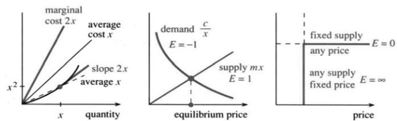

相对变化量更管用。比如价格涨了 $10\%$，需求量跌了 $5\%$；若变化越来越小，这个比值仍接近这个数，需求弹性就是 $1/2$。实际上，带符号的比值应为 $-1/2$：价格上去了，需求下来了。在我们的定义中，弹性是 $-1/2$。经济学家交谈时会把负号省掉（我希望没有忘掉）。

> **定义。**需求函数 $y(x)$ 的弹性为
> $$E(x)=\lim_{\Delta x\to0}\frac{\Delta y/y}{\Delta x/x}
> =\frac{dy/dx}{y/x}.\tag{3}$$

**弹性等于“边际量”除以“平均量”**，也等于 $y$ 的相对变化量除以 $x$ 的相对变化量。有时候，所有价格处的弹性都一样——下面就谈这个重要的情形。

**例 4。**设价格为 $x$ 时需求量 $y=c/x$。由微积分得 $dy/dx=-c/x^2$；由代数得 $y/x=c/x^2$。两者之比为 $E=-1$：
$$E=\frac{-c/x^2}{c/x^2}=-1.$$

别的需求曲线，都拿这个例子作比。$|E|<1$ 时称需求**缺乏弹性**，$|E|>1$ 时称需求**富有弹性**。需求函数 $20/\sqrt{x}$ 缺乏弹性，$E=-1/2$；$x^{-3}$ 富有弹性，$E=-3$。导数已知的幂函数 $y=cx^n$，恰好具有常弹性 $n$：
$$y=cx^n\quad\Longrightarrow\quad
\frac{dy}{dx}=cnx^{n-1},\qquad
E=\frac{cnx^{n-1}}{cx^n/x}=n.$$

正因为幂函数立下了这个基准，我们才能这么早讨论经济学应用。在 $y=c/x$ 的特殊情形中，消费者在各种价格下的总支出相同：价格乘以数量恒为 $xy=c$。

**例 5。**供给曲线满足 $E>0$，也就是价格一涨，供给量就增加。此时的基准是 $y=cx$：斜率为 $c$，平均量 $y/x=c$，所以 $E=c/c=1$。

把 $E=1$ 和 $E=0$、$E=\infty$ 摆在一起看。恒定供给 $y=c$ 对价格“完全无弹性”：指数为零，斜率也为零。收获一结束，供给不会立刻增加；价格再高，农民也不能立即种出更多小麦。缺了弹性，农业经济的问题就难办了。

另一个极端 $E=\infty$ 称为“完全有弹性”：固定价格下，供给量可任意增加。这一说法曾似乎适用于水和木材。实际上，图中陡直的 $x=\text{常数}$ 部分，会转向水平的 $y=\text{常数}$ 部分。


固定价格转成固定供给，$E=\infty$ 转成 $E=0$，水的供给曲线弯成一个像希腊字母 $\Gamma$ 的形状。

**例 6。**需求是收入的递增函数——收入越多，需求越多。收入弹性定义为
$$E(I)=\frac{dy/dI}{y/I}.$$
奢侈品满足 $E>1$，即富有收入弹性；收入翻倍时，对鱼子酱的需求增加到两倍以上。必需品满足 $E<1$，缺乏收入弹性，比如面包的需求，就不会随收入翻倍而翻倍。请注意，微积分的核心概念，为经济学的核心概念提供了语言。

**关于“供给量＝需求量”的重要说明。**这是微观经济学的基本方程。在供给曲线与需求曲线的交点处，经济达到均衡价格。供给量＝需求量假定完全竞争。供应者很多时，谁也不能提高价格。如果有人尝试这样做，顾客就会转向别处。

相反的情形是垄断——没有竞争。不再是许多小麦小生产者，而是一个电力生产者。机场是垄断者（也许美国国家橄榄球联盟也是）。如果提高价格，仍有一部分需求。几个生产者像一个垄断者那样行动，就出现了价格操纵——反垄断法力图阻止这种情况。价格不是由供给量＝需求量决定的。微积分的问题不同了：**使利润最大化**。第3.2节在边际利润（斜率！）为零处确定最大值。

**收入弹性问题。**收入为 10,000 美元时，你储蓄 500 美元。储蓄的收入弹性为 $E=2$，那么新增的一美元收入里，有多少用于储蓄？

**解。**因为 $E=2$，所以储蓄函数为 $y=cx^2$。由 $500=c(10,000)^2$ 得 $c=5\times10^{-6}$。于是，在这个收入水平上，
$$\frac{dy}{dx}=2cx=10\cdot10\cdot10^{-6}\cdot10^4=\frac1{10}.$$
这就是边际储蓄，每一美元存十美分。平均储蓄率为 $5\%$，边际储蓄率为 $10\%$，二者之比 $E=2$。

### 2.2 习题

**阅读填空**

$f=x^4$ 的导数为 $f'=$ **(a)______**。将 $(x+h)^4$ 展开为五项 **(b)______**，减去 $x^4$ 并除以 $h$ 后，剩下四项 **(c)______**。这就是 $\Delta f/h$，其极限为 **(d)______**。

$f=x^n$ 的导数为 $f'=$ **(e)______**。$(x+h)^n$ 由 **(f)______** 定理展开。要关注的是形如 $x^{n-1}h$ 的项，它只含一个 **(g)______**。这种乘积共有 **(h)______** 个，所以 $(x+h)^n=x^n+$ **(i)______** $+\cdots$。减去 **(j)______** 并除以 $h$ 后，$\Delta f/h$ 的极限为 **(k)______**。这里不需要用到的 $x^{n-j}h^j$ 的系数“$n$ 选 $j$”为 **(l)______**，其中 $n!$ 表示 **(m)______**。

$x^{-2}$ 的导数为 **(n)______**，$x^{1/2}$ 的导数为 **(o)______**，$3x+1/x$ 的导数为 **(p)______**。最后一项用到以下法则：$3f(x)$ 的导数为 **(q)______**，$f(x)+g(x)$ 的导数为 **(r)______**。积分根据 $dy/dx$ 求回 **(s)______**。若 $dy/dx=x^4$，则 $y(x)=$ **(t)______**。

1. 从 $f=x^6$ 出发，依次写出 $f'$、$f''$（“$f$ 两撇”，即 $f'$ 的导数）。对 $x^6$ 求导 ______ 次后得到常数；这个常数是多少？
2. 找一个导数为 $x^6$ 的函数。

**求第 3–10 题中函数的导数。即使 $n$ 为负数或分数，$x^n$ 的导数仍为 $nx^{n-1}$。**

3. $x^2+7x+5$。
4. $1+7/x+5/x^2$。
5. $1+x+x^2+x^3+x^4$。
6. $(x^2+1)^2$。
7. $x^n+x^{-n}$。
8. $x^n/n!$。
9. $1+x+\tfrac12x^2+\tfrac16x^3+\tfrac1{24}x^4$。
10. $\tfrac23x^{3/2}+\tfrac25x^{5/2}$。
11. 写出两个满足 $df/dx=1/x^2$ 的函数。


12. **找出错误：**$x^2=x+x+\cdots+x$（共 $x$ 项），因此其导数是 $1+1+\cdots+1$（也共 $x$ 项），似乎得到 $x^2$ 的导数为 $x$。
13. 求 $3x^{1/3}$、$-3x^{-1/3}$ 和 $(3x^{1/3})^{-1}$ 的导数。
14. $x+1/x$ 的斜率在 $x=$ ______ 时为零。图像在这些点有什么特点？
15. 画出 $y=x^3-x$ 的图像，找出斜率为零的位置。
16. 若 $df/dx$ 为负，$f(x)$ 是否总为负？当 $x$ 足够大时，$f(x)$ 是否必为负？若觉得不对，请举出例子。
17. 一块石头以 $16\,\mathrm{ft/s}$ 的初速度竖直向上抛出，时刻 $t$ 的高度为 $f=16t-16t^2$。（a）求从 $t=0$ 到 $t=1/2$ 的平均速度 $\Delta f/\Delta t$。（b）求从 $t=1/2$ 到 $t=1$ 的平均速度。（c）求 $t=1/2$ 时的 $df/dt$。
18. 若 $f$ 以英尺计、$t$ 以秒计，则 $f'$ 及其导数 $f''$ 的单位分别是什么？在 $f=16t-16t^2$ 中，第一个 $16$ 的单位为英尺每秒，第二个 $16$ 的单位为 ______。
19. 在 $-2\le x\le2$ 上画出 $y=x^3+x^2-x$，估计它在哪些区间递减，再解 $dy/dx=0$ 核对分界点。
20. 在 $dy/dx=0$ 的点，$y(x)$ 的图像有什么特点？可用 $y=x^2$ 检验。
21. 用代数方法求 $y=\sqrt{x}$ 的斜率，再令 $h\to0$：
   $$\frac{\Delta y}{h}=\frac{\sqrt{x+h}-\sqrt{x}}h
   =\frac{\sqrt{x+h}-\sqrt{x}}h=
   \frac{\sqrt{x+h}+\sqrt{x}}{\sqrt{x+h}+\sqrt{x}}.$$
22. 仿照第 21 题，求 $y=1/\sqrt{x}$ 的斜率。
23. 补出帕斯卡三角形中 $n=5$、$n=6$ 两行。为什么第 $n$ 行系数之和为 $2^n$？
24. 补全 $(x+h)^5=x^5+$ ______。二项式系数 $\binom51$、$\binom52$、$\binom53$ 分别是多少？
25. 计算 $(x+h)^3-(x-h)^3$，除以 $2h$，再令 $h=0$。为什么求斜率时要除以 $2h$？
26. 解微分方程 $y''=x$，求 $y(x)$。
27. 对 $f(x)=x^2+x^3$，写出 $f(x+\Delta x)$ 和 $\Delta f/\Delta x$。$\Delta x\to0$ 时的极限是什么？这验证了哪条关于和的求导法则？
28. 根据第 2.1 节，$(u(x))^2$ 的导数为 ______。取 $u=x^n$ 验证此法则。
29. $x^7+1$ 和 $(x+1)^7$ 的导数分别是什么？可通过平移 $x^7$ 的图像思考。
30. 若 $df/dx=v(x)$，找出导数分别为下列函数的函数：（a）$4v(x)$；（b）$v(x)+1$；（c）$v(x+1)$；（d）$v(x)+v'(x)$。
31. 什么函数 $f(x)$ 的四阶导数为 $1$？
32. 什么函数 $f(x)$ 的 $n$ 阶导数为 $1$？
33. 设 $df/dx=1+x+x^2+x^3$，求 $f(x)$。
34. 设 $df/dx=x^{-2}-x^{-3}$，求 $f(x)$。
35. 一个函数可以等于自己的导数。在无穷多项式 $f=1+x+\tfrac12x^2+\tfrac16x^3+\cdots$ 中，若 $df/dx=f$，则 $x^4$ 和 $x^5$ 的系数应分别是多少？
36. 写出一个以 $y=x^2$ 为解的微分方程 $dy/dx=$ ______。使右端含有 $y$，而不只是 $2x$。
37. 判断正误。（a）$x^\pi$ 的导数为 $\pi x^\pi$。（b）$ax^n/(bx^n)$ 的导数为 $a/b$。（c）若 $df/dx=x^4$、$dg/dx=x^4$，则 $f(x)=g(x)$。（d）当 $x\to a$ 时，$[f(x)-f(a)]/(x-a)$ 趋于 $f'(a)$。（e）$y=(x-1)^3$ 的导数为 $y'=3(x-1)^2$。

**第 38–44 题讨论微积分的经济学应用。**

38. 总成本 $y=y_0+cx$ 时，求 $E(x)=(dy/dx)/(y/x)$。当 $x$ 很大时，它趋于 ______。
39. 收入 $x=10,000$ 美元时，你用于汽车的支出为 $y=1,200$ 美元。若 $E=1/2$，新增一美元收入中有多少用于汽车？比较边际比例 $dy/dx$ 与平均比例 $y/x$。
40. 分别举出价格弹性（a）高、（b）低、（c）为负（？）的产品例子。
41. 需求函数 $y=c/x$ 满足 $dy/dx=-y/x$。用数值或代数说明，有限差商 $\Delta y/\Delta x$ 并不等于 $-y/x$。有限的步长错过了无穷小步长的特殊之处。
42. 需求函数 $y=x^n$ 的弹性为 $E=$ ______；收入 $xy$（价格乘以需求量）的弹性为 $E=$ ______。
43. $y=2x+3$ 表示固定成本为 $3$、边际成本为 $2$。画出 $E(x)$ 的图像。
44. 收入为 $I$ 时，储蓄为 $S(I)$。边际储蓄倾向为 ______。这里无需用弹性消除单位影响，因为 $S$ 与 $I$ 具有相同的 ______。将这一问题用于整个经济体系，属于（微观经济学／宏观经济学）。
45. 当 $t$ 增加 ______ 时，$2^t$ 翻倍；当 $t$ 增至原来的 ______ 倍时，$t^3$ 翻倍。艾滋病病例翻倍所需的时间与 $t$ 成正比。
46. 生物学中也会出现关系 $dy/y=n\,dx/x$，其中 $dy/y$ 表示头部的相对增长，$dx/x$ 表示身体的相对增长。对儿童的生长而言，$n>1$ 还是 $n<1$？
47. 哪些函数分别满足 $df/dx=x^9$ 和 $df/dx=x^n$？为什么 $n=-1$ 会带来麻烦？
48. $y=x^3$ 的斜率可由恒等式
   $$\frac{(x+h)^3-x^3}{h}=(x+h)^2+(x+h)x+x^2$$
   求得。（a）验证这个恒等式，并令 $h\to0$ 求 $dy/dx$。


   （b）为 $y=x^4$ 写出类似的恒等式。
49. **计算机绘图。**求 $y=x^4+2x^3-7x^2+3$ 满足 $y=0$ 的所有点，以及满足 $dy/dx=0$ 的所有点。
50. $y_1(x)=x^4+x^3$ 与 $y_2(x)=7x-5$ 的图像在某点相切，该点满足 $y_3(x)=$ ______ $=0$。画出 $y_3(x)$，观察该处有什么特点。一般而言，若某点 $y=y'=0$，图像在该处有什么性质？
51. 在马萨诸塞州的彩票中，从36个号码选6个，一张彩票中奖的概率是多少？
52. 什么情况下，把每一种可能组合都买上一张、确保至少中一张，经济上才合算？

## 2.3 斜率与切线


第 1 章从直线图像讲起：速度是常数，至少分段是常数；距离函数是一次函数。现在摆在面前的是 $x^3-2$、$x^4-x^2+3$ 这样的多项式，往后还会碰到别的函数。它们的图像确实是弯的。大多数函数在大范围里都不接近一次函数——可一旦把注意力收拢到一个点附近，情形就变了。这一节要做的，正是这件事。

**范围很小时，曲线看着像直线。**拿显微镜去看，或者在计算机上不断放大，这一点不会有疑问。距离—时间图像近似为一条直线，它的斜率，就是那一刻的速度。我们要找的，是图像最贴近的那条直线，也就是“切线”。再往外，它才弯开。

切线其实好描述。在 $y=f(x)$ 的图像上，点取在 $x=a$、$y=f(a)$，那里的斜率就是 $f'(a)$。**切线经过点 $(a,f(a))$，斜率为 $m=f'(a)$。**图 2.5 把这条线画得比任何方程都清楚，可我们终究得把几何翻成代数：写出直线的方程。

**例 1。**设 $y=x^4-x^2+3$。在 $x=a=1$ 处，高度是 $y=f(a)=3$。导数为 $dy/dx=4x^3-2x$，于是在该点，斜率是 $4-2=2$，也就是 $f'(a)=2$。

三个数 $x=1$、$y=3$、$dy/dx=2$ 就把这条切线定下来了，方程是
$$y-3=2(x-1).$$
本节要讲清楚的，就是为什么。


### 直线方程

一条直线由两个条件确定。知道两个点，就知道了这条直线（我们仍须写出方程）。知道一个点和斜率，一条直线也就定了。切线正属于后一种：切点在哪儿、那一点的斜率是多少，都是现成的。

1. 直线的方程，总可以写成 $y=mx+b$。
2. $m$ 是斜率，因为 $dy/dx=m$。
3. 常数 $b$ 负责把直线挪到指定的点上。

下面我一个一个来说：先看方程 $y=mx+b$，再看斜率 $m$，最后看截距 $b$。


**1. 为什么 $y=mx+b$ 的图像不弯？**拿 $y=2x+1$ 试：点 $(0,1)$ 和 $(4,9)$ 都满足方程，两者的中点 $(2,5)$ 也满足。再取中点，$(0,1)$ 与 $(2,5)$ 的中点 $(1,3)$ 仍在图像上。图像包含所有中点，因此必定是直的。

**2. 切线的斜率 $m$ 该取多少？**本例里 $m=f'(a)=2$。**在切点处，曲线与切线的斜率相同。**

直线 $y=mx+b$ 的斜率，还可以这样看：$x=0$ 时高度是 $b$，$x=1$ 时高度是 $m+b$；横向增加一个单位，纵向增加 $m$ 个单位，所以
$$\text{斜率}=\frac{\text{纵向变化量}}{\text{横向变化量}}=\frac m1.\tag{1}$$
横坐标每增加一个单位，纵坐标就增加 $m$，依次到达 $2m+b$、$3m+b$ 等。直线的斜率始终不变；曲线 $y=x^4-x^2+3$ 却不然，斜率随 $x$ 改变，只在 $x=1$ 处等于 $2$。

**3. 最后定 $b$。**切线 $y=2x+b$ 要经过 $(1,3)$，所以 $b=1$。换成字母：$y=mx+b$ 在切点处给出 $f(a)=ma+b$，$b$ 就解出来了。

> **2E** 切线方程中的 $b=f(a)-ma$，其中 $m=f'(a)$。因此
> $$y=mx+f(a)-ma,
> \qquad\text{或}\qquad y-f(a)=m(x-a).\tag{2}$$

后一种写法最省事。取 $x=a$，右端为零，立刻得到 $y=f(a)$，说明直线确实经过那个点。这就是直线方程的**点斜式**，往后要常用：
$$y-3=2(x-1),\qquad
\frac{y-3}{x-1}=\frac{\text{纵向变化量}}{\text{横向变化量}}=2.$$

**例 2。**曲线 $y=x^3-2$ 过点 $(2,6)$。在该点，$dy/dx=3x^2=12$，于是切线的点斜式，由 $2,6,12$ 这三个数拼出来：
$$y-6=12(x-2),\qquad\text{即}\quad y=12x-18.$$

还有一条重要的线：与切线垂直、也与曲线垂直的**法线**，见图 2.6。切线斜率为 $m$ 时，法线斜率就是 $-1/m$。（法则：两条垂直直线的斜率乘积为 $-1$。）本例 $m=12$，于是
$$\text{切线： }y-6=12(x-2),\qquad
\text{法线： }y-6=-\frac1{12}(x-2).$$

光线沿法线方向传播。灌木火灾也是如此——火势垂直于火线推进。写法线方程时，点斜式必须老老实实用上：切线是 $y=12x-18$，法线可不是把斜率换成 $-1/12$、截距照抄 $-18$ 就完事。


**例 3。**你坐在过山车上，轨道是 $y=x^2+4$。朋友站在原点 $(0,0)$，你想尽快赶到他那儿——该在哪儿跳？

**解。**你的路径就是切线（在高速时）。要选的，是让这条切线正好穿过原点的 $x=a$。离开点的高度是 $a^2+4$，斜率是 $2a$，于是
$$y-(a^2+4)=2a(x-a).$$
把 $(0,0)$ 代进去，得 $-(a^2+4)=-2a^2$，所以 $a=\pm2$。

航天器控制人员和棒球投手解的是同一个问题。在恰当的时刻放球，击中60英尺外的目标，是微积分一次惊人的展示。面对移动目标的四分卫，应当阅读第4章的相关变化率。

再看一个比过山车更好的例子。红灯前停车会浪费汽油。早点减速、然后加速才更聪明。要是路口已经有车在等，时机的拿捏就得靠微积分了。

**例 4。**红灯在前方 $72$ 米处，$4$ 秒后转绿。等在路口的那辆车随后以 $3\,\mathrm{m/s^2}$ 的加速度起步。你不能超它。那么，该立刻减速到多大的恒定速度？

**策略。**立刻把速度降到 $V$，刚好够得着前车。要是先往前开一段再刹车，速度就得压得更低。到追上的时刻 $T$，两车位置相同、速度也相同；两个条件，正对应图 2.6 中两条位置曲线相切。

**解。**前车在时刻 $T$ 的速度是 $3(T-4)$，式中的 $4$ 表示启动延迟。要速度相等，就得
$$3(T-4)=V,\qquad T=\frac V3+4.$$
你的位置是 $VT$，前车的位置是 $72+\tfrac32(T-4)^2$。位置相等，给出
$$72+\frac32(T-4)^2=VT,
\qquad72+\frac{V^2}{6}=V\left(\frac V3+4\right).$$
解为 $V=12\,\mathrm{m/s}$，合 $43\,\mathrm{km/h}$，也就是 $27$ 英里每小时。

要是前面没车，只需取 $V=72/4=18\,\mathrm{m/s}$，绿灯亮时正好通过路口，以 $65\,\mathrm{km/h}$ 或 $40$ 英里每小时。试试看。


### 连接曲线上两点的割线


这回不看只过一个切点的切线，改看穿过曲线上两个不同点的**割线**。切线的两个点，是靠拢得来的；现在把它们分开。点斜式也就换成了两点式。

曲线仍是 $y=f(x)$。第一点 $(a,f(a))$，第二点 $(c,f(c))$，。割线从这两点之间穿过，我们要写出它的方程。这一回斜率没有现成的，但很好求。

**例 5。**曲线 $y=x^3-2$ 过 $(2,6)$，也过 $(3,25)$。两点之间的斜率是
$$m=\frac{y\text{ 的变化量}}{x\text{ 的变化量}}=\frac{25-6}{3-2}=19.$$
拿第一点写点斜式，得 $y-6=19(x-2)$。这条线自动穿过第二点，因为 $25-6=19(3-2)$。斜率 $19$，正是两点之间的平均斜率 $\Delta y/\Delta x$。

**向前看一步。**让第二点向第一点靠拢，割线斜率便趋向切线斜率 $dy/dx$，取极限，导数就露出来了。这是眼下的重点——但不会是永远的重点。

用不了多久，你求导就会很顺手：算精确的 $dy/dx$，反倒比算差商 $\Delta y/\Delta x$ 容易。一旦知道 $x^9$ 的导数是 $9x^8$，思路就能倒过来用：在 $x=1$ 附近，纵向增量大约是横向增量的九倍。要估算
$$\Delta y=1.001^9-1^9,$$
只需把 $\Delta x=0.001$ 乘以 $9$，得 $0.009$；计算器给出的约为 $0.009036$。沿着切线算，比沿着曲线算容易。

回到割线，把数字换成字母：连接 $(a,f(a))$ 和 $(c,f(c))$ 的，是哪条直线？数学家把公式排在数字前面，把推理排在公式前面，更把推理背后的思想排在推理前面。

1. 斜率是 $\displaystyle m=\frac{f(c)-f(a)}{c-a}$。
2. 在 $x=a$ 处，高度是 $y=f(a)$。
3. 在 $x=c$ 处，高度是 $y=f(c)$；只要斜率对，这一条自然成立。

> **2F 两点式：**用两点间的斜率写出割线方程：
> $$y-f(a)=\frac{f(c)-f(a)}{c-a}(x-a).\tag{3}$$

令 $x=a$，右端为零，所以 $y=f(a)$；令 $x=c$，右端两个因子 $c-a$ 约掉，剩下 $y=f(c)$。切线方程 (2) 与割线方程 (3) 都到手了，接下来就能把两者接上。


### 割线趋近切线

这一步其实很基本，跟前面处理速度是同一个路数：
$$\text{平均速度}=\frac{\Delta\text{距离}}{\Delta\text{时间}}
=\frac{f(t+\Delta t)-f(t)}{\Delta t},$$
取极限，就是 $df/dt$。现在把同样的动作用到斜率上。**$c\to a$ 时，割线趋于切线：**
$$\text{割线斜率： }\frac{\Delta f}{\Delta x}=\frac{f(c)-f(a)}{c-a},
\qquad
\text{切线斜率： }f'(a)=\lim_{c\to a}\frac{\Delta f}{\Delta x}.$$

这就是微分学的基本思想！$c$ 一步步贴近 $a$ 时，图 2.7 画不下的那些割线，得靠你自己在脑子里补出来。$c-a$ 就是 $\Delta x$；$f(c)-f(a)$ 呢，就是取 $x=a$ 作起点时的 $f(x+\Delta x)-f(x)$，也就是高度的变化量 $\Delta f$。所有这些割线都过点 $(a,f(a))$，它们的极限位置，就是切线。


$$\text{割线： }y-f(a)=\frac{f(c)-f(a)}{c-a}(x-a),
\qquad\text{切线： }y-f(a)=f'(a)(x-a).$$

直觉上，这个极限挺清楚：两点一靠拢，就得到在该点与曲线相切的那条直线；当然，切线也可能在远处再次与曲线相遇。数学上却要小心，因为这个极限把我们从代数带进了微积分。代数不允许除以零；微积分偏要研究分子、分母都趋于零时，比值怎么变。

下面这个形式看着新鲜，其实与原来的导数定义完全一样：
$$f'(a)=\lim_{c\to a}\frac{f(c)-f(a)}{c-a}.\tag{4}$$

**例 6。**求 $y=f(x)=\sin x$ 在 $x=0$ 处的所有割线与切线。

基点是 $(0,\sin0)=(0,0)$。连到另一点 $(c,\sin c)$ 的割线，斜率是 $(\sin c)/c$，因此
$$\text{割线： }y=\frac{\sin c}{c}x,
\qquad\text{切线： }y=x.$$
$c\to0$ 时，割线就变成切线；$(\sin c)/c$ 的极限不是毫无意义的 $0/0$，而是 $1$，即该点的导数。

**例 7。**你手上的黄金，$t$ 年后值 $\sqrt t$ 百万美元。什么时候它的增长率会降到当时价值的 $10\%$，使你应该卖掉黄金、改买债券？到 $t=25$ 时，这样能比黄金的价值 $\sqrt{25}=5$ 多出多少？


**解。**价值的增长率，就是 $\sqrt t$ 的导数 $1/(2\sqrt t)$。它等于当前价值的 $10\%$ 时，
$$\frac1{2\sqrt t}=\frac{\sqrt t}{10},\qquad2t=10,\qquad t=5.$$
这时卖出黄金，价值轨迹便从曲线转到切线：
$$y-\sqrt5=\frac{\sqrt5}{10}(t-5).$$
到 $t=25$ 时，$y-\sqrt5=2\sqrt5$，所以 $y=3\sqrt5=6.7$ 百万美元。这里用的是单利，不是复利。黄金只值区区 $5$ 百万美元。

### 2.3 习题

**阅读填空**

一条直线可由 **(a)______** 个点确定，或由一个点和 **(b)______** 确定。切线的斜率等于 **(c)______** 在切点的斜率。切线的点斜式为 $y-f(a)=$ **(d)______**。

$y=x^3+x$ 在 $x=1$ 处的切线斜率为 **(e)______**，方程为 **(f)______**，与 $y$ 轴相交于 **(g)______**，与 $x$ 轴相交于 **(h)______**。该点 $(1,2)$ 处法线的斜率为 **(i)______**，方程为 $y-2=$ **(j)______**。连接 $(1,2)$ 与 $(2,$ **(k)______** $)$ 的割线斜率为 **(l)______**，方程为 $y-2=$ **(m)______**。

当 $m=$ **(n)______** 时，点 $(c,f(c))$ 位于直线 $y-f(a)=m(x-a)$ 上。$c\to a$ 时，斜率 $m$ 趋于 **(o)______**，割线趋于 **(p)______** 线。

1. （a）求 $y=12/x$ 的斜率。求 $y=12/x$ 的斜率。（b）求 $(2,6)$ 处的切线方程。（c）求该处的法线方程。（d）求连接 $(2,6)$ 与 $(4,3)$ 的割线方程。
2. 对 $y=x^2+x$，求：（a）$(1,2)$ 处的切线和法线方程；（b）连接该点与 $(1+h,(1+h)^2+(1+h))$ 的割线方程。
3. 一条直线经过 $(1,-1)$ 和 $(4,8)$。先写出点斜式，再化为 $y=mx+b$。
4. $y=x^3+6x$ 在原点的切线为 $y=$ ______。它是否还在别处与曲线相交？
5. $y=x^3-3x^2+x$ 在原点的切线为 $y=$ ______。它也是连接原点与点 ______ 的割线。
6. 求曲线 $x=y^2$ 在 $(4,2)$ 处的切线。
7. 对 $y=x^2$，连接 $(a,a^2)$ 和 $(c,c^2)$ 的割线方程为 ______。约去斜率表达式中的 $c-a$，再令 $c\to a$ 求切线。
8. 构造一个在 $x=1$ 与 $x=2$ 处导数相同的函数；然后画出 $y=x^4-2x^2$，找出它具有同一条切线的两个不同点。
9. 找一条在 $x=5$ 处与 $y=2x-3$ 相切的曲线，并求该曲线在 $(5,7)$ 处的法线。
10. 对 $y=1/x$，连接 $(a,1/a)$ 和 $(c,1/c)$ 的割线方程为 ______。化简斜率，再求 $c\to a$ 时的极限。
11. 求 $y=\sin x$ 在 $x=\pi/2$ 处的切线和法线方程。
12. 若 $a$ 和 $c$ 分别从两侧趋近位于二者之间的 $b$，则割线斜率 $[f(c)-f(a)]/(c-a)$ 趋于 ______。
13. 对 $y=1/x$ 上的点 $x=a$，求：（a）切线方程；（b）切线与两坐标轴的交点。切线与坐标轴围成的三角形面积恒为 ______。
14. 设 $g(x)=f(x)+7$，则 $f$、$g$ 在 $x=4$ 处的切线互相 ______。判断正误：两条直线之间的距离为 $7$。
15. 选取 $c$，使 $y=4x$ 与 $y=x^2+c$ 相切。必须同时匹配高度与斜率。
16. 选取 $c$，使 $y=5x-7$ 与 $y=x^2+cx$ 相切。
17. 对 $y=x^3+4x^2-3x+1$，求切线水平的所有点。
18. 说明 $y=4x$ 不可能与 $y=cx^2$ 相切。可尝试同时匹配高度和斜率，或画图说明。
19. 确定 $c$，使经过 $(0,3)$ 和 $(5,-2)$ 的直线与 $y=c/(x+1)$ 相切。
20. 选取 $b,c,d$，使两条抛物线 $y=x^2+bx+c$ 与 $y=dx-x^2$ 在 $(1,0)$ 处相切。
21. $f(x)=x^3$ 经过 $(1,1)$。（a）另一点为 $x=c=1+h$，$y=f(c)=$ ______。（b）$\Delta f=$ ______。（c）割线斜率 $m=$ ______。（d）$h\to0$ 时，$m$ 趋于 ______。
22. 构造一个函数 $y=f(x)$，使它在 $x=1$ 处的切线同时也是一条在 $x=3$ 处再次与曲线相交的割线。


23. 画出两条向相反方向弯曲、彼此分离的曲线，标出距离最近的点 $P$、$Q$。在这些点处，两条切线互相 ______，两条法线 ______。
24. ★ 若抛物线 $y=x^2+1$ 与 $y=x-x^2$ 的最近点分别为 $(a,a^2+1)$ 和 $(c,c-c^2)$，列出确定 $a,c$ 的两个方程。
25. 一束光沿直线 $x=a$ 竖直向下，射到抛物面反射器截线 $y=x^2$ 上的 $P=(a,a^2)$。（a）求 $P$ 处切线，并求它与 $y$ 轴的交点 $Q$。（b）验证 $P$、$Q$ 到焦点 $F=(0,1/4)$ 的距离相等。（c）由（b）说明图中相应角相等。（d）哪条物理定律保证每条入射光线都反射到焦点 $F$？


26. 对反射器截线 $y=2/x$，沿某条特殊直线 $x=a$ 向下的入射光线，经反射后沿水平方向传播。求 $a$。
27. 对抛物线 $4py=x^2$，斜率在哪一点等于 $1$？该点的竖直入射光线会水平反射，因此焦点为 $(0,$ ______ $)$。
28. 下面的说法为什么错误？请改正。（a）若 $(1,2)$ 处的切线为 $y=2x$，则法线为 $y=-\tfrac12x$。（b）当 $c\to a$ 时，割线斜率 $[f(c)-f(a)]/(c-a)$ 趋于 $[f(a)-f(a)]/(a-a)$。（c）经过 $(2,3)$、斜率为 $4$ 的直线是 $y-2=4(x-3)$。
29. 一个小球沿圆周运动，$x=\cos t$、$y=\sin t$。在 $t=3\pi/4$ 时，它沿切线飞出。求这条切线方程及其与地面 $y=0$ 的交点。
30. 若 $y=f(x)$ 在 $x=a$ 处的切线与 $y=g(x)$ 在 $x=b$ 处的切线重合，列出 $a,b$ 必须满足的两个方程。
31. 画一个半径为 $1$、放在抛物线 $y=x^2$ 内部并与之相切的圆。接触点 $(a,a^2)$ 处的法线方程为 ______；它与 $y$ 轴交于 $y=$ ______。该交点到 $(a,a^2)$ 的距离等于半径 $1$ 时，$a=$ ______，由此确定接触点。
32. 仿照第 31 题，讨论更平缓的抛物线 $y=\tfrac12x^2$，说明圆会落在什么位置。
33. 你正在申请一笔 1,000 美元的奖学金，时间价值为每小时 10 美元。若花 $x$ 小时撰写申请，成功概率为 $1-1/x$，应何时停止投入时间？
34. 设任意两点 $a,c$ 都满足 $|f(c)-f(a)|\le|c-a|$。证明 $|df/dx|\le1$。
35. $y=1/x^2$ 在哪一个 $x=a$ 处的切线与 $x$ 轴相交于 $x=3$？
36. 若 $u(x)/v(x)=7$，求 $u'(x)/v'(x)$，并求 $(u(x)/v(x))'$。
37. 用两种方法求 $f(c)=1.001^{10}$：一是计算器，二是近似式 $f(c)-f(a)\approx f'(a)(c-a)$，其中 $a=1$，$f(x)=x^{10}$。
38. 距 $x=1$ 的横向增量为 $\Delta x$ 时，曲线 $y=1/x$ 比其在 $x=1$ 处的切线高多少？
39. 距 $x=2$ 的横向增量为 $\Delta x$ 时，曲线 $y=x^3$ 比其在 $x=2$ 处的切线高多少？
40. 根据第 38 或 39 题，曲线与切线之间的距离像 $\Delta x$ 的什么幂 $(\Delta x)^p$ 那样增长？
41. $f(x)=x^2-1$ 在 $x_0=2$ 处的切线与 $x$ 轴交于 $x_1=$ ______；在 $x_1$ 处的切线又与 $x$ 轴交于 $x_2=$ ______。画出曲线与两条切线。这是用牛顿法求解 $f(x)=0$ 的最初两步。
42. **思考题。**方程 $y=mx+b$ 需要两个数；点斜式 $y-f(a)=f'(a)(x-a)$ 需要三个数；两点式需要四个数 $a,f(a),c,f(c)$。这怎么解释？
43. 求例 4 中你恰好追上前车时的相切时刻 $T$。
44. 若等待车辆的加速度仅为 $2\,\mathrm{m/s^2}$，则你应降到多大的恒定速度 $V$？
45. 一个小偷在40米外，以每秒8米的速度向你跑来。使 $v=at$ 能让你保持在前面的最小加速度是多少？
46. 接力赛中，你距交接位置还有 $8$ 米，且正在明显减速，位置为 $f=-8+6t-\tfrac12t^2$。下一棒选手若从该位置以恒定速度前进，位置为 $f=vt$，应选择多大的 $v$，才能恰好完成交棒？

## 2.4 正弦函数与余弦函数的导数


本节要办两件事：一是算出 $\sin x$ 和 $\cos x$ 的导数，二是讲清这两个函数为什么如此重要。它们描述的是**振荡**——这种运动，我们会用文字讲，也会用方程写。下面你会看到一个“微分方程”，里头是未知函数 $y(x)$ 的导数。它说的是：二阶导数，也就是导数的导数，等于原函数的相反数，记作 $y''=-y$。放到运动里，距离朝一侧去，加速度就朝另一侧来，于是 $y$、$y'$、$y''$ 一起振荡。这个方程的解，正是 $\sin x$、$\cos x$ 以及它们的所有线性组合。

先看斜率。$y=\sin x$ 的导数是 $y'=\cos x$。这本来就不该是个谜，可我至今觉得它漂亮。第 1 章跟着小球绕圆转了一圈：影子上下起落，高度是 $\sin t$，速度是 $\cos t$。现在就用标准的极限方法，把这个导数算出来。设 $y(x)=\sin x$，则
$$\frac{dy}{dx}=\lim_{h\to0}\frac{\Delta y}{\Delta x}
=\lim_{h\to0}\frac{\sin(x+h)-\sin x}{h}.\tag{1}$$

正弦可比 $x^2$、$x^3$ 难对付。从前展开的是 $(x+h)^2$、$(x+h)^3$，如今要展开 $\sin(x+h)$，就得请出三角里的“加法公式”——第 1.5 节刚复习过的那一组：
$$\sin(x+h)=\sin x\cos h+\cos x\sin h,\tag{2}$$
$$\cos(x+h)=\cos x\cos h-\sin x\sin h.\tag{3}$$
由式 (2)，
$$\frac{\Delta y}{\Delta x}
=\frac{\sin x\cos h+\cos x\sin h-\sin x}{h}
=\sin x\frac{\cos h-1}{h}+\cos x\frac{\sin h}{h}.\tag{4}$$

右端裂成两块，各自都简单些。代数和三角能做的到此为止，接下来才是微积分的问题：**$h\to0$ 时会怎样？**这时再不能像多项式那样把 $h$ 一约了之——至于把 $(\sin h)/h$ 写成“$\sin$”，这种错我提都不想提。这里需要两个关键极限：
$$\lim_{h\to0}\frac{\cos h-1}{h}=0,
\qquad\lim_{h\to0}\frac{\sin h}{h}=1.\tag{5}$$

细心的读者可能要抗议了：极限还没定义呢！你还可以再追问：凭什么先分别取极限，再拼回式 (4)？不过，我还是按“先讲思想、后补严密”的原则往下走。式 (4) 的极限，确实可以由式 (5) 里那两个极限拼出来：
$$\frac{dy}{dx}=(\sin x)\cdot0+(\cos x)\cdot1=\cos x.\tag{6}$$
割线斜率 $\Delta y/\Delta x$ 就此逼近切线斜率 $dy/dx$。

> **2G** $y=\sin x$ 的导数为 $dy/dx=\cos x$。


不能跳过式 (5) 里那两个关键极限——真正的思想就在这里。直接把 $h=0$ 代进去，两个比值都成了 $0/0$。别忘了：零角的余弦是 $1$，正弦是 $0$。图 2.8 画了个很小的角 $h$：长为 $\sin h$ 的边几乎缩到零，长为 $\cos h$ 的边接近 $1$；$(\sin h)/h$ 给出的，正是正弦曲线刚起步时的割线斜率。


两个函数同时趋于零，比值却可能千差万别。比如，
$$\frac{h^2}{h}\to0,\qquad\frac hh\to1,\qquad\frac{\sqrt h}{h}\to\infty.$$
单看 $0/0$，什么也判断不出来；关键是分子、分母谁趋近零更快。粗略地说，我们要说明 $(\cos h-1)/h$ 像 $h^2/h$，而 $(\sin h)/h$ 像 $h/h$。

**暂停一下。**图2.9画出 $\sin x$ 的图像（黑色）。$\sin(x+\Delta x)$ 的图像紧挨在旁边（红色）。平移距离为 $\Delta x$ 时，高度差为 $\Delta f$。


再把高度差除以这个小量 $\Delta x$（也就是 $h$），右图画的就是差商曲线。它跟 $\cos x$ 很接近，可又不完全一样——从起点就能看出来。数学论证要证明：$\Delta x\to0$ 时，极限恰为 $\cos x$。有趣的是，整套推理只落在一个点上：$x=0$，该点的斜率是 $\cos0=1$。

下面就来证明 $\sin\Delta x/\Delta x\to1$，也就是说，正弦曲线在原点处的斜率是 $1$。有了加法公式，一个点的结论就能推向所有点，得到导数 $\cos x$。

**问：**$\Delta x>0$ 时，为什么 $f(x+\Delta x)$ 的图像相对于 $f(x)$ 向左平移？

**答：**在 $x=0$ 处，平移后的图像显示的已经是 $\Delta x$ 处的值 $f(\Delta x)$。图2.9a中，红色图像相对于黑色图像向左平移。黑色图像显示 $\sin0$ 时，红色图像显示 $\sin h$。

### $(\sin h)/h$ 的极限为 $1$

要理解这个极限，办法不止一种。最直白的办法，是让计算机画图。图 2.10 显示，$(\sin h)/h$ 在 $h\to0$ 时趋于 $1$，$(\tan h)/h$ 也一样。麻烦只在真正动手的时候：可能出现“函数无定义”之类的消息，而没有图像。（机器可能拒绝在 $h=0$ 处除以零。你大概能绕过这个问题。）由于这个极限很重要，我想用数学证明它等于1。

图 2.10 还显示：对小正数 $h$，$\sin h<h$，而 $\tan h>h$。记住 $\tan h=\sin h/\cos h$——除以余弦就足以把正切抬到 $h$ 以上。需要在 $h$ 为小正数时证明的关键不等式是
$$\sin h<h,\qquad\tan h>h.\tag{7}$$


由 $\tan h=\sin h/\cos h$，式 (7) 等价于
$$\frac{\sin h}{h}<1,
\qquad\frac{\sin h}{h}>\cos h.\tag{8}$$
**$h\to0$ 时，$(\sin h)/h$ 被夹在 $\cos h$ 与 $1$ 之间，而 $\cos h\to1$。**中间那个比值无处可去，只能趋于 $1$。

这就是夹逼原理：两个函数奔向同一个极限，夹在它们中间的那个也只能跟着去。第 2.6 节末会证明这一点。

$h$ 取负值也完全可以，结论一样。正弦是奇函数：$\sin(-h)=-\sin h$，分子、分母同时变号，比值不变。所以 $(\sin h)/h$ 是偶函数，图像关于纵轴对称，从左右两边都趋于 $1$。

证明要靠 $\sin h<h<\tan h$。图只把它画了出来，没讲原因。现在回到直角三角形。


图 2.11 左图说明为什么 $\sin h<h$。弦 $PQ$ 长 $2\sin h$；同一段弧只能更长，因为两点之间线段最短。[^shortest] 单位圆上弧 $PQ$ 的长是 $2h$。重要的是：**半径等于 $1$ 时，弧长就等于圆心角的弧度数。**整个圆周长与整个周角，弧度数都是 $2\pi$。所以 $2\sin h<2h$。

右图说明 $h<\tan h$，这回比面积。大三角形的底为 $1$，高为 $\tan h$，面积是 $\tfrac12\tan h$。三角形里头，正嵌着一块阴影扇形，它占整个圆的 $h/(2\pi)$。

[^shortest]: 如果我们试着证明这一点，就得在这里待上一整夜。把它当作真的接受吧。


单位圆面积是 $\pi$，扇形面积照公式 $\pi\cdot h/(2\pi)=h/2$ 算。它比外接的三角形小，于是 $h/2<\tan h/2$。

到这里，$\sin h<h<\tan h$ 已经证完；再用式 (8) 一夹，$(\sin h)/h\to1$。证毕。第 13 题会示范怎样用面积比较证明 $\sin h<h$。

**注意：**角 $x,h$ 一律以弧度计。要是自变量改成角度数，$\sin x$ 的导数就不再是 $\cos x$，一度比一弧度小得多，$dy/dx$ 按因子 $2\pi/360$ 缩小。

### $(\cos h-1)/h$ 的极限为 $0$

第二个极限不一样。这里要说明：$1-\cos h$ 趋于零，比 $h$ 还快。余弦与正弦由 $\sin^2h+\cos^2h=1$ 连在一起；从已知的 $\sin h<h$ 出发，把它改写成含余弦的形式：
$$ (1-\cos h)(1+\cos h)=1-\cos^2h=\sin^2h<h^2.\tag{9}$$
注意各项都为正；两边同除以 $h(1+\cos h)$，得
$$0<\frac{1-\cos h}{h}<\frac{h}{1+\cos h}.\tag{10}$$
右端趋于零，夹在中间的比值只好也趋于零——又一次“夹逼”，逃不掉。换成 $\cos h-1$，或者让 $h$ 取负，只是变个符号；零取负还是零。式 (6) 就此坐实：$\sin x$ 的斜率是 $\cos x$。

**说明。**式(10)也说明 $1-\cos h$ 近似为 $\tfrac12h^2$。2来自 $1+\cos h$。找出像 $\tfrac12h^2$ 这样简单的近似，是微积分的基本用途之一。一条“相切抛物线”$1-\tfrac12h^2$ 贴近余弦曲线的顶部。

### 余弦函数的导数

这一回轻松。把正弦曲线向左平移 $\pi/2$，就得到余弦曲线；导函数也跟着平移，所以 $\cos x$ 的导数是 $-\sin x$。图 2.12 里，实线是函数，虚线是导函数。

看那条虚线：实线一往下走，虚线（也就是斜率）就落到零以下；实线走平，斜率正好为零。递增函数的斜率为正，递减函数的斜率为负。这一点很重要，以后还要细说。

导数不只告诉我们函数是升是降，还告诉我们升得多快、降得多快。仍可从差商直接算：
$$\frac{\Delta y}{\Delta x}=\frac{\cos(x+h)-\cos x}{h}
=\cos x\frac{\cos h-1}{h}-\sin x\frac{\sin h}{h},$$
$$\frac{dy}{dx}=(\cos x)\cdot0-(\sin x)\cdot1=-\sin x.\tag{11}$$
第一行用的是余弦的加法公式 (3)；第二行分别取那两个已知极限，跟图像给出的结论对上了。


### 正弦与余弦的二阶导数

现在引入**导数的导数**，也就是原函数的**二阶导数**。它量的是斜率变化的快慢，而不是原函数本身变化的快慢。在运动问题里，它就是速度的变化率。直线斜率恒定（速度也恒定），所以二阶导数为零：
$$f(t)=5t,\qquad\frac{df}{dt}=5,\qquad\frac{d^2f}{dt^2}=0.$$

抛物线 $y=x^2$ 的导数是 $2x$，一次函数；再求一次导，得常数 $2$。同样地，
$$f(t)=\frac12at^2,\qquad\frac{df}{dt}=at,\qquad\frac{d^2f}{dt^2}=a.$$
二阶导数记作 $d^2f/dt^2$ 或 $d^2y/dx^2$，简写为 $f''$、$y''$，读作“$f$ 两撇”“$y$ 两撇”。比如 $y=x^3$ 的二阶导数是 $y''=6x$。

在距离—速度问题中，$f''$ 就是**加速度**：$v$ 说的是距离变多快，$f''$ 说的是速度变多快。$df/dt$ 的量纲是长度除以时间，二阶导数的量纲是长度除以时间的平方。重力加速度约为 $32\,\mathrm{ft/s^2}$ 或 $9.8\,\mathrm{m/s^2}$，这意味着速度在一秒内增加 $32\,\mathrm{ft/s}$，可不是说距离增加 $32$ 英尺。

$y=\sin t$ 一上来是往上走的，因为导数 $\cos t$ 为正。可二阶导数是 $-\sin t$，在这一段为负：曲线一边上升，一边往下弯。上面那个拱形，就叫“向下凹”。

到了 $t=\pi$，曲线穿过零点、进入负值区，二阶导数转为正，曲线向上弯；下面那个拱形，叫“向上凹”。

- $y''>0$ 表示 $y'$ 递增，曲线向上弯曲，即向上凹；
- $y''<0$ 表示 $y'$ 递减，曲线向下弯曲，即向下凹。

第 3 章会正式研究这些性质，这里先借 $\sin t$ 作个初步观察。

正弦与余弦的非凡之处是 $y''=-y$。这很不寻常，也很特别：加速度＝负的距离。距离越大，拉回来的力越大。
$$y=\sin t:\quad y'=\cos t,\quad y''=-\sin t=-y;$$
$$y=\cos t:\quad y'=-\sin t,\quad y''=-\cos t=-y.$$

**问：**$d^2y/dt^2<0$ 是不是说明 $y(t)$ 正在变小？

**答：**不是！它说的是 $dy/dt$ 在减小，$y$ 本身未必减小。正弦曲线刚起步的那一段，$y$ 明明还在增加，二阶导数却是负的。


正弦与余弦给出的是**简谐运动**：上下、往复、伸缩、拉伸与压缩。拉长弹簧，回复力就把它拽回去；推高秋千，重力就把它压下来。这些运动由一个微分方程支配：
$$\frac{d^2y}{dt^2}=-y.\tag{12}$$
它的所有解，都是正弦与余弦的线性组合：
$$y=A\sin t+B\cos t.$$

这门课不是微分方程专课，可你得看见微积分的用处：用方程给现象建模，用式 (12) 给振荡建模。心脏充盈又排空，皮球弹起又落下，交流电来回变向，经济忽高忽低：
$$\text{高价格}\longrightarrow\text{高产量}\longrightarrow\text{低价格}\longrightarrow\cdots$$
我们离不开振荡（或微分方程）。

### 2.4 习题

**阅读填空**

$y=\sin x$ 的导数为 $y'=$ **(a)______**；二阶导数，即导数的 **(b)______**，为 $y''=$ **(c)______**；四阶导数为 $y^{(4)}=$ **(d)______**。因此，$y=\sin x$ 满足微分方程 $y''=$ **(e)______** 和 $y^{(4)}=$ **(f)______**。$y=\cos x$ 也满足这两个方程，它的二阶导数为 **(g)______**。

这些结果来自基本极限：$(\sin h)/h$ 趋于 **(h)______**。$0.01$ 弧度的正弦非常接近 **(i)______**，$0.01$ 弧度的 **(j)______** 也如此。$0.01$ 弧度的余弦不是 $0.99$，因为 $1-\cos h$ 比 $h$ **(k)______** 得多。比值 $(1-\cos h)/h^2$ 趋于 **(l)______**，因此 $\cos h$ 接近 $1-\tfrac12h^2$，$\cos0.01\approx$ **(m)______**。这里也可以把 $h$ 换成 $x$。

微分方程 $y''=-y$ 描述 **(n)______**。$y$ 为正时，$y''$ 为 **(o)______**，所以 $y'$ 在 **(p)______**。当 $y$ 变为负时，$y''$ 变为 **(q)______**，$y'$ 开始 **(r)______**。生活中的振荡例子有 **(s)______** 和 **(t)______**。

1. $h\to0$ 时，下列哪些比值趋于 $1$？
   $$\text{(a) }\frac h{\sin h},\qquad\text{(b) }\frac{\sin^2h}{h^2},\qquad
   \text{(c) }\frac{\sin h}{\sin2h},\qquad\text{(d) }\frac{\sin(-h)}h.$$
2. **计算器。**计算 $h=0.5,0.1,0.01$ 时的 $(\sin h)/h$。$(\sin h)/h$ 在哪里超过 $0.99$？
3. 求 $h\to0$ 时下列极限：
   $$\text{(a) }\frac{\sin^2h}{h},\quad\text{(b) }\frac{\sin5h}{5h},\quad
   \text{(c) }\frac{\sin5h}{h},\quad\text{(d) }\frac{\sin h}{5h}.$$
4. $\tan h=1.01h$ 在何处成立？$\tan h=h$ 呢？
5. $y=\sin x$ 的周期为 $2\pi$，即 $\sin x=$ ______。$[\sin(2\pi+h)-\sin2\pi]/h$ 的极限为 $1$，因为 ______。这给出 $x=$ ______ 处的 $dy/dx$。
6. 在 $\cos x$ 的图像旁画出 $\cos(x+\Delta x)$，标出高度差 $\Delta y$，再像图 2.9 那样画出 $\Delta y/\Delta x$。
7. 由 $\cos^2\theta=1-\sin^2\theta$ 及 $\sin\theta\approx\theta$，得到 $\cos^2\theta\approx1-\theta^2$。平方根为 $\cos\theta\approx1-\tfrac12\theta^2$，因为后者平方为 ______，其中修正项 ______ 在 $\theta=0$ 附近很小。
8. **计算器。**比较 $\cos\theta$ 与 $1-\tfrac12\theta^2$：（a）$\theta=0.1$；（b）$\theta=0.5$；（c）$\theta=30^\circ$；（d）$\theta=30^\circ$。
9. 由三角恒等式 $\cos\theta=1-2\sin^2(\theta/2)$，使用 $\sin(\theta/2)\approx$ ______，可直接得到 $\cos\theta\approx1-\tfrac12\theta^2$。
10. 求 $h\to0$ 时的极限：
    $$\text{(a) }\frac{1-\cos h}{h^2},\qquad\text{(b) }\frac{1-\cos^2h}{h^2},$$
    $$\text{(c) }\frac{1-\cos2h}{\sin^2h},\qquad\text{(d) }\frac{1-\cos2h}{h}.$$
11. 用计算器或微积分求：（a）$\displaystyle\lim_{h\to0}\frac{\sin3h}{\sin2h}$；（b）$\displaystyle\lim_{h\to0}\frac{1-\cos2h}{1-\cos h}$。
12. 直接用极限求下列函数在 $x=0$ 处的斜率：（a）$y=\tan x$；（b）$y=\sin(-x)$。
13. 图 2.11 右图的两个未标名点记为 $P$、$S$，求高度 $PS$ 和三角形 $OPR$ 的面积，用面积比较证明 $\sin h<h$。
14. $\cos x$ 和 $1-\tfrac12x^2$ 的导数分别是 $-\sin x$ 和 ______。$\sin x$ 与 ______ 的导数分别是 $\cos x$ 与 $1-\tfrac12x^2$。
15. 第 10 章将给出无穷级数
    $$\sin x=x-\frac{x^3}{3\cdot2\cdot1}+\frac{x^5}{5\cdot4\cdot3\cdot2\cdot1}-\cdots.$$
    逐项求导得到 $\cos x$ 的级数，再求一次导数，验证得到 $-\sin x$。


16. 对 $f(x)=\sin x$，中心差商为
    $$\frac{f(x+h)-f(x-h)}{2h}=\frac{\sin(x+h)-\sin(x-h)}{2h}.$$
    用加法公式 (2) 化简，再令 $h\to0$。
17. 仿照第 16 题，利用公式 (3) 化简 $\cos(x+h)-\cos(x-h)$，求 $\cos x$ 的导数。
18. 求 $y=\sin x$ 在下列位置的切线：（a）$x=0$；（b）$x=\pi$；（c）$x=\pi/4$。
19. $y=\sin x+\cos x$ 在何处的斜率为零？
20. 用两种方法求 $\sin(x+1)$ 的导数。（a）展开为 $\sin x\cos1+\cos x\sin1$ 后求导。（b）将 $\Delta y=\sin(x+1+\Delta x)-\sin(x+1)$ 除以 $\Delta x$，记 $X=x+1$，再令 $\Delta x\to0$。
21. 证明 $(\tan h)/h$ 夹在 $1$ 和 $1/\cos h$ 之间。$h\to0$ 时的极限为 ______。
22. 对 $y=\sin2x$，
    $$\frac{\Delta y}{h}=\frac{\sin2(x+h)-\sin2x}{h}
    =\frac{\sin2x(\cos2h-1)+\cos2x\sin2h}{h}.$$
    说明为什么极限是 $dy/dx=2\cos2x$。
23. 画出 $y=\sin(x/2)$，求 $x=0,\pi/2,\pi,2/\pi$ 处的斜率。$\tfrac12\sin x$ 在这些点有相同斜率吗？
24. 画出 $y=\sin x+\sqrt3\cos x$。它的最大值为 $y=$ ______，在 $x=$ ______ 处取得；该点斜率为 ______。
25. 求 $\sin x$ 和 $\cos x$ 的一个线性组合，使它在 $x=0$ 时函数值为 $2$、斜率为 $1$。它也满足微分方程 $y''=$ ______。
26. 判断正误并说明理由。（a）$\sin^2x$ 的导数为 $\cos^2x$。（b）$\cos(-x)$ 的导数为 $\sin x$。（c）正值函数的二阶导数为负。（d）若 $y'$ 递增，则 $y''$ 为正。
27. 分别求 $dy/dx=\sin3x$ 和 $dy/dx=\cos3x$ 的解。
28. 若 $y=\sin5x$，则 $y'=5\cos5x$，$y''=-25\sin5x$。因此它满足 $y''=$ ______。
29. 若 $h$ 表示角度数，求 $\displaystyle\lim_{h\to0}(\sin h)/h$。可把计算器设为角度模式检验。
30. 写一个差商，使它的极限是函数在 $x=\pi$ 处的导数；再对 $y=\sin x$ 取 $\Delta x=0.01$，把这个差商算出来。
31. 利用平方求导法则 $d(u^2)/dx=2u\,du/dx$，对恒等式 $\sin^2x+\cos^2x=1$ 的各项求导。
32. 举一个物理学之外的振荡例子。它是否为简谐振荡，即只有一种频率？
33. 用自己的话解释二阶导数。

## 2.5 乘积、商与幂的求导法则


$x+\sin x$、$x\sin x$、$1/\sin x$、$x/\sin x$ 和 $\sin^n x$，这些函数的导数各是什么？它们都由熟悉的 $x$ 与 $\sin x$ 拼成，可求导还得另立新法则。好在这些法则对每个函数都成立：立一次，往后反复用。只要知道 $u,v$ 的导数，$u+v$、$uv$、$1/v$、$u/v$ 和 $u^n$ 的导数就到手了。

本节直截了当，分量却不轻：微分计算要用的工具，大半都在这儿。五条法则、十三个例子，单子拉出来可能有点长，可例子省不得——光摆公式，眼睛会发直。先拣最容易的一条说：**函数相加，导数也相加。**

> **和的求导法则**
> $$\frac d{dx}(u+v)=\frac{du}{dx}+\frac{dv}{dx}.\tag{1}$$

**例 1。**$x+\sin x$ 的导数是 $1+\cos x$。简单得不能再简单，却也十分基本。拿运动来讲，可能反而更绕，也更有意思：设火车以速度 $1$ 行驶，时刻 $t$ 的距离就是 $t$；车上一位教授来回走动（作简谐运动），离座位的距离是 $\sin t$。他离出发点的总距离为 $t+\sin t$，速度为火车速度与步行速度之和，即 $1+\cos t$。

距离相加，速度也相加。实际上，这个例子很荒谬：教授相对车厢的最大速率竟等于火车速率，他是在拼命跑，不是踱步。偶尔，他相对地面还会瞬时停住。

求和法则只是一个更大的法则——**线性性质**——的特例。函数相加减、再乘常数，都归它管。比如 $3x-4\sin x$，由线性性质，导数就是 $3-4\cos x$。这条法则对所有函数 $u(x),v(x)$ 都适用。设 $a,b$ 为任意实数，线性组合为
$$y(x)=au(x)+bv(x).$$
其差商为
$$\begin{aligned}
\frac{\Delta y}{\Delta x}
&=\frac{au(x+\Delta x)+bv(x+\Delta x)-au(x)-bv(x)}{\Delta x}\\
&=a\frac{u(x+\Delta x)-u(x)}{\Delta x}
+b\frac{v(x+\Delta x)-v(x)}{\Delta x}.
\end{aligned}$$
两边分别取极限，再相加——这正是我们盼着的结果：

> **求导的线性性质**
> $$\frac d{dx}(au+bv)=a\frac{du}{dx}+b\frac{dv}{dx}.\tag{2}$$

接着是乘积法则。乘积不是线性运算，求导也不能照搬乘法那一套。**$uv$ 的导数并不等于 $u'v'$。**看 $x^5$，导数是 $5x^4$；你若把 $x^3$ 的导数 $3x^2$ 与 $x^2$ 的导数 $2x$ 相乘，得到 $6x^3$，可它不是 $5x^4$。两个函数相乘，导数有两项。

> **乘积求导法则——本节的关键**
> $$\frac d{dx}(uv)=u\frac{dv}{dx}+v\frac{du}{dx}.\tag{3}$$


**例 2。**取 $u=x^3$、$v=x^2$，则 $uv=x^5$。乘积法则给出
$$x^3(2x)+x^2(3x^2)=2x^4+3x^4=5x^4.$$

**例 3。**求 $x\sin x$ 的斜率时，$dx/dx=1$ 我并没有写出来，可它就在那儿：
$$\frac d{dx}(x\sin x)=x\cos x+\sin x.$$

**例 4。**若 $u=v=\sin x$，则 $uv=\sin^2x$，两项一模一样：
$$\sin x\frac d{dx}(\sin x)+\sin x\frac d{dx}(\sin x)=2\sin x\cos x.$$
这正好印证了平方求导法则 $2u\,du/dx$。同样，$\cos^2x$ 的导数为 $-2\cos x\sin x$，负号来自余弦的导数。

**问：**这两个导数符号相反，所以 $\sin^2x+\cos^2x$ 的导数为零。怎样更快地看出这一点？

**例 5。**三个函数连乘，导数是
$$ (uvw)'=uvw'+uv'w+u'vw,$$
每次只对一个因子求导。例如，$xxx$ 的导数为 $xx+xx+xx$。


例子摆完，该证乘积法则了。图 2.13 说得最清楚：大长方形的面积是 $uv$，真正要紧的新增面积，是两条窄带 $u\Delta v$ 和 $v\Delta u$，角上那块 $\Delta u\Delta v$ 则小得多。除以 $\Delta x$ 后，窄带给出 $u\Delta v/\Delta x$ 和 $v\Delta u/\Delta x$，角块给出 $\Delta u\Delta v/\Delta x$，它趋于零。

留意一下：求和法则管长度，是一维的图；乘积法则管面积，是二维的图；$uvw$ 的法则，就该拿三维体积来画。

把上方窄带与侧边窄带合起来，代数上有精确的恒等式
$$\begin{aligned}
u(x+h)v(x+h)-u(x)v(x)
={}&u(x+h)[v(x+h)-v(x)]\\
&+v(x)[u(x+h)-u(x)].
\end{aligned}\tag{4}$$
这个增量，就是上方窄带加侧边窄带：$u(x+h)\Delta v+v(x)\Delta u$。两端同除以 $h$，再令 $h\to0$。左端变成乘积的导数；右端第一项趋于 $u(x)v'(x)$，第二项趋于 $v(x)u'(x)$——我们可以把两个极限相乘。乘积法则于是得证。

下面本可以直接讲商 $u/v$，不过先让 $u=1$。$1/x$ 的导数是 $-1/x^2$，这是已知的；那么 $1/v(x)$ 的导数是什么？

> **倒数求导法则**
> $$\frac d{dx}\frac1{v(x)}=-\frac{v'(x)}{v(x)^2}.\tag{5}$$


证明从 $v\cdot(1/v)=1$ 出发。两边求导，右端为零；再用乘积法则，得
$$v\frac d{dx}\left(\frac1v\right)+\frac1v\frac{dv}{dx}=0,
\qquad\frac d{dx}\left(\frac1v\right)=-\frac{dv/dx}{v^2}.\tag{6}$$

倒数法则也好，别的公式也好，都值得查一查单位。科学与工程里，量纲检查是家常便饭；数学里也该这么做。它不管常数因子，也不管正负号，却能挡掉一些离谱的错误。若 $v$ 的单位是美元、$x$ 的单位是小时，则 $dv/dx$ 的单位是美元每小时；两端分别是
$$\frac d{dx}\frac1v\approx\frac{1/\text{美元}}{\text{小时}},
\qquad-\frac{dv/dx}{v^2}\approx\frac{\text{美元}/\text{小时}}{\text{美元}^2},$$
两端一致。可见 $1/v$ 的导数，不可能一般地等于 $1/(dv/dx)$。同样的检查也说明，爱因斯坦的公式 $e=mc^2$ 在量纲上是可能的。相对论也许是正确的！质量转化为能量时，两端都有质量乘距离平方、除以时间平方的量纲。[^einstein]

[^einstein]: 但只有爱因斯坦知道那个常数是1。

**例 6。**$x^{-1}$、$x^{-2}$、$x^{-n}$ 的导数，分别是 $-x^{-2}$、$-2x^{-3}$、$-nx^{-n-1}$。把倒数法则用在 $v=x,x^2,x^n$ 上，就得到它们：
$$\frac d{dx}x^{-n}=\frac d{dx}\frac1{x^n}
=-\frac{nx^{n-1}}{(x^n)^2}=-nx^{-n-1}.$$
妙的是，这个答案仍落在同一条规律里：**乘以指数，再把指数减一。**
$$\text{对负指数和正指数，}\qquad
\frac d{dx}x^n=nx^{n-1}.\tag{7}$$


图中的精确增量公式为
$$\frac1{v+\Delta v}-\frac1v=\frac{-\Delta v}{v(v+\Delta v)},$$
$$\frac{u+\Delta u}{v+\Delta v}-\frac uv
=\frac{v\Delta u-u\Delta v}{v(v+\Delta v)}.$$
除以自变量的增量，再取极限，分母里的 $v(v+\Delta v)$ 就趋于 $v^2$。

**例 7。**$1/\cos x$ 与 $1/\sin x$ 的导数，分别是 $\sin x/\cos^2x$ 和 $-\cos x/\sin^2x$，都由倒数法则直接给出。三角学里，$1/\cos x$ 叫正割 $\sec x$，$1/\sin x$ 叫余割 $\csc x$。于是它们的导数也有了：
$$\frac d{dx}\sec x=\frac{\sin x}{\cos^2x}
=\frac1{\cos x}\frac{\sin x}{\cos x}=\sec x\tan x,\tag{8}$$
$$\frac d{dx}\csc x=-\frac{\cos x}{\sin^2x}
=-\frac1{\sin x}\frac{\cos x}{\sin x}=-\csc x\cot x.\tag{9}$$


这些公式在微积分里常露面。记性好，不妨背下来；不过大多数数学家每次用之前都要重查一遍，我也不例外（大约一年一次）。真正基本的，是求导法则，不是一条条孤立的公式。

商 $u/v=u\cdot(1/v)$，把乘积法则和倒数法则一合，就得到一条又新又重要的法则：

> **商的求导法则**
> $$\frac d{dx}\frac uv=\frac1v\frac{du}{dx}-u\frac{dv/dx}{v^2}
> =\frac{v\,du/dx-u\,dv/dx}{v^2}.$$

最后这条公式，非背下来不可。分母 $v^2$ 是熟面孔；分子虽新，却也没新到哪儿去。$v=1$ 时，退化成 $u'$（理所当然）；$u=1$ 时，退回倒数法则。图 2.14 里，增量的分母是 $v(v+\Delta v)$，极限中那个 $v^2$，就是从这儿来的。

**例 8：练习。**$u/v=x^5/x^3=x^2$，商法则给出
$$\frac d{dx}\frac{x^5}{x^3}
=\frac{x^3(5x^4)-x^5(3x^2)}{x^6}
=\frac{5x^7-3x^7}{x^6}=2x.$$

**例 9：重要。**取 $u=\sin x$、$v=\cos x$，商就是 $\tan x$。用商法则，再用 $\cos^2x+\sin^2x=1$：
$$\frac d{dx}\tan x
=\frac{\cos x\cos x-\sin x(-\sin x)}{\cos^2x}
=\frac1{\cos^2x}=\sec^2x.\tag{11}$$
这一条也请记住：$(\tan x)'=\sec^2x$。在 $x=0$ 处，斜率是 $1$；$\sin x$、$x$、$\tan x$ 三条图像都从这个斜率出发（随后才各走各的）。到了 $x=\pi/2$，正弦曲线变平；正切曲线竖直（$\sec^2x=\infty$）。

这些例子里，导数通常比原函数发散得更快。正切只除以一次 $\cos x$，它的导数却要除以 $\cos^2x$；$1/x$ 的导数是 $-1/x^2$。分母上多了个平方，导数就对靠近奇点的变化格外敏感。

**例 10。**
$$\frac d{dx}\frac{\sin x}{x}=\frac{x\cos x-\sin x}{x^2}.$$
在 $x=0$ 处，我不大敢碰这个式子。形式上它成了 $0/0$，实际上更像 $0^3/0^2$，真正的导数是零。图2.10已从图像上表明，$(\sin x)/x$ 在中心点处是平的。这个函数是偶函数（关于 $y$ 轴对称），所以它的导数只能为零。

这一节的法则已经够多，请允许我再添一条：从 $x^n$ 走到 $(u(x))^n$，比如 $(\sin x)^6$、$(\tan x)^7$、$(x^2+1)^8$。导数里除了照抄 $nx^{n-1}$ 的 $nu^{n-1}$，**还得多乘一个因子 $du/dx$**——看下面三个式子，它就在那儿：
$$6(\sin x)^5\cos x,\qquad
7(\tan x)^6\sec^2x,\qquad
8(x^2+1)^7(2x).$$

> **幂的求导法则**
> $$\frac d{dx}[u(x)]^n=n[u(x)]^{n-1}\frac{du}{dx}.\tag{12}$$

$n=1$ 时，它退化成 $u'=u'$；$n=2$ 时，就是平方法则 $2uu'$。再往下是三次幂。最好的证法是数学归纳法。


假设结论对 $n$ 成立，用乘积法则往前推一步，就轮到 $n+1$：
$$\frac d{dx}u^{n+1}=\frac d{dx}(u^nu)
=u^nu'+u(nu^{n-1}u')=(n+1)u^nu'.$$
这正是指数为 $n+1$ 的那条公式。从 $n=1$ 起步，一路往上，所有正整数指数都拿下了；负整数指数，则交给倒数法则。

图 2.15 画出 $n=1,2,3$ 的几何意义，其中立方体最说明问题。三个薄层的边长是 $u,u,\Delta u$，体积变化的主要部分为 $3u^2\Delta u$。把它完整乘开，精确的增量是
$$ (u+\Delta u)^3-u^3=3u^2\Delta u+3u(\Delta u)^2+(\Delta u)^3.$$
多出来的三条窄长方体，加上角落里那块小立方体，正好对应后两项。二项式公式，就这么画出来了。


**例 11。**
$$\frac d{dx}(\sin x)^n=n(\sin x)^{n-1}\cos x.$$
多出来的因子 $\cos x$，正是 $du/dx$。

最后一步，要甩掉一个很不讨喜的限制：指数只能是整数。我们想放行有理指数 $n=p/q$，同时保住同一条公式：$x^n$ 的导数仍是 $nx^{n-1}$。

碰到平方根，我可以写成 $(\sqrt{x})^2=x$。两边求导，得 $2\sqrt{x}(\sqrt{x})'=1$，于是 $(\sqrt{x})'=1/(2\sqrt{x})$，正好对上 $n=1/2$ 的公式。

**有理指数。**把 $u=x^{p/q}$ 写成 $u^q=x^p$。假定导数存在，两边求导（两边都用幂法则）：
$$qu^{q-1}\frac{du}{dx}=px^{p-1}.$$
用 $u^q=x^p$ 把相同因子约掉，得
$$\frac{du}{dx}=\frac{p x^{-1}}{q u^{-1}}=\frac pq\frac ux=nx^{n-1}.$$
这里以 $n=p/q$、$u=x^n$ 代入。

**例 12。**$x^{1/3}$ 的斜率是 $\tfrac13x^{-2/3}$。在 $x=0$ 处斜率无穷大，在 $x=\infty$ 处斜率为零。可图 2.16 里，函数还在一个劲儿往上爬，它并不停留在某条“渐近线”之下。


**例 13。**$x^{4/3}$ 的导数是 $\tfrac43x^{1/3}$。在 $x=0$ 处，导数为零；在 $x=\infty$ 处，斜率无穷大。因为 $1<4/3<2$，它增长得比一次函数快、比二次函数慢；导函数则跟着立方根曲线走，只是乘了 $4/3$。

法则就停在这儿吧。抱歉，一下子列了这么多。计算机能把它们全背下来，却不知道它们是什么意思——你知道。等第 4 章的重头戏——链式法则一加进来，人类算过的导数差不多就全能拿下了。为方便查阅，汇总如下。

| 法则 | 公式 |
|---|---|
| 线性性质 | $(au+bv)'=au'+bv'$，$a,b$ 为常数 |
| 乘积法则 | $(uv)'=uv'+vu'$ |
| 倒数法则 | $(1/v)'=-v'/v^2$ |
| 商法则 | $(u/v)'=(vu'-uv')/v^2$ |
| 幂法则 | $(u^n)'=nu^{n-1}u'$ |

幂法则适用于负数、分数或任意实数指数。第 6 章会说明，$x^\pi$ 的导数是 $\pi x^{\pi-1}$。至于 $(\sin x)^\pi$，导数是 ______。六个三角函数的导数，到这里就齐了：

| 函数 | 导数 | 函数 | 导数 |
|---|---|---|---|
| $\sin x$ | $\cos x$ | $\cos x$ | $-\sin x$ |
| $\tan x$ | $\sec^2x$ | $\cot x$ | $-\csc^2x$ |
| $\sec x$ | $\sec x\tan x$ | $\csc x$ | $-\csc x\cot x$ |

### 2.5 习题

**阅读填空**

$\sin x\cos x$、$1/\cos x$、$\sin x/\cos x$、$\tan^3x$ 的导数分别来自 **(a)______** 法则、**(b)______** 法则、**(c)______** 法则和 **(d)______** 法则。对正弦与余弦的乘积，$(uv)'=uv'+$ **(e)______** $=$ **(f)______**。$1/v$ 的导数为 **(g)______**，所以 $\sec x$ 的导数为 **(h)______**。$u/v$ 的导数为 **(i)______**，所以 $\tan x$ 的导数为 **(j)______**。$\tan^3x$ 的导数为 **(k)______**。$x^n$ 的导数为 **(l)______**，$(u(x))^n$ 的导数为 **(m)______**。取 $n=-1$，$(\cos x)^{-1}$ 的导数为 **(n)______**，与正割求导公式一致。

更简单的是 **(o)______** 性质：$au(x)+bv(x)$ 的导数为 **(p)______**。$3\sin x+4\cos x$ 的导数为 **(q)______**，它的平方的导数为 **(r)______**。函数 **(s)______** 的导数为 $4\sin^3x\cos x$。

**求第 1–26 题中函数的导数。**

1. $(x+1)(x-1)$。
2. $(x^2+1)(x^2-1)$。
3. $\displaystyle\frac1{1+x}+\frac1{1+\sin x}$。
4. $\displaystyle\frac1{1+x^2}+\frac1{1-\sin x}$。


5. $(x-1)(x-2)(x-3)$。
6. $(x-1)^2(x-2)^2$。
7. $x^2\cos x+2x\sin x$。
8. $x^{1/2}(x+\sin x)$。
9. $\displaystyle\frac{x^3+1}{x+1}+\frac{\cos x}{\sin x}$。
10. $\displaystyle\frac{x^2+1}{x^2-1}+\frac{\sin x}{\cos x}$。
11. $x^{1/2}\sin^2x+(\sin x)^{1/2}$。
12. $x^{3/2}\sin^3x+(\sin x)^{3/2}$。
13. $x^4\cos x+x\cos^4x$。
14. $\sqrt{x}(\sqrt{x}+1)(\sqrt{x}+2)$。
15. $\tfrac12x^2\sin x-x\cos x+\sin x$。
16. $(x-6)^{10}+\sin^{10}x$。
17. $\sec^2x-\tan^2x$。
18. $\csc^2x-\cot^2x$。
19. $\displaystyle\frac4{(x-5)^{2/3}}+\frac4{(5-x)^{2/3}}$。
20. $\displaystyle\frac{\sin x-\cos x}{\sin x+\cos x}$。
21. $(\sin x\cos x)^3+\sin2x$。
22. $x\cos x\csc x$。
23. $u(x)v(x)w(x)z(x)$。
24. $[u(x)]^2[v(x)]^2$。
25. $\displaystyle\frac1{\tan x}-\frac1{\cot x}$。
26. $x\sin x+\cos x$。
27. 一个随时间变化的长方体，长为 $t$、宽为 $1/(1+t)$、高为 $\cos t$。（a）求体积变化率。（b）求表面积变化率。
28. 两次使用乘积法则，证明 $(uvw)'=uvw'+uv'w+u'vw$。边长 $u,v,w$ 分别增加 $\Delta u,\Delta v,\Delta w$ 时，新增的三个主要薄层体积分别为 $uv\Delta w$、______、______。
29. 已知距离函数
    $$f(t)=\begin{cases}5t^2,&t\le10,\\500+100\sqrt{t-10},&t\ge10,\end{cases}$$
    求速度。
30. 圆柱的半径 $\displaystyle r=\frac{t^{3/2}}{1+t^{3/2}}$，高 $h=1/(1+t)$。（a）求体积变化率。（b）求包括上下底面的总表面积变化率。
31. 模型火箭的高度为 $f(t)=t^3/(1+t)$。（a）求速度 $v(t)$。（b）求加速度 $dv/dt$。
32. 对 $u(x)u^2(x)$ 使用乘积法则，得到 $u^3(x)$ 的求导公式。
33. 求乘积 $u(x)v(x)$ 的二阶、三阶导数，并用 $u=v=x$ 检验。
34. 分别找出导数为下列函数的函数 $y(x)$：（a）$x^3$；（b）$1/x^3$；（c）$(1-x)^{3/2}$；（d）$\cos^2x\sin x$。
35. 已知 $f(0)=0$，分别求对应于下列速度的距离函数：（a）$v(t)=\cos t\sin t$；（b）$v(t)=\tan t\sec^2t$；（c）$v(t)=\sqrt{1+t}$。
36. 对 $(u(x))^3/(u(x))^2$ 和 $-v'/v^2$ 使用商法则。后一项给出 ______ 的二阶导数。
37. 画一幅类似图 2.13 的图来解释平方求导法则。
38. 举一个 $u(x)/v(x)$ 递增、但 $u'=v'=1$ 的例子。
39. 判断正误并充分说明理由。（a）$x^{2n}$ 的导数为 $2nx^{2n-1}$。（b）由线性性质，$a(x)u(x)+b(x)v(x)$ 的导数为 $a(x)u'(x)+b(x)v'(x)$。（c）$|x|^3$ 的导数为 $3|x|^2$。（d）$\tan^2x$ 与 $\sec^2x$ 的导数相同。（e）当 $u(x)=1$ 时，$(uv)'=u'v'$ 成立。
40. 持有 $u$ 股、每股价格 $v$ 美元时，总价值为 $uv$ 美元。检查 $d(uv)/dt$、$u\,dv/dt$ 和 $v\,du/dt$ 的单位。
41. 若 $u(x)$、$v(x)$ 都是 $n$ 次多项式，则 $u/v$ 的导数可写成怎样次数的多项式之比？
42. 对 $y=5x+3$，$(dy/dx)^2$ 与 $d^2y/dx^2$ 相同吗？
43. 运动轨迹先为 $f(t)=t\cos t$，在 $t=\pi/2$ 后改沿该点的切线。写出分段的速度函数 $df/dt$。
44. 用自己的话说明，为什么 $u(x)v(x)$ 的导数有两项。
45. 一架飞机从 $(-L,h)$ 开始下降，在 $(0,0)$ 着陆。选择 $a,b,c,d$，使着陆路径 $y=ax^3+bx^2+cx+d$ 光滑。若 $dx/dt=V$ 为常数，求 $x=0$ 和 $x=-L$ 处的 $dy/dt$ 与 $d^2y/dt^2$。（为了让 $d^2y/dt^2$ 很小，跨大陆航班从距机场 $L>100$ 英里处开始下降。）

## 2.6 极限


你已经见过足够多的极限，现在可以给极限下定义了。没有严格定义，我们也一路走到了这里，甚至还能接着走；不过，现在把极限说得更仔细些，正是时候。目标是严谨，而不是僵化。

先要明白：$\Delta y/\Delta x$ 的极限，绝不是数学里唯一的一类极限。下面这五个例子完全不同，涉及的都是 $n\to\infty$，而不是 $\Delta x\to0$。

1. $a_n=(n-3)/(n+3)$：$n$ 很大时，常数 $3$ 的相对影响很小，$a_n\to1$。
2. $a_n=\tfrac12a_{n-1}+4$：不管从哪个 $a_1$ 开始，总有 $a_n\to8$。
3. $a_n$ 是活到第 $n$ 年的概率：不幸的是，$a_n\to0$。
4. $a_n$ 是 $\pi$ 的前 $n$ 位小数中数字 $0$ 所占的比例：（$a_n\to1/10$？）
5. $a_1=0.4$、$a_2=0.49$、$a_3=0.493$，小数一位一位往下添。后面各位不论是什么，这个数列都收敛到某个极限。它可能是 $0.493000\ldots$，但多半不是。

**问题就在这里：极限符号 $\to$ 到底是什么意思？**

先问一个更基本的问题：正数列什么时候趋于零？$a_n\to0$ 这句话，不能只理解成“各项变得很小”——“小”这个字太含糊。下面四种说法，哪一种才是对的？

1. 所有 $a_n$ 都小于 $10^{-10}$。这对实际计算也许够用，可这并不能让它们趋于零。
2. 每一项都比前一项小。数列 $1.1,1.01,1.001,\ldots$ 就满足这一条，可它趋于 $1$。
3. 不管你想到多小的正数，至少有一项 $a_n$ 比它小。数列 $1,\tfrac12,1,\tfrac13,1,\tfrac14,\ldots$ 就符合，却不趋于零。
4. **不管你想到多小的正数，从某一项起，所有项都小于它，而且一直如此。**这才是正确的说法。

再说一遍：要检验趋于零，先挑一个小正数，比如 $10^{-10}$。数列最终必须落到它以下。中途上来又下去，都不要紧；前一百万项怎样，接下来的十亿项又怎样，全都无关紧要——只要从某项以后，所有项都小于 $10^{-10}$。再往后等（也许要久得多），所有项还得小于 $10^{-20}$。决定一切的，是数列的尾部。

**问题 1。**数列 $10^{-3},10^{-2},10^{-6},10^{-5},10^{-9},10^{-8},\ldots$ 趋于零吗？

**答：**是。它虽然上下起伏，最终还是会小于任意给定的正数 $\varepsilon$，而且不再上来。

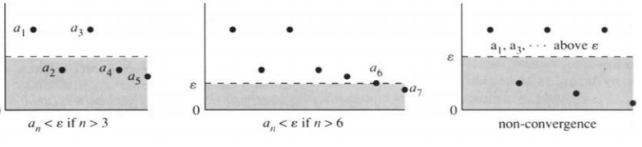


**问题 2。**$10^{-4},10^{-6},10^{-4},10^{-8},10^{-4},10^{-10},\ldots$ 是否趋于零？

**答：**否。它确实会掉到 $10^{-4}$ 以下，却待不住，过一会儿又冒回 $10^{-4}$。

数学界有个约定：用希腊字母 $\varepsilon$（epsilon，艾普西龙）表示“任意小的正数”。趋于零，就是数列最终小于 $\varepsilon$，而且一直小于。$\varepsilon$ 取得越小，检验越严，要等的时间也越长。不妨把它看成允许误差，然后不断调小。

为了强调 $\varepsilon$ 是从外面提出来的，不妨请苏格拉底来选。不管他挑什么正数，数列最终都得比它小；也就是说，存在某个下标 $N$，过了这一项，所有项都低于容许值：
$$\text{对任意 }\varepsilon>0,\ \text{存在正整数 }N,\ \text{使得 }n>N\Rightarrow a_n<\varepsilon.$$
抓住这个想法，剩下的都好办。图 2.17 的前两幅，画的分别就是 $N=3$ 和 $N=6$。

**例 1。**数列 $\tfrac12,\tfrac44,\tfrac98,\ldots$，也就是 $a_n=n^2/2^n$，开头一路往上，最后却趋于零。分子都是平方数，分母都是 $2$ 的幂；到后来，$2^n$ 长得比 $n^2$ 快，例如 $a_{10}=100/1024$。比值终究会小于任意 $\varepsilon>0$。

**例 2。**$1,0,\tfrac12,0,\tfrac13,0,\ldots$ 趋于零。它并不一直递减——数学上管“一直”叫“单调”——可极限仍然是零。选择 $\varepsilon=1/10$ 就能得到正确的回应：在 $a_{2001}$ 之后，所有项都小于 $1/1000$。所以，对这个 $\varepsilon$，$N=2001$。

数列 $1,\tfrac12,\tfrac12,\tfrac13,\tfrac13,\tfrac13,\ldots$ 趋于零的速度慢得多，但仍然收敛到零。

现在让 $a_n$ 也可以为负。它可以从下方往上趋于零，也可以从左右两侧靠过来。要求没变：最终要钻进零附近的任意窄带，并且待在里面；只不过这条带子现在是 $(-\varepsilon,\varepsilon)$。到零的距离，就是绝对值 $|a_n|$，所以 $a_n\to0$ 等价于 $|a_n|\to0$：
$$\forall\varepsilon>0,\ \exists N,\quad n>N\Rightarrow |a_n|<\varepsilon.$$

**例 3。**$1,-\tfrac12,\tfrac13,-\tfrac14,\ldots$ 趋于零，因为取绝对值后的数列 $1,\tfrac12,\tfrac13,\tfrac14,\ldots$ 也趋于零。

从零挪到一般极限 $L$，只差一小步：$a_n\to L$，当且仅当 $a_n-L\to0$。最后的定义，可以这样写：

> **数列极限的定义。**称 $a_n$ 收敛到实数 $L$，如果对任意 $\varepsilon>0$，都存在正整数 $N$，使
> $$n>N\quad\Longrightarrow\quad |a_n-L|<\varepsilon.$$

换句话说：在 $L$ 周围画任意窄的一条带子，带外至多只有有限项。记作 $a_n\to L$、$\lim a_n=L$ 或 $\lim_{n\to\infty}a_n=L$。

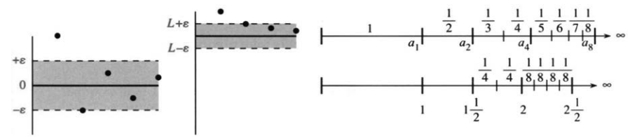


**例 4。**$\tfrac32,\tfrac54,\tfrac76,\ldots$ 收敛到 $L=1$。每个数减去 $1$，就得到 $\tfrac12,\tfrac14,\tfrac16,\ldots$，它们趋于零；减出来的差，正是 $|a_n-L|$。

**例 5。**数列
$$1,\quad1+\frac12,\quad1+\frac12+\frac13,\quad1+\frac12+\frac13+\frac14,\quad\ldots$$
不收敛。相邻两项确实越挨越近，可这些部分和会越过任何一个候选的极限。第二项是 $3/2$；第四项又添上 $1/3+1/4$，已经超过 $2$；第八项新增四项，每项至少 $1/8$，加起来大于 $1/2$，所以 $a_8>5/2$。再加八项，总增量大于 $8/16=1/2$，于是 $a_{16}>3$。照这样下去，图 2.18 里的折线无限伸长，不会停在任何一个 $L$ 上。

用第 10 章的话说，调和级数 $1+1/2+1/3+\cdots$ 发散，部分和一路奔向正无穷，例如 $a_{5000}>9$。无穷级数以后还会细讲；这里只想点出一个微妙之处：**相邻的步子可以趋于零，数列本身却照样趋于无穷。**

可见，$a_{n+1}-a_n\to0$ 不是收敛的充分条件，只是必要条件。数列若收敛，相邻差一定趋于零。下面就证明这一步，也顺便看清“充分”与“必要”的区别：
$$[a_n\to L]\quad\Longrightarrow\quad[a_{n+1}-a_n\to0].\tag{1}$$

**证明。**因为 $a_n$ 收敛，存在一个数 $N$，过了它就有 $|a_n-L|<\varepsilon$，并且 $|a_{n+1}-L|<\varepsilon$。由于 $a_{n+1}-a_n$ 是 $a_{n+1}-L$ 与 $L-a_n$ 之和，其绝对值不超过 $\varepsilon+\varepsilon=2\varepsilon$。因此 $a_{n+1}-a_n$ 趋于零。

苏格拉底反对道：我们只做到了小于 $2\varepsilon$，而他要求的是 $\varepsilon$。我们的回答是：如果他特别要求 $|a_{n+1}-a_n|<1/10$，我们就从 $\varepsilon=1/20$ 开始。这样 $2\varepsilon=1/10$。但没有必要玩这种把戏。始终小于 $2\varepsilon$ 与始终小于 $\varepsilon$ 一样有说服力。

### “如果”与“只有……才……”的逻辑

这里插一段，专门说说数学的语言。日常我们会讲“如果你打电话，我就来”，也会讲“只有你打电话，我才来”——这两句可不一样；数学家还会讲“我来，当且仅当你打电话”，把两个方向都包了进去。我们的目标是理清这层逻辑，因为它很重要，而且不那么熟悉。[^logic]

式 (1) 里，命题 $A$ 是“$a_n\to L$”，命题 $B$ 是“$a_{n+1}-a_n\to0$”。数学中至少有五种方式写出 $A\Rightarrow B$，我想你也许愿意把它们放在一起看看。同一个想法有这么多表达，似乎过多，但作者们迫切想要一点变化。下面是我想到的五种说法：

- $A\Rightarrow B$；
- $A$ 蕴含 $B$；
- 如果 $A$，那么 $B$；
- $A$ 是 $B$ 的充分条件；
- $A$ 成立时，$B$ 成立。

[^logic]: 逻辑思考比 $\varepsilon$ 和 $\delta$ 重要得多。


**例子。**

- 若正数在递减，则它们收敛到某个极限。
- 若 $a_n,b_n$ 都收敛，则 $a_n+b_n$ 收敛。
- 若 $f$ 是 $v$ 的积分，则 $v$ 是 $f$ 的导函数。

这些都是真的，但还没有证明。 $A$ 是假设，$B$ 是结论。

现在把 $A,B$ 对调，得到**逆命题**。原命题成立，逆命题可不一定成立。前两个例子的逆命题都不对：数列可以不单调却仍然收敛；和数列可以收敛，两个加数数列却各自不收敛。第三个例子的逆命题是真的。反过来写，有下面这些等价说法：

- $A\Leftarrow B$；
- $B$ 蕴含 $A$；
- 如果 $B$，那么 $A$；
- $A$ 是 $B$ 的必要条件；
- 只有 $A$ 成立，$B$ 才成立。

“必要”“充分”不容易一下子掌握；“当且仅当”这几个字看着短，也一样难缠。$A\Rightarrow B$ 与 $B\Rightarrow A$ 是两个不同的命题，都得各证一遍。两者都成立时，就合起来写成：

- $A\Leftrightarrow B$；
- $A$ 蕴含 $B$，且 $B$ 蕴含 $A$；
- $A$ 与 $B$ 等价；
- $A$ 是 $B$ 的充分必要条件；
- $A$ 成立，当且仅当 $B$ 成立。

**例子：**
$$[a_n\to L]\Longleftrightarrow[2a_n\to2L]
\Longleftrightarrow[a_n+1\to L+1]
\Longleftrightarrow[a_n-L\to0].$$

### 极限的运算法则

要定义 $dy/dx$，先得有极限：自变量的增量 $\Delta x\to0$，差商 $\Delta y/\Delta x$ 才被推着趋向导数。而要证明求导的加法法则和乘积法则，还得有极限的运算法则。

若 $a_n\to L$、$b_n\to M$，则
$$a_n+b_n\to L+M,\qquad a_n-b_n\to L-M,$$
$$a_nb_n\to LM,\qquad \frac{a_n}{b_n}\to\frac LM\quad(M\ne0).$$

乘法法则可以用一个恒等式来验证：
$$a_nb_n-LM=(a_n-L)(b_n-M)+M(a_n-L)+L(b_n-M).\tag{2}$$
设过了某项 $N$ 就有 $|a_n-L|<\varepsilon$，过了另一项 $N'$ 就有 $|b_n-M|<\varepsilon$。那么过了 $N$ 与 $N'$ 中较大的那一项，式(2)右端就很小。它小于 $\varepsilon\cdot\varepsilon+M\varepsilon+L\varepsilon$。这证明式(2)给出 $a_nb_n\to LM$。

重要特例是 $ca_n\to cL$，其中 $c$ 为常数：把常数列 $b_n=c$ 代进去就是了。常数因此可以提到极限外面，记作 $\lim(ca_n)=c\lim a_n$。


### $x\to a$ 时 $f(x)$ 的极限

最后一步，把数列换成函数。现在面对的不再是一串离散的项，而是随连续自变量变化的 $f(x)$；极限让 $x$ 趋向某个指定的点 $a$，不再是整数 $n\to\infty$。例如，$x\to0$ 时 $4-x^2\to4$；$x\to2$ 时 $5x\to10$。这些结论看着直观，可总得说清它们是什么意思。

意思大概是：**$x$ 离 $a$ 够近，$f(x)$ 就离 $L$ 够近。**$x-a$ 小，$f(x)-L$ 也应该小。可“小”这个字没把话说尽——这里要的是“任意小”，小到比任何给定的正数 $\varepsilon$ 还小。这时就记作 $\lim_{x\to a}f(x)=L$，或者写成“当 $x\to a$ 时，$f(x)\to L$”。

难就难在这里同时有两个“接近”：输入在靠近，输出也在靠近，而两者的误差界不能混为一谈。$|x-a|<\varepsilon$ 未必就能保证 $|f(x)-L|<\varepsilon$；也许得把 $x$ 逼得更近才行。

于是就到了极限的 **$\varepsilon$–$\delta$ 定义**。这回还是苏格拉底先开口，给出输出误差 $\varepsilon$；再由柏拉图回一个输入范围 $\delta$，让所有离 $a$ 足够近、但不等于 $a$ 的 $x$ 都满足要求：

> **函数极限的定义。**
> $$0<|x-a|<\delta\quad\Longrightarrow\quad |f(x)-L|<\varepsilon,\tag{3}$$
> 则称 $\displaystyle\lim_{x\to a}f(x)=L$。

$\delta$（delta，德尔塔）管输入误差，$\varepsilon$ 管输出误差。每个 $\varepsilon$ 都能配上一个 $\delta$，苏格拉底就认账，承认这个极限。

**例。**证明 $\displaystyle\lim_{x\to2}5x=10$。

要让 $|5x-10|<\varepsilon$，只要 $|x-2|<\varepsilon/5$ 就够了，因为 $|5x-10|=5|x-2|$。所以柏拉图选择小于 $\varepsilon/5$ 的 $\delta$（更小的 $\delta$ 总是可以的）。

**说明 1。**图 2.19 里，先定盒子的高度 $2\varepsilon$，让上下两条边分别落在 $L\pm\varepsilon$；再定宽度 $2\delta$。宽度得足够窄，使图像从侧边穿出。这样就有 $|f(x)-L|<\varepsilon$。

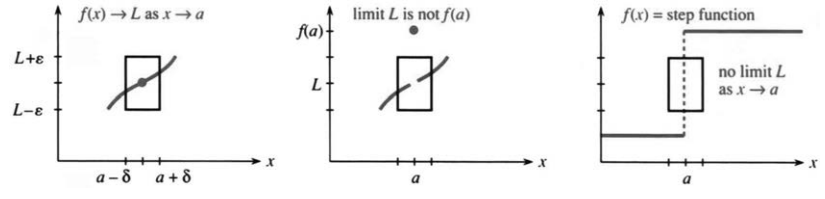


函数要是在该点跳一下，盒子再扁也装不下两侧的图像。无论把盒子缩得多窄，总有一侧会从上面或下面穿出去，所以跳跃点没有双侧极限。

**说明 2。**中间那幅图仍然有 $f(x)\to L$，因为求极限时把 $x=a$ 这一点挖掉了。$f(a)$ 取什么值，都不影响极限 $L$。左边那幅图还多一条：$f(a)=L$。这时给它一个专门的名字——$f$ 在 $a$ 处**连续**。连续函数，下一节就讲。

**说明 3。**在 $f=5x$、$\delta=\varepsilon/5$ 的例子中，5就是斜率。这个选择勉强把图像留在盒子里——它从角上穿出。再窄一点，比如 $\delta=\varepsilon/10$，图像就安全地从侧边穿出。一个合理的选择是把 $\varepsilon$ 除以 $2|f'(a)|$。（为保险起见，我们把斜率加倍。）我想说说这个 $\delta$ 为什么管用——即使 $\varepsilon$–$\delta$ 检验在实际中很少使用。

$f(x)-L$ 与 $x-a$ 的比值是纵向距离除以横向距离。这就是 $\Delta f/\Delta x$，接近斜率 $f'(a)$。横向距离为 $\delta$ 时，纵向距离接近 $\delta|f'(a)|$。对我们“合理选择”的 $\delta$，它等于 $\varepsilon/2$，所以稳妥地小于 $\varepsilon$。这个选择能解决多数习题。但例7说明，即使斜率无穷大，极限仍可能存在。

**例 7。**
$$\lim_{x\to1^+}\sqrt{x-1}=0.$$
这是**右极限**。符号里那个“$+$”表示：$x$ 只从大于 $1$ 的一边靠过来。本书通常说的双侧极限，两边都要看，但不算点本身。平方根要求 $x\ge1$，所以这里只能谈右极限。

比如给定 $\varepsilon=1/10$，取 $\delta=1/100$ 就行。只要 $0<x-1<1/100$，就有 $\sqrt{x-1}<1/10$。此时盒子必须极窄，$\delta$ 远小于 $\varepsilon$，因为平方根曲线起始处的斜率无穷大。

这些例子说明了 $\varepsilon$–$\delta$ 定义的要点。（给定 $\varepsilon$，寻找 $\delta$。这是法国柯西的思想，不是希腊苏格拉底的。）我们也看到了它的缺点：检验不方便。数学家不会到处提出 $\varepsilon$、回答 $\delta$。我们的生活也许奇怪，但还没有奇怪到这种地步。

更省事的办法，是一次性把常见函数的极限定下来：$5x\to5a$、$x^n\to a^n$、$\sin x\to\sin a$、$(1-x)^{-1}\to(1-a)^{-1}$，最后一条要求 $a\ne1$。在各自的定义域内，**连续函数的极限，直接代入就得到。**在转入连续性之前，先用定义把夹逼定理证出来。

> **2H 夹逼定理。**设在 $a$ 附近，$f(x)\le g(x)\le h(x)$。若 $x\to a$ 时 $f(x)\to L$ 且 $h(x)\to L$，则 $g(x)\to L$。

**证明。**$g(x)$ 夹在 $f(x)$ 与 $h(x)$ 之间。减去 $L$ 后，$g(x)-L$ 夹在 $f(x)-L$ 与 $h(x)-L$ 之间。因此
$$|g(x)-L|<\varepsilon\quad\text{如果 }|f(x)-L|<\varepsilon\text{ 且 }|h(x)-L|<\varepsilon.$$
对任意 $\varepsilon$，后两个不等式都在某个区域 $0<|x-a|<\delta$ 内成立。所以第一个也成立。这就证明了 $g(x)\to L$。$x=a$ 处的值没有参与——直到我们讲到连续函数时才会用到。


### 2.6 习题

**阅读填空**

$a_n=(\sin n)/n$ 的极限为 **(a)______**；$a_n=n^4/2^n$ 的极限为 **(b)______**；$a_n=(-1)^n$ 的极限 **(c)______**。$a_n\to0$ 的含义是：对任意给定的正数 $\varepsilon$，只有 **(d)______** 个 $|a_n|$ 可以 **(e)______**。$a_n\to L$ 的含义是：对每个 **(f)______**，存在 **(g)______**，使 $n>$ **(i)______** 时有 **(h)______**。$1,1+1/2,1+1/2+1/3,\ldots$ 不 **(j)______**，因为这些和最终超过 **(k)______**。

$x\to a$ 时，$\sin x$ 的极限为 **(l)______**。$x\to-2$ 时，$x/|x|$ 的极限为 **(m)______**；但 $x\to0$ 时，极限不 **(n)______**，该点只有 **(o)______** 侧极限。$\lim_{x\to a}f(x)=L$ 的定义是：对任意 $\varepsilon>0$，存在 $\delta>0$，使得只要 **(p)______**，就有 $|f(x)-L|<\varepsilon$。

若 $a_n\to L$、$b_n\to M$，则 $a_n+b_n\to$ **(q)______**，$a_nb_n\to$ **(r)______**。若 $x\to a$ 时 $f(x)\to L$、$g(x)\to M$，相应的函数极限法则为 **(s)______** 与 **(t)______**。在这些极限中，误差最终必须小于任意正数 **(v)______**，并 **(u)______**。

$A\Rightarrow B$ 表示 $A$ 是 $B$ 的 **(w)______** 条件，即 **(x)______** $A$ 成立，$B$ 就成立。$A\Leftrightarrow B$ 表示 $A$ 是 $B$ 的 **(y)______** 条件，即 $B$ 成立 **(z)______** $A$ 成立。

1. 各数列的 $a_4$ 和极限 $L$ 是什么？从哪个下标 $N$ 起，有 $|a_n-L|<1/10$？可以使用计算器。
   - （a）$-1,\tfrac12,-\tfrac13,\ldots$；
   - （b）$\tfrac12,\tfrac12+\tfrac14,\tfrac12+\tfrac14+\tfrac16,\ldots$；
   - （c）$a_n=n/2^n$；
   - （d）$1.1,1.11,1.111,\ldots$；
   - （e）$a_n=\sqrt[n]{n}$；
   - （f）$a_n=\sqrt{n^2+n}-n$；
   - （g）$a_n=(1+1/n)^n$。
2. 举反例说明下列命题错误：（a）若 $a_n\to L$、$b_n\to L$，则 $a_n/b_n\to1$。（b）$a_n\to L$ 当且仅当 $a_n^2\to L^2$。（c）若 $a_n<0$ 且 $a_n\to L$，则 $L<0$。（d）若零附近每条带中都有无穷多项，则 $a_n\to0$。
3. 下列哪些说法等价于 $B\Rightarrow A$？（a）$A$ 成立则 $B$ 成立。（b）$A$ 成立当且仅当 $B$ 成立。（c）$B$ 是 $A$ 的充分条件。（d）$A$ 是 $B$ 的必要条件。
4. 判断下列各组是 $A\Rightarrow B$、$B\Rightarrow A$、两者都成立，还是两者都不成立。

| 小题 | $A$ | $B$ |
|---|---|---|
| （a） | $a_n\to1$ | $-a_n\to-1$ |
| （b） | $a_n\to0$ | $a_n-a_{n-1}\to0$ |
| （c） | 对所有 $n$，$a_n\le n$ | 对所有 $n$，$a_n=n$ |
| （d） | $a_n\to0$ | $\sin a_n\to0$ |
| （e） | $a_n\to0$ | $1/a_n$ 不收敛 |
| （f） | 对所有 $n$，$a_n<n$ | $a_n/n$ 收敛 |

5. ★ 若 $a_n\to0$，证明任意重排数列各项后，所得数列仍趋于零。
6. ★ 设 $x\to a$ 时 $f(x)\to L$、$g(x)\to M$，从定义证明 $f(x)+g(x)\to L+M$。

**求第 7–24 题的极限（若存在）。无需逐题使用 $\varepsilon$–$\delta$ 定义。**

7. $\displaystyle\lim_{t\to2}\frac{t+3}{t^2-2}$。
8. $\displaystyle\lim_{t\to2}\frac{t^2+3}{t-2}$。
9. $\displaystyle\lim_{x\to0}\frac{f(x+h)-f(x)}h$（小心）。
10. $\displaystyle\lim_{h\to0}\frac{f(1+h)-f(1)}h$。
11. $\displaystyle\lim_{h\to0}\frac{\sin^2h\cos^2h}{h^2}$。
12. $\displaystyle\lim_{x\to0}\frac{2x\tan x}{\sin x}$。
13. $\displaystyle\lim_{x\to0^+}\frac{|x|}x$（右极限）。
14. $\displaystyle\lim_{x\to0^-}\frac{|x|}x$（左极限）。
15. $\displaystyle\lim_{x\to1}\frac{\sin x}x$。
16. $\displaystyle\lim_{c\to a}\frac{f(c)-f(a)}{c-a}$。
17. $\displaystyle\lim_{x\to5}\frac{x^2+25}{x-5}$。
18. $\displaystyle\lim_{x\to5}\frac{x^2-25}{x-5}$。
19. $\displaystyle\lim_{x\to0}\frac{\sqrt{1+x}-1}{x}$（可先试 $x=0.01$）。
20. $\displaystyle\lim_{x\to2}\frac{\sqrt{4-x}}{\sqrt{6+x}}$。
21. $\displaystyle\lim_{x\to a}[f(x)-f(a)]$（？）。
22. $\displaystyle\lim_{x\to\pi/2}(\sec x-\tan x)$。
23. $\displaystyle\lim_{x\to0}\frac{\sin x}{\sin(x/2)}$。
24. $\displaystyle\lim_{x\to1}\frac{\sin(x-1)}{x^2-1}$。
25. 对下列各函数，选择 $\delta>0$，使 $0<x<\delta$ 时 $|f(x)|<1/100$：$10x$、$\sqrt{x}$、$\sin2x$、$x\sin x$。
26. 极限定义要求下列哪一种蕴含？（1）$|f(x)-L|<\varepsilon\Rightarrow0<|x-a|<\delta$；（2）$|f(x)-L|<\varepsilon\Leftarrow0<|x-a|<\delta$；（3）$|f(x)-L|<\varepsilon\Leftrightarrow0<|x-a|<\delta$。
27. “$x\to+\infty$ 时 $f(x)\to L$”的定义是：对任意 $\varepsilon>0$，存在 $X$，使 $x>X$ 时 ______ $<\varepsilon$。举一个 $x\to+\infty$ 时 $f(x)\to4$ 的例子。
28. 给出“$x\to-\infty$ 时 $f(x)\to0$”的正确定义。
29. $x\to+\infty$ 时 $(\sin x)/x$ 的极限为 ______。对 $\varepsilon=0.01$，给出 $X$，使 $x>X$ 时 $|f(x)|<\varepsilon$。
30. $x\to+\infty$ 时 $f(x)=2x/(1+x)\to2$。对 $\varepsilon=0.01$，给出 $X$，使 $x>X$ 时 $|f(x)-2|<\varepsilon$。
31. 解释为什么 $x\to+\infty$ 时 $\sin x$ 没有极限。
32. **计算器。**估计 $\displaystyle\lim_{x\to+\infty}(1+1/x)^x$。


33. 对 $f(x)=2x-5x^2+7x^3$，求：（a）$\lim_{x\to1}f(x)$；（b）$\lim_{x\to+\infty}f(x)$；（c）$\lim_{x\to+\infty}f(x)/x^3$；（d）$\lim_{x\to-\infty}f(x)/x^3$。
34. 对 $f(x)=6x^3+1000x$，求 $x\to+\infty$ 时：（a）$f(x)/x$；（b）$f(x)/x^2$；（c）$f(x)/x^4$；（d）$f(x)/(x^3+1)$ 的极限。

**重要规律。**$x\to+\infty$ 时，多项式之比 $f(x)/g(x)$ 的极限，和它们最高次项之比的极限一样。例如，$f=x^3-x+2$、$g=5x^6+x+1$，则 $f/g\to0$，$g/f\to+\infty$，$f^2/g\to1/5$。

35. 求 $x\to+\infty$ 时下列极限：
    $$\frac{3x^2+2x+1}{3+2x+x^2},\qquad
    \frac{x^4}{x^3+x^2},\qquad
    \frac{x^2+1000}{x^3-1000},\qquad x\sin\frac1x.$$
36. 若某个 $\delta$ 已能保证 $|f(x)-L|<\varepsilon$，为什么选更小的正 $\delta$ 仍然可行？
37. 等比和 $a_n=1+r+\cdots+r^{n-1}=(1-r^n)/(1-r)$。求 $n\to\infty$ 时的极限，哪些 $r$ 使极限存在。
38. 若 $a_n\to L$，证明：对任意 $\varepsilon>0$，存在 $N$，使 $n>N,m>N$ 时 $|a_n-a_m|<2\varepsilon$。这是柯西收敛准则。
39. 不论后续各位如何，$a_1=0.4,a_2=0.49,a_3=0.493,\ldots$ 都趋于某个极限。我们不知道 $L$，怎么知道这一点呢？柯西准则得到满足：各项彼此越来越接近。（a）从 $a_4$ 起，$|a_n-a_m|<$ ______。（b）从哪个 $a_N$ 之后，$|a_m-a_n|<10^{-7}$？
40. 为第 39 题选择后续小数位，使极限为 $0.494$；再选择一种规则，使教师也难以明确算出极限值。
41. 若 $0.abcde\ldots$ 的每一位都随机地从 $0,1,\ldots,9$ 中选择，极限的“平均值”是多少？
42. 若每位随机地取 $0$ 或 $1$，极限的平均值是多少？
43. 设 $a_n=\tfrac12a_{n-1}+4$，$a_1=10$。求 $a_2,a_3$，找出 $a_n-8$ 与 $a_{n-1}-8$ 的关系，并推出 $a_n\to8$。
44. “对任意 $\delta>0$，存在 $\varepsilon>0$，使 $|x|<\delta$ 时 $|f(x)|<\varepsilon$。”这个条件把量词顺序倒过来了。对不趋于零的 $f(x)=\cos x$，找出满足该条件的 $\varepsilon$。
45. 用 $\varepsilon$ 定义证明数列夹逼定理：若 $a_n\to L$、$c_n\to L$，且从某项起 $a_n\le b_n\le c_n$，则 $b_n\to L$。
46. 用简短文字解释三句话的区别：“如果你快一点，我们就能到达”“只有你快一点，我们才能到达”“我们能到达，当且仅当你快一点”。要求用110个词表述。

## 2.7 连续函数


这一节很短。它本来并进讲极限的那一节，可两节合起来太长，只好单列一节。我们仍然盯着 $x\to a$ 时 $f(x)$ 的极限，只是多出一个数：函数在该点的值 $f(a)$。求极限时，$x$ 只是逼近 $a$，从不真正到达，所以 $f(a)$ 可以不管；讲连续就不同了，最后这个 $f(a)$ 必须对得上。

我先概括一下通常（也最理想）的情形，三件事要同时成立：

1. $f(a)$ 有定义；
2. $x\to a$ 时 $f(x)$ 的极限 $L$ 存在；
3. $L=f(a)$。

三件事都满足，就说 $f$ 在 $x=a$ 处连续；也常写成一行：$x\to a$ 时 $f(x)\to f(a)$。作为对照，先看四个在零点处不连续的函数。


第一幅图里，第一个函数只要取 $f(0)=0$ 就连续了，可它偏偏取 $f(0)=1$。把这一点的函数值改对，问题就没了——这叫**可去间断**。例2、3、4更重要，也更严重。无论怎么挑 $f(0)$，都补不出一个“正确”的值：

2. 阶梯函数在 $x=0$ 处从 $0$ 跳到 $1$；
3. $f(x)=1/x^2$ 在 $x\to0$ 时趋于正无穷；
4. $f(x)=\sin(1/x)$ 在 $x\to0$ 时不断振荡。

阶梯函数在跳跃处左右极限都有，却没有双侧极限：左极限是 $0$，右极限是 $1$。$x/|x|$ 也一样，从 $-1$ 跳到 $1$。

在 $1/x^2$ 的图像中，唯一合理的极限是 $L=+\infty$。我不能正式说这个极限存在。按正式说法，它不存在——但我们还是常常写：$x\to0$ 时 $1/x^2\to\infty$。这表示 $x\to0$ 时，$1/x^2$ 会超过每个 $L$，并一直在它上方。我们也以同样非正式的方式写出 $f(x)=1/x$ 的单侧极限。
$$\lim_{x\to0^-}\frac1x=-\infty,
\qquad\lim_{x\to0^+}\frac1x=+\infty.\tag{1}$$

**说明。**$1/x$ 在零点有一个**极点**，$1/x^2$ 则是二阶极点。$1/(x^2-x)$ 在 $x=0,1$ 处有极点；$1/\sin x$ 则在 $x=k\pi$（$k$ 为整数）处各有一个极点。


除了 $1/x^2$，这些极点都是“一阶”的——把这些函数乘以 $x$ 后，在 $x=0$ 处就完全光滑了：
$$x\cdot\frac1x=1,\qquad x\cdot\frac1{x^2-x}=\frac1{x-1},\qquad x\cdot\frac1{\sin x}$$
在 $x=0$ 处连续。
$1/x^2$ 得乘 $x^2$ 才消得去奇性，所以是二阶极点。多项式之比 $P(x)/Q(x)$ 在 $Q=0$ 处有极点，前提是先约掉像 $(x+1)/(x+1)$ 这样的公因子。

跳跃和极点是最基本的不连续，但还不是全部。$\sin(1/x)$ 在 $x\to0$ 时没有极限，这个函数不会无限增大；正弦从不超过1。取 $x=1/3,1/4,1/1000$，函数值依次是 $\sin3,\sin4,\sin1000$。这些数有正、有负，还有（？）。$x$ 越小，$1/x$ 越大，摆动越来越快，图像终究待不住——无论盒子多窄，它的图像都不会待在高度为 $\varepsilon$ 的小盒子里。

### 连续函数

> **定义。**如果 $f(a)$ 有定义，并且当 $x\to a$ 时 $f(x)\to f(a)$，就称 $f$ 在 $x=a$ 处“连续”。如果 $f$ 在每一个有定义的点都连续，它就是一个连续函数。

**异议。**这个定义竟让 $f(x)=1/x$ 成了连续函数！它在 $x=0$ 处没有定义，所以它的连续性不可能在这里失效。逻辑要求我们接受这一点，但我们不一定非得喜欢它。的确，无论给 $f(0)$ 取什么值，都不能使 $1/x$ 在 $x=0$ 处连续。

说来也怪，但事实确实如此：“连续函数”的定义至今仍有争论（*Mathematics Teacher*，1989 年 5 月）。原因你也看到了——我们一方面谈论 $1/x$ 的间断性，另一方面又称它为连续函数。这个定义没有体现出 $1/x$ 与 $(\sin x)/x$ 之间的区别。函数 $f(x)=(\sin x)/x$ 可以在所有 $x$ 处变得连续：只要令 $f(0)=1$。

如果一个函数的定义能够扩充到所有 $x$，并且扩充后处处连续，我们就称这个函数“可连续延拓”（**continuable**）。因此，$(\sin x)/x$ 和 $\sqrt{x}$ 都是可连续延拓的函数，而 $1/x$ 与 $\tan x$ 不是。这个建议也许不能结束争论，但我希望它有所帮助。

**例 1。**$\sin x$、$\cos x$ 和所有多项式 $P(x)$ 都是连续函数。

**例 2。**绝对值 $|x|$ 连续。它的斜率有跳跃（不可连续延拓）。

**例 3。**有理函数 $P(x)/Q(x)$ 在 $Q(x)\ne0$ 的地方都连续。

**例 4。**有理数处取 $1$、无理数处取 $0$ 的函数，处处不连续。随便取一个区间，里面既有有理数，也有无理数——每两个无理数之间都有有理数，反过来也一样。（不知怎么，无理数要多得多。）

**例 5。**$0^{x^2}$ 对每个 $x$ 都是零；可 $0^0$ 没有定义，零点就空着。把它补成 $0$，函数便连续了。下一段却会碰上另一个函数，那里非把零点的值补成 $1$ 不可。


连续性的证明能写满一本书，可情形往往一眼就清楚：连续函数的图像，不用抬笔就能一笔画完。遇到跳跃、无穷极限或无限振荡，除了在另一侧重新开始，无法越过间断。

$n>0$ 时，函数 $x^n$ 连续；$n<0$ 时，它不可连续延拓。函数 $x^0$ 对每个 $x$ 都等于1，只是 $0^0$ 没有定义。这一次，连续性要求 $0^0=1$。

有趣的例子是那些差一点的情形——我们已经见过两个：

**例 6。**
$$\frac{\sin x}{x},\qquad\frac{1-\cos x}{x}$$
这两个函数都能在零点连续延拓，该补的值分别是 $1$ 和 $0$。这两个极限，正是求正弦函数导数的关键。

分母要是换成 $x^2$，又会怎样？

**例 7。**$\sin x/x^2$ 在零点附近无界；$(1-\cos x)/x^2$ 却不同，它的极限是 $1/2$。

因为 $(\sin x)/x\to1$，再除一个 $x$，得到的就像 $1/x$：零点处是一阶极点。这里分母、分子都趋于零，可 $x^2$ 那个零来得比 $\sin x$ 的零快。趋零速度的比较，正是许多重要极限问题的核心。

而 $1-\cos x$ 与 $x^2$ 呢，趋零的快慢几乎不分上下，比值趋于 $1:2$：
$$\frac{1-\cos x}{x^2}
=\frac{1-\cos^2x}{x^2(1+\cos x)}
=\frac{\sin^2x}{x^2}\frac1{1+\cos x}
\longrightarrow\frac1{1+1}=\frac12.$$
这个结果，以后用洛必达法则能更省事地再求一遍。这里我要强调的不是结果，而是问题本身：**微分学的核心问题之一，是极限以怎样的速度被逼近；而逼近的快慢，恰好写在导数里。**

这三个例子在 $x=0$ 处都连续。趋零的快慢由斜率控制——因为 $f(x)-f(0)$ 近似为 $f'(0)$ 乘以 $x$：

- $\sin x$ 的导数是 $1$ $\longleftrightarrow$ $\sin x$ 像 $x$ 一样递减；
- $\sin^2x$ 的导数是 $0$ $\longleftrightarrow$ $\sin^2x$ 比 $x$ 递减得更快；
- $x^{1/3}$ 的导数是 $\infty$ $\longleftrightarrow$ $x^{1/3}$ 比 $x$ 递减得更慢。

### 可导函数

$|x|$ 在零点连续，却没有导数；$x^{1/3}$ 也一样。**可导比连续要求更强。**回到定义，差别一目了然：
$$\text{在 }x\text{ 处连续：}\quad f(x+\Delta x)-f(x)\to0;$$
$$\text{在 }x\text{ 处可导：}\quad
\frac{f(x+\Delta x)-f(x)}{\Delta x}\to f'(x),$$
其中都令 $\Delta x\to0$。


第一种情形只要求增量趋于零，可能还很慢；第二种情形中， $\Delta f/\Delta x$ 有极限，$\Delta f$ 与 $\Delta x$ 一样快地趋于零。

> **2I 可导蕴含连续。**函数在某点有导数，则在该点连续；反过来，连续函数在该点可能不可导。

**证明。**由
$$\Delta f=\Delta x\frac{\Delta f}{\Delta x}\to0\cdot f'(x)=0,$$
可知 $f(x+\Delta x)-f(x)\to0$。

连续函数 $x^{1/3}$ 在 $x=0$ 处没有导数，因为 $\tfrac13x^{-2/3}$ 无限增大。绝对值 $|x|$ 没有导数，因为它的斜率跳跃。更出人意料的是，下面这个函数：
$$\frac12\cos3x+\frac14\cos9x+\cdots
$$
它处处连续，却处处没有导数。你可以不抬笔地画出它的图像（但不容易——它在每一点都转弯）。对多数人来说，它与填充空间的曲线和不可测面积一起，被放在奇观盒子里。分形过去也被放在同一个盒子里！它们是美丽的形状，边界上没有切线。分形理论十分活跃，有很好的数学理由，我们会在第3.7节稍作介绍。

我希望你已经清楚理解微积分的这些基本定义：

1. 极限（$n\to\infty$ 或 $x\to a$）；
2. 连续性（在 $x=a$ 处）；
3. 导数（在 $x=a$ 处）。

它们可追溯到 $\varepsilon$ 和 $\delta$，但很少有必要追得那么远。就像经济学描述许多交易、历史描述许多事件一样，一个函数来自许多值 $f(x)$。少数点可能特殊，就像市场崩盘、战争或间断。在其他点，$df/dx$ 是理解函数的最好向导。

本章最后讲闭区间上连续函数的两个基本事实。区间是 $a\le x\le b$，简记为 $[a,b]$。[^interval] 在端点 $a,b$，我们要求 $f(x)$ 趋于 $f(a)$、$f(b)$。

> **最值性质。**有限区间 $[a,b]$ 上的连续函数具有最大值 $M$ 和最小值 $m$。区间 $[a,b]$ 中有点 $x_{\max}$ 和 $x_{\min}$，函数在那里取到这些值：
> $$f(x_{\max})=M\ge f(x)\ge f(x_{\min})=m\qquad(\text{对 }[a,b]\text{ 中所有 }x).$$

> **介值性质。**如果数 $F$ 介于 $f(a)$ 和 $f(b)$ 之间，那么在 $a,b$ 之间有点 $c$，使 $f(c)=F$。因此，如果 $F$ 介于最小值 $m$ 和最大值 $M$ 之间，那么在 $x_{\min}$ 和 $x_{\max}$ 之间有点 $c$，使 $f(c)=F$。

例子说明了为什么要求闭区间和连续函数。对 $0<x\le1$，函数 $f(x)=x$ 从不取到最小值（零）。如果定义 $f(0)=3$（不连续），使区间闭合，最小值仍取不到。由于跳跃，中间值 $F=2$ 也取不到。柯西定义极限的概念之后，连续性的概念就不可回避了。

[^interval]: 区间 $[a,b]$ 是闭的（包括端点）。区间 $(a,b)$ 是开的（不包括 $a,b$）。无穷区间 $[0,\infty)$ 包括所有 $x\ge0$。


### 2.7 习题

**阅读填空**

在 $a$ 处连续，要求 $x\to a$ 时 $f(x)$ 的 **(a)______** 存在，且等于 **(b)______**。$x/|x|$ 不能在零点连续延拓，是因为 **(c)______**；它有 **(d)______** 极限。$1/\cos x$ 在 **(e)______** 处不能连续补值，原因是 **(f)______**。$\cos(1/x)$ 在零点不能连续补值，原因是 **(g)______**。函数 $f(x)=$ **(h)______** 在 $x=3$ 有一阶极点，其平方 $f^2$ 在此有 **(i)______** 阶极点。

$n$ 为 **(j)______** 时，$x^n$ 在所有 $x$ 处连续；$n$ 为 **(k)______** 时，它在零点无导数。$\sin(-x)/x$ 在 $x\to0$ 时趋于 **(l)______**；若定义 $f(0)=$ **(n)______**，就成为 **(m)______** 函数。连续函数必须在所有 **(o)______** 上连续；可连续延拓到全实轴的函数，可以为缺少的点补值，使 **(p)______**。

若 $f$ 在 $a$ 处可导，则在该点必 **(q)______**。导数控制 $f(x)$ 接近 **(r)______** 的速度。闭区间上的连续函数具有 **(s)______** 值性质与 **(t)______** 值性质，能取得 **(u)______** $M$ 与 **(v)______** $m$，并取得 **(w)______** 的所有值。

**第1–20题，求使 $f(x)$ 成为（A）连续函数、（B）可导函数的数 $c$。一种情形要求每点都有 $f(x)\to f(a)$，另一种情形要求每点的 $\Delta f/\Delta x$ 都有极限。**

1. $\displaystyle f(x)=\begin{cases}\sin x,&x<1,\\c,&x\ge1.\end{cases}$
2. $\displaystyle f(x)=\begin{cases}\cos^3x,&x\ne\pi,\\c,&x=\pi.\end{cases}$
3. $\displaystyle f(x)=\begin{cases}cx,&x<0,\\2cx,&x\ge0.\end{cases}$
4. $\displaystyle f(x)=\begin{cases}cx,&x<1,\\2cx,&x\ge1.\end{cases}$
5. $\displaystyle f(x)=\begin{cases}c+x,&x<0,\\c^2+x^2,&x\ge0.\end{cases}$
6. $\displaystyle f(x)=\begin{cases}x^3,&x\ne c,\\-8,&x=c.\end{cases}$
7. $\displaystyle f(x)=\begin{cases}2x,&x<c,\\x+1,&x\ge c.\end{cases}$
8. $\displaystyle f(x)=\begin{cases}x^c,&x\ne0,\\0,&x=0.\end{cases}$
9. $\displaystyle f(x)=\begin{cases}\sin x/x^2,&x\ne0,\\c,&x=0.\end{cases}$
10. $\displaystyle f(x)=\begin{cases}x+c,&x\le c,\\1,&x>c.\end{cases}$
11. $\displaystyle f(x)=\begin{cases}c,&x\ne4,\\1/x^3,&x=4.\end{cases}$
12. $\displaystyle f(x)=\begin{cases}c,&x\le0,\\\sec x,&x\ge0.\end{cases}$
13. $\displaystyle f(x)=\begin{cases}(x^2+c)/(x-1),&x\ne1,\\2,&x=1.\end{cases}$
14. $\displaystyle f(x)=\begin{cases}(x^2-1)/(x-c),&x\ne c,\\2c,&x=c.\end{cases}$
15. $\displaystyle f(x)=\begin{cases}\tan x/x,&x\ne0,\\c,&x=0.\end{cases}$
16. $\displaystyle f(x)=\begin{cases}x^2,&x\le c,\\2x,&x>c.\end{cases}$
17. $\displaystyle f(x)=\begin{cases}(c+\cos x)/x,&x\ne0,\\0,&x=0.\end{cases}$
18. $f(x)=|x+c|$。
19. $\displaystyle f(x)=\begin{cases}(\sin x-x)/x^c,&x\ne0,\\0,&x=0.\end{cases}$
20. $f(x)=|x^2+c^2|$。

**自行构造函数，使它在 $x=1$ 附近具有第 21–27 题指定的行为。**

21. 可去间断。
22. 无限振荡。
23. 右极限存在，左极限不存在。
24. 二阶极点。
25. $\displaystyle\lim_{x\to1^-}f(x)=4+\lim_{x\to1^+}f(x)$。
26. $\displaystyle\lim_{x\to1}f(x)=+\infty$，但 $\displaystyle\lim_{x\to1}(x-1)f(x)=0$。
27. $\displaystyle\lim_{x\to1}(x-1)f(x)=5$。
28. 命题“$x\to1$ 时 $3x\to7$”是假的。选一个 $\varepsilon>0$，使任何 $\delta>0$ 都不能满足定义。命题“$x\to1$ 时 $3x\to3$”是真的；对 $\varepsilon=1/2$，选一个适当的 $\delta$。
29. 下列函数的连续阶次如何，即 $f',f'',\ldots$ 中连续可延拓的导函数有多少阶？（a）$f=x^{3/2}$；（b）$f=x^{3/2}\sin x$；（c）$f=(\sin x)^{5/2}$。
30. 在无双侧极限的点求单侧极限，并为（c）写出分三段的公式：（a）$|x|/(7x)$；（b）$\sin|x|$；（c）$\dfrac d{dx}|x^2-1|$。
31. 定义 $f(1)=f(-1)=1$，其余点 $f(x)=(x^2-x)/(x^2-1)$。判断在（a）$x=1$；（b）$x=0$；（c）$x=-1$ 处是否连续。
32. ★ 设 $x\ne0$ 时 $f(x)=x^2\sin(1/x)$，且 $f(0)=0$。分别求（若存在）：（a）$\lim_{x\to0}f(x)$；（b）$f'(0)$；（c）$\lim_{x\to0}f'(x)$。
33. 若 $f(0)=0,f'(0)=3$，当 $x\to0^+$ 时，将下列各量从小到大排列：$f(x)$、$x$、$xf(x)$、$f(x)+2x$、$2(f(x)-x)$、$(f(x))^2$。
34. 构造不连续的 $f(x)$，使其平方 $f(x)^2$ 连续。
35. 判断正误，并用例子说明：（a）在所有实数处连续的函数必有最大值。（b）若所有 $x$ 都有 $f(x)\le7$，则函数必能取得最大值。（c）若 $f(1)=1,f(2)=-2$，则某处必有 $f(x)=0$。（d）若再加上 $f$ 在 $[1,2]$ 上连续，则该区间内必有零点。


36. $\cos x$ 与 $2x$ 都连续。用 ______ 值性质说明，存在 $0<x<1$ 使 $\cos x=2x$。
37. 举反例说明下列命题错误：（a）函数能取得最大值和最小值，就必连续。（b）函数取得最大值、最小值以及 $f(0)$ 与 $f(1)$ 之间的所有值，就必在零点连续。（c）（主要供教师思考）若函数在任意两点之间都具有介值性质，就必连续。
38. 定义 $f(0)=0$，其余点 $f(x)=x\sin(1/x)$。用语言和图像说明，它在零点连续却不可导。
39. 下列函数哪些能连续延拓到全实轴？说明理由。
    $$f_1(x)=\begin{cases}\sin x,&x<0,\\\cos x,&x>1,\end{cases}
    \qquad f_2(x)=\begin{cases}\sin(1/x),&x<0,\\\cos(1/x),&x>1;\end{cases}$$
    $$f_3(x)=\frac{x}{\sin x}\quad(\sin x\ne0),
    \qquad f_4(x)=x^0+0^{x^2}.$$
40. 解释定义域上连续与可连续延拓到全实轴的区别。连续函数是否总能这样延拓？
41. ★ $f$ 是任意满足 $f(0)=f(1)$ 的连续函数。（a）画一个典型图像，标出满足 $f(x)=f(x+1/2)$ 的位置。（b）设 $g(x)=f(x+1/2)-f(x)$，说明 $g(1/2)=-g(0)$。（c）由此证明（a）中的位置必存在。
42. 构造一个仅在 $x=0$ 连续的函数。
43. 若 $f$ 连续，且所有 $x$ 都满足 $0\le f(x)\le1$，证明存在不动点 $x^*$，即 $f(x^*)=x^*$。先用图像解释，再用介值定理证明。
44. 将极限定义中的 $0<|x-a|<\delta$ 改为 $|x-a|<\delta$，为什么该条件会使 $f$ 在 $a$ 处连续？
45. 函数在零点有 ______，当且仅当差商 $[f(x)-f(0)]/x$ 在零点可 ______。

# 第3章 导数的应用


第2章着重计算导数，这一章着重应用导数。我们已经算出了由 $x^n$、$\sin x$、$\cos x$ 构成的函数的 $dy/dx$。知道了斜率，必要时也知道二阶导数，就能回答这门学科为之创立的那些关于 $y=f(x)$ 的问题：

1. $x$ 一变，$y$ 跟着怎么变？
2. $y$ 的最大值是多少？最小值呢？
3. 有了导数，怎么分辨极大值与极小值？

导数 $dy/dx$ 中的信息完全是**局部的**。它说明该点附近发生的事情，而不说明其他地方的事情。在第2章中，$\Delta x$ 和 $\Delta y$ 趋于零。现在我们想把它们找回来。局部信息说明了更大的图景，**因为 $\Delta y$ 近似等于 $dy/dx$ 乘以 $\Delta x$**。

问题在于把有限与无穷小联系起来，也就是把平均斜率与瞬时斜率联系起来。这些斜率彼此接近，有时相等。中值定理保证了相等点的存在，这是微分学核心的局部与整体之间的联系。但我们无法预言 $dy/dx$ 在哪里等于 $\Delta y/\Delta x$。因此，我们现在寻找其他方法，由导数还原函数，或由速度和加速度估计距离。

我们从 $dy/dx$ 了解 $y$，这也许令人惊讶。我们之前所做的一切方向都相反！我们费力地从 $y$ 中挤出 $dy/dx$。现在却用 $dy/dx$ 来研究 $y$。生活就是这样。也许这确实就是生活：从后代了解前代。

## 3.1 线性近似


本书从直线 $f=vt$ 讲起。速度恒定时，距离是线性的。$v$ 一开始变化，$f=vt$ 就不成立了。当 $v(t)$ 不是常数时，该选哪个速度呢？办法是取很短的时间间隔，其中 $v$ 近似不变：
$$f=vt\quad\text{完全错误},$$
$$\Delta f=v\Delta t\quad\text{近似成立},$$
$$df=v\,dt\quad\text{完全正确}.$$
在短暂的一瞬，函数 $f(t)$ 是线性的，并且保持在切线附近。

第 2.3 节求出了 $y=f(x)$ 的切线。在 $x=a$ 处，曲线和直线的斜率都是 $f'(a)$。对直线上的点，从 $y=f(a)$ 开始，加上斜率乘以“增量”$x-a$：
$$Y=f(a)+f'(a)(x-a).\tag{1}$$
大写 $Y$ 留给切线，小写 $y$ 留给曲线。切线的意义，就在于两者挨得近——只要别离开 $a$ 太远：
$$y\approx Y,\qquad f(x)\approx f(a)+f'(a)(x-a).\tag{2}$$
这就是通用的**线性近似**。

图 3.1 画的是 $y=\sqrt{x}$ 和它在 $a=100$ 处的切线。这一点的函数值是 $10$，导数 $1/(2\sqrt{x})$ 在这里等于 $1/20$，于是 $Y=10+(x-100)/20$。旁边的表把两者逐点对照。


| $x$ | $Y$ | $y=\sqrt{x}$ |
|---|---:|---:|
| 100 | 10 | 10 |
| 102 | 10.1 | 10.0995 |
| 110 | 10.5 | 10.49 |
| 200 | 15 | 14.1 |
| 400 | 25 | 20 |

离 $100$ 越远，近似越差，切线渐渐离开曲线。$102$ 处已经不错，$101$ 处还会更好。切线跑到了曲线上方：直线斜率始终不变，曲线斜率却往下减。这种曲线往后叫“向下凹”，切线总在曲线上方。

再回到 $x=102$，这儿的效果相当好。第2章求导数，是从差商出发的：
$$\text{斜率}\approx\frac{\sqrt{102}-\sqrt{100}}{102-100}.\tag{3}$$


现在把方向倒过来。斜率已知，是 $1/20$；不知道的换成了 $\sqrt{102}$，于是
$$\sqrt{102}\approx\sqrt{100}+\frac1{20}(102-100).\tag{4}$$
手头有什么就用什么。先前不会求导，用式 (3)；如今导数熟了，用式 (4)。把基点导数算准一次，附近许多点的函数值都能近似。

把附近的点写成 $100+\Delta x$，把近似值平方，误差就露出来了：
$$\left(\sqrt{100}+\frac1{20}\Delta x\right)^2
=100+\Delta x+\frac1{400}(\Delta x)^2.$$
想要的是 $100+\Delta x$，多出来的偏偏是带 $(\Delta x)^2$ 的那一项。线性近似的要义，就是只留一阶项，其余忽略。

$100$ 没什么神奇，只是平方根好算。换基点、换函数，照样能这样处理。我想换套记号说：不从 $a$ 走到 $x$，而从 $x$ 往前挪一段，到 $x+\Delta x$。字母换了，数学一字不差。

> **3A** 在任意点 $x$，对于任意光滑函数 $y=f(x)$，
> $$x\text{ 处的斜率}\approx\frac{f(x+\Delta x)-f(x)}{\Delta x}.\tag{5}$$
> 为近似计算 $f(x+\Delta x)$，两边乘以 $\Delta x$，再加上 $f(x)$：
> $$f(x+\Delta x)\approx f(x)+(x\text{ 处的斜率})\Delta x.\tag{6}$$

**例 1。**$x$ 接近零时，重要近似是：$(1+x)^n\approx1+nx$。

**例 2。**第二个重要近似：$1/(1+x)^n\approx1-nx$，也在零附近成立。

**讨论。**这两条其实相同。把例1中的 $n$ 换成 $-n$，就成了例2。这些线性近似使用了 $x=0$ 处的斜率 $n$ 和 $-n$：
$$ (1+x)^n\approx1+(\text{零点处的斜率})\times(x-0)=1+nx.$$
下面用 $f(x)=x^n$ 表示同一件事。式 (6) 的基点现在是 $1$ 或 $x$：
$$ (1+\Delta x)^n\approx1+n\Delta x,
\qquad(x+\Delta x)^n\approx x^n+nx^{n-1}\Delta x.$$

光说不够，代几个数。取 $\Delta x=0.01$：
$$1.01^3\approx1.03,\qquad\frac1{1.01}\approx0.99.$$
$$\left(1+\frac1{100}\right)^{100}\approx2.$$
其实最后这个数不行。100次幂太大了。线性近似给出 $1+100\Delta x=2$，计算器给出的却是 $(1.01)^{100}=2.7\ldots$。它接近第6章中极其重要的数 $e$。二项式公式说明了近似失败的原因：
$$ (1+\Delta x)^{100}
=1+100\Delta x+\frac{100\cdot99}{2}(\Delta x)^2+\cdots.$$
线性近似忽略了 $(\Delta x)^2$ 项。当 $\Delta x=1/100$ 时，这个误差接近 $\tfrac12$，大得不能忽略。精确误差是 $\tfrac12(\Delta x)^2f''(c)$，第3.8节的中值定理把 $c$ 放在 $x$ 与 $x+\Delta x$ 之间。你已经看到了要点：$y-Y$ 是 $(\Delta x)^2$ 阶的。线性近似，二次误差。


### 微分

线性近似还有一种记号。它经常使用，因此必须介绍。这个记号既有启发性，又容易令人困惑，因为它保留了导数中出现的符号 $dx$ 和 $dy$。此前我们费了很大力气强调，$dy/dx$ 不是普通分数。[原书脚注：不管是不是分数，都绝对禁止约去 $d$。] 在这一段以前，$dx$ 和 $dy$ 没有各自的含义。现在它们成为分开的变量，像 $x$ 和 $y$ 一样，但有自己的名称。这两个量 $dx$ 和 $dy$ 叫作**微分**。

它们量的都是沿切线的变化。取 $dx=\Delta x$，横向增量相同；纵向未必：曲线上的纵向增量是 $\Delta y$，切线上另有一个，通常不同。定义
$$dy=f'(x)\,dx.$$
它等于切线上的增量 $\Delta Y$，而函数真正的增量是 $\Delta y$，前者正是后者的线性近似。


**例 3。**$y=x^2$ 的导数是 $2x$，所以 $dy=2x\,dx$。基点取 $x=2$，这时 $dy=4dx$，而真实的增量是
$$\Delta y=(2+\Delta x)^2-4=4\Delta x+(\Delta x)^2.$$

| $dx=\Delta x$ | $dy$ | $\Delta y$ |
|---:|---:|---:|
| 0.1 | 0.4 | 0.41 |
| 0.2 | 0.8 | 0.84 |
| 0.3 | 1.2 | 1.29 |

差正好是 $(\Delta x)^2$，也就是 $0.01,0.04,0.09$。

微分 $dy=f'(x)dx$ 与导数 $dy/dx=f'(x)$ 一致。我们终于有了 $dy=(dy/dx)dx$，但它并不像看起来那么显然！它看似约分，其实是一个定义。本来可以使用全新的符号，但 $dx$ 和 $dy$ 有两个优点：它们提示小步长，并且满足 $dy=f'(x)dx$。

三个例子、三条法则：
$$d(x^n)=nx^{n-1}dx,\qquad d(\sin x)=\cos x\,dx,\qquad d(\tan x)=\sec^2x\,dx,$$
$$d(f+g)=df+dg,\qquad d(cf)=c\,df,\qquad d(fg)=f\,dg+g\,df,$$

科学与工程，几乎一切数学应用，都靠线性近似：拿局部斜率把函数**线性化**。


- 时间增加 $\Delta t$，位置大约改变 $v\Delta t$；
- 作用力增加 $\Delta f$，挠度大约增加 $v\Delta f$；
- 产量增加 $\Delta p$，产值大约改变 $v\Delta p$。

动力学、静力学或经济学的目标，是预测这个乘数 $v$，也就是等于切线斜率的导数。这个乘数给出了函数变化的局部预测。精确规律是非线性的，但欧姆定律、胡克定律和牛顿定律都是线性近似。

### 绝对变化、相对变化与百分比变化

函数的变化、自变量的变化，都能从三个角度来量：

| 类型 | 函数变化 | 自变量变化 |
|---|---|---|
| 绝对变化量 | $\Delta f$ | $\Delta x$ |
| 相对变化量 | $\Delta f/f(x)$ | $\Delta x/x$ |
| 百分比变化 | $[\Delta f/f(x)]\times100\%$ | $[\Delta x/x]\times100\%$ |

相对变化常比绝对变化更符合实际。知道到月球的距离，误差不超过三英里，比知道自己的身高，误差不超过一英寸，更令人印象深刻。从绝对量看，一英寸比三英里更接近。从相对量看，三英里却接近得多：
$$\frac3{300,000}=0.001\%<\frac1{70}\approx1.4\%.$$

**例 4。**地球半径取近似值 $r=4,000$ 英里，误差不超过 $80$ 英里。

（a）用线性近似，求球体体积 $V=\tfrac43\pi r^3$ 的变化 $dV$。（b）算出相对变化 $dr/r$、$dV/V$，以及真实的 $\Delta V/V$。

**解。**微积分的工作是求出导数。得到 $dV/dr=4\pi r^2$ 以后，它的工作就完成了。体积的变化是
$$dV=4\pi(4000)^2\cdot80\quad\text{立方英里}.$$
半径相对变化 $2\%$，体积的相对变化便是 $6\%$：
$$\frac{dr}{r}=\frac{80}{4000}=2\%,\qquad
\frac{dV}{V}=\frac{4\pi(4000)^2(80)}{(4\pi/3)(4000)^3}=6\%.$$
不用微积分，就需要求 $r=4000+80$ 时（还有 $r=3920$ 时）的精确体积：
$$\frac{\Delta V}{V}=\frac{4\pi(4080)^3/3-4\pi(4000)^3/3}{4\pi(4000)^3/3}\approx6.1\%.$$

关于 $dV=4\pi r^2dr$ 再说一句：它是（球面面积）乘以（半径的变化）。它是球体外面一层薄壳的体积。当半径增长 $dr$ 时，就添上了这层球壳。精确的 $\Delta V/V$ 是 $3917312/640000\%$，但微积分只把它叫作 $6\%$。


### 3.1 习题

**阅读填空**

图像上，线性近似由一条 **(a)______** 线给出。在基点 $x=a$，直线方程是 $Y=f(a)+$ **(b)______**。在 $a=10$ 附近，$y=x^3$ 的线性近似是 $Y=1000+$ **(c)______**。$x=11$ 时，真实值 $11^3=$ **(d)______**，近似值 $Y=$ **(e)______**；此时 $\Delta y=$ **(f)______**，$dy=$ **(g)______**。已知 $\sin x$，要估计 $\sin(x+\Delta x)$，加上 **(h)______**。

用 $x$ 和 $\Delta x$ 表示，线性近似就是 $f(x+\Delta x)\approx f(x)+$ **(i)______**。误差是 $(\Delta x)^p$ 或 $(x-a)^p$ 阶的，其中 $p=$ **(j)______**。微分 $dy$ 等于 **(k)______** 乘以微分 **(l)______**：这些移动沿 **(m)______** 线，而 $\Delta y$ 沿 **(n)______**。

**第 1–6 题求 $y=f(x)$ 在 $x=a$ 附近的线性近似 $Y$。**

1. $f(x)=x+x^4$，$a=0$。
2. $f(x)=1/x$，$a=2$。
3. $f(x)=\tan x$，$a=\pi/4$。
4. $f(x)=\sin x$，$a=\pi/2$。
5. $f(x)=x\sin x$，$a=2\pi$。
6. $f(x)=\sin^2x$，$a=0$。

**第 7–12 题选择合适的函数和基点，用 $f(a)+f'(a)(x-a)$ 计算，使误差不超过 $0.01$，并用计算器检查。**

7. $2.001^6$。
8. $\sin0.02$。
9. $\cos0.03$。
10. $15.99^{1/4}$。
11. $1/0.98$。
12. $\sin3.14$。

**第 13–18 题计算线性近似的数值误差，并与基点处的 $\tfrac12f''(x)(\Delta x)^2$ 比较。**

13. $1.01^3\approx1+3(0.01)$。
14. $\cos0.01\approx1+0(0.01)$。
15. $(\sin0.01)^2\approx0+0(0.01)$。
16. $1.01^{-3}\approx1-3(0.01)$。
17. $(1+1/10)^{10}\approx2$。
18. $\sqrt{8.99}\approx3+\tfrac16(-0.01)$。

**第 19–21 题通过适当函数在零点的导数验证近似式。**

19. $\sqrt{1-x}\approx1-x/2$。
20. $1/\sqrt{1-x^2}\approx1+x^2/2$。先对 $f(u)=1/\sqrt{1-u}$ 作线性近似，再令 $u=x^2$。
21. $\sqrt{c^2+x^2}\approx c+x^2/(2c)$。先取 $f(u)=\sqrt{c^2+u}$，再令 $u=x^2$。
22. 分别写出 $f(x)=\cos x$、$(x+1)/(x-1)$、$(x^2+1)^2$ 的微分 $df$。

**第 23–27 题求体积的一阶变化 $dV$ 或表面积的一阶变化 $dA$。**

23. 正方体边长由 $10$ 增为 $10.1$ 时的 $dV$。
24. 正方体边长由 $x$ 变为 $x+dx$ 时的 $dA$。
25. 球半径改变 $dr$ 时的 $dA$。
26. 圆柱半径固定为 $2$，高由 $3$ 增为 $3.05$ 时的 $dV$，其中 $V=\pi r^2h$。
27. 圆柱高固定为 $3$，半径由 $2$ 变为 $1.9$ 时的 $dV$。附加题：若半径和高同时改变 $dr,dh$，一阶体积变化是什么？
28. 在相对论中，速度为 $v$ 时的质量是 $m_0/\sqrt{1-(v/c)^2}$。由第20题，$v$ 很小时，它接近 $m_0+$ ______。证明动能 $\tfrac12mv^2$ 与质量的变化满足爱因斯坦方程 $e=(\Delta m)c^2$。
29. 计算器输入 $1.1$，连按五次平方根键。小数点后的数字每次怎样变？这是因为 $\sqrt{1+x}\approx$ ______。
30. 第 29 题所得数值分别小于 $1.05,1.025,\ldots$。$\sqrt{1+x}$ 的二阶导数为 ______，所以线性近似位于曲线上方。
31. 输入 $0.9$，连按四次平方根键，先猜第五次结果再按。这时得到 $0.9$ 的 ______ 次方根。它与 $1-\tfrac1{32}(0.1)$ 有几位小数一致？

## 3.2 最大值与最小值问题


我们的目标是从 $df/dx$ 了解 $f(x)$。先问两个简单问题：$df/dx$ 为正，说明 $f$ 怎么样？斜率为负，在函数上又如何反映？第三个问题才是关键：怎样认出一个极大值或极小值？通常的答案是：斜率为零。得到 $df/dx=0$，这也许是微积分最重要的应用。

先看简单情形。区间 $(a,b)$ 上若处处 $f'(x)>0$，所有切线都往右上方斜，函数便随 $x$ 增大而增大。

> **3B** 若 $df/dx>0$，则 $f(x)$ 递增。若 $df/dx<0$，则 $f(x)$ 递减。

先把话说清：“递增”指任取 $x<X$，都有 $f(x)<f(X)$；“递减”则要求 $f(x)>f(X)$。**导数为正，可不代表函数值为正。**函数值本身可正可负。

**例 1。**$f(x)=x^2-2x$ 的导数是 $2x-2$：$x>1$ 时为正，$x<1$ 时为负。所以函数在 $1$ 之前递减，过了那里就转为递增，先降后升。

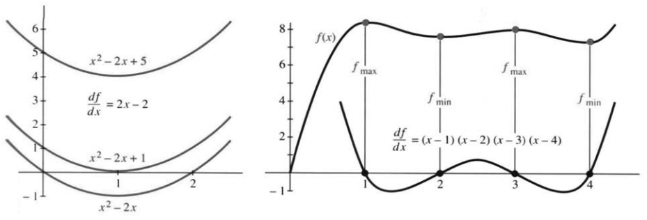

这些结论，一个函数值都不用逐点去算。这条抛物线一路降到 $x=1$ 处的最小值，再升上去。

**例 2。**$x^2-2x+5$ 的导数还是 $2x-2$，图像只是整体上移 $5$——而这个常数一求导就没了。凡导数相同的函数，都是 $x^2-2x+C$。有的穿过横轴，交点处函数值为零；有的始终悬在横轴上方。$x^2-2x+5=0$ 的根是复数，实平面上看不到交点。特殊的一条 $(x-1)^2$ 在 $x=1$ 处与横轴相切，那里是二重零点，同时有 $f=f'=0$。


**例 3。**设
$$f'(x)=(x-1)(x-2)(x-3)(x-4).$$
这个斜率在 $x>4$ 和 $x<1$ 时为正（$x=0$ 时 $df/dx=24$），在 $2$ 与 $3$ 之间也为正。在 $x=1,2,3,4$ 处，斜率为零，$f(x)$ 改变方向。

这里 $f(x)$ 是五次多项式，因为 $f'(x)$ 是四次的。$f$ 的图像先升、降、升、降、再升。它可能与 $x$ 轴相交五次，至少必须相交一次（如图中这条）。允许复数时，每个五次多项式都有五个根。

“导数为正就意味着递增”，听上去理所当然——也许真是。可这里有个微妙之处：从每一点的导数符号，推出任意两点之间的大小关系，这是“局部推整体”的功夫，得靠中值定理。也可以等微积分基本定理：把 $f(X)-f(x)$ 写成导函数图像下的面积。面积为正，于是 $f(X)>f(x)$。

### 极大值与极小值

哪个位置能让函数值尽可能大、或者尽可能小？没有微积分，只能逐个算、再比大小；有了导数，范围就能先缩小。

假设最大值或最小值在某个点 $x$ 处。图像可能有一个折角，因此没有导数。但如果 $df/dx$ 存在，它就必须为零。切线是水平的。图3.3中的抛物线从递减转为递增，斜率从负变正。在这个关键点，斜率为零。

> **3C 局部极大值或极小值。**设最大值或最小值出现在一个区间内部的点 $x$ 处，且 $f(x)$ 和 $df/dx$ 在该区间内都有定义。那么 $f'(x)=0$。

“局部”二字，只比较这一点附近的函数值；别处完全可能更高，或者更低。以极大值为例：增量取得足够小，函数值之差就满足 $f(x+\Delta x)-f(x)\le0$。于是
$$\Delta x>0:\quad\frac{f(x+\Delta x)-f(x)}{\Delta x}\le0,$$
$$\Delta x<0:\quad\frac{f(x+\Delta x)-f(x)}{\Delta x}\ge0.$$
正反两个方向都走一遍，结论只有一个：双侧导数若存在，它既不能大于零，也不能小于零，只能等于零。

费曼也许说得最妙。他拿一块特制的塑料曲线板给朋友看：“不管怎么转，最低点那儿的切线总是水平的。”朋友们一试，果然不假。作者推荐的出处是《别闹了，费曼先生！》——好书，只是对数学家不太客气。

**例 3 续。**回头看图 3.3 右图，最显眼的不是那些“峰”和“谷”，而是四个“转弯”的位置。它们叫**驻点**，即 $f'=0$ 的点，其中两个局部极大、两个局部极小。可它们都不是全局最值——这个五次函数在左端跌向负无穷，在右端升向正无穷。


**例 4。**$f(x)=4x^3-3x^4$ 的斜率是 $12x^2-12x^3$。$x^2=x^3$ 时，即 $x=0$ 和 $x=1$ 这两点，导数为零。要判定是极小值还是极大值（局部或全局），第一步是计算这些驻点处的 $f(x)$。得到 $f(0)=0$ 和 $f(1)=1$。

现在看较大的 $x$。函数沿两个方向都降向 $-\infty$。（你可以心算代入 $x=1000$ 和 $x=-1000$。）$x$ 较大时，$-3x^4$ 占主导，超过 $4x^3$。

**结论。**$f=1$ 是全局最大值。$f=0$ 既不是极大值，也不是极小值（局部或全局）。我们必须认识到这个例外：曲线（或汽车）可以暂停一瞬（$f'=0$），然后继续沿同一方向前进。原因是 $12x^2-12x^3$ 中的“二重零点”，它来自二重因子 $x^2$。

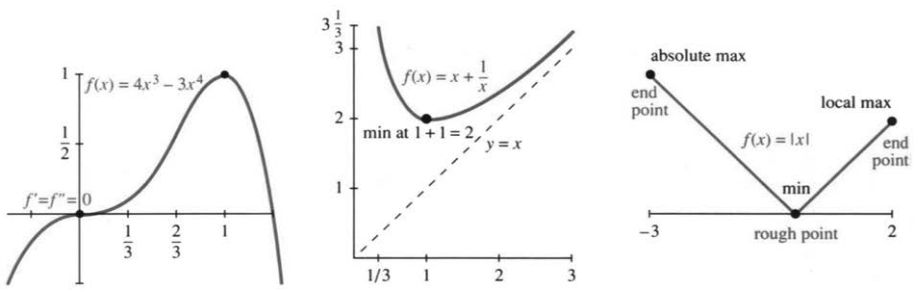

**例 5。**在 $x>0$ 上定义 $f(x)=x+x^{-1}$。导数 $1-1/x^2$ 在 $x=1$ 处为零。该点的 $f(1)=2$ 是最小值。像 $1/3+3$ 或 $2/3+3/2$ 这样的每个组合都大于 $f_{\min}=2$。图3.4表明，$x+x^{-1}$ 的最大值是 $+\infty$。[原书脚注：当 $f(x)\to\infty$ 时，“趋近”是个好词。无穷并没有达到。但我仍说“最大值是 $\infty$”。]

**重要。**最大值总出现在驻点（$df/dx=0$）、不可导点（没有导数），或定义域的端点。这是三类**临界点**。所有极大值和极小值都出现在临界点！在其他每个点上，$df/dx>0$ 或 $df/dx<0$。步骤如下：

1. 解 $df/dx=0$，找出驻点 $f(x)$。
2. 计算每个临界点——驻点、不可导点、端点——处的 $f(x)$。
3. 取这些 $f(x)$ 临界值中的最大值和最小值。

**例 6。**$f(x)=|x|$ 在 $[-3,2]$ 上，最小值 $0$ 落在不可导点 $x=0$，最大值 $3$ 落在端点 $x=-3$。它一个驻点也没有。分段线性函数常是这副样子。

**问：**函数始终不等于零，还能不能把零叫作最小值？

**答：**能。$f(x)=1/(1+x)^2$ 在 $x\to\infty$ 时趋近零，却永远达不到零。


**说明 1。**$f$ 在闭区间 $a\le x\le b$ 上连续时，便避免了 $x\to\pm\infty$ 和 $f(x)\to\pm\infty$。这时 $f(x)$ 达到它的最大值和最小值（极值定理）。但 $x\to\infty$ 和 $f(x)\to\infty$ 太重要，不能排除。考察较大的 $x$，就能检验 $x\to\infty$；超过每一个有限值，就能辨认 $f(x)\to\infty$。

**说明 2。**注意临界点（由 $x$ 指定）和临界值（由 $f(x)$ 指定）的区别。例子 $x+x^{-1}$ 的最小值点是 $x=1$，最小值是 $f(1)=2$。

### 应用中的最值

解 $f'=0$、再查其他候选点，这套流程很清楚；可在实际问题里，它往往不是第一步。真正的第一步——也常常是最难的一步——是**选变量、建函数**。变量和函数都是我们自己挑的；方程 $f'=0$ 出现在半路上，不在开头。

**例 7。**高速公路上的速度是每小时 $60$ 英里，普通道路是每小时 $30$ 英里。该从哪儿驶上高速，总行车时间才最短？

我很熟悉这个问题，每天早晨都会碰到。马萨诸塞收费公路通往麻省理工学院，我得在某个地方驶上去。一个入口在128号公路附近，另一个入口更靠里。我以前走第二个，现在走第一个。数学应该决定哪条路更快——有些早晨，我觉得它们都是最大值。

大多数模型都经过简化，以突出关键思想。我们允许在任意位置 $x$ 驶上高速公路（图3.5）。不再是两个入口（离散问题），而是一个连续的选择（微积分问题）。行程有两段，速度分别为30和60：

- 普通道路的距离是 $\sqrt{a^2+x^2}$，用时 $\sqrt{a^2+x^2}/30$；
- 高速上的距离是 $b-x$，用时 $(b-x)/60$。

于是，问题变成求这个函数的最小值：
$$f(x)=\frac1{30}\sqrt{a^2+x^2}+\frac1{60}(b-x).$$
我们有了函数 $f(x)$，现在轮到微积分。第一项使用幂法则：$u^{1/2}$ 的导数是 $\tfrac12u^{-1/2}du/dx$。这里 $u=a^2+x^2$，有 $du/dx=2x$：
$$f'(x)=\frac1{30}\frac12(a^2+x^2)^{-1/2}(2x)-\frac1{60}.\tag{1}$$
令它为零，得到
$$\frac{2x}{\sqrt{a^2+x^2}}=1,
\qquad2x=\sqrt{a^2+x^2},\qquad4x^2=a^2+x^2.\tag{2}$$
于是 $3x^2=a^2$，给出两个候选值 $x=a/\sqrt3$ 和 $x=-a/\sqrt3$。但负的 $x$ 意味着在高速公路上作无用的行驶。事实上，$x=-a/\sqrt3$ 时 $f'$ 不为零。这个假根是在把 $2x$ 平方时引入的。


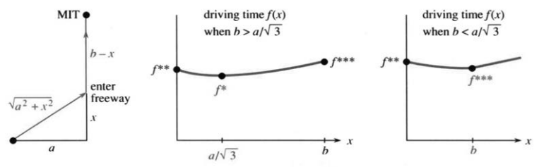

我注意到一件令人惊讶的事。驻点 $x=a/\sqrt3$ 与 $b$ 无关。总时间中包括常数 $b/60$，它在 $df/dx$ 中消失了。$b$ 总得以某种方式进入答案，这提醒我们小心。最小值可能出现在不可导点或端点。这些是 $f$ 的其他临界点，我们的图也可能不符合实际。当然，我们预期 $x\le b$，否则就要在经过麻省理工学院以后才驶上高速公路了。

继续用微积分。计算在 $x^*=a/\sqrt3$ 处驶入时的行车时间 $f(x)$：
$$f^*=\frac1{30}\sqrt{a^2+\frac{a^2}3}+\frac1{60}\left(b-\frac a{\sqrt3}\right)
=\frac{\sqrt3a+b}{60}.$$
$4a^2/3$ 的平方根是 $2a/\sqrt3$。我们合并了 $2/30-1/60=3/60$，再除以 $\sqrt3$。这个驻点值 $f^*$ 是最小值吗？你还必须考察端点：
$$f(0)=\frac a{30}+\frac b{60}=f^{**},\qquad
f(b)=\frac{\sqrt{a^2+b^2}}{30}=f^{***}.$$
只要驻点可行，它总比垂直冲上高速强：微积分没挑 $x=0$，别跟高速垂直着硬闯。另一头是 $x=b$，干脆一路走普通道路到目的地。这个选项可不能小看；$b$ 小或 $a$ 大时，它反倒最优。

这个选择 $x=b$ 在数学上有两种来路。若所有入口都在 $0$ 和 $b$ 之间，$b$ 就是端点；若允许经过麻省理工学院以后再驶入，$b$ 就是不可导点。图3.5c在 $x=b$ 处有一个折角，导数在那里跳跃。原因是高速上的距离为绝对值 $|b-x|$，永远非负。无论哪种情形，$x=b$ 都是临界点。最佳的 $x$ 是 $a/\sqrt3$ 与 $b$ 中较小的一个：
$$x_{\mathrm{opt}}=\min\left\{\frac a{\sqrt3},b\right\}.$$
若 $a/\sqrt3\le b$，就在驻点驶入，总时间 $f^*$；若 $a/\sqrt3\ge b$，干脆直奔目的地，总时间 $f^{***}$。

应用题的重头戏在建模。真正的微积分只有几行——求导、解方程而已：

1. 把要最小化或最大化的量表示成函数 $f(x)$。变量 $x$ 必须选定。


2. 计算 $f'(x)$，解 $f'(x)=0$，检查临界点，求 $f_{\min}$ 和 $f_{\max}$。

画一张实际情境的图，再配上函数图像，效果往往大不相同。

**例 7 续。**选择 $x$ 为角度，而不是距离。图3.6画出角为 $x$、一边为 $a$ 的三角形。到高速公路的行车距离是 $a\sec x$，高速上的距离是 $b-a\tan x$。除以速度30和60，行车时间有一个简洁的形式：
$$f(x)=\text{总时间}=\frac{a\sec x}{30}+\frac{b-a\tan x}{60}.\tag{3}$$
$\sec x$ 和 $\tan x$ 的导数进入 $df/dx$：
$$\frac{df}{dx}=\frac a{30}\sec x\tan x-\frac a{60}\sec^2x.\tag{4}$$
现在令 $df/dx=0$，除以 $a$，再乘以 $30\cos^2x$：
$$\sin x=\frac12.\tag{5}$$
这个答案很漂亮。角 $x$ 是 $30^\circ$！这个最佳角度（$\pi/6$ 弧度）满足 $\sin x=\tfrac12$。边长为 $a$、斜边为 $a/\sqrt3$ 的三角形是一个30—60—90直角三角形。

我不知道你偏爱 $\sqrt{a^2+x^2}$ 还是三角函数。最小值与前面完全一样：要么取 $30^\circ$，要么直接驶向麻省理工学院。

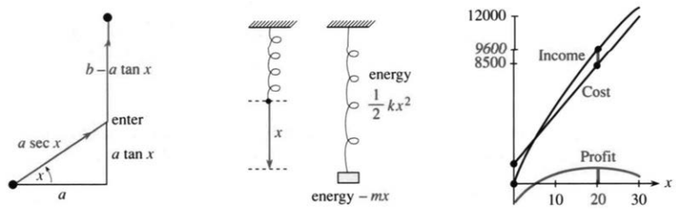

**例 8。**在力学中，自然界选择最小能量。一个质量块把弹簧向下拉，能量是 $f(x)$，$df/dx=0$ 给出平衡。为什么如此多的物理定律涉及最小能量或最短时间，这是一个哲学问题，也使数学变得容易。

能量有两项，分别属于弹簧和质量块。弹簧能量是 $\tfrac12kx^2$，拉伸时为正（$x>0$ 指向下方），压缩时（$x<0$）也为正。质量块的势能取为 $-mx$，随质量块下降而减少。平衡出现在 $f(x)=\tfrac12kx^2-mx$ 的最小值处。

抱歉给你这么一个小问题，但它说明了一个关键点。**当 $f(x)$ 是二次函数时，平衡方程 $df/dx=0$ 是线性的。**
$$df/dx=kx-m=0.$$
从图像看，$x=m/k$ 位于抛物线的底部。从物理看，$kx=m$ 是力的平衡：弹簧力与重力相平衡。弹簧力的胡克定律是弹性常数 $k$ 乘以位移 $x$。


**例 9：成本的导数=边际成本（我们的第一个管理学例子）。**印 $x$ 本本书，纸张成本可能是 $C=1000+3x$ 美元。导数是 $dC/dx=3$。这是每增加一本书的纸张边际成本。$x$ 增加一本，成本 $C$ 就增加3美元。边际成本好比速度，总成本好比距离。

**边际成本的单位是美元每本，总成本的单位是美元。**收入这一边，收入是 $I(x)$，边际收入是 $dI/dx$。为应用微积分，我们忽略只取整数的限制。

假设书的本数增加 $dx$。[原书脚注：也许 $dx$ 是一本微分学的书。为这个玩笑我道歉。] 成本增加 $(dC/dx)dx$，收入增加 $(dI/dx)dx$。如果不考虑其他一切成本，那么**利润 $P(x)=$ 收入 $I(x)-$ 成本 $C(x)$**。在大多数情形下，$P$ 增加到最大值后回落。

在利润曲线的最高点，**边际利润为零**：
$$dP/dx=0\quad\text{或}\quad dI/dx=dC/dx.\tag{6}$$
**边际收入 $I'$ 等于边际成本 $C'$ 时，利润最大。**这个基本经济学法则直接来自微积分，我们给出一个例子：

举个例子：广告数量为 $x$ 时，设
$$C(x)=900+400x-x^2,\qquad I(x)=600x-6x^2.$$
成本由固定费用 $900$、印制费用 $400x$ 和批量节省 $x^2$ 组成；收入里的 $-6x^2$，表示新增广告的效果递减。令 $C'=I'$：
$$400-2x=600-12x\quad\Longrightarrow\quad x=20.$$
利润 $=$ 收入 $-$ 成本 $=9600-8500=1100$。

下一节说明怎样验证这个利润是最大值而不是最小值。前面的习题要求你解 $df/dx=0$，后面的习题还要寻找 $f(x)$。

### 3.2 习题

**阅读填空**

若某区间内 $df/dx>0$，则 $f(x)$ 是 **(a)______** 的。若在 $x$ 处取得极大或极小值，则 $f'(x)=$ **(b)______**。$f'(x)=0$ 的点，叫作 **(c)______** 点。$f(x)=3x^2-x$ 在 $x=$ **(d)______** 处取得（极小／极大）值。函数 $f(x)=$ **(e)______** 有不成为极大值或极小值的驻点。

最值还可能出现在 **(f)______** 没有定义的地方，或定义域的 **(g)______** 上。在 $[-2,2]$ 上，$|x|$ 和 $5x$ 的最小值分别落在 $x=$ **(h)______**、$x=$ **(i)______**，尽管那里 $df/dx$ 不为零。若所有 $x$ 都满足 $f(x^*)\ge f(x)$，$x^*$ 就是全局 **(j)______**；若所有接近 $x^*$ 的 $x$ 都满足 $f(x^*)\le f(x)$，则取得 **(k)______** 极小值。$\tfrac12ax^2-bx$ 在 $x=$ **(m)______** 处的最小值是 **(l)______**。

**找出驻点、不可导点和端点。判定每个点是局部还是全局的极小值点或极大值点。**

1. $f=x^2+4x+5$，$x\in\mathbb R$。
2. $f=x^3-12x$，$x\in\mathbb R$。
3. $f=x^2+3$，$-1\le x\le4$。
4. $f=x^2+2/x$，$1\le x\le4$。
5. $f=(x-x^2)^2$，$-1\le x\le1$。


6. $f=1/(x-x^2)$，$0<x<1$。
7. $f=3x^4+8x^3-18x^2$，$x\in\mathbb R$。
8. $\displaystyle f(x)=\begin{cases}x^2-4x,&0\le x\le1,\\x^2-4,&1\le x\le2.\end{cases}$
9. $f=\sqrt{x-1}+\sqrt{9-x}$，$1\le x\le9$。
10. $f=x+\sin x$，$0\le x\le2\pi$。
11. $f=x^3(1-x)^6$，$x\in\mathbb R$。
12. $f=x/(1+x)$，$0\le x\le100$。
13. $f(x)$ 为 $x\ge0$ 到最近非负整数的距离。
14. $f(x)$ 为 $x\ge0$ 到最近素数的距离。
15. $f=|x+1|+|x-1|$，$-3\le x\le2$。
16. $f=x\sqrt{1-x^2}$，$0\le x\le1$。
17. $f=x^{1/2}-x^{3/2}$，$0\le x\le4$。
18. $f=\sin x+\cos x$，$0\le x\le2\pi$。
19. $f=x+\sin x$，$0\le x\le2\pi$。
20. $f(\theta)=\cos^2\theta\sin\theta$，$-\pi\le\theta\le\pi$。
21. $f(\theta)=4\sin\theta-3\cos\theta$，$0\le\theta\le2\pi$。
22. $\displaystyle f(x)=\begin{cases}x^2+1,&x\le1,\\x^2-4x+5,&x\ge1.\end{cases}$

**应用题中，你若愿意，可以选择公制单位。**

23. 航空公司接受的箱子要求长 $+$ 宽 $+$ 高 $=l+w+h\le62$ 英寸或158厘米。固定 $h$，证明体积 $(62-w-h)wh$ 的最大值为 $V=h(31-h/2)^2$；再选 $h$ 使 $V$ 最大。容积最大的箱子是一个 ______。
24. 某次脉搏测量依次为 $70,80,120$。求使 $(x-70)^2+(x-80)^2+(x-120)^2$ 最小的最小二乘估计。若认为第三次受紧张影响而降低权重，再最小化 $(x-70)^2+(x-80)^2+\tfrac12(x-120)^2$。
25. 卡车以速度 $v$ 行驶时，每英里耗油 $av+b/v$ 加仑。速度为 $v$ 时，每加仑能行驶多少英里？最小化耗油量。最大化每加仑行驶的英里数。
26. 豪华轿车每加仑行驶 $(120-2v)/5$ 英里，司机费用每小时 $10$ 美元，汽油每加仑 $1$ 美元。（a）求速度 $v$ 下的每英里费用。（b）求最省费用的行驶速度。
27. 投篮应该选择使所需速度最小的角度 $\theta$。避免平直球和高抛球。从 $(0,0)$ 投向篮筐 $(a,b)$，最小化
    $$f(\theta)=\frac1{a\sin\theta\cos\theta-b\cos^2\theta}.$$
    （a）$b=0$ 时，你与篮筐齐高。证明 $\theta=45^\circ$ 最好（贾巴尔的天勾）。（b）把 $df/d\theta=0$ 化为 $\tan2\theta=-a/b$，并解 $a=b$ 的情形。（c）估计罚球的最佳角度。
    同一个角度也允许最大的误差范围（Peter Brancazio的 *Sports Science*）。第12.2节给出飞行轨迹。
28. 六月和十二月，白昼最长和最短的那两天，为什么白昼长度的变化最小？
29. 求连接图中 $P,Q,B$ 的最短 Y 形线。$B$ 原本是一个喂鸟器。Y 形线的长度为 $L(x)=b-x+2\sqrt{a^2+x^2}$。（a）选 $x$ 使 $L$ 最小（不允许 $x>b$）。（b）证明 Y 形中心处的角是 $120^\circ$。（c）当 $a/b=$ ______ 时，最优 Y 形变为 V 形。

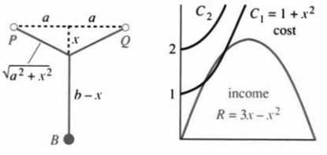

30. 距离函数为 $f(t)=(1+3t)/(1+3t^2)$ 时，向前运动何时结束？你已经走了多远？附加题：画出 $f(t)$ 和 $df/dt$。

**第 31–34 题生产并销售 $x$ 个比萨，收入 $R=ax+bx^2$，成本 $C=c+dx+ex^2$。**

31. 利润 $\Pi(x)=$ ______；平均每个利润为 ______ $=$ ______；边际利润 $\Pi'(x)=$ ______。应最大化（总利润／平均利润／边际利润）。
32. 每个比萨的售价为 $p(x)=$ ______ 时，收入为 $R(x)=ax+bx^2$。反过来，售价为 $p$ 时，售出 $x=$ ______ 个比萨（$p$ 的函数）。我们预期 $b<0$，因为 ______。
33. 求使利润 $\Pi(x)$ 最大的 $x$。该 $x$ 处的边际利润为 $d\Pi/dx=$ ______。
34. 图B中 $R(x)=3x-x^2$，$C_1(x)=1+x^2$，$C_2(x)=2+x^2$。成本为 $C_1$ 时，哪些销量 $x$ 盈利？哪一销量利润最大？$C_2$ 的固定成本较高，此时最好的计划是 ______。

下图的饼干盒与爆米花盒由 Kay Dundas 设计，使用 $12\times12$ 英寸的正方形材料。无盖盒是经典微积分题型。

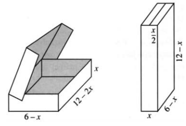


35. 选择 $x$，使饼干盒体积最大。
36. 选择 $x$，使爆米花盒体积最大。
37. 高档巧克力盒在饼干盒前部增加一条宽 $x$ 的盖舌。求新体积 $V(x)$ 及其最大值点。附加题：说明最大体积减少超过 $20\%$。
38. 从边长 $12$ 英寸的正方形四角各剪去边长 $x$ 的小正方形，向上折起四边，得到高为 $x$ 的无盖盒。求最大体积。

**几何题看着抽象，其实往往很贴近应用。**

39. 把长 $4$ 英尺的铁丝分成两段，一段围成半径 $r$ 的圆，另一段围成边长 $x$ 的正方形。选择 $r$ 使面积之和最小，再选择 $r$ 使其最大。
40. 一面固定墙作矩形的一边，其余三边共有 $200$ 英尺围栏。按四步最大化面积 $A$：画出实际情形；选择一个未知量作为 $x$（但不能选 $A$！）；用 $x$ 表示其他所有量；解 $dA/dx=0$ 并检查端点。
41. 若无现成墙，矩形满足 $2x+2y=200$。求最大面积，并与同长围栏围成的圆面积比较。
42. 在已有的一段长 $100$ 米的直围栏基础上，再加 $200$ 米围栏，围成最大面积的矩形（Klee教授提出）。
43. 在三边为 $x=0,y=0,x/4+y/6=1$ 的三角形内，求与坐标轴平行的最大面积矩形，即在第三边上选点使 $xy$ 最大。
44. 矩形不必与坐标轴平行。将一边放在 $x/4+y/6=1$ 上，再求最大面积。
45. 第43题矩形的周长为 $P=2x+2y$。代入 $y$ 的表达式，求 $P(x)$。哪个矩形具有 $P_{\max}=12$？
46. 求内接于单位球的最大体积直圆柱。
47. 圆锥底半径为 $R$、高为 $H$。内接圆柱半径和高满足 $r/R+h/H=1$，求使 $V=\pi r^2h$ 最大的 $r,h$。
48. 在第 47 题中改为最大化侧面积 $A=2\pi rh$。
49. 包括顶面和底面时，圆柱面积为 $A=2\pi rh+2\pi r^2=2\pi rH(1-r/R)+2\pi r^2$。$H>R$ 时最大化 $A$。$R>H$ 时最大化 $A$。
50. ★ 一堵高 $8$ 英尺的墙距房屋 $1$ 英尺。求跨过墙顶、靠到房屋上的最短梯长 $L$。画出高为 $y$、底为 $1+x$、斜边为 $L$ 的大直角三角形。
51. 体积 $V=\pi r^2h=16\pi$ 的封闭圆柱，怎样取 $r,h$ 使总表面积最小？
52. 两个三角形分别具有边长 $1,1,2x$ 与 $2x,2,2$，沿公共底边拼成风筝形。求面积 $A$ 及最大值点。提示：$\sqrt{1-x^2}-x^2/\sqrt{1-x^2}=(1-2x^2)/\sqrt{1-x^2}$。

**第53–56题中，$x,y$ 是非负数，且 $x+y=10$。求最大值和最小值：**

53. $xy$。
54. $x^2+y^2$。
55. $y-1/x$。
56. $\sin x\sin y$。
57. 求从 $A$ 经 $X$ 到 $C$ 的总距离 $f(x)$。证明 $df/dx=0$ 给出 $\sin a=\sin c$。光以相等的角度反射，使传播时间最短。

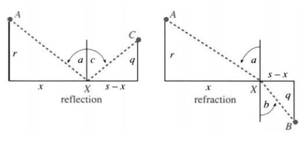

58. 费马原理说，光沿从 $A$ 到 $B$ 的最快路径传播。它在 $x$ 轴上方的速度为 $v$，下方为 $w$。（a）求从 $A$ 经 $X$ 到 $B$ 的时间 $T(x)$。在 $AX$ 上，时间 $=$ 距离 $/$ 速度 $=\sqrt{r^2+x^2}/v$。（b）列出使时间最短的 $x$ 的方程。（c）推出斯涅尔定律 $\sin a/v=\sin b/w$。

**最近点问题也是许多应用的模型。**

59. 抛物线 $y=x^2$ 上哪些点离 $(0,2)$ 最近？
60. 直线 $y=5-2x$ 上哪个点离原点最近？
61. 曲线 $y=-x^2$ 与直线 $y=5-2x$ 的哪一对点最近？最近点处两者斜率相同，请画图。
62. $y=x^2$ 上哪个点离 $(0,1/3)$ 最近？若直接最小化 $x^2+(y-1/3)^2=y+(y-1/3)^2$，得到 $y<0$，哪里出了问题？
63. 直线 $y=mx$ 要拟合点 $(2,3),(1,1),(-1,1)$。求使 $(3-2m)^2+(1-m)^2+(1+m)^2$ 最小的 $m$。


64. 三角形顶点为抛物线上的 $(-1,1),(x,x^2),(3,9)$，$-1\le x\le3$。求最大面积。提示：点 $(X,Y)$ 到直线 $y=mx+b$ 的距离为 $|Y-mX-b|/\sqrt{1+m^2}$。
65. 潜艇位于 $(2,0)$ 和 $(1,1)$。选择斜率 $m$，使直线 $y=mx$ 从潜艇之间通过，并且尽可能远离较近的那艘。

**第 66–72 题回到理论。**

66. 为寻找 $y(x)$ 的图像斜率最大的地方，解 ______。对 $y=1/(1+x^2)$，该点为 ______。
67. $f(x)$ 与 $g(x)$ 的差最小时，它们的斜率 ______。在 $f=2+x^2$ 与 $g=2x-x^2$ 的图像上标出此点。
68. 固定 $y$，$x^2+xy-y^2$ 关于 $x$ 的最小值为 $m(y)=$ ______，再求 $m(y)$ 的最大值。反过来固定 $x$，该式关于 $y$ 的最大值为 $M(x)=$ ______，再求 $M(x)$ 的最小值。
69. 对每个 $m$，$f(x)-mx$ 的最小值都在 $x=m$ 处取得。$f(x)$ 是什么？
70. $y=x+2x^2\sin(1/x)$ 在 $x=0$ 处斜率为1。但请找出 $dy/dx=1-2\cos(1/x)+4x\sin(1/x)$ 为负的点，证明 $y$ 在 $x=0$ 附近的区间内并不递增。
71. 判断正误并说明理由：光滑函数 $f(x)$ 的两个局部极小值之间，有一个局部极大值。
72. 构造一个在不可导点取得最大值、在端点取得最小值的函数。
73. 画一个圆形泳池，一侧有救生员，对面有溺水者。救生员以速度 $v$ 游泳，并以速度 $w=10v$ 沿池边跑完剩余路程。若游泳方向与直达方向的夹角为 $\theta$，选择 $\theta$，使到达时间最短和最长。

## 3.3 二阶导数：弯曲与加速度


导数为正的区间上，函数递增；导数为负的区间上，函数递减。那么二阶导数呢？只看曲线，能判断 $f''(x)$ 的符号吗？能——关键就在弯曲。

直线不弯。$y=mx+b$ 的斜率恒为 $m$，二阶导数为零。要看斜率怎么变，就得看曲线；斜率的变化，全写在二阶导数里：
$$f=x^2:\quad f'=2x,\quad f''=2\qquad\text{向上弯曲};$$
$$y=\sin x:\quad y'=\cos x,\quad y''=-\sin x\qquad\text{正弦曲线向下弯曲}.$$
哪怕抛物线正在往下掉，斜率 $2x$ 照样随 $x$ 增大。二阶导数的符号并不直接决定函数值，也不直接决定一阶导数的符号；它描述的是**斜率如何变化**。

某区间内 $f''>0$ 时，函数向上凹，也叫凸函数；斜率递增，图像一路向上弯。$f''<0$ 则向下凹，斜率递减。$\cos x$、$1+\cos x$、$1+x/2+\cos x$ 都在 $x=\pi/2$ 附近由向下凹转为向上凹——它们的二阶导数同为 $-\cos x$，就在这里由负变正。加上一次函数，图像会平移、会倾斜，弯曲却不变。


还可以这样看 $f''$ 的符号：观察切线。曲线向上凹时，切线位于曲线下方，线性近似偏低。本节计算二次近似，其中包括含 $f''>0$ 的项。曲线向下弯曲（$f''<0$）时，情况相反，切线在曲线上方。线性近似偏高，$f''$ 把它降低。

物体运动中，$f''(t)$ 是加速度，单位是距离除以时间的平方。加速度是速度的变化率。振动 $\sin2t$ 的速度为 $v=2\cos2t$（最大速率2），加速度为 $a=-4\sin2t$（最大加速度4）。

人口增加对应 $f'>0$，每单位时间新增人数还在增加，则对应 $f''>0$。这是两回事：增长可以继续，增长速度却可能慢下来。

### 区分极大与极小

记住，$f'(x)=0$ 确定了驻点。它可能是极小值，也可能是极大值。二阶导数作出决定！我们不必在许多点计算 $f(x)$，而是在一个点——驻点——计算 $f''(x)$。若 $f''(x)>0$，就是极小值。


> **3D** 当 $f'(x)=0$ 且 $f''(x)>0$ 时，$x$ 处有局部极小值。
> 当 $f'(x)=0$ 且 $f''(x)<0$ 时，$x$ 处有局部极大值。

在极小值的左侧，曲线下降；在极小值之后，曲线上升。斜率从负变正，图像向上弯曲，$f''(x)>0$。在极大值处，斜率从正降到负。在例外情形下，$f'(x)=0$ 且 $f''(x)=0$，什么都可能发生。例如 $x^3$ 在 $x=0$ 处暂停一下，然后继续上升（斜率为 $3x^2\ge0$）。然而 $x^4$ 暂停后向下走（图像非常平坦）。

这些判断都只管局部。要确定全局的最大或最小值，还得看整个定义域。

**例 1。**$f=x^3-x^2$，$f'=3x^2-2x$，$f''=6x-2$。让一阶导数为零，驻点是 $0$ 和 $2/3$。再看二阶导数：$f''(0)=-2$，零点是局部极大值点；$f''(2/3)=2$，$2/3$ 是局部极小值点。极大与极小之间夹着**拐点**：$f''$ 在 $x=1/3$ 由负变正。

### 拐点

函数穿过零值，在数学上是件大事：$f$ 变号，图像就穿过横轴；$f'$ 为零，切线就变水平；$f''$ 变号，凹向随之改变——那就是拐点。

**弯曲方向在拐点处改变。**你用眼睛就能在图上辨认出来。有一瞬间，图像是直的（直线有 $f''=0$）。交点、驻点和拐点都容易看出。很少有人能辨认哪里有 $f'''=0$ 或 $f^{(4)}=0$。我不确定这些点有没有名称。

$f'(x)$ 变号时，才有真正的极大值或极小值。同样，$f''(x)$ 变号时，才有真正的拐点。图像在拐点的一侧向下凹，在另一侧向上凹。[原书脚注：这排除了 $f(x)=x^4$，它的 $f''=12x^2$ 在零的两侧都大于0。它的切线是 $x$ 轴，始终在图像下方，所以没有拐点。]

切线在曲线的一侧位于上方，在另一侧位于下方。在拐点处，切线穿过曲线（图3.7b）。注意，抛物线 $y=ax^2+bx+c$ 没有拐点，因为 $y''$ 是常数。三次曲线有一个拐点，因为 $f''$ 是一次函数。四次曲线可能有拐点，也可能没有，因为二次函数 $f''(x)$ 可能穿过横轴，也可能不穿过。

**例 2。**$f=x^4-2x^2$ 是 W 形，$f'=4x^3-4x$ 有两个鼓包，$f''=12x^2-4$ 是 U 形。关键横坐标处的符号列在下表；其中 $x=0$ 是 $f$ 的二重零点。

| $x$ | $-\sqrt2$ | $-1$ | $-1/\sqrt3$ | $0$ | $1/\sqrt3$ | $1$ | $\sqrt2$ |
|---|---|---|---|---|---|---|---|
| $f(x)$ | $0$ | $-$ | $-$ | $0,0$ | $-$ | $-$ | $0$ |
| $f'(x)$ | | $0$ | $+$ | $0$ | $-$ | $0$ | |
| $f''(x)$ | | | $0$ | $-$ | $0$ | | |


在 $f(x)$ 的零点之间，有 $f'(x)$ 的零点（驻点）。在 $f'(x)$ 的零点之间，有 $f''(x)$ 的零点（拐点）。本例的 $f(x)$ 在原点有一个二重零点，所以 $f'$ 的一个单零点被留在了那里。由于 $f''(0)<0$，它是局部极大值。

拐点很重要，不仅仅对数学如此。我们知道世界人口还会继续增长，却不知道增长率会不会放缓。记住：增长率在拐点处停止增长。下面是1990年联合国人口基金的报告：

> 今后十年将决定：世界人口在最终停止增长之前，是增为三倍，还是只增为两倍。这可能决定地球作为人类居所的未来。现在人口为53亿，每天增加25万。20世纪90年代每年将新增9,000万至1亿人，十年增加10亿——整整一个中国的人口。增长最快的将是最贫困的国家。
>
> 几年前，除非洲和南亚部分地区外，各地人口增长率似乎都在放缓。[原书脚注：联合国在关注二阶导数！] 世界人口似乎会在下个世纪末稳定在102亿左右。今天，情况看起来不那么乐观了。世界人口已经超过1984年“最可能”的中位预测所设的各个阶段性指标。按目前的趋势，最终总数将更接近110亿，而不是100亿。
>
> 如果生育率下降仍慢于预测，这个目标还可能再次落空；真到那一步，世界人口可能高达 140 亿。

联合国从人口普查出发，跟踪每个国家的各年龄组。他们估计死亡率和生育率，公布中位估计。这份报告说的是，我们没有沿着估计的轨道前进。

第6.5节会回到人口问题，给出一个预测人口为100亿的方程。它假定我们现在正处于拐点。但中国的第二次人口普查刚在1990年7月1日开始。等它结束，我们就会知道拐点是否还在前方。

现在你已理解二阶导数的符号：它说的是斜率怎样变化。接下来不只看符号，还要用二阶导数的大小算一算——曲线到底弯多少，并据此构造二次近似。这部分在有些课程中可选读。

### 中心差分与二阶差分

在 $x$ 的两侧，各算一个平均变化率：
$$\frac{f(x+\Delta x)-f(x)}{\Delta x},\qquad
\frac{f(x)-f(x-\Delta x)}{\Delta x},\tag{1}$$
两者都接近 $f'(x)$。把这两个平均值再平均一次，就得到通常更精确的中心差商：
$$\begin{aligned}
f'(x)&\approx\frac12\left[\frac{f(x+\Delta x)-f(x)}{\Delta x}
+\frac{f(x)-f(x-\Delta x)}{\Delta x}\right]\\
&=\frac{f(x+\Delta x)-f(x-\Delta x)}{2\Delta x}.
\end{aligned}\tag{2}$$
它左右各取一点，两点横向相隔 $2\Delta x$。为什么更精确？拿幂函数试一试。


对 $f(x)=x$，这些比值都给出 $f'=1$（完全精确）。对 $f(x)=x^2$，只有中心差分正确给出 $f'=2x$。单侧比值给出 $2x+\Delta x$（第1章中是 $2t+h$），它只有“一阶精度”。但取中心后就没有误差了。我们把 $2x+\Delta x$ 与 $2x-\Delta x$ 平均，所以中心差分有“二阶精度”。

那么，什么差商能趋于二阶导数？可以拿 $f'$ 再作差商，但我们想只用 $f$ 本身的值。很自然的想法是“对差分再作差分”：
$$\frac{\dfrac{f(x+\Delta x)-f(x)}{\Delta x}
-\dfrac{f(x)-f(x-\Delta x)}{\Delta x}}{\Delta x}
=\frac{f(x+\Delta x)-2f(x)+f(x-\Delta x)}{(\Delta x)^2}
\longrightarrow f''(x).\tag{3}$$
分子是二阶差分，对应 $d^2f$；分母是步长的平方，对应 $dx^2$。$d^2f/dx^2$ 的写法为什么是这样，也就有了解释：平方落在分母上，$df$ 并不平方。

注意，$(\Delta x)^2$ 变得比 $\Delta x$ 小得多。如果把 $\Delta f$ 除以 $(\Delta x)^2$，比值就会无限增大。二阶差分 $\Delta^2f$ 中的额外抵消使极限得以存在。那个极限就是 $f''(x)$。

**应用。**绝大多数方程都求不出精确的公式解，摆方程 $f''(x)=-\sin f(x)$ 就是典型。要算解，我可以把二阶导数换成式 (3) 的二阶差商，在间距为 $\Delta x$ 的网格上逐点近似。离散近似，是科学计算里很大的一块。

为检验这些差分的精度，下面对 $f(x)=\sin x+\cos x$ 作一个实验。表中列出式 (1)、(2)、(3) 在 $x=0$ 处的误差：

| 步长 $\Delta x$ | 前向差商误差 | 中心差商误差 | 二阶差商误差 |
|---|---:|---:|---:|
| $1/4$ | 0.1347 | 0.0104 | -0.0052 |
| $1/8$ | 0.0650 | 0.0026 | -0.0013 |
| $1/16$ | 0.0319 | 0.0007 | -0.0003 |
| $1/32$ | 0.0158 | 0.0002 | -0.0001 |

步长减半，前向差商的误差大致也减半；其余两列的误差大致除以四。前者记作 $O(\Delta x)$，后两者记作 $O((\Delta x)^2)$。

**“大 $O$”记号。**误差为 $\Delta x$ 阶时，我们写 $E=O(\Delta x)$。这意味着，对某个常数 $C$，有 $E\le C\Delta x$。我们不计算 $C$，事实上也不想处理它。“单侧误差是 $\Delta x$ 的大 $O$”抓住了重要之处。其他几列的要点是 $E=O((\Delta x)^2)$。

### 线性近似与二次近似

切线不会弯。开头它离曲线很近，走远一点，就可能高估或低估；加上二阶导数，情况就大不一样。最清楚的例子是 $f(x)=x^2$：零点的切线就是横轴，可抛物线向上弯，得靠二次项补上。


这一项里得有 $f''$，也得有 $(x-a)^2$。你几乎能猜到它长什么样；但若直接让两者相乘，还不对——$x^2$ 的二阶导数是 $2$，必须乘上 $1/2$ 才能把它抵消掉，恢复原来的系数。

> **3E 二次近似。**对足够光滑的函数，在 $x=a$ 附近，
> $$f(x)\approx f(a)+f'(a)(x-a)+\frac12f''(a)(x-a)^2.\tag{4}$$

在基点处，它是 $f(a)=f(a)$。导数在 $x=a$ 处也相等，而且二阶导数也相等。式 (4) 两边在 $x=a$ 处的二阶导数都是 $f''(a)$。

二次近似随着函数一起弯曲。它不是最终的结论：后面还有三次项 $\tfrac16f'''(a)(x-a)^3$、四次项 $\tfrac1{24}f^{(4)}(a)(x-a)^4$，等等。整个无穷和是“泰勒级数”。式 (4) 把这个级数保留到二次项，对实际用途已经给出极好的近似。你将在数值实验中看到这一点。

有两件事要提。第一，式 (4) 说明了 $f''>0$ 为什么使曲线在切线上方。线性部分给出直线，二次部分为正，向上弯曲。第二，式 (4) 来自式 (2)、(3)。单侧差分给出 $f(x+\Delta x)\approx f(x)+f'(x)\Delta x$，中心差分则给出二次近似：
$$f(x+h)\approx f(x-h)+2f'(x)h,$$
$$f(x+h)\approx2f(x)-f(x-h)+f''(x)h^2.$$
两式相加再除以二，得到 $f(x+h)\approx f(x)+f'(x)h+\tfrac12f''(x)h^2$。这在二次项以内是正确的，误差为三次阶，下面的例子会说明这一点。


**例 3。**
$$ (x+h)^3=x^3+3x^2h+\frac12(6x)h^2+h^3.$$
二次近似漏掉的那一项，精确地就是 $h^3$。

**例 4。**
$$ (1+x)^n\approx1+nx+\frac12n(n-1)x^2.$$
零点处一阶导数是 $n$，二阶导数是 $n(n-1)$；再下一项是 $n(n-1)(n-2)x^3/6$。这不就是二项式展开的开头吗。

**例 5。**
$$\frac1{1-x}\approx1+x+x^2.$$
$1/(1-x)$ 的导数是 $1/(1-x)^2$，二阶导数是 $2/(1-x)^3$。在 $x=0$ 处，它们等于 $1,1,2$。因子 $\tfrac12$ 抵消了2，留下 $1,1,1$，这就解释了 $1+x+x^2$。后两项是 $x^3$ 和 $x^4$。整个级数为 $1/(1-x)=1+x+x^2+x^3+\cdots$。

**数值实验。**用
$$\frac1{\sqrt{1+x}}\approx1-\frac12x+\frac38x^2$$
检验精度：步长减半，二次近似的误差大约缩到八分之一；只留一次项，误差大约只缩到四分之一。

| 近似与误差主项 | $x=1/4$ | $x=1/8$ | $x=1/16$ |
|---|---:|---:|---:|
| 线性，误差约 $3x^2/8$ | 0.0194 | 0.0053 | 0.0014 |
| 二次，误差约 $-5x^3/16$ | -0.00401 | -0.00055 | -0.00007 |


### 3.3 习题

**阅读填空**

弯曲方向由 **(a)______** 的符号决定。若某区间二阶导数为 **(b)______**，函数向上凹，图像向 **(c)______** 弯曲，切线在图像 **(d)______**。若 $f''<0$，则向 **(e)______** 凹，斜率 **(f)______**。

若 $f'=0,f''>0$，则有 **(g)______**；若 **(h)______**，则有局部极大值。若 $f''=0$ 且在两侧变号，则为 **(i)______** 点，此时切线 **(j)______** 曲线。

$f'(x)$ 的中心近似为 [**(k)______**]$/2\Delta x$；$f''(x)$ 的三点近似为 [**(l)______**]$/ (\Delta x)^2$。$f(x+\Delta x)$ 的二阶近似为 $f(x)+f'(x)\Delta x+$ **(m)______**；没有额外这一项，就是 **(n)______** 近似。加入这一项，误差为 $O($ **(o)______** $)$。

1. 说“向上凹的图像能盛水”，其实不准确。画一个 $f''>0$、却没法直观地“盛水”的图像。
2. 找一个函数：$x<0$ 时向下凹，$0<x<1$ 时向上凹，$x>1$ 时又向下凹。
3. 一个函数能始终向下凹，却从不穿过零吗？能始终向下凹且为正吗？请解释。
4. 找一个函数，使 $f''(2)=0$，而且除 $x=2$ 外再没有别的拐点。

**第 5–10 题假设 $f$ 为九次多项式，$f'(1)=f'(3)=0$。判断正误并给出理由或图像。**

5. 在 $1$ 与 $3$ 之间某处 $f=0$。
6. 在 $1$ 与 $3$ 之间某处 $f''=0$。
7. $x=3$ 不是全实轴上的绝对最大值点。
8. 函数有七个拐点。
9. 若 $f(x)$ 有九个零点，则有七个拐点。
10. 若 $f(x)$ 有七个拐点，则有九个零点。

**第 11–16 题判断各驻点是否为极大或极小值点。**

11. $f=x^2-6x$。
12. $f=x^3-6x^2$。
13. $f=x^4-6x^3$。
14. $f=x^{11}-6x^{10}$。
15. $f=\sin x-\cos x$。
16. $f=x+\sin2x$。

**第 17–20 题找拐点及向上凹、向下凹的区间。**

17. $f=x+x^2-x^3$。
18. $f=\sin x+\tan x$。
19. $f=(x-2)^2(x-4)^2$。
20. $f=\sin x+(\sin x)^3$。
21. 若 $f(x)$ 是偶函数，中心差分 $[f(\Delta x)-f(-\Delta x)]/(2\Delta x)$ 恰等于 $f'(0)=0$。为什么？
22. 若 $f(x)$ 是奇函数，二阶差分 $[f(\Delta x)-2f(0)+f(-\Delta x)]/(\Delta x)^2$ 恰等于 $f''(0)=0$。为什么？

**第 23–26 题写出零点处的二次近似。**

23. $f=\cos x+\sin x$。
24. $f=\tan x$。
25. $f=(\sin x)/x$。
26. $f=1+x+x^2$。再写出基点 $a=1$ 处的二次近似。
27. 求 $\sqrt{1-x}\approx1+Ax+Bx^2$ 中的 $A,B$。
28. 求 $1/(1-x)^2\approx1+Ax+Bx^2$ 中的 $A,B$。
29. 把二次近似代入前向差商 $[f(x+h)-f(x)]/h$，估一估它近似 $f'(x)$ 时的误差。
30. 在基点零处，$f(-h)$ 的二次近似是什么？
31. 把 $f(x+\Delta x)$、$f(x-\Delta x)$ 代入中心近似 $[f(x+\Delta x)-f(x-\Delta x)]/(2\Delta x)$，得到 $f'(x)+$ 误差。求误差里的 $\Delta x$ 项与 $(\Delta x)^2$ 项，再用 $f(x)=x^3$ 在 $x=0$ 处检验。
32. 猜测三次近似 $f(h)\approx f(0)+f'(0)h+\tfrac12f''(0)h^2+$ ______，用 $f=x^3$ 检验。

**第 33–35 题仿照正文列表，计算基点零处的单侧差商、中心差商、二阶差商和二次近似的真实误差。手算取两个步长，计算器取三个，计算机取四个。**

33. $f=x^3+x^4$。
34. $f=1/(1-x)$。
35. $f=x^2+\sin x$。
36. 对近似 $1/(1-x)\approx1+x+x^2$，求 $x=0.1$ 与 $x=2$ 时的误差。
37. 在几何级数中分别取 $x=0.01$、$x=-0.1$，求 $1/0.99$ 和 $1/1.1$：先保留四位小数，再写出完整循环小数形式。
38. 用式 (4) 在 $a=0$ 处估算 $\cos1^\circ$，并用计算器核对；再估算 $\cos1$。后者为什么误差大得多？
39. 为什么 $\sin x\approx x$ 不仅是线性近似，也是二次近似？零点是 ______ 点。
40. 若 $f(x)$ 是偶函数，求其在 $x=0$ 处的二次近似。切线方程是什么？


41. 对 $f(x)=x+x^2+x^3$，计算中心差商 $[f(3)-f(1)]/2$ 与真实导数 $f'(2)$。
42. 对同一函数，计算二阶差商 $[f(3)-2f(2)+f(1)]/1^2$ 与真实二阶导数 $f''(2)$。
43. 线性近似的误差约为 $\tfrac12f''(a)(x-a)^2$。函数向 ______ 凹时，这个误差为正，切线就在曲线 ______。
44. 画一个向上凹的分段线性函数，再给出一个不靠 $y''\ge0$ 的“向上凹”定义——折点处导数可能根本不存在。
45. 下列各句话，分别说的是 $f,f',f'',f'''$ 的什么性质？（1）人口增长得更慢了。（2）飞机平稳着陆。（3）经济正在加速。（4）税率恒定。（5）自行车加速更快，但汽车行驶更快。（6）股价已经见顶。（7）加速度的变化率正在减缓。（8）这门课正在走下坡路。
46. **推荐。**画一条先升、后降、再升的曲线，在下方画其一阶导函数，再画二阶导函数。把原曲线的极大点、极小点和拐点对应的横坐标，在三幅图中都标出。
47. 对 $y=x^3-4x^2+x+2$ 重做第 46 题，并把函数、一阶导函数和二阶导函数打印在同一坐标图中。

## 3.4 函数图像


读图就像欣赏一幅画。东西全在眼前，可你得知道该看什么。学读图的一个法子，是自己动手画；过去，这几乎是唯一的法子。如今再花几个星期手绘曲线，已经过时了——计算机或图形计算器画得更快，也更好。但欣赏图像（或者绘画）的本事仍不能丢，因为一条曲线里藏着的信息，实在多得很。

本节把两条路并到一起：一条是研究仪器实际画出的图，尤其是心电图；另一条是弄懂图背后的数学——斜率、凹凸性、渐近线、平移、缩放。我们要介绍**中心化变换**和**缩放变换**。微积分其他部分也是这个路数：特殊的导数和积分用手算，日常应用交给计算机。两样都少不了——机器能替我们做手工做不了的实验；可不懂数学，我们发出的指令就抓不住要点。要画出好图，总得亲手熟悉几条基本曲线。

### 读懂心电图（ECG或EKG）

心电图画的是一次心搏过程中心电势的变化。一共十二条曲线：六条来自胸前的导联，六条来自接在双臂和左腿上的导联。（检查不疼，可人人都会紧张。你必须躺着一动不动，因为别的肌肉一收缩，就会盖住心脏的信号。）细胞去极化、心脏收缩，图上就记下电脉冲。

两页纸里，我能解释些什么？图中给出心电图的基本波形。请留意 **P波、QRS波群和T波**。这些波形在十二条曲线中呈现得各不相同，它们说明心脏是正常，还是节律紊乱，还是正在发生梗死（心脏病发作）。

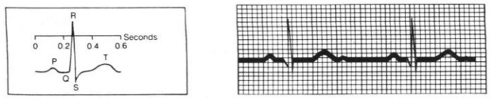

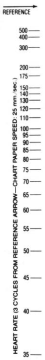

图中 Seconds 为秒；左侧标尺：参考尺。参考箭头上方的心率。图表速度为每秒25毫米。

图像首先显示**心率**。按惯例，粗竖线相隔$1/5$秒，细竖线相隔$1/25$秒。若心脏每$1/5$秒跳一次（一条粗线），就是每秒5次，或每分钟300次。这是极度心动过速，不能维持生命。正常心率在每搏三条粗线（$3/5$秒，每分钟100次）与五条粗线（两搏之间1秒，每分钟60次）之间。婴儿心率更快，超过每分钟100次。图中的心率是____。低于每分钟60次叫心动过缓，本身并不危险。对静息的运动员，这是正常的。

医生常记的是六个数：300、150、100、75、60、50，分别对应两次心搏之间隔1、2、3、4、5、6个大格。最好量的距离，是尖峰到尖峰，也就是相邻两个R波波峰之间的距离。许多医生索性把印好的标尺搁在图旁。有本教材强调：“下一个波落在哪里，心率就定了，用不着算。”不过现在你已经知道，这些数是从哪儿来的。


接下来看**心律**。正常节律由起搏点设定，它产生P波。波与波之间的距离恒定是好事，然后再逐个检查心搏。传导路径上有阻滞时，图上表现为延迟。有时起搏点不规则地发出冲动。图3.10显示窦性心律不齐（相当正常）。波峰之间的时间正在变化。生病或紧急时，心脏各部分都有潜在的起搏点。

我本该先指出主要的部件。心脏有四个腔，左右各有一个心房和一个心室。窦房结（SA结）应该是起搏点。刺激从心房传到心室——从为“泵作准备”的小腔，传到把血送遍全身的有力腔。P波伴随心房收缩。到房室结（AV结）时，有$1/10$秒的停顿。然后，大的QRS波开始心室收缩，T波则是心室放松的时候。细胞转回负电荷，心动周期完成。

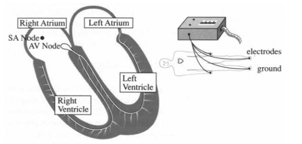

图3.9 一个有着心脏和正常心电图的快乐的人。图中字样：Right/Left Atrium，右/左心房；Right/Left Ventricle，右/左心室；SA/AV Node，窦房结/房室结；electrodes，电极；ground，接地。

起搏点出毛病时，心电图会显示出来。其他起搏点接管节律，房室结会以每分钟60次起搏。心室提前发出冲动，可能在QRS波群中产生一个宽尖峰，随后是长间歇。冲动沿慢路径传播。起搏点也可能突然加速（阵发性心动过速为每分钟150–250次）。但最凶险的是**颤动**。

图3.10b显示一颗濒死的心脏。心电图表明收缩不规则，完全没有正常的PQRST序列。什么样的心脏会产生这种节律？肌肉各自独立地颤抖，或称“颤动”。泵血功能几乎消失，意味着需要急救。病人需要立即进行心肺复苏（CPR），由别人完成心脏不能完成的泵血。心肺复苏结合胸部压力和空气压力（手和口），以重新启动节律。CPR可以在街上进行。医院使用除颤器，电击使心脏恢复活力。它使全部心脏细胞去极化，以便重新设定时序。然后，电荷正常地从窦房结传到心房、房室结，再到心室。

到这儿还没用上全部十二条曲线来定位问题——那得靠向量。不妨先翻到第11.1节看心脏向量，尤其是第11.2节的十二个投影。这些读数能分出心房和心室、左和右、前和后。真碰上心肌梗死，这些信息性命攸关。通常说的“心脏病发作”，在这里就是心肌梗死（MI）。

通往心脏的一支动脉部分堵塞（冠状动脉闭塞）时，就发生心肌梗死。


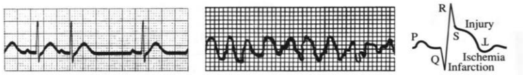

图3.10 可疑心律、严重颤动以及心脏病发作的信号。右图的 Ischemia、Injury、Infarction 分别为缺血、损伤、梗死。

一块区域失去供血，因此没有氧和葡萄糖。发作常在厚实的左心室，那里最需要血液。细胞先缺血，再损伤，最后梗死（死亡）。经典的心电图信号涉及这三个以I开头的词：

- **缺血（Ischemia）**：供血减少，胸前的导联上T波倒置。
- **损伤（Injury）**：S与T之间的节段抬高，表示近期发作。
- **梗死（Infarction）**：通常很小、甚至没有的Q波变宽，宽到一个小格，即$1/25$秒；可能占整个QRS波群的三分之一。

Q波给出诊断。图3.10c里可以找到全部三个I。一张好图能做到的事情之多，实在令人惊叹。

### 研究图像的方法

现在从图的意思，转到画图的门道。给定$f(x)$的公式，要你把图画出来。用手算十几个点、再连成曲线，这办法太老了。计算机脑子里的抛物线，比画家笔下的准——画家总爱把它画成渐渐贴向一条直线。有些事计算机懂，有些事画家懂，还有些事你和我懂，因为我们懂导数。

我们的任务，是把微积分用上。除了$f$本身，还得从$f'$和$f''$里挖信息。图上细小的动静可能看不出来，主要性质却瞒不过去：

1. $f(x)$的符号决定图像在横轴上方还是下方；与横轴相交处，$f=0$。
2. $f'(x)$的符号说明函数在增还是在减；驻点处，$f'=0$。
3. $f''(x)$的符号（向上凹或向下凹；拐点处$f''=0$）。
4. $x\to+\infty$和$x\to-\infty$时，$f(x)$往哪儿走。
5. 在哪些点附近$f(x)\to+\infty$或$-\infty$。
6. 偶函数还是奇函数？有没有周期？$f$或$f'$有跳跃吗？有端点吗？$f(0)$是几？

**例1**

$$f(x)=\frac{x^2}{1-x^2},\qquad f'(x)=\frac{2x}{(1-x^2)^2},\qquad f''(x)=\frac{2+6x^2}{(1-x^2)^3}.$$

$f(x)$的符号取决于$1-x^2$。因此，在$x^2<1$的内部区间中，$f(x)>0$。同一区间中，图像向上弯曲（$f''(x)>0$）。没有拐点，因为$f''$从不为零。$f'$为零的驻点是$x=0$。在$x=0$处有局部极小值。

渐近线说的是图像在无穷远处往哪儿靠。$|x|$一大，挑大梁的是$x^2$和$-x^2$，两边的比是$-1$；这正是$x\to\pm\infty$时函数的极限。所以**水平渐近线是$y=-1$**。

函数冲到无穷的位置，还有两处：$1-x^2=0$，也就是$x=1$和$x=-1$。**竖直渐近线是$x=1$和$x=-1$**。


图3.11a里的曲线，就朝着这几条直线靠过去。

- 若$x\to+\infty$或$-\infty$时$f(x)\to b$，则$y=b$是水平渐近线。
- 若$x\to a$时$f(x)\to+\infty$或$-\infty$，则$x=a$是竖直渐近线。
- 若$x\to+\infty$或$-\infty$时$f(x)-(mx+b)\to0$，则$y=mx+b$是斜渐近线。

最后还有一个要紧的事实：这是偶函数，$f(-x)=f(x)$——平方一抹，正负号就没了。图像关于$y$轴对称。

把除以$1-x^2$的效果归拢一下：$x=0$附近没什么影响，函数还近似$x^2$；到了$\pm1$附近，分母趋于零，函数发散；$|x|\to\infty$时，函数趋于$-1$。

**例2**

$$f(x)=\frac{x^2}{x-1},\qquad f'(x)=\frac{x^2-2x}{(x-1)^2},\qquad f''(x)=\frac2{(x-1)^3}.$$

这个例子除以$x-1$，所以$x=1$是一条竖直渐近线，函数在它旁边没了边。竖直渐近线，多半是分母为零的地方冒出来的。

往$x>1$那边看：$f(x)$和$f''(x)$都是正的，而斜率在$x=2$处为零，所以那里必是极小值点。

$x\to\infty$时又如何？拿$x-1$去除$x^2$，商的第一项是$x$。函数按线性增长，那就该有一条斜渐近线。老老实实做除法：

$$\frac{x^2}{x-1}=x+1+\frac1{x-1}.\tag{1}$$

末项趋于零，函数便贴向渐近线$y=x+1$。这函数既不是奇函数也不是偶函数，图像见图3.11b。把图缩小，看渐近线；把图放大，找$f=0$、$f'=0$、$f''=0$的位置。

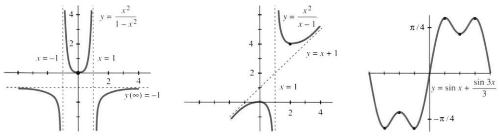

图3.11 $x^2/(1-x^2)$、$x^2/(x-1)$和$\sin x+\tfrac13\sin3x$的图像。

**例3** $f(x)=\sin x+\tfrac13\sin3x$的导数为$f'(x)=\cos x+\cos3x$。

头一条，这些函数都是周期的。$x$加上$2\pi$，函数值一点不变。$[2\pi,4\pi]$上的图，是$[0,2\pi]$上的图一遍遍重来。所以$f(x+2\pi)=f(x)$，周期是$2\pi$。随便取一段长$2\pi$的区间，都能看全一个周期；图3.11c挑的是$[-\pi,\pi]$。

第二个显眼的性质，是$f$为奇函数。正弦都满足$f(-x)=-f(x)$，图像便关于原点对称。把右半边绕原点转半圈，左半边就出来了。相比之下，$f'$里的那些余弦倒都是偶函数。

要找$f$、$f'$和$f''$的零点，先把它们改写成

$$f(x)=2\sin x-\frac43\sin^3x,$$
$$f'(x)=-2\cos x+4\cos^3x,$$
$$f''(x)=-10\sin x+12\sin^3x.$$


这里用了$\sin3x=3\sin x-4\sin^3x$，求完导再用$\sin^2x=1-\cos^2x$收拾。现在来找零点——与横轴的交点、驻点，还有拐点位置。在$[-\pi,\pi]$上：

$$\begin{aligned}
f=0&:\quad2\sin x=\tfrac43\sin^3x
\ \Longrightarrow\ \sin x=0\text{ 或 }\sin^2x=\tfrac32
\ \Longrightarrow\ x=0,\pm\pi;\\
f'=0&:\quad2\cos x=4\cos^3x
\ \Longrightarrow\ \cos x=0\text{ 或 }\cos^2x=\tfrac12
\ \Longrightarrow\ x=\pm\tfrac\pi4,\pm\tfrac\pi2,\pm\tfrac{3\pi}4;\\
f''=0&:\quad5\sin x=6\sin^3x
\ \Longrightarrow\ \sin x=0\text{ 或 }\sin^2x=\tfrac56.
\end{aligned}$$

末行给出$x=0,\pm66^\circ,\pm114^\circ,\pm\pi$。

有这些，图就画得出来了。三个正驻点$\pi/4,\pi/2,3\pi/4$排得一样疏密，函数值依次是$\sqrt8/3$（最大）、$2/3$（极小）、$\sqrt8/3$（最大）。图像见图3.11c。

这个花样还能往下走，走得很好看：

$$f(x)=\sin x+\frac13\sin3x+\frac15\sin5x+\cdots,$$
$$f'(x)=\cos x+\cos3x+\cos5x+\cdots.$$

若在十项后停止，$f(x)$已经极为接近阶梯函数。若不停止，精确的阶梯函数中就有无穷多个正弦。$x$经过零时，它从$-\pi/4$跳到$+\pi/4$。更准确地说，它是“方波”，因为图像在$\pi$处又跳下来，然后重复。斜率$\cos x+\cos3x+\cdots$也以$2\pi$为周期。无穷多个余弦相加，得到一个δ函数！（跳跃处的斜率是一个无穷高的尖峰。）这些正弦、余弦之和就是**傅里叶级数**。

### 用计算机和计算器作图

下面这个话题，分量很重。手边有计算机绘图软件，或者一台图形计算器，微积分就能活起来。图用另一副面孔呈现$y(x)$，跟公式不一样；藏在公式里的东西，图上也许一眼就看穿了。**可别把$y(x)$和$dy/dx$扔了。导数远没有过时。**

这几页要讲，微积分和图像怎么联手。我们盯住应用数学里一个要紧的问题：$y(x)$在哪儿取到最小值。一百种应用就不一一列举了，直接看公式：怎样找出使$y(x)$最小的$x^*$？

先画图。图一出来，主要特征就在眼前，$x^*$的位置也就能估个八九不离十。极小值可能有好几个，也可能一个都没有。不过能看见什么，还得看我们自己定的视窗——$x$和$y$各取多大范围。

要是对$y(x)$一无所知，范围就难定了。不妨先用默认范围，再放大或缩小；也可以动用原书提到的第1.7节自动缩放程序。反正先在屏幕上把$x^*$的大致位置找出来，剩下的才是算。

看一个具体的例子。第3.2节用微积分算过：上快速路的最佳位置在哪儿。两种速度是30和60。设快速路的横向长度$b=6$，进入点合情理的范围是$0\le x\le6$；起点到路边的垂直距离$a=3$，见图3.12。先用速度30走$\sqrt{3^2+x^2}$，再用速度60走剩下的$6-x$：

$$\text{行车时间}\quad y(x)=\frac1{30}\sqrt{3^2+x^2}+\frac1{60}(6-x).\tag{2}$$

要最小化的就是这个函数。它的图像平得出奇。可平坦并不反常，反倒常见得很：$dy/dx=0$，说的就是切线水平。


极小值附近的图像看起来像$y=Cx^2$，一条坐在水平切线上的抛物线。横向距离为$\Delta x=0.01$时，纵向只升高$C(\Delta x)^2=0.0001C$。除非$C$很大，这点$\Delta y$几乎看不出来。

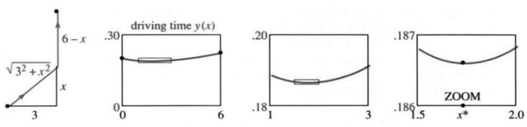

图3.12 在$x$处进入道路；行车时间$y(x)$的图像；用缩放框逐步定位$x^*$。driving time 为行车时间，ZOOM 为放大。

办法是改比例尺——**把$x^*$附近放大**。切线照样水平，因为$dy/dx$还是零；但只要把纵横比例调合适，由$C$带出来的那点弯就显出来了。图3.12把缩放框里的一块抻开，画成一张新的$y(x)$图。

计算器有一种或几种找$x^*$的办法。用TRACE模式，让光标沿图像移动。从显示的$y$值读出$y_{\max}$和$x^*$，精确到最近的像素。缩放提高精度，因为它拉伸坐标轴，每个像素代表更小的$\Delta x$和$\Delta y$。TI-81的默认拉伸倍数是4。更好的办法是让整个过程图形化，在屏幕上画出实际的缩放框。选两个对角，按ENTER，框就成为新的视窗（图3.12）。

第一次放大，把$x^*$圈进了$1<x^*<3$。再建一个框，接着放大，就得到$1.5\le x^*\le2$。要个差不多的精度，很快；要很高的精度，就不快了——画框、执行放大，都要花时间。

**问题1** 如果每次都等比例缩放，横纵放大倍数一样，图像会变成什么样？

**答** 越来越平——我们正一路放大到切线的尺度上。把$x$换成$X/4$、$y$换成$Y/4$，抛物线$y=x^2$就成了$Y=X^2/4$。想看见弯曲，框子得选得又长又细。

现在换条完全不同的路。假设$dy/dx$的公式已经在手。这个导数本身，就是脑子做的一次“无限放大”——取$\Delta y/\Delta x$的极限：

$$\frac{dy}{dx}=\frac{x}{30\sqrt{3^2+x^2}}=-\frac1{60}.
\qquad\text{记作 }f(x).$$

在$x^*$处，这个函数是零。问题一下子变了样：去解$f(x)=0$。找$f$的根，通常比拿眼睛去认$y$的极小值点容易。$f$的图像穿过横轴，$y$的图像却在极小值点变平——变平的地方，位置最难指准。


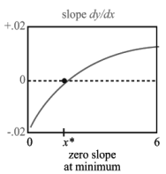

图3.13 斜率$dy/dx$；极小值点处斜率为零。

拿模型$y=x^2$来说，只看$|x|<0.01$。斜率$f=2x$从$-0.02$变到$+0.02$，$x^2$才动了$0.0001$——极小值点当然难认。

再说一遍：有了$dy/dx$，最小化就轻松了。对着$f(x)=0$跟踪、放大，屏幕上认位置的本事能一下子好上一个数量级。平常学微积分，我们总把求导当成理所当然，对$dy/dx=0$见怪不怪，反倒忘了：拿斜率代替函数，是多聪明的一招。

**问题2** 怎样再好上一个数量级？

**答** 使用下一阶导数！有了$df/dx$的公式，也就是$d^2y/dx^2$，收敛更快。两步之内，误差从$0.01$变到$0.0001$，再到$0.00000001$。又一次无限放大进入了$df/dx$的公式，而牛顿法利用了它。第3.6和3.7节研究$f(x)=0$。

快速路这个例子，甚至能拿代数算出精确解。令$dy/dx=0$，化简得$60x=30\sqrt{3^2+x^2}$。两边除以30再平方：$4x^2=3^2+x^2$，也就是$3x^2=3^2$。因为$x\ge0$，精确解是

$$x^*=\sqrt3=1.73205\ldots.$$

这样的模型可以当基准，用来比各种算法的高下；它也暴露了我们先前没留意的一点——图平到了什么地步：从$x^*=\sqrt3$进路，和从$x=2$进路，行车时间只差约1秒。

### 中心化变换与缩放变换

拍一张照片，要做两件事：对准方向，站到合适的距离，然后按快门。画图也一样。先挑新的中心点，把图平移，让这个点从$(a,b)$挪到$(0,0)$；再定图该伸到哪儿——它得装进一个矩形，就跟照片装进相框一样。坐标缩放，管的是两个方向各显示多宽。

好摄影师还兼着艺术家的心思：摆布主体，调好焦距。画好图也少不了这两下。可日用的计算器、计算机和相机，本来就不是给艺术家造的——对准了，按下去，就行。下面说说怎样对准$y=f(x)$。

我们做的跟计算器差不多，但有个大区别：**计算器不改坐标，我们改。** 计算器把$(1,-2)$挪到视窗中心，标签照旧是$(1,-2)$。中心化变换一作用到$y+2=m(x-1)$上，这些常数就没了。要避免混淆，变量得跟着换：$X=x-1$，$Y=y+2$，新方程便是$Y=mX$。

对人来说，这么做最要紧的好处，是代数变简单了。计算机并不觉得$Y=mX$比$y-y_0=m(x-x_0)$强，处理$2x^2-4x$和$x^2$一样顺手。我们却喜欢$Y=mX$和$y=x^2$，部分原因是它们过原点。打从零被发明出来，数学家就格外偏爱它。

> **3F 中心化变换**向左平移$a$、向下平移$b$：
> $$X=x-a,\qquad Y=y-b,$$
> 将$y=f(x)$化为$Y+b=f(X+a)$。

**例4** 抛物线$y=2x^2-4x$在$dy/dx=4x-4=0$时取到最小值，所以$x=1,y=-2$。把它最低的那点挪到中心。


$y=2x^2-4x$成为

$$Y+2=2(X-1)^2-4(X-1),\qquad\text{即}\quad Y=2X^2.$$

新抛物线$Y=2X^2$的最低点在$(0,0)$。曲线还是那条曲线，只是往左、往上挪了挪。再简单的形式就是$y=x^2$——这最后一步，交给缩放。

接下来改尺度。想看清切线，可能要放大局部；想看清全貌、检查渐近线，可能要缩小。图要是扁得像张饼，或者高得像座摩天楼，两轴还可以用不同的倍数。

> **3G 缩放变换**把$X,Y$坐标分别乘以$c,d$：
> $$\boldsymbol{x}=cX,\qquad\boldsymbol{y}=dY,$$
> 将$Y=F(X)$化为
> $$\boldsymbol{y}=dF(\boldsymbol{x}/c).$$
> 新变量$\boldsymbol{x},\boldsymbol{y}$用粗体表示，图像重新缩放。常有$c=d$。

**例5** 从$Y=2X^2$出发，做一次$c=d$的等比例缩放。在新的$\boldsymbol{x}\boldsymbol{y}$坐标中，方程是$\boldsymbol{y}/c=2(\boldsymbol{x}/c)^2$；取$c=d=2$，数2就消失了。中心化和缩放都选得合适，每条开口向上的抛物线都是$\boldsymbol{y}=\boldsymbol{x}^2$。

**问题3** 缩放以后，导数代表的斜率和弯曲会怎么变？

**答** 用链式法则：一阶导数乘以$d/c$。等比例缩放有$d/c=1$，直线斜率不变。二阶导数乘以$d/c^2$，弯曲也跟着变。缩小的时候$c=d$很小，二阶导数的数值反而变大，所以全局的图看着更弯。

把中心化和缩放接起来：

$$y=f(x)\ \longrightarrow\ Y=f(X+a)-b
\ \longrightarrow\ \boldsymbol{y}=d\left[f\left(\frac{\boldsymbol{x}}c+a\right)-b\right].$$

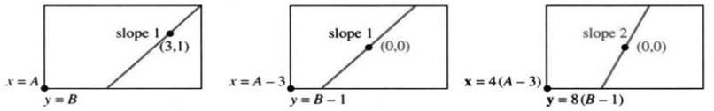

图3.14 中心化和缩放引起坐标改变。计算器视窗则仍显示原来的$(x,y)$。slope 为斜率。

**问题4** 两次变换之后，原来的$x,y$范围怎么定？新视窗都取$[-1,1]$。

**答** 只中心化时，视窗条件是$-1\le x-a\le1$和$-1\le y-b\le1$。再做缩放，条件变成$-1\le c(x-a)\le1$、$-1\le d(y-b)\le1$。原先在右上角的$(1,1)$，如今对应的原坐标是$(a+c^{-1},b+d^{-1})$。

选择$a,b,c,d$，可以得到更简单的函数（如$\boldsymbol{y}=\boldsymbol{x}^2$）。或者——这在应用数学中很重要——选择它们使$\boldsymbol{x},\boldsymbol{y}$“无量纲”。例如$y=\tfrac12\cos8t$，频率8的量纲是$1/\text{时间}$，振幅$1/2$是一个距离。取$d=2$厘米、$c=8$秒，就去掉了单位，得到$\boldsymbol{y}=\cos\boldsymbol{t}$。


还有一种变换真会改斜率：**旋转**——把整个平面转一个角度。摄影师偶尔这么干，不过通常还是希望人像站直。你转动地图、摆正照片，用的就是旋转。下一节里，一条原本认不出的双曲线，转一转就成了$Y=1/X$。

### 3.4 习题

#### 通读填空

$y=f(x)$图像的位置、斜率和弯曲分别由 **a____**、**b____**、**c____** 决定。若$x\to a$时$|f(x)|\to\infty$，则$x=a$是一条竖直 **d____**。若$x$充分大时$f(x)\to b$，则$y=b$是 **e____**。若$f(x)-mx\to b$，则$y=mx+b$是 **f____**。$y=x^2/(x^2-4)$的渐近线是 **g____**。这是偶函数，因为$y(-x)=$ **h____**。$\sin kx$的周期为 **i____**。

在$dy/dx=0$的点附近，图像非常 **j____**。对模型$y=Cx^2$，当$x=0.1$时，$y=$ **k____**。围住这一局部图像的框形状细长而 **l____**。向这个框内 **m____**，可再确定$x^*$的一位数字。但求解$dy/dx=0$更精确，因为该函数的图像 **n____** 横轴。$dy/dx$的斜率是 **o____**。每求一次导数，就像作一次 **p____** 缩放。

要把$(a,b)$移到$(0,0)$，令$X=$ **q____**、$Y=$ **r____**。这种 **s____** 变换把$y=f(x)$化为$Y=$ **t____**。原图像在$(a,b)$处的斜率等于新图像在 **u____** 处的斜率。要将两轴分别伸缩$c,d$倍，令$\boldsymbol{x}=cX$以及 **v____**。这种 **w____** 变换把$Y=F(X)$化为$\boldsymbol{y}=$ **x____**。一阶导数乘以 **y____**，二阶导数乘以 **z____**。

1. 若相邻心搏分别间隔$1/2$秒、两个大格、$x$秒，求相应的每分钟脉搏次数。
2. 另一种估算心率的方法是在图上标出6秒的区间，再数其中的周期数。(a) 6秒包含多少个大格？(b) 若一个区间内有8次心搏，心率是多少？(c) 补全规则：心率=每区间周期数$\times$____。

**第3–18题：判断函数是奇函数、偶函数还是周期函数；求全部水平、竖直和斜渐近线，并手绘草图或用计算机作图。**

3. $f(x)=x-9/x$。
4. $f(x)=x^n$，$n$为任意整数。
5. $f(x)=1/(1-x^2)$。
6. $f(x)=x^3/(4-x^2)$。
7. $f(x)=(x^2+3)/(x^2+1)$。
8. $f(x)=(x^2+3)/(x+1)$。
9. $f(x)=(\sin x)(\sin2x)$。
10. $f(x)=\cos x+\cos3x+\cos5x$。
11. $f(x)=x\sin x/(x^2-1)$。
12. $f(x)=x/\sin x$。
13. $f(x)=1/(x^3+x^2)$。
14. $f(x)=1/(x-1)-2x$。
15. $f(x)=(x^3+1)/(x^3-1)$。
16. $f(x)=(\sin x+\cos x)/(\sin x-\cos x)$。
17. $f(x)=x-\sin x$。
18. $f(x)=1/x-\sqrt{x}$。

**第19–24题：构造函数$f(x)$，使其恰有下列渐近线。**

19. $x=1$和$y=2$。
20. $x=1$、$x=2$、$y=0$。
21. $y=x$和$x=4$。
22. $y=2x+3$和$x=0$。
23. $x\to+\infty$时为$y=x$，$x\to-\infty$时为$y=-x$。
24. $x=1$、$x=3$、$y=x$。

25. 要使$P(x)/Q(x)$以$y=2$为渐近线，多项式$P,Q$必须满足____。
26. 要使$P(x)/Q(x)$具有非水平的斜渐近线，$P,Q$的次数必须满足____。
27. 要使$P(x)/Q(x)$以$y=0$为渐近线，$P,Q$的次数必须满足____。$x^4/(1+x^2)$的图像有什么渐近线？
28. $1/(x-1)$和$1/(x-1)^2$都以$x=1$、$y=0$为渐近线，两图像最明显的区别是____。
29. 若$f'(x)$以$x=1$和$y=3$为渐近线，则$f(x)$的渐近线为____。
30. 判断正误，正确则说明理由，错误则举出反例：(a) 每个多项式之比都有渐近线；(b) 若$f$为偶函数，则$f''$也为偶函数；(c) 若$f''$为偶函数，则$f$也为偶函数；(d) 在两条竖直渐近线之间，$f'$必达到零。
31. 构造一个“关于$x=3$为偶”的函数$f$。
32. 构造一个“关于$x=\pi$为奇”的函数$g$。

**第33–38题：用计算机或计算器作图。**

33. $y(x)=(1+1/x)^x$，$-3\le x\le3$。
34. $y(x)=x^{1/x}$，$0.1\le x\le2$。
35. $y(x)=\sin(x/3)+\sin(x/5)$。
36. $y(x)=(2-x)/(2+x)$，$-3\le x\le3$。


37. $y(x)=2x^3+3x^2-12x+5$，分别在$[-3,3]$及$[2.9,3.1]$作图。
38. $y(x)=100[\sin(x+0.1)-2\sin x+\sin(x-0.1)]$。

**第39–40题：选取足够大的计算机绘图范围，展示渐近线。**

39. (a) $y=(x^3+8x-15)/(x^2-2)$；(b) $y=(x^4-6x^3+1)/(2x^4+x^2)$。
40. (a) $y=(x^2-2)/(x^3+8x-15)$；(b) $y=(x^2-x+2)/(x^2-2x+1)$。
41. 对$y=\sin x$重新选取尺度，使$X$以度而非弧度计，$Y$的长度单位由米改为厘米。

**第42–46题：最小化正文中的行车时间$y(x)$。部分问题可能不适用于你使用的软件。**

42. 沿$y(x)$的图像跟踪，估计$x^*$；自行选择坐标范围或使用默认值。
43. 每次取$c=d=4$放大。要得到$x^*=1.73205$或$1.7320508$，需放大多少次？
44. 让程序分别求$y(x)$的最小值点和$dy/dx=0$的解，结果相同吗？
45. 图3.12中的两次放大，各自的比例因子$c,d$是多少？它们分别表示横纵轴的伸缩倍数。
46. 证明在$x=0$处，$dy/dx=-1/60$，$d^2y/dx^2=1/90$。线性近似给出$dy/dx\approx-1/60+x/90$，因此斜率在$x=$____附近为零。这就是利用下一阶导数的牛顿法。

**将函数改为$y(x)=\sqrt{15+x^2}/30+(10-x)/60$。**

47. 仅使用$y(x)$的图像求$x^*$。
48. 再利用$dy/dx$的图像求$x^*$。
49. 图3.14中的直线，在$xy$、$XY$和$\boldsymbol{x}\boldsymbol{y}$三种坐标中的方程分别是什么？
50. 定义$f_n(x)=\sin x+\tfrac13\sin3x+\tfrac15\sin5x+\cdots$，共$n$项。在$[-\pi,\pi]$画出$f_5,f_{10}$，放大$x=0$附近，描述吉布斯现象。

**第51–56题：放大所有极大值点和极小值点附近的图像，确定其位置至3位有效数字，并估计拐点。**

51. $y=2x^5-16x^4+5x^3-37x^2+21x+683$。
52. $y=x^5-x^4-\sqrt{3x+1}-2$。
53. $y=x(x-1)(x-2)(x-4)$。
54. $y=7\sin2x+5\cos3x$。
55. $y=(x^3-2x+1)/(x^4-3x^2-15)$，$-3\le x\le5$。
56. $y=x\sin(1/x)$，$0.1\le x\le1$。
57. 一台10位数字计算机在$x^*=1$处显示$y=0$、$dy/dx=0.01$。这个根大约可精确到多少位：8位、10位还是12位？提示：设$y=0.01(x-1+\text{误差})$，哪些误差在$y$的10位显示中看不出来？
58. 哪个更难精确计算：极大值点还是拐点？一阶导数还是二阶导数？

## 3.5 抛物线、椭圆和双曲线


下面是数学里最重要的几类曲线，先列个单子，好让你知道接下来要讲什么。前四名谁先谁后，实在不好排：

1. 直线。
2. 正弦与余弦曲线——振荡。
3. 指数曲线——增长与衰减。
4. 抛物线、椭圆和双曲线——方程涉及$1,x,y,x^2,xy,y^2$。

最后这一类，我排在末尾；换成古希腊人，准会把它摆在第一位。从一次方程走向二次方程，本来就顺理成章。直线用$1,x,y$就够了，二次曲线还多出$x^2,xy,y^2$。再往上添$x^3,y^3$，事情就复杂了。现在要研究的，就是二次方程和它们画出的曲线。

**方程和曲线**，得同时看，这一点很重要。本节把数学的两大块接在一起：一边是方程的分析，一边是曲线的几何；合起来，就是**解析几何**。函数和图像你早就熟悉，比这更基本的，是数与点的对应。我们说“点$(5,2)$”，欧几里得听了，可能也听不懂这种说法。

同样是过原点、倾角$45^\circ$的直线，欧几里得动手去画，笛卡尔只写下$y=x$。解析几何如今已是数学的中心，下面只看其中的一小部分。


图3.15 截平面逐渐变陡：圆、椭圆、抛物线、双曲线。

### 圆锥曲线

抛物线、椭圆、双曲线，性质都非同寻常。古希腊人发现，这三种曲线都能用一个平面去截圆锥面得到，于是叫它们**圆锥曲线**。平着截，截出圆；斜得适度，截出椭圆；截平面再陡些，就截出双曲线的两支，见图3.15d。到了临界情形，截平面与圆锥母线平行，截下来的正是抛物线。它和椭圆一样只有一支，却又像双曲线那样，一直延伸到无穷远。

在数学的许多地方，抛物线都正处在椭圆与双曲线之间的临界位置。

截圆锥是一路，研究方程是另一路。一束锥形的光照到墙上，会映出一个椭圆——墙面把光锥截了。至于一般方程

$$Ax^2+Bxy+Cy^2+Dx+Ey+F=0,$$

我们的任务，是把它化得简单些。


办法是平移、缩放，必要时再旋转坐标，最终化成类似$y=x^2$的简单方程。离心率和极坐标，留到第9章再讲。

### 抛物线 $y=ax^2+bx+c$

这个函数，你在学微积分之前就熟。图像在$y=0$处穿过横轴。方程$3x^2-4x+1=0$，用求根公式能解，分解成$(x-1)(3x-1)=0$也能解；两个交点横坐标$x=1$、$x=1/3$，就这样由代数定下来。

另一个要紧的点，得靠微积分才找得到：在最低点处$dy/dx=6x-4=0$，于是$x=4/6=2/3$，恰好落在两个交点的正中间；高度是$y_{\min}=-1/3$。这就是图3.16a中抛物线底部的**顶点$V$**。

抛物线没有渐近线。它的斜率$6x-4$不会停在一个常数上。

**把顶点移到原点。** 先向左挪$2/3$，再向上挪$1/3$，引入新变量

$$X=x-\frac23,\qquad Y=y+\frac13.$$

原来的$(2/3,-1/3)$正好对应新坐标$(0,0)$，于是

$$y=3x^2-4x+1\quad\longrightarrow\quad Y=3X^2.\tag{1}$$

代数上验一下：$Y=3X^2$就是$y+1/3=3(x-2/3)^2$，乘开便回到原方程。第二幅图画的是顶点已移到原点的抛物线$Y=3X^2$。

**再把顶点附近放大。** 用同一个比例$a$去缩放$X,Y$：

$$Y=3X^2\quad\longrightarrow\quad
\frac{\boldsymbol y}{a}=3\left(\frac{\boldsymbol x}{a}\right)^2.$$

方程里的新变量用粗体标出。取$a=3$，得到$\boldsymbol y=\boldsymbol x^2$，图像放大了3倍。两步走完，开口向上的标准抛物线就到手了。


图3.16 抛物线在$V$处取最小值；平行光线反射后汇聚于焦点。(b)已平移，(c)已缩放。vertex、focus、directrix、ray分别为顶点、焦点、准线、光线。

抛物线还有另一个重要的点——**焦点**。它到顶点的距离叫作$p$。特殊抛物线$y=x^2$有$p=1/4$，其他抛物线$Y=aX^2$有$p=1/(4a)$。放大$a$倍，就得到$y=x^2$。抛物线的美妙性质是：**每条竖直向下射来的光线都反射到焦点。**

第2.3节第25题已经定出焦点$F$的位置，这里说两个应用。太阳能集热器和电视天线都是抛物面。它们把阳光和电视信号集中到一点，焦点处的集热元件或接收器将其收集。1982年的《UMAP Journal》解释了雷达和声呐如何使用同一思想。汽车前灯把这个思想反过来，将光向外射出。

还有一条经典性质：**曲线上每一点到焦点的距离，都等于它到准线的距离。**


准线是顶点下方的直线$y=-p$（所以顶点在焦点和准线的正中间）。取$p=1/4$，从任意$(x,y)$向下的距离是$y+1/4$。令它等于到焦点$(0,1/4)$的距离，也就是下面的平方根，就得到特殊抛物线$y=x^2$：

$$y+\frac14=\sqrt{x^2+\left(y-\frac14\right)^2}
\quad\xrightarrow{\text{两边平方}}\quad y=x^2.\tag{2}$$

习题会让你把这些步骤都练一遍：平移到$Y=aX^2$，缩放到$\boldsymbol y=\boldsymbol x^2$，再定出顶点、焦点和准线。

**其他抛物线的总结。** $y=ax^2+bx+c$的顶点处$dy/dx=0$，所以$2ax+b=0$，$x=-b/(2a)$。横向平移到这一点，就是“配方”：

$$ax^2+bx+c=a\left(x+\frac b{2a}\right)^2+C,\qquad
C=c-\frac{b^2}{4a}.\tag{3}$$

$C$正是顶点的纵坐标。作变换$X=x+b/(2a)$、$Y=y-C$，方程变成$Y=aX^2$，顶点也就搬回了原点。

对椭圆和双曲线，打法差不多：

1. 平移到中心，把一次项$Dx,Ey$消掉。
2. 找到各个焦点，弄清反射性质。
3. 方程里若有$Bxy$项，就旋转坐标把它消掉。

### 椭圆 $\dfrac{x^2}{a^2}+\dfrac{y^2}{b^2}=1$（$a=b$时为圆）

这个方程使椭圆关于中心$(0,0)$对称。把$x$换成$-x$，或者把$y$换成$-y$，方程不变。不需要再作中心化或旋转。

因为$x^2/a^2$和$y^2/b^2$都不为负，加起来又等于1，所以谁也不会超过1。于是$-a\le x\le a$，$-b\le y\le b$，整个椭圆被关在一个矩形里。

把$y$解出来，得到$x$的两个函数：

$$\frac{y^2}{b^2}=1-\frac{x^2}{a^2}
\quad\Longrightarrow\quad
\frac yb=\pm\sqrt{1-\frac{x^2}{a^2}}
\quad\Longrightarrow\quad y=\pm\frac ba\sqrt{a^2-x^2}.$$

正号画上半椭圆，负号画下半椭圆；两半合起来，才是完整的椭圆。它们在$y=0$处碰头，正是图3.17最右端的$x=a$和最左端的$x=-a$。最高点$y=b$、最低点$y=-b$在椭圆的顶部和底部，刚好顶到外接矩形。

圆不过是$a=b$时的一个特例。圆方程$x^2+y^2=r^2$，就是椭圆方程里取$a=b=r$。这个圆以$(0,0)$为圆心；一般的圆，圆心可以搬到$(h,k)$。半径$r$和圆心$(h,k)$一定，圆就定了：

$$\boxed{(x-h)^2+(y-k)^2=r^2.}\tag{4}$$

换句话说，圆上任一点$(x,y)$到圆心$(h,k)$的距离，恒等于$r$。把方程展开，会多出一次项$-2hx$、$-2ky$；圆心一回到原点，这两项就没了。


**例1** 一条直径的两个端点是$(1,7)$和$(5,7)$，求这个圆。

**解** 圆心落在中点$(3,7)$，半径$r=2$，于是$(x-3)^2+(y-7)^2=2^2$。

**例2** 求圆$x^2-6x+y^2-14y=-54$的圆心和半径。

**解** 给$x^2-6x$添上9，配成$(x-3)^2$；给$y^2-14y$添上49，配成$(y-7)^2$。两边同时加上$9+49$，方程变成$(x-3)^2+(y-7)^2=4$——和例1是同一个圆。

**更快的解法**：拿已知方程和式(4)展开后的样子逐项对照系数：

$$x^2-2hx+h^2+y^2-2ky+k^2=r^2,$$

立刻读出$h=3,k=7,r=2$。

取$X=x-h,Y=y-k$，圆心便从$(h,k)$挪到$(0,0)$。椭圆也一样：

$$\frac{(x-h)^2}{a^2}+\frac{(y-k)^2}{b^2}=1
\quad\longrightarrow\quad
\frac{X^2}{a^2}+\frac{Y^2}{b^2}=1.$$

再令$\boldsymbol x=X/a$、$\boldsymbol y=Y/b$，就得到单位圆$\boldsymbol x^2+\boldsymbol y^2=1$。单位圆的面积是$\pi$，所以**椭圆面积是$\pi ab$**——这个证明后面再给。单位圆的周长是$2\pi$；椭圆的周长却没法按同一个比例缩放出来，也没有同样简洁的公式。


图3.17 圆心不在原点的圆；以原点为中心的椭圆$x^2/3^2+y^2/2^2=1$；从$F_2$发出的光线反射后经过$F_1$。中心到最右端的距离为$a=3$；major axis为长轴。

现在离开圆，专看椭圆。它有两个焦点（foci，读作fo-sigh）。抛物线的第二个焦点在无穷远；圆的两个焦点都在圆心。椭圆的焦点在它较长的轴（**长轴**）上，中心两侧各有一个：

$$F_1=(c,0),\qquad F_2=(-c,0),\qquad c=\sqrt{a^2-b^2}.$$

图3.17里的直角三角形，三条边是$a,b,c$。从椭圆顶端到两个焦点，距离都是$a$。最右端$(a,0)$到两焦点的距离分别是$a-c$和$a+c$，加起来正好$2a$。事实上，**点沿椭圆走一圈，到两个焦点的距离之和始终是$2a$**。

> **3H** 椭圆上每一点到两焦点的距离之和等于$2a$，因此椭圆还可以表示为
> $$\sqrt{(x-c)^2+y^2}+\sqrt{(x+c)^2+y^2}=2a.\tag{5}$$


要画椭圆，可以拿一根长为$2a$的细绳，两端钉在两个焦点上，用铅笔把绳绷紧，然后带着笔移动——画出的轨迹就是椭圆。这种说法用的是$a,c$，标准方程用的是$a,b$；别忘了$b^2+c^2=a^2$。第24题就要求把式(5)一路化简到$x^2/a^2+y^2/b^2=1$。

美国参议院的“耳语廊”是一个椭圆。站在一个焦点轻声说话，另一个焦点处可以听见（其他地方都听不见）。声音经墙壁反射，沿细绳的路径到达另一个焦点。抛物线的光线从无穷远射入焦点，第二个焦点就在那里。

医院利用这个反射性质击碎肾结石。病人坐在一个椭圆内，肾结石位于一个焦点。在另一个焦点，碎石机发出数百次小冲击。你接受脊椎麻醉（我是说病人），结石就碎成小块。

最重要的焦点是太阳。椭圆是地球的轨道。请看第12.4节，那里有皇家铸币厂在英国最后一版一英镑纸币上犯下的严重印刷错误。他们把太阳放在了中心。

**问题1** 耳语声也好，冲击波也好，为什么反射之后会同时到达第二个焦点？

**答** 不管走哪条路，距离都是$2a$。例外：直达路径为$2c$。

**问题2** 定出椭圆$4x^2+9y^2=36$的位置和参数。

**答** 两边同除以36，把右边化成1：

$$\frac{x^2}{9}+\frac{y^2}{4}=1.$$

于是$a=3,b=2$，焦点在$(\pm\sqrt5,0)$。

**问题3** 把这个椭圆的中心搬到$(1,-5)$。

**答** 把$x$换成$x-1$，把$y$换成$y+5$，方程就成了$(x-1)^2/9+(y+5)^2/4=1$。实际做题时常常倒过来：先拿到一个中心不在原点的椭圆，再想办法把它移回原点。

### 双曲线 $\dfrac{y^2}{a^2}-\dfrac{x^2}{b^2}=1$

请注意那个减号——双曲线与椭圆的根本差别，就在这个符号上。和椭圆不同，这里$x,y$可以同时很大，曲线一直伸向无穷远。它仍关于两条坐标轴对称：$x,y$分别变号，方程都不变。

中心在$(0,0)$。把$y$解出来，再次得到两个函数（正号和负号）：

$$\frac{y^2}{a^2}-\frac{x^2}{b^2}=1
\quad\Longrightarrow\quad\frac ya=\pm\sqrt{1+\frac{x^2}{b^2}}
\quad\Longrightarrow\quad y=\pm\frac ab\sqrt{b^2+x^2}.\tag{6}$$

双曲线分两支，永远碰不到一起。取正号的上支满足$y\ge a$，顶点$V_1=(0,a)$就是这一支的最低点。离中心远了，曲线便贴着两条斜渐近线往上爬。比如$x^2/b^2=1000$时，$y^2/a^2=1001$，于是$y/a$就接近$x/b$或$-x/b$。


图3.18 双曲线$y^2/4-x^2/9=1$有$a=2,b=3,c=\sqrt{4+9}$。到$F_1,F_2$的距离相差$2a=4$。右图文字：无线电信号到达曲线的时间差固定；光波反射向$F_2$。

两条渐近线是$y/a=x/b$和$y/a=-x/b$，斜率分别为$a/b$和$-a/b$，在图3.18里一眼就能看见。

双曲线的两个焦点，分别位于两支张开的区域内。它们到中心的距离仍记作$c$，不过这回

$$c=\sqrt{a^2+b^2},$$

比$a$和$b$都大。顶点到一个焦点的距离是$c-a$，到另一个是$c+a$，两者相减，得$2a$。

双曲线上每一点都有这个性质：**到两焦点的距离之差恒为$2a$**。射向一个焦点的光线反射向另一个焦点。反射发生在双曲线的外侧，以及椭圆的内侧。

导航里就有这样的应用。两个固定的发射站同时发出无线电信号，一艘船收到它们的时间差了1毫秒——船在哪儿？

**答** 船在一条以发射站为焦点的双曲线上。无线电信号1毫秒走186英里，所以$186=2a$，这确定了曲线。在远程导航（LORAN）中，第三个发射站给出另一条双曲线，船的位置就精确确定了。

**问题4** 离中心很远的时候，双曲线和抛物线有什么不同？

**答** 双曲线有直线渐近线，抛物线没有。

双曲线有一种很自然的缩放：令$X=x/b,Y=y/a$。上顶点处$Y=1$，方程便成了标准双曲线：

$$\frac{y^2}{a^2}-\frac{x^2}{b^2}=1
\quad\longrightarrow\quad Y^2-X^2=1.$$

转过$90^\circ$，得到$X^2-Y^2=1$，双曲线向两侧开口。转过$45^\circ$，得到$2XY=1$。下面会说明怎样认出$x^2+xy+y^2=1$是椭圆，$x^2+3xy+y^2=1$是双曲线。（因为有$xy$项，它们不是圆。）当$xy$的系数超过2时，$x^2+y^2$就不再表示椭圆。

**问题5** 定出双曲线$9y^2-4x^2=36$的位置和参数。

**答** 两边同除以36，得到$y^2/4-x^2/9=1$，于是$a=2,b=3$。

**问题6** 定出这条中心不在原点的双曲线$9y^2-18y-4x^2-4x=28$。

**答** 给$9y^2-18y$加上9，配成$9(y-1)^2$；给$4x^2+4x$加上$4(1/2)^2=1$，配成$4(x+1/2)^2$。方程改写成：

$$9(y-1)^2-4\left(x+\frac12\right)^2=28+9-1=36.$$

形状和问题5的双曲线一模一样，只是中心换成了$(-1/2,1)$。


总而言之：先配方找出中心，再读出$a,b$。

### 一般方程 $Ax^2+Bxy+Cy^2+Dx+Ey+F=0$

这个方程是二次的，可以包含$1,x,y,x^2,xy,y^2$中的任意项或全部项。一个平面切过圆锥。曲线是抛物线、椭圆还是双曲线？先看最重要的情形$Ax^2+Bxy+Cy^2=1$。

> **3I** 方程$Ax^2+Bxy+cy^2=1$在$B^2>4AC$时产生双曲线，在$B^2<4AC$时产生椭圆。抛物线有$B^2=4AC$。

要辨认曲线，先旋转坐标，把$Bxy$项消掉。旋转会连带改变$A,C$，可组合$B^2-4AC$不变——证明从略。看个例子：$2xy=1$里$B^2=4$；适当旋转后变成$y^2-x^2=1$，这时$-4AC=4$。正数4说明它是双曲线，因为$A=-1,C=1$正好异号。

再看$x^2+y^2=1$，它是圆，也是特殊的椭圆。随便怎么旋转，方程都不变，$B^2-4AC=-4<0$，跟椭圆的判定对得上。

把坐标轴转过角$\alpha$，引入$x',y'$：

$$\begin{aligned}
x&=x'\cos\alpha-y'\sin\alpha, &x'&=x\cos\alpha+y\sin\alpha,\\
y&=x'\sin\alpha+y'\cos\alpha, &y'&=-y\sin\alpha+x\cos\alpha.
\end{aligned}\tag{7}$$

代进去，方程变成$A'x'^2+B'x'y'+C'y'^2=1$。系数$A',B',C'$的公式太繁琐，我直接说要点：

$$B'=0\quad\text{可通过选择}\quad \tan2\alpha=\frac B{A-C}\quad\text{实现。}$$


交叉项一消，$A'x'^2+C'y'^2=1$就一眼认得出。$A',C'$异号，便是双曲线，此时$B'^2-4A'C'>0$。原来的$B^2-4AC$也是正数，因为这个组合在旋转中始终不变。

消掉$xy$项后，再通过平移到中心来处理$x$和$y$项。要找中心，就像问题3和6那样配方。最后一步是缩放，把它化成标准模型：$y=x^2$、$x^2+y^2=1$或$y^2-x^2=1$。

剩下的问题是$F=0$。$Ax^2+Bxy+Cy^2=0$的图像是什么？椭圆、双曲线、抛物线都消失了。但如果希腊人是对的，圆锥仍然被一个平面截着。退化情形$F=0$出现在平面恰好穿过圆锥尖顶时。

水平截过去，只落下一个点$(0,0)$，方程缩成$x^2+y^2=0$，不妨看作半径为零的圆。截得陡些，留下两条直线：双曲线$y^2-x^2=0$只剩下渐近线$y=\pm x$。要是截平面与圆锥母线平行，又穿过锥顶，就只剩一条直线，比如$x^2=0$。一个点、两条直线、一条直线——这些分别是椭圆、双曲线和抛物线的极端情形。

所有这些“圆锥曲线”都来自平面和圆锥。阿基米德看到的几何之美，与方程的重要性相映照。伽利略发现抛体沿抛物线运动（第12章）。开普勒发现地球沿椭圆运动（也是第12章）。最后，爱因斯坦发现光沿双曲线传播。那是在四维中，不在第12章。


| 曲线 | 方程 | 顶点 | 焦点 |
|---|---|---|---|
| 抛物线 | $y=ax^2+bx+c$ | $(-b/(2a),c-b^2/(4a))$ | 顶点上方$1/(4a)$，还有无穷远 |
| 椭圆 | $x^2/a^2+y^2/b^2=1$，$a>b$ | $(a,0)$和$(-a,0)$ | $(c,0)$和$(-c,0)$，$c=\sqrt{a^2-b^2}$ |
| 双曲线 | $y^2/a^2-x^2/b^2=1$ | $(0,a)$和$(0,-a)$ | $(0,c)$和$(0,-c)$，$c=\sqrt{a^2+b^2}$ |

### 3.5 习题

#### 通读填空

$y=x^2+2x+5$的图像是 **a____**，其最低点即顶点为$(x,y)=$ **b____**。取$X=x+1$、$Y=$ **c____**，把顶点移至原点，方程成为$Y=$ **d____**。平移后的抛物线焦点为 **e____**。竖直向下射入的光线都被 **f____** 到焦点。

$x^2+4y^2=16$的图像是 **g____**。两边除以 **h____**，得到$x^2/a^2+y^2/b^2=1$，其中$a=$ **i____**，$b=$ **j____**。图像位于以 **k____** 为边界的矩形内。面积$\pi ab=$ **l____**。焦点横坐标为$x=\pm c=$ **m____**。椭圆上一点到两焦点的距离之和恒为 **n____**。若取$X=x/4,Y=y/2$，方程变为 **o____**，图像变为 **p____**。

$y^2-x^2=9$的图像是 **q____**。两边除以9，得到$y^2/a^2-x^2/b^2=1$，其中$a=$ **r____**，$b=$ **s____**。上支满足$y\ge$ **t____**。渐近线是 **u____**。焦点纵坐标为$y=\pm c=$ **v____**。双曲线上一点到两焦点距离的 **w____** 为 **x____**。

这些都是圆锥曲线，即一个 **y____** 与一个 **z____** 相交所得的曲线。截平面较陡时得到 **A____**；临界倾角时得到 **B____**。一般方程为$Ax^2+$ **C____** $+F=0$。若$D=E=0$，图像的中心在 **D____**。方程$Ax^2+Bxy+Cy^2=1$在 **E____** 时给出椭圆。$4x^2+5xy+6y^2=1$的图像是 **F____**。

1. $y=ax^2+bx+c$的顶点横坐标为$x=-b/(2a)$。这个$x$有什么特殊之处？证明相应$y=c-b^2/(4a)$。
2. 抛物线$y=3x^2-12x$在$x_{\min}=$____处取得最小值。此时$3x^2$是$12x$的____倍。令$X=x-2,Y=y+12$，方程化为____。

**手绘或用计算器、计算机画出第3–14题的曲线，确定顶点和焦点。**

3. $y=x^2-2x-3$。
4. $y=(x-1)^2$。
5. $4y=-x^2$。
6. $4x=y^2$。
7. $(x-1)^2+(y-1)^2=1$。
8. $x^2+9y^2=9$。
9. $9x^2+y^2=9$。
10. $x^2/4-(y-1)^2=1$。
11. $y^2-4x^2=1$。
12. $(y-1)^2-4x^2=1$。
13. $y^2-x^2=0$。
14. $xy=0$。

**第15–20题讨论抛物线，第21–34题讨论椭圆，第35–41题讨论双曲线。**

15. 求经过$(0,0)$、$(1,1)$、$(2,12)$的抛物线$y=ax^2+bx+c$。
16. $y=x^2-x$的顶点是____。要将顶点移至原点，应取$X=$____、$Y=$____，于是$Y=X^2$。
17. (a) 把式(2)中的$1/4$改为$p$，平方并化简。(b) 确定$Y=3X^2$的焦点和准线。哪些点到焦点和准线的距离都为1？
18. $y=9-x^2$向____开口，顶点为____。令$Y=y-9$，得到$Y=-x^2$。
19. 求满足下列条件的所有抛物线方程：(a) 向右开口，顶点在原点；(b) 向上开口，焦点在原点；(c) 向下开口，经过$(0,0)$与$(1,0)$。
20. 一个抛体在时刻$t$的位置为$x=t,y=t-t^2$。求初始时刻的$dx/dt,dy/dt$、最大高度，以及消去$t$后的轨迹方程。
21. 求最左、最右、最高、最低点分别为$(\pm2,0)$与$(0,\pm1)$的椭圆。再将中心移至$(1,1)$，写出新方程。
22. 对$x^2/a^2+y^2/b^2=1$，当$x=c=\sqrt{a^2-b^2}$时求$y$。焦点正上方的这一高度，将用于证明开普勒第三定律。
23. 求满足下列条件的椭圆方程：(a) 经过$(5,0)$，焦点为$(\pm4,0)$；(b) 到$(1,1)$与$(5,1)$的距离之和为12；(c) 两焦点均在原点，距离之和$2a=10$。


24. 将式(5)中的一个根式移到右边，两边平方；再分离剩下的根式，再平方。化简，得到椭圆的标准方程。
25. 令$X=x-1,Y=y+3$，根据新方程判断下列曲线是圆、椭圆、抛物线还是双曲线：(a) $x^2-2x+y^2+6y=6$；(b) $x^2-2x-y^2-6y=6$；(c) $x^2-2x+2y^2+12y=6$；(d) $x^2-2x-y=6$。
26. 一个倾斜柱面的方程为$(x-2y-2z)^2+(y-2x-2z)^2=1$。证明$z=0$的水面截得椭圆，写出方程并求$B^2-4AC$。
27. 点$(4,9/5)$位于椭圆$x^2/25+y^2/9=1$的一个焦点正上方。求该点的$dy/dx$和切线方程。
28. (a) 证明$xx_0+yy_0=r^2$是圆$x^2+y^2=r^2$在$(x_0,y_0)$处的切线。(b) 证明椭圆$x^2/a^2+y^2/b^2=1$在$(x_0,y_0)$处的切线为$xx_0/a^2+yy_0/b^2=1$，可通过核对斜率验证。


29. 图A中法线的斜率$s=-1/(\text{切线斜率})=$____。从$F_2$引出的直线斜率$S=$____。由反射性质，
    $$S=\cot2\theta=\frac12(\cot\theta-\tan\theta)=\frac12\left(s-\frac1s\right).$$
    用求出的$s,S$验证这一等式。
30. 图B证明椭圆的反射性质。$R$是$F_1$关于切线的对称点，$Q$是切线上异于$P$的点。从前一步依次推出后一步：① $PF_1+PF_2<QF_1+QF_2$，因为左边为$2a$，而$Q$在椭圆外；② $PR+PF_2<QR+QF_2$；③ $P$在连接$F_2,R$的直线上；④ $\alpha=\beta$，反射性质得证。
31. $(x-3)^2/4+(y-1)^2/4=1$实际上是一个____，中心为____，半径为____。选择$X,Y$，使方程成为$X^2+Y^2=1$。
32. 计算恰好放入椭圆$x^2/a^2+y^2/b^2=1$内的正方形面积。
33. 在式(7)中取$\sin\alpha=\cos\alpha=1/\sqrt2$，旋转$x^2+xy+y^2=1$的坐标轴。所得$x',y'$方程应表明它是椭圆。
34. 地球绕太阳运行的椭圆轨道，其$a,b,c$分别是多少？
35. 求满足下列条件的双曲线方程：(a) 顶点$(0,\pm1)$，焦点$(0,\pm2)$；(b) 顶点$(0,\pm3)$，渐近线$y=\pm2x$；(c) 经过$(2,3)$，渐近线$y=\pm x$。
36. 求$y^2-x^2=1$在$(x_0,y_0)$处的斜率。证明$yy_0-xx_0=1$经过该点且具有相同斜率，因此为切线。
37. 若$(x,y)$到$(8,0)$与$(-8,0)$的距离相差10，求其所在的双曲线。
38. 拿破仑听到一声炮响，威灵顿公爵晚1秒听到，火炮位于一条____上，其焦点为____。
39. $y^2-4y$可补成$(y-2)^2=$____，$2x^2+12x$可补成$2(x+3)^2=$____。因此$y^2-4y-2x^2-12x=0$可写成$(y-2)^2-2(x+3)^2=$____，中心为____，向____开口。
40. 仿照第39题，把$y^2+2y=x^2+10x$化为$Y^2=X^2+C$，求$X,Y,C$。
41. 画出双曲线$x^2-4y^2=1$，求焦点和渐近线。

**第42–46题讨论一般二次曲线。**

42. $A,C,F$满足什么条件时，$Ax^2+Cy^2+F=0$没有实数解，即图像为空集？
43. 证明$x^2+2xy+y^2+2x+2y+1=0$是一个直线方程的平方，图像只有一条直线。
44. 平面内任给____个点，有一条二次曲线$Ax^2+\cdots+F=0$经过这些点。
45. (a) 平面$z=ax+by+c$与圆锥面$z^2=x^2+y^2$相交，将平面方程平方以消去$z$，写成$Ax^2+Bxy+Cy^2+Dx+Ey+F=0$。(b) 用$a,b$表示$B^2-4AC$。(c) 证明$a^2+b^2<1$时平面截圆锥得到椭圆，$a^2+b^2>1$时得到双曲线（更陡）。
46. $ax^2+bx+c=0$的根也涉及特殊组合$b^2-4ac$。这个二次方程在____时有两个实根，在____时没有实根。$b^2=4ac$时两根合在一起，这是像抛物线一样的临界情形。

## 3.6 迭代 $x_{n+1}=F(x_n)$


**迭代，就是把同一个函数反复用下去。** 设$F(x)=\cos x$，初值随便取，比如$x_0=1$。先求余弦，得$x_1=\cos x_0\approx0.54$；再对$x_1$求余弦，得$x_2=\cos x_1\approx0.86$。迭代公式就是$x_{n+1}=\cos x_n$。我把计算器调成弧度模式，每次都按余弦键。开头几个数不必在意，要紧的是按到12步、30步甚至100步，会落在哪里。

**例1**

$$x_{12}\approx0.75,\quad x_{13}\approx0.73,\quad x_{14}\approx0.74,\quad\ldots,\quad
x_{29}\approx0.7391,\quad x_{30}\approx0.7391.$$

这些数为什么都往$x^*=0.739085\ldots$靠？这正是接下来要解释的。不管从哪个实初值$x_0$出发，最后都落到同一个$x^*$。**这个数到底特别在哪？**

**关于迭代，先提个醒。** $x_1=\cos x_0$且$x_2=\cos x_1$，是不是就意味着$x_2=\cos^2x_0$？绝对不是！迭代造出的是一个新函数$\cos(\cos x)$，靠的是余弦键，不是平方键。第三步再套一层，得到$F(F(F(x)))$。一有机会，就试试$x_{n+1}=\tfrac12\cos x_n$：它最后趋于什么极限？会是$\tfrac12(0.7931)$吗？

让我慢下来，弄懂这些问题。**核心全在$x_{n+1}=F(x_n)$这一行里。** 把$x_0$送进$F$，出来$x_1$；再把$x_1$送进去，出来$x_2$；接着送进$x_2$，出来$x_3=F(x_2)$。如此反复，就是迭代，得到一串数$x_0,x_1,x_2,\ldots$。

这串数可能趋于某个极限$x^*$，得看$F$；有时极限还跟初值$x_0$有关，有时干脆没有极限。第二个例子不用计算器也能算。

**例2** $x_{n+1}=F(x_n)=\tfrac12x_n+4$。从$x_0=0$出发：

$$x_1=4,\quad x_2=6,\quad x_3=7,\quad x_4=7\tfrac12,\quad\ldots.$$

数列$0,4,6,7,7\tfrac12,\ldots$看上去正往8靠。计算机能让人相信这一点，数学则要说清8为什么特殊。若这串数真的趋于$x^*$，就在迭代式两边取极限：

$$x^*=\frac12x^*+4\quad\Longrightarrow\quad x^*=8.$$

8是输入与输出相等的“稳态”：$8=F(8)$，称为**不动点**。

若从$x_0=8$开始，数列始终是$8,8,8,\ldots$；若从$x_0=12$开始，数列也会掉头走向8：$x_1=10,x_2=9,x_3=8.5,\ldots$。

**极限要满足的方程：** 若$x_{n+1}=F(x_n)$收敛于$x^*$，则$x^*=F(x^*)$。

8之所以特别，是因为$8=\tfrac12\cdot8+4$；$0.739085\ldots$之所以特别，是因为它等于自己的余弦。**两条曲线$y=x$与$y=F(x)$就在$(x^*,x^*)$处相交。** 至于迭代为什么收敛、为什么不收敛，那是微积分要回答的。

**例3** $x_{n+1}=x_n^2$有两个不动点：$0=0^2$，$1=1^2$。这里$F(x)=x^2$。

从$x_0=1/2$出发，接下去是$1/4,1/16,1/256,\ldots$，很快就落到0。只有$x_0=1$或$x_0=-1$会走向不动点1。从$x_0=2$出发，得到$4,16,256,\ldots$，一路发散到$+\infty$。


每个极限$x^*$都配着一个**吸引域**：凡是迭代下去会落到$x^*$的初值，全归它管。例1、例2里，任何实初值都分别被引向$0.739085\ldots$和8，所以吸引域是整条实轴——当然，这还得证明。例3的初值则分成三拨：$-1<x_0<1$趋于0；$x_0=\pm1$落到1；外面的吸引域$|x_0|>1$奔向$\pm\infty$。这里给你出个题：拿计算器去探一探$F(x)=x-\tan x$的极限和吸引域。

例3里，$x^*=0$是**吸引不动点**，附近的初值会一点点挪向它；$x^*=1$是**排斥不动点**，旁边那些不等于它的点都会走开。靠什么判别？看$F$在$x^*$处的导数。

> **3J** 从不动点$x^*=F(x^*)$附近任一$x_0$出发：
> 在$x^*$处，若$|dF/dx|<1$，则$x^*$吸引；
> 在$x^*$处，若$|dF/dx|>1$，则$x^*$排斥。

我先给出微积分证明，再用“蛛网图”把收敛画出来。两条路都指向同一个吸引条件：$|F'(x^*)|<1$。

第一个证明：从$x_{n+1}=F(x_n)$里减去$x^*=F(x^*)$，差$x_{n+1}-x^*$等于$F(x_n)-F(x^*)$，也就是$\Delta F$。微积分的基本思想是$\Delta F$接近$F'\Delta x$：

$$x_{n+1}-x^*=F(x_n)-F(x^*)\approx F'(x^*)(x_n-x^*).\tag{1}$$

旧误差$x_n-x^*$近似乘上斜率$F'(x^*)$，就成了新误差。所以导数的绝对值小于1，误差就缩；大于1，误差就胀。每一步乘的，近似是同一个数，**这个数有多大，决定收敛有多快**。

例1中$F(x)=\cos x$，$F'(x)=-\sin x$，而$|\sin x^*|<1$，所以被吸引到$0.7391$。例2的$F'(x)=1/2$，不动点8自然吸引。例3的$F'(x)=2x$：在0处导数为零，是**超吸引不动点**；在1处导数为2，是排斥不动点。

我承认有个大难题：式(1)的近似只在$x^*$附近管用。$x_0$离得远，数列还肯不肯往$x^*$走？若有几个吸引点，又该投奔哪一个？本节先挑好用的迭代来研究——它们能解$x^*=F(x^*)$或$f(x)=0$——最后引出牛顿法。下一节还会亮出既不收敛、也不奔向无穷的怪迭代，一路通向分形、康托集和混沌。

迭代的理论远没做完，也许永远做不完，但我们正一步步逼近答案。挑一个函数，自己动手试试。

### 迭代的图像：蛛网图

迭代$x_{n+1}=F(x_n)$要同时看两条图像：$y=F(x)$和$y=x$。后者就是一条倾角$45^\circ$的直线。迭代在这两条线之间来回跳，整个过程的走势一眼可见。

例1是$x_{n+1}=\cos x_n$，图3.19画出余弦曲线和蛛网。从直线上的$(x_0,x_0)$出发，凭$x_1=F(x_0)$：

- 竖直走到曲线上的$(x_0,x_1)$。
- 水平走到直线上的$(x_1,x_1)$。


就这样一直重复：从$(x_1,x_1)$竖直上到高度$F(x_1)=x_2$，再水平走到$(x_2,x_2)$。蛛网渐渐收向两条图像的交点$(x^*,x^*)\approx(0.7391,0.7391)$。

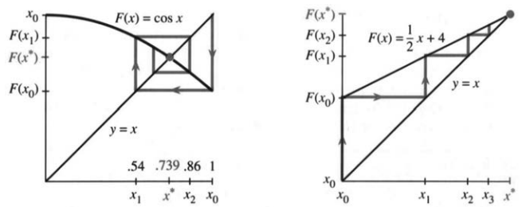

图3.19 从$(x_0,x_0)$到$(x_0,x_1)$再到$(x_1,x_1)$：直线—曲线—直线。

例2是$x_{n+1}=\tfrac12x_n+4$，两条图像都是直线。蛛网从一侧凑近交点：$(0,0)\to(0,4)\to(4,4)\to(4,6)\to(6,6)$。看它怎么先动$y$，再动$x$。因为$F$的斜率是$1/2$，到8的距离每一步都砍掉一半。

例3是$x_{n+1}=x_n^2$。抛物线与$y=x$交于0和1两处。图3.20a里，初值明明离1很近，却很快跑开：$F'(1)=2$，一开始到1的距离差不多翻倍。另一条路径一路向下，落到超吸引点0；从$x_0>1$出发的路径，则冲向无穷。

**例4** $F(x)$有两个吸引不动点$x^*$（中间总有一个排斥的$x^*$）。

图中两个交点处斜率都是零，迭代和蛛网很快就收敛过去。夹在它们中间，$F$的图像必定从下往上穿过$45^\circ$直线，这要求斜率大于1。蛛网从这不稳定的点向外散开，它正好把两边的吸引域隔开。不动点$x=\pi$独自占着一个吸引域！

**说明1** 要在计算器上画蛛网，先把$y=F(x)$和$y=x$叠着画出来。在Casio上，一种操作是：标出$(x_0,x_0)$，输入`LINE: PLOT X,Y`，按`EXE`；再把光标竖直移到$y=F(x)$上，按`EXE`；然后水平移到$y=x$，再按`EXE`。照此继续，每按一轮就画出一段线。

TI-81（以及Casio）还能用一小段程序画蛛网。把$F$存进`Y1`函数槽，设好范围（正方形窗口或自动缩放），运行后按提示输入$x_0$：

```text
PrgmC:COBWEB
:Disp "INITIAL X?"
:Input X
:All-off
:Y1-On
:"X"→Y4
:Lbl 1
:X→S
:Y1→T
:Line(S,S,S,T)
:Line(S,T,T,T)
:T→X
:Pause
:Goto 1
```

**说明2** 当$0<dF/dx<1$时，$x$们从一侧趋于$x^*$。

**说明3** 吸引域里可能装着离得很远的初值，甚至碎成无穷多块——问题之所以有意思，就在这儿。要是根本没有吸引不动点，那就去看第3.7节的周期轨道和混沌。


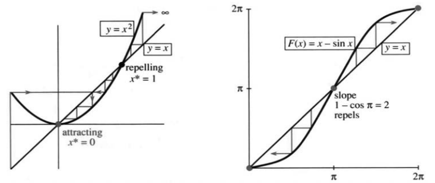

图3.20 $F(x)=x^2$与$F(x)=x-\sin x$的蛛网。attracting为吸引，repelling为排斥，slope为斜率。

### 迭代 $x_{n+1}=x_n-cf(x_n)$

走到这里，读者面前有两种选择。一种是直接翻到下一节“牛顿法”。那是一种解$f(x)=0$的迭代：把$x_n,f(x_n),f'(x_n)$凑在一起，定出$x_{n+1}$。它在适用的时候收敛有多快，我们马上会看到。解方程的重要算法里，它算得上一号，根基全在切线近似上。

另一种，是留下来用微积分把一整族迭代看个明白。这一族全靠一个由我们挑选的数$c$，最佳的$c$产生牛顿法。我要强调，迭代不是什么新奇罕见的玩意儿，它是科学计算里的基本技术。

通向$f(x^*)=0$的路不止一条（我用$x^*$表示解）。好的算法，可能在离解足够近时改换牛顿法。下面这种迭代，就用$f(x_n)$来决定下一个点：

$$x_{n+1}=F(x_n)=x_n-cf(x_n).\tag{2}$$

注意，$F$虽由$f$搭出来，两者却不是一回事。我们把$f$挪到一边，乘上一个“预条件因子”$c$，再从$x$里减掉。$c$挑得如何，至关重要；若它每步都变，就记作$c_n$。初值$x_0$同样要紧，可它准不准，未必由得了我们。

假设$x_n$收敛于$x^*$。式(2)的极限为：

$$x^*=x^*-cf(x^*),\tag{3}$$

于是$f(x^*)=0$。$x_n$若有极限，就解对了方程；它是$F$的不动点（我们可以假设$c_n\to c\ne0$及$f(x_n)\to f(x^*)$）。关键问题有两个，答案都藏在$F'(x^*)$里：

1. $x_n$趋于$x^*$有多快，还是会发散？
2. 怎样挑$c$或$c_n$？

**例5** $f(x)=ax-b$，零点在$x^*=b/a$。迭代$x_{n+1}=x_n-c(ax_n-b)$打的算盘，是不做除法也算出$b/a$。（早期的计算机不能做除法；它们使用迭代。）


等式两边减去$x^*$，再用$b=ax^*$：

$$x_{n+1}-x^*=x_n-x^*-c(ax_n-b)=(1-ca)(x_n-x^*).$$

于是得到误差方程

$$e_{n+1}=(1-ca)e_n,\qquad e_n=x_n-x^*.\tag{4}$$

每一步，误差都乘上$1-ca=F'$。$x_n$收敛于$x^*$的充要条件是

$$-1<1-ca<1.\tag{5}$$

最理想的选择是$c=1/a$：误差因子直接归零，一步就得到精确解$x_1=x_0-(ax_0-b)/a=b/a$。图3.21a里那条水平线就是这种情形，其余几条线则各显各的收敛或发散。

这个线性例子用不着微积分。要紧的是：一旦靠近$x^*$，非线性方程$f(x)=0$就近似成了线性方程，切线近似便能派上用场。你看，题目开头并没让你求导，微积分照样插得上手。

### 怎样选择$c$

现在盯住误差$x_n-x^*$。误差因子越小，误差消失得越快。从迭代式里减去$x^*=x^*-cf(x^*)$：

$$x_{n+1}-x^*=x_n-x^*-c\bigl(f(x_n)-f(x^*)\bigr).\tag{6}$$

这时候，微积分该登场了：看见两个函数值相减，就要想到导数。记$A=f'(x^*)$，用$A(x_n-x^*)$去近似$f(x_n)-f(x^*)$：

$$x_{n+1}-x^*\approx(1-cA)(x_n-x^*).\tag{7}$$

这就是局部误差方程：新误差近似等于旧误差乘上$m=1-cA$，正好对应线性例子里的$1-ca$。判据还是那一条：$|m|=|F'(x^*)|<1$。

> **3K** 从$x^*$附近出发，若乘子满足$|m|<1$，误差$x_n-x^*$趋于零。理想的选择是$c=1/A=1/f'(x^*)$，此时$m=1-cA=0$。

难处只有一个：$x^*$不知道，那儿的斜率也就不知道，理想的$c$没法直接选。好在，可以拿当前点$x_n$处的斜率来凑近：

$$c_n=\frac1{f'(x_n)},\qquad
\boxed{x_{n+1}=x_n-\frac{f(x_n)}{f'(x_n)}.}$$

**这就是牛顿法。** 乘子$m=1-cA$被我们压到了尽可能接近零。把$df/dx$放进$F(x)$，牛顿提高了迭代的收敛速度。


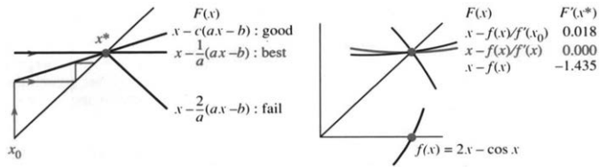

图3.21 固定因子的误差乘子为$m=1-cf'(x^*)$；牛顿法取$c_n=1/f'(x_n)$，$m\to0$。good、best、fail分别表示良好、最佳、失败。

**例6** 用不同$c$求解$f(x)=2x-\cos x=0$。

直线$y=2x$和余弦曲线在$x=1/2$附近相交。交点满足$2x^*=\cos x^*$，却写不出简单的初等表达式。从$x_0=1/2$出发，用$x_{n+1}=x_n-c(2x_n-\cos x_n)$迭代，三种选法摆在一起比：$c=1$；固定$c=1/f'(x_0)$；每步更新$c_n=1/f'(x_n)$。

| 初值$x_0=0.50$ | $c=1$ | $c=1/f'(x_0)$ | $c_n=1/f'(x_n)$ |
|---|---:|---:|---:|
| $x_1$ | 0.38 | 0.45063 | 0.45062669 |
| $x_2$ | 0.55 | 0.45019 | 0.45018365 |
| $x_3$ | 0.30 | 0.45018 | $0.45018361\ldots$ |

第一列被$x^*$推开，第二列收敛过去，第三列的牛顿法快得惊人：到$x_3$，除了写出的$0.4501836$，还有约七位数字是准的。

再拿理论预测对一对：$f'(x)=2+\sin x$，所以$A=f'(x^*)\approx2.435$。看实际误差$x_n-x^*$是否在每一列向下时，都乘上了列底所预测的$m$：

| 误差 | $c=1$ | $c=1/(2+\sin\tfrac12)$ | $c_n=1/(2+\sin x_n)$ |
|---|---:|---:|---:|
| $x_0-x^*$ | 0.05 | $4.98\times10^{-2}$ | $4.98\times10^{-2}$ |
| $x_1-x^*$ | −0.07 | $4.43\times10^{-4}$ | $4.43\times10^{-4}$ |
| $x_2-x^*$ | 0.10 | $7.88\times10^{-6}$ | $3.63\times10^{-8}$ |
| $x_3-x^*$ | −0.15 | $1.41\times10^{-7}$ | $2.78\times10^{-16}$ |
| 误差因子 | $m\approx-1.4$ | $m\approx0.018$ | $m_n\to0$ |

第一列的因子小于$-1$，误差一步比一步大；又因这个因子是负的，误差正负交替，蛛网便一圈圈向外摊开。

第二列的因子约0.018。它先老老实实走一步牛顿迭代，然后就把$c$定住。走$n$步之后，误差近似与$m^n=(0.018)^n$成正比——这叫**线性收敛**，好在收敛因子很漂亮。

第三列亮出的是牛顿法的**二次收敛**。乘上$m$比以往更诱人，因为$m\to0$。实际上$m$本身与误差成正比，所以每一步误差都被平方。第3.8节第31题将证明$(\text{误差})_{n+1}\le M(\text{误差})_n^2$。这么一平方，三步就从$10^{-2}$到$10^{-4}$、$10^{-8}$，再到“机器$\varepsilon$”。牛顿法收敛时，正确位数每一步都翻倍。


**说明1** $c=1$时，迭代成了$x_{n+1}=x_n-f(x_n)$，这叫“逐次代入”：把$f(x)=0$改写成$x=x-f(x)$，再把每一步的结果代回去。$c=1$并不是注定失败。

**说明2** 牛顿法把这种逐次代入用在$f/f'$上，而不是$f$上；此时$m\approx0$。

**说明3** Edwards和Penney恰好也挑过$2x=\cos x$这个例子，不过他们把它巧妙地写成$x_{n+1}=\tfrac12\cos x_n$。这时$|F'|=|\tfrac12\sin x|<1$，正对应该族迭代的$c=1/2$，所以收得住。极限不是$\tfrac12(0.7391\ldots)$，而是$0.4501836\ldots$。

**说明4** 把$c=1/f'(x_0)$固定住，就是本节的**简化牛顿法**：头一步照牛顿法走，之后导数值不再更新。每步省掉了重算$f'(x_n)$，单步更便宜，但通常要多走几步。牛顿法上花了数百万美元，速度当然要紧；$f(x)=0$的各种变体，始终是计算的核心问题。

### 3.6 习题

#### 通读填空

$x_{n+1}=x_n^3$描述一种 **a____**。一步后$x_1=$ **b____**；两步后$x_2=F(x_1)=$ **c____**。若输入等于输出，即$x^*=$ **d____**，则$x^*$是 **e____** 点。$F(x)=x^3$有 **f____** 个不动点，分别为 **g____**。从不动点附近出发，若 **h____** $<1$，迭代趋于它，因为$x_{n+1}-x^*=F(x_n)-F(x^*)\approx$ **i____**。这种点称为 **j____**。若 **k____**，则附近迭代被排斥。$F=x^3$在各不动点的导数为 **l____**。蛛网从$(x_0,x_0)$到$(\_,\_)$再到$(\_,\_)$，趋于$(x^*,x^*)=$ **m____**。这是$y=x^3$与$y=$ **n____** 的交点，并因 **o____** 而超吸引。

可以用$x_{n+1}=x_n-cf(x_n)$解$f(x)=0$，此时$F'(x^*)=$ **p____**。减去$x^*=x^*-cf(x^*)$，得到误差式$x_{n+1}-x^*\approx m($ **q____** $)$，其中$m=$ **r____**。若 **s____**，误差趋于零。取$c_n=$ **t____**得到牛顿法；$c=1$称为逐次 **u____**；$c=$ **v____**称为简化牛顿法。收敛到$x^*$ **w____** 有保证。

研究迭代有三种办法：① 从不同初值计算数列；② 求不动点并检验$|F'|<1$；③ 画蛛网图。

**第1–8题：分别从$x_0=0.6$与$x_0=2$开始，计算$x_1,x_2,\ldots$，考察收敛性。**

1. $x_{n+1}=x_n^2-1/2$。
2. $x_{n+1}=2x_n(1-x_n)$。
3. $x_{n+1}=\sqrt{x_n}$。
4. $x_{n+1}=1/\sqrt{x_n}$。
5. $x_{n+1}=3x_n(1-x_n)$。
6. $x_{n+1}=x_n^2+x_n-2$。
7. $x_{n+1}=x_n/2-1$。
8. $x_{n+1}=|x_n|$。

9. 检查第1–6题所有不动点处的$F'$。它们吸引还是排斥？
10. 从$x_0=-1$开始计算$x_{n+1}=-x_n^3$，画出含周期轨道的蛛网。两步合成得到$x_{n+2}=x_n^9$，其不动点是____。
11. 从$x_0=2$开始，分别画$x_{n+1}=x_n/2-1$与$x_{n+1}=1-x_n/2$的蛛网。规律：在不动点附近，当$F'$为____时，蛛网从两侧交替靠近或离开。
12. 从周期点$x_0=0$开始，画$x_{n+1}=x_n^2-1$的蛛网。另一个周期点为____。再从附近$x_0=0.1$开始，观察是否趋于$0,-1,0,-1,\ldots$这一周期轨道。

**第13–16题：用迭代求解，误差控制在1%以内。**

13. $x=\cos(x/2)$。
14. $x=\cos^2x$。
15. $x=\cos\sqrt{x}$。
16. $x=2x-1$（??）。

17. 对哪些数$a$，$x_{n+1}=a(x_n-x_n^2)$趋于$x^*=0$？
18. 对哪些数$a$，同一迭代趋于$x^*=(a-1)/a$？
19. 迭代$x_{n+1}=4(x_n-x_n^2)$以观察混沌。为什么$x_n$不会趋于$x^*=3/4$？
20. $F(x)=x^2-1/2$的一个不动点吸引，另一个排斥。用数值实验或蛛网找出趋于吸引点的初值集合。
21. **重要：** 求$F(x)=ax+s$的不动点，何时吸引？
22. 在线性迭代$x_{n+1}=ax_n+4$中，$a=1$与$a=-1$时分别怎样？
23. 起初有1000美元，每年先花掉一半，再由一位富有却糊涂的姑妈给你1000美元。稳态余额$x^*$是多少？若最初有100万美元，结果又如何？


24. 美国国债曾为1万亿美元。通胀每年使实际价值减少5%，即乘以0.95，而新增赤字又增加1000亿美元。稳态债务$x^*$是多少？
25. $x_{n+1}=b/x_n$有不动点$x^*=\sqrt b$。证明该点$|F'|=1$，并求从$x_0$出发的数列。
26. 证明$x_{n+1}=x_n^2+x_n-3$的两个不动点都排斥。迭代会出现什么行为？
27. 一台5美元的计算器能开平方，不能开立方。解释为什么$x_{n+1}=\sqrt{2/x_n}$趋于$\sqrt[3]2$。
28. 画$x_{n+1}=\sin x_n$与$x_{n+1}=\tan x_n$的蛛网。两者在不动点0均有$F'=1$。(a) 是否收敛？(b) 对$F'=1$的情形，根据$F''$提出一个理论。

**第29–32题：使用$x_{n+1}=x_n-cf(x_n)$求$f(x)=0$，分别寻找一个成功的$c$和一个失败的$c$。**

29. $f(x)=x^2-4$。
30. $f(x)=x^2-4x+3$。
31. $f(x)=(x-2)^9-1$。
32. $f(x)=(1-x)^{-1}-3$。

33. 牛顿法每步重新计算$c_n=1/f'(x_n)$。分别写出求$x^3-2=0$和$\sin x-1/2=0$的迭代公式。
34. 用第33题的方法求$\sqrt[3]2$与$\pi/6$，精确到小数点后六位。
35. 对$f(x)=x^2-5x+4$使用牛顿法，通过实验寻找各个根及其吸引域。
36. 对$x^2-1=0$，从遥远初值$x_0=10^6$开始测试牛顿法。起初误差大约每步减半；接近$x^*=1$后，有效误差因子趋于零。
37. 求$x_{n+1}=x_n-c(x_n^2-x_n)$在各不动点处的误差因子$m$，预测不同$c$下的收敛性及趋近哪个根。
38. 取$f(x)=x^2-1/2$、$x_0=1$，列表比较$c=1$、固定$c=1/f'(x_0)$和每步$c_n=1/f'(x_n)$三种迭代。
39. (a) 对求$x^2-2=0$的迭代$x_{n+1}=\tfrac12(x_n+2/x_n)$，求不动点处的$F'$。(b) 对$F(x)=x-f(x)/f'(x)$，证明当$f(x)=0$时$F'=0$。牛顿法的乘子为$m=0$。
40. 方程$x^2+2=0$的解是什么？为什么牛顿法必定失败？实际迭代，观察是否趋于无穷。
41. **计算机项目。** $F(x)=x-\tan x$的不动点满足$\tan x^*=0$，即$x^*$为$\pi$的整数倍。从$x_0=2.0,1.8,1.9$出发，分别趋于哪个倍数？测试$1.7<x_0<1.9$，寻找趋于$\pi,2\pi,3\pi,4\pi$的初值区间。任意两个吸引域之间，都有通向$\pi$的每一个整数倍的吸引域。而这些之间又有更多吸引域（一个分形）。将其标在$[0,\pi]$上，并放大$x_0=1.9$附近，可尝试使用颜色。
42. 画$\cos x$、$\cos(\cos x)$、$\cos(\cos(\cos x))$以及余弦函数复合八次的图像。它们趋于什么？
43. 画$\sin x$、$\sin(\sin x)$及正弦函数复合八次的图像。它们趋于什么？为什么这么慢？

## 3.7 牛顿法（及混沌）


要求解的方程是$f(x)=0$，它的解$x^*$就是图像穿过横轴的点。图3.22上标出了$x^*$和初始猜测$x_0$。我们手头只有$f(x_0)$和$f'(x_0)$，目标是从这两样东西出发，尽量靠近$x^*$。第3.6节已经推出了下一次猜测$x_1$的牛顿公式；这回我们直接从几何入手。

站在$x_0$处，我们看到什么？图像的高度是$f(x_0)$，斜率是$f'(x_0)$。也就是说，我们知道自己在哪儿，也知道曲线朝哪个方向走；可它弯不弯，我们不知道——手里没有$f''$。最自然的办法，就是**沿切线前进**：这条线用上了我们手里的全部信息。

牛顿法拿线性近似——也就是切线近似——来替换$f(x)$：

$$f(x)\approx f(x_0)+f'(x_0)(x-x_0).\tag{1}$$

我们希望左边等于零；退一步，先让右边等于零。切线在$x_1$处与横轴相交，曲线则在$x^*$处相交。由$f(x_0)+f'(x_0)(x_1-x_0)=0$，除以$f'(x_0)$并解出$x_1$，得到牛顿法的第一步：

$$x_1=x_0-\frac{f(x_0)}{f'(x_0)}.\tag{2}$$

到了新点，算出$f(x_1),f'(x_1)$，又能作一条新切线，它与横轴交于$x_2$。每一步我们想要的都是$f(x_{n+1})=0$；实际做到的，是退而满足$f(x_n)+f'(x_n)(x_{n+1}-x_n)=0$。

> **3L 牛顿法**：从$x_n$处作切线，它与横轴的交点横坐标为
> $$x_{n+1}=x_n-\frac{f(x_n)}{f'(x_n)}.\tag{3}$$
> 这个迭代$x_{n+1}=F(x_n)$通常很快收敛于$x^*$。

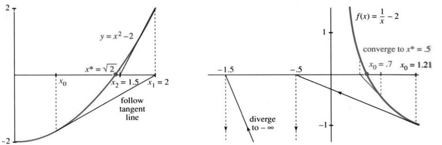

图3.22 沿切线走：从$x_0$到$x_1$，再到$x_2$。左图是$x^2-2$；右图是$1/x-2$，收敛和发散两条路都画了出来。


线性近似里有三个量：横向的变化$\Delta x$、纵向的变化$\Delta f$，还有斜率$f'(x)$。知道其中两个，就能估出第三个。到这里，微积分把三种算法都用上了——它们正是这门课的关键：

1. 用$\Delta f/\Delta x$估计斜率$f'(x)$，见第2.1节。
2. 用$f'(x)\Delta x$估计变化$\Delta f$，见第3.1节。
3. 用$\Delta f/f'(x)$估计变化$\Delta x$，即牛顿法。

我们想要的纵向变化是$-f(x_n)$；式(3)说的正是$\Delta x=-f(x_n)/f'(x_n)$。

**例1：平方根。** $f(x)=x^2-b$的零点为$\pm\sqrt b$。牛顿法是求平方根的快捷法子；你手边的计算器里可能就装着它。因为$f'(x_n)=2x_n$，

$$x_{n+1}=x_n-\frac{x_n^2-b}{2x_n}
=x_n-\frac12x_n+\frac{b}{2x_n}.\tag{4}$$

化简得$x_{n+1}=\tfrac12(x_n+b/x_n)$。先猜一个平方根，拿$b$除以这个猜测，再把两数平均。古巴比伦人不懂函数，也不懂斜率，却早就有同样的想法。他们迭代的函数是

$$F(x)=\frac12\left(x+\frac bx\right),\qquad
F'(x)=\frac12\left(1-\frac b{x^2}\right).\tag{5}$$

巴比伦人做对了。在解$x^2=b$处，$F'=0$，比一般$|F'|<1$的情形收敛得更快。

求$\sqrt4$，从$x_0=1$起步：

$$x_1=2.5,\quad x_2=2.05,\quad x_3=2.0006,
\quad x_4=2.000000009.$$

每走一步，第一个错位的小数就往后挪一倍——因为误差被平方了。两边同时减去$x^*=2$：

$$x_{n+1}-2=\frac12\left(x_n+\frac4{x_n}\right)-2
=\frac{(x_n-2)^2}{2x_n}.\tag{6}$$

离2很近时，$e_{n+1}\approx\tfrac14e_n^2$。牛顿法为什么这么快？答案就在这里。

**说明1** 起点不能取$x_0=0$：第一步就要除以零。几何上，零点处的切线是水平的，永远不会与横轴相交。

**说明2** 从$x_0=-1$出发，牛顿法收敛于$-\sqrt2$而非$+\sqrt2$。那是另一个$x^*$。牛顿法最后会挑哪个根，事先往往猜不准。每个根周围都有一片“吸引域”，可同一片吸引域的其他部分，也许远在天边。用许多初值做数值实验，是研究它们的一种方法——也正是这类问题，把人们引向了分形。


**例2** 解$1/x-a=0$，目标是不用直接除以$a$也能得到$x^*=1/a$。

这里$f(x)=1/x-a$，$f'(x)=-1/x^2$。牛顿公式化简下来，除法竟然不见了：

$$x_{n+1}=x_n-\frac{1/x_n-a}{-1/x_n^2}
=2x_n-ax_n^2.\tag{7}$$

这些迭代收敛吗？我取$a=2$，盯住$x^*=1/2$。误差方程是：

$$x_{n+1}-\frac12=-2\left(x_n-\frac12\right)^2.\tag{8}$$

每步都把误差平方：离解近时，这是天大的好事；可要是误差本来就大，平方之后再乘$-2$，就可能糟得没法看。：

| 初值 | $x_1$ | $x_2$ | $x_3$ | $x_4$ |
|---|---:|---:|---:|---:|
| 0.70 | 0.42 | 0.487 | 0.4997 | 0.4999998 |
| 1.21 | −0.5 | −1.5 | −7.5 | −127.5 |

第18题会从代数上确认：$0<x_0<1$时收敛很快；$x_0<0$或$x_0>1$时则发散。后一种情形，第一步切线就落到负半轴，此后一路向负方向远行。

上一节画的是$F$，不动点满足$x^*=F(x^*)$，位于与$y=x$的交点；这一节画的是$f$，目标挪到了横轴上，满足$f(x^*)=0$。

再说一遍：我们盯的是$f(x^*)=0$，可能否走到那里，得看$F'(x^*)$。例2化简后$F(x)=2x-2x^2$，不动点是$1/2$和0。前者的导数为0，后者导数为2，是个排斥点。

牛顿法的关键在于：在解处，$F'=0$：

$$F(x)=x-\frac{f(x)}{f'(x)},\qquad
F'(x)=\frac{f(x)f''(x)}{[f'(x)]^2}.$$

所以在$f(x)=0$的地方，$F'=0$。

平方根和倒数这两个例子，既让我们看到飞快的收敛，也让我们看到失败。第13章里，还有实际应用中，牛顿法要对付的方程难得多。我将选择第三个例子，纯粹出于好奇：拿它去解$x^2=-1$，会怎样？结果出人意料。

**例3** 让牛顿法去解$f(x)=x^2+1=0$，会发生什么？

仅有的根是$i,-i$，实根一个也没有。算法大可以就此罢手，可它并不知道这回事！即使曲线$y=x^2+1$永远不穿过横轴，切线照样在新点$x_{n+1}$处横穿横轴。式(5)在$b=-1$时仍给出迭代：

$$x_{n+1}=\frac12\left(x_n-\frac1{x_n}\right)=F(x_n).\tag{9}$$

实数迭代不可能趋于$\pm i$。那它们到底往哪儿跑？从$x_0=1$出发，$x_1=0$，接着$x_2$除以零，爆掉了。我原以为别的数列都会奔向无穷；实验却给了我一副怪景象：$x_n$很大时，下一步略小于它的一半。


比如$x_n=10$，下一步是$x_{n+1}=4.95$。来回折腾一阵之后，最终会出现一个接近零的数；下一步一除，又猛地弹到很远的地方。这让我想到了“混沌”。

当然，也大可以退回那些牛顿法大获成功的寻常例子。翻翻书里的习题，或者拿自己的方程试试，你会发现像求$\sqrt4$那样的快速收敛才是常态；当然，实际碰到的函数要复杂得多。上一节的$2x=\cos x$，误差同样一步一步被平方。牛顿法从$x^*$附近出发时，收敛快得惊人。本节最要紧的一句话还是：**沿切线前进。**

不过，请允许我留在这个奇怪的例子上：$x^2+1=0$。它不太可预测，也许不太有用，可就是更有意思。没有实根，迭代却在到处乱跳。下面就来把$x_n$找出来。

### $x_n$的公式

钥匙是三角学课本里的一道习题。这类习题大多只是练习正弦和余弦，这一道却恰好配得上$\tfrac12(x_n-1/x_n)$：

$$\frac12\left(\frac{\cos\theta}{\sin\theta}-\frac{\sin\theta}{\cos\theta}\right)
=\frac{\cos2\theta}{\sin2\theta},$$

即

$$\frac12\left(\cot\theta-\frac1{\cot\theta}\right)=\cot2\theta.$$

两个分式一通分，分母成了$2\sin\theta\cos\theta=\sin2\theta$，分子成了$\cos^2\theta-\sin^2\theta=\cos2\theta$。将余弦/正弦换成余切，恒等式便说明：

$$x_0=\cot\theta\quad\Longrightarrow\quad
x_1=\cot2\theta,\quad x_2=\cot4\theta,\quad
\boxed{x_n=\cot(2^n\theta).}$$

这些点全落在余切曲线上。图3.23从$x_0=2=\cot\theta$出发，每迭代一次，角度就翻一倍。

**例A** 数列$x_0=1,x_1=0,x_2=\infty$对应着$\pi/4,\pi/2,\pi$的余切。数列爆掉，是因为$x_2$要除以$x_1=0$。

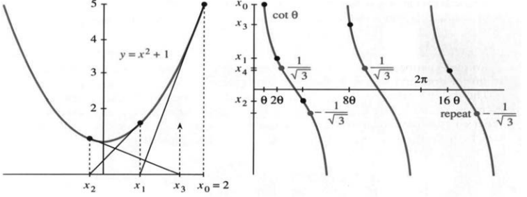

图3.23 对$x^2+1=0$的牛顿迭代，$x_n=\cot(2^n\theta)$。

**例B** 数列$1/\sqrt3,-1/\sqrt3,1/\sqrt3,\ldots$对应着$\pi/3,2\pi/3,4\pi/3,\ldots$，以周期2永远循环下去。


**例C** 从很大的$x_0$（也就是很小的$\theta$）出发，$x_1$大约只有它的一半。等到某个加倍后的角度再次撞上很大的余切，数列又飞向远处。这才是典型情形；例A、B里$\theta/\pi=1/4,1/3$，反倒是特例。

混沌就在这里。$x$们不能收敛，它们被所有点强烈排斥，而且对$\theta$的值极其敏感。十步之后，角度差被放大为$2^{10}=1024$倍。起初$60^\circ$与$61^\circ$只差1度，十步后差了1024度。如果这个差是180度的整数倍，余切仍会接近；实际两者的$x_{10}$约为0.6与14。

数学里的这种混沌在自然界也见得到。最熟悉的例子是天气，它比你想的要敏感得多。1989年《Science》出现过“Forecasting Pushed Too Far”（预报推得太远）的标题。文章说，小误差滚雪球般增大，六天后就毁掉预报。我们无法跟着天气方程走一个月——一架飞机的飞行就能改变一切。这是革命性的想法：一条简单规则，竟能产生敏感得无法计算的答案。

复杂的公式（或干脆没有公式），我们习以为常；我们不习惯的是$\cot(2^n\theta)$这种看着无害的公式——100步之后就完全没了指望。

### 抛物线产生的混沌

现在我可以告诉你新的数学了。先把迭代$x_{n+1}=\tfrac12(x_n-1/x_n)$换成更简单的样子。作代换$z=1/(1+x^2)$，下一步就只用旧的$z$与$z^2$来表示：

$$z_{n+1}=4z_n-4z_n^2.\tag{10}$$

这是二次迭代里最有名的一个，专门研究它的书都有。第28题会告诉你它是怎么来的。从$x_n$的公式出发，可得

$$z_n=\frac1{1+x_n^2}
=\frac1{1+\cot^2(2^n\theta)}
=\sin^2(2^n\theta).\tag{11}$$

当$2^n\theta$很大时，正弦也像余切一样不可预测。再把它塞进一个参数族：

$$z_{n+1}=az_n-az_n^2,\qquad0\le a\le4.\tag{12}$$

式(10)正是$a=4$这个端点；例2恰好是中间那个$a=2$，趋于$1/2$。我想给一份关于不同$a$下这种迭代的简短报告，完全可以选读。

从$0\le z_0\le1$里的某个数出发往下算。$a$一点点变大，行为的变化很好看，你完全可以自己在电脑上试。所有迭代值都留在$[0,1]$内，而且可能趋于一个极限。$a$较小时，事情很简单：

- 当$0\le a\le1$，迭代值趋于$z^*=0$。
- 当$1\le a\le3$，迭代值趋于$z^*=(a-1)/a$。

这些极限满足$z^*=az^*-a(z^*)^2$。而$F'(z)=a-2az$，在上面两个极限处一算，都有$|F'|\le1$。真正难办的是$a>3$以后的行为；我们那个例子正是$a=4$。

当$|F'(z^*)|>1$时，$z$们不可能趋于极限。总得发生些什么，至少有三种可能：$z_n$们循环，或填满整个区间$(0,1)$，或趋于一个康托集。


我随机取一个初值，先迭代100步，再把第101–105步抄在下面：

| 步数 | $a=3.4$ | $a=3.5$ | $a=3.8$ | $a=4.0$ |
|---|---:|---:|---:|---:|
| $z_{101}$ | 0.842 | 0.875 | 0.336 | 0.169 |
| $z_{102}$ | 0.452 | 0.383 | 0.848 | 0.562 |
| $z_{103}$ | 0.842 | 0.827 | 0.491 | 0.985 |
| $z_{104}$ | 0.452 | 0.501 | 0.950 | 0.060 |
| $z_{105}$ | 0.842 | 0.875 | 0.182 | 0.225 |

第一列正在趋于一条**二周期轨道**，在约0.842和0.452之间来回跳。记这两个点为$x,y$，就有$y=F(x)$、$x=F(y)=F(F(x))$。对两步迭代来说，它们都是不动点。等$a$越过约3.45，这条周期轨道就不稳了。

就在这一刻，**周期由2倍增为4**。看$a=3.5$那一列：每四步一重复，大致是$0.875\to0.383\to0.827\to0.501\to0.875$。这条轨道一定有吸引力，不然一般初值不会让我们看见它。可$a$再涨，它也会失稳。接着，在$a\approx3.55$附近的一个小窗口里，冒出一条稳定的八周期轨道。

稳定的参数区间越来越窄，相邻两段宽度之比，渐渐稳定在**费根鲍姆常数$4.6692\ldots$**上。物理实验里也能看到16、32、64周期；在这条倍周期级联上，它们在$a<3.57$时就已经一个个失稳了。接下来呢？

图3.24画的是3.57到4之间的丰富景象。对每个参数$a$，计算机先扔掉前1000次迭代，再画出$z_{1001}$至$z_{2000}$，好让稳定的周期（或者混沌）显形。我不知道图里那块大白楔形为什么一个点都没有。到了三周期窗口，只看得见三个$z$值；三周期后面又跟着6、12、24等倍周期。每个稳定窗口的末端都有类似的倍周期，连小到看不见的窗口也不例外。你随便取个初值，反复迭代再作图，也能重现这幅图。

### 康托集与分形

我说不出$a=3.8$时会发生什么。也许有某个长周期的稳定循环；$z$们也许会靠近0与1之间的每一点。第三种可能是趋于一个非常薄的极限集合，看上去像著名的康托集。

康托集这样造：把$[0,1]$三等分，挖掉中间的开区间$(1/3,2/3)$；剩下的两段，再各自挖掉中间三分之一，也就是$(1/9,2/9)$和$(7/9,8/9)$。以后每一步，都从每个剩余区间里挖走中间那开的三分之一。一直挖下去，最后剩下的点就组成**康托集**。

所有被删区间的端点——$1/3,2/3,1/9,2/9,\ldots$——都留在集合里。$4/3$也在其中，见第42题。可即便如此，被删区间的长度之和等于1，康托集的长度（测度）却是零。

最叫人吃惊的是它的**自相似性**：$[0,1/3]$里那一段，就是整个康托集缩小3倍；$[0,1/9]$里的，又是缩小9倍。把每一小段放大，整体就又回来了。

**分形。** 这种自相似，正是分形的招牌。它里面有数不清的尺度。数学里的雪花可以从一个三角形起步，在每条边的中间鼓出一个小三角形；每走一步，边界总长就乘上$4/3$。取到极限，边界自相似，像一条无穷长的海岸线。


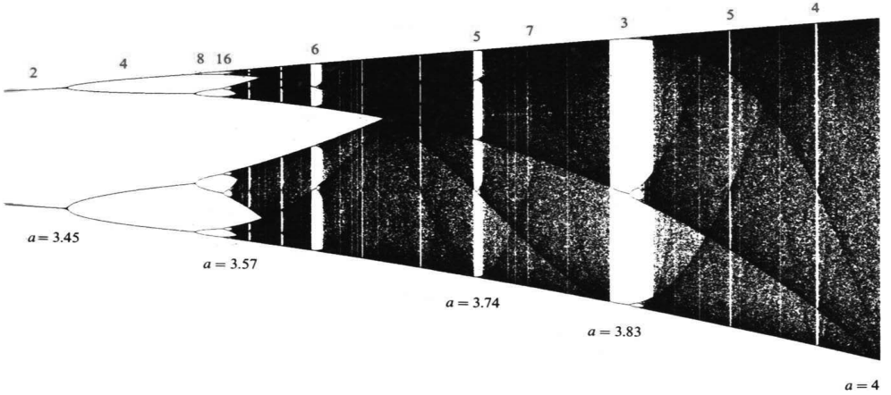

图3.24 迭代$F(z)$产生的倍周期与混沌。周期2、4等，指的是一条周期轨道里不同点的个数。（经特别许可偷自Gilbert Strang的《Introduction to Applied Mathematics》，Wellesley-Cambridge Press。）

“分形”一词来自分数维。雪花边界的维数比1大、比2小；康托集的维数比0大、比1小。拿半径$r$的小圆去盖一条普通线段，需要$c/r$个圆。对分形，需要$c/r^D$个圆——$D$就是维数。

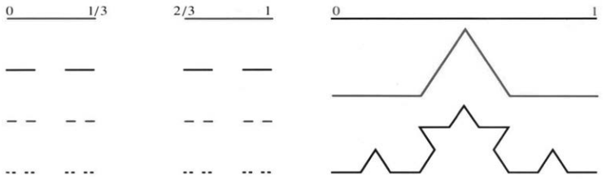

图3.25 左边是逐次挖去中间三分之一的康托集，右边是边界无限长的分形雪花。

迭代$z_{n+1}=4z_n-4z_n^2$正对着图3.24的$a=4$端点。数列$z_0,z_1,\ldots$无处不去，却又无处可去。它的行为混沌，统计检验找不到规律。就所有实际用途而言，这些数都是随机的。

想想这对实验（或者股票市场）意味着什么。简单规则若能产生混沌，就绝无办法预测结果。任何测量都不可能足够精确。报纸报道说冥王星的轨道混沌——尽管它服从引力定律。长时间的运动完全不可预测。我不知道这对天文学（或者占星术）意味着什么。

这一主题最好读的书是James Gleick的《Chaos: Making a New Science》；图像最漂亮的，则数《The Beauty of Fractals》和《The Science of Fractal Images》。


Peitgen、Richter、Saupe等人书里的那些图像，曾在世界各地的艺术馆展出。最有原创性的是Mandelbrot的《Fractals》和《Fractal Geometry》：本书封面用的分形，来自图13.11。

现在回到那些比较友好的问题上去——在它们面前，微积分并不是束手无策。

### 牛顿法与割线法：计算器程序

牛顿法难就难在求导数：切线的斜率，非得有$f'$不可。不过也可以拿已经算出的$f(x_n)$与$f(x_{n-1})$凑出差商，用割线代替切线：

$$x_{n+1}=x_n-\frac{f(x_n)}{(\Delta f/\Delta x)_n},\qquad
\left(\frac{\Delta f}{\Delta x}\right)_n
=\frac{f(x_n)-f(x_{n-1})}{x_n-x_{n-1}}.\tag{13}$$

割线连着图像上最近的那两个点，方程是$y-f(x_n)=(\Delta f/\Delta x)_n(x-x_n)$。令$y=0$，解出的横轴交点就是新的$x_{n+1}$。

预测：三步割线法差不多抵得上两步牛顿法。两者都应该给出四倍的正确小数位数：$(\text{误差})\to(\text{误差})^4$。割线法用于$x^2+1=0$时，大概也会混沌。

这些牛顿法和割线法程序用于TI-81。在`Y=`函数编辑屏幕上，将$f(x)$公式放进`Y1`槽，将$f'(x)$公式放进`Y2`槽。按提示输入初值$x_0$。程序暂停，显示每个近似值$x_n$、函数值$f(x_n)$及差$x_n-x_{n-1}$。按`ENTER`继续，或按`ON`并选择`2:Quit`中止。如果$f(x_n)=0$，程序显示`ROOT AT`和根$x_n$。

```text
PrgmN:NEWTON
:Disp "X0="
:Input X
:X→S
:Y1→Y
:Lbl 1
:X-Y/Y2→X
:X-S→D
:X→S
:Y1→Y
:Disp "ENTER FOR MORE"
:Disp "ON 2 TO BREAK"
:Disp " "
:Disp "XN FXN XN-XNM1"
:Disp X
:Disp Y
:Disp D
:Pause
:If Y≠0
:Goto 1
:Disp "ROOT AT"
:Disp X
```

```text
PrgmS:SECANT
:Disp "X0="
:Input X
:X→S
:Y1→T
:Disp "X1="
:Input X
:Y1→Y
:Lbl 1
:X-S→D
:X→S
:X-YD/(Y-T)→X
:Y→T
:Y1→Y
:Disp "ENTER FOR MORE"
:Disp "XN FXN XN-XNM1"
:Disp X
:Disp Y
:Disp D
:Pause
:If Y≠0
:Goto 1
:Disp "ROOT AT"
:Disp X
```

### 3.7 习题

#### 通读填空

把$f(x)=0$线性化成$f(x_n)+f'(x_n)(x-x_n)=0$，它的解$x=$ **a____** 就是牛顿法的$x_{n+1}$。曲线的 **b____** 在$x_{n+1}$处与横轴相交，**c____** 则在$x^*$处相交。误差通常满足$e_{n+1}\approx M$ **d____**，这叫 **e____** 收敛，正确小数位数每步 **f____**。

对$f(x)=x^2-b$，牛顿公式是$x_{n+1}=$ **g____**。$x_0>0$时趋于 **h____**；$x_0<0$时趋于 **i____**。换成$f(x)=x^2+1$，公式变成$x_{n+1}=$ **j____**，实迭代不可能趋于 **k____**，反倒会显出混沌。再令$z=1/(1+x^2)$，二次迭代就是$z_{n+1}=$ **l____**。


在$a\le3$时，$z_{n+1}=az_n-az_n^2$趋于一个单一的 **m____**。过了$a=3$，极限是二周期，意思是 **n____**。再往下变，还可能出现像康托集那样的极限集；康托集是一维的 **o____** 的例子，并具有自 **p____** 性。

1. 对$x^3-b=0$，写出牛顿法的迭代公式。
2. 对$f(x)=(x-1)/(x+1)$，牛顿公式是$x_{n+1}=F(x_n)=$____。解$x^*=F(x^*)$，再求$F'(x^*)$。迭代趋于什么极限？
3. 我相信牛顿当众演示这个方法，只用过一个方程$x^3-2x-5=0$；Raphson把这一想法推向前去，得到的认可却很有限。从$x_0=2$走两步，结果与$x^*\approx2.09455148$有几位小数对得上？
4. 证明：对$f(x)=x^{1/3}$，牛顿公式就变成$x_{n+1}=-2x_n$。再画图说明。
5. 分别讨论：(a) $f(x_0)=0$；(b) $f'(x_0)=0$。这时$x_1$是什么？
6. 画出$f(x)=x^3-3x-1$，估计各根。再从$0,1,-1/2,1.1$分别起跑，用实验判断哪个初值奔向哪个根。
7. 取$x_0=2.5$和3，用牛顿法解$x^2-6x+5=0$。画图说明哪些初值通向哪个根，。
8. 若$f(x)$递增且向上凹（$f'>0,f''>0$），用图像说明牛顿法收敛。从哪一侧？

**第9–17题：用计算机或计算器上的牛顿法求解，保留四位小数。除根$x^*$以外，任取初值$x_0$。**

9. $x^2-10=0$。
10. $x^4-100=0$，比第9题快还是慢？
11. $x^2-x=0$，哪些初值导向哪个根？
12. $x^3-x=0$，哪些初值导向哪个根？
13. $x+5\cos x=0$，有三个实根。
14. $x+\tan x=0$，求两个根；是否还有更多？
15. $1/(1-x)=2$。
16. $1+x+x^2+x^3+x^4=2$。
17. $x^3+(x+1)^3=10^3$。
18. (a) 证明例2的$x_{n+1}=2x_n-2x_n^2$与$1-2x_{n+1}=(1-2x_n)^2$等价。(b) 证明$|1-2x_0|>1$时发散；而$|1-2x_0|<1$，也就是$0<x_0<1$时，迭代趋于$1/2$。
19. 在例2中取$a=3$，用实验判断$x_{n+1}=2x_n-3x_n^2$的哪些初值会趋于$1/3$。
20. 把$x_{n+1}=2x_n-ax_n^2$改写成$1-ax_{n+1}=(1-ax_n)^2$。哪些$x_0$能让$1-ax_n\to0$，也就是$x_n\to1/a$？
21. 写出求7的$k$次方根的牛顿法，并把$\sqrt[7]7$算到小数点后七位。
22. 求$x^3=4x-1$的所有实根，保留五位小数。

**第23–29题讨论$x^2+1=0$与混沌。**

23. $\theta=\pi/16$时，$x_n=\cot(2^n\theta)$何时爆掉？$\theta=\pi/7$时，什么时候又会有$\cot(2^n\theta)=\cot\theta$？（两角之差须为$\pi$的整数倍）。
24. 取$\theta=\pi/9$，一路跟踪数列，直到$x_n=x_0$。
25. $\theta=1$时，$x_n$永远回不到$x_0=\cot1$，因为$2^n-1$不可能是$\pi$的非零整数倍，理由是____。
26. 若$z_0=\sin^2\theta$，证明$z_1=4z_0-4z_0^2=\sin^22\theta$。
27. 令$y_n=x_n^2+1$，证明
    $$y_{n+1}=\frac14\left(x_n-\frac1{x_n}\right)^2+1
    =\frac{y_n^2}{4(y_n-1)}.$$
28. 对第27题取倒数，令$z_n=1/y_n=1/(1+x_n^2)$，推导式(10)。
29. 若$F(z)=4z-4z^2$，求$F(F(z))$。方程$z=F(F(z))$有多少实解？其中多少个不满足$z=F(z)$？
30. 对$x^3-0.64x-0.36=0$用牛顿法，找出根$x^*=1$的吸引域。再找一对点$y,z$，使$y=F(z),z=F(y)$。这个例子说明，牛顿法未必总能找到根。
31. 用牛顿法解$x/(1-x)=0$，公式是$x_{n+1}=$____。哪些初值收敛？到$x^*=0$的距离恰好一步一步被平方。
32. 在二重根处，牛顿法只有线性收敛。那么解$x^2=0$的迭代公式是什么？

**第33–41题讨论牛顿法的其他竞争方法。**

33. 为了给迭代加速，把二阶项也留下：从$f(x_n)+\Delta x f'(x_n)+\tfrac12(\Delta x)^2f''(x_n)=0$解出步长。再取$f(x)=x^2-1$、$x_0=0$试一下，并解释结果。
34. Halley（哈雷）法用的是$f_n+\Delta x f'_n+\tfrac12\Delta x(-f_n/f'_n)f''_n=0$。对$f(x)=x^2-1$、$x_0=1+\varepsilon$，证明$x_1=1+O(\varepsilon^3)$——这就是三次收敛。
35. 对$x^2-4=0$用割线法，从$x_0=1,x_1=2.5$出发，手算差商和$x_2$。牛顿法用$f'(x_1)=5$算出$x_2=2.05$；哪一个离2更近？
36. 画出$x^2-4$，标出第35题那条割线，以及它与横轴的交点$x_2$。


**二分法。** 如果$f(x)$在$x_0,x_1$之间变号，求它在中点$x_2=(x_0+x_1)/2$处的符号。判断它在$x_0,x_2$还是$x_2,x_1$之间变号。在那一半区间上重复，继续。区间够小了，再换更快的方法。

37. $f(x)=x^2-4$在1处为负，在2.5处为正，在中点1.75处又为负。根落在哪个区间？再二分一步。
38. 写一个二分法程序，每一步打印一个包含根的区间。输入$x_0,x_1$，程序里调用$f$；两个端点值要是同号，就停下来。
39. 三次二分之后，区间长度缩到原来的几分之一？从$[0,8]$出发，对$x^2-10$做三次二分。
40. 把图像在横轴交点附近反复放大，求$10x^3-8.3x^2+2.295x-0.21141=0$。
41. 若每次放大10倍，正确小数位数每次____。与牛顿法比较。
42. $3/4=\tfrac23(1+1/9+1/81+\cdots)$。证明它属于康托集：每次挖掉中间三分之一，它都留了下来。
43. $f(x)=(x-1.9)/(x-2.0)=0$的根是1.9。分别从$x_0=1.5,2.1,1.95$试牛顿法。附加题：哪些初值收敛？
44. 从$x_0=0.308$附近，用割线法求$\cos x=0$。
45. 从$x_0=0.308$开始，用牛顿法求$\cos x=0$。若$\cot x_0$恰好等于$\pi$，证明$x_1=x_0+\pi$，并且$x_2=x_1+\pi$。从$x_0=0.308169071$出发，程序会停吗？
46. 用牛顿法和割线法程序求$x^3-10x^2+22x+6=0$，分别从$x_0=2$和1.39试。
47. 对$\sin x=0$，牛顿法就是$x_{n+1}=x_n-\tan x_n$。画出正弦曲线，再从$x_0=2$和1.8各画三次迭代。先猜$x_0=1.9$会怎样，再动手试，并联系第3.6节第41题。
48. 在$[0,1]\times[0,1]$的正方形窗口里，画$Y_1(x)=3.4(x-x^2)$和$Y_2(x)=Y_1(Y_1(x))$，再画$Y_3=Y_2\circ Y_1$，一直画到$Y_9$。长期二周期约为0.842与0.452。
49. 把第48题里的3.4分别换成2、3.5、4，重画一遍。

## 3.8 中值定理与洛必达法则


现在轮到微积分的一块基石：**中值定理**。它一头是局部图景——某一点的斜率，一头是整体图景——一段区间上的平均斜率；换句话说，它把$df/dx$和$\Delta f/\Delta x$接了起来。微积分处处依赖这层联系。我们最早是在速度问题里碰到它的：平均速度若是75，会不会总有某一刻，瞬时速度也正好是75？


图3.26 (a)速度跳过了平均值；(b)某一刻速度等于平均值。

条件不够，答案是否定的。速度可以先冲到100，再掉到50，平均75，却一次也没等于75。一旦允许速度跳变，它就能从平均值头上直接跨过去；那一刻速度不存在（图3.26a里的路程函数在$x=1$处没有导数）。要堵住这条轻巧的退路，就得要求区间内每一点都有导数。

再看图3.26b：时间增加2，位置增加150。区间内部处处有$df/dt$，只是$t=0$处切线斜率无穷。平均速度算出来是

$$\frac{\Delta f}{\Delta t}=\frac{f(2)-f(0)}{2-0}=75.$$

定理的结论是：区间内部至少有一点$c$，使$f'(c)=75$。这不是构造性的定理——它不负责把$c$找出来，只负责证明这样的点确实存在。

> **3M 中值定理。** 设$f$在闭区间$[a,b]$连续，在开区间$(a,b)$可导，则存在$c\in(a,b)$，使
> $$\frac{f(b)-f(a)}{b-a}=f'(c).\tag{1}$$

左边是平均斜率，右边是某个内点的瞬时斜率，定理说两者相等。记号上，闭区间$[a,b]$含端点，开区间$(a,b)$不含端点。定理在端点只要求连续，不要求端点可导。

证明从一个特殊情形入手：$f(a)=f(b)=0$。函数从零出发，最后又回到零，平均斜率为零；要证的就是中间某点有$f'(c)=0$。连续、可导的假设照旧保留，这个特例就叫**罗尔定理**。几何上，曲线离开零再折回来，途中总得转一次向，转向处切线是水平的。


> **3N 罗尔定理。** 设$f(a)=f(b)=0$，则存在$c\in(a,b)$，使$f'(c)=0$。

**证明。** 在区间内部$f(x)$取到最大值或最小值的点，$df/dx$必定为零。这样的点$c$就合乎要求。图3.27a显示了$f=0$（在$a,b$处假定）和$f'=0$（在$c$处证明）的区别。

可能有个小问题：若内部$f<0$，最大值0只在端点取得，端点导数未必为零。可这时最小值会在内部取得，照样给出所需的$c$。整个证明的支点，正是**闭区间上连续函数取得最大、最小值**的最值定理。

[^author3_8]

[^author3_8]: 如果$f(x)$没有取到最大值$M$，那么$1/(M-f(x))$会连续，却又趋于无穷。基本事实：闭区间$[a,b]$上的连续函数不能趋于无穷。

有趣的是，罗尔本人曾不信任当时微积分的论证。也许他连自己的定理都不相信！他大概不知道它是什么意思。当年的“消逝量”（牛顿）和“无穷小”（莱布尼茨）语言令人兴奋又令人困惑：极限似乎总在逼近，却永远达不到；曲线似乎由无穷多个平直小段拼成。罗尔反对这些推理，也反对它们的结论——法国科学院不得不出面停止他的争斗（他反对的是普通数学家，并非牛顿和莱布尼茨）；后来他回到数论研究。不过，$f(a)=f(b)=0$这一特殊情形，确实直接导出一般中值定理。


图3.27 罗尔定理，就是两端函数值同为零的特殊情形；右图中，切线斜率等于割线斜率。

**中值定理的证明。** 要找一点使$f'=\Delta f/\Delta x$，可以从曲线上减去割线，让新函数在两端都为零。令

$$F(x)=f(x)-\left[f(a)+\frac{f(b)-f(a)}{b-a}(x-a)\right].\tag{2}$$

它量的是曲线与割线之间的距离。$F(a)=F(b)=0$，罗尔定理的条件也满足了，于是某个内点$F'(c)=0$。两边求导，得

$$0=f'(c)-\frac{f(b)-f(a)}{b-a},$$

至此，定理证完。

**例1** $f(x)=\sqrt x$从$(0,0)$走到$(100,10)$，平均斜率为$10/100$。$x=0$处导数虽然无界，但在$(0,100)$内处处可导。中值定理保证存在某点，使

$$\frac{10}{100}=\frac1{2\sqrt c},$$

解出来，$c=25$。


其实，没人关心$c$的精确数值，关键是它存在。把本章的线性近似$f(x)\approx f(a)+f'(a)(x-a)$中的导数改在合适的中间点$c$上计算，近似就成了精确等式。

> **3O** 在$c$处的导数给出$f(x)$的精确预测：
> $$f(x)=f(a)+f'(c)(x-a).\tag{3}$$

这无非是$\Delta f=f'(c)\Delta x$；现在$a<c<x$。

**例2** $f(x)=\sin x$从$f(0)=0$出发。线性近似拿$\cos0=1$作斜率，精确公式则用0与$x$之间某点的$\cos c$：

$$\sin x\approx x,\qquad\sin x=(\cos c)x.\tag{4}$$

近似式很实用，因为所有量都在已知点0处计算。精确式则能证明不等式：$\cos c\le1$再次证明$\sin x\le x$。斜率小于1，因此正弦图像留在$45^\circ$直线下方。

**例3** 若$f'$在某个区间内处处为零，则$f$在该区间上为常数。

**证明。** 任取两点用一次中值定理，得到$\Delta f=0$，所以函数值相等，图像是一条水平直线。这个看似简单的事实，正是微积分基本定理的关键。

中值定理的许多应用，最后得到的是另一个定理，而不是一个数。它的目的，是把导数的局部信息接到函数差的整体信息上。下面的洛必达法则，则帮我们从形式上的$0/0$里把极限找出来。

### 洛必达法则

当$f(x),g(x)$都趋于零时，比值$f(x)/g(x)$会怎样？例如

$$\frac{x^2}{x},\qquad\frac{\sin x}{x},\qquad\frac{x-\sin x}{1-\cos x}$$

它们在$x\to0$时都呈$0/0$型。$0/0$不是一个有意义的数，不能把分子、分母的极限分开来相除。两个函数都在变小，比值却可能有各种表现——得比一比谁趋于零更快。

这样的极限，我们早就研究过一种，那就是导数：

$$f(x)-f(a)\to0,\quad x-a\to0,\qquad
\lim_{x\to a}\frac{f(x)-f(a)}{x-a}=f'(a).\tag{5}$$

洛必达法则的思路，是借$f'/g'$去研究$f/g$。导数的定义，正是分母取$g(x)=x-a$、$g'=1$的特殊情形。

> **3P 洛必达法则。** 假设当$x\to a$时，$f(x),g(x)$都趋于零。那么，若$f'(x)/g'(x)$的极限存在，$f(x)/g(x)$也趋于同一极限：
> $$\lim_{x\to a}\frac{f(x)}{g(x)}=\lim_{x\to a}\frac{f'(x)}{g'(x)}.\tag{6}$$
> 通常，这个极限是$f'(a)/g'(a)$。


图3.28 (a)两个线性函数的比恒为$6/2=3$；(b)两条曲线分别与这两条直线相切，其比趋于3。

**这不是商的求导法则。** 这里对分子、分母分别求导，不是对整个商求导。几何上，两个函数都趋于零时，局部斜率左右着它们的大小之比。最简单的例子是$f=6(x-a)$、$g=2(x-a)$，比值恒为斜率之比3；就算换成与这两条线相切的曲线，极限仍是3。

比值的极限可以是有限数，也可以是正负无穷。趋近点在某些版本里还能跑到无穷远，我们保持$a$有限。本段的$0/0$版本有个硬要求：分子、分母都趋于零，不能随便乱用。例如$f=x,g=x-1$，

$$\frac{f(x)}{g(x)}\to\frac a{a-1},\qquad
\frac{f'(x)}{g'(x)}=1,$$

两者一般不相等。普通极限本来就能直接相除，用不着洛必达法则。

**例4**

$$\lim_{x\to0}\frac{1-\cos x}{x}
=\lim_{x\to0}\frac{\sin x}{1}=0.$$

**例5**

$$\lim_{x\to0}\frac{\tan x}{\sin x}
=\lim_{x\to0}\frac{\sec^2x}{\cos x}=1.$$

**例6** 求$(x-\sin x)/(1-\cos x)$的极限。第一次上下分别求导，得$(1-\cos x)/\sin x$，仍是$0/0$型。对$f'/g'$再用这条法则，它与$f''/g''$有相同的极限：

$$\lim_{x\to0}\frac{x-\sin x}{1-\cos x}
=\lim_{x\to0}\frac{1-\cos x}{\sin x}
=\lim_{x\to0}\frac{\sin x}{\cos x}=0.$$

先看最简单情形背后的道理。洛必达法则背后的道理，是以下分式相等：

$$\frac{f(x)}{g(x)}
=\frac{\dfrac{f(x)-f(a)}{x-a}}
{\dfrac{g(x)-g(a)}{x-a}}.\tag{7}$$

这只是代数恒等式，极限还没有发生。约去$x-a$，再用$f(a)=g(a)=0$，随后让$x\to a$。


若两个差商分别趋于$f'(a),g'(a)$，且$g'(a)\ne0$，便可把两个极限相除：

$$\lim_{x\to a}\frac{f(x)}{g(x)}=\frac{f'(a)}{g'(a)}.\tag{8}$$

若两个导数本身也分别趋于端点导数，这就与式(6)一致。他在有史以来第一本微分学教材中发表了这条法则（1696年——这极限实际上由他的老师伯努利发现）。三百年后，我们用他的名字称呼式(6)所允许的其他情况：一般版本还允许$f'/g'$有极限，而分子、分母各自没有极限。

要证明更一般的形式，得先有更一般的中值定理。我认为下面的讨论在微积分课里可以选学，但在微积分书里必须有；核心直觉，其实已在式(8)中体现。

**说明。** 最基本的“不定式”是无穷减无穷。 最基本的例子是$\infty-\infty$。两个函数都趋于无穷，差却可能趋于各种值：$x^2-x$、$x-x^2$、$(x+2)-x$分别趋于$+\infty,-\infty,2$。

再往上一层是$0/0$、$\infty/\infty$、$0\cdot\infty$。可以试用洛必达法则。对$f\to0,g\to\infty$的乘积$fg$，可以写成$f/(1/g)$，化为$0/0$型。

幂型不定式包括$0^0,1^\infty,\infty^0$，都来自$f(x)^{g(x)}$的极限。如果$f(x)$趋于0、1或无穷，而$g(x)$相应趋于0、无穷或0，我们还需要更多信息。一个十分奇特的例子是$x^{1/\ln x}$，它展示了$0^0,1^\infty,\infty^0$这三种形式。这个函数实际上是常数！它等于$e$。

要往下退一层，就取对数。这样$g(x)\ln f(x)$又回到$0/0$、$0\cdot\infty$与洛必达法则。不过对数和$e$要等第6章。

### 广义中值定理

中值定理还能推广到两个函数，这一推广由柯西完成，他澄清了极限的整个思想。取$g(x)=x$，就回到普通中值定理。

> **3Q 柯西中值定理。** 若$f,g$在$[a,b]$连续，在$(a,b)$可导，则存在$c\in(a,b)$，使
> $$[f(b)-f(a)]g'(c)=[g(b)-g(a)]f'(c).\tag{9}$$

**证明。** 构造一个新函数，让它在两端取相同的值：

$$F(x)=[f(b)-f(a)]g(x)-[g(b)-g(a)]f(x).$$

它满足$F(a)=F(b)$。普通中值定理给出$F'(c)=0$，恰是式(9)。

**应用1：证明洛必达法则。** 这条法则处理$f(a)/g(a)=0/0$。将这两个零代入式(9)，得$f(b)g'(c)=g(b)f'(c)$。因此

$$\frac{f(b)}{g(b)}=\frac{f'(c)}{g'(c)}.\tag{10}$$

当$b\to a$时，夹在两者之间的$c$也趋于$a$。当$b\to a$、$c\to a$时，式(10)的极限就是洛必达法则。


**应用2：线性近似的误差。** 第3.2节说过，曲线与切线间的距离像$(x-a)^2$那样增长。现在我们可以证明这一点，并发现更多。线性近似是：

$$f(x)=f(a)+f'(a)(x-a)+e(x).\tag{11}$$

从规律看，误差涉及$f''$和$(x-a)^2$。例如$f=x^2$，因为$f''=2$，系数里就需要一个$1/2$。精确公式为

$$e(x)=\frac12f''(c)(x-a)^2,\qquad a<c<x.\tag{12}$$

关键思想：下面比较$e(x)$与$g(x)=(x-a)^2$，两者在$a$处均为零：

$$\begin{aligned}
e(x)&=f(x)-f(a)-f'(a)(x-a), & e'(x)&=f'(x)-f'(a), & e''(x)&=f''(x),\\
g(x)&=(x-a)^2, &g'(x)&=2(x-a), &g''(x)&=2.
\end{aligned}$$

先由柯西中值定理，得到$a,x$之间的$C$，使$e(x)/g(x)=e'(C)/g'(C)$。再注意$e'(a)=g'(a)=0$，对导函数用同一定理，又得到$a,C$之间的$c$，使

$$\frac{e'(C)}{g'(C)}=\frac{e''(c)}{g''(c)}.$$

因此$e(x)/g(x)=f''(c)/2$，式(12)得证。一个很好的近似是$\tfrac12f''(c)(x-a)^2$。

**例7** $f(x)=\sqrt x$，在$a=100$附近试算：

$$\sqrt{102}\approx10+\frac1{20}\cdot2
+\frac12\left(-\frac1{4000}\right)2^2.$$

最后一项给出的线性近似误差估计是$-0.0005$；实际算出来$\sqrt{102}-10.1=-0.000496$，两者贴得很近。

### 3.8 习题

#### 通读填空

中值定理把 **a____** $[a,b]$上的平均斜率$\Delta f/\Delta x$，与未知 **b____** 处的导数联系起来，其表达式为 **c____**。要求$f$在 **e____** 区间$[a,b]$上 **d____**，在$(a,b)$内具有 **f____**。罗尔定理是$f(a)=f(b)=0$的特例，相应$c$满足 **g____**。证明选取$f$取得 **h____** 的点$c$。

中值定理的推论包括：若$f'$在区间处处为零，则$f(x)=$ **i____**。对$a,x$之间某个$c$，$f(x)=f(a)+$ **j____** $(x-a)$精确成立。对另一个$c$，$f(x)=f(a)+f'(a)(x-a)+$ **k____** $(x-a)^2$精确成立。若$M$是 **l____** 的最大值，线性近似的误差小于$\tfrac12M(x-a)^2$。

洛必达法则适用于$f,g$都趋于 **m____** 的情形。若 **n____** 的极限存在，则$f/g$与它有相同极限。常见情况下为$f'(a)/g'(a)$；若这仍是$0/0$，就继续求 **o____** 的极限。

**第1–6题：求所有$0<c<2$，使$f(2)-f(0)=2f'(c)$。**

1. $f(x)=x^3$。
2. $f(x)=\sin\pi x$。
3. $f(x)=\tan2\pi x$。
4. $f(x)=1+x+x^2$。
5. $f(x)=(x-1)^{10}$。
6. $f(x)=(x-1)^9$。

**第7–10题：说明不存在内点$c$使$f(1)-f(-1)=2f'(c)$，并解释为何不能使用中值定理。**

7. $f(x)=|x-1/2|$。
8. $f(x)$为单位阶跃函数。
9. $f(x)=|x|^{1/2}$。
10. $f(x)=1/x^2$。


11. 证明$\sec^2x$与$\tan^2x$导数相同，并对$f(x)=\sec^2x-\tan^2x$作出结论。
12. 证明$\csc^2x$与$\cot^2x$导数相同，并求$f(x)=\csc^2x-\cot^2x$。

**第13–22题：用洛必达法则计算极限。**

13. $\displaystyle\lim_{x\to3}\frac{x^2-9}{x-3}$。
14. $\displaystyle\lim_{x\to3}\frac{x^2-9}{x+3}$。
15. $\displaystyle\lim_{x\to0}\frac{(1+x)^{-2}-1}{x}$。
16. $\displaystyle\lim_{x\to0}\frac{\sqrt{1-\cos x}}x$。
17. $\displaystyle\lim_{x\to\pi}\frac{x-\pi}{\sin x}$。
18. $\displaystyle\lim_{x\to1}\frac{x-1}{\sin x}$。
19. $\displaystyle\lim_{x\to0}\frac{(1+x)^n-1}{x}$。
20. $\displaystyle\lim_{x\to0}\frac{(1+x)^n-1-nx}{x^2}$。
21. $\displaystyle\lim_{x\to0}\frac{\sin x-\tan x}{x^3}$。
22. $\displaystyle\lim_{x\to0}\frac{\sqrt{1+x}-\sqrt{1-x}}x$。

23. 对$f=x^2-4,g=x+2$，$x\to2$时$f'/g'\to4$。$f/g$的极限是多少？为什么这里不能套用洛必达法则？
24. 洛必达法则对$f(x)/g(x)\to\infty/\infty$仍成立。$L$为
    $$L=\lim\frac{f(x)}{g(x)}=\lim\frac{1/g(x)}{1/f(x)}
    =\lim\frac{g'(x)/g(x)^2}{f'(x)/f(x)^2}
    =L^2\lim\frac{g'(x)}{f'(x)}.$$
    若这个极限存在，那么$L=\lim[f'(x)/g'(x)]$。哪里使用了$0/0$法则？还使用了哪条极限法则？
25. 求$\displaystyle\lim_{x\to0}\frac{1+1/x}{1-1/x}$。
26. 求$\displaystyle\lim_{x\to\infty}\frac{x^2+x}{2x^2}$。
27. 直接分析$\displaystyle\lim_{x\to\infty}\frac{x+\cos x}{x+\sin x}$，再说明分别求导后的比值为什么不能给出极限。
28. 求$\displaystyle\lim_{x\to\infty}\frac{\csc x}{\cot x}$，用常识或技巧求解。
29. 对$f(x)=x^3$在$[1,4]$应用中值定理，说明所保证的$c$具有什么性质，并求出$c$。
30. 若所有点都满足$|df/dx|\le1$，证明这个事实：
    $$|f(x)-f(y)|\le1\qquad\text{对所有 }x,y.$$
31. 牛顿法的误差每一步都被平方：$|x_{n+1}-x^*|\le M|x_n-x^*|^2$。从
    $$0=f(x^*)=f(x_n)+f'(x_n)(x^*-x_n)
    +\frac12f''(c)(x^*-x_n)^2$$
    出发，除以$f'(x_n)$，辨认$x_{n+1}$并估计$M$。
32. **罗尔定理的逆问题：** 若$f'(c)=0$，是否一定存在$c$两侧的$a,b$，使$f(a)=f(b)$？
33. 设$f(0)=0$。若$x\to0$时$f(x)/x$有极限，该极限就是____。洛必达法则则考察____的极限。洛必达法则的结论：若$\lim_{x\to0}f'(x)$存在，则等于$f'(0)$；因此导函数不能出现可去____。
34. 可能$f'/g'$没有极限，而$f/g\to L$，这正是洛必达法则中“若该极限存在”的意义。(a) 取$f=x^2\cos(1/x),g=x$，求$x\to0$时的$L$。记住余弦小于1。(b) 由$f'(x)=\sin(1/x)+2x\cos(1/x)$说明$f'/g'$无极限。
35. Stein的微积分教材比较图A中三角形面积$f(x)$与弧边区域面积$g(x)$。(a) 猜测角$x\to0$时$f/g$的极限。(b) 解释$f(x)=\tfrac12(\sin x-\sin x\cos x)$、$g(x)=\tfrac12(x-\sin x\cos x)$。(c) 求真正的极限。


36. 100小时内从纽约到洛杉矶行驶3000英里，期间可睡觉、吃饭、折返。某一时刻的速率为____。
37. 当$x\to\infty$时，洛必达法则仍适用。若导数比的极限存在，$f(x)/g(x)$的极限等于$f'(x)/g'(x)$的极限。在图B中，当两条图像趋于平行时，极限是多少？
38. 用中值定理证明：若区间内处处$f'>0$，则任取$b>a$，都有$f(b)>f(a)$，因而函数严格递增。

# 第4章 用链式法则求导

## 4.1 链式法则


你还记得：$f(x)g(x)$的导数并不是$f'(x)g'(x)$。$\sin x$乘$x^2$，导数也不是$\cos x$乘$2x$——乘积法则给出的是两项，不是一项。可要把正弦函数$f$和平方函数$g$合成一个新函数，还有另一条路。这个新函数的导数里，确实有余弦乘$2x$，只是取值的位置有点不一样。我们先把这个新函数说清楚，再来找它的**链式求导法则**。

这里我得说一句：链式法则很重要，容易学，而且你会经常用。在我看来，它是从已有函数的导数求新函数导数的第三种基本办法。到目前为止，手头的函数是$x^n,\sin x,\cos x$，往后还有$e^x,\log x$。函数相加、相乘，导数分别由和法则、乘积法则给出；这一节要用第三种方式把两个函数组合起来。

新函数是$\sin(x^2)$，也就是先平方、再取正弦。它由原来两个函数搭成：若$x=3$，先有$x^2=9$，再取$\sin9$。两个函数这样串成一条“链”，合成一个**复合函数**。从$x$出发，先求$g(x)$，再求$f(g(x))$：

$$x\ \xrightarrow{g}\ y=x^2\ \xrightarrow{f}\ z=\sin y=\sin(x^2).$$

内层函数$g$给出$y$，再把$y$送进外层函数$f$。这就叫**函数复合**。它有时记作$f\circ g$——中间的小圆圈，就是用来跟普通乘积$fg$区分开的；更常见的写法是$f(g(x))$：

$$z(x)=(f\circ g)(x)=f(g(x)).\tag{1}$$

其他例子还有$\cos2x$与$(2x)^3$，内层都是$g(x)=2x$。在计算器上，就是先输入$x$，按$g$键，再按$f$键。当然，不是每个函数都配一个专用键；不过平方和正弦大多有，而且就得按这个顺序。图4.1a画的是：平方这一步怎样把正弦波在横轴上拉长、压扁。


$\sin(x^2)$可看成一种“疯”了的调频信号：照样像$\sin x$那样上下起伏，只是波峰不在原来的位置。把自变量换成$g(x)$，波峰的左右位置和间距都会变；相比之下，乘积$g(x)\sin x$倒像调幅信号，变的是振幅。

**提醒：$f(g(x))$通常不同于$g(f(x))$，顺序往往很要紧。** 对$f(x)=\sin x,g(x)=x^2$，把次序倒过来，先取正弦、再平方，得到

$$y=\sin x,\qquad z=y^2=(\sin x)^2.$$

常把它写成$\sin^2x$，为的是省掉括号；但绝不能写作$\sin x^2$——后者表示$\sin(x^2)$，是完全不同的东西。图4.1把两者摆在一起比较。


图4.1 $f\circ g$与$g\circ f$不同：先作用$g$再作用$f$，或者先$f$后$g$。

**例1** 复合函数$f\circ g$会骗人。设$g(x)=x^3,f(y)=y^4$。普通乘积$f(x)g(x)=x^7$；复合则要一层层来：先得$y=x^3$，再得$z=y^4=x^{12}$，所以$f(g(x))=x^{12}$。

**例2** 在牛顿法中，$F(x)$与自身复合，这就是迭代，每次的输出都当作下一次的输入。若$F(x)=x/2+4$，则

$$F(F(x))=\frac12\left(\frac12x+4\right)+4=\frac14x+6.$$

$F$的导数是$1/2$；复合两次，导数成了$1/4=(1/2)(1/2)$。看，导数乘起来了——这正是链式法则的一个特殊情形。

再举一个极端的例子：$f(x)=g(x)=x$。普通乘积是$x^2$，复合却还是$x$。恒等函数把输入原样吐出，再来一次也还是它。导数是$1\times1$。[^author4_1]

[^author4_1]: 计算器上没有恒等函数键；它什么都不会做。

| $y=g(x)$ | $z=f(y)$ | $z=f(g(x))$ |
|---|---|---|
| $x^2-1$ | $\sqrt y$ | $\sqrt{x^2-1}$ |
| $\cos x$ | $y^3$ | $(\cos x)^3$ |
| $2^x$ | $2^y$ | $2^{2^x}$ |
| $x+5$ | $y-5$ | $x$ |


最后一行先加5再减5，输出回到输入，一模一样。这种互相抵消的**反函数**，留到第4.3节再谈。其余各行都造出了新的函数，我们想求它们的导数。

### $f(g(x))$的导数

要求$z=\sin(x^2)$的导数，就得看$\Delta z/\Delta x$的极限，于是把目光挪到邻近的一点$x+\Delta x$。$x$这一变，$y=x^2$跟着变到$y+\Delta y=(x+\Delta x)^2$；$y$再一变，$z=f(y)$也随之一变。这像多米诺骨牌：$\Delta x$推倒$\Delta y$，再一路推倒$\Delta z$。我们要做的，是把最后这点变化和最初那点变化接上。

关键是把$\Delta z/\Delta x$写成$\Delta z/\Delta y$乘$\Delta y/\Delta x$，再让$\Delta x$趋于零：

$$\frac{\Delta z}{\Delta x}
=\frac{\Delta z}{\Delta y}\frac{\Delta y}{\Delta x}
\quad\longrightarrow\quad
\frac{dz}{dx}=\frac{dz}{dy}\frac{dy}{dx}.\tag{2}$$

$\Delta x\to0$时，$\Delta y/\Delta x\to g'(x)$；可导保证了$\Delta y\to0$，于是外层差商趋于$f'(y)$。乘积的极限，等于各自极限的乘积。（快速证明结束。）我们把导数相乘。

> **4A 链式法则。** 若$g$在$x$处可导，$f$在$y=g(x)$处可导，则$z=f(g(x))$在$x$处可导，且
> $$\frac{dz}{dx}=\frac{dz}{dy}\frac{dy}{dx}=f'(g(x))g'(x).\tag{3}$$
> 外层导数在内层函数值$g(x)$处计算，内层导数在$x$处计算。

**注意。** 链式法则可没说$\sin(x^2)$的导数就是$(\cos x)(2x)$。$\sin y$的导数确实是$\cos y$，但必须代入$y=x^2$再算，因此

$$\frac d{dx}\sin(x^2)=\cos(x^2)\cdot2x.\tag{4}$$

**例3** 若$z=(\sin x)^2$，内层是$y=\sin x$，外层是$z=y^2$，于是

$$\frac{dz}{dx}=2y\cos x=2\sin x\cos x.$$

外层导数是$2y$，不是$2x$。至于导数为$2x\cos x$的函数，我们至今还没遇上。

**例4** $z=\sin3x$的导数，是$3\cos3x$。


图4.2 $\Delta x\to\Delta y\to\Delta z$：差商连乘，取极限就得到导数连乘。


例4的外层是$z=\sin y$，内层是$y=3x$。$dz/dy=\cos y=\cos3x$；别忘了再乘上$dy/dx=3$。

我可以解释这个因子3，尤其是把$x$换成$t$。位置$z=\sin3t$与$\sin t$一样振荡，只是快3倍：一个周期从$2\pi$缩到$2\pi/3$。速度里自然就多出这个3。

**例5** 设$z=f(y)=y^n$，求$f(g(x))=[g(x)]^n$的导数。此时$dz/dy=ny^{n-1}$，链式法则再乘上$dy/dx$：

$$\frac d{dx}[g(x)]^n=n[g(x)]^{n-1}g'(x).\tag{5}$$

这正是第2.5节见过的幂函数求导法则。平方根对应$n=1/2$，既常见又重要。设$y=x^2-1$：

$$\frac d{dx}\sqrt{x^2-1}
=\frac12(x^2-1)^{-1/2}\cdot2x
=\frac{x}{\sqrt{x^2-1}}.\tag{6}$$

**问题** 一辆别克每行驶1英里耗油$1/20$加仑，现在以60英里/小时行驶，每小时耗油多少？

**答** $(\text{加仑/小时})=(\text{加仑/英里})(\text{英里/小时})$，写成链式法则就是$dy/dt=(dy/dx)(dx/dt)$。算出来是$(1/20)\cdot60=3$加仑/小时。

**链式法则的证明。** 上面的讨论正确地建立在下式上：

$$\frac{\Delta z}{\Delta x}=\frac{\Delta z}{\Delta y}\frac{\Delta y}{\Delta x},\qquad
\frac{dz}{dx}=\frac{dz}{dy}\frac{dy}{dx}.\tag{7}$$

正是在链式法则这里，莱布尼茨赢得了“记号之战”。他的记号几乎直接告诉你该怎么做：对每一项取极限。（我得提一句，$\Delta x$趋于零时，理论上$\Delta y$可能碰到零。这样$\Delta z/\Delta y$就成为$0/0$，我们得赋予它正确的含义，也就是$dz/dy$。）当$\Delta x\to0$时，

$$\frac{\Delta y}{\Delta x}\to g'(x),\qquad
\frac{\Delta z}{\Delta y}\to f'(y)=f'(g(x)).$$

于是$\Delta z/\Delta x$趋于$f'(y)$乘$g'(x)$，这就是链式法则$(dz/dy)(dy/dx)$。

下面几个例子，千万别漏掉内层导数：

| 函数 | 导数 |
|---|---|
| $(x^3+1)^5$ | $5(x^3+1)^4\cdot3x^2$ |
| $(\sin x)^3$ | $3\sin^2x\cdot\cos x$ |
| $(1-x)^2$ | $2(1-x)\cdot(-1)$ |

**重要。** 字母可以随便换。输出常记作$y$，内层常记作$u$。例如$y=\sin u(x)$时，

$$\frac{dy}{dx}=\cos u\frac{du}{dx}.$$

含$du/dx$的例子极其常见。我请你接受出现的任何字母。核心永远不变：外层导数要在正确的内层值处算，再乘上内层导数。


**例6** 对$\sin(x-1)$，链式法则几乎不用费什么劲：内层$u=x-1$的导数是1，不是$-1$，所以导数为$\cos(x-1)$。图像平移了，斜率函数也跟着平移；余弦仍要在$x-1$处取值。

### 识别内层和外层函数

用链式法则，很大一部分功夫花在认出“链”上。看到$(x^3+1)^5$，先盯一秒，再把它看成$u^5$，内层就是$u=x^3+1$。练得多了，这种拆解会越来越顺手：$\cos(2x+1)$是$\cos u$，$\sqrt{1+\sin t}$是$\sqrt u$，可$x\sin x$是乘积——该用乘积法则！

稳妥的做法，是把各层都写出来：

$$z=\cos u,\quad u=2x+1,\qquad
\frac{dz}{dx}=(-\sin u)\cdot2=-2\sin(2x+1).$$

熟练之后，中间变量可以不写，只在心里记着：还要乘上“里面的导数”。

**例7** $\sin\sqrt{1-x}$是一条三层链：$z=\sin y,y=\sqrt u,u=1-x$。用这条三层链，你就会掌握链式法则：

$$\frac d{dx}\sin\sqrt{1-x}
=\cos\sqrt{1-x}\cdot\frac1{2\sqrt{1-x}}\cdot(-1).$$

这正是$(dz/dy)(dy/du)(du/dx)$：每个因子，都要在各自该用的$y,u,x$处取值。

最后说说二阶导数。第一次求导得到的是乘积，再求一次，就得动用乘积法则：

$$\frac{d^2z}{dx^2}
=\frac{dz}{dy}\frac{d^2y}{dx^2}
+\frac d{dx}\left(\frac{dz}{dy}\right)\frac{dy}{dx}.\tag{8}$$

最后一项还要再用一次链式法则，于是完整形式是

$$\frac{d^2z}{dx^2}
=\frac{dz}{dy}\frac{d^2y}{dx^2}
+\frac{d^2z}{dy^2}\left(\frac{dy}{dx}\right)^2.$$

**例8** $z=\sin(x^2)$的一阶导数是$2x\cos(x^2)$，再求一次导：

$$z''=2\cos(x^2)-4x^2\sin(x^2).$$

这里$y=x^2$，于是$y''=2$，$(y')^2=4x^2$。

### 4.1 习题

#### 通读填空

$z=f(g(x))$来自$z=f(y)$与$y=$ **a____**。当$x=2$时，$(x^2-1)^3=$ **b____**。其内层$y=$ **c____**，外层$z=$ **d____**，导数为 **e____**。第一个因子须在$y=$ **f____** 处计算，不是在$y=x$处。$z=\sin(x^4-1)$的导数为 **g____**。$z=\cos((x+1)^2)$包含平移、**h____** 和余弦三层，导数为 **i____**。

证明从$\Delta z/\Delta x=($ **j____** $)($ **k____** $)$出发，最后得到 **l____**。换字母后，$y=\cos u(x)$的导数为 **m____**。幂函数法则$y=[u(x)]^n$给出$dy/dx=$ **n____**。$5g(x)$的导数为 **o____**，$g(5x)$的导数为 **p____**。若$f=\cos,g=\sin,x=0$，则$f(g(x)),g(f(x)),f(x)g(x)$依次为 **q____**。

**第1–10题：识别各复合项的外层$f$和内层$g$，再求$dz/dx$。**

1. $z=(x^2-3)^3$。
2. $z=(x^3-3)^2$。
3. $z=\cos(x^3)$。
4. $z=\tan2x$。


5. $z=\sqrt{\sin x}$。
6. $z=\sin\sqrt x$。
7. $z=\tan(1/x)+1/\tan x$。
8. $z=\sin(\cos x)$。
9. $z=\cos(x^2+x+1)$。
10. $z=\sqrt{x^2}$。

**第11–16题：直接写导数，不必另列$f,g$。**

11. $z=\sin17x$。
12. $z=\tan(x+1)$。
13. $z=\cos(\cos x)$。
14. $z=(x^2)^{3/2}$。
15. $z=x^2\sin x$。
16. $z=(9x+4)^{3/2}$。

**第17–22题：分解为三层，用$(dz/dy)(dy/du)(du/dx)$求导。**

17. $z=\sin\sqrt{x+1}$。
18. $z=\sqrt{\sin(x+1)}$。
19. $z=\sqrt{1+\sin x}$。
20. $z=\sin(\sqrt x+1)$。
21. $z=\sin(1/\sin x)$。
22. $z=(\sin(x^2))^2$。

**第23–26题：分别使用链式法则与先化简再求导两种方法。**

23. $z=((x^2)^2)^2$。
24. $z=(3x)^3$。
25. $z=(x+1)^2+\sin(x+\pi)$。
26. $z=\sqrt{1-\cos^2x}$。

27. 若$f(x)=x^2+1$，求$f(f(x))$。若$U$是在0处从0跳到1的单位阶跃函数，画$\sin U(x)$与$U(\sin x)$。若$R(x)=(x+|x|)/2$为斜坡函数，画$R(x)$与$R(\sin x)$。
28. **推荐。** 设$g(x)=x^3$，依次找$f,h,k$，使$f(g(x))=x^3+1$、$h(g(x))=x$、$k(g(x))=1$。
29. 设$f(y)=y-2$，依次找$g,h,k$，使$f(g(x))=x$、$f(h(x))=x^2$、$f(k(x))=1$。
30. 找两组不同的$f,g$，使$f(g(x))=\sqrt{1-x^2}$。
31. $f(f(x))$的导数为____。它等于$[f'(x)]^2$吗？用$f(x)=1/x$检验。
32. 已知$f(3)=3,g(3)=5,f'(3)=2,g'(3)=4$，尽可能求下列函数在$x=3$处的导数；：(a) $fg$；(b) $f\circ g$；(c) $g\circ f$；(d) $f\circ f$。
33. 设$F(x)=x/2+8$，证明迭代给出$F(F(x))=x/4+12$。求$F(F(F(x)))$——也记作$F^{(3)}(x)$。$F^{(4)}(x)$的导数是____。
34. 第33题中$F^{(n)}(x)$的极限是常数$C=$____。从任意初值出发（试试$x=0$），迭代$x_{n+1}=F(x_n)$都趋于$C$。
35. 设$g(x)=3x+1,f(y)=(y-1)/3$，求$f(g(x))$与$g(f(y))$。它们互为反函数。
36. 设$g$在4处连续且$g(4)=7$，$f$在7处连续且$f(7)=9$。证明$f\circ g$在4处连续：给定$\varepsilon>0$，因为____连续，存在$\delta>0$，当$|g(x)-7|<\delta$时，$|f(g(x))-9|<\varepsilon$；又因为____连续，存在$\theta>0$，当$|x-4|<\theta$时，$|g(x)-7|<\delta$。因此$|x-4|<\theta$时有____。
37. 用$g(x)=1-x$与$f(x)=1/x$按任意有限次序复合，只会得到六种不同的有理式。从这两个开始，找其余四种。
38. $g(x)=1-x$与$g(x)=1/x$都满足$g(g(x))=x$，画图解释。再找两个具有这一性质的函数。
39. 构造$f,g$，使$f(g(x))$恒为零，但$f$本身不恒为零。
40. 判断正误：(a) $f(x)=f(-x)$蕴含$f'(x)=f'(-x)$；(b) 恒等函数导数为零；(c) $f(1/x)$的导数为$-1/[f(x)]^2$；(d) $f(1+x)$的导数为$f'(1+x)$；(e) $f(g(x))$的二阶导数为$f''(g(x))g''(x)$。
41. 在同一坐标图中画$y=x^2$与$z=\sin y$，都以$y$竖直、$x$或$z$水平。从$x=3$出发，沿图找到$z=\sin9$。
42. 同样画$y=\sin x$与$z=y^2$，从$x=\pi/4$沿图找到$z=(\sin x)^2$。
43. 求二阶导数：(a) $\sin(x^2+1)$；(b) $\sqrt{x^2-1}$；(c) $\cos\sqrt x$。
44. 解释式(8)中为什么$\dfrac d{dx}(dz/dy)=(d^2z/dy^2)(dy/dx)$，并对$z=y^2,y=x^3$验证。

**第45–54题：综合练习，按给定依赖关系对$x$或$t$求导。**

45. $z=f(u(t))$。
46. $z=u^3,u=x^3$。
47. $y=\sin u(x)\cos u(x)$。
48. $y=\sqrt{u(t)}$。
49. $y=x^2u(x)$。
50. $y=f(x^2)=[f(x)]^2$。
51. $z=\sqrt{1-u},u=\sqrt{1-x}$。
52. $z=1/[u(t)]^n$。
53. $z=f(u),u=v^2,v=\sqrt t$。
54. $y=u,u=x,x=1/t$。
55. 若$f=x^4,g=x^3$，则$f'=4x^3,g'=3x^2$。链式法则把导数相乘得到$12x^5$，但$f(g(x))=x^{12}$的导数不是它。错误在哪里？
56. $y=\sin(\sin x)$的导数是哪一个：$\cos(\cos x)$；$\sin(\cos x)\cos x$；$\cos(\sin x)\cos x$；$\cos(\cos x)\cos x$？
57. (a) 一本书每页400词，每节9页，每节共有____词。


57. (b) 阅读速度为每分钟200词，即每分钟____页。读完一节需要多少分钟？
58. (a) 你在火车内以3英里/小时行走，列车对地速度为50英里/小时，你对地速度为____英里/小时。(b) 你在火车内以3英里/小时行走。火车显示在电视上，比例为实际1英里对应屏幕20英寸。你在屏幕上的移动速率为____英寸/小时。
59. 可乐每瓶$1/3$美元，买者每美元可买____瓶。若$dy/dx=1/3$，则$dx/dy=$____。
60. **计算机题。** 画$F(x)=\sin x$和$G(x)=\sin(\sin x)$，图像差异不大；再比较$F',G'$及$F'',G''$，观察差异在哪里变明显。

## 4.2 隐函数求导与相关变化率


先从两个方程说起：$xy=2$与$y^5+xy=3$。$x$一变，$y$也得跟着变，点才能留在曲线上。我们要的是曲线上某一点的$dy/dx$。对$xy=2$，这不算难；第二个方程却要换个新办法。

第一个方程能直接解出$y=2/x$，求导就得到$dy/dx=-2/x^2$。曲线是条双曲线；在$x=2$处，斜率是$-1/2$。

$y^5+xy=3$的问题是解不出$y$。伽罗瓦证明，五次方程没有求解公式。[^author4_2]函数$y(x)$不能显式给出。我们手上只有一个隐含关系$y^5+xy=3$。$(2,1)$确实满足方程，可斜率从哪儿求？

这类情形并不少见。像$\sin y+\sin x=1$、$y\sin y=x$，甚至$\sin y=x$，都未必好直接解出$y$。然而，我们能在任意点求出$dy/dx$。

出路是**隐函数求导**：不去解$y$，直接拿原方程开刀，每一项都对$x$求导——连导数为零的常数3也不放过。

**例1** $y^5$用链式法则，$xy$用乘积法则，于是

$$5y^4\frac{dy}{dx}+x\frac{dy}{dx}+y=0.\tag{1}$$

把$(x,y)=(2,1)$代进去：

$$5\frac{dy}{dx}+2\frac{dy}{dx}+1=0
\quad\Longrightarrow\quad\frac{dy}{dx}=-\frac17.\tag{2}$$

诀窍就在这里：$y$的显式公式可以不知道，链式法则带出来的$dy/dx$却一个都不能漏。

**例2**

$$\sin y+\sin x=1\quad\Longrightarrow\quad
\cos y\frac{dy}{dx}+\cos x=0.$$

**例3**

$$y\sin y=x\quad\Longrightarrow\quad
y\cos y\frac{dy}{dx}=\sin y\frac{dy}{dx}=1.$$

知道斜率，曲线就好画些；可还得找出满足方程的点。有时不妨改解$x$：在$y^5+xy=3$里，除以$y$得$x=3/y-y^4$。照样对$x$求导：

$$1=\left(-\frac3{y^2}-4y^3\right)\frac{dy}{dx}.
\quad y=1\text{ 时 }1=-7\frac{dy}{dx}.\tag{3}$$

又回到$-1/7$。

> **4B 隐函数求导。** 方程$F(x,y)=0$可以直接用链式法则求导，不必先解出$y$关于$x$的表达式。

比如$xy=2$，直接求导得$xy'+y=0$，于是$y'=-y/x=-2/x^2$，与显式求导的结果对得上。例子比理论更能讲清方法——也许什么事都是这样。要领可以归结为一句：“直接求导吧。”

[^author4_2]: 那是在他赴那场著名决斗并丧命之前。四次方程确实有求解公式，不过几乎从来不用。


**例4** 圆$x^2+y^2=25$的切线方向怎么找？

可以先解出$y=\pm\sqrt{25-x^2}$，也可以直接对圆方程求导：

$$2x+2y\frac{dy}{dx}=0,\qquad
\frac{dy}{dx}=-\frac xy.\tag{4}$$

与半径比较，它的斜率是$y/x$。半径横向走$x$、向上走$y$；切线横向走$-y$、向上走$x$。斜率相乘给出$(-x/y)(y/x)=-1$。

接着求二阶导数。圆的上半部分向下弯，二阶导数应当为负。对$-x/y$用商法则：

$$\frac{d^2y}{dx^2}
=-\frac{y-x(dy/dx)}{y^2}
=-\frac{y+x^2/y}{y^2}
=-\frac{x^2+y^2}{y^3}.\tag{5}$$

### 相关变化率

有一类问题，搁在微积分里似乎哪儿都不太合适。这里就把它当作链式法则的应用：题目要算的是$df/dt$，可给出的偏偏是另一个量的导数$dg/dt$。要把两种变化率挂上钩，先得找到$f,g$之间的关系。

把$f$看作$g$的函数，链式法则就给出$df/dt=(df/dg)(dg/dt)$。应用里那个变量一般就是时间$t$：由一个量的变化率，求出另一个量的变化率——这就是**相关变化率问题**。

**例5** 圆的半径以$dr/dt=7$增长，周长跟着长多快？记住$C=2\pi r$：

$$\frac{dC}{dt}=\frac{dC}{dr}\frac{dr}{dt}=2\pi\cdot7=14\pi.$$

关系虽简单，含义却惊人。设想沿地球围一根绳，能让任何7英尺高的人从下面走过。如果距离是24000英里，绳子需要加长多少？答：只要$14\pi$英尺。

再看个更实际的：圆形跑道上两道相距5英尺，外道跑者跑一整圈要多跑$10\pi$英尺，起点就该相应往前挪。车以速度55绕弯，相邻外道的车以56绕弯，谁赢？见第14题。

例6–8都出自1988年的AP考试；版权属于College Entrance Examination Board（1989）。题目经过精心准备。


图4.3 左：例6的矩形；中：例7的影子；右：例8的气球。

**例6** 矩形的两条边一起增长，增长时满足对角线$dz/dt=1$和$dx/dt=3dy/dt$。当$x=4,y=3$时，$dx/dt$等于多少？


**解** 关键关系是$x^2+y^2=z^2$。先对时间求导，再把$x=4,y=3,z=5,z'=1$代进去：

$$2xx'+2yy'=2zz'\quad\Longrightarrow\quad8x'+6y'=10.$$

由$x'=3y'$得$6y'=2x'$，于是$10x'=10$，即$dx/dt=1$。

**例7** 一个身高2米的人，沿直线走离一盏高8米的路灯。他的影子正以$4/9$米/秒变长。人的步行速率是多少？

**解** 先画图！把人与灯底的距离记作$x$，影长记作$s$。已知$s'=4/9$，要求的是$x'$。由相似三角形得$x/6=s/2$，所以

$$\frac{dx}{dt}=3\frac{ds}{dt}=\frac43\text{ 米/秒}.$$

**说明。** 这题不好做：我画了三张图，才把$x,s$理清。有意思的是，整个计算既用不着它们的具体长度，也用不着角度。

**例8** 观察者站在$A$，看气球$B$从$C$处笔直升起。$AC=100$米，气球以$dy/dt=3$米/秒匀速上升。

(a) 当$y=50$米时，斜距$z$变化得多快？

$$z^2=y^2+100^2\quad\Longrightarrow\quad2zz'=2yy'.$$

这时$z=50\sqrt5$，于是

$$z'=\frac{50\cdot3}{50\sqrt5}=\frac{3\sqrt5}{5}\text{ 米/秒}.$$

(b) 这时直角三角形$BCA$的面积变化率是多少？面积是$A=\tfrac12(100)y=50y$，于是$A'=50y'=150$平方米/秒。

(c) 这时仰角$\theta$变化多快？由$\tan\theta=y/100$：

$$\sec^2\theta\,\theta'=\frac{y'}{100}.$$

而$\cos\theta=100/(50\sqrt5)=2/\sqrt5$，所以

$$\theta'=\left(\frac2{\sqrt5}\right)^2\frac3{100}
=\frac3{125}\text{ 弧度/秒}.$$

**每一题我都先从图上写出关系，再求导，最后才代入已知信息。** 若先把$y=50$代进$\tan\theta=y/100$，再对常数$50/100$求导，变化的信息就丢了。

“建议考生写出过程，以尽量减小无法获得相应分数的风险。”例6约50%的考生答对，例7约21%；例8是9分问答题，约12000名考生的平均分是6.1。


**例9** 这回把图4.3右图的$A$当作灯塔，$BC$当作笔直的海岸线。灯每秒转一圈，光束的角速度是$2\pi$弧度/秒。被照亮的位置$B$沿海岸移动得多快？

**解** 图中给出$y=100\tan\theta$，于是

$$\frac{dy}{dt}=100\sec^2\theta\frac{d\theta}{dt}=200\pi\sec^2\theta.$$

**悖论。** 当$\theta$趋于直角时，$\sec\theta$趋于无穷，$dy/dt$也一样。$B$的移动超过光速！这与爱因斯坦的相对论矛盾。第18题将解决这一悖论（我希望如此）。

如果你绕着$A$处的灯走，你在$B$处的影子似乎比光还快。同样的问题。这种速度不可能——有什么被忘了。

**小一点的悖论**（不至于摧毁相对论）。图上有$y=z\sin\theta$，似乎$dy/dt=(dz/dt)\sin\theta$。这完全错了。不仅错，事实恰好反过来：$dz/dt=(dy/dt)\sin\theta$。如果你能解释它（第15题），隐函数求导和相关变化率就都不可怕了。

### 4.2 习题

#### 通读填空

由$x^3+y^3=2$求$dy/dx$，使用 **a____** 求导，不必先解出 **b____**。逐项求导得$3x^2+$ **c____** $=0$，故$dy/dx=$ **d____**。在$x=y=1$处斜率为 **e____**，切线方程$y-1=$ **f____**。

对$y^2=x$关于$x$求导，得到 **g____**，故$dy/dx=$ **h____**。取正分支$y=\sqrt x$后，导数为 **i____**。

相关变化率中已知$dg/dt$，要求$df/dt$，需要$f$与 **j____** 的关系。若$f=g^2$，则$df/dt=$ **k____** $\cdot dg/dt$；若$f^2+g^2=1$，则$df/dt=$ **l____**。立方体边长以$ds/dt=2$增长，体积变化率$dV/dt=$ **m____**。要得到具体数值，还须知道 **n____**，答案并不是8。

**第1–10题：用隐函数求导求$dy/dx$。**

1. $y^n+x^n=1$。
2. $x^2y+y^2x=1$。
3. $(x-y)^2=4$。
4. $\sqrt x+\sqrt y=3$，在$x=4$处。
5. $x=F(y)$。
6. $f(x)+F(y)=xy$。
7. $x^2y=y^2x$。
8. $x=\sin y$。
9. $x=\tan y$。
10. $y^n=x$，在$x=1$处。
11. 证明双曲线$xy=C$垂直于双曲线$x^2-y^2=D$。（垂直是指斜率乘积为$-1$。）
12. 证明圆$(x-2)^2+y^2=2$与$x^2+(y-2)^2=2$在$(1,1)$相切。
13. 你的车以25米/秒绕弯，另一辆车在外侧5米处以26米/秒行驶。谁的角速度更大？你的转弯半径分别为(a)50米；(b)100米。
14. 从$2x+2yy'=0$再次直接隐式求导，得到式(5)。

**第15–18题解决例9中的光速悖论。**

15. 对$z^2=y^2+100^2$关于$t$求导，证明$z'=y'\sin\theta$。
16. $B$沿海岸向上移动时，为什么$y'>z'$，尽管$z>y$？当$\theta$增大时，两长度越来越____。
17. （超过光速。）例9中$y=100\tan\theta$的导数是$y'=100\sec^2\theta\,\theta'=200\pi\sec^2\theta$。因此$\sec^2\theta$超过____时，$y'$超过$c$（光速）。这样的速度不可能——我们忘了光到达$B$需要时间。


图中$t$是光到达海岸的时刻，因此$\theta$不再等于$2\pi t$。

18. 光传播用时$z/c$。取发射时刻为$\theta/(2\pi)$，则到达时刻$t=\theta/(2\pi)+z/c$。以下撇号均对到达时刻$t$求导：$\theta'/(2\pi)=1-z'/c$、$z'=y'\sin\theta$、$y'=100\sec^2\theta\,\theta'$。由此推出
    $$y'=\frac{200\pi c}{c\cos^2\theta+200\pi\sin\theta}.$$


18. （续）当$\theta\to\pi/2$时，此速度趋于____。说明：某些负角度下，$y'$仍超过$c$。这留给爱因斯坦解释。见1985年《College Mathematics Journal》第186页及1960年《Scientific American》的“Things that go faster than light”供进一步阅读。
19. 飞机沿$y=f(x)$飞行，水平速度$dx/dt=500$英里/小时。其上升速度是多少？沿轨迹的速率是多少？
20. 为什么不能对$x=7$关于$x$求导，得到$1=0$？

**第21–29题为相关变化率应用。**

21. 一把10英尺长的梯子靠墙放置，底端以2英尺/秒远离墙面。画直角三角形，求顶端高度$y$分别为(a)6英尺；(b)5英尺；(c)0时的$dy/dt$。
22. 这把10英尺梯子的顶端能超过光速。在什么高度$y$处，$dy/dt=-c$？
23. 以每秒1立方英寸的速率喝可乐，杯子为半径2英寸的圆柱。液面下降多快？先写体积与高度的关系。
24. 喷气飞机在8英里高度水平飞行，速率560英里/小时。向你飞近时，你与飞机的距离缩短多快：(a)直线距离为16英里；(b)阳光竖直时，飞机影子距你8英里；(c)飞机正好位于你上方，距离8英里？
25. 初始为3–4–5直角三角形，两条较短边各以2米/秒增长，而它们的夹角以1弧度/秒减小。此刻面积增长或减小多快？
26. 接球队员的位置为$x=4,y=8t$。球在$t=3$抛出，此后位置为$x=c(t-3),y=10c(t-3)$。(a) 选择$c$使球与队员相遇。(b) 相遇瞬间，两者距离$D$的变化率是多少？
27. 小偷距你10米：前方8米，同时隔着6米宽的街道。他沿对面街边以7米/秒跑，你以9米/秒跑。求双方距离缩短的速率：(a)你沿自己一侧同向追赶；(b)你此刻直接朝向他跑；(c)你沿自己一侧反向跑。
28. 球形雨滴蒸发的速率等于其表面积的两倍。求$dr/dt$。
29. 某时刻$P=V=5$，且始终满足$PV=T$。若$dP/dt=2,dT/dt=3$，求$dV/dt$。
30. (a) 曲柄$AB$每秒转两圈，$d\theta/dt=$____。(b) 对余弦定理$6^2=3^2+x^2-2(3x\cos\theta)$求导，求$\theta=\pi/2$与$\pi$时活塞速度$dx/dt$。
31. 摄像机在$C$转动以跟踪火箭$R$。(a) 当$y=10$时，建立$dz/dt$与$dy/dt$的关系。(b) 由$y=10\tan\theta$建立$d\theta/dt$与$dy/dt$的关系。(c) 建立$d^2\theta/dt^2$与$d^2y/dt^2,dy/dt$的关系。


图中piston为活塞。

## 4.3 反函数及其导数


链式法则有个重要的特例：$f$和$g$互为**反函数**。这条关系短小，却极有力：$f(g(x))=x$。

从任意一个输入算起，比如$x=5$：先算$y=g(x)=3$，再算$f(y)$，答案必须回到5。一个函数做过的事，反函数原样撤销。若$g(5)=3$，则$f(3)=5$。反函数接住输出$y$，把它送回输入$x$。

**例1** $g(x)=x-2$与$f(y)=y+2$互为反函数。从5出发，先减2，得到3；再加2，回到5。直说就是：$y=x-2$的反向关系为$x=y+2$。

**例2** 温度换算

$$y=g(x)=\frac59(x-32),\qquad x=f(y)=\frac95y+32$$

这是一对反函数。$x$是华氏温度，$y$是摄氏温度：32华氏度对应0摄氏度，反过来又能回到32。图4.4还标出，50华氏度正好对应10摄氏度。

留意次序：$g$先减32，最后才乘$5/9$；反函数$f$正相反，先乘$9/5$，最后加32。


图4.4 华氏度换成摄氏度，再换回华氏度。$g^{-1}(g(x))=x$，$g(g^{-1}(y))=y$。domain为定义域，range为值域。

反函数写作$f=g^{-1}$，读作“$g$的反函数”，**可不是$1/g$**。

若需求量$y$是价格$x$的函数，价格反过来也能表示成需求量的函数。两者互为反函数。$dy/dx$与$dx/dy$相乘等于1。温度例子里，这两个数是$5/9$和$9/5$。

换个顺序，先$f$后$g$，照样回到起点。比如先加2、再减2，$g(f(y))=(y+2)-2=y$。所以，$f$是$g$的反函数，$g$也就是$f$的反函数。这种关系完全对称，连定义也对称：

$$y=g(x)\quad\Longleftrightarrow\quad x=g^{-1}(y),$$

复合$g^{-1}\circ g$就是恒等函数，不会造出一个新值，而是原路返回。正因如此，对这个恒等式用一次链式法则，导数的倒数关系就出来了。

**例3** $y=g(x)=\sqrt x$与$x=f(y)=y^2$互为反函数。9开方得3，再平方，回到9。两种次序各给一个恒等式：$(\sqrt x)^2=x$与$\sqrt{y^2}=y$。


**当心定义域。** 例3里$x\ge0$：平方根只对非负数有定义，这既是平方根函数的定义域，也正好是反函数“平方”的值域。$y$也必须非负。你也许觉得，什么数不能平方？可回来时要开主平方根，负数只剩下$|y|$，再也回不到负的$y$。

总结成一句：**函数的定义域对应反函数的值域，函数的值域对应反函数的定义域**。

真要动手求反函数，就是从$g(x)=y$里解出$x$：

$$y=3x-6\quad\Longrightarrow\quad x=\frac{y+6}{3},$$
$$y=x^3+1\quad\Longrightarrow\quad x=\sqrt[3]{y-1}.$$

每解一次方程，其实都在算一个反函数值。

并非所有函数都有反函数。值域里每个$y$，$g(x)=y$只许给出一个$x$。若同一个$y$撞上两个不同的$x$，反向关系就成不了单值函数。

**例4** $\sin x=1/2$有多少个解？多得是。在$[0,\pi]$上，正弦不是一一对应，整个区间上就没有反函数。图4.5画的是：两个角，同一个正弦值。不让$x$超过$\pi/2$，正弦就有反函数，写成$x=\sin^{-1}y$。

若$x_1\ne x_2$，偏偏$g(x_1)=g(x_2)$，反函数就得把同一个$y$同时送回两个地方——没有函数办得到。要在一个区间上可逆，$g$必须一直递增或者一直递减。


图4.5 左：每个$y$只有一个原像；右：同一个$y$却有两个原像。

### $g^{-1}$的导数

该讲微积分了。请原谅我用这么简陋的例子。

**例5** $y=3x$的反函数是$x=y/3$。两个导数$dy/dx=3$与$dx/dy=1/3$相乘等于1。这条规律并非线性函数独有，它是链式法则用在$f(g(x))=x$上的结果。


> **4C 反函数求导。** 从$f(g(x))=x$，链式法则给出
> $$f'(g(x))g'(x)=1.$$
> 写成$y=g(x),x=f(y)$，便是
> $$\frac{dx}{dy}\frac{dy}{dx}=1,\qquad
> \frac{dx}{dy}=\frac1{dy/dx}.\tag{1}$$
> $x=g^{-1}(y)$的斜率乘上$y=g(x)$的斜率等于1。

既然$f(g(x))=x$，两边求导都得1，所以知道$g'$，也就知道了$f'$。下一节会借它推出全新的导数公式。

**例6** $y=x^3$的反函数是$x=y^{1/3}$。可以直接用幂法则：$dx/dy=\tfrac13y^{-2/3}$；也可以走另一条路：

$$\frac{dx}{dy}=\frac1{3x^2}=\frac1{3y^{2/3}}.$$

这个倒数关系，可不是把两个普通分数随手约分；它是差商$(\Delta x/\Delta y)(\Delta y/\Delta x)=1$取极限的产物，让$\Delta x\to0$。


图4.6 反函数的图像：$x=y/3$是$y=3x$的镜像。

在讲新函数之前，我想画几张图。图4.6有$y=\sqrt x$和$y=3x$。特别的是，同样的图也显示反函数。$y=\sqrt x$的反函数是$x=y^2$，同一对$x=4,y=2$满足两者。这正是反函数的全部要点——若$2=g(4)$，则$4=g^{-1}(2)$。注意图像一直上升。

唯一的问题是，$x=g^{-1}(y)$的图像躺倒了。要把斜率从3变成$1/3$，你得转动图。转过以后又有问题——坐标轴不再指向右和上。你还得照镜子！（排字员拒绝把字母反着印。他觉得这很疯狂，其实不然。）为了让书和排字员各安其位，我们得想个更好的办法。

把图跨过$45^\circ$线翻转，就得到$x=y/3$的图像。$y$轴变成水平，$x$轴向上。$y=3x$上的点$(2,6)$变成$x=y/3$上的点$(6,2)$。眼睛看到的是跨过$45^\circ$线的反射（图4.6c），数学看到的是相同的一对$x,y$。$g$与$g^{-1}$的特殊性质让我们同时了解两个函数、画两张图。[^author4_3] $x=g^{-1}(y)$的图像是$y=g(x)$图像的镜像。

[^author4_3]: 我见过图上既有$y=g(x)$，又有$y=g^{-1}(x)$。对我来说那不对：必须是$x=g^{-1}(y)$。若$y=\sin x$，则$x=\sin^{-1}y$。


### 指数与对数

我想再补两个反函数的例子，因为它们十分重要。一个是第1章见过、用分段直线模仿$2^x$的函数；另一个是货真价实的指数函数$2^x$，本节暂不定义它。指数$b^x$与对数$\log_b y$太重要了，值得单独讲一整章，不过先看看图像。

线性模型每段的斜率是$1,2,4,\ldots$，每段起点的高度也正好是$1,2,4,\ldots$。它的反函数就是分段线性的以2为底对数模型：$2^0=1$，所以$\log_2 1=0$；$2^1=2$，所以$\log_2 2=1$；一般地$\log_2(2^j)=j$。于是模型在节点$1,2,4,8,\ldots$上取值分毫不差，各段斜率成了$1,1/2,1/4,\ldots$，恰好与原斜率互为倒数。

模型已经不错，真正的曲线还要更好。$y=2^x$在整数点与模型分毫不差，可到了$x=1/2$，高度是$\sqrt2$；到了$x=0.1$，高度是$2^{1/10}=1.07\ldots$。零点处的斜率不再是1，而更接近差商$0.07/0.1$。精确的斜率是某个接近0.7的数$c$，我们还没准备揭晓。

指数函数特别在哪儿？每一点的斜率都等于$cy$：**导数与函数本身成正比**，满足$dy/dx=cy$。

反函数就是对数：若$y=2^x$，则$x=\log_2y$。比如$2^{1/10}\approx1.07$，所以$\log_2 1.07\approx0.1$。指数做过的事，对数原样撤销，反过来也一样。指数从斜率$c$起步，对数则在对应的输入$y=1$处从斜率$1/c$起步；拿差商粗估，就是$0.1/0.07$。一般地，$dx/dy=1/(cy)$。


图4.7 分段线性模型与真正的指数、对数曲线，底数为2。$y=2^x$和$x=\log_2y$。

微积分通常更偏爱自然对数，因为这里的$c=\ln2=0.693147\ldots$会让公式拖上额外常数。选特殊底数$e$，就能把系数简化：

$$y=e^x\quad\Longleftrightarrow\quad x=\ln y.\tag{2}$$


它们的导数漂亮得很，留到第6章再说。指数、对数，连同幂函数、正弦、余弦，一起构成微积分的骨干函数。

其实几乎可以直接跳到第6章：反正弦、反正切都花不了多少工夫。可我们还是先在第5章讲积分，因为积分能系统地解微分方程，不用猜。例如：

$$\frac{dy}{dx}=y\quad\Longrightarrow\quad
\frac{dx}{dy}=\frac1y\quad\Longrightarrow\quad
\int dx=\int\frac{dy}{y}\quad\Longrightarrow\quad x=\ln y+C.$$

积分的应用贯穿余下全书。同时别忘了$2^x,e^x$：$dy/dx=cy$这条方程靠它们求解，而这是应用微积分的核心模型之一。

### 复合函数$h(g(x))$的反函数

$g(x)=x-2$的逆运算是加2，$h(y)=3y$的逆运算是除以3。那么，复合出来的$z=h(g(x))=3(x-2)$，反函数是什么？

常见的函数大多由简单函数一层层复合而成。要给整条链求逆，就得反过来，从最外层开始逐层撤销：

> **4D** $z=h(g(x))$的反函数，是按相反次序复合的一串反函数：
> $$z=h(g(x))\quad\Longleftrightarrow\quad
> x=g^{-1}(h^{-1}(z)),\qquad
> (h\circ g)^{-1}=g^{-1}\circ h^{-1}.\tag{3}$$

$h$最后作用，所以$h^{-1}$最先作用。这个嵌套式子：

$$g^{-1}(h^{-1}(h(g(x))))=x$$

乍看很乱，其实中间$h^{-1}\circ h$先抵消，剩下$g^{-1}\circ g$再抵消，最后回到$x$。

**例7** $z=3(x-2)$的逆是$x=z/3+2$：先除以3，再加2；直接解原方程也能得到。复合的逆有点像写文章，我们在用，却未必意识到。

**例8** 反转$z=\sqrt{x-2}$：先把两边平方，得$z^2=x-2$，再加2，得$x=z^2+2$。别反过来先加2再平方，那样得到的是$(z+2)^2$，错的。

定义域同样要一层层对上：从$x\ge2$出发，减2得$y\ge0$，开平方得$z\ge0$；反方向先平方，再加2，又回到$x\ge2$。


图4.8 每一步都是一一对应，按逆序复合就返回原输入。


**例9：逆矩阵，选读。** $(AB)^{-1}=B^{-1}A^{-1}$。

向量$x$先乘矩阵$B$，得$y=Bx$；逆函数就是$x=B^{-1}y$，和乘3、除3一个道理。再乘$A$，得$z=ABx$。要从$z$找回$x$，得先撤销最后作用的$A$：$Bx=A^{-1}z$，再乘$B^{-1}$：$x=B^{-1}A^{-1}z$。所以乘积的逆要倒着乘，这正是函数复合反演规则的一个特例。

我最好别离微积分太远。下一节讲正弦、余弦、正切的反函数，再求它们的导数；底子仍然是链式法则。

### 4.3 习题

#### 通读填空

$g(x)=x-4$与$f(y)=y+4$互为 **a____**，因为$f(g(x))=$ **b____**，$g(f(y))=$ **c____**。记作$f=g^{-1}$、$g=$ **d____**。复合 **e____** 是恒等函数。按定义，$x=g^{-1}(y)$当且仅当$y=$ **f____**。$g$值域中的$y$位于$g^{-1}$的 **g____**；$g$的 **h____** 中的$x$位于$g^{-1}$的 **i____**。不同$x_1,x_2$须满足$g(x_1)$ **j____** $g(x_2)$。函数$g$必须一直 **k____** 或严格 **l____**。

链式法则给出$(df/dy)($ **m____** $)=$ **n____**，反函数与原函数在对应点的斜率之积为 **o____**。也可写$dx/dy=1/$ **p____**。对$y=2x+1$与$x=(y-1)/2$，两斜率为 **q____**、**r____**。对$y=x^2$与$x=$ **s____**，两导数为 **t____**、**u____**。代入$y=x^2$，后者为 **v____**，两者之积为 **w____**。

保持坐标角色时，$y=g(x)$也是$x=$ **x____** 的图像。把反函数输入放到横轴，其图像是原图关于直线 **y____** 的反射。原图上的$(3,8)$对应镜像点 **z____**；这里$8=2^3$、$3=$ **A____**。

$z=h(g(x))$的反函数为$x=$ **B____**。若$g(x)=3x,h(y)=y^3$，则$z=$ **C____**，逆为$x=$ **D____**，是 **E____** 与 **F____** 按适当顺序的复合。

**第1–10题：解出$x=g^{-1}(y)$。若自然定义域内同一$y$有多个$x$，写明没有反函数。**

1. $y=3x-6$。
2. $y=Ax+B$。
3. $y=x^2-1$。
4. $y=x/(x-1)$，可先写$xy-y=x$。
5. $y=1+x^{-1}$。
6. $y=|x|$。
7. $y=x^3-1$。
8. $y=2x+|x|$。
9. $y=\sin x$。
10. $y=x^{1/5}$，并画图。
11. 从$y=1/(x-a)$解得$x=(1+ay)/y$，再从这个式子解回$y$。
12. 从$y=(x+1)/(x-1)$解得$x=(y+1)/(y-1)$。画图解释它为何与自身互逆，并求$dy/dx,dx/dy$。
13. 设$f$递增，$f(2)=3,f(3)=5$。对$f^{-1}(4)$能说什么？
14. 若$f(2)=3,f(3)=5,f(5)=5$，对反函数可说什么？
15. 若$f(2)=3,f(3)=5,f(5)=0$，你怎么知道没有反函数$f^{-1}$？
16. **竖线检验：** 每条竖线至多与图像相交一次，表示每个$x$至多有一个$y$。**横线检验：** 每条横线至多相交一次，则可逆，因为____。
17. 设$f,g$递增，以下哪两个可能不递增：$f+g$、$fg$、$f\circ g$、$f^{-1}$、$1/f$？
18. $y=1/x$与$y=1-x$均与自身互逆，图像关于$y=x$对称。再构造两个满足$f(f(x))=x$的例子。
19. 哪些$m$使以下函数可逆：(a) $mx+b$；(b) $mx+x^3$；(c) $mx+\sin x$？
20. 从图像说明，当$c>1$或$c<-1$时，$y=|x|+cx$可逆。分段线性可逆函数的反函数是分段____函数。


**第21–26题：分别用$x$表示$dy/dx$，用$y$表示$dx/dy$。**

21. $y=x^5$。
22. $y=1/(x-1)$。
23. $y=x^3-1$。
24. $y=1/x^3$。
25. $y=x/(x-1)$。
26. $y=(ax+b)/(cx+d)$。

27. 若$dy/dx=1/y$，则$dx/dy=$____，$x=$____。
28. 若$dx/dy=1/y$，则$dy/dx=$____。$y=e^x,x=\ln y$是这种关系的基本例子。
29. $f(x)=x^3/3$与$g(x)=-1/x$的导数分别为$x^2$和$1/x^2$。为何这并不说明它们互逆？求$g^{-1}$，并在对应点核对$g'(x)(g^{-1})'(g(x))=1$。
30. 一个分段常函数从$y(0)=0$开始，在$x_1,x_2,x_3$处分别跳到$y_1,y_2,y_3$。画图并画关于$y=x$的镜像。镜像是分段常数，在____处跳到____。为什么它不是反函数？

**第31–38题：画原函数，再以横轴为输入、纵轴为输出画其反函数镜像。**

31. $y=5x-10$。
32. $y=\cos x$，$0\le x\le\pi$。
33. $y=1/(x+1)$。
34. $y=|x|-2x$。
35. $y=10^x$。
36. $y=\sqrt{1-x^2}$，$0\le x\le1$。
37. $y=2^{-x}$。
38. $y=1/\sqrt{1-x^2}$，$0\le x<1$。

**第39–42题：求给定点处的$dx/dy$。**

39. $y=\sin x$，$x=\pi/6$。
40. $y=\tan x$，$x=\pi/4$。
41. $y=\sin(x^2)$，$x=3$。
42. $y=x-\sin x$，$x=0$。
43. 若$y$是$x$的递减函数，则反函数$x$是$y$的____函数。用图像证明，并用链式法则证明。
44. 若对所有$x$都有$f(x)>x$，证明$f^{-1}(y)<y$。
45. 判断正误并举例：(a) $f$可逆则$[f(x)]^2$可逆；(b) $f$可逆则$f(f(x))$可逆；(c) $f^{-1}(y)$在每个$y$处都有导数。

**第46–51题：写出内层$g$、外层$f$及各自反函数，再求$x=g^{-1}(f^{-1}(z))$。**

46. $z=5(x-4)$。
47. $z=(x^m)^n$。
48. $z=(6+x)^3$。
49. $z=6+x^3$。
50. $z=\tfrac12(\tfrac12x+4)+4$。
51. $z=\log(10^x)$。

52. 求$f(x)=0$是应用数学的重要部分。用$f^{-1}$表示解$x^*=$____。
53. (a) 举例说明$d^2x/dy^2$通常不等于$1/(d^2y/dx^2)$。(b) 若$y$以米计、$x$以秒计，这两个二阶导数的单位分别是什么？
54. 牛顿法可视为对$f^{-1}$作线性近似：$f^{-1}(0)\approx f^{-1}(y)+(df^{-1}/dy)(0-y)$。令$y=f(x)$，得到$x^*\approx x+$____。
55. 价格为$p\ge0$时，需求量为$1/(p+1)^2$。需求为$y$时，价格为____。需求量的范围是什么？
56. 设$F'=f$。证明$G(y)=yf^{-1}(y)-F(f^{-1}(y))$满足$G'(y)=f^{-1}(y)$。
57. 对每个实数$y$，求$yx-2x^4$关于$x$的最大值，记为$G(y)$。验证$G'$与$(2x^4)'$互为反函数。
58. **仅供教授。** 若$G(y)$是$yx-F(x)$的最大值，证明$F(x)$是$xy-G(y)$的最大值。假设$f(x)=dF/dx$递增，如第57题中的$8x^3$。
59. 假设最富有的$x\%$人口拥有$10\sqrt x\%$财富。则$y\%$财富由最富有的____$\%$人口拥有。

## 4.4 反三角函数


数学建立在正弦这样的基本函数上，也建立在“逆”这样的基本想法上。所以研究正弦的反函数，再自然不过。$x=\sin^{-1} y$的图像就是$y=\sin x$的镜像。只是定义域得盯紧：整条正弦曲线无穷无尽地上下起伏，我们只取图4.9里的一段。

粗线那一段，角度限制在$-\pi/2\le x\le\pi/2$。这个区间上正弦严格递增，每个$y\in[-1,1]$正好对应一个$x$。若把整条正弦曲线都算上，光$\sin x=0$就有无穷多个解，不可能直接反解成单值函数。

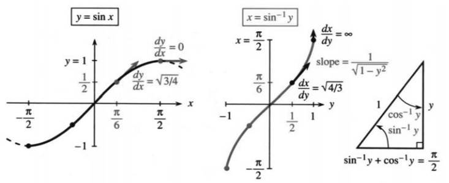

图4.9 $y=\sin x$与$x=\sin^{-1} y$；导数分别为$\cos x$和$1/\sqrt{1-y^2}$。

**反正弦**就是把$y$送回去，变回角$x$：

$$x=\sin^{-1} y\quad\Longleftrightarrow\quad
y=\sin x,\quad |x|\le\pi/2.\tag{1}$$

输入是$[-1,1]$里的一个数，输出是$[-\pi/2,\pi/2]$里正弦等于它的唯一角。历史上，$x$被称为$y$的“arc sine”，计算中使用arcsin。数学记号是$\sin^{-1}$，跟$1/\sin$毫无关系。

例如$\sin(\pi/6)=1/2$，所以$\sin^{-1}(1/2)=\pi/6$；$\sin^{-1}1=\pi/2$。两个方向各有一条复合关系：

$$\sin^{-1}(\sin x)=x\quad(-\pi/2\le x\le\pi/2),$$
$$\sin(\sin^{-1} y)=y\quad(-1\le y\le1).$$

**例1：重要。** 若$\sin x=y$，求$\cos x$的公式。

这里的关键是$\cos^2x=1-\sin^2x=1-y^2$。当正弦是$y$，余弦就是$1-y^2$的平方根：

$$\cos(\sin^{-1} y)=\sqrt{1-y^2}.\tag{2}$$

这个公式对求导至关重要，我们马上就用。


### 反正弦的导数

反函数求导有现成法则：对应点的斜率互为倒数。从$y=\sin x$出发：

$$\frac{dy}{dx}=\cos x,\qquad
\frac{dx}{dy}=\frac1{\cos x}=\frac1{\sqrt{1-y^2}},\quad |y|<1.\tag{3}$$

这一来，就多出一对极有价值的导数—原函数：

$$v(t)=\frac1{\sqrt{1-t^2}},\qquad f(t)=\sin^{-1} t,\qquad f'=v.$$

接下来，反正切和反正割还会各送来一对新函数；节末再汇总主要结果。

**例2** $\sin^{-1} y$在$y=1$处的斜率是无穷：$1/\sqrt{1-y^2}=1/0$。解释。

原正弦在$x=\pi/2$处切线水平，斜率为零；坐标一交换，切线就立成竖直。斜率$1/0$是链式法则的极端情形。

**问题** 那么$d(\sin^{-1} x)/dx$是多少？

**答** $1/\sqrt{1-x^2}$。我只是把字母换了一下。

### 反余弦及其导数

余弦也得挑一段区间，让每个$y\in[-1,1]$只对应一个角。取$0\le x\le\pi$：这段上余弦严格递减，于是有反函数$x=\cos^{-1} y$。因此

$$\cos^{-1}(\cos x)=x\quad(0\le x\le\pi),$$
$$\cos(\cos^{-1} y)=y\quad(-1\le y\le1).\tag{4}$$

$\cos0=1$与$\cos^{-1}1=0$说的是同一件事。

求导可以照搬反正弦，也有更快的路——两个反函数之间有个特殊关系。这些角总是相加等于一个直角：

$$\cos^{-1} y+\sin^{-1} y=\frac\pi2.\tag{5}$$

图4.9c显示这些角，图4.10c显示图像。两角之和是常数，它的导数为零，所以两条导数相加也为零：

$$\frac d{dy}\cos^{-1} y=-\frac1{\sqrt{1-y^2}},\qquad |y|<1.\tag{6}$$

**问题** 为什么$\sin^{-1} y$与$-\cos^{-1} y$可以有相同的导数？

**答** 它们只差一个常数；式(5)告诉我，这个常数是$\pi/2$。


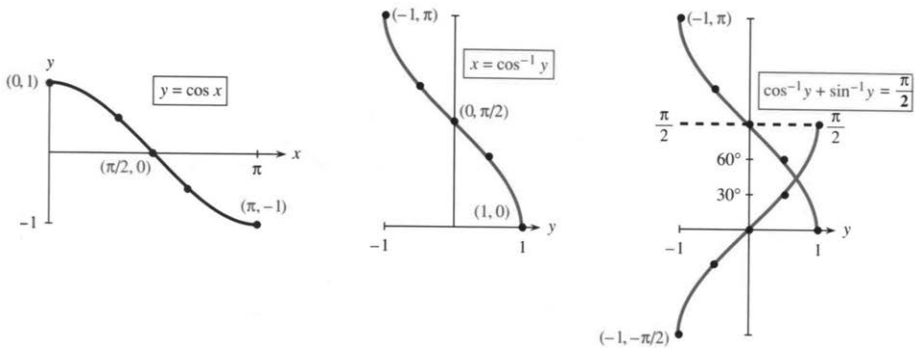

图4.10 余弦被限制在$[0,\pi]$上；反余弦与反正弦相加，和恒为$\pi/2$。

### 反正切及其导数

正切是正弦除以余弦；但反正切**不是**反正弦除以反余弦。反正切要找的，是“正切等于输入值”的角。正切在$(-\pi/2,\pi/2)$上严格递增，能取到全体实数，所以$\tan^{-1}$的定义域是$\mathbb R$，值域就是这个开区间。端点不取，因为正切在$\pm\pi/2$处没有定义。

从$dy/dx=\sec^2x$和$1+\tan^2x=\sec^2x$出发：

$$\frac{dx}{dy}=\frac1{\sec^2x}
=\frac1{1+\tan^2x}=\frac1{1+y^2}.\tag{7}$$

> **4E**
> $$\frac d{dy}\tan^{-1} y=\frac1{1+y^2},\qquad y\in\mathbb R.\tag{8}$$

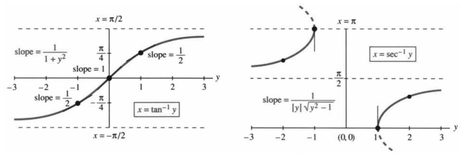

图4.11 反正切的导数为$1/(1+y^2)$；反正割导数为$1/(|y|\sqrt{y^2-1})$。

**例3** $\tan(\pi/4)=1$。核对斜率：反函数在$y=1$处斜率是$1/2$；原正切在$x=\pi/4$处斜率是$\sec^2(\pi/4)=2$。两者相乘得1。


**重要。** 很快就要反过来问：哪个函数的导数是$1/(1+x^2)$？答案就藏在式(8)里——把字母一换，正是$\tan^{-1} x$。这也是读本节的一个重要目的。

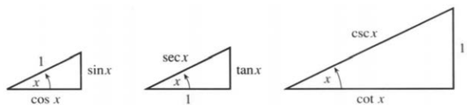

图4.12 $\cos^2x+\sin^2x=1$，$1+\tan^2x=\sec^2x$，$1+\cot^2x=\csc^2x$。

### 反余切、反正割、反余割

这张讨厌的单子，我们无论如何得补完！不过也可以不费力。办法还是对原导数取倒数。对$y=\cot x,\sec x,\csc x$分别有

$$\frac{dx}{dy}=-\frac1{\csc^2x},\qquad
\frac{dx}{dy}=\frac1{\sec x\tan x},\qquad
\frac{dx}{dy}=-\frac1{\csc x\cot x}.\tag{9}$$

在中间一式中，把$\sec x$换成$y$，$\tan x$换成$\pm\sqrt{y^2-1}$。选择能给出正斜率的符号（比较图4.11），就得到式(10)中间的一式：

$$\frac d{dy}\cot^{-1}y=-\frac1{1+y^2},$$
$$\frac d{dy}\sec^{-1}y=\frac1{|y|\sqrt{y^2-1}},$$
$$\frac d{dy}\csc^{-1}y=-\frac1{|y|\sqrt{y^2-1}}.\tag{10}$$


**反正割的分支说明。** 输入为负时，我们取第二象限的角，使$\sec^{-1}y=\cos^{-1}(1/y)$。这样也使它成为递增函数，而反余弦是递减函数。所以导数里需要绝对值$|y|$。有些数学表作不同的选择：角$x$可以在第三象限（$-\pi$与$-\pi/2$之间），这样斜率就不带绝对值。

六种函数，其实只需记住三种基本导数；另外三种不过是添个负号。按本节的分支，反正弦与反余弦、反正切与反余切、反正割与反余割，每对之和都是$\pi/2$。

| 函数$f(y)$ | 输入$y$ | 输出$x$ | 斜率$dx/dy$ |
|---|---|---|---|
| $\sin^{-1} y,\cos^{-1} y$ | $|y|\le1$ | $[-\pi/2,\pi/2], [0,\pi]$ | $\pm1/\sqrt{1-y^2}$ |
| $\tan^{-1} y,\cot^{-1}y$ | 所有$y$ | $(-\pi/2,\pi/2), (0,\pi)$ | $\pm1/(1+y^2)$ |
| $\sec^{-1}y,\csc^{-1}y$ | $|y|\ge1$ | $[0,\pi]^*, [-\pi/2,\pi/2]^*$ | $\pm1/(|y|\sqrt{y^2-1})$ |


正弦、余弦的值满足$|y|\le1$；正割、余割却反过来，必须$|y|\ge1$。所以反正割没有$-1<y<1$的输入，也永远不输出$\pi/2$：那个角的余弦是零，正割无从定义。反余割同理，永远不输出0。表里的星号，就是用来去掉这些点的。

微积分里真正用得上的，是表中导数那一栏。

### 4.4 习题

#### 通读填空

$x-\sin^{-1} y$说的是：**a____** 是 **b____** 的正弦，即$x$是正弦等于 **c____** 的角。$y$在 **d____** 与 **e____** 之间，$x$在 **f____** 与 **g____** 之间。$\sin^{-1} y$的余弦为$\sqrt{\text{h____}}$，导数$dx/dy=$ **i____**。

$x=\cos^{-1} y$表示$y=$ **j____**。$y$在 **k____** 与 **l____** 之间，$x$在 **m____** 与 **n____** 之间。$\sin^{-1} y+\cos^{-1} y=$ **o____**；正输入对应的两个锐角互为 **p____**，相加是一个 **q____** 角。反余弦的导数为 **r____**，比反正弦多一个 **s____** 号。

$x=\tan^{-1} y$表示$y=$ **t____**。输入从 **u____** 一直延伸到 **v____**，输出落在 **w____** 与 **x____** 之间，端点不取。导数为 **y____**。因$\tan^{-1} y+\cot^{-1}y=$ **z____**，反余切的导数多一个 **A____** 号。

$x=\sec^{-1}y$表示 **B____**。输入不在 **C____** 与 **D____** 之间，输出落在 **E____** 与 **F____** 之间，但不等于 **G____**。它的导数为 **H____**。

**第1–4题：分别求$\sin^{-1} y,\cos^{-1} y,\tan^{-1} y$，用弧度表示。**

1. $y=0$。
2. $y=-1$。
3. $y=1$。
4. $y=\sqrt3$。
5. 已知$\sin\pi=0$，为什么$\pi\ne\sin^{-1}0$？
6. 已知$\sin x=y$，还须对$x$作什么限制，才能写$x=\sin^{-1} y$？
7. 画$x=\sin^{-1} y$，找出$dx/dy=2$的点。
8. 对$x=\sin^{-1}(y/2)$求$dx/dy$并画图。
9. 若$y=\cos x$，求$\sin x$的公式。先画角为$x$、邻边为$y$的直角三角形——另两边是什么？
10. 若$y=\sin x$，求$\tan x$的公式。先画角为$x$、对边为$y$的直角三角形——另两边是什么？
11. 对$\sin^{-1}(\sin x)=x$用链式法则求$x$导数。核对$d(\sin^{-1} y)/dy=-1/\sqrt{1-y^2}$给出正确结果。
12. 对$\cos(\cos^{-1} y)=y$求导，验证$(\cos^{-1} y)'=-1/\sqrt{1-y^2}$。
13. 在$y=0$和1处，分别求$x=\sin^{-1} y,\cos^{-1} y,\tan^{-1} y$的$dx/dy$。
14. 分别在输出角$x=0$和1处，求上述三条反函数曲线的$dx/dy$。
15. 判断正误，并说明理由：(a) $(\sin^{-1} y)^2+(\cos^{-1} y)^2=1$；(b) $\sin^{-1} y=\cos^{-1} y$无解；(c) 反正弦递增；(d) 反正弦为奇函数；(e) $\sin^{-1} y$与$-\cos^{-1} y$导数相同，所以两函数相同；(f) $\sin(\cos x)=\cos(\sin x)$。
16. 画边为$\sin x,\cos x,1$的三角形，求$\tan(\cos^{-1}(\sin x))$。

**第17–28题：按给定字母求导。**

17. $u=\sin^{-1} x$。
18. $u=\tan^{-1}2x$。
19. $z=\sin^{-1}(\sin3x)$。
20. $z=\sin^{-1}(\cos x)$。
21. $z=(\sin^{-1} x)^2$。
22. $z=(\sin^{-1} x)^{-1}$。
23. $z=\sqrt{1-y^2}\sin^{-1} y$。
24. $z=(1+x^2)\tan^{-1} x$。
25. $x=\sec^{-1}(y+1)$。
26. $u=\sec^{-1}(\sec(x^2))$。
27. $u=\sin^{-1} y\,/\,\cos^{-1}\sqrt{1-y^2}$。
28. $u=\sin^{-1} y+\cos^{-1} y+\tan^{-1} y$。
29. 画直角三角形说明$\tan^{-1} y+\cot^{-1}y=\pi/2$。
30. 画直角三角形说明$\tan^{-1} y=\cot^{-1}(1/y)$。
31. 若$x=\tan^{-1} y$，用$y$表示$\sec x$。
32. 画$y=\cot x$的图像及其反函数。
33. 求$x=\tan^{-1} y$的$dx/dy$：(a) $y=-3$；(b) $x=0$；(c) $x=-\pi/4$。


34. 找一个$u(t)$，使$u'+t^2u'=1$。
35. 求$x=\sin^{-1} y$的二阶导数$d^2x/dy^2$。
36. 求$u=\tan^{-1} y$的二阶导数。

**第37–44题：求导。**

37. $y=\sec(x/2)$。
38. $x=\sec^{-1}(2y)$。
39. $u=\sec^{-1}(x^n)$。
40. $u=\sec^{-1}(\tan x)$。
41. $\tan y=(x-1)/(x+1)$。
42. $z=(\sin x)(\sin^{-1} x)$。
43. $y=\sec^{-1}\sqrt{x^2+1}$。
44. $z=\sin(\cos^{-1} x)-\cos(\sin^{-1} x)$。
45. 对$\cos^{-1}(1/y)$求导，用另一种方法得到反正割的导数。
46. $x=\csc^{-1}y$的定义域和值域分别为____。
47. 找$u(y)$，使$du/dy=4/\sqrt{1-y^2}$。
48. 解$du/dx=1/(1+4x^2)$。
49. 若$du/dx=2/\sqrt{1-x^2}$，求$u(1)-u(0)$。
50. **推荐。** 令$u(x)=(x-1)/(x+1)$，求$\tan^{-1} u(x)$的导数。它也是____的导数，所以两函数相差一个____。
51. 求$x=0$时的$u(x),\tan^{-1} u(x),\tan^{-1} x$，以及$x\to+\infty$时各自的极限。结合第50题，求$\tan^{-1} u(x)-\tan^{-1} x$的常数值。
52. 求$x\to-\infty$时上述三量的极限，进而求差值。$u$及$\tan^{-1} u$在哪一点发生间断？

# 第5章 积分

## 5.1 积分的思想


这一章讲积分的思想，也讲积分怎么算。先说原理上怎样做，再说实际中怎样算。说白了，积分就是把无穷多个无穷小的量加在一起。不过，这种加法并不值得推荐：微积分的全部意义，就在于给出更好的办法。

积分问题要求出一个和式的极限。关键一步是反着走：从差的极限——也就是导数——往回推。如果 $v(x)$ 恰好是另一个函数 $f(x)$ 的导数，我们就能借 $f$ 来积分。例如，$v=\cos x$ 的积分是 $f=\sin x$；$v=x$ 的积分是 $f=\tfrac12x^2$。这个 $f(x)$，就是所谓的“原函数”。这样的函数会越积越多，第5.4节尤其关键。本书封面内页就选列了一部分。万一找不到合适的 $f(x)$，数值积分照样能给出很好的答案。

我大可以直接抛出积分公式，让你去算各种奇妙曲线下的面积。（面积最能说清“把无穷多个无限薄的矩形累加起来”是怎么回事，所以总打头阵。可它当然不是积分学唯一能解决的问题。）然而，我实在不愿只写下一堆公式，把背后的思想全跳过去。牛顿和莱布尼茨的直觉好得惊人，我们完全没理由不分沾一份。

他们从简单处开始。我们也一样。

### 和与差

只需简短地谈谈和与差，就能说清积分和导数的大部分道理。先不管函数，只看 $n$ 个普通的数。关键思想不过是一条基本的代数事实；当 $n\to\infty$ 时取极限，它就成了微积分的基本事实。**“取极限”这一步，正是代数与微积分的根本区别。**要把无穷多个无穷小量加起来，这一步非迈不可；不过眼下，我们先停在极限的这一边。

为此，得准备两组各含 $n$ 个数的数列。第一组记为 $v_1,v_2,\ldots,v_n$，字母 $v$ 让人想到速度；第二组记为 $f_1,f_2,\ldots,f_n$，字母 $f$ 沿用前面表示路程的记号。你也许觉得用 $d$ 表示距离更顺理成章，可微积分里的 $dx$、$dy$ 已经占用了这个字母。


先从 $n=4$ 看起：

$$
(v_1,v_2,v_3,v_4)=(1,2,3,4),\qquad
(f_1,f_2,f_3,f_4)=(1,3,6,10).
$$

这一例子里，两组数的关系已经露出来了。给你 $1,3,6,10$，怎么变出 $1,2,3,4$？**作差。**$10$ 与 $6$ 相差 $4$，$6-3=3$，$f_2-f_1=3-1=v_2=2$。每个 $v$ 都是相邻两个 $f$ 之差：

$$v_j=f_j-f_{j-1}.$$

这是导数的离散版本。我承认，$j=1$ 处有个小麻烦：还没有 $f_0$。第一个 $v$ 理应是 $f_1-f_0$，那就顺理成章地约定 $f_0=0$。这个“总得有个起点”的需要，在微积分里还会回过头来纠缠我们——它既可能添乱，也可能帮忙。

再把这两组数看一遍，这回从 $v$ 出发。由 $v=1,2,3,4$ 怎样得到 $f=1,3,6,10$？**求和。**前两个 $v$ 加起来是 $3=f_2$；前三个加起来是 $6=f_3$；四个全加是 $1+2+3+4=10$。**求和与作差互为逆运算。**

这个来自代数的想法，正是微积分的关键。和 $f_j$ 牵扯全部这些数：$v_1+v_2+\cdots+v_j$；而差 $v_j$ 只牵扯 $f_j-f_{j-1}$ 两项。二者这种互相抵消，就是“基本定理”的核心。微积分把和变成积分，把差变成导数——何不现在就把这个关键想法亮出来？

> **5A 微积分基本定理（取极限之前）**
>
> 若对每个 $j$ 都有 $v_j=f_j-f_{j-1}$，则
> $$v_1+v_2+\cdots+v_n=f_n-f_0.$$

把 $f$ 的这些差加起来，就只剩 $f_n-f_0$。中间那些项统统消掉，只剩下末项 $f_n$ 和起始项取负的 $-f_0$。这样的和，叫作“伸缩和”：

$$
v_1+v_2+v_3+\cdots+v_n
=(f_1-f_0)+(f_2-f_1)+(f_3-f_2)+\cdots+(f_n-f_{n-1}).
$$

$f_1$ 和 $-f_1$ 相消，$-f_2$ 和 $f_2$ 相消，$-f_3$ 和 $f_3$ 相消，依此类推，最后只剩 $f_n$ 与 $-f_0$。如果 $f_0=0$，总和就是末项 $f_n$。

代数部分到此为止。**找到 $f$，$v$ 的和就到手了。**

**问题** 这些奇数 $1+3+5+\cdots+99$ 加起来是多少——也就是这些 $v$ 的和？

**回答** 它们正是 $0,1,4,9,\ldots$ 的相邻差，而这些 $f$ 都是平方数。按上面的基本定理，前50个奇数之和就是 $50^2$。

难就难在找出合适的那些 $f$——它们的差必须恰好凑出这些 $v$。到了微积分里，难处变成找出合适的 $f(x)$——它的导数必须恰好给出 $v(x)$。令人惊叹的是，这样的 $f$ 往往真能找到，而且求积分时比求有限和时还更容易。

下一步，就看积分怎样成为一个和式的极限。

### 和式趋于积分

设想你办了家公司，生意红火，收入率一路往上涨。到了第 $x$ 年，收入是每年 $\sqrt{x}$ 百万美元。第1、2、3、4年末，收入率分别达到每年 $1,\sqrt2,\sqrt3,\sqrt4$ 百万美元。图5.1a把这些数画成柱状图，好让投资者看个明白。我知道大多数初创公司都在亏钱，可你的公司是例外。这个例子要是好得不像真的——那就请接着往下读。


图5.1：总收入＝矩形总面积＝6.15。图中字样：Income per year＝年收入率，Total income＝累计收入，Year＝年。

图中四个矩形的高依次是 $\sqrt1,\sqrt2,\sqrt3,\sqrt4$。每个矩形的底都是1年，所以面积的数值就等于高度的数值。这时来了一位投资者——算术也许不太灵光——他问了个简单问题：**这四年一共收入多少？**有两种答法，我下面都讲。

第一种答法是 $\sqrt1+\sqrt2+\sqrt3+\sqrt4$。加起来约6.15百万美元。图5.1b把这一总量画了出来，到第4年末正好达到这个数。这和速度与路程的关系一模一样，只不过现在 $v$ 是年收入率，$f$ 是累计收入。代数上，还是 $f_j=v_1+\cdots+v_j$。

第二种答法来自几何：总收入就是各矩形面积之和。这里强调的是**求和与面积之间的对应关系**。这一点看着也许显然，可等第二位投资者——比第一位更精明——问出一个更难的问题，它就要紧了。

问题就出在这儿：**这些收入数字是假的。**公司第一年并没有赚到100万美元。过了三个月，$x=1/4$，收入率才只有 $\sqrt{x}=1/2$。柱状图却把整年的收入率都画成 $\sqrt1=1$，那是往高里说了。前三个月的收入不超过 $\tfrac12\times\tfrac14$ 百万美元，也就是收入率乘时间。

其余各季度、各年也都估高了。图5.2a把4年分成16个季度，更贴近实际，给出一个新的总收入估计。

求总量仍然有两条路。一是把 $\sqrt{1/4}+\sqrt{2/4}+\cdots+\sqrt{16/4}$ 加起来，但别忘了再乘以 $1/4$，因为每个收入率只管 $1/4$ 年。二是算16个矩形的面积之和。面积这条路更好，因为 $1/4$ 会自动带上：每个矩形的底都是 $1/4$，这个因子自然进了每一项面积。总面积现在是约5.56百万美元，离真实值又近了一步。

接下来会发生什么，你大概已经猜到了。下一步，把时间按周切。第一周结束时，收入率 $\sqrt{x}$ 只有 $\sqrt{1/52}$。这就是第一个矩形的高，底是 $\Delta x=1/52$；每周都有一个矩形。接着，一位勤快的投资者把时间按天切，每个矩形的底成了 $\Delta x=1/365$。这时一共有 $4\times365=1460$ 个矩形；若计入闰日，则是1461天。按天算出来的总面积，已经低于550万美元。


图5.2：收入等于面积之和，不是高度之和：

$$\frac14\left(\sqrt{\frac14}+\sqrt{\frac24}+\cdots+\sqrt{\frac{16}4}\right).$$

图中字样：Rate of income＝收入率；Total income＝累计收入；sum of heights＝高度之和；Year＝年。

上千个平方根，每个都得乘上底边的 $\Delta x$，再全加起来——这计算虽说初等，可真够折磨人的。一定有更好的办法。

这个更好的办法——事实上也是最好的办法——就是微积分。全部想法，是让量**连续变化**：几何问题，就是求平方根曲线下的面积。这个问题，单靠有限次的算术求和答不了，因为它牵涉极限。各矩形的底是 $\Delta x$，高依次为 $\sqrt{\Delta x},\sqrt{\Delta2x},\ldots,\sqrt4$。矩形一共 $4/\Delta x$ 个：矩形越窄，项数越多。**面积，就是 $\Delta x\to0$ 时这些和式的极限。**

这个极限面积，就叫“积分”。我们要找的那个数小于 $5\tfrac12$。

**代数（$n$ 个矩形的面积）**：找出 $f$，算出 $v_1+\cdots+v_n$。

关键思想：若 $v_j=f_j-f_{j-1}$，则总和为 $f_n-f_0$。

**微积分（曲线下的面积）**：计算 $\Delta x\,[v(\Delta x)+v(2\Delta x)+\cdots]$ 的极限。

关键思想：若 $v(x)=df/dx$，就可用 $f$ 计算面积，即积分；下一节继续说明。

### 5.1 习题

#### 阅读填空

求和问题，就是算出 $v_1+\cdots+v_n$。若能找到一些 $f$，使 $v_j=\underline{\text{a}}$，问题便得到解决。这时 $v_1+\cdots+v_n=\underline{\text{b}}$。在 $(f_1-f_0)+(f_2-f_1)+\cdots+(f_n-f_{n-1})$ 中消去相反项，最后只剩 $\underline{\text{c}}$。求和是作差的 $\underline{\text{d}}$ 运算。

$0,1,4,9$ 的相邻差为 $v_1,v_2,v_3=\underline{\text{e}}$。若 $f_j=j^2$，则 $f_{10}$ 与 $f_9$ 的差是 $v_{10}=\underline{\text{f}}$。按照这个规律，$1+3+5+\cdots+19=\underline{\text{g}}$。

对函数而言，求积分是 $\underline{\text{h}}$ 的逆运算。如果 $f(x)$ 的导数是 $v(x)$，那么 $v(x)$ 的 $\underline{\text{i}}$ 就是 $f(x)$。若 $v(x)=10x$，则可取 $f(x)=\underline{\text{j}}$。这也是一个底为 $x$、高为 $10x$ 的三角形的 $\underline{\text{k}}$。

积分从求和开始。在 $0\le x\le4$ 上，直线 $v=10x$ 下方的三角形面积为 $\underline{\text{l}}$。用高分别为 $10,20,30,40$ 的四个矩形近似，其总面积为 $\underline{\text{m}}$。若改用八个矩形，其高为 $\underline{\text{n}}$，总面积为 $\underline{\text{o}}$，近似效果更好。用 $n$ 个等宽矩形覆盖这一三角形时，总面积为 $\underline{\text{p}}$ 的和。


当 $n\to\infty$ 时，这个和应趋于数 $\underline{\text{q}}$。这就是 $v=10x$ 从0到4的积分。

#### 练习

第1—6题讨论和 $f_j$ 与差 $v_j$。

1. 若 $v=1,2,4,8$，则 $v_j$ 的公式是 ______（不是 $2^j$）。从 $f_0=0$ 出发，求 $f_1,f_2,f_3,f_4$，再求 $f_7$。
2. 同样的数列 $v=1,2,4,8,\ldots$ 也是 $f=1,2,4,8,16,\ldots$ 的相邻差。此时 $f_0=1$，$f_j=2^j$。（a）检验 $2^5-2^4=v_5$。（b）$1+2+4+8+16$ 等于多少？
3. 数列 $f=1,1/2,1/4,1/8$ 的相邻差为 $v=-1/2,-1/4,-1/8$。这些负的 $v$ 相加，不会得到那些正的 $f$。验证关系 $v_1+v_2+v_3+v_4=f_4-f_0$ 仍然成立。
4. 可以给原函数 $f(x)$ 加上任意常数 $C$，因为常数的 ______ 为零。也可以给 $f_0,f_1,\ldots$ 同时加上任意常数 $C$，因为相邻 $f$ 之间的 ______ 不变。
5. 证明 $f_j=r^j/(r-1)$ 满足 $f_j-f_{j-1}=r^{j-1}$。因此，等比和 $1+r+\cdots+r^{j-1}$ 等于 ______；别忘记减去 $f_0$。
6. 和 $f_j=(r^j-1)/(r-1)$ 也满足 $f_j-f_{j-1}=r^{j-1}$。此时 $f_0=$ ______，所以 $1+r+\cdots+r^{j-1}=f_j$。和 $1+r+\cdots+r^n$ 等于 ______。
7. 设 $x<1$ 时 $v(x)=3$，$x>1$ 时 $v(x)=7$。求从0到 $x$、位于 $v(x)$ 图像下方的面积 $f(x)$，分两段讨论。
8. 若 $v=1,-2,3,-4,\ldots$，从 $f_0=0$ 开始写出相应的 $f$。分别在 $j$ 为奇数和偶数时，给出 $v_j$ 与 $f_j$ 的公式。

第9—16题讨论收入率为每年 $\sqrt{x}$ 的公司。

9. 按周划分时间时，共有 $4\times52=208$ 个矩形。写出第1个、第208个和第 $j$ 个矩形的面积。
10. 怎样知道208周的面积和小于16个季度的面积和？
11. 一位悲观的投资者会用每段时间**起点**处的 $\sqrt{x}$ 作为该段的收入率。用高 $\sqrt0,\sqrt1,\sqrt2,\sqrt3$ 重画图5.1的两部分。总收入的估计比原来减少多少？
12. 同一位悲观的投资者会用高 $0,\sqrt{1/4},\ldots$ 重画图5.2。最后一个矩形有多高？总矩形面积由约5.56减少了多少？
13. 从按年划分到按周、按日、按小时划分，悲观估计的面积逐渐 ______，乐观估计的面积逐渐 ______。二者之差等于最后一个 ______ 的面积。
14. 随着时间分割细化为周、日、小时、秒，乐观估计和悲观估计趋于同一个极限。在矩形之间画出 $\sqrt{x}$ 曲线，说明悲观估计总是偏低，乐观估计总是偏高。
15. **重要。**设 $f(x)$ 是区间 $[0,x]$ 上平方根曲线下的面积。到 $x+\Delta x$ 为止的面积为 $f(x+\Delta x)$，新增面积 $\Delta f=$ ______。它近似于底为 ______、高为 $\sqrt{x}$ 的矩形，所以 $\Delta f/\Delta x$ 接近 ______。当 $\Delta x\to0$ 时，我们猜想 $df/dx=$ ______。
16. 画出 $x=0$ 到4之间的 $\sqrt{x}$ 曲线，在曲线下画三角形，证明其下方面积大于5。提示：从 $\sqrt1=1$ 对应的点分别向左、向右看。

第17—22题讨论支出率 $v(x)=6-x$ 不断下降的公司。

17. 在 $x=$ ______ 时，支出率降到零。在此之前的累计支出等于 ______，这是 ______ 的面积。
18. 高分别为 $6,5,4,3,2,1$ 的矩形给出的总支出估计为 ______。画出这些覆盖三角形的矩形，说明为什么结果偏高。
19. 要使覆盖三角形的矩形面积和与三角形的准确面积相差不超过1，需要多少个矩形？
20. 会计师采用每段2年的划分，并用各段中点，也就是奇数年份处的 $v=5,3,1$ 计算。她得到的估计是多少？准确程度如何？为什么？
21. 在区间 $[2,x]$ 上，直线 $v(x)=6-x$ 下方的面积 $f(x)$ 是多少？这个 $f(x)$ 的导数是多少？
22. 在区间 $[x,6]$ 上，直线 $v(x)=6-x$ 下方的面积 $f(x)$ 是多少？这个 $f(x)$ 的导数是多少？
23. 取 $\Delta x=1/3$，求包住 $v(x)=x^2$ 图像的三个矩形的总面积。
24. 在 $0\le x\le1$ 上画出 $v=\sqrt{x}$ 与 $v=x^2$ 的图像。哪两个面积相加等于1？同样的关系也适用于 $v=x^3$ 和 $v=$ ______。
25. 在 $x$ 到 $x+\Delta x$ 之间，$v=x^2$ 曲线下的面积增量为 $\Delta f$。它近似于底为 $\Delta x$、高为 ______ 的矩形，因此 $\Delta f/\Delta x$ 接近 ______。取极限得到 $df/dx=x^2$，进而 $f(x)=$ ______。
26. 计算从 $x=0$ 到 $x=4$ 时，用208个矩形估算 $v(x)=\sqrt{x}$ 曲线下面积所得的面积和。

## 5.2 原函数


积分号 $\int$ 是莱布尼茨造出来的。它是一个被拉长的 S，取自拉丁语里表示“和”的那个词。这个符号一眼点出了整个构造的脉络：**和式趋于积分，S变成 $\int$，矩形面积和趋于曲边区域的面积**：

$$\text{曲边区域的面积}=\int v(x)\,dx=\int\sqrt{x}\,dx.\tag{1}$$

底为 $\Delta x$ 的矩形，一路把我们引到这个极限，也就是 $\sqrt{x}$ 的积分。“$dx$”在说：$\Delta x$ 正趋于零。矩形的高 $v_j$ 取的是曲线的高度 $v(x)$。把各项 $v_j\Delta x$ 加起来，就趋于“$v(x)$ 对 $x$ 的积分”。直观上，你可以想象每一点上方都立着一个无限薄的矩形，而不是只在几个指定点上方摆普通矩形。

现在来求平方根曲线下的面积。“积分限”取 0 和 4。下限是面积起步处 $x=0$；起点其实也可以换成任意一点 $x=a$。上限取 $x=4$，因为只算前 4 年；终点也可以换成任意一点 $x=b$。矩形面积之和，是底 $\Delta x$ 乘上各个高 $\sqrt{x}$ 再相加。曲边区域的面积就是这个和式的极限，即 **$\sqrt{x}$ 从 0 到 4 的积分**：

$$
\lim_{\Delta x\to0}
\left[\sqrt{\Delta x}\,\Delta x+\sqrt{2\Delta x}\,\Delta x+\cdots+\sqrt4\,\Delta x\right]
=\int_0^4\sqrt{x}\,dx.\tag{2}
$$

积分学的核心问题还悬着：这个极限面积究竟是多少？答案的符号我们有了——$\int$、$\sqrt{x}$、$dx$ 都在里面——可数值还没有。

### 原函数

我很想知道，最早是谁算出 $\sqrt{x}$ 图像下的面积。也许是牛顿。这个结果更早就有了，可关键思想由牛顿和莱布尼茨共同抓住：和与积分对应，差与导数对应。顺着这个类比，答案我可以给出来。不过证明我还给不出，得等一等——那就是微积分基本定理。

代数里，差 $f_j-f_{j-1}$ 就是 $v_j$；把这些 $v$ 加起来，得到 $f_n-f_0$。微积分里，$f(x)$ 的导数是 $v(x)$；做积分时，$v(x)$ 曲线从 0 到 $x$ 下方的面积，就是 $f(x)-f(0)$。我们的问题，是要算到 $x=4$ 为止：

> **5B 离散与连续、矩形与曲边区域、求和与积分的对应**
>
> $v(x)$ 的定积分等于 $f(x)$ 的增量：
> $$\text{若 }\frac{df}{dx}=\sqrt{x},\qquad
> \text{则面积}=\int_0^4\sqrt{x}\,dx=f(4)-f(0).\tag{3}$$

那么 $f(x)$ 是什么？这里要的不是 $\sqrt{x}$ 的导数，而是它的“原函数”：找一个 $f(x)$，让它的导数等于 $\sqrt{x}$。这和第2—4章反着来，需要**逆向推求**。$x^n$ 的导数是 $nx^{n-1}$，现在要反过来找。现成的公式是 $f(x)=x^{n+1}/(n+1)$，可我们得弄明白它怎么来的。

**求解** 求导把指数压低，求原函数就把指数抬高。于是从 $x^{1/2}$ 走到 $x^{3/2}$。可后者的导数是 $(3/2)x^{1/2}$，多出一个不想要的因子 $3/2$。要消掉它，就在原函数前乘上 $2/3$：


$$f(x)=\frac23x^{3/2},\qquad f'(x)=x^{1/2}=\sqrt{x}.$$


图5.3：$v(x)=\sqrt{x}$ 从 0 到 4 的积分，就是曲线下的准确面积 $16/3$。Rate of income＝收入率；Total income＝累计收入；red area＝着色面积；Year＝年。

积分的关键就在这里：从导数倒着找原函数，再把系数调好。现在，准确面积终于能给出一个数了。$x=4$ 处，$x^{3/2}=8$；乘 $2/3$ 得 $16/3$，再减去 $f(0)=0$：

$$\int_0^4\sqrt{x}\,dx
=\frac23\,4^{3/2}-\frac23\,0^{3/2}
=\frac23\cdot8=\frac{16}3.\tag{4}$$

**4年的总收入是 $16/3=5\tfrac13$ 百万美元。**这正是 $f(4)-f(0)$。前面那上千个矩形加起来，正慢慢逼近这个准确值 $5\tfrac13$。

**其他面积** 第一年，也就是到 $x=1$ 为止，收入是 $\tfrac23\,1^{3/2}=\tfrac23$ 百万美元；原先按 100 万美元估算，偏高了。算满 $x$ 年，累计收入就是 $\tfrac23x^{3/2}$，也正是这里选定的原函数 $f(x)$。平方根曲线把它所在的那个外接矩形占去 $2/3$。矩形的宽到 $x$、高到 $\sqrt{x}$，面积是 $x^{3/2}$；其中 $2/3$ 在曲线下方，$1/3$ 在曲线上方。

**其他原函数** $x^5$ 的导数是 $5x^4$，所以 $x^4$ 的一个原函数是 $x^5/5$。除以5，或者一般地除以 $n+1$，是为了抵消求导时冒出来的因子5或 $n+1$。注意 $n+1=0$ 是不允许的：

$$v(x)=x^n\quad\text{的一个原函数为}\quad f(x)=\frac{x^{n+1}}{n+1}\qquad(n\ne-1).$$

**例1** $x^2$ 的一个原函数是 $\tfrac13x^3$。它就是抛物线 $v(x)=x^2$ 从0到 $x$ 下方的面积。到 $x=1$ 为止，面积是 $\tfrac13\,1^3-\tfrac13\,0^3=1/3$。

**关于 $\sqrt{x}$ 与 $x^2$** 平方根带来的 $2/3$，加上平方函数带来的 $1/3$，刚好凑成1。它们也正是图5.3左下方那个单位正方形里，平方根曲线下方和上方的两块面积。将曲线转过$90^\circ$，它就成为抛物线。函数$y=\sqrt{x}$与$x=y^2$互为反函数！这两个反函数在单位区间上的曲线下面积相加，合起来正好是一个面积为1的正方形。


### 直线下的面积

三角形的面积你早就会算。图5.4那块区域在直线 $v=x$ 下方，底为4，高为4，面积是 $\tfrac12\cdot4\cdot4=8$，根本用不着积分！不过，若让微积分把这个答案再算一遍——把面积函数 $f(x)=\tfrac12x^2$ 当作许多矩形面积和的极限，一点点搭起来——那就迈出了重要的一步。


图5.4：三角形面积8是矩形面积和 $10,9,8\tfrac12,\ldots$ 的极限。Total area＝总面积；Exact area＝准确面积；Area under＝曲线下的面积。

四个矩形的面积加起来是 $1+2+3+4=10$。它们把整个三角形罩在里面，所以比8大。10是三角形面积8的第一次近似；想改进它，就得再加矩形。

下一批矩形更细，宽由 $\Delta x=1$ 缩到 $\Delta x=1/2$，个数由4个变成8个。它们还是探到直线上方，结果自然仍偏大。新的高依次是 $1/2,1,3/2,2,5/2,3,7/2,4$。图5.4b的总面积，就是底 $1/2$ 乘上这些高的和：

$$\text{面积}=\frac12\left(\frac12+1+\frac32+2+\cdots+4\right)=9,$$

这比10更靠近8。

**问题** 16个矩形呢？总面积是多少？它们的高是 $1/4,1/2,\ldots,4$。

**回答** 底取 $\Delta x=1/4$，面积就是 $\tfrac14(\tfrac14+\tfrac12+\cdots+4)=8\tfrac12$。

一项项加起来，活儿越来越重。求和公式是需要的，不久就会推出来；下一次的答案会是 $8\tfrac14$。但比公式更要紧的是那个想法：**我们正在一步一步地走极限过程。**$\Delta x$ 一变小，矩形面积和就朝三角形面积靠拢。同样的极限过程，也适用于形状复杂得多的区域。所以，值得停下来把要点说清楚。

**曲线下的面积**

对这些越来越细的矩形，要提什么要求？不必等宽，也不必把三角形整个盖住；矩形可以全部落在曲线下方。宽度各不相同也罢，矩形内接于三角形或者横跨曲线也罢，极限结果仍是8。我们只提两条：

1. 最大宽度 $\Delta x_{\max}$ 趋于零。
2. 每个矩形的上边，在它对应的那个小区间里，与曲线相接或相交。


如果这些矩形面积和存在极限，就把它定义为图像下方的面积。对这条直线，极限确实存在，等于8。极限不取决于宽度和高度怎么选；这正是我们坚持的要求。

第5.5节要处理任意连续函数 $v(x)$。问题仍是：极限存在吗？回答仍是：存在。这个极限就是 $v(x)$ 的积分，也就是曲线下的面积。它就是$f(x)$。

**例2** 从0到 $x$ 的三角形面积是 $\tfrac12\times\text{底}\times\text{高}=\tfrac12x\cdot x$，即 $f(x)=\tfrac12x^2$，导数为 $v(x)=x$。不过请注意，$\tfrac12x^2+1$ 的导数也一样；对任意常数 $C$，$f=\tfrac12x^2+C$ 同样如此。$f(x)$ 里藏着一个“积分常数”，一求导得到 $v(x)$，它就被消掉了。

**例3** 设速度随 $x$ 增大而减小：$v(x)=4-x$。在 $x=1,2,3,4$ 处取函数值造矩形，矩形就落在图像下方。因为 $v$ 递减，每个区间右端点的值，就是这一段上的最小值。于是矩形总面积 $3+2+1+0=6$，小于准确面积8。矩形整个内接在三角形里。改用8个底为 $1/2$ 的矩形，结果更接近准确值：

$$\text{矩形面积和}=\frac12\left(3\frac12+3+\cdots+\frac12+0\right)=7.$$

16个矩形的面积和是 $7\tfrac12$。再说一遍：矩形不必等宽，只是等宽会让这些计算方便些。

算到任意一点，比如 $x=3$ 或 $x=1$，面积是多少？继续塞矩形也行，但基本定理给了一条更快的路。取 $4-x$ 的任意一个原函数，面积就出来了。我们要找的是一个导数等于 $4-x$ 的函数。$4x$ 的导数是4，$\tfrac12x^2$ 的导数是 $x$，于是倒着推：

$$\text{要使 }\frac{df}{dx}=4-x,\quad\text{可取 }f(x)=4x-\frac12x^2.$$

微积分跳过一个个矩形，直接算出 $f(3)=7\tfrac12$。$x=1$ 与 $x=3$ 之间的面积，就是两者的差 $7\tfrac12-3\tfrac12=4$，也就是图5.5中梯形的面积。

当 $v$ 的图像降到零，$f$ 的图像就变平：切线是水平的，此刻面积的瞬时增加率为零。


图5.5：面积为 $\Delta f=7\tfrac12-3\tfrac12=4$。因为 $v(x)$ 递减，$f(x)$ 的图像向下弯曲。zero velocity＝速度为零；zero slope＝斜率为零。


### 不定积分与定积分

两种积分得区分清楚。它们都与原函数 $f(x)$ 有关，但定积分带着积分限，例如0和4，不定积分不带：

- 不定积分是一个函数$f(x)=4x-\tfrac12x^2$。
- 从 $x=0$ 到 $x=4$ 的定积分是数 $f(4)-f(0)$。

定积分的值确定是8。但原函数不一定非取 $4x-\tfrac12x^2$ 不可。给 $f(x)$ 加上一个常数，导数不变——常数的导数为零。下面这些也都是原函数：

$$f(x)=4x-\frac12x^2+1,\qquad
f(x)=4x-\frac12x^2-9,\qquad
f(x)=4x-\frac12x^2+C.$$

前两个是特例，最后一个是通例。$C$ 可以是任意常数，包括零；这样便得到具有指定导数的全部函数。微积分理论会说明，再没有别的形式。不定积分就是全部原函数的一般表达式，不带积分限：

$$f(x)=\int v(x)\,dx=4x-\frac12x^2+C.\tag{5}$$

相比之下，积分限一旦固定，定积分就是一个数。它没有任意常数 $C$，也不以积分变量 $x$ 为自变量。定积分由函数 $v(x)$ 和积分限——也就是两个端点——唯一确定；它就是两个端点之间图像下方的面积。

要看两者的关系，先回答一个问题：从 $x=1$ 到 $x=3$ 的定积分是多少？由不定积分得到 $f(3)=7\tfrac12+C$、$f(1)=3\tfrac12+C$。要求两个积分限之间的面积，就把原函数在上限的值减去它在下限的值：

$$\int_1^3v(x)\,dx=f(3)-f(1)
=\left(7\frac12+C\right)-\left(3\frac12+C\right)=4.\tag{6}$$

常数自己抵消了！定积分就是同一个原函数在两个端点处的值之差，$C$ 在相减时不见了。

差 $f(3)-f(1)$ 就像 $f_n-f_0$。从1到 $n$ 的 $v_j$ 求和，连续情形里就成了“$v(x)$ 从1到3的积分”。第5.3节从求和出发算更多面积，第5.4节从原函数出发算更多积分。之后，我们再回到定积分与基本定理：

$$\int_a^b v(x)\,dx=\int_a^b\frac{df}{dx}\,dx=f(b)-f(a).\tag{7}$$

### 5.2 习题

#### 阅读填空

积分给出曲线 $y=v(x)$ 下方的 $\underline{\text{a}}$。它从底为 $\underline{\text{b}}$、高为 $v(x)$、面积为 $\underline{\text{c}}$ 的矩形开始。当 $\Delta x\to0$ 时，面积和 $v_1\Delta x+\cdots+v_n\Delta x$ 趋于 $v(x)$ 的 $\underline{\text{d}}$。$v(x)$ 的不定积分记为 $\underline{\text{e}}$。

如果找到 $f(x)$ 使 $\underline{\text{f}}$，积分问题便可解决。这时 $f$ 是 $v$ 的一个 $\underline{\text{g}}$，$\int_2^6v(x)\,dx$ 等于 $\underline{\text{h}}$ 减去 $\underline{\text{i}}$。积分限为 $\underline{\text{j}}$。这是一个 $\underline{\text{k}}$ 积分，它是一个 $\underline{\text{l}}$，而不是函数 $f(x)$。

对于 $v(x)=x$，可取 $f(x)=\underline{\text{m}}$，也可以取 $f(x)=\underline{\text{n}}$。$v(x)$ 从2到6下方的面积为 $\underline{\text{o}}$。计算 $\underline{\text{p}}$ 减去 $\underline{\text{q}}$ 时，常数抵消。如果 $v(x)=x^8$，则 $f(x)=\underline{\text{r}}$。


和式 $v_1+\cdots+v_n=f_n-f_0$ 引出基本定理 $\int_a^bv(x)\,dx=\underline{\text{s}}$。$\underline{\text{t}}$ 积分用 $f(x)$ 表示，$\underline{\text{u}}$ 积分为 $f(b)-f(a)$。求 $v$ 图像下的 $\underline{\text{v}}$，与求 $f$ 图像的 $\underline{\text{w}}$ 互为逆过程。

#### 练习

第1—14题：求 $v(x)$ 的一个原函数 $f(x)$，再计算定积分 $\int_0^1v(x)\,dx=f(1)-f(0)$。

1. $5x^4+4x^5$。
2. $x+12x^2$。
3. $1/\sqrt{x}$，即 $x^{-1/2}$。
4. $(\sqrt{x})^3$，即 $x^{3/2}$。
5. $x^{1/3}+(2x)^{1/3}$。
6. $x^{1/3}/x^{2/3}$。
7. $2\sin x+\sin2x$。
8. $\sec^2x+1$。
9. $x\cos x$，试探求解。
10. $x\sin x$，试探求解。
11. $\sin x\cos x$。
12. $\sin^2x\cos x$。
13. $0$，求所有原函数 $f$。
14. $-1$，求所有原函数 $f$。
15. 若 $df/dx=v(x)$，则 $v(x)$ 从 $a$ 到 $b$ 的定积分为 ______。若 $f_j-f_{j-1}=v_j$，则有限和 $v_3+\cdots+v_7$ 为 ______。
16. 面积中含有每个矩形的底 $\Delta x$ 这个因子。因此，$v$ 的和要乘以 ______，才趋于积分；$f$ 的差要除以 ______，才趋于导数。
17. 用 4、8、16 个矩形去盖住从0到4的三角形，总面积依次为10、9、$8\tfrac12$。求 $N$ 个矩形面积和 $A_N$ 的公式，并在 $N=3$、$N=6$ 时检验。
18. 在 $0\le x\le4$ 上，画出直线 $y=x$ 下方四个底为1的矩形，求其总面积。用 $N$ 个矩形时，面积和是多少？
19. 画出从0到 $\pi$ 的 $y=\sin x$ 图像。用三个底为 $\pi/3$ 的矩形，以及六个底为 $\pi/6$ 的矩形，分别覆盖正弦曲线的一拱。求面积和，并猜测极限。
20. 画一个例子，使曲线下方三个内接矩形的面积和小于两个内接矩形的面积和；三个矩形的高分别为 $m_1,m_2,m_3$。
21. 在 $0<x<1$ 上画出 $y=1/x^2$，并画出两个底为 $1/2$ 的内接矩形。面积和是多少？四个矩形呢？猜测其极限。
22. 对 $y=1/x$ 重做第21题。
23. 使用计算器。对 $v(x)=1/\sqrt{x}$，在0到1之间取足够多的矩形，使任何合理的教师都愿意相信面积是2。求 $f(x)$，并验证 $f(1)-f(0)=2$。
24. 求抛物线 $v=x^2$ 从 $x=0$ 到 $x=4$ 下方的面积。它与 $\sqrt{x}$ 从0到4下方的面积 $16/3$ 有什么关系？
25. 对下图中的 $v_1$、$v_2$，估计面积 $f(2)$ 和 $f(4)$，取 $f(0)=0$。


26. 画出 $y=v(x)$ 的图像，使面积函数 $f(x)$ 先增加到 $x=1$，然后保持不变直到 $x=2$，再减小到 $f(3)=1$。
27. 描述 $v_1$、$v_2$ 的不定积分图像。面积是增加，还是先增加后减少，或有其他变化？
28. 对 $v_4(x)$，求面积 $f(4)-f(1)$，并画出 $f_4(x)$。
29. 图中 $B(t)$ 表示出生率，即时刻 $t$ 单位时间内的出生人数；$D(t)$ 表示死亡率。下列量在图中如何体现？（a）从 $t=0$ 到 $t=10$ 的人口变化量。（b）人口最多的时刻 $T$。（c）人口增长最快的时刻 $t^*$。
30. 画出一个函数 $y_4(x)$ 的图像，使它的面积函数为 $v_4(x)$。
31. 若 $v_2(x)$ 是 $y_2(x)$ 的一个原函数，画出 $y_2(x)$。
32. 设 $v(x)$ 从 $v(0)=0$ 增加到 $v(3)=4$。曲线 $y=v(x)$ 下方的面积与曲线 $x=v^{-1}(y)$ 左方的面积相加，等于 ______。
33. 已知 $f(x)$ 是 $v(x)$ 的一个原函数，判断正误。（a）$2f(x)$ 是 $2v(x)$ 的一个原函数，可试举例。（b）$f(2x)$ 是 $v(2x)$ 的一个原函数。（c）$f(x)+1$ 是 $v(x)+1$ 的一个原函数。（d）$f(x+1)$ 是 $v(x+1)$ 的一个原函数。（e）$[f(x)]^2$ 是 $[v(x)]^2$ 的一个原函数。

## 5.3 求和与积分


这一节偏要费劲地算积分：先找出 $f_n=v_1+\cdots+v_n$ 的显式公式，再让矩形面积和取极限，得到曲线下的面积 $f(x)$。按基本定理，$df/dx$ 该把我们带回 $v(x)$——每个例子里，我们都会当场验证。

还记得吗？有时候有更省事的路。只要能找到导数为 $v(x)$ 的函数 $f(x)$，$v$ 的积分就是 $f$。一眼认出 $f$ 的时候，和式、极限全都不用算。下一节就讲怎样去找 $f(x)$，到那时，这套算法会被它取代；实在找不到原函数，再回过头求和。找到一个合适的 $f$ 之后，加上任意常数还是原函数，因为常数的导数为零。常数选得巧，就能让 $f(0)=0$，而且不多费什么力气。本节从和式造出 $f(x)$，下一节则直接去找原函数。

### 求和符号 $\Sigma$

要谈求和，先得有个像样的记法。就看 $1^2+2^2+3^2+4^2$，它的各项是 $v_j=j^2$。借大写希腊字母 $\Sigma$——读作 sigma——这个和可以写成

$$1^2+2^2+3^2+4^2=\sum_{j=1}^4j^2.$$

念出来就是“$j^2$ 从 $j=1$ 到4的和”，等于30。$\Sigma$ 下方和上方写着的上下限，管的就是从哪儿起、到哪儿停：

$$v_1+\cdots+v_n=\sum_{j=1}^n v_j,\qquad
v_3+\cdots+v_9=\sum_{k=3}^9v_k.\tag{1}$$

式(1)末尾写的是 $k$，这里想多说一句：字母 $j$ 并不特殊。它是个“哑变量”，换成 $k$、换成 $i$ 都一样。哑变量只出现在带求和符号的那一边，叫什么都影响不了和的值；上限 $n$ 却两边都有。下面六个和：

$$\sum_{k=1}^n k=1+2+3+\cdots+n;$$
$$\sum_{j=1}^4(-1)^j=-1+1-1+1=0;$$
$$\sum_{j=1}^5(2j-1)=1+3+5+7+9=5^2;$$
$$\sum_{i=0}^0v_i=v_0\qquad\text{（只有一项）};$$
$$\sum_{i=1}^4j^2\qquad\text{（没有意义吗？）};$$
$$\sum_{k=0}^{\infty}\frac1{2^k}=1+\frac12+\frac14+\cdots=2\qquad\text{（无穷级数）}.$$

1和 $n$、1和4、0和 $\infty$，这些分别是下限和上限。哑变量 $i$、$j$、$k$，名字叫**求和指标**。无穷级数 $1+\tfrac12+\tfrac14+\cdots$ 加起来是2——但愿这个结果看着还算合理。第10章还会回来说它。

像 $\sum_{j=1}^n6$ 这样的和，看着别扭，其实就是 $6+6+\cdots+6=6n$，规则照样管用。$\sum_{i=1}^4j^2$ 也并非没有意义：对指标 $i$ 来说，每一项都是同一个 $j^2$，加起来自然是 $4j^2$。

*古希腊的芝诺认为，人无法真正到达目的地，因为必须先走一半，再走剩余的一半，然后不断重复。无穷级数会改变他的一生。*


不过，写下这个式子的人，也许本想把求和指标 $i$ 写成 $j$；真是那样，结果才是 $1+4+9+16=30$。

**问题** 如果把这些和的上限都改成 $n$，会怎样？

**回答** 和值取决于停止位置 $n$。如果可能，总得有个公式。变上限积分停在 $x$，和式停在 $n$；现在，就去找那些能求出 $f(x)$ 或 $f_n$ 的特殊情形。

### 一个特殊的求和公式

怎样求前100个正整数的和？要算的就是

$$\sum_{j=1}^{100}j=1+2+3+\cdots+98+99+100=?$$

你要是高斯，答案一眼就出来了。他小小年纪就解出了这道题，旁人一合计：这孩子该换个更高的年级。他的办法是配对：$1+100$、$2+99$、$3+98$，每一对都凑成101。这样的配对共有50对，所以总和是 $50\times101=5050$。

从1加到 $n$，还是这一招。首项加末项得 $n+1$，接着的 $2$ 加 $n-1$ 也是 $n+1$。若 $n$ 是偶数，比如100，正好有 $n/2$ 对。于是总和就是 $n/2$ 个 $n+1$：

$$\sum_{j=1}^n j=1+2+\cdots+(n-1)+n=\frac12n(n+1).\tag{2}$$

要紧的是首项 $\tfrac12n^2$；不过准确的和里还有 $\tfrac12n$。

$n$ 是奇数呢，比如99，又怎样？式(2)照样成立。$1+99$、$2+98$ 依然等于 $n+1=100$。有49对配得整整齐齐，中间那个50没伴儿，合起来相当于 $49\tfrac12$ 个100。所以 $1+2+\cdots+99=4950$。

**说明** 这个和必须是 $5050-100=4950$：加到99，就是加到100再去掉最后一项。看，关键公式 $f_n-f_{n-1}=v_n$ 又露面了！

**例** 求第二组100个正整数的和 $101+102+\cdots+200$。

**解法一** 先算1加到200，再减去1加到100：

$$\sum_{101}^{200}j=\sum_1^{200}j-\sum_1^{100}j.\tag{3}$$

右边两项分别是 $\tfrac12\cdot200\cdot201$ 和 $\tfrac12\cdot100\cdot101$，相减得15050。

注意，求和限里的“$j=$”被我省掉了——省的是字，意思还在。

**解法二** 15050恰好等于前100个正整数的和5050，再加上10000。10000这么整的数冒出来，总该有个缘由。换个求和指标、换套上下限，缘由就露出来了：


$$\sum_{j=101}^{200}j=\sum_{k=1}^{100}(k+100).\tag{4}$$

能这样挪动求和限，很要紧。为了省事，我们常把下限挪到0或1。两个和式的项数都是100，一项不多、一项不少。哑变量 $j$ 换成了另一个哑变量 $k$，两者的关系是 $j=k+100$，或者 $k=j-100$。

**变量得处处同时换**：和式内部要换，上下限也得换。$j$ 从101起步，$k=j-100$ 就从1起步；$j$ 到200收尾，$k$ 就到100收尾。和式里的 $j$ 一律换成 $k+100$；碰上 $j^2$，就得换成 $(k+100)^2$。

式(4)把15050的来历说清楚了：$1+2+\cdots+100$ 还是5050；100项，每一项都多出100，合起来多出10000。

**更换变量和求和限的例子**

$$\sum_{i=0}^3 2^i=\sum_{j=1}^4 2^{j-1}\qquad(i=j-1).$$

两边都是 $1+2+4+8$。

$$\sum_{i=3}^n v_i=\sum_{j=0}^{n-3}v_{j+3}\qquad(i=j+3,\ j=i-3).$$

两边都是 $v_3+\cdots+v_n$。上限为什么从 $n$ 变成 $n-3$？因为上限就是 $i=n$，此时 $j+3=n$，于是 $j=n-3$。

还能再走一步，以后也常会见到：把新变量 $j$ 的名字改回 $i$。哑变量的名字本来就没有独立含义，只是头一回看到下面这个结果，可能还是会觉得意外：

$$\sum_{i=0}^5 2^i=\sum_{j=1}^6 2^{j-1}=\sum_{i=1}^6 2^{i-1}.$$

练熟了，大可以跳过临时字母 $j$，一步到位：左边的旧 $i$ 换成右边的 $i-1$，旧指标的范围 $0,\ldots,5$ 也换成新指标的范围 $1,\ldots,6$。初学时分两步更稳。这看着只是个小技巧，可不久之后，我们要换的就是积分限，而不只是求和限了。积分与求和本是并行的，先在这里见识一下“变量代换”，很有好处。

**再谈 $1+2+\cdots+n$** 高斯找出了和 $\tfrac12n(n+1)$，这当然是好事；麻烦的是，他那套办法太像一个戏法。我想把它放回和与差的基本关系里：

$$\text{若 }v_1+v_2+\cdots+v_n=f_n,\quad\text{则 }v_n=f_n-f_{n-1}.\tag{5}$$

高斯的公式给出 $f_n=\tfrac12n(n+1)$；把 $n$ 减1，就得到 $f_{n-1}=\tfrac12(n-1)n$。两者之差，应当正好是末项 $n$：

$$f_n-f_{n-1}=\frac12n(n+1)-\frac12(n-1)n
=\frac12(n^2+n-n^2+n)=n.\tag{6}$$

这正是含在 $f_n$ 里、却不含在 $f_{n-1}$ 里的那一项 $v_n=n$。

这里还有更深一层。任何求和公式 $f_n$，都要过两关：起点对不对，每一步的变化对不对。背后的想法就是**数学归纳法**——假定前一步成立，再推下一步也成立。


**目标** 证明 $1+2+\cdots+n=\tfrac12n(n+1)$；右边就是我们猜的 $f_n$。

**归纳证明** 先查 $f_1=1$，再查每个 $n\ge2$ 是否都满足 $f_n-f_{n-1}=n$。

$n=1$ 时，公式给出 $\tfrac12\cdot1\cdot2=1$，对。$n=2$ 时，$\tfrac12\cdot2\cdot3$ 也等于 $1+2$——可这一步其实不必单独验。只要 $f_1$ 对，每一步的差 $f_n-f_{n-1}$ 也对，那么所有 $f_n$ 就一定对。式(6)就是那道关键检验：$f$ 怎么变，$v$ 就怎么变，两者对得上。

数学归纳法的逻辑，就是这样。不过说实话，用它的大多数练习都让我提不起劲，因为里头没有发现的乐趣：答案由某位高人（比如高斯）先抛出来，再由我们这些低手去证明。要是答案能由我们亲手找出来，那该多好。所以第二个问题——平方和——我打算就这么办。

*真正教学的目标是让学生找到答案，也找到问题。*

### $j^2$ 的和与 $x^2$ 的积分

接下来这项计算很重要：求图5.6里的面积。一块区域由矩形拼成，面积是 $n$ 小块之和；另一块在抛物线 $v=x^2$ 底下，没法精确切成有限个矩形，于是就得动用微积分。

头一个问题是求 $f_n=1^2+2^2+3^2+\cdots+n^2$。这是平方和，$f_1=1$、$f_2=5$、$f_3=14$。目标是把这串数的规律摸出来。猜 $f_n$，其实是在预演即将用在积分上的办法：微积分要找的是导数等于 $v(x)$ 的那个函数 $f(x)$，管它叫原函数；代数则寻找相邻差为 $v_n$ 的那个 $f_n$——叫“反差分”也行，不过叫“和”更自然。


图5.6：覆盖 $v=x^2$ 下方区域的矩形面积和为
$$\left(\frac13n^3+\frac12n^2+\frac16n\right)(\Delta x)^3
\approx\frac13(n\Delta x)^3=\frac13x^3.$$
图中 Area＝面积；最右图的准确面积为 $\int_0^3x^2\,dx=9$。

好猜想就是好开端。照着积分的答案抄，先试 $f_n=\tfrac13n^3$。对不对？看相邻差能不能给出 $v_n=n^2$：

$$\frac13n^3-\frac13(n-1)^3
=\frac13n^3-\frac13(n^3-3n^2+3n-1)
=n^2-n+\frac13.$$

$n^2$ 是出来了，可旁边还挂着 $-n+1/3$。$\tfrac13n^3$ 这个猜测得修一修。差里头多了 $1/3$，我就从和里减去 $n/3$；差里头少了 $n$，我就往和里补上 $1+2+\cdots+n=\tfrac12n(n+1)$。新猜测该是对的了：

$$f_n=\frac13n^3+\frac12n(n+1)-\frac13n
=\frac13n^3+\frac12n^2+\frac16n.\tag{7}$$

先验 $f_1=1$，再验 $f_2=5$、$f_3=14$。要板上钉钉，还得验 $f_n-f_{n-1}=n^2$。对微积分来说，要紧的是首项 $\tfrac13n^3$。


**前 $n$ 个平方数之和 $\sum_{j=1}^n j^2$，等于 $\tfrac13n^3$ 加上修正项 $\tfrac12n^2$ 与 $\tfrac16n$。**

实用上，$\tfrac13n^3$ 就是很好的估计。前100个平方数之和约等于 $\tfrac13\cdot100^3$，也就是一百万的三分之一。真要准确值，用式(7)，得338350。许多应用——比如估计解100个线性方程要多少步运算——有主项 $\tfrac13n^3$ 就够用了。

和微积分一比，妙处就出来了：**积分里没有这些修正项！**矩形一再变窄、取极限，它们全被冲掉了。把有限和换成积分（也就是面积），答案干净得惊人：

$$\text{$v=x^2$ 从 $x=0$ 到 $x=n$ 的积分恰为 }\frac13n^3.$$

抛物线底下、一直到 $x=100$ 的面积，恰好就是一百万的三分之一。为什么？下面拿一大堆矩形来说明。

思路是让矩形越来越多、越来越薄，直到无穷。100个矩形给出的面积是338350。现在换1000个：曲线是 $v=x^2$，高依次为 $(1/10)^2,(2/10)^2,\ldots$，每个底都是 $\Delta x=1/10$。高乘底，再加起来：

$$\text{矩形面积和}=\left(\frac1{10}\right)^2\frac1{10}
+\left(\frac2{10}\right)^2\frac1{10}
+\cdots+\left(\frac{1000}{10}\right)^2\frac1{10}.$$

提出 $(1/10)^3$，剩下 $1^2+2^2+\cdots+1000^2$，正好套平方和公式。1000个矩形的准确面积和是333833.5。我大可以再猜10000个矩形的结果——可我不打算再这么算下去了。

**要点** 面积和向着 $333333.333\ldots$ 靠，可算起来越来越费劲。该请代数出场了：留住 $\Delta x$，别急着代数字。把长为100的区间切成 $n$ 段，每段长 $\Delta x$，于是 $n=100/\Delta x$。第 $j$ 个矩形的右上角落在曲线 $v=x^2$ 上，高为 $(j\Delta x)^2$，底为 $\Delta x$。面积和就是

$$
(\Delta x)^2\Delta x+(2\Delta x)^2\Delta x+\cdots+(n\Delta x)^2\Delta x
=\sum_{j=1}^n(j\Delta x)^2\Delta x.\tag{8}
$$

提出 $(\Delta x)^3$，剩下的正是前 $n$ 个平方数之和。面积等于 $(\Delta x)^3f_n$，把 $n=100/\Delta x$ 代进去：

$$
\begin{aligned}
&(\Delta x)^3\left[\frac13\left(\frac{100}{\Delta x}\right)^3
+\frac12\left(\frac{100}{\Delta x}\right)^2
+\frac16\left(\frac{100}{\Delta x}\right)\right]\\
&\qquad=\frac13\,100^3+\frac12\,100^2\Delta x+\frac16\,100(\Delta x)^2.
\end{aligned}\tag{9}
$$

这个等式把事情的来龙去脉摆得清清楚楚。首项不出所料，是一百万的三分之一；其余各项都在趋于零！它们带着 $\Delta x$，矩形一窄，它们就没了。这些项补的，正是矩形探出曲线的那几个小角。以后我们会证明：对任意连续函数，这部分多余面积都趋于零；而在式(9)里，这一点已经看得见。

曲线下的面积，来自积分最核心的想法：$100/\Delta x$ 个宽为 $\Delta x$ 的矩形，面积和趋于极限 $\tfrac13\,100^3$。矩形面积和写作 $\sum v_j\Delta x$，准确面积写作 $\int v(x)\,dx$。记号上，取了极限，$\sum$ 就成了 $\int$，$v_j$ 成了 $v(x)$，$\Delta x$ 成了 $dx$。


抛物线的账算完了。这一步靠的是平方和公式，那是个特殊公式；可背后的想法要普遍得多。和式的极限，与一个原函数对上了：$v(x)=x^2$ 的一个原函数是 $f(x)=\tfrac13x^3$。按基本定理，曲线下的面积就是

$$\int_0^{100}v(x)\,dx=f(100)-f(0)=\frac13\,100^3.$$

这个基本定理还没证明呢！我是说，我们还没证过它。牛顿或莱布尼茨当年证成了没有，我不太确定；但它确实能严格证出来。从差的和出发，麻烦在于一上来就撞见太多极限：$v_j\Delta x$ 的和奔着积分去，差商 $\Delta f/\Delta x$ 奔着导数去。真要证明，得把这些步骤拆开，第5.7节就来办这件事。

不管证没证完，主线你已经看到了。数列 $f_j$ 与 $v_j$ 之间的关系，取极限后依然留在 $f(x)$ 与 $v(x)$ 之间。现在 $v(x)$ 可以连续地变，可它仍旧是 $f(x)$ 的斜率函数。**求斜率的逆过程，就是累积面积。**


$$(1+2+3+4)^2=1^3+2^3+3^3+4^3.$$

Roger Nelsen 的无字证明，刊于《Mathematics Magazine》，1990年。

最后回头看看 $v=x$ 下方的面积。$1+2+\cdots+n=\tfrac12n^2+\tfrac12n$。到 $x=4$ 为止，一共 $n=4/\Delta x$ 个矩形，高为 $j\Delta x$，底为 $\Delta x$。加起来：

$$\sum_{j=1}^{4/\Delta x}(j\Delta x)\Delta x
=(\Delta x)^2\left[\frac12\left(\frac4{\Delta x}\right)^2+\frac12\left(\frac4{\Delta x}\right)\right]
=8+2\Delta x.\tag{10}$$

$\Delta x=1$ 时，面积和是 $1+2+3+4=10$。8个矩形、$\Delta x=1/2$，面积和变成 $8+2\Delta x=9$。再取16个宽为 $1/4$ 的矩形，修正项就降到 $1/2$。准确面积是8，**误差与 $\Delta x$ 成正比**。

**重要说明** 这里冒出一个应用数学的问题：有误差，那误差有多大？$\Delta x\to0$ 时，它又怎么变？$\Delta x$ 这一项趋于零，$(\Delta x)^2$ 那项溜得更快。可要把这里的误差压到 $10^{-6}$，得用800万个矩形：

$$2\Delta x=\frac{2\cdot4}{8000000}=10^{-6}.$$

这实在吓人！$10,9,8\tfrac12,8\tfrac14,\ldots$ 看着稳稳地朝8去，可收敛得实在太慢。答案每多一个二进制有效位，工作量就得翻倍——这无论如何不能接受。$\Delta x$ 项非除掉不可。要是修正项是 $(\Delta x)^2$ 而不是 $\Delta x$，1000个矩形就能达到 $10^{-6}$ 的精度。

毛病出在矩形放得不平衡：右边贴着 $v$ 的图像，左边却翘得太高。更好的做法，是让矩形在区间的**中点**与曲线相交——这就是中点公式。对直线 $v=x$，矩形跨在直线两边，一上一下互相抵消，误差恰好为零。第5.8节会回到中点公式，还会讲到用抛物线拟合、把二阶误差项也消掉的辛普森公式；许多计算器里都内置了这一招。


最后再试一次快招。$v=x$ 下方的面积函数是 $f=\tfrac12x^2$，因为 $df/dx=v$。到 $x=4$ 为止，面积就是 $\tfrac12\cdot4^2=8$。完事。


图5.7：端点公式：“误差 $\sim1/\text{工作量}\sim1/n$”；中点公式更好，“误差 $\sim1/(\text{工作量})^2$”。Error＝误差；Work＝工作量；unbalanced rectangles＝取端点高度的矩形；centered rectangles＝取中点高度的矩形。

### 选读：$p$ 次幂

这些和透着一个规律。$1+\cdots+n$ 的主项是 $\tfrac12n^2$，修正项是 $\tfrac12n$；平方和的主项是 $\tfrac13n^3$，后面再拖一串修正项。$p$ 次幂之和则是

$$1^p+2^p+\cdots+n^p=\frac1{p+1}n^{p+1}+\text{修正项}.\tag{11}$$

192 修正项是一串 $n$ 的较低次幂。接下来会怎样，你大概已经猜到了：到了积分极限里，这些修正项统统消失。$v=x^p$ 从0到 $n$ 下方的面积是

$$\int_0^n x^p\,dx
=\lim_{\Delta x\to0}\sum_{j=1}^{n/\Delta x}(j\Delta x)^p\Delta x
=\frac1{p+1}n^{p+1}.\tag{12}$$

积分才不管上限 $n$ 是不是整数，也不管指数 $p$ 是不是整数。我们只需要 $p+1>0$，以确保 $n^{p+1}$ 确实是主项。$v=x^p$ 的一个原函数是 $f=x^{p+1}/(p+1)$。

现在可以做点有趣的实验了。修正项消失，和趋于积分。先挑最好算的 $p=1$：$S_n=1+\cdots+n$，$I_n=\int_0^n x\,dx=\tfrac12n^2$，差为 $D_n=\tfrac12n$。要看的是**相对误差** $E_n=D_n/I_n$：

| $n$ | $S_n$ | $I_n$ | $D_n=S_n-I_n$ | $E_n=D_n/I_n$ |
|---:|---:|---:|---:|---:|
| 100 | 5050 | 5000 | 50 | 0.010 |
| 200 | 20100 | 20000 | 100 | 0.005 |

20100就是 $\tfrac12\cdot200\cdot201$。请把 $n=400$ 那一行补上，再求出 $E_n$ 的公式。可以盯着表格猜，也可以拿 $S_n$ 和 $I_n$ 的公式推。推出来的式子不光要说明 $E_n\to0$，还得说清它收敛得多快——或者多慢。

前面还提过一个数：一百万的三分之一。它是 $x^2$ 从0到100的积分，正好拿来和前100个平方数的和 $S_{100}$ 比一比：

| $n$ | $p$ | $S_n$ | $I_n=\tfrac13n^3$ | $D=S-I$ | $E=D/I$ |
|---:|---:|---:|---:|---:|---:|
| 100 | 2 | 338350 | $333333\tfrac13$ | $5016\tfrac23$ | 0.01505 |
| 200 | 2 | 2686700 | $2666666\tfrac23$ | $20033\tfrac13$ | 0.0075125 |

这些数字提示了一个新玩法：把 $n$ 按住不动，改 $p$。没有显式公式，计算机照样能直接求和。借它的力，去看看四次幂和平方根：

| $n$ | $p$ | $S=1^p+\cdots+n^p$ | $I=n^{p+1}/(p+1)$ | $D=S-I$ | $E_{n,p}=D/I$ |
|---:|---:|---:|---:|---:|---:|
| 100 | 4 | 2050333330 | $\tfrac15\,100^5$ | 50333330 | 0.0252 |
| 100 | $\tfrac12$ | 671.4629 | $\tfrac23\,100^{3/2}$ | 4.7963 | 0.0072 |


本表和后面几张表，都不要求每项精确；末列是舍入过的，为的是看出规律。误差 $E_{n,p}$ 肯定服从一条系统的规律：它们与 $1/n$ 成正比，比例系数是一个未知数 $C(p)$。我希望你把实验做到足以找出 $C(p)$ 的地步。这不是翻书后找答案的练习——这就是在做数学。

### 5.3 习题

#### 阅读填空

希腊字母 $\underline{\text{a}}$ 表示求和。在 $\sum_1^n v_j$ 中，哑变量为 $\underline{\text{b}}$，上下限为 $\underline{\text{c}}$，所以首项为 $\underline{\text{d}}$，末项为 $\underline{\text{e}}$。当 $v_j=j$ 时，和为 $\underline{\text{f}}$。$n=100$ 时，主项是 $\underline{\text{g}}$，修正项是 $\underline{\text{h}}$。主项等于 $v=x$ 从0到100的积分，记为 $\underline{\text{i}}$。这个和是100个矩形的总 $\underline{\text{j}}$。修正项是 $\underline{\text{k}}$ 与 $\underline{\text{l}}$ 之间的面积。

$\sum_{i=3}^6i^2$ 与 $\sum_{j=1}^4\underline{\text{m}}$ 相同，等于 $\underline{\text{n}}$。$\sum_{i=4}^5v_i$ 与 $\underline{\text{o}}\,v_{i+4}$ 相同，等于 $\underline{\text{p}}$。若 $f_n=\sum_{j=1}^n v_j$，则 $f_n-f_{n-1}=\underline{\text{q}}$。

$1^2+2^2+\cdots+n^2$ 的公式是 $f_n=\underline{\text{r}}$。用数学归纳法证明时，需要检查 $f_1=\underline{\text{s}}$，并检查 $f_n-f_{n-1}=\underline{\text{t}}$。抛物线 $v=x^2$ 从 $x=0$ 到 $x=9$ 下方的面积为 $\underline{\text{u}}$。它接近 $\underline{\text{v}}$ 个底为 $\Delta x$ 的矩形面积和。修正项趋于零的速度很 $\underline{\text{w}}$。

#### 练习

1. 计算 $\sum_{n=1}^4 1/n$ 与 $\sum_{i=2}^5(2i-3)$。
2. 计算 $\sum_{j=0}^3(j^2-j)$ 与 $\sum_{j=1}^n1/2^j$。
3. 求 $\sum_{i=0}^6 2^i$ 与 $\sum_{i=0}^n2^i$。
4. 求 $\sum_{i=1}^6(-1)^ii$ 与 $\sum_{j=1}^n(-1)^jj$。
5. 用求和符号表示并计算：（a）$2+4+6+\cdots+100$；（b）$1+3+5+\cdots+199$；（c）$1-\tfrac12+\tfrac13-\tfrac14$。
6. 用求和符号表示：（a）$v_1-v_2+v_3-v_4$；（b）$v_1w_1+v_2w_2+\cdots+v_nw_n$；（c）$v_1+v_3+v_5$。
7. 用求和符号表示：（a）$a_0+a_1x+\cdots+a_nx^n$；（b）$\sin(2\pi/n)+\sin(4\pi/n)+\cdots+\sin2\pi$。
8. 二项式公式使用系数 $\binom nj=n!/[j!(n-j)!]$。填空：
   $$(a+b)^n=\binom n0a^n+\binom n1a^{n-1}b+\cdots+\binom nnb^n
   =\sum_{j=0}^n\underline{\hspace{1cm}}\,b^j.$$
9. 借助电子计算工具计算 $\sum_{j=1}^{100}1/j$ 与 $\sum_{j=1}^{1000}1/j$。
10. 用计算机求 $\left(\sum_{j=0}^{10}(-1)^j/j!\right)\left(\sum_{j=0}^{10}1/j!\right)$。
11. 把 $\sum_{i=1}^n(a_i+b_i)^2+\sum_{i=1}^n(a_i-b_i)^2$ 化为 $\sum_{i=1}^n\underline{\hspace{1cm}}$。
12. 证明下列不等式：$\left(\sum_{i=1}^n a_i\right)^2\ne\sum_{i=1}^n a_i^2$；$\sum_{i=1}^n a_ib_i\ne\left(\sum_{j=1}^n a_j\right)\left(\sum_{k=1}^n b_k\right)$。
13. 用相邻项抵消的方法求 $\sum_{k=1}^n(2^k-2^{k-1})$ 与 $\sum_{j=1}^{10}\left(\frac1{j+1}-\frac1j\right)$。除两项外，其他项均抵消。
14. 化简 $\sum_{j=1}^n(f_j-f_{j-1})$ 与 $\sum_{j=3}^{12}(f_{j+1}-f_j)$。
15. 判断正误：（a）$\sum_{j=4}^8v_j=\sum_{i=2}^6v_{i-2}$；（b）$\sum_{i=1}^9v_i=\sum_{i=3}^{11}v_{i-2}$。
16. 填空：$\sum_{i=1}^n v_i=\sum_{j=0}^{n-1}\underline{\hspace{1cm}}$；$\sum_{i=0}^6i^2=\sum_{i=2}^8\underline{\hspace{1cm}}$。
17. $d^2f/dx^2$ 的一个原函数是 $df/dx$。求和
   $$(f_2-2f_1+f_0)+(f_3-2f_2+f_1)+\cdots+(f_9-2f_8+f_7).$$
18. 用归纳法验证 $1^2+2^2+\cdots+n^2=f_n=n(n+1)(2n+1)/6$：先检查 $f_1$，再检查 $f_n-f_{n-1}=n^2$。
19. 用归纳法证明 $1+3+\cdots+(2n-1)=n^2$。
20. 通过检查 $f_1$ 与 $f_n-f_{n-1}$，验证 $1^3+2^3+\cdots+n^3=f_n=\tfrac14n^2(n+1)^2$。正文中给出了一个无字证明的示意图。
21. 设 $f_n$ 具有 $an+bn^2+cn^3$ 的形式。已知 $f_1=1$、$f_2=5$、$f_3=14$，把它们写成关于 $a,b,c$ 的三个方程。解 $a=1/6$、$b=1/2$、$c=1/3$ 给出了哪个公式？
22. 求公式 $1^8+\cdots+n^8=qn^9+\text{修正项}$ 中的 $q$。
23. 在 $S_n=1+\cdots+n$ 的表格中加入 $n=400$，求相对误差 $E_n$，猜测并证明 $E_n$ 的公式。
24. 在 $S_n=1^2+\cdots+n^2$ 的表格中加入 $n=50$，计算 $E_{50}$，并求 $E_n$ 的近似公式。
25. 在 $S_{100,p}=1^p+\cdots+100^p$ 的表格中加入 $p=1/3$ 和 $p=3$，猜测 $E_{100,p}$ 的近似公式。


26. 猜测公式 $E_{n,p}\approx C(p)/n$ 中的 $C(p)$。
27. 证明 $|1-5|<|1|+|-5|$。一般有 $|v_1+v_2|<|v_1|+|v_2|$，除非 ______。
28. 设 $S$ 是无穷等比级数 $1+x+x^2+\cdots$ 的和。则 $xS=x+x^2+x^3+\cdots$ 等于 $S$ 减去 ______，所以 $S=$ ______。当 $x=2$ 时，这些运算都不成立，因为 ______。
29. 二重和 $\sum_{i=1}^2\left[\sum_{j=1}^3(i+j)\right]$ 等于 $v_1=\sum_{i=1}^3(1+j)$ 加上 $v_2=\sum_{j=1}^3(2+j)$。计算 $v_1$、$v_2$ 及二重和。
30. 二重和 $\sum_{i=1}^2\left(\sum_{j=1}^3w_{i,j}\right)$ 等于 $(w_{1,1}+w_{1,2}+w_{1,3})+$ ______。二重和 $\sum_{j=1}^3\left(\sum_{i=1}^2w_{i,j}\right)$ 等于 $(w_{1,1}+w_{2,1})+(w_{1,2}+w_{2,2})+$ ______。比较二者。
31. 找出下面这个“证明”的错误，它声称对每个 $n=0,1,2,\ldots$ 都有 $2^n=1$：当 $n=0$ 时，$2^0=1$；若对每个 $n<N$ 都有 $2^n=1$，则 $2^N=2^{N-1}\cdot2^{N-1}/2^{N-2}=1\cdot1/1=1$。
32. 展开所有项，说明下式为什么成立：
   $$\sum_{j=1}^3 4v_j=4\sum_{j=1}^3v_j,\qquad
   \sum_{i=1}^2\left(\sum_{j=1}^3u_iv_j\right)
   =\left(\sum_{i=1}^2u_i\right)\left(\sum_{j=1}^3v_j\right).$$
33. $6,11,4$ 的平均值为 $\bar v=\tfrac13(6+11+4)$。于是 $(6-\bar v)+(11-\bar v)+(4-\bar v)=$ ______。$v_1,\ldots,v_n$ 的平均值为 $\bar v=$ ______。证明 $\sum_{i=1}^n(v_i-\bar v)=0$。
34. 施瓦茨不等式为
   $$\left(\sum_{i=1}^n a_ib_i\right)^2
   \le\left(\sum_{i=1}^n a_i^2\right)\left(\sum_{i=1}^n b_i^2\right).$$
   当 $a_1=2,a_2=3,b_1=1,b_2=4$ 时，计算两边。再对任意 $a_1,a_2,b_1,b_2$ 展开两边。第11.1节将用向量给出证明。
35. 设 $n$ 个底为 $\Delta x$ 的矩形分别在 $x=\Delta x,2\Delta x,\ldots,n\Delta x$ 处接触 $v(x)$ 图像。用求和符号表示矩形面积和。
36. 设 $1/\Delta x$ 个底为 $\Delta x$ 的矩形在每段区间的左端点，即 $x=0,\Delta x,2\Delta x,\ldots$ 处接触 $v(x)$ 图像。用求和符号表示矩形面积和。
37. 和式
   $$\Delta x\sum_{j=1}^{1/\Delta x}
   \frac{f(j\Delta x)-f((j-1)\Delta x)}{\Delta x}$$
   等于 ______。取极限后，它成为 $\int_0^1\underline{\hspace{1cm}}\,dx=$ ______。

## 5.4 不定积分与换元法


本节换一条省事的路子来积分：直接去找原函数。矩形面积和，以及它在 $\Delta x\to0$ 时的极限，先搁在一边；我们要找的是函数 $f(x)$，它的导数就是给定的 $v(x)$。实际计算时，这条路与求和法大体各走各的，答案却一样。不过，找原函数未必总能成功——万一找不到合适的 $f$，就退回矩形求和，或者改用第5.8节更好的数值方法。

计算机也能算出 $v$ 的积分，只是它通常靠的不是发现 $f$：它在指定的上下限之间算出一个数，也就是定积分。这里要的是一个函数，即不定积分所讲的那个原函数。这得有 MACSYMA、Mathematica、MAPLE 这类符号积分程序，或者有一个形式足够漂亮的 $v(x)$，再不然就两样都备着。比起一串数字，$f(x)$ 的表达式可能强出一大截。

所以，目标就是找到原函数，再把它用起来。第7章还会接着发展这些方法；本节不长，却很好用。先把已经知道的写下来：下面每一行里，$f(x)$ 都是 $v(x)$ 的一个原函数，因为 $df/dx=v(x)$。

| 类型 | 函数 $v(x)$ | 原函数的一般形式 $f(x)$ |
|---|---|---|
| 幂函数 | $x^n$ | $x^{n+1}/(n+1)+C$ |
| 三角函数 | $\cos x$ | $\sin x+C$ |
| 三角函数 | $\sin x$ | $-\cos x+C$ |
| 三角函数 | $\sec^2x$ | $\tan x+C$ |
| 三角函数 | $\csc^2x$ | $-\cot x+C$ |
| 三角函数 | $\sec x\tan x$ | $\sec x+C$ |
| 三角函数 | $\csc x\cot x$ | $-\csc x+C$ |
| 反函数 | $1/\sqrt{1-x^2}$ | $\sin^{-1}x+C$ |
| 反函数 | $1/(1+x^2)$ | $\tan^{-1}x+C$ |
| 反函数 | $1/(|x|\sqrt{x^2-1})$ | $\sec^{-1}x+C$ |

幂函数那一行把 $n=-1$ 排除在外，否则分母就成了 $n+1=0$。至于 $v=x^{-1}$，它会一路把我们领到 $f=\ln x$，

看得出来，每个积分公式都直接从求导公式搬来。余弦的原函数是正弦，因为正弦的导数是余弦。为强调这一点，下面把三个导数和对应的积分并排摆出来：

$$\frac{d}{dx}(\text{常数})=0,\qquad \int0\,dx=C;$$
$$\frac{d}{dx}x=1,\qquad \int1\,dx=x+C;$$
$$\frac{d}{dx}\left(\frac{x^{n+1}}{n+1}\right)=x^n,\qquad
\int x^n\,dx=\frac{x^{n+1}}{n+1}+C.$$

要往这份表里添内容，有两条路。一条是拿一个新的 $f(x)$ 求导：$f$ 填一列，$v=df/dx$ 填另一列。另一条是用求导法则推出积分法则——这条路能把积分表扩得又多又省力。

*我们很快会遇到 $e^x$，它可以同时放入两列，因为它既是 $f(x)$，也是 $v(x)$。*


### 积分法则

求导法则里有三条分量最重：线性、乘积、链式。其余方法都是从这三条长出来的。反过来，从 $v$ 求 $f$，道理仍然一样：

| 求导法则 | 相应的积分方法 |
|---|---|
| 导数的线性性质 | 积分的线性性质 |
| 乘积求导法则 | 分部积分法 |
| 链式求导法则 | 换元积分法 |

最容易的是线性，先说它。分部积分留到第7.1节。本节从换元法讲起：把链式法则倒过来用，积分就化简了。

### 积分的线性性质

$v(x)+w(x)$ 的积分怎么求？分开积，再相加。看图形：$v+w$ 下方的区域能切成两块，一块在 $v$ 下方，一块夹在 $v$ 与 $v+w$ 之间。两块面积一加，和法则就出来了。设 $f$、$g$ 分别是 $v$、$w$ 的原函数：

- 和法则：$f+g$ 是 $v+w$ 的一个原函数。
- 常数倍法则：$cf$ 是 $cv$ 的一个原函数。
- 线性性质：$af+bg$ 是 $av+bw$ 的一个原函数。

这有点小题大做：前两条都是第三条的特例，逻辑上留最后一条就够了。可常数得处理得快，这实在太要紧——手法就是把常数“提到积分号外”——所以 $cv\leftrightarrow cf$ 还是单列出来。证明用的仍是导数的线性性质：$(af+bg)'=af'+bg'=av+bw$。

换成积分号，就是这样三行：

$$\int[v(x)+w(x)]\,dx=\int v(x)\,dx+\int w(x)\,dx;$$
$$\int cv(x)\,dx=c\int v(x)\,dx;$$
$$\int[av(x)+bw(x)]\,dx=a\int v(x)\,dx+b\int w(x)\,dx.$$

**关于 $f(x)+C$ 中的常数** 每个原函数都可以再加一个常数。像 $av(x)+bw(x)$ 这样的组合，原函数的一般形式是 $af(x)+bg(x)+C$：各部分的常数并成一个就够了。要写出某函数的全部原函数，找到其中一个以后，别忘了添上“$+C$”。真正费劲的，是找到那一个原函数。

**例1** $v=x^2+x^{-2}$ 的原函数是
$$f=\frac{x^3}3+\frac{x^{-1}}{-1}+C.$$

**例2** $6\cos t+7\sin t$ 的原函数是 $6\sin t-7\cos t+C$。

**例3** 把 $1/(1-\sin x)$ 改写成
$$\frac{1-\sin x}{1-\sin^2x}=\frac{1-\sin x}{\cos^2x}
=\sec^2x-\sec x\tan x.$$
于是一个原函数就是 $\tan x-\sec x+C$。这种代数变形，符号计算程序会做，你自己也能做。求导往往比较简单，所以多数人会回头验一下 $df/dx=v(x)$。

**问题** $\tan^2x$ 怎么积分？

**方法** 写成 $\sec^2x-1$ 就行。答案是 $\tan x-x+C$。


### 换元积分法

现在讲本节最值钱的方法——换元法。要看清它的想法，先回想链式法则：

$$\frac{d}{dx}f(g(x))=f'(g(x))g'(x);$$
$$\frac{d}{dx}\sin(x^2)=\cos(x^2)\cdot2x;$$
$$\frac{d}{dx}(x^3+1)^5=5(x^3+1)^4\cdot3x^2.$$

右边那个函数要是已经给了，左边被求导的函数就是它的一个原函数！有两点得马上强调。

**1. 常数因子可以调整。** 除以2，或者除以15，就有了

$$\int x\cos(x)^2\,dx=\frac12\sin(x^2)+C;$$
$$\int x^2(x^3+1)^4\,dx=\frac1{15}(x^3+1)^5+C.$$

看清这几个数：2来自 $x^2$ 求导，5来自那个五次幂，3来自 $x^3$ 求导。

**2. 选定内层函数 $g$，也就是 $u$ 后，就必须顾及它的导数。**

| 积分 | 直接作 $g=x^2$ 代换的情况 |
|---|---|
| $\int2x\cos(x^2)\,dx$ | 得 $\sin(x^2)+C$，因为 $g'=2x$ 恰好存在 |
| $\int\cos(x^2)\,dx$ | 不能这样直接套用，缺少 $g'$ |
| $\int x^2\cos(x^2)\,dx$ | 不能这样直接套用，所带因子不是 $g'$ |

要从 $x^2$ 换到 $g$，得先有它的导数。诀窍是认出一个内层函数，让它的导数也出现在被积式里。2、15 这样的常数可以补，别的就不行：$dg/dx$ 必须在场。内层函数通常写作 $u$。若 $f'=v$，换元法则就是

$$\int v(u(x))\frac{du}{dx}\,dx=f(u(x))+C.\tag{1}$$

**例4** 取 $u=\sin x$：
$$\int\sin x\cos x\,dx=\frac12\sin^2x+C.$$
与例6比较。

**例5** 取 $u=\sin x$：
$$\int\sin^2x\cos x\,dx=\frac13\sin^3x+C.$$

**例6** 取 $u=\cos x$：
$$\int\cos x\sin x\,dx=-\frac12\cos^2x+C.$$
与例4比较。

**例7** 取 $u=\tan x$：
$$\int\tan^4x\sec^2x\,dx=\frac15\tan^5x+C.$$

下例取 $u=x^2-1$，$du/dx=2x$。关键的一步是选定 $u$。

**例8**
$$\int\frac{x}{\sqrt{x^2-1}}\,dx=\sqrt{x^2-1}+C;$$
$$\int x\sqrt{x^2-1}\,dx=\frac13(x^2-1)^{3/2}+C.$$

把 $x$ 平移成 $x+2$，或者按比例伸缩成 $2x$，这类情形格外省事。

**例9—10**
$$\int(x+2)^3\,dx=\frac14(x+2)^4+C;$$
$$\int\cos2x\,dx=\frac12\sin2x+C.$$

这些计算，你很快就会熟到闭眼也能做。严格说，$(x+2)^4$ 求导仍要用到链式法则，可内层函数 $u=x+2$ 的导数为1，这个因子自己就在那儿，图像只是平移了一下；图5.8b画的正是这一类平移。

例10的内层函数是 $u=2x$，它的导数是 $du/dx=2$。


图5.8：分别代入 $u=x+1$、$u=2x$、$u=x^2$。最后一图只含 $du/dx=2x$ 的一半，也就是因子 $x$。图内 area＝面积；第一图注明若 $f(0)=0$。

积分 $\int\cos2x\,dx$ 里少了那个必需的因子2，不过乘一个2再除一个2就补上了。验算 $\tfrac12\sin2x$ 的导数时，链式法则给出的2恰好抵消 $1/2$。对任意非零常数，道理一样，都有

$$\int v(x+c)\,dx=f(x+c),\qquad
\int v(cx)\,dx=\frac1c f(cx).\tag{2}$$

图像在水平方向被压紧 $c$ 倍，相应面积也跟着除以 $c$。$3x+7$ 呢，缩放和平移一起来。

**例11**
$$\int\cos(3x+7)\,dx=\frac13\sin(3x+7)+C;$$
$$\int(3x+7)^2\,dx=\frac13\cdot\frac13(3x+7)^3+C.$$

**关于书写步骤** 换元一复杂，最好把需要的 $du/dx$ 明明白白写出来。这里 $3x^2+1$ 要配一个因子 $6x$：

$$\int7x(3x^2+1)^4\,dx
=\frac76\int(3x^2+1)^4\,6x\,dx
=\frac76\int u^4\frac{du}{dx}\,dx.$$

然后积分：

$$\frac76\cdot\frac{u^5}5+C
=\frac76\cdot\frac{(3x^2+1)^5}5+C.\tag{3}$$

最后别忘了验导数。指数5抵消分母5，链式法则带来的 $6x$ 抵消分母6，剩下的正是开头那个 $7x$。

**关于微分** 很多人干脆把 $(du/dx)\,dx$ 写成 $du$：

$$\int(3x^2+1)^4\,6x\,dx=\int u^4\,du=\frac15u^5+C.\tag{4}$$

这样写，换元怎么走就一目了然。**从 $x$ 换到 $u$ 的同时，也必须从 $dx$ 换到 $du$。**最常见的错误，是把 $dx$ 和 $du$ 搅在一起。链式法则给出 $du/dx$ 这个因子，绝对少不得——有它才有 $du$。更换变量（反正都是哑变量！）后，积分变得好算；算完再把 $u$ 换回 $3x^2+1$。四步是这样：

1. 挑好 $u(x)$，算出 $du/dx$。
2. 把被积式认出来，或整理成 $v(u)(du/dx)\,dx$，也就是 $v(u)\,du$。
3. 积分 $\int v(u)\,du$，得到 $f(u)+C$。
4. 把 $u=u(x)$ 代回这个原函数。

**例12** 取 $u=\sqrt{x}$，则

$$\int\frac{\cos\sqrt{x}}{2\sqrt{x}}\,dx
=\int\cos u\,du=\sin u+C=\sin\sqrt{x}+C.$$

三步走：换成 $u$，积分，再换回 $x$。

$u$ 必须选得合适，被积式才能整个换成 $u$。代换用得巧，能算出一些让人拍案的积分；但大多数永远都不可能。$\cos(x^2)$ 和 $1/\sqrt{4-\sin^2x}$ 就没有初等原函数。这些积分照样有明确意义，应用中也会碰到。后一个给出椭圆的周长。


它可以算到极高的精度，但达不到完全准确。

习题专练换元法——这方法需要练，也值得练。先看一个套错的例子：$\int(x^2+1)^2\,dx$ **不等于** $\tfrac13(x^2+1)^3$，因为缺了因子 $du/dx=2x$，$u=x^2+1$ 这条幂公式不能硬套。反过来，常数 $\pi$ 是可以补上的：

$$\int\sin\pi x\,dx=\int\sin u\,\frac{du}{\pi}
=-\frac1\pi\cos u+C=-\frac1\pi\cos\pi x+C.$$

### 5.4 习题

#### 阅读填空

换元积分法，就是 $\underline{\text{a}}$ 法则的逆用。$(\sin x)^3$ 的导数为 $\underline{\text{b}}$，因此 $\underline{\text{c}}$ 的一个原函数为 $\underline{\text{d}}$。计算 $\int(1+\sin x)^2\cos x\,dx$ 时，令 $u=\underline{\text{e}}$，则 $du/dx=\underline{\text{f}}$，所以代入 $du=\underline{\text{g}}$。用 $u$ 表示后，积分为 $\int\underline{\text{h}}=\underline{\text{i}}$，再换回 $x$ 得最终答案。

对 $\int\tan(x+3)\sec^2(x+3)\,dx$ 和 $\int(x^2+1)^{10}x\,dx$，合适的代换分别是 $u=\underline{\text{j}}$、$u=\underline{\text{k}}$，对应的微分为 $du=\underline{\text{l}}$ 和 $du=\underline{\text{m}}$，答案为 $\underline{\text{n}}$ 和 $\underline{\text{o}}$。$v\,dv/dx$ 的一个原函数是 $\underline{\text{p}}$。$\int2x\,dx/(1+x^2)$ 化为 $\int\underline{\text{q}}$，这个我们还没学会怎么算；$\int dx/(1+x^2)$ 却能一眼写出 $\underline{\text{r}}$。

#### 练习

第1—20题：求不定积分，每题都要写出积分常数。

1. $\int\sqrt{2+x}\,dx$。
2. $\int\sqrt{3-x}\,dx$。
3. $\int(x+1)^n\,dx$。
4. $\int(x+1)^{-n}\,dx$。
5. $\int(x^2+1)^5x\,dx$。
6. $\int\sqrt{1-3x}\,dx$。
7. $\int\cos^3x\sin x\,dx$。
8. $\int\cos x\,dx/\sin^3x$。
9. $\int\cos^3(2x)\sin2x\,dx$。
10. $\int\cos^3x\sin2x\,dx$。
11. $\int dt/\sqrt{1-t^2}$。
12. $\int t\sqrt{1-t^2}\,dt$。
13. $\int t^3\,dt/\sqrt{1+t^2}$。
14. $\int t^3\sqrt{1-t^2}\,dt$。
15. $\int(1+\sqrt{x})\,dx/\sqrt{x}$。
16. $\int(1+x^{3/2})\sqrt{x}\,dx$。
17. $\int\sec x\tan x\,dx$。
18. $\int\sec^2x\tan^2x\,dx$。
19. $\int\cos x\tan x\,dx$。
20. $\int\sin^3x\,dx$。

第21—32题：求一个函数 $y(x)$ 满足所给微分方程。

21. $dy/dx=x^2+\sqrt{x}$。
22. $dy/dx=y^2$。可试 $y=cx^n$。
23. $dy/dx=\sqrt{1-2x}$。
24. $dy/dx=1/\sqrt{1-2x}$。
25. $dy/dx=1/y$。
26. $dy/dx=x/y$。
27. $d^2y/dx^2=1$。
28. $d^5y/dx^5=1$。
29. $d^2y/dx^2=-y$。
30. $dy/dx=\sqrt{xy}$。
31. $d^2y/dx^2=\sqrt{x}$。
32. $(dy/dx)^2=\sqrt{x}$。
33. 已知 $f$ 是 $v$ 的一个原函数，判断正误：
   （a）$\int v(u(x))\,dx=f(u(x))+C$；
   （b）$\int v^2(x)\,dx=\tfrac13f^3(x)+C$；
   （c）$\int v(x)(du/dx)\,dx=f(u(x))+C$；
   （d）$\int v(x)(dv/dx)\,dx=\tfrac12f^2(x)+C$。
34. 已知 $f$ 是 $v$ 的一个原函数，判断正误：
   （a）$\int f(x)(dv/dx)\,dx=\tfrac12f^2(x)+C$；
   （b）$\int v(v(x))(dv/dx)\,dx=f(v(x))+C$；
   （c）积分与求导互逆，所以 $f(v(x))=x$；
   （d）积分与求导互逆，所以 $\int(df/dx)\,dx=f(x)$。
35. 若 $df/dx=v(x)$，则 $\int v(x-1)\,dx=$ ______，$\int v(x/2)\,dx=$ ______。
36. 若 $df/dx=v(x)$，则 $\int v(2x-1)\,dx=$ ______，$\int v(x^2)x\,dx=$ ______。
37. 由 $x^2/(1+x^2)=1-1/(1+x^2)$，得 $\int x^2\,dx/(1+x^2)=$ ______。
38. $\int(x^2+1)^2\,dx$ 不是 $\tfrac13(x^2+1)^3$，而是 ______。
39. $\int2x\,dx/(x^2+1)=\int\underline{\hspace{1cm}}\,du$，不久将知道其原函数为 $\ln u$。
40. 证明 $\int2x^3\,dx/(1+x^2)^3=\int(u-1)\,du/u^3=$ ______。
41. 由加速度 $d^2f/dt^2=9.8$，得 $f(t)=$ ______，含两个积分常数。
42. $d^4y/dx^4=0$ 的通解为 ______，含四个常数。
43. 若 $f(t)$ 是 $v(t)$ 的一个原函数，求下列函数的原函数：（a）$v(t+3)$；（b）$v(t)+3$；（c）$3v(t)$；（d）$v(3t)$。

## 5.5 定积分


$v(x)$ 的积分，就是一个原函数 $f(x)$ 再加上任意常数 $C$。本节分两步走：先定 $C$，再构造 $f(x)$。目标是把积分定义下来——尤其是那种常见情形：找不到合适的 $f(x)$。

不定积分里总挂着“$+C$”。这个常数定不下来，原因很简单：$C$ 取什么值，$f(x)+C$ 的斜率都一样。只盯着导数看，$C$ 无关紧要；当目标是一个数——定积分——时，$C$ 可以在起点处被赋予一个确定的值。

算已行驶的里程，要拿终点读数减去起点读数。这一节对面积也照做。路程记作 $f(t)$，面积记作 $f(x)$，定积分则由差 $f(b)-f(a)$ 给出。字母是 $t$ 还是 $x$，不必太在意；真正该盯住的是积分学这条大公式：

$$\int_a^bv(t)\,dt=\int_a^bv(x)\,dx=f(b)-f(a).\tag{1}$$

**观点一** 知道 $f$，等式就告诉你从 $a$ 到 $b$ 的面积。

**观点二** 不知道 $f$，那就反过来，从面积把 $f$ 造出来。

碰上一般的 $v(x)$，靠猜、靠换元都未必找得到 $f(x)$。不过它的图像下面仍然有一块“面积”，我们要的积分函数就由此造出来。

本节大半是理论，一路通向积分的定义。你也许会觉得，该先定义积分，再去算积分——逻辑上确实如此。可最初的例子早把面积思想和矩形方法讲清楚了。现在再往前走一步：**每个连续函数 $v(x)$ 都有积分**，某些不连续函数也可积。接下来，基本定理会把这一圈接上：积分带我们回到 $df/dx=v(x)$。到 $x$ 为止的累计面积，正是我们别处找不到的那个原函数。

### 积分常数

目标很明确：把 $f(x)+C$ 变成定积分——$a$ 与 $b$ 之间的面积。头一条要求：起点处的累计面积必须是零：

$$f(a)+C=0,\qquad C=-f(a).\tag{2}$$

要算到移动端点 $x$ 为止的面积，就把 $t$ 当作积分变量：

$$\text{从 $a$ 到 $x$ 的累计面积}=\int_a^xv(t)\,dt=f(x)-f(a)
\quad\text{（不定积分）};$$
$$\text{从 $a$ 到 $b$ 的面积}=\int_a^bv(x)\,dx=f(b)-f(a)
\quad\text{（端点固定的定积分）}.$$

**例1** 拿 $5(x+1)^4$ 来说，取 $f(x)=(x+1)^5$ 就行，于是从 $a$ 到 $b$ 的面积为

$$\int_a^b5(x+1)^4\,dx
=\left[(x+1)^5\right]_a^b=(b+1)^5-(a+1)^5.$$

计算分两步：先找 $f(x)$，再代 $b$ 和 $a$。第一步做完，回头验一下 $df/dx=v$；第二步，上限处的 $f(b)$ 取正号，再减去下限处的 $f(a)$。


方括号和竖线的记法，要留意：

$$\left.f(x)\right|_a^b=f(b)-f(a),\qquad
\left.x^3\right|_1^2=8-1,\qquad
[\cos x]_0^{2t}=\cos2t-1.$$

换成 $f(x)=(x+1)^5-1$，同样是个好原函数，而且现在 $f(0)=0$。$f(b)-f(a)$ 却一点没变，因为 $-1$ 自己抵消了：

$$\left[(x+1)^5-1\right]_a^b
=((b+1)^5-1)-((a+1)^5-1)=(b+1)^5-(a+1)^5.$$

**例2** 若 $v=2x\sin(x^2)$，原函数可以取 $f=-\cos(x^2)$。从0到3的面积是

$$\int_0^3 2x\sin(x^2)\,dx
=[-\cos(x^2)]_0^3=-\cos9+\cos0.$$

代入上限时，负号照抄；代入下限再相减，就成了 $-(-\cos0)=+\cos0$。定积分习题的标准写法，这个例子已经演示清楚了。

例2是一步认出 $f(x)=-\cos(x^2)$ 的。可大多数要用链式法则的题没这么省事，得靠换元一步步来。令 $u=x^2$，$du/dx=2x$：

$$\int_0^3 2x\sin(x^2)\,dx
=\int_0^3\sin(u(x))\frac{du}{dx}\,dx
=\int_{?}^{?}\sin u\,du.\tag{3}$$

一旦 $x^2$ 换成 $u$，积分限也必须跟着换。$u$ 的新积分限是 $a^2$ 与 $b^2$；本例里就是 $0^2=0$ 与 $3^2=9$。**当 $x$ 的起止值为 $a,b$ 时，$u$ 的起止值相应为 $u(a),u(b)$。**

$$\int_a^bv(u(x))\frac{du}{dx}\,dx
=\int_{u(a)}^{u(b)}v(u)\,du
=f(u(b))-f(u(a)).\tag{4}$$

**例3**
$$\int_0^1(x^2+5)^3x\,dx
=\int_5^6u^3\frac{du}2
=\left[\frac{u^4}8\right]_5^6
=\frac{6^4}8-\frac{5^4}8.$$

这里 $u=x^2+5$，于是 $du/dx=2x$，也可以写成 $du=2x\,dx$。缺的那个因子2，必须补上。换元后，一个原函数是 $u^4/8$；积分限也跟着走：$u(0)=0^2+5=5$、$u(1)=1^2+5=6$，所以 $u$ 的积分从5到6。另有捷径：一步认出 $f(x)=(x^2+5)^4/8$，再求导验一验。

**例4** $\int_0^1\sin(x^2)\,dx=?$ 被积函数没有初等原函数。

试试 $\cos(x^2)$？链式法则会多出一个 $2x$，靠调常数怎么也消不掉。那么 $\sin(x^2)$ 还有原函数吗？有！连续函数 $v(x)$ 总有原函数 $f(x)$。不管它能不能写成初等表达式，我们都可以拿积分把它表示出来。而要定义这个积分，接下来就得对矩形面积和取极限。

### 积分是黎曼和的极限

现在，轮到积分的正式定义了。本章一开头借 $1+\cdots+n$ 与 $1^2+\cdots+n^2$ 的公式，算出了 $x$ 和 $x^2$ 的积分。那些公式这里不再重复。碰上太不规则、无法精确求和的其他函数，矩形面积和同样会趋于极限。

这个极限，就是积分。这个定义是微积分理论上的一大步，可以细究，也可以先抓住原理。说实话，它并不难，你几乎早就知道了。


**问题** 对连续函数 $v(x)$ 在区间 $[a,b]$ 上积分。

**步骤1** 把 $[a,b]$ 分成 $n$ 个小区间：$[a,x_1],[x_1,x_2],\ldots,[x_{n-1},b]$。

分点 $x_1,x_2,\ldots$ 把区间一段段分开，两个端点是 $x_0=a$、$x_n=b$。第 $k$ 个小区间的长度是 $\Delta x_k=x_k-x_{k-1}$。在这个小区间上，$v$ 的最小值记作 $m_k$，最大值记作 $M_k$。

接下来搭矩形。第 $k$ 个小区间上，下矩形的高取 $m_k$，上矩形的高取 $M_k$。$v$ 连续，最值定理便保证：有实际取到这些值的点 $x_{\min}$ 与 $x_{\max}$。函数图像就夹在两种高度之间。

要紧的是：曲线下的面积，不小于下矩形的面积和 $s$：

$$\int_a^bv(x)\,dx\ge m_1\Delta x_1+m_2\Delta x_2+\cdots+m_n\Delta x_n=s.\tag{5}$$

同时，也不会大过上矩形的面积和 $S$：

$$\int_a^bv(x)\,dx\le M_1\Delta x_1+M_2\Delta x_2+\cdots+M_n\Delta x_n=S.\tag{6}$$

这两个量，$s$ 叫**下和**，$S$ 叫**上和**。以前算过它们，不过只在特殊情形：$v=x$ 或 $v=x^2$，而且各小区间等宽。图5.9a说明的正是 $s\le\text{面积}\le S$。


图5.9：下矩形的面积和是 $s$；上和 $S$ 还包含顶上多出的部分；黎曼和 $S^*$ 夹在两者之间。lower area＝下矩形面积；shaded area＝着色面积。

有个要紧的事实：添一个分点 $x'$，下和不会变小。原来那一小段被切开后，某一段上的最小值可能比原来的 $m_k$ 大——中图画的就是这个。同样，上和不会变大，因为切开后的最大值可能低于原区间上的最大值。分点越添越多，下和往上走，上和往下走，两边越靠越近：

$$s\le s'\le\quad\le S'\le S.\tag{7}$$

我在中间留出来的那片地方，正是曲边区域的面积，也就是 $v(x)$ 的积分。

接着添分点，让最大子区间的长度 $\Delta x_{\max}\to0$。下和单调不减，上和单调不增，而且下和永远超不过上和。**如果 $v(x)$ 连续，两边就会挤向同一个数 $A$。**这个数就是定积分，也就是图像下面那块面积。

> **定义** 积分值 $A$ 是下和与上和的共同极限：
> $$s\to A,\qquad S\to A\qquad(\Delta x_{\max}\to0).\tag{8}$$

所有连续函数 $v(x)$ 都有这个极限；某些不连续函数也有。极限一旦存在，$A$ 就是 $v(x)$ 从 $a$ 到 $b$ 的**黎曼积分**。


### 关于积分的几点说明

积分和导数一样，定义里都带着极限。微积分整个架在极限上，所以总得补上一句：“如果极限存在”。难缠的正是这里。下面五条说明一层比一层技术，我希望能帮你分清：哪些函数黎曼可积，哪些不可积。

**说明1** 下和与上和，未必走向同一个极限。标准的例子是这样：在所有有理点 $x=p/q$ 上，$V(x)=1$；其余各点，$V(x)=0$。每个区间里都有有理点（分数）和无理点（不循环小数）。于是每一段上 $m_k=0$、$M_k=1$：下和永远是 $s=0$，上和永远是 $S=b-a$，也就是各个 $1\cdot\Delta x_k$ 加起来。式(7)里的间隙，怎么也合不拢。这个函数不黎曼可积，图像下的面积也就不能靠黎曼积分来定义——见说明5。

**说明2** 阶跃函数 $U(x)$ 不连续，却照样可积。除了含跳跃点的那一小段，其余各段上的最小值都等于最大值。含跳跃的小区间上有 $m_k=0$、$M_k=1$。可一旦乘上区间宽度，再令 $\Delta x_{\max}\to0$，上和与下和之差照样趋于零。阶跃函数下的面积一清二楚：矩形正好拼上对应的区域。

**说明3** 再往下还能证一条：如果对某一系列分割，上和与下和都趋于 $A$，那么换成任何网格宽度趋于零的分割，二者仍趋于同一个 $A$。积分是所有上和的下确界，也是所有下和的上确界——前提是这两个确界相等。间隙合上了，积分才定义得起来。

夹在上、下矩形中间的矩形，同样通向这个极限。在第 $k$ 个小区间里任取一点 $x_k^*$，拿 $v(x_k^*)$ 当高，见图5.9c和图5.10。这些矩形合起来的面积叫**黎曼和**，它就落在 $s$ 与 $S$ 之间：

$$S^*=v(x_1^*)\Delta x_1+v(x_2^*)\Delta x_2+\cdots+v(x_n^*)\Delta x_n.\tag{9}$$

真实面积究竟在 $S^*$ 上方还是下方，一般说不准。不过 $S^*$ 往往比 $s$ 或 $S$ 更靠近 $A$。中点公式把 $x_k^*$ 放在所在区间的正中间；它为什么更准，第5.8节会讲。上下和主要管定义和理论，$S^*$ 才拿去算。


图5.10：$x_k^*$ 在底边上可以换好几个位置，矩形的高取 $v(x_k^*)$。从左到右：左端点、右端点、中点、最小值点、最大值点、任意取样点。

**说明4 每个连续函数都是黎曼可积的。** 在我的课上，这个证明可以选读；不过放在这里备查，很有必要。证明从 $x^*$ 处的连续性说起：“对任意 $\varepsilon>0$，存在 $\delta>0$，……”当一个小矩形所覆盖的区间落在 $x^*-\delta$ 与 $x^*+\delta$ 之间时，它上面的最大值与最小值之差就小于 $2\varepsilon$。再乘上底 $\Delta x_k$，上下两个矩形的面积差小于 $2\varepsilon\Delta x_k$。把所有矩形加起来，上下和之差小于

$$2\varepsilon(\Delta x_1+\cdots+\Delta x_n)=2\varepsilon(b-a).$$


让 $\varepsilon\to0$，$S$ 与 $s$ 就能靠得任意近，最后夹住同一个数 $A$。所以，$v$ 连续时，黎曼和趋于黎曼积分。

这套推理藏着两个问题。头一个在最后一步：$S$ 与 $s$ 靠拢时，得先知道实数轴没有“空洞”，才能保证它们有共同的极限 $A$。这一点是真的：

> 任意单调不减且有上界的实数数列，都收敛于一个有限极限。

上和数列单调不增，又有下界，所以也收敛；$A$ 便存在了。

第二个问题出在连续性上。我们没明说，就假定每个 $x^*$ 附近的宽度 $2\delta$ 都一样；可函数变化剧烈的地方，所需的 $\delta$ 可能越缩越小，小到有限个小区间根本不够用——这一点，先前没有排除。推理其实还需要

> **一致连续性**：$\delta$ 只依赖于 $\varepsilon$，不依赖于点 $x^*$ 的位置。

对每个 $\varepsilon$，都能找到一个在区间内处处管用的 $\delta$。闭区间上的连续函数一定一致连续；这个事实这里不证。承认了它，前面的论证才算完整，$v(x)$ 也才可积。

换到无界区间，连 $v=x^2$ 都不一致连续。从 $x^*-\delta$ 跨到 $x^*+\delta$，函数值的变化是

$$ (x^*+\delta)^2-(x^*-\delta)^2=4x^*\delta.$$

$x^*$ 越大，想让这个变化小于给定的 $\varepsilon$，$\delta$ 就得越小；没有一个正 $\delta$ 能处处通用。可换到有限区间 $[0,b]$，取 $\delta=\varepsilon/(4b)$ 就足以控制这个变化，所以 $x^2$ 在这个区间上一致连续。

**说明5** 前四条若算选读，这一条就完全可以自己看着办。现代数学还需要对说明1里那个0—1函数 $V(x)$ 积分。直观上，它取0的点“更多”：取1的有理数能排成一个序列，取0的无理数却不可数。我们自然指望积分是零，可黎曼上和在每个区间都拿 $M_k=1$，怎么也降不到零。

勒贝格发现了一项重要改进。他允许无穷多个越来越小的子区间。这样，所有分数都可以用总宽度为 $\varepsilon$ 的区间覆盖。（分数如此密集，这真让人吃惊。）办法是用总宽度为 $\varepsilon/2^q$ 的窄区间覆盖 $1/q,2/q,\ldots,q/q$。把所有 $q=1,2,3,\ldots$ 合起来，覆盖全部分数的总宽度不超过

$$\varepsilon\left(\frac12+\frac14+\frac18+\cdots\right)=\varepsilon.$$

由于其他地方处处都有 $V(x)=0$，上和 $S$ 只有 $\varepsilon$。又因为 $\varepsilon$ 是任意的，“勒贝格积分”就如愿等于零。

到这里，理论已经讲了不少，也许超出你眼下的需要；可把一件事讲清楚，总归让人舒服。积分的定义和推广，至今仍是研究课题；导数也要推广，好容纳更多函数。相比之下，积分的基本性质人人都在用。下一节就从定义转向性质，把应用里要用的法则整理出来——它们都非常直白。


### 5.5 习题

#### 阅读填空

在 $\int_a^xv(t)\,dt=f(x)+C$ 中，$C=\underline{\text{a}}$，所以 $x=a$ 时积分是 $\underline{\text{b}}$，$x=b$ 时变成 $\underline{\text{c}}$。记号 $[f(x)]_a^b$ 表示 $\underline{\text{d}}$，于是 $[\cos x]_0^\pi=\underline{\text{e}}$，$[\cos x+3]_0^\pi=\underline{\text{f}}$——这也说明，原函数里为什么能带一个任意 $\underline{\text{g}}$。代换 $u=2x-1$ 把 $\int_1^3\sqrt{2x-1}\,dx$ 化成 $\underline{\text{h}}$，别忘了写出 $u$ 的积分限。

对任意 $\underline{\text{i}}$ 函数 $v(x)$，都能定义 $\int_a^bv(x)\,dx$，哪怕找不到一个简单的 $\underline{\text{j}}$。先用分点 $x_1,x_2,\ldots$ 把 $[a,b]$ 切成长度为 $\Delta x_k=\underline{\text{k}}$ 的小区间。底为 $\Delta x_k$ 的上矩形，高是 $M_k=\underline{\text{l}}$；上和 $S=\underline{\text{m}}$，下和 $s=\underline{\text{n}}$。而 $\underline{\text{o}}$ 呢，就夹在 $s$ 与 $S$ 之间。分点越添越多时，$S$ 单调 $\underline{\text{p}}$，$s$ 单调 $\underline{\text{q}}$。二者若趋于同一个 $\underline{\text{r}}$，积分就定义出来了。中间和 $S^*$ 以 $\underline{\text{s}}$ 命名，矩形的高取 $v(x_k^*)$；这里的 $x_k^*$ 是 $\underline{\text{t}}$ 之间的任意一点，$S^*=\underline{\text{u}}$ 便趋于面积。

#### 练习

第1—10题：设 $v(x)=df/dx$。什么常数 $C$ 能让等式成立？

1. $\int_2^bv(x)\,dx=f(b)+C$。
2. $\int_1^4v(x)\,dx=f(4)+C$。
3. $\int_x^3v(t)\,dt=-f(x)+C$。
4. $\int_{\pi/2}^bv(\sin x)\cos x\,dx=f(\sin b)+C$。
5. $\int_1^xv(t)\,dt=f(t)+C$。留意变量。
6. $df/dx=v(x)+C$。
7. $\int_0^1(x^2-1)^3 2x\,dx=\int_{-1}^C u^3\,du$。
8. $\int_0^{x^2}v(t)\,dt=f(x^2)+C$。
9. $\int_a^bv(-x)\,dx=C$。令 $t=-x$，同时更换微分与积分限。
10. $\int_0^2v(x)\,dx=C\int_0^1v(2t)\,dt$。

第11—18题：先选好 $u(x)$，积分限也跟着换；第11—16题还要把积分算出来。

11. $\int_0^1(x^2+1)^{10}x\,dx$。
12. $\int_0^{\pi/2}\sin^8x\cos x\,dx$。
13. $\int_0^{\pi/4}\tan x\sec^2x\,dx$。
14. $\int_0^2x^{2n+1}\,dx$，令 $u=x^2$。
15. $\int_0^{\pi/4}\sec^2x\tan x\,dx$。
16. $\int_0^1x\,dx/\sqrt{1-x^2}$。
17. $\int_1^2dx/x$，令 $u=1/x$。
18. $\int_0^1x^3(1-x)^3\,dx$，令 $u=1-x$。

第19—22题：取 $\Delta x=1/2$。求每一段上的最大值 $M_k$、最小值 $m_k$，再求上和 $S$ 与下和 $s$。

19. $\int_0^1(x^2+1)^4\,dx$。
20. $\int_0^1\sin2\pi x\,dx$。
21. $\int_0^2x^3\,dx$。
22. $\int_{-1}^1x\,dx$。
23. 换成 $\Delta x=1/4$，把第19、20题再做一遍，并和准确积分值比一比。
24. 第21题里，$S-s$ 等于最右端矩形的面积 $2^3\Delta x$。请选一个 $\Delta x$，使 $S<4.001$。
25. 若 $v(x)$ 在 $[a,b]$ 上递增，$S-s$ 就等于 ______ 矩形的面积，减去 ______ 矩形的面积。这两块面积都趋于零，于是 $[a,b]$ 上每个单调递增函数都黎曼可积。
26. 对说明1里的 $V(x)$，取 $\Delta x=1/n$，每个 $x_k^*$ 都取中点，求黎曼和 $S^*$。这个 $S^*$ 虽然规规矩矩，$V(x)$ 却仍不黎曼可积。
27. 当 $x=1/2,1/4,1/8,\ldots$ 时，$W(x)=1$；其余各点 $W(x)=0$。取 $\Delta x=0.01$，求上和 $S$。$W(x)$ 是否可积？
28. 多阶跃函数 $M(x)$ 在 $x=1/2,1/4,1/8,\ldots$ 各点依次向上跳 $1/2,1/4,1/8,\ldots$。取 $M(0)=0$、$M(1)=1$，画出大致图像。再取 $\Delta x=1/3$，求 $S$ 与 $s$。
29. 还是第28题的 $M(x)$：求 $S-s$，并说明它当 $\Delta x\to0$ 时趋于零。图像下的面积是多少？
30. 若 $df/dx=-v(x)$ 且 $f(1)=0$，解释为什么 $f(x)=\int_x^1v(t)\,dt$。
31. （a）设 $df/dx=+v(x)$、$f(0)=3$，求 $f(x)$。（b）设 $df/dx=+v(x)$、$f(3)=0$，求 $f(x)$。
32. 用你自己的话，定义 $v(x)$ 从 $a$ 到 $b$ 的积分。
33. 判断正误，并说明理由或举出例子：（a）每个连续函数 $v(x)$ 都有原函数 $f(x)$。（b）若 $v(x)$ 不连续，则 $S$ 与 $s$ 趋于不同极限。（c）若当 $\Delta x\to0$ 时，$S,s$ 都趋于 $A$，则式(9)中的所有黎曼和 $S^*$ 也趋于 $A$。（d）若 $v_1+v_2=v_3$，则上和满足 $S_1+S_2=S_3$。（e）若 $v_1+v_2=v_3$，则在中点 $x_k^*$ 处的黎曼和满足 $S_1^*+S_2^*=S_3^*$。（f）中点和等于 $S$ 与 $s$ 的平均值。（g）图5.10中的某个 $x_k^*$ 给出准确面积。

## 5.6 积分的性质与平均值


上一节走到了 $\int_a^bv(x)\,dx$ 的定义，可事情不能停在定义上。积分定出来就是为了用：性质要紧，应用更要紧。定义之所以这样取，正是为了让积分具备支撑各种应用的性质。

一个直接的应用，是求 $v(x)$ 的平均值。$n$ 个数的平均值再清楚不过；积分把这个想法推而广之，给出一整族连续取值的函数值的平均。这件事由下面最后一条性质（性质7）引出。现在，把定积分的七条基本性质收在一起。

$\int[v(x)+w(x)]\,dx$ 的加法法则，这里不再重复，尽管这条线性性质最为基本。先从另一种加法讲起：函数只有一个 $v(x)$，区间却有两个，而且相邻。**从 $a$ 到 $b$ 的积分，加上从 $b$ 到 $c$ 的积分，等于从 $a$ 到 $c$ 的积分。**

**性质1** 相邻两段区间上的面积加在一起，就是合并后那段区间上的面积：

$$\int_a^bv(x)\,dx+\int_b^cv(x)\,dx=\int_a^cv(x)\,dx.\tag{1}$$

图5.11a把这一点画得很直观；它也能从积分的正式定义推出来。只要分割中带上分点 $b$，矩形面积和就满足式(1)；让最大网格宽度趋于零，极限仍满足式(1)。矩形面积的这些常规运算法则，积分在极限中一样遵守。

性质1还值得往下追。它告诉我们上下限相等时积分该怎么定义：从 $b$ 到 $b$ 的积分，是一个点上方的那块面积，理应为零。它确实是零。

**性质2**
$$\int_b^bv(x)\,dx=0.$$

在性质1里令 $c=b$，就得到与这个定义相符的结果：两边已经有相同的积分，剩下的从 $b$ 到 $b$ 那一段自然为零。再看令 $c=a$ 会怎样——第二个积分于是从 $b$ 积到 $a$。

积分反着走，会怎样？“下限”成了较大的数 $b$，“上限”反而是较小的 $a$。方向一反过来，符号就变。

**性质3**
$$\int_b^av(x)\,dx=-\int_a^bv(x)\,dx=f(a)-f(b).$$

**证明** 取 $c=a$，式(1)右边为零，左边两个积分就只能互相抵消。从 $b$ 走向 $a$ 时，每一步 $\Delta x$ 都是负的；矩形面积要添负号，积分也添负号，道理就在这里（图5.11b）。于是，不论 $a,b,c$ 按什么次序排列，性质1都成立。

**例**
$$\int_x^0t^2\,dt=-\frac{x^3}3,\qquad
\int_1^0dt=-1,\qquad\int_2^2\frac{dt}t=0.$$

**性质4**

若 $v$ 是奇函数，即 $v(-x)=-v(x)$，则
$$\int_{-a}^av(x)\,dx=0.$$

若 $v$ 是偶函数，即 $v(-x)=v(x)$，则
$$\int_{-a}^av(x)\,dx=2\int_0^av(x)\,dx.$$

$x,x^3,x^5,\ldots$ 都是奇函数：$x$ 一变号，这些幂也跟着变号。$\sin x$、$\tan x$ 以及它们的反函数同样是奇函数。


这是一族很重要的函数。奇函数在对称区间上的积分为零，因为正负面积正好相消：

$$\int_{-a}^a6x^5\,dx=[x^6]_{-a}^a=a^6-(-a)^6=0.$$

若 $v(x)$ 是奇函数，那它的原函数 $f(x)$ 就是偶函数！$1,x^2,x^4,\ldots$ 则全是偶函数。还有个有趣的区别：奇函数乘偶函数得奇函数，奇数乘偶数却得偶数。

偶函数则相反，两侧的面积相加：
$$\int_{-a}^a\cos x\,dx=\sin a-\sin(-a)=2\sin a.$$


图5.11：相邻的面积相加；反向积分要变号；奇函数正负相消；偶函数两侧相加。

接下来的性质都跟不等式有关。若 $v(x)$ 为正，它图像下方的面积也为正——这倒并不意外。现在能给出证明了：下和为正，而且不断增大、趋向面积积分，所以积分取正值：

**性质5** 若 $a<x<b$ 时 $v(x)>0$，则
$$\int_a^bv(x)\,dx>0.$$

速度为正，位移就为正；函数图像在零上方，面积也在零上方。更一般的结论同样成立：设 $v(x)$ 始终夹在下方的函数 $l(x)$ 与上方的函数 $u(x)$ 之间。对应的矩形也按这个次序排列。取极限，$v$ 的积分便夹在二者之间。

**性质6** 当 $a\le x\le b$ 时，若 $l(x)\le v(x)\le u(x)$，则

$$\int_a^bl(x)\,dx\le\int_a^bv(x)\,dx\le\int_a^bu(x)\,dx.\tag{2}$$

**例1**
$$\cos t\le1\ \Longrightarrow\ \int_0^x\cos t\,dt\le\int_0^x1\,dt
\ \Longrightarrow\ \sin x\le x.$$

**例2**
$$1\le\sec^2t\ \Longrightarrow\ \int_0^x1\,dt\le\int_0^x\sec^2t\,dt
\ \Longrightarrow\ x\le\tan x.$$

**例3** 将 $1/(1+x^2)\le1$ 积分，得到 $\arctan x\le x$。

这些例子都取 $x>0$，你也许记得，第2.4节用几何方法证过 $\sin h<h<\tan h$。例1、2似乎给出了更短的新证明。但依我看，这个推理有可疑之处：当初正是靠这些不等式，才算出了三角函数的导数，从而才有相应的积分公式。


图5.12：$v$ 在零上方；$v$ 夹在 $l,u$ 之间；取平均高度，上下的偏差面积正好相抵。


**性质7 积分中值定理。** 若 $v(x)$ 连续，则在 $a$ 与 $b$ 之间有一点 $c$，使

$$v(c)=\frac1{b-a}\int_a^bv(x)\,dx
=\text{$v(x)$ 在 $[a,b]$ 上的平均值}.\tag{3}$$

这和通常的微分中值定理是一回事：

$$f'(c)=\frac{f(b)-f(c)}{b-a}=\text{$f$ 的平均变化率}.\tag{4}$$

若 $f'=v$，由基本定理，式(3)与式(4)就是同一个等式。但我得老实承认：真这样证，逻辑上还缺一块——得先靠微积分基本定理保证 $f(x)=\int_a^xv(t)\,dt$ 确实满足 $f'=v$。

式(3)也能直接证明。在 $[a,b]$ 上先放一个矩形，让它的高从函数的最小值 $v_{\min}$ 起步，一路升到最大值 $v_{\max}$。升到某个高度时，面积恰好合适——等于曲线下方的面积。于是矩形面积 $(b-a)v(c)$ 等于 $\int_a^bv(x)\,dx$，式(3)得证。


图5.13：面积除以区间长度 $b-a$，就是平均高度；在某个 $c$ 处，平均高度等于 $v(c)$。

这个直接证明靠的是介值定理：连续函数 $v$ 取遍 $v_{\min}$ 与 $v_{\max}$ 之间的所有高度。于是总有点让函数等于自身的平均值——图5.12c里就有两个这样的点。图5.13则显示，平均高度上方与下方的偏差面积相等。

**例4** 奇函数在 $[-1,1]$ 上的平均值为零。例如
$$\frac12\int_{-1}^1x\,dx=\left[\frac{x^2}4\right]_{-1}^1
=\frac14-\frac14=0.$$
注意归一化因子 $1/(b-a)=1/2$。这一次可以把 $c=0$ 明确写出来：此处 $v(c)=v_{\mathrm{ave}}=0$。

**例5** $x^2$ 在 $[-1,1]$ 上的平均值为 $1/3$：
$$\frac12\int_{-1}^1x^2\,dx=\left[\frac{x^3}6\right]_{-1}^1
=\frac16-\left(-\frac16\right)=\frac13.$$
函数在哪些点等于平均值 $1/3$？解 $c^2=1/3$，得 $c=\pm1/\sqrt3$。这正是图5.13b中的两个点，也是高斯求积点——第5.8节会说明，它们在数值积分中非常好用。


**例6** $\sin^2x$ 在一个周期——0到 $\pi$——上的平均值为 $1/2$：

$$\frac1\pi\int_0^\pi\sin x^2\,dx
=\left[\frac{x-\sin x\cos x}{2\pi}\right]_0^\pi=\frac12.$$

归一化因子是 $1/(b-a)=1/\pi$。可取 $c=\pi/4$ 或 $3\pi/4$，此时 $\sin^2c=1/2$。$\sin^2x$ 的图像绕着平均值 $1/2$ 上下振荡；这一点，看图也行，看恒等式也行：

$$\sin^2x=\frac12-\frac12\cos2x.\tag{5}$$

常数项是 $1/2$，振荡项是 $-\tfrac12\cos2x$。一个原函数为 $f(x)=\tfrac12x-\tfrac14\sin2x$，也就是 $\tfrac12x-\tfrac12\sin x\cos x$。这个积分以后还会再露面；请验证 $df/dx=\sin^2x$。

### 平均值与期望

函数在 $[a,b]$ 上的平均值，就是积分除以区间长度 $b-a$。前面已经为 $x,x^2,\sin^2x$ 算过它，却一直没解释它凭什么叫“平均”。这是积分的一项重要应用，而它的来路，正是 $n$ 个数的普通平均数：

$$v_{\mathrm{ave}}=\frac1{b-a}\int_a^bv(x)\,dx
\quad\longleftrightarrow\quad
v_{\mathrm{ave}}=\frac1n(v_1+v_2+\cdots+v_n).$$

积分与求和是并行的一套东西：和式趋向积分，离散平均趋向连续平均。$1/3,2/3,3/3$ 的平均值是 $2/3$；$1/5,2/5,3/5,4/5,5/5$ 的平均值是 $3/5$。从 $1/n$ 到 $n/n$ 的 $n$ 个数，平均值为

$$v_{\mathrm{ave}}=\frac1n\left(\frac1n+\frac2n+\cdots+\frac nn\right)
=\frac{n+1}{2n}.\tag{7}$$

$n$ 为奇数时，正中间那一项就是平均值；当然，直接求和也行。当 $n\to\infty$ 时，右端的和趋向一个积分——你看见那些矩形了吗？普通的数的平均，就这样变成了 $v(x)=x$ 的连续平均：

$$\frac{n+1}{2n}\longrightarrow\frac12,\qquad
\int_0^1x\,dx=\frac12,$$

这里 $1/(b-a)=1$。日常的说法是：“0与1之间所有数的平均值是 $1/2$。”可这一整段里挤着连续无穷多个数；在积分出现之前，这句话没有意义。

这些数的平方，平均值则是 $\int_0^1x^2\,dx=1/3$。**在0与1之间随机取一个数，它的期望是 $1/2$，它平方的期望是 $1/3$。**

这句话让我琢磨了好一阵。第一，我们并不指望每次恰好取到 $1/2$，所以“期望”得先有个定义。第二，既然期望是 $1/2$，平方的期望凭什么会是 $1/3$，而不是 $1/4$？这些想法都来自概率论；微积分正把我们领向连续型概率。这里先简短开个头，第8章再接着讲。


### 随机事件中可预测的平均值

假设你掷两枚骰子。单次的结果猜不到——不然还掷它干什么？可掷的次数越来越多时，平均值就完全可以预测。我们不知道这一次会出什么，却知道每种结果的概率。

每枚骰子的点数都在1到6之间，所以点数和落在2到12之间。点数和为2，得两枚都是1，概率是 $(1/6)(1/6)=1/36$。各结果的概率列在下表：

| 点数和 | 2 | 3 | 4 | 5 | 6 | 7 | 8 | 9 | 10 | 11 | 12 |
|---|---|---|---|---|---|---|---|---|---|---|---|
| 概率 | $1/36$ | $2/36$ | $3/36$ | $4/36$ | $5/36$ | $6/36$ | $5/36$ | $4/36$ | $3/36$ | $2/36$ | $1/36$ |

再说一遍：单次投掷不可预测，已知的只有概率；这些概率加起来等于1，因为所有可能都已列全。100万次投掷的总点数仍然无从预知，可能落在200万到1200万之间的任何位置。不过，这100万次结果的平均值，却几乎完全可预测。期望值这样求——把上面那一行的乘积逐个相加：

> **期望：把每个结果乘以其发生概率，再全部相加。**

$$\frac2{36}+\frac6{36}+\frac{12}{36}+\frac{20}{36}+\frac{30}{36}
+\frac{42}{36}+\frac{40}{36}+\frac{36}{36}+\frac{30}{36}+\frac{22}{36}+\frac{12}{36}=7.$$

你掷骰子1000次，如果平均值不在6.9与7.1之间，就能得到A。用计算机的随机数生成器，再四舍五入成整数。

现在轮到连续型概率。假设2到12之间的数都等可能被取到——是所有实数，不光是整数。恰好取到某个指定的数，比如 $x=\pi$，概率是多少？是零！按任何合理的衡量，$\pi$ 都没有机会出现。在连续情形中，每个 $x$ 的概率都是零。但一段 $x$ 的区间有非零概率：

- 结果落在2到3之间，概率为 $1/10$。
- 结果落在 $x$ 与 $x+\Delta x$ 之间的概率为 $\Delta x/10$。

求平均值，先做离散近似：把2到12分成10段，每段长1、概率为 $1/10$，若把 $x$ 取整，平均值为 $6\tfrac12$：

$$2\cdot\frac1{10}+3\cdot\frac1{10}+\cdots+11\cdot\frac1{10}=6.5.$$

这里用到的代表值全是整数。换成20段，每段长 $1/2$、概率为 $1/20$，近似值就成了 $6\tfrac34$。趋势你已经看出来了：这些和都是矩形面积，也就是黎曼和，$\Delta x\to0$ 时趋向积分。结果落在 $x$ 与 $x+dx$ 之间的概率为 $p(x)\,dx$，本题中 $p(x)=1/10$。到了连续情形，期望由积分给出：

$$E(x)=\int_2^{12}xp(x)\,dx
=\int_2^{12}\frac{x}{10}\,dx
=\left[\frac{x^2}{20}\right]_2^{12}=7.$$

这是跨出的一大步。站在积分这一边看，它是和式的极限；站在概率这一边看，单点概率是零，可概率密度并不是零。


本例的密度是 $p(x)=1/10$。密度在整个可能范围上的积分等于1，因为总得出现某个结果；$xp(x)$ 的积分则是 $E(x)=7$。每次选择 $x$ 都是随机的，但平均值可以预测。

概率论的第一步，到这里告一段落。等学过更多微积分，再走第二步；比如衰减的概率密度会用到 $e^{-x}$ 或 $e^{-x^2}$，这样一来，很大的数值出现的概率就很小。最后，列出从0到1均匀随机取 $X$（此时密度为1）时，$X^n$、$1/\sqrt x$ 和 $1/X$ 的期望：

$$E(x^n)=\int_0^1x^n\,dx=\frac1{n+1};$$
$$E\left(\frac1{\sqrt x}\right)=\int_0^1\frac{dx}{\sqrt x}=2;$$
$$E\left(\frac1x\right)=\int_0^1\frac{dx}{x}=\infty\text{（！）}.$$

### “平均班级规模”的混淆

一所大学可以宣传平均班级规模为29人，而大多数学生的大多数时间都在大班里。我来快速说明这是怎么回事。

假设95个班各有20名学生，5个班各有200名学生。100个班的总注册人数是 $1900+1000=2900$。随机选一位教授，他的班级人数期望为29。但随机选一名学生，看到的情况就不同了。他在小班里的概率为 $1900/2900$，在大班里的概率为 $1000/2900$。班级人数乘概率再相加，得到学生所见的班级人数期望：

$$20\left(\frac{1900}{2900}\right)+200\left(\frac{1000}{2900}\right)=82\text{人}.$$

同样，在顾客看来，餐厅的平均等候时间似乎是40分钟。在把全天平均起来的女接待员看来，则是10分钟。若你在随机时刻到来，就是10分钟；若你是一位随机顾客，就是40分钟。

把每辆汽车的平均人数提高到2.5，甚至2，就能消除交通问题。但这几乎不可能。问题的一部分在于两个比例的区别：（a）只有一人的汽车所占比例；（b）独自乘车的人所占比例。比例（b）较小。实际上，大多数人会在拥挤的车里。见第37—38题。

### 5.6 习题

#### 阅读填空

$\int_0^bv(x)\,dx$ 与 $\int_b^5v(x)\,dx$ 相加得 $\underline{\text{a}}$。$\int_1^3v(x)\,dx$ 等于 $\underline{\text{b}}$，理由是 $\underline{\text{c}}$。若 $v(x)\le x$，则 $\int_0^1v(x)\,dx\le\underline{\text{d}}$。$v$ 在 $[1,9]$ 上的平均值定义为 $\underline{\text{e}}$。这个平均值等于某点 $c$ 处的 $v(c)$，而 $c$ 位于 $\underline{\text{f}}$。以整个区间为底、高为 $v(c)$ 的矩形，与 $\underline{\text{g}}$ 有相同的面积。$v(x)=x+1$ 在 $[1,9]$ 上的平均值为 $\underline{\text{h}}$。

若从 $1,3,5,7$ 中以相同概率 $1/4$ 取 $X$，其期望为 $\underline{\text{i}}$，$X^2$ 的期望为 $\underline{\text{j}}$。若从 $1,2,\ldots,8$ 中以相同概率 $1/8$ 取值，期望为 $\underline{\text{k}}$。若在 $[1,9]$ 上取值，恰好取到整数的概率为 $\underline{\text{l}}$；落在 $x$ 到 $x+dx$ 的微小区间中的概率写为 $p(x)\,dx=\underline{\text{m}}$；期望 $E(x)$ 由积分 $\underline{\text{n}}$ 给出，等于 $\underline{\text{o}}$。

#### 练习

第1—6题：求 $v$ 在 $[a,b]$ 上的平均值，并找出所有使 $v(c)=v_{\mathrm{ave}}$ 成立的点 $c$。

1. $v=x^4$，$a=-1,b=1$。
2. $v=x^5$，$a=-1,b=1$。
3. $v=\cos^2x$，$a=0,b=\pi$。
4. $v=\sqrt x$，$a=0,b=4$。
5. $v=1/x^2$，$a=1,b=2$。
6. $v=(\sin x)^9$，$a=-\pi,b=\pi$。
7. 当 $x=8$ 时，$F(x)=\int_3^xv(t)\,dt+\int_x^5v(t)\,dt=$ ______。
8. $\int_1^3x\,dx+\int_3^5x\,dx-\int_5^1x\,dx=$ ______。


第9—16题：判断正误，说明理由或举例。

9. $\int_4^xv(t)\,dt$ 的最小值在 $x=4$ 处取得。
10. $\int_x^{x+3}v(t)\,dt$ 的值与 $x$ 无关。
11. 从0到3的平均值，等于从0到1的平均值乘 $1/3$，加上从1到3的平均值乘 $2/3$。
12. $(f(b)-f(a))/(b-a)$ 是 $f(x)$ 在 $[a,b]$ 上的平均值。
13. 在对称区间 $[-1,1]$ 上，$v(x)-v_{\mathrm{ave}}$ 是奇函数。
14. 若 $l(x)\le v(x)\le u(x)$，则 $dl/dx\le dv/dx\le du/dx$。
15. $v$ 从0到2的平均值加上从2到4的平均值，等于从0到4的平均值。
16. （a）偶函数的原函数都是奇函数。（b）奇函数的平方都是奇函数。
17. 什么数 $\bar v$ 满足 $\int_a^b(v(x)-\bar v)\,dx=0$？
18. 若 $f(2)=6,f(6)=2$，则 $df/dx$ 从2到6的平均值为 ______。
19. （a）$\cos x$ 与 $|\cos x|$ 从0到 $\pi$ 的平均值分别为 ______。（b）$v_1,\ldots,v_n$ 的平均值 ______ $|v_1|,\ldots,|v_n|$ 的平均值。
20. （a）积分的哪条性质给出 $\int_0^1v(x)\,dx\le\int_0^1|v(x)|\,dx$？（b）哪条性质给出 $-\int_0^1v(x)\,dx\le\int_0^1|v(x)|\,dx$？合起来便得到性质8：
   $$\left|\int_0^1v(x)\,dx\right|\le\int_0^1|v(x)|\,dx.$$
21. 什么函数对每个 $x$，都使从0到 $x$ 的平均值等于 $v(x)/3$？又有什么函数，使这个平均值始终等于 $v(x)$？
22. （a）若 $v$ 递增，利用性质6解释为什么对 $x>0$ 有 $\int_0^xv(t)\,dt\le xv(x)$。（b）对两边求导，给出第二种证明。
23. 当 $b\to\infty$ 时，$v(x)=1/(1+x^2)$ 在 $[0,b]$ 上的平均值趋于 ______，$V(x)=x^2/(1+x^2)$ 的平均值趋于 ______。
24. 若正数数列 $v_n\to0$，证明其平均值 $(v_1+\cdots+v_n)/n$ 也趋于零。
25. 求点 $x=a$ 到区间 $0\le x\le2$ 上各点的平均距离。当 $a<2$ 时，公式是否变化？
26. 计算机实验：在0到1之间取随机数 $x$，直到 $x^2$ 的样本平均落在0.333与0.334之间。所得 $x^2$ 有多少个高于、多少个低于平均值？如可行，重复10次。
27. 沿半径为1的半圆均匀随机取点 $P$，即等长弧被选中的概率相等。到 $x$ 轴的距离 $y$ 的平均值是多少？见下图。
28. 在 $[-1,1]$ 上随机取点 $Q$。（a）从 $Q$ 竖直到半圆的距离 $Y$ 的平均值是多少？（b）为什么与第27题不同？


29. **计算 $\pi$ 的经典方法。** 将一根长2英寸的针随机投到地板上，平行地板缝间距为2英寸。求针跨越某条缝的概率。当 $\cos\theta>y$ 时会跨缝，其中 $y$ 是针中点到最近缝的距离。在矩形 $0\le\theta\le\pi/2,0\le y\le1$ 中画出 $y<\cos\theta$ 的区域，求其面积占比。
30. 若布丰针的长度由2改成 $2x$，仍使用相同间距的地板缝，求跨缝概率 $P(x)$。
31. 同时掷三枚骰子，点数和3到18各自的概率是多少？期望是多少？
32. 在单位正方形 $0\le x\le1,0\le y\le1$ 中随机取点，坐标满足 $y^2\le x$ 的概率是多少？
33. 电压 $V(t)=220\cos(2\pi t/60)$ 的频率为60赫兹，振幅为220伏。求从0到 $t$ 的平均电压。
34. （a）证明 $v_{\mathrm{even}}(x)=\tfrac12(v(x)+v(-x))$ 总是偶函数。（b）证明 $v_{\mathrm{odd}}(x)=\tfrac12(v(x)-v(-x))$ 总是奇函数。
35. 利用第34题或其他方法，把 $(x+1)^3$ 与 $1/(x+1)$ 分别写成偶函数与奇函数之和。
36. 从导数定义出发，证明偶函数 $f(x)$ 的导函数为奇函数。
37. 四个班分别有6、8、10、40人，按班级平均人数为 ______。随机选一名学生，他属于第一个班的概率为 ______。从学生角度的班级人数期望为
   $$E(x)=6\cdot\frac6{64}+8\cdot\frac8{64}+10\cdot\frac{10}{64}+40\cdot\frac{40}{64}=\underline{\hspace{1cm}}.$$
38. 各组人数为 $x_1,\ldots,x_n$，合计 $G$ 人。按组平均人数为 ______；随机选一人，他属于第1组的概率为 ______。所在组人数的期望为 $E(x)=x_1(x_1/G)+\cdots+x_n(x_n/G)$。证明 $\sum_{i=1}^n x_i^2/G\ge G/n$。
39. 快速判断正误，每项约15秒：（a）若 $f(x)\le g(x)$，则 $f'(x)\le g'(x)$。（b）若 $f'(x)\le g'(x)$，则 $f(x)\le g(x)$。（c）若 $v$ 为偶函数，则 $xv(x)$ 为奇函数。（d）若在每个区间上都有 $v_{\mathrm{ave}}\le w_{\mathrm{ave}}$，则每一点都有 $v(x)\le w(x)$。
40. 若
   $$v(x)=\begin{cases}2x,&x<3,\\-2x,&x>3,\end{cases}
   \quad\text{则}\quad
   f(x)=\begin{cases}x^2,&x<3,\\-x^2,&x>3,\end{cases}$$
   因而 $\int_0^4v(x)\,dx=f(4)-f(0)=-16$。请纠正这一错误。
41. 若 $v(x)=|x-2|$，求一个原函数 $f(x)$，并计算 $\int_0^5v(x)\,dx$。
42. 为什么平均高度 $v_{\mathrm{ave}}$ 上方与下方的偏差面积相等？

## 5.7 微积分基本定理及其应用


端点固定在 $a,b$ 时，定积分给出一个数；上限换成变量 $x$，它就成了不定积分。再往一般走：只要端点以任何方式依赖 $x$，积分便是 $x$ 的函数，导数也就可以求了。走到这一步，得请出微积分基本定理。

定理的精髓就一句：**$v$ 的积分的导数等于 $v$。**我们还会算上下限都动的情形——积分从 $a(x)$ 走到 $b(x)$，它的导数是什么。

第二部分把次序颠倒过来：**$f$ 的导数的积分等于 $f+C$。**有微分中值定理帮忙，它很快就能从第一部分推出来。积分通常比求导难，所以第二部分反倒用得最多。

证完定理，我们去看新的应用——不只是曲线下面积那类老问题。积分能把圆环、三角形、薄壳一块块加起来，不只限于矩形；答案可以是体积、是概率，也不只是面积。

### 基本定理第一部分

拿一个连续函数 $v$，从固定点 $a$ 积到动点 $x$。每给定一个 $x$，积分 $f(x)$ 就是一个数。我们既不要求、也不指望它有现成的显式公式——它就是积到 $x$ 为止的面积，当然是 $x$ 的函数。基本定理说：这个面积函数有导数（又一个取极限的过程），而导数正好是原来的 $v(x)$。

> **5C 微积分基本定理第一部分**
>
> 设 $v(x)$ 是连续函数。若
> $$f(x)=\int_a^xv(t)\,dt,$$
> 则
> $$f'(x)=v(x).$$

把积分变量写成 $t$，眼睛就可以只盯着上下限。积分值只由 $a$ 和 $x$ 决定，跟哑变量的名字 $t$ 无关。

要求 $df/dx$，先算 $\Delta f=f(x+\Delta x)-f(x)$——这就是两块面积之差：

$$\Delta f=\int_a^{x+\Delta x}v(t)\,dt-\int_a^xv(t)\,dt
=\int_x^{x+\Delta x}v(t)\,dt.\tag{1}$$

严格说来，这是性质1：到 $x+\Delta x$ 的面积减去到 $x$ 的面积，剩下的正是两点之间那一小条。再除以 $\Delta x$：

$$\frac{\Delta f}{\Delta x}
=\frac1{\Delta x}\int_x^{x+\Delta x}v(t)\,dt
=\text{该短区间上的平均值}=v(c).\tag{2}$$

这一步用的是性质7，积分中值定理。点 $c$ 落在 $x$ 与 $x+\Delta x$ 之间，具体位置不必知道。让 $\Delta x\to0$，就有 $c\to x$；又因 $v$ 连续，$v(c)$ 趋于 $u(x)$。对式(2)取极限，便得

$$\frac{\Delta f}{\Delta x}\longrightarrow\frac{df}{dx},\qquad
v(c)\longrightarrow v(x),\qquad
\frac{df}{dx}=v(x).\tag{3}$$

$\Delta x<0$ 时，推理照样成立。那为什么非得要求 $v$ 连续？若 $v$ 为阶跃函数，$f(x)$ 会出现一个折角，那里的 $df/dx$ 不等于 $v(x)$。


也可以绕开积分中值定理，只用上下界把它夹住：

$$\begin{aligned}
v_{\min}&\le v(t)\le v_{\max},\qquad t\text{ 在 }x\text{ 与 }x+\Delta x\text{ 之间},\\
v_{\min}\Delta x&\le\Delta f\le v_{\max}\Delta x,\\
v_{\min}&\le\frac{\Delta f}{\Delta x}\le v_{\max}.
\end{aligned}\tag{4}$$

$\Delta x\to0$ 时，$v_{\min}$ 与 $v_{\max}$ 一起挤向 $v(x)$，结果还是 $df/dx=v(x)$。


图5.14：基本定理第一部分：窄条面积 $\Delta f$ 除以底长 $\Delta x$，便趋于高度 $v(x)$。area under＝曲线下面积；increase in＝相应函数的增量。

**几何意义** $f$ 的图像画出的是 $v$ 图像下方的累计面积。图里那条窄条的面积就是 $\Delta f$，近似等于 $v(x)\Delta x$。再除以底长，差商便贴近高度 $v(x)$。窄条无限变薄时，“近似相等”通过极限变成准确的等式：$df/dx=v(x)$。

### 变积分限积分的导数

上限是 $x$，导数就是 $v(x)$。那下限是 $x$ 又如何？积分改成从 $x$ 走到固定点 $b$。$x$ 一动，下限跟着动；图5.15的左侧，$x$ 往右挪会削掉左边一块面积，所以导数前面带负号：

$$g(x)=\int_x^bv(t)\,dt\quad\Longrightarrow\quad g'(x)=-v(x).\tag{5}$$

最快的证法是把积分限翻过来，这会改变符号（性质3）：

$$g(x)=-\int_b^xv(t)\,dt,$$

再用第一部分，立刻得 $g'(x)=-v(x)$。


图5.15：从 $x$ 到 $b$ 的面积，导数是 $-v(x)$。两端都在动时，上端添进 $v(b)\,db$，下端失去 $v(a)\,da$。lose＝减少；gain＝增加。

一般情形记号多些，难度却没涨多少，用处倒很大：两个积分限都随 $x$ 变。上限 $b(x)$ 不一定就是 $x$，下限 $a(x)$ 也可以依赖 $x$。


两端之间的面积 $A$ 随 $x$ 而变，我们要求 $dA/dx$：

$$A(x)=\int_{a(x)}^{b(x)}v(t)\,dt
\quad\Longrightarrow\quad
A'(x)=v(b(x))b'(x)-v(a(x))a'(x).\tag{6}$$

图里画出两条窄条：一条添进去，一条减出来。先拿已知的情形验一验。$a=0,b=x$ 时，$a'=0,b'=1$，式(6)给出 $v(x)$，正是基本定理。$a=x,b$ 为常数时，给出 $-v(x)$。若积分从 $a=2x$ 走到 $b=x^3$，那就是新例子了。

**例1**
$$A(x)=\int_{2x}^{x^3}\cos t\,dt=\sin(x^3)-\sin2x,$$
$$A'(x)=3x^2\cos(x^3)-2\cos2x.$$

这跟式(6)对得上：$b'=3x^2$，$a'=2$，下限那一项还带着负号。它看着像链式法则——它本来就是链式法则。要证式(6)，先取 $f$ 为 $v$ 的一个原函数：

$$A(x)=f(b(x))-f(a(x)),$$

这里用到了下文的基本定理第二部分。再用链式法则，

$$A'(x)=f'(b(x))b'(x)-f'(a(x))a'(x).$$

因为 $f'=v$，式(6)到此证完。下一个例子里，面积看着依赖 $x$，实际上是个常数。注意 $v(t)=1/t$，所以 $v(3x)=1/(3x)$。

**例2**
$$A(x)=\int_{2x}^{3x}\frac{dt}t,\qquad
A'(x)=\frac1{3x}\cdot3-\frac1{2x}\cdot2=0.$$

**问题** 设 $A(x)=\int_{-x}^xv(t)\,dt$，则 $A'(x)=v(x)+v(-x)$。$v(-x)$ 前头为什么是加号？

### 基本定理第二部分

这条定理我们早已反复使用，现在才正式证明，它是积分计算的关键：“$df/dx$ 的不定积分是 $f(x)+C$。”用法是从 $v(x)$ 出发，去找一个导数等于它的 $f(x)$。若 $f'=v$，则

$$\int v(x)\,dx=\int\frac{df}{dx}\,dx=f(x)+C.$$

证明不能靠背下来的公式，只能靠积分与导数的定义。先看一个极特殊、却极要紧的情形：$f'$ 恒为零。常数函数随手就能找到；难的是证明除此之外别无可能。斜率处处为零，图像理应是一条平直的线。这道理谁都觉得对，可直觉终究不等于证明。

设 $f'=0$ 在某个区间上成立。若 $f$ 不是常数，总能找到 $a,b$ 使 $f(a)\ne f(b)$。由微分中值定理，中间某点 $c$ 满足

$$f'(c)=\frac{f(b)-f(a)}{b-a}\ne0,$$

这与 $f'=0$ 直接冲突。所以 $f$ 只能是常数。


注意中值定理在这里的关键作用：条件只是局部的——每一点导数为零；结论却是整体的——整个区间上函数为常数。导数把视野收窄到局部，积分再把它铺回整体；中值定理正好把瞬时与平均、局部与整体、点与区间连起来。这个结论还能用在两个函数导数相同的时候：

$$\text{若在一个区间上 }A'(x)=f'(x),\quad\text{则 }A(x)=f(x)+C.\tag{7}$$

道理很简单：$A-f$ 的导数为零，它就只能是常数。

下面登场的是那条大定理。它假设 $v$ 连续，并借原函数 $f$ 来算积分。

> **5D 微积分基本定理第二部分**
>
> 若 $v(x)=df/dx$，则
> $$\int_a^bv(x)\,dx=f(b)-f(a).$$

**证明** 手里已有一个原函数 $f(x)$。第一部分却又为同一个 $v$ 造出了另一个原函数——由矩形和的极限得来的积分函数：

$$A(x)=\int_a^xv(t)\,dt,\qquad A'(x)=v(x).$$

既然 $A'=v=f'$，式(7)便给出 $A(x)=f(x)+C$。关键就在这儿：矩形搭出来的积分函数，跟我们找到的原函数只差一个常数。

看下限：$A(a)=0$，故 $f(a)+C=0$；再看上限：$A(b)=f(b)+C$。两式一减，得

$$A(b)=\int_a^bv(x)\,dx=f(b)-f(a).$$

微积分很美，而它的基本定理，正是它最有用的定理。

**第二种证明** 仍从 $f'=v$ 出发，把区间切成若干小段，每段各用一次微分中值定理：

$$\begin{aligned}
f(x_1)-f(a)&=v(x_1^*)(x_1-a),\\
f(x_2)-f(x_1)&=v(x_2^*)(x_2-x_1),\\
&\ \vdots\\
f(b)-f(x_{n-1})&=v(x_n^*)(b-x_{n-1}).
\end{aligned}$$

左边逐项相加，中间项互相抵消，只剩 $f(b)-f(a)$；右边的和在 $\Delta x\to0$ 时就是 $\int_a^bv(x)\,dx$。

### 积分的应用

到目前为止，积分主要用来表示曲线下的面积，其实它的用场多得很。**求和一旦变成“连续”的，我们就有了积分，而不再是和。**第8章会把这些应用铺开讲，这里先看四个几何例子，说明矩形并不是唯一的选择。

物理、工程、生物、经济里的问题，先不深究，往后都会碰到。这里的目标只有一个：迈出离开矩形的第一步。


**例3 圆的面积 $A$ 与周长 $C$ 之间，有 $dA/dr=C$ 这层关系。**

为什么？面积是 $\pi r^2$，求导得 $2\pi r$，正好是周长。按基本定理，把周长积起来自然得到面积。可这里还缺一层几何上的解释：面积凭什么等于周长对半径的积分？

我要说的是：用来拼面积的小块不是矩形。硬要在圆弧底下塞矩形也行，可那些矩形的高跟周长扯不上关系。直觉要换个方向：去累加图5.16里的薄圆环。


图5.16：圆面积由一圈圈薄圆环累积而成，球体积由一层层薄球壳累积而成。ring area＝圆环面积；shell volume＝球壳体积。

设圆环厚度为 $\Delta r$，它的面积近似为 $C(r)\Delta r$，误差是 $(\Delta r)^2$ 这一阶——正是我们要的精度。积分把这些圆环面积累加起来，跟先前累加矩形面积是一个路数：

$$A=\int_0^rC\,dr=\int_0^r2\pi r\,dr=\pi r^2.$$

从矩形跨到圆环，这是第一步。圆环面积还能精确验算：它就是两个圆面积之差：

$$\Delta A=\pi(r+\Delta r)^2-\pi r^2
=2\pi r\Delta r+\pi(\Delta r)^2.$$

也就是 $C(r)\Delta r$ 再加一个修正项。两边同除以 $\Delta r$，让它趋于零，便得 $dA/dr=C$。

几何上，不妨把薄圆环展开，看成一条窄条：宽是 $\Delta r$，长近似为周长。内外两个圆的周长并不相等，所以它算不上严格的矩形，面积却接近 $C\Delta r$。

**例4 球的表面积与体积之间，有 $A=dV/dr$ 这层关系。**

圆的那套办法，对球同样管用，只消把薄圆环换成薄球壳。球壳从半径 $r$ 铺到 $r+\Delta r$，厚度为 $\Delta r$。我们不必求出每个球壳的精确体积，够准的近似就行。球面面积是 $4\pi r^2$，于是薄壳体积近似为 $4\pi r^2\Delta r$。

误差照样从二阶起步。写成微分就是 $dV=A\,dr$，于是

$$V=\int_0^rA\,dr
=\int_0^r4\pi r^2\,dr=\frac43\pi r^3.$$

球的体积，就这样到手了。$V$ 的导数是 $A$，薄球壳把缘由说清楚了。要点一句话：**积分不限于累加矩形。**


**例5 正方形周长是 $4s$，面积的导数怎么偏偏是 $dA/ds=2s$？**

边长是 $s$，面积是 $s^2$，导数 $2s$ 只等于半个周长。我试着画个图看明白——通常这招很灵——可图5.17a看上去倒像 $dA/ds=4s$。准是哪里出了岔子。下课铃响了，这题留作练习。

**例6 求 $v(x)=\cos^{-1}x$ 在0到1下方的面积。**

这是道常规题，可惜我们还没学反余弦的原函数。真要找，当然也找得着；不过还有一条不那么常规、却照样正确的路：把竖直薄条换成水平薄条。图5.17b中一条典型的水平薄条，长为 $x=\cos v$，因为曲线是 $v=\cos^{-1}x$。厚度 $\Delta v\to0$ 时，面积和便趋于 $\int x\,dv$。这时是沿竖直方向积分，积分限得用 $v$ 的取值：

$$\text{面积}=\int_0^{\pi/2}\cos v\,dv=[\sin v]_0^{\pi/2}=1.$$

习题会让你列出别的积分式，用的并不总是矩形。阿基米德算圆面积，用的就是三角形，不是圆环。


图5.17：正方形出了问题；水平薄条和三角形取得成功。

### 5.7 习题

#### 阅读填空

面积函数 $f(x)=\int_a^xv(t)\,dt$，是 $\underline{\text{a}}$ 的函数。由基本定理第一部分，它的导数是 $\underline{\text{b}}$。证明中，小增量 $\Delta x$ 产生一个窄 $\underline{\text{c}}$ 的面积，这个 $\Delta f$ 近似为 $\underline{\text{d}}$ 乘 $\underline{\text{e}}$。因此 $\int_a^xt^2\,dt$ 的导数是 $\underline{\text{f}}$。

$\int_x^bt^2\,dt$ 的导数是 $\underline{\text{g}}$，负号来自 $\underline{\text{h}}$。两个积分限都依赖 $x$ 时，导数公式是 $\underline{\text{i}}$ 减去 $\underline{\text{j}}$。比如 $\int_2^{3x}t\,dt$ 的导数就是 $\underline{\text{k}}$。

按基本定理第二部分，$df/dx$ 的不定积分是 $\underline{\text{l}}$。若 $df/dx=0$，则 $\underline{\text{m}}$。由此还能推出：若 $A'=B'$，则 $A(x)=\underline{\text{n}}$。若 $1/x$ 的一个原函数是 $\ln x$（不论它是什么），那么自然有 $\int_a^bdx/x=\underline{\text{o}}$。

正方形 $0\le x\le s,0\le y\le s$ 的面积为 $A=\underline{\text{p}}$。若边长增加 $\Delta s$，多出来那块区域形状是 $\underline{\text{q}}$，面积近似为 $\underline{\text{r}}$，所以 $dA/ds=\underline{\text{s}}$。

#### 练习

求下列函数 $F(x)$ 的导数：

1. $\int_1^x\cos^2t\,dt$。
2. $\int_x^1\cos3t\,dt$。
3. $\int_0^2t^n\,dt$。
4. $\int_0^2x^n\,dt$。
5. $\int_1^{x^2}u^3\,du$。
6. $\int_{-x}^{x/2}v(u)\,du$。
7. $\int_x^{x+1}v(t)\,dt$，这是 $v$ 的移动平均。
8. $\dfrac1x\int_0^xv(t)\,dt$，这是平均值，使用乘积法则。
9. $\dfrac1x\int_0^x\sin^2t\,dt$。
10. $\dfrac12\int_x^{x+2}t^3\,dt$。


11. $\int_0^x\left[\int_0^tv(u)\,du\right]dt$。
12. $\int_0^x(df/dt)^2\,dt$。
13. $\int_0^xv(t)\,dt+\int_x^1v(t)\,dt$。
14. $\int_0^xv(-t)\,dt$。
15. $\int_{-x}^x\sin(t^2)\,dt$。
16. $\int_{-x}^x\sin t\,dt$。
17. $\int_0^xu(t)v(t)\,dt$。
18. $\int_{a(x)}^{b(x)}5\,dt$。
19. $\int_0^{\sin x}\sin^{-1}t\,dt$。
20. $\int_0^{f(x)}(df/dt)\,dt$。
21. 判断正误：（a）若 $f'=g'$，则 $f=g$。（b）若 $f''=g''$，则 $f=g+C$。（c）若 $x<3$，则 $\int_3^xv(t)\,dt$ 的导数为 $-v(x)$。（d）$\int_1^3v(x)\,dx$ 关于 $x$ 的导数为零。
22. 设 $F(x)=\int_x^{2x}\sin t\,dt$，在正弦图像上标出 $F(\pi+\Delta x)-F(\pi)$ 对应的面积变化。$F(\Delta x)-F(0)$ 又落在哪里？
23. 求一个函数 $v(x)$，使它在0到 $x$ 之间的平均值等于 $\cos x$。可从 $\int_0^xv(t)\,dt=x\cos x$ 出发。
24. 已知 $f'=2x$，又知道 $(x^2)'=2x$。怎样证明 $f(x)=x^2+C$？
25. 若 $\int_{-x}^0v(t)\,dt=\int_0^xv(t)\,dt$，即零点左右的面积相等，则 $v(x)$ 是 ______ 函数。用求导来证明。
26. 例2说 $\int_{2x}^{3x}dt/t$ 其实不依赖 $x$，自然也不依赖哑变量的名字 $t$。令 $t=xu$，把积分限仔细跟着换。
27. 判断正误，并说明理由：（a）所有连续函数都可导。（b）所有连续函数都有原函数。（c）所有原函数都可导。（d）$A(x)=\int_{2x}^{3x}dt/t^2$ 满足 $A'(x)=0$。
28. 已知 $d(x^n)/dx=v(x)$，求 $\int_1^xv(t)\,dt$。
29. 已知 $\int_0^xv(t)\,dt=x/(x+2)$，求 $\int_1^xv(t)\,dt$。
30. 图5.17a的问题出在哪？它似乎给出 $dA=4s\,ds$，于是推出 $A=\int4s\,ds=2s^2$。
31. 立方体 $0\le x,y,z\le s$ 的体积 $V=$ ______。位于 $x=s$、$y=s$、$z=s$ 的三个面，总面积是 ______。$s$ 增加 $\Delta s$ 时，多出来的那块区域形状是 ______，体积近似为 ______，所以 $dV/ds=$ ______。
32. 四维立方体 $0\le x,y,z,t\le s$ 的超体积 $H=$ ______。$x=s$ 的“面”实际上是一个 ______，其三维体积为 ______。位于 $x=s,y=s,z=s,t=s$ 的四个面的三维体积之和为 ______。当 $s$ 增加 $\Delta s$ 时，新增超体积近似为 ______，所以 $dH/ds=$ ______。
33. 四维球的超体积为 $H=\tfrac12\pi^2r^4$。因此，其三维表面 $x^2+y^2+z^2+t^2=r^2$ 的面积（体积？）为 ______。
34. 从 $x=0$ 到 $x=1$，抛物线 $y=x^2$ 上方的面积是 $2/3$。画几根水平薄条，再积分。


35. 图(a)中窄扇形的面积微元是 $\tfrac12r^2\,d\theta$。理由之一：它占整个圆面积 $\pi r^2$ 的 $d\theta/(2\pi)$。理由之二：它近似于一个窄三角形，底为 $r\,d\theta$，高为 ______。把 $\tfrac12r^2\,d\theta$ 从0积到 $\theta=$ ______，就得到四分之一圆的面积。
36. $A=\int_0^r\sqrt{r^2-x^2}\,dx$ 同样等于四分之一圆的面积。画个图，用薄矩形说明理由，再代 $x=r\sin\theta$、$dx=r\cos\theta\,d\theta$ 把它算出来。
37. 图(b)中的距离 $r$ 与角度满足 $r=$ ______，于是窄三角形的面积微元 $\tfrac12r^2\,d\theta=$ ______。积到 $\theta=$ ______，总面积便是 $1/2$。
38. 图(c)的坐标满足 $x+y=r\cos\theta+r\sin\theta=$ ______。不直接算积分，解释为什么
   $$\int_0^{\pi/2}\frac{d\theta}{(\cos\theta+\sin\theta)^2}=1.$$


39. 图(d)中高度 $y$ 处的水平条，厚为 $dy$，长 $x=$ ______，所以积到 $y=2$ 的面积是 ______。若改用竖直薄条求同一块面积，每条各有多长？
40. 用薄圆环求半径2与3的两个圆之间的面积。画图说明：为什么换成薄矩形会麻烦得多。
41. 图(e)中斜条的长度近似为 ______，垂直于斜条方向的宽度是 ______，所以三角形面积可写成 $\int_0^1\underline{\hspace{1cm}}\,da$。算出来是 $1/2$ 吗？
42. 图(f)中椭圆的面积是 $2\pi r^2$，导数是 $4\pi r$，可这并不是它的周长。通常对圆用的那套推理，到这里哪一步失灵了？
43. 对 $v(x)$ 先积分再求导，回到 $v(x)$。换成数列 $v_j$，求和与作差之间有什么相应结论？请证明。


44. $f'(x)$ 的不定积分是 $f(x)+C$。换成数列 $f_j$，把相邻差再求和，相应结论是什么？请证明。
45. 若 $f''(x)=a(x)$，是否就能推出 $\int_0^1\left(\int_0^xa(t)\,dt\right)dx=f(1)-f(0)$？
46. 曲线 $y=-x^2+t$ 像一座山，在 $x$ 轴上方围出一块面积 $A(t)$。$t$ 增大，面积也跟着增大。画出 $t=1$ 时的图像。哪条线段的长度给出 $dA/dt$？用文字或导数证明 $d^2A/dt^2>0$。

## 5.8 数值积分


本节专门算定积分。给它一个函数 $y(x)$ 和两个端点 $a,b$，它要交出的答案是积分值 $I$。目标很明确：又快又准地算出 $I=\int_a^by(x)\,dx$。只要方法对路，这个目标通常就能实现。

此前的两条路都有短板。找原函数，在一些重要情形下确实能成，第7章还会把范围再扩大；但一般不能指望找到所需的显式表达式。矩形方法方向是对的，只是太粗：每个小区间的高度，直接取左端点或右端点。**右端点矩形公式**与**左端点矩形公式**分别为

$$R_n=\Delta x(y_1+y_2+\cdots+y_n),\qquad
L_n=\Delta x(y_0+y_1+\cdots+y_{n-1}).$$

把 $[a,b]$ 等分成 $n$ 段，$\Delta x=(b-a)/n$，再记 $y_j=y(a+j\Delta x)$。最左端的 $y_0=y(a)$ 进 $L_n$，最右端的 $y_n=y(b)$ 进 $R_n$，其余各项完全一样。式子算起来简单，看起来也直观，精度却很低。

本节的路子是这样：从收敛慢的矩形公式，走到好一些的梯形公式和中点公式，再走到辛普森公式和高斯公式。每改进一步，误差都会小一些。这些公式你不看书也能自己发现——去算 $x,x^2,x^4$ 的积分就行。$R_n$ 会落在答案的一侧，$L_n$ 会落在另一侧；两边一比较，下一步怎么逼近，心里就有数了。这里先强调一条关键原则：

> 一个公式的好坏，要看它能准确算出多少个积分 $\int1\,dx,\int x\,dx,\int x^2\,dx,\ldots$。如果第一个算错的是 $\int x^p\,dx$，精度阶数就是 $p$。

通过检验 $1,x,x^2,\ldots$ 的积分，我们判断公式的精度。图5.18的左右矩形公式，碰上 $y=x$ 就已经不准，所以只是一阶方法，$p=1$。误差里带着 $\Delta x$ 的一次幂，而我们想要的是更高次幂。$(\Delta x)^p$ 里的 $p$ 越大，误差就越小。


图5.18：$R_n$ 与 $L_n$ 的误差 $E,e$ 是三角形的面积。

直线图像的积分是已知的。误差三角形的底为 $\Delta x$，高是相邻两个函数值之差；面积等于底乘高的一半，两种误差只差一个符号。$L_n$ 偏低，所以 $L_n-I<0$。把所有这些三角形加起来，右端点公式的总误差是

$$R_n-I=\frac12\Delta x(y_1-y_0)+\cdots+\frac12\Delta x(y_n-y_{n-1})
=\frac12\Delta x(y_n-y_0).\tag{1}$$

中间的项全部抵消。类似地，

$$L_n-I=-\frac12\Delta x(y_n-y_0)
=-\frac12\Delta x[y(b)-y(a)].\tag{2}$$


$y(x)$ 的斜率越大，误差越大——矩形的上边是平的，斜率为零。式(1)、(2)很简洁，误差却仍然很大。把 $y=x$ 从0积到1，误差是 $\Delta x/2$；要降到百万分之一，得用50万个矩形。精度要求不算过分，计算量却大到难以接受。

这些误差公式的妙处在于，它们对所有函数都是“渐近正确”的。图像弯了，误差区域不再恰好是三角形；但预测误差与实际误差之比趋于1。$\Delta x\to0$ 时，每一小段图像都近似是直线——这正是线性近似。

拿 $y(x)=\sqrt x$ 来验一验这个预测 $\tfrac12\Delta x[y(b)-y(a)]$。准确积分是 $I=\int_0^1\sqrt x\,dx=2/3$。数值如下：

| $n$ | 1 | 10 | 100 | 1000 |
|---:|---:|---:|---:|---:|
| $R_n-I$ | 0.33 | 0.044 | 0.0048 | 0.00049 |
| $L_n-I$ | -0.67 | -0.056 | -0.0052 | -0.00051 |

每行往右，误差都在减小；步长 $\Delta x=0.1,0.01,0.001,0.0001$ 也在减小。$n$ 乘10，步长除以10，误差也近似除以10。一阶方法就是这样：误差近似与步长成正比。

这里 $y(1)=1,y(0)=0$，所以预测误差就是 $\Delta x/2$，即 $0.5,0.05,0.005,0.0005$。表中的实际误差，正一步步向这个主项靠拢。

表里还藏着一个有趣的事实：把上面一行减去最后一行，得到的正好是 $1,0.1,0.01,0.001$。道理在 $(R_n-I)-(L_n-I)=R_n-L_n$：这是右端多出的一个矩形，它计入 $R_n$，却未计入 $L_n$；高为1，面积依次为 $1,0.1,0.01,0.001$。

既然 $R_n$ 与 $L_n$ 的误差几乎抵消，取平均 $T_n=\tfrac12(R_n+L_n)$ 就更准——这就是梯形公式。下面再给矩形误差两个检验：

| 被积函数 | $n=1$ | $n=10$ | $n=100$ | $n=1000$ |
|---|---:|---:|---:|---:|
| $x^2-x$ 的误差 | $1.7\times10^{-1}$ | $1.7\times10^{-3}$ | $1.7\times10^{-5}$ | $1.7\times10^{-7}$ |
| $1/(10+\cos2\pi x)$ 的误差 | $-1\times10^{-3}$ | $2\times10^{-14}$ | “0” | “0” |

这些误差比 $\Delta x$ 下降得更快。对 $y=x^2-x$，预测解释了原因：$y(0)=y(1)$，含有 $y(b)-y(a)$ 的首项是零。准确的误差是 $(\Delta x)^2/6$，从 $10^{-1}$ 降到 $10^{-3},10^{-5},10^{-7}$。这些例子里两端函数值相等，所以 $L_n=R_n=T_n$。这个二阶误差，在梯形公式里还会再见到。

最后一行几乎没有误差。矩形公式怎么突然表现这么好？因为 $y(x)=1/(10+\cos2\pi x)$ 是周期函数。$y(0)=y(1)$，所以误差首项是零；$y'(0)=y'(1)$，所以下一项也是零。积分跨过一个完整周期时，$\Delta x$ 的每个幂次都乘上零，所以误差以指数速度趋于零。

**作者说明** 我曾想手算 $1/(10+\cos2\pi x)$ 的积分，没算出来；后来竟在自己那本应用数学书里翻到了答案，实在惭愧。书里用的是一套复数技巧，适用于一个完整周期。最后我又在一本积分手册里找到那个相当复杂的原函数，核验出的面积是 $1/\sqrt{99}$。


### 梯形公式与中点公式

接下来换一批公式，它们能把 $y=x$ 积得准确，具有二阶精度。一次误差项消失了，直线下方的面积分毫不差。这时的预测误差是 $(\Delta x)^2$ 乘一个系数；系数是多少，拿积不准的 $y=x^2$ 一试便知。

第一个公式把左右矩形取平均，让误差尽可能抵消，这就是**梯形公式**：

$$T_n=\frac12R_n+\frac12L_n
=\Delta x\left(\frac12y_0+y_1+\cdots+y_{n-1}+\frac12y_n\right).\tag{3}$$

也可以直接把图5.19a中一个个梯形的面积加起来。


图5.19：二阶精度；误差预测基于 $v=x^2$。

每个小梯形宽 $\Delta x$，两侧的高分别是 $y_{j-1},y_j$。相邻两个梯形共用一个端点，各分得 $1/2$ 的权重，合起来正好是1；只有头尾两个端点没有邻居分担，权重才留作 $1/2$。梯形能严丝合缝地贴住斜直线，所以 $T_n$ 对 $y=x$ 准确。

跟右矩形公式比，梯形公式把右端点的权重从 $\Delta x$ 改成 $\Delta x/2$，再给左端点同样一份。于是

$$R_n-T_n=\frac12y_n-\frac12y_0,$$

前面那个一阶误差主项，恰好被它消掉。

另一个对直线也准确的公式，是从“中点”来的。矩形的高若等于两个端点高度的平均值，面积就与梯形相同；在直线图像上，这个平均高度正好在区间中点取到。于是改在 $\Delta x/2,3\Delta x/2,5\Delta x/2,\ldots$ 处取值，就得到**中点公式**：

$$M_n=\Delta x(y_{1/2}+y_{3/2}+\cdots+y_{n-1/2}).\tag{4}$$

拿 $\int_0^4x\,dx$ 试，步长取1：梯形公式给出 $\tfrac12\cdot0+1+2+3+\tfrac12\cdot4=8$，中点公式给出 $\tfrac12+\tfrac32+\tfrac52+\tfrac72=8$，都准确。换成 $y=x^2$，中点值不再等于两端值的平均，两种公式就分道扬镳了：

| $I=\int_0^1x^2\,dx$ | $n=1$ | $n=10$ | $n=100$ |
|---|---:|---:|---:|
| $T_n-I$ | $1/6$ | $1/600$ | $1/60000$ |
| $M_n-I$ | $-1/12$ | $-1/1200$ | $-1/120000$ |

$n$ 乘10，误差除以100。这个例子里，中点误差的绝对值只有梯形的一半。光滑函数在每个小区间上都能用二次式近似，所以误差主项可以借抛物线来分析。


对 $y=x^2$，梯形误差正好等于 $(\Delta x)^2/6$（$y'$ 中的2除以公式中的12）：

$$\begin{aligned}
T_n-I&\approx\frac1{12}(\Delta x)^2
[(y_1'-y_0')+\cdots+(y_n'-y_{n-1}')]\\
&=\frac1{12}(\Delta x)^2[y_n'-y_0'],
\end{aligned}\tag{5}$$

$$M_n-I\approx-\frac1{24}(\Delta x)^2[y_n'-y_0']=-\frac1{24}(\Delta x)^2[y'(b)-y'(a)].\tag{6}$$

要得到准确的误差公式，把 $y'(b)-y'(a)$ 换成 $(b-a)y''(c)$。$c$ 的位置并不知道（就像中值定理一样）。实际上这些公式用得不多：它们涉及未知位置 $c$ 处的 $p$ 阶导数。误差的关键是因子 $(\Delta x)^p$。

做这些试验时，有件事很容易被忽略：每一次计算 $y(x)$ 都可能很贵。公式每要一个函数值，计算机都会调用一次子程序。数值积分要做的，是在达到误差容限的同时，把函数求值的次数压到最少。对于典型的容许误差 $10^{-6}$，二阶公式需要约1000个函数值；下面的方法更划算。

### 四阶方法：辛普森公式

梯形误差的主项，大约是中点误差的负两倍。那就用两份 $M_n$ 配一份 $T_n$，把二阶项抵掉。这就是辛普森公式：

$$\begin{aligned}
S_n&=\frac13T_n+\frac23M_n\\
&=\frac{\Delta x}6
\left(y_0+4y_{1/2}+2y_1+4y_{3/2}+2y_2+\cdots+4y_{n-1/2}+y_n\right).
\end{aligned}\tag{7}$$

中点的权重是 $4/6$，内部整点的权重是 $2/6$，最外侧的 $a,b$ 端点（高度为 $y_0,y_n$）除外。那个有名的权重串就是 $1,4,2,4,2,\ldots,4,1$。

辛普森公式不只是两个公式的组合，它还有更深的来历：每一段都用抛物线去插值。有一条抛物线穿过 $y_0,y_{1/2},y_1$ 三点，它在第一段下方围出的面积恰为 $\Delta x(y_0+4y_{1/2}+y_1)/6$。这些求积公式的造法其实一样：能准确积出多少个幂函数，就尽可能积多少个。抛物线比直线贴得更紧，直线又比水平段强；$S$ 胜过 $M$，$M$ 胜过端点矩形。取 $\Delta x=1/n$，来检验辛普森公式：

| 被积函数 | $n=1$ 的误差 | $n=10$ 的误差 | $n=100$ 的误差 |
|---|---:|---:|---:|
| $x^2$ | 0 | 0 | 0 |
| $x^3$ | 0 | 0 | 0 |
| $x^4$ | $8.33\times10^{-3}$ | $8.33\times10^{-7}$ | $8.33\times10^{-11}$ |

二次函数算得准，并不意外——公式本就是冲着它设计的；三次也准，则是额外收获。精度因此跳到四阶，误差与 $(\Delta x)^4$ 成正比；辛普森公式之所以用得广，原因就在这里。

三次为什么也准？先看对称区间 $[-1,1]$：奇函数 $x^3$ 的积分是零，辛普森公式靠对称性也给出零：

$$\int_{-1}^1x^3\,dx=\left[\frac{x^4}4\right]_{-1}^1=0,
\qquad\frac26[(-1)^3+4\cdot0^3+1^3]=0.\tag{8}$$


图5.20：辛普森与高斯：$E=c(\Delta x)^4(y'''_{j+1}-y'''_j)$，其中 $c_S=1/2880$、$c_G=-1/4320$。

### 高斯公式（选读）

辛普森公式得有个对手，而高斯跟谁都能争一争。他在天文学里算积分，发现只要两个取样点，就足以构成四阶方法。在单个区间 $[-1,1]$ 上，公式为

$$\int_{-1}^1y(x)\,dx\approx y(-1/\sqrt3)+y(1/\sqrt3).\tag{9}$$

这两个高斯点可以直接算出来。把两个点对称地摆成 $-x_G,x_G$，所有奇次幂都因对称性积成准确的零。关键在 $y=x^2$，它的准确积分是 $2/3$。于是要求

$$\frac23=(-x_G)^2+x_G^2,$$

由此 $x_G^2=1/3$，$x_G=\pm1/\sqrt3$。

图5.20c把区间挪到 $[0,\Delta x]$，高斯点变成 $(1\pm1/\sqrt3)\Delta x/2$。这些点不像辛普森的端点和中点那样方便手算。高斯公式适合在同一段上做数千个积分；辛普森公式适合区间一段接一段地拼，因为公共端点能接着用，每添一段只要两个新函数值。

对 $I=\int_0^1x^4\,dx$，从 $n=1$ 到 $n=10$，两种误差都缩到原来的 $10^{-4}$：

| 方法 | $n=1$ 的误差 | $n=10$ 的误差 |
|---|---:|---:|
| 辛普森 | $8.33\times10^{-3}$ | $8.33\times10^{-7}$ |
| 两点高斯 | $-5.56\times10^{-3}$ | $-5.56\times10^{-7}$ |

### 计算器中的定积分

数值积分在实际机器上怎么跑，很值得一看。取样点并不等距！算0到1的积分时，惠普计算器内部可能作代换 $x=3u^2-2u^3$，$u$ 的积分限仍是0和1，$dx$ 也要跟着换。例如

$$\int_0^1\frac{dx}{\sqrt x}
=\int_0^1\frac{6(u-u^2)}{\sqrt{3u^2-2u^3}}\,du
=\int_0^1\frac{6(1-u)}{\sqrt{3-2u}}\,du.$$

从代数上看，式子像是更复杂了，可原来在 $x=0$ 处的无穷值在 $u=0$ 处消失了。$dx=6(u-u^2)\,du$ 在两端都趋于零；我们不需要端点处的 $y(x)$——无穷最常出现在那里。在 $u$ 里均匀取点，换到 $x$ 里自然就不等距了。

难点若落在 $[a,b]$ 内部，就把区间切成两段。延伸到无穷远的积分则要截断。$e^{-x^2}$ 的积分应该在到达 $x=10$ 时停下，因为尾巴极细。（走得太远反而不好。）


快速振荡尤其难缠：结果取决于正负两部分怎么抵消，取样点少了不行。

从 $x$ 换到 $u$，周期函数也会受影响。我原以为等距取样很好，因为上面的 $1/(10+\cos2\pi x)$ 积得极准。可这里有一种危险，叫**混叠**。若以 $\Delta x=1/8$ 对 $\sin8\pi x$ 取样，得到的始终是零。高频率8被错当成低频率0（它的“别名”，在取样点上与它相同）。取样点不等距时，这个问题就消失了。

注意，任何积分方法都可能被骗。让计算器算 $y=0$ 的积分并指定精度。它在 $x_1,\ldots,x_k$ 处取样。（用 PAUSE 键可能可以显示这些 $x$。）然后积分

$$Y(x)=(x-x_1)^2\cdots(x-x_k)^2.$$

这也会返回零（这回错了），因为计算器遵循相同的步骤。

在计算器上输入函数、端点和精度。变量 $x$ 可以命名，也可以不命名（见页边）。示例输出4.67077和 $4.7\times10^{-5}$，前者是 $\int_1^2e^x\,dx$ 的近似值，后者是估计的误差界。输入精度0.00001保证

$$\left|\frac{y_{\mathrm{true}}-y_{\mathrm{computed}}}{y_{\mathrm{computed}}}\right|\le0.00001.$$

机器根据对 $y(x)$ 取样的经验来估计精度。如果你保证 $e^x$ 的误差在0.00000000001以内，它会认为你要求高精度，因而算得更久。

William Kahan 为惠普提供咨询时，选用了含 $1,3,7,15,\ldots$ 个取样点的公式。每一级都复用上一级取样点，当相邻两次结果足够接近时就停下。


### 5.8 习题

#### 阅读填空

积分 $y(x)$ 时，把 $[a,b]$ 分成 $n$ 段，每段长 $\Delta x=\underline{\text{a}}$。$R_n,L_n$ 在每段上放一个 $\underline{\text{b}}$，高度取右端点或 $\underline{\text{c}}$ 端点的值：$R_n=\Delta x(y_1+\cdots+y_n)$，$L_n=\underline{\text{d}}$。它们是 $\underline{\text{e}}$ 阶方法，因为对 $y=\underline{\text{f}}$ 就不准确。在 $[0,1]$ 上，端点公式的总误差主项为 $\underline{\text{g}}$。对 $y=\cos\pi x$，此主项为 $\underline{\text{h}}$；对 $y=\cos2\pi x$，误差很小，因为 $[0,1]$ 是一个完整 $\underline{\text{i}}$。

更好的方法是 $T_n=\tfrac12R_n+\underline{\text{j}}=\Delta x[\tfrac12y_0+\underline{\text{k}}y_1+\cdots+\underline{\text{l}}y_n]$。这个 $\underline{\text{m}}$ 公式为 $\underline{\text{n}}$ 阶，因为对 $y=x$ 的误差为 $\underline{\text{o}}$。$y=x^2$ 从 $a$ 到 $b$ 的误差为 $\underline{\text{p}}$。$\underline{\text{q}}$ 公式的精度是它的两倍，使用 $M_n=\Delta x[\underline{\text{r}}]$。

辛普森公式为 $S_n=\tfrac23M_n+\underline{\text{s}}$，是 $\underline{\text{t}}$ 阶，因为幂函数 $\underline{\text{u}}$ 都被准确积分。$y_0,y_{1/2},y_1$ 的系数为 $\underline{\text{v}}$ 乘 $\Delta x$。在三段上，权重为 $\Delta x/6$ 乘 $1,4,\underline{\text{w}}$。高斯公式每段使用 $\underline{\text{x}}$ 个点，两点间距为 $\Delta x/\sqrt3$。$p$ 阶方法的误差通常近似正比于 $\underline{\text{y}}$。

#### 练习

1. $L_n-T_n$ 等于多少？与式(2)的误差主项比较。
2. 步长减半时，梯形误差近似缩小到原来的几分之一？辛普森误差呢？
3. 对 $\int_0^1x^3\,dx$，计算 $n=1,2,10$ 时的 $R_n,L_n$。可用计算机验证，或直接使用 $1^3+\cdots+n^3=\tfrac14n^2(n+1)^2$。
4. 算 $T_n$ 有两条路：分别求 $L_n,R_n$ 再平均，或者直接算加权和 $\tfrac12y_0+y_1+\cdots+\tfrac12y_n$。哪条更省事？比一比运算次数。
5. 用三种不同公式计算 $I=\int_0^1x^4\,dx$，分别取 $n=2,4,8$。
6. 用 $\pi=4\int_0^1dx/(1+x^2)$，随便挑一种公式，把 $\pi$ 算到小数点后6位。
7. 把每段辛普森公式改成 $\Delta x(\tfrac14y_0+\tfrac12y_{1/2}+\tfrac14y_1)$，求精度阶 $p$。
8. 展示 $1/(3+\sin x)$ 从0到 $2\pi$ 的积分误差快速衰减。
9. 对 $y=1,x,x^2$，检验首个梯形的误差确为 $(\Delta x)^2(y'_{j+1}-y'_j)/12$，取 $j=0$。于是该式对任意抛物线及任意区间成立。
10. 对中点误差 $-(\Delta x)^2(y'_{j+1}-y'_j)/24$ 重做第9题。画图说明：通过矩形上边中点的任意直线所形成的梯形，都与中点矩形等面积，其中包括曲线的中点切线所形成的梯形。
11. 原则上 $\int_{-\infty}^{\infty}(\sin x)^2/x^2\,dx=\pi$。使用符号代数程序或 HP-28S，能得到多少位小数？把积分截为 $[-A,A]$，试验较大和较小的 $A$。
12. 以下四个积分都等于 $\pi$：

    $$\int_0^1\frac{dx}{\sqrt{x(1-x)}},\qquad
    \int_{-\infty}^{\infty}\frac{\sin x}{x}\,dx,\qquad
    \frac83\int_0^\pi\sin^4x\,dx,\qquad
    \int_0^\infty\frac{x^{-1/2}}{1+x}\,dx.$$

    （a）选择两个，用中点公式算到 $\pi\approx3.1416$。（b）选做：选择另两个，求得 $\pi\approx3$。

13. 要算 $\ln2=\int_1^2dx/x=0.69315$ 且误差小于0.001，按主误差项 $(\Delta x)^2[y'(b)-y'(a)]/12$ 估计，梯形公式得取多少段？再用 $y=1/x$ 验一验实际误差。

14. 对 $\int_0^1\sqrt x\,dx$，取 $n=1,10,100$，比较 $T_n,M_n$。由于 $y'(0)=\infty$，误差预测失效。

15. 在误差公式3R中取 $f(x)=\int_0^xy(x)\,dx$，证明对某个点 $c$，

    $$\int_0^{\Delta x}y(x)\,dx-y(0)\Delta x
    =\frac12(\Delta x)^2y'(c).$$

16. 对周期函数 $y(x)=1/(2+\cos6\pi x)$ 在 $[-1,1]$ 上积分，取 $n=2$，比较 $T,S,G$。
17. 对 $I=\int_0^1\sqrt{1-x^2}\,dx$，梯形公式的误差首项是 ______。试验 $n=2,4,8$，挑战这一预测。
18. 作代换 $x=\sin\theta$、$\sqrt{1-x^2}=\cos\theta$、$dx=\cos\theta\,d\theta$，对 $\int_0^{\pi/2}\cos^2\theta\,d\theta$ 计算 $T_4$。换元后的预测误差是多少？
19. 要求 $Ay(0)+By(1/2)+Cy(1)=I$ 对 $I=\int_0^11\,dx,\int_0^1x\,dx,\int_0^1x^2\,dx$ 都准确，写出三个方程，解 $A,B,C$，并指出所得公式名称。
20. 能否用 $Ay_0+By_{1/4}+Cy_{1/2}+Dy_{3/4}+Ey_1$ 构造精度比辛普森更高的公式？
21. 证明：$T_n$ 是 $L_n$ 与 $R_n$ 的组合中唯一具有二阶精度的公式。
22. 用10个小区间分别计算 $e^{-x^2}$ 从0到5、20、400的积分。已知从0到无穷的积分为 $\sqrt\pi/2$。这个无穷积分在哪里截断最好？
23. $y(x)=1/(x^2+10^{-10})$ 有尖峰和长尾。用 $T_{10},T_{100}$ 估计 $\int_0^1y(x)\,dx$，不要期待很好的效果。再令 $x=10^{-5}\tan\theta$、$dx=10^{-5}\sec^2\theta\,d\theta$，把 $10^5$ 从0积到 $\pi/4$。
24. 用 $T_4$ 计算 $\int_0^4|x-\pi|\,dx$，再与在 $x=\pi$ 处分为两个积分的做法比较。


25. 求 $a,b,c$，使 $y=ax^2+bx+c$ 在 $x=0,1/2,1$ 处分别为1、3、7。写出三个方程，并检验 $\tfrac16\cdot1+\tfrac46\cdot3+\tfrac16\cdot7=\int_0^1y(x)\,dx$。
26. 取 $y=x^4$、$\Delta x=1$，求 $S-I=c(\Delta x)^4[y'''(1)-y'''(0)]$ 中的 $c$。
27. 取 $y=x^4$、$\Delta x=2$、$G=(-1/\sqrt3)^4+(1/\sqrt3)^4$，求 $G-I=c(\Delta x)^4[y'''(1)-y'''(-1)]$ 中的 $c$。
28. $y(x)$ 满足什么条件时，$\int_a^by(x)\,dx$ 的 $L_n,R_n,T_n$ 相等？
29. 设 $y$ 的图像向上弯曲。由图说明梯形结果偏高，中点结果偏低。若 $y''>0$，它如何使式(5)为正、式(6)为负？

# 第6章 指数函数与对数函数


本章讲的是指数函数：$2^x$、$10^x$，尤其是 $e^x$。目标是这样几件事：理解它们，求它们的导数和积分，解含有这些函数的方程，再取反函数，得到对数函数。$e^x$ 太重要，本章因此在纯粹数学和应用数学中都占着关键地位。

按微积分教材的传统编排，通常要等积分的其他应用讲完，才轮到 $e^x$。我把它提前，是因为在我看来，方程 $dy/dx=y$ 该比积分技巧更受重视。自然规律是用微分方程写下来的，$e^x$ 正坐在正中央。它的应用遍及生命科学、物理科学、经济学和工程学；凡是变化受当下状态影响的地方，都可能碰上它。模型给出微分方程，我想展示微积分能做些什么。

关键始终是 $b^{m+n}=b^mb^n$。第6.1节把这条规律用在三处：

1. 把对数理解为指数。
2. 在普通坐标纸、半对数坐标纸和双对数坐标纸上作图。
3. 求导数。算 $b^x$ 的斜率时，要用到 $b^{x+\Delta x}=b^xb^{\Delta x}$。


## 6.1 总览

你很可能已经见过对数。它把乘法变成加法——加法简单得多。计算尺靠它，对数坐标纸上的图也靠它；前者如今不那么重要了，后者却十分要紧。对数函数的图像是指数函数图像的镜像，而指数函数你一定见过。

先从指数说起。$10$、$10^2$、$10^3$ 是十进制的骨架。为完整起见，还得补上 $10^0$，也就是“10的零次幂”，它等于1。**这些数的对数，就是各自的指数。** $1$、$10$、$100$、$1000$ 的对数分别是 $0$、$1$、$2$、$3$。它们都是“以10为底”的对数，因为这里取的正是10的幂。

问：底数从10换成 $b$，1的对数是多少？

答：因为 $b^0=1$，所以 $\log_b1$ 始终为0。以 $b$ 为底，$b^n$ 的对数就是 $n$。

负指数我们也用得上。$10^x$ 是正数，指数 $x$ 却可以为负。头两个例子是 $1/10$ 和 $1/100$，也就是 $10^{-1}$ 和 $10^{-2}$；它们的对数分别是 $-1$ 和 $-2$。

$$
1000=10^3,\qquad \log1000=3;
$$
$$
\frac1{1000}=10^{-3},\qquad \log\frac1{1000}=-3.
$$

$1000$ 乘以 $1/1000$ 得 $1=10^0$，对数也跟着相加：$3+(-3)=0$。一般地，$10^m10^n=10^{m+n}$。比如 $10^3$ 乘上 $10^2$，就是五个10连乘在一起：

$$
(10)(10)(10)\cdot(10)(10)=(10)(10)(10)(10)(10)=10^5.
$$

$b^mb^n$ 的运算法则，可以推广到任意实数指数，$10^{4.6}10^\pi$ 就是一例。它也适用于各种底数；讨论对数时，约定 $b>0$ 且 $b\ne1$。所有这些情形里，数的相乘都对应着指数的相加。

> **6A** $b^mb^n=b^{m+n}$，因此对数（指数）相加；$b^m/b^n=b^{m-n}$，因此对数（指数）相减。
>
> $$\log_b(yz)=\log_by+\log_bz,\qquad
> \log_b(y/z)=\log_by-\log_bz.\tag{1}$$


**历史札记。** 计算尺流行的年代，要算 $1.2\times1.3$，就把一条尺的边缘滑到1.2的位置，再在1.3下面读出答案。一把德国造的计算尺，连1.56的第三位数字都能读出来。照片上的数字刻在对数刻度上：从1到2、从2到4、从4到8，距离都相等。滑动尺条，就是在加距离，也就是在把数相乘。

除法反过来走。注意 $1000/10=100$ 正好对应 $3-1=2$。要算 $1.56/1.3$，沿D刻度往回找，就得到1.2。

图6.1右侧那张小图更要紧。**当 $x$ 增加1时，$2^x$ 乘以2；给 $x$ 加上一个数，就相当于给 $y$ 乘上一个数。** 于是 $y=1,2,4,8$ 随手可得。可微积分不会停留在整数上。

到了微积分里，我们令 $x$ 增加 $\Delta x$，$y$ 就乘上 $2^{\Delta x}$。$\Delta x$ 很小时，这个乘数接近1。比如 $\Delta x=1/10$，$2^{\Delta x}\approx1.07$，正是2的十次方根。要算斜率，就得看 $(2^{\Delta x}-1)/\Delta x$。它的极限接近 $(1.07-1)/(1/10)=0.7$；确切值还要过些时候才定得下来。


图6.1 一件旧时代的遗物——计算尺。指数 $x$ 相加时，幂 $2^x$ 相乘。

**换底。** 真用起来，底数不限于10，指数也不限于 $1,2,3,\ldots$。预计 $x$ 年后世界人口将增长到现在的约 $1.02^x$ 倍。$x$ 显然不必是整数年；底数1.02显然更不能换成10而让指数不动，否则增长就太惊人了。以后讲增长的微分方程时，这个预测模型还会改进。若想以10为底，可以改写成

$$
1.02^x=10^{(\log1.02)x}.
$$

底数从1.02换成10，指数也跟着乘上一个因子。

练一下手：把底数 $b$ 换成 $a$。暂时把以 $a$ 为底的对数简记成 $\log$。全部道理都出在“对数就是指数”这一句：

$$
\text{数的换底表示：}\qquad b=a^{\log b}.
$$

两边取 $x$ 次幂，就看到指数如何变化：

$$
\text{指数函数换底：}\qquad b^x=a^{(\log b)x}.
$$

最后令 $y=b^x$。它对底数 $b$ 的对数是 $x$，对底数 $a$ 的对数则是右边那个指数，所以 $\log_ay=(\log_ab)x$。再把 $x$ 换成 $\log_by$：

$$
\text{对数换底：}\qquad \log_ay=(\log_ab)(\log_by).
$$

换底是必不可少的本事。取 $a=2$ 试一下：

$$
b=8=2^3,\qquad 8^2=(2^3)^2=2^6,
$$
$$
\log_264=3\cdot2=(\log_28)(\log_864).
$$

换底的底子在 $(a^m)^x=a^{mx}$：幂再取一次幂，指数就相乘。三次幂的平方，就是六次幂：

$$
(a)(a)(a)\cdot(a)(a)(a)=(a)(a)(a)(a)(a)(a),\qquad (a^3)^2=a^6.
$$

比10更重要的底数，很快就要登场。先把换底规则列在下面。


> **6B** 把数、幂和对数从底数 $b$ 换为底数 $a$，使用
>
> $$b=a^{\log_ab},\qquad b^x=a^{(\log_ab)x},\qquad
> \log_ay=(\log_ab)(\log_by).\tag{2}$$


第一式是定义，第二式把第一式两边各取 $x$ 次幂，第三式给第二式取对数，其中 $y=b^x$。$y=a$ 是个要紧的特例：

$$
\log_aa=(\log_ab)(\log_ba)=1,
\qquad \log_ab=\frac1{\log_ba}.\tag{3}
$$

**例。** $8=2^3$ 说明 $8^{1/3}=2$，于是 $(\log_28)(\log_82)=3(1/3)=1$。

对数的代数，到这里就说完了。规则6A来自 $b^mb^n=b^{m+n}$，规则6B来自 $(a^m)^x=a^{mx}$。可我们还得对每个实数 $x$ 定义 $b^x$ 和 $a^x$。$x$ 是有理数时不难办：比如 $a^8$ 的平方根是 $a^4$，对应 $m=8$、$x=1/2$。$x$ 不是有理数时，比如 $2^\pi$，图像已经提示了怎么把定义补全。

可以把 $2^\pi$ 定义为数列 $2^3,2^{31/10},2^{314/100},\ldots$ 的极限。有理数 $r$ 趋于 $\pi$ 时，$2^r$ 也趋于 $2^\pi$。严格论证下来，这样得到的 $y=2^x$ 是连续函数，$2^m2^n=2^{m+n}$ 与 $(2^m)^x=2^{mx}$ 也都保住，不论 $m,n,x$ 是不是整数。只是连续性证明里那套 $\varepsilon$ 和 $\delta$ 不那么直观，所以第6.4节会换一条更顺的路，从积分入手。

### $b^x$ 与 $\log_by$ 的图像

该画图了。原则上，一幅图就够两个函数用——$y=b^x$ 与 $x=\log_by$ 本来就是同一个关系。这两个函数互为反函数：一个函数做了什么，反函数就把它撤回去。设 $g(x)=b^x$，则

$$
g^{-1}(g(x))=\log_b(b^x)=x.\tag{4}
$$

反过来，先取对数，再作指数运算，得到原数：

$$
g(g^{-1}(y))=b^{\log_by}=y.\tag{5}
$$

对每个允许的底数 $b$ 都成立。把 $b=2$ 与 $b=4$ 画在同一幅图上对比，很有帮助。图6.2左图画的是 $y=2^x$ 与 $y=4^x$；它们关于45°直线的镜像，就是右图中以2和4为底的对数函数。

$x$ 为负时，$b^x$ 仍然是正的。把左图往左延伸，曲线仍在 $x$ 轴上方。请用铅笔把它补画出来；右图的曲线也向下延伸，跟它照成一对镜像——只是别越过纵轴。


图6.2 指数函数及其镜像——对数函数。原图的横纵坐标采用不同刻度。


左图里还藏着几处有趣的关系。所有指数函数都经过纵坐标为1的那个起点，因为 $b^0=1$。高度 $y=16$ 处，一条曲线对应 $x=2$，因为 $4^2=16$；另一条对应 $x=4$，因为 $2^4=16$。为什么 $4^x=2^{2x}$？拿 $4=2^2$ 一换底就明白了。

右图是对应的对数函数。所有对数函数都在真数 $y=1$ 处取0；这些图像在 $y=0$ 处向下趋于 $-\infty$。（粗略地说，$2^{-\infty}$ 等于0。）这边一幅图里的 $x$，在另一幅图里就是 $2x$——还是对数换底。指数函数增长得快，反函数就增长得慢。

$\log_210$ 在3和4之间，因为10在 $2^3$ 和 $2^4$ 之间。$2^x$ 的斜率与 $2^x$ 本身成正比——这一点，$x^n$ 从来没有过。不过，这些图拿到应用里，有两个困难：

1. $2^x$ 和 $4^x$ 增长太快，曲线几乎笔直朝上。
2. $Ab^x$ 最要紧的是底数 $b$，可底数在普通图上并不显眼。

还有一层：许多问题里，我们并不知道函数 $y=f(x)$，要做的正是把它找出来。手上只有带着测量误差的 $y$ 值，想靠画图把 $f(x)$ 找出来。

办法是给 $y$ 轴换一种刻度。普通坐标里，每往上走一个单位，$y$ 加上一个固定数；对数坐标里，每往上走一个单位，$y$ 乘上一个固定数。于是，从1到2、从3到6以及从10到20，这几段距离相等。

对数刻度上，11不在10与12的正中间；0则根本不在刻度上。每往下走一步，都除以一个固定的正数，所以永远到不了0。$Ab^x$ 正合这个脾气——它同样永远取不到0。

图6.3用的是半对数坐标纸，也叫对数—线性坐标纸，$x$ 轴仍是普通线性刻度。$y=Ab^x$ 的图像之所以成为直线，是因为取对数可得

$$
\log y=\log A+x\log b.\tag{6}
$$

**$x$ 与 $\log y$ 之间是线性关系。** 真正画上去的其实是 $\log y$，所以图是直的。纵轴刻度已经按真数 $y$ 标好，描点时不必先去查对数；画出来的图，实质上就是 $\log y$ 对 $x$ 的普通坐标图。

图6.3给了两个例子。第一个是 $y=2\cdot10^x$ 的精确图像。若横向增加1的那段长度，等于纵向上乘以10的一段，直线斜率就是1。$10^x$ 对应1，$10^{(\log b)x}=b^x$ 对应 $\log b$。于是关键量 $\log b$ 可以直接从直线斜率读出来。

第二个例子更贴近实际：手上先有测量值，再去寻找 $f(x)$。数据是

| $x$ | 0.0 | 0.2 | 0.4 | 0.6 | 0.8 | 1.0 |
|---|---:|---:|---:|---:|---:|---:|
| $y$ | 4.0 | 3.2 | 2.4 | 2.0 | 1.6 | 1.3 |

这些值合不合模型 $y=Ab^x$，我们事先并不知道。图像给出的证据相当有力：点大致顺着一条负斜率的直线落下，说明 $\log b<0$，即 $0<b<1$。往下走的这条斜率，绝对值约为刚才那条上升直线的一半，所以数据与下面这个模型对得上：

$$
y=A\cdot10^{-x/2},\qquad \log y=\log A-\frac12x.\tag{7}
$$

$x$ 从0增加到2，$y$ 就缩成原来的十分之一。看 $x=0$ 处的数据，$A\approx4$。


图6.3 半对数坐标纸上的 $2\cdot10^x$ 与 $4\cdot10^{-x/2}$。slope：斜率。


图6.4 双对数坐标纸上的 $Ax^k$。

另一类模型是幂函数 $y=Ax^k$。用对数刻度，同样能让它的特征显形，只是这回两个坐标轴都取对数，叫**双对数坐标纸**。对 $y=Ax^k$ 取对数，$\log y$ 与 $\log x$ 之间就成了线性关系：

$$
\log y=\log A+k\log x.\tag{8}
$$

指数 $k$ 就成了双对数图上的斜率。底数 $b$ 不影响这个斜率。量一条直线的斜率，总比对付一条幂函数曲线省事得多。

图6.4中三条直线的斜率分别是3、$1/2$ 和 $-1$，对应 $Ax^3$、$A\sqrt{x}$ 和 $A/x$。各自的 $A$ 怎么定？看直线上的一个点就行：当 $x=4$ 时，$y=8$。照此调整，三个函数是 $x^3/8$、$4\sqrt{x}$ 和 $32/x$。若画到半对数坐标纸上，它们可不是直线。

对数坐标纸买得到，也可以用计算机画。

### $y=b^x$ 与 $x=\log_by$ 的导数

这是微积分教材，斜率绕不过去。指数的代数做完了，规则立好了，对数坐标纸上的图也拉直了。接下来，该极限上场了。

核心问题就是导数：$y=b^x$ 时，$dy/dx$ 是多少？$x=\log_by$ 时，$dx/dy$ 又是多少？这两个问题挨得很紧——指数函数与对数函数互为反函数。只要求出一个导数，用 $dx/dy=1/(dy/dx)$ 就能得到另一个。先从指数函数下手。

答案来得又快又漂亮，只差一个神秘的常数因子 $c$——要定下它，得多花些时间。


我想，值得先把眼前能做完的那部分单独提出来，$dy/dx$ 里暂留 $c$，$dx/dy$ 里暂留 $1/c$。第6.2节会借一个叫 $e$ 的特殊数把 $c$ 定下来；（但 $c\ne e$）。

> **6C** $b^x$ 的导数是它的常数倍 $cb^x$，其中 $c$ 取决于底数 $b$。

学过的乘积法则、幂函数求导法则和链式法则，都还不够用。我们只能退回定义——$\Delta y/\Delta x$ 的极限：

$$
\frac{dy}{dx}=\lim_{h\to0}\frac{y(x+h)-y(x)}h
=\lim_{h\to0}\frac{b^{x+h}-b^x}h.\tag{9}
$$

**关键想法：把 $b^{x+h}$ 拆成 $b^xb^h$。** 这样，$b^x$ 就能提出来。它与 $h$ 无关，还能挪到极限外面。方括号里剩下的那个极限，就是还没定下的 $c$：

$$
\frac{dy}{dx}=\lim_{h\to0}\frac{b^xb^h-b^x}h
=b^x\left[\lim_{h\to0}\frac{b^h-1}h\right]=cb^x.\tag{10}
$$

这个方程贯穿整章：$dy/dx=cb^x=cy$。**$y$ 的变化率与 $y$ 本身成正比。** 斜率与函数值始终相差一个固定因子 $c$。银行存款就是现成的例子：利息与本金成正比——本金多的，增加得多；本金少的也增加，只是增加得少。以后回到复利问题，会把其中的 $b$ 和 $c$ 认清楚。

换成反函数 $x=\log_by$，未知的因子就成了 $1/c$。

> **6D** $\log_by$ 的导数为 $1/(cy)$，其中 $c$ 与上面相同，仍取决于 $b$。

证明：由 $dy/dx=cb^x$ 得

$$
\frac{dx}{dy}=\frac1{cb^x}=\frac1{cy}.\tag{11}
$$

这个证明像俄罗斯人的祝酒词，简短有力，就是太快。不妨写细一点。令 $f(y)=\log_by$，则

$$
\begin{aligned}
f(b^x)&=x &&\text{（指数运算后再取对数）},\\
f'(b^x)\,cb^x&=1 &&\text{（对 }x\text{ 求导，用链式法则）},\\
f'(b^x)&=\frac1{cb^x} &&\text{（除以 }cb^x\text{）},\\
f'(y)&=\frac1{cy} &&\text{（令 }y=b^x\text{）}.
\end{aligned}
$$

对数函数还给出确定 $c$ 的另一条路：从它的斜率可以把 $1/c$ 找出来。下一节就走这条路。


图6.5 $2^x$ 的斜率约为 $0.7\cdot2^x$；$\log_2y$ 的斜率约为 $1/(0.7y)$。slope：斜率。

最后说明：终于碰上一个导数等于 $1/(cy)$ 的函数 $f(y)$，实在令人满意。“$-1$ 次幂”总算有了原函数。还记得 $\int x^n\,dx=x^{n+1}/(n+1)+C$ 在 $n=-1$ 时会失效吗？


$x^0$ 是常数，它的导数不可能给出 $x^{-1}$。从前缺的那个 $x^{-1}$ 的原函数，如今由对数补上了。变量名 $y$ 换成 $x$ 或 $t$，结论不变：

$$
\frac d{dx}\log_bx=\frac1{cx},\qquad
\frac d{dt}\log_bt=\frac1{ct}.\tag{12}
$$

底数可以挑，让 $c=1$，这时导数恰为 $1/x$。这个关键的选择就是 $b=e$——第6.2节的主角。

### 6.1 习题

**通读填空。**

在 $10^4=10000$ 中，指数4是10000的 **a**。底数 $b=$ **b**。$10^m10^n$ 的对数为 **c**，$10^m/10^n$ 的对数为 **d**，$10000^x$ 的对数为 **e**。若 $y=b^x$，则 $x=$ **f**。这里 $x$ 可以是任意实数，而 $y$ 总是 **g**。

换底得到 $b=a^{\text{h}}$ 和 $b^x=a^{\text{i}}$。例如 $8^5=2^{15}$。换言之，$\log_2y$ 是 $\log_8y$ 的 **j** 倍。令 $y=2$ 可得 $(\log_28)(\log_82)=$ **k**。

在普通坐标纸上，$y=$ **l** 的图像是直线，斜率为 **m**。在半对数坐标纸上，$y=$ **n** 的图像是直线，斜率为 **o**。在双对数坐标纸上，$y=$ **p** 的图像是直线，斜率为 **q**。

$y=b^x$ 的斜率为 $dy/dx=$ **r**，其中 $c$ 取决于 $b$。$c$ 就是 $h\to0$ 时 **s** 的极限。由于 $x=\log_by$ 是反函数关系，$(dx/dy)(dy/dx)=$ **t**。由 $dy/dx=cb^x$ 得 $dx/dy=$ **u**。用 $y=b^x$ 表示后，$\log_by$ 的斜率为 **v**。换一个变量名，$\log_bx$ 的斜率为 **w**。

第1—10题使用对数运算法则。

1. 求下列对数（也就是指数）：(a) $\log_232$；(b) $\log_2(1/32)$；(c) $\log_{32}(1/32)$；(d) $\log_{32}2$；(e) $\log_{10}(10\sqrt{10})$；(f) $\log_2(\log_216)$。
2. 不用计算器，求：(a) $3^{\log_35}$；(b) $3^{2\log_35}$；(c) $\log_{10}5+\log_{10}2$；(d) $(\log_3b)(\log_b9)$；(e) $10^5\cdot10-4\cdot10^3$；(f) $\log_256-\log_27$。
3. 在同一坐标系中，画出 $-1\le x\le1$ 上的 $y=2^{-x}$ 与 $y=\tfrac12(4^x)$。在另一坐标系中画出相应的镜像 $x=-\log_2y$ 与 $x=\log_4(2y)$。
4. 仿照图6.2，画出 $y=(1/2)^x$ 与 $x=\log_{1/2}y$。$\log_{1/2}2$ 和 $\log_{1/2}4$ 分别是多少？
5. 不借助计算机计算：(a) $\log_23+\log_2(2/3)$；(b) $\log_2((1/2)^{10})$；(c) $\log_{10}(100^{40})$；(d) $(\log_{10}e)(\log_e10)$；(e) $2^{2^3}/(2^2)^3$；(f) $\log_e(1/e)$。
6. 解方程求 $x$：(a) $\log_{10}(10^x)=7$；(b) $\log(4x)-\log4=\log3$；(c) $\log_x10=2$；(d) $\log_2(1/x)=2$；(e) $\log x+\log x=\log8$；(f) $\log_x(x^x)=5$。
7. 若 $y=x^n$，则其对数 $\log_by=$ ______。
8. ★ 证明 $(\log_ba)(\log_dc)=(\log_da)(\log_bc)$。
9. $2^{10}$ 与 $10^3$ 很接近，分别为1024和1000。如果二者相等，那么 $\log_210=$ ______，$\log_{10}2=$ ______，而不是0.301。
10. $2^{1000}$ 大约有多少位十进制数字？

第11—19题讨论 $y=b^x$ 与 $x=\log_by$ 的图像。

11. 手工画出半对数坐标轴，以及 $y=1.1^x$ 和 $y=10(1.1)^x$ 的图像。
12. 设计一组坐标轴，使 $y=\log_{10}x$ 的图像成为直线。在这种坐标系中，还有哪些方程的图像也是直线？
13. 声级以分贝计量时，若放大为原来的 $A$ 倍，声级就增加 $10\log A$ 分贝。若耳语为20分贝、喊声为70分贝，则 $10\log A=50$，于是 $A=$ ______。
14. 在半对数坐标纸上画出 $y=10^{1-x}$ 与 $y=\tfrac12(\sqrt{10})^x$。
15. 里氏震级用 $\log_{10}(I/I_0)=R$ 衡量地震。强度为 $I_0$ 的标准地震，其 $R$ 为多少？如果1989年旧金山地震测得 $R=7$，它的强度 $I$ 与 $I_0$ 相比如何？1906年旧金山地震的 $R=8.3$。创纪录的那次地震强度是它的4倍，$R=$ ______。
16. 中央C上方A音的频率为每秒440次。高一个八度的A音频率为 ______。由于 $2^{7/12}\approx1.5$，频率约为每秒660次的音是 ______。
17. 自制半对数坐标纸，标出 $x=0,1/2,1,3/2,2$ 时的数据 $y=7,11,16,28,44$，估计模型 $y=Ab^x$ 中的 $A$ 和 $b$。
18. 在双对数坐标纸上画出 $y=x^2$ 与 $y=\sqrt{x}$。


19. 在购买或自制的双对数坐标纸上，标出 $x=1,2,3,4,5$ 时的数据 $y=4,11,21,32,45$，估计 $y=Ax^k$ 中的 $A$ 和 $k$。

第20—29题讨论导数 $dy/dx=cb^x$。

20. $g(x)=b^x$ 的导数为 $g'=cg$。对 $g(f(y))=y$ 使用链式法则，证明 $df/dy=1/(cy)$。
21. 若 $\log x$ 的导数为 $1/(cx)$，求 $\log(2x)$、$\log(x^2)$ 与 $\log(2^x)$ 的导数。
22. 求 $y=10^x$ 在 $x=0$ 处的切线方程，方程中保留 $c$。再求 $x=1$ 处的切线方程。
23. 求 $x=\log_{10}y$ 在 $y=1$ 处的切线方程，再求 $y=10$ 处的切线方程。
24. 当 $b=10$ 时，$10^x$ 的导数为 $c10^x$。利用计算器和较小的 $h$，估计 $c=\lim_{h\to0}(10^h-1)/h$。
25. $y=(0.1)^x$ 的导数中，未知常数为 $L=\lim_{h\to0}((0.1)^h-1)/h$。(a) 选择较小的 $h$，估计 $L$。(b) 将 $h$ 换成 $-h$，证明 $L=-c$，其中 $c$ 为第24题中的常数。
26. 找一个底数 $b$，使 $(b^h-1)/h\approx1$。手算时取 $h=1/4$；用计算器时取 $h=1/10$ 和 $1/100$。
27. 求 $y=b^x$ 的二阶导数，以及 $x=\log_by$ 关于 $y$ 的二阶导数。
28. 证明 $C=\lim_{h\to0}(100^h-1)/h$ 是 $c=\lim_{h\to0}(10^h-1)/h$ 的2倍。提示：将后一个极限中的变量改写为 $2h$。
29. 第28题中，$b=100$ 对应的极限是 $b=10$ 对应极限的2倍。因此，$c$ 很可能与 $b$ 的 ______ 有关。

## 6.2 指数函数 $e^x$


上一节讲了 $b^x$ 与 $\log_by$。底数 $b$ 可以是2、6、9.3，也可以是任何不等于1的正数。可实际常用的底数没几个：我就从未遇到过以6或9.3为底的对数。真正够格的主要候选者有两个，10是其中之一。本节要说的就是另一个——一个极不寻常的数。在初等算术、代数和几何里都不太见得到它，摆在那儿甚至有些笨拙、格格不入；可一到微积分，它就有了用武之地。

这个数就是 $e$。欧拉选择了这个符号（最初出于一时的私心，但他是一位杰出的数学家）。它是**自然对数**的底数，也支配着指数函数 $e^x$，后者比 $\ln x$ 重要得多。欧拉还选择了 $\pi$ 来表示周长（perimeter）——不管怎样，我们的第一个目标是找出 $e$。

还记得吗？$b^x$ 与 $\log_by$ 的导数里都藏着一个常数 $c$，它由底数 $b$ 决定。上一节的式(10)、(11)是

$$
\frac d{dx}b^x=cb^x,\qquad \frac d{dy}\log_by=\frac1{cy}.\tag{1}
$$

当 $x=0$ 时，$b^x$ 的图像从 $b^0=1$ 起步，斜率是 $c$；当 $y=1$ 时，$\log_by$ 的图像从 $\log_b1=0$ 起步，斜率是 $1/c$。**底数一旦选对，两个斜率就都等于1，因为那时 $c=1$。**

$y=2^x$ 在 $x=0$ 处的斜率接近0.7，此前取 $\Delta x=0.1$，算得 $\Delta y\approx0.07$。想要起始斜率为1，底数就得大于2。

先直接算一回 $\log_by$ 在 $y=1$ 处的斜率：

$$
\frac1c=\lim_{h\to0}\frac{\log_b(1+h)-\log_b1}{h}
=\lim_{h\to0}\log_b\bigl((1+h)^{1/h}\bigr).\tag{2}
$$

记住 $\log_b1=0$，所以中间的式子是 $\log_b(1+h)$ 乘上 $1/h$；这个乘数还能挪到真数的指数位置上——它也确实挪上去了。

$(1+h)^{1/h}$ 这个量很古怪，说得客气点，是相当古怪。当 $h\to0$ 时，底数 $1+h\to1$，指数 $1/h\to\infty$，形式上就出现了“$1^\infty$”。但这个表达式没有意义（就像 $0/0$ 一样）。结局如何，全看“接近1”和“接近无穷”之间怎么平衡；正是这种平衡，造出了那个特殊的数 $e$。

> **定义**
>
> $$e=\lim_{h\to0}(1+h)^{1/h}.
> \qquad\text{等价地，}\quad e=\lim_{h\to0}\left(1+\frac1n\right)^n.$$

$e$ 的具体数值暂且放下。回头看式(2)的末段——那里出现的正是它的对数。得到

$$
\frac1c=\log_be.\tag{3}
$$

取 $b=e$，右边就是 $\log_ee=1$，于是 $c=1$，正如所愿：

$$
\frac d{dx}e^x=e^x,\qquad \frac d{dy}\log_ey=\frac1y.\tag{4}
$$

底数 $e$ 在微积分里地位如此特殊，原因就在这里：它让 $c=1$。

真要算出 $e$ 的数值，就从 $(1+h)^{1/h}$ 出发，取 $h=1,1/10,1/100,\ldots$，对应的指数是 $n=1/h=1,10,100,\ldots$。极限与导数的严格基础，留到第6.4节再补。下表显示：$h\to0$、$n\to\infty$ 时，这个表达式正朝 $e$ 靠过去。


| $n$ | $h=1/n$ | $1+h$ | $(1+h)^{1/h}=(1+1/n)^n$ |
|---:|---:|---:|---:|
| 1 | 1.0 | 2.0 | 2.0 |
| 2 | 0.5 | 1.5 | 2.25 |
| 10 | 0.1 | 1.1 | 2.593742 |
| 100 | 0.01 | 1.01 | 2.704814 |
| 1000 | 0.001 | 1.001 | 2.716924 |
| 10000 | 0.0001 | 1.0001 | 2.718146 |

最后一列确实在向 $e$ 收敛，只是速度不快。后面还有一个无穷级数，收敛快得多。我们已经知道 $e$ 的125000位数字（以及 $\pi$ 的十亿位数字）。开头几位看着像在重复，可这些数位并没有固定规律：

$$
e=2.7\,1828\,1828\,45\,90\,45\cdots,\qquad 1/e\approx0.37.
$$

$e$ 的各个幂，连成 $y=e^x$ 这条曲线。$x=2.3$ 和5时，$y$ 分别接近10和150。

对数函数是它的反函数。所以150和10以 $e$ 为底的对数，分别接近5和2.3。这种对数有个专门的名字——**自然对数**；还有一个专门的符号 $\ln$，提醒你底数就是 $e$：

$$
\ln y=\log_ey.\qquad\text{自然对数就是 }e^x=y\text{ 中的指数 }x.
$$

$\ln y$ 或 $\ln x$ 是微积分课程里的标准记号；要紧的是函数本身，变量叫什么名字倒在其次。学完微积分后，通常就假定底数为 $e$。在大多数科学与工程领域，自然对数是自然而然的选择。$\exp(x)$ 表示 $e^x$；说穿了，$\log x$ 也常用来表示 $\ln x$，底数 $e$ 是心照不宣的，连那两个字母都省了。但有疑问时，比如面对计算器上的按键，写上 $\ln x$ 就明明白白地表明以 $e$ 为底。

#### $e^x$ 与 $\ln x$ 的导数

回到导数。$b^x$ 的导数是 $cb^x$，$\log_by$ 的导数是 $1/(cy)$。$b=e$ 时，$c=1$。对任何允许的底数，式(3)的 $1/c=\log_be$ 都能把 $c$ 定出来——它就是 $b^x$ 在 $x=0$ 处的斜率：

> **6E**
>
> $$c=\frac1{\log_be}=\log_eb=\ln b.\tag{5}$$

先前那个定不下来的常数，就是 $c=\ln b$。$2^x$ 的斜率是 $(\ln2)2^x$；$e^x$ 的斜率是 $(\ln e)e^x=e^x$，因为 $\ln e=1$。本章要用的基本导数，到这里就齐备了。

> **6F** $e^x$ 与 $\ln y$ 的导数分别为 $e^x$ 与 $1/y$。对其他底数，
>
> $$\frac d{dx}b^x=(\ln b)b^x,\qquad
> \frac d{dy}\log_by=\frac1{(\ln b)y}.\tag{6}$$

这些导数只取决于函数本身，跟变量挑哪个字母毫不相干。把变量字母一换，重写一遍就更清楚了：

$$
\frac d{dt}e^t=e^t,\qquad \frac d{dx}\ln x=\frac1x.\tag{7}
$$


**关于 $x=0$ 处斜率的说明。** 若能一眼看出 $2^x$ 的斜率小于1、$4^x$ 的斜率大于1，那才叫人满意。捷径是搬出 $2<e<4$，可这里想从图像上看明白。这是个小谜题，解起来有趣，跳过也不碍事。

$2^x$ 在 $x=0$ 处是1，到 $x=1$ 长到2，这一段的平均斜率是1。它的斜率递增，起点的斜率小于平均值，所以小于1。另一方面，$4^x$ 从 $x=-1/2$ 时的 $1/2$ 增长到 $x=0$ 时的1，平均斜率仍为 $(1/2)/(1/2)=1$。这一回0落在区间的右端点，所以该处斜率大于1。夹在2和4之间的 $e^x$，起始斜率恰为1。

这是从图像理解 $e$ 的路子。还有无穷级数；此外还有一个借助积分的定义，写在这里备查。五种刻画，列在一起：

1. $e$ 是使 $e^x$ 在 $x=0$ 处斜率为1的底数。
2. $e$ 是使 $\ln y=\log_ey$ 在 $y=1$ 处斜率为1的底数。
3. $e=\lim_{n\to\infty}(1+1/n)^n$。
4. $e=1/0!+1/1!+1/2!+1/3!+\cdots=1+1+1/2+1/6+\cdots$。
5. 面积 $\int_1^e x^{-1}\,dx=1$。

前三种刻画之间的联系已经讲过了：以 $(1+1/n)^n$ 的极限为底数，相应的斜率就是1。把这个幂展开，就通向第6.6节的无穷级数。$\ln x$ 的正式定义来自 $\int dx/x$；第五条说的正是 $\ln e=1$。第6.4节走的正是这条路线，尽管它不如前几种直观。

$e^{-x}$ 的图像，是 $e^x$ 关于纵轴的镜像，两者相乘得 $e^xe^{-x}=1$。$x$ 增大时，$e^x$ 指数增长，$e^{-x}$ 指数衰减；$x\to-\infty$ 时，$e^{-x}$ 反倒增长了。它们的增长和衰减都比 $x$ 的任何幂快。指数增长比多项式增长快，因此 $e^x/x^n$ 趋于无穷大（第59题）。$e^x$ 之所以一路往上爬、越爬越猛，靠的正是“导数仍等于自身”这一条。


图6.6 $e^x$ 的增长介于 $2^x$ 与 $4^x$ 之间；$e^{-x}$ 衰减，而 $e^{-x^2/2}$ 衰减得更快。

另一条曲线 $y=e^{-x^2/2}$，就是概率论里那条著名的钟形曲线。再除以 $\sqrt{2\pi}$，得到的就是标准正态分布的概率密度。许多平均值、许多实验结果都得靠它来描述，第8.4节要讲的盖洛普民意调查就是一例。曲线关于均值所在的 $x=0$ 左右对称，因为把 $x$ 换成 $-x$，$x^2$ 一点不受影响。

曲线下约三分之二的面积落在 $-1<x<1$ 之间。如果在图像下方随机取点，预计所有样本中有三分之二落在这个区间。$x=-2$ 和2距离中心各为两个标准差，把95%的面积夹在中间，落在区间外的概率只有5%。它比普通指数函数衰减得更快，因为指数里的 $x$ 换成了 $x^2/2$。


#### $e^{cx}$ 与 $e^{u(x)}$ 的导数

$e^x$ 的导数还是 $e^x$。就这一条，为微积分打开了一整个世界的新函数。$e^{3x}$、$e^{\sin x}$，乃至任意 $e^{u(x)}$ 的导数，都交给链式法则。

> **6G**
>
> $$\frac d{dx}e^{u(x)}=e^{u(x)}\frac{du}{dx}.\tag{8}$$
>
> 特别地，若 $u=cx$，则
>
> $$\frac d{dx}e^{cx}=ce^{cx}.\tag{9}$$

**例1。** $e^{3x}$ 的导数是 $3e^{3x}$，这里 $c=3$；$e^{\sin x}$ 的导数是 $e^{\sin x}\cos x$，这里 $u=\sin x$。复合函数 $f(u(x))$ 的导数是 $(df/du)(du/dx)$；取 $f(u)=e^u$，就有 $df/du=e^u$。链式法则偏要把第二个因子 $du/dx$ 留着，别丢。

**例2。** $e^{(\ln2)x}=2^x$，它的导数是 $(\ln2)2^x$。链式法则把常数 $c=\ln2$ 又找了回来。一般的底数也一样：从 $b^x$ 的导数里找回 $c=\ln b$。

通常，$e^{cx}$ 比 $b^x$ 更合用：求导只需乘上常数 $c$。索性统一用底数 $e$，把 $c=\ln b$ 之类的麻烦都塞进指数里，表达反而更简洁。$e^{cx}$ 的二阶导数是 $c^2e^{cx}$。

**例3。** $e^{-x^2/2}$ 的导数是 $-xe^{-x^2/2}$，因为这里 $u=-x^2/2$，$du/dx=-x$。

**例4。** 利用链式法则与乘积法则，$f=e^{-x^2/2}$ 的二阶导数为

$$
f''=(-1)e^{-x^2/2}+(-x)^2e^{-x^2/2}
=(x^2-1)e^{-x^2/2}.\tag{10}
$$

注意，指数因子始终活着。每求一次导数，前面就多出几个乘数，可它还在那儿管事，远处的增长或衰减仍由它说了算。式(10)里，钟形曲线在 $x=\pm1$ 处二阶导数为0，这两点是拐点。

**例5。** 取 $u=n\ln x$。有 $e^{n\ln x}=x^n$，因此

$$
\frac d{dx}e^{n\ln x}=e^{n\ln x}\frac d{dx}(n\ln x)
=x^n\frac nx=nx^{n-1}.\tag{11}
$$

这对所有实数 $n$ 都成立，不要求 $n$ 取整数。第2章靠二项式定理得到了 $3x^2$ 和 $4x^3$；这一回，$\ln$、$\exp$ 和链式法则联手给出了普遍公式。

**例6。** 再走个极端：$x^x=(e^{\ln x})^x=e^{x\ln x}$。这里 $u=x\ln x$，则

$$
\frac d{dx}x^x=e^{x\ln x}\left(\ln x+x\frac1x\right)
=x^x(\ln x+1).
$$

#### $e^{cx}$ 与 $e^u(du/dx)$ 的积分

$e^x$ 的原函数就是 $e^x$，可 $e^{cx}$ 的原函数不是 $e^{cx}$。求导要乘 $c$，积分自然得除以 $c$。不定积分就是 $e^{cx}/c+C$。

例如，

$$
\int e^{2x}\,dx=\frac12e^{2x}+C,\qquad
\int b^x\,dx=\frac{b^x}{\ln b} +C,
$$
$$
\int e^{3(x+1)}\,dx=\frac13e^{3(x+1)}+C.
$$

$\int e^{-x^2/2}\,dx$ ——失败。

第一个积分里 $c=2$。第二个里 $c=\ln b$——再提醒一次，$b^x=e^{(\ln b)x}$，所以积分要除以 $\ln b$。第三个里，$e^{3(x+1)}=e^3e^{3x}$，常数 $e^3$ 就跟着一起走。


也可以更直接些，把 $e^{3(x+1)}$ 看成 $e^u$：缺的那个 $du/dx=3$，除以3补上就是了。最后一个例子之所以失败，就是因为 $du/dx$ 根本不在场，没有 $du/dx$，我们就无法积分。

> **6H**
>
> $$\int e^u\frac{du}{dx}\,dx=e^{u(x)}+C.$$

下面四个积分，前三个都能化成 $e^u\,du$，第四个走的是另一条路：

$$
\int e^{\sin x}\cos x\,dx=e^{\sin x}+C,
\qquad \int xe^{x^2/2}\,dx=e^{x^2/2}+C,
$$
$$
\int\frac{e^{\sqrt{x}}}{\sqrt{x}}\,dx=2e^{\sqrt{x}} +C,
\qquad \int\frac{e^x}{(1+e^x)^2}\,dx=-\frac1{1+e^x}+C.
$$

前两个是地道的 $e^u\,du$。第三个取 $u=\sqrt{x}$，$du/dx=1/(2\sqrt{x})$，只消把因子2摆平。第四个跟它们不是一路：令 $u=1+e^x$，积出来的却是 $du/u^2$。换元该挑哪个最好，我实在没有一句话就能说清；只能说，最麻烦的那块是 $1+e^x$，顺手把它设成 $u$ 也就顺理成章。管用就行。

若没有额外的 $e^x$ 因子，$\int dx/(1+e^x)^2$ 看上去更难缠。可 $u=1+e^x$ 依然值得一试：这时 $du=e^x\,dx=(u-1)\,dx$：

$$
\int\frac{dx}{(1+e^x)^2}
=\int\frac{du}{(u-1)u^2}
=\int\left(\frac1{u-1}-\frac1u-\frac1{u^2}\right)du.\tag{12}
$$

最后一步叫部分分式分解，第7.4节会详细讲。它把一个积分拆成几块简单的，再逐块求积。再看三个例子：

$$
\int e^{1/x}\,dx,\qquad
\int e^x(4+e^x)\,dx,\qquad
\int e^{-x}(4+e^x)\,dx.
$$

第一个能变成 $-\int e^u/u^2\,du$，可惜没什么实质改善，照样无法积分。第二个其实就是 $\int u\,du$，可我更愿意拆成 $\int4e^x\,dx$ 与 $\int e^{2x}\,dx$，分开做更稳妥。第三个化成 $\int(4e^{-x}+1)\,dx$，同样拆得开。习题里就练这个：把被积式凑成可以直接积分的样子。

**关于定积分的提醒。** 下限为0时，人很容易想当然：原函数在0处也该是0吧？于是忽略了下限。对 $x^3$ 确实如此，对 $e^{3x}$ 却不成立，因为 $e^0=1$：

$$
\int_0^1e^{3x}\,dx=\left[\frac13e^{3x}\right]_0^1
=\frac13(e^3-1),
$$
$$
\int_0^1xe^{x^2}\,dx=\left[\frac12e^{x^2}\right]_0^1
=\frac12(e-1).
$$


#### 6.2 习题

**通读填空。**

$e$ 约为 **a**。它等于 $h\to0$ 时 $(1+h)$ 的 **b** 次幂的极限。当 $h=$ **c** 时，该表达式就是 $1.01^{100}$。等价地，$e=\lim_{n\to\infty}(\text{d})^n$。

底数 $b=e$ 时，第6.1节中的常数 $c=$ **e**。于是 $y=e^x$ 的导数 $dy/dx=$ **f**，$x=\log_ey$ 的导数 $dx/dy=$ **g**。两者在 $x=0$ 与 $y=1$ 处的斜率都是 **h**。$\log_ey$ 记作 **i**，称为 $y$ 的 **j** 对数。

$b^x$ 的导数里的常数 $c=$ **k**。$b^x$ 可以改写成 **l**，它的导数是 **m**。$e^{u(x)}$ 的导数为 **n**，$e^{\sin x}$ 的导数为 **o**。对 $e^{cx}$ 求导，会带出一个因子 **p**。

$e^x$ 的不定积分为 **q**，$e^{cx}$ 的不定积分为 **r**，$e^{u(x)}du/dx$ 的不定积分为 **s**。一般而言，单独拿 $e^{u(x)}$ 去积分，是 **t** 的。

求第1—18题各函数的导数。

1. $7e^{7x}$。
2. $-7e^{-7x}$。
3. $(e^x)^8$。
4. $(x^{-x})^{-8}$。
5. $3^x$。
6. $e^{x\ln3}$。
7. $(2/3)^x$。
8. $4^{4x}$。
9. $1/(1+e^x)$。
10. $e^{1/(1+x)}$。
11. $e^{\ln x}+x^{\ln e}$。
12. $xe^{1/x}$。
13. $xe^x-e^x$。
14. $x^2e^x-2xe^x+2e^x$。
15. $(e^x-e^{-x})/(e^x+e^{-x})$。
16. $e^{\ln(x^2)}+\ln(e^{x^2})$。
17. $e^{\sin x}+\sin(e^x)$。
18. $x^{-1/x}$，先把它写成 $e$ 的幂。

19. $e-(1+1/n)^n$ 近似等于 $Ce/n$。用2.7183减去 $n=10,100,1000$ 时算出的值，估计常数 $C$。
20. 用代数方法或计算器，求 $(1+1/n)^{2n}$ 与 $(1+1/n)^{\sqrt n}$ 在 $n\to\infty$ 时的极限。
21. 数列 $(11/10)^{10},(101/100)^{100},\ldots$ 的极限是 $e$。因此，$(10/11)^{10},(100/101)^{100},\ldots$ 的极限为 ______；$(10/11)^{11},(100/101)^{101},\ldots$ 的极限为 ______。后一列是 $(1-1/n)^n$ 的相应项。
22. 比较 $(1.001)^{1000}$、$(1.0001)^{10000}$ 对 $e$ 的正确小数位数；若条件允许，再算 $(1.00001)^{100000}$。$n$ 取到多大，才能得到2.71828中的全部小数位？
23. $y=e^x$ 满足 $dy/dx=y$。用 $\Delta Y/\Delta x=Y$ 近似，即 $Y(x+h)-Y(x)=hY(x)$。取 $h=1/10$，从 $Y(0)=1$ 出发，一步后的 $Y(h)$ 是多少？十步后的 $Y(1)$ 呢？
24. 满足 $dy/dx=-y$ 且 $y(0)=1$ 的函数为 ______。用 $Y(x+h)-Y(x)=-hY(x)$ 近似。若 $h=1/4$，一步后的 $Y(h)$ 与四步后的 $Y(1)$ 分别是多少？
25. 构造三个函数 $f,g,h$，使对 $x>10$ 有 $(1+1/x)^x<f(x)<e^x<g(x)<e^{2x}<h(x)<x^x$。
26. 在 $x=-2,-1,0,1,2$ 处描点，画出 $e^x$ 与 $\sqrt{e^x}$。$\sqrt{e^x}$ 的另一种写法是 ______。

求第27—36题各函数的原函数。

27. $e^{3x}+e^{7x}$。
28. $(e^{3x})(e^{7x})$。
29. $1^x+2^x+3^x$。
30. $2^{-x}$。
31. $(2e)^x+2e^x$。
32. $1/e^x+1/x^e$。
33. $xe^{x^2}+xe^{-x^2}$。
34. $(\sin x)e^{\cos x}+(\cos x)e^{\sin x}$。
35. $\sqrt{e^x}+(e^x)^2$。
36. $xe^x$，可用试探法。

37. 比较 $e^{-x}$ 与 $e^{-x^2}$。在0的右侧附近，哪一个下降得更快？两条曲线还会在哪里相交？何时比值 $e^{-x^2}/e^{-x}<1/100$？
38. 比较 $e^x$ 与 $x^x$。它们在哪里相交？该处斜率分别是多少？考察比值 $x^x/e^x$，证明它在 $x\to\infty$ 时趋于无穷大。
39. 求 $y=e^x$ 在 $x=a$ 处的切线。曲线上哪一点处的切线经过原点？
40. 比较斜率，证明当 $x>0$ 时：(a) $e^x>1+x$；(b) $e^{-x}>1-x$。
41. 求 $y=x^x$ 在 $x>0$ 上的最小值，并利用二阶导数说明曲线凹向上。
42. 求 $y=x^{1/x}$ 的导数及导数为0的点，再检查二阶导数，说明 $x^{1/x}$ 的最大值为 ______。
43. 若 $dy/dx=y$，利用乘积法则求 $e^{-x}y$ 的导数，从而推出 $y(x)=Ce^x$，其中 $C$ 为常数。
44. 证明 $x^e=e^x$ 只有一个正数解。


算出第45—54题的积分。第49—50题的上限是无穷，属于反常积分。

45. $\displaystyle\int_0^1e^{2x}\,dx$。
46. $\displaystyle\int_0^\pi\sin x\,e^{\cos x}\,dx$。
47. $\displaystyle\int_{-1}^12^x\,dx$。
48. $\displaystyle\int_{-1}^12^{-x}\,dx$。
49. $\displaystyle\int_0^\infty e^{-x}\,dx$。
50. $\displaystyle\int_0^\infty xe^{-x^2}\,dx$。
51. $\displaystyle\int_0^1e^{1+x}\,dx$。
52. $\displaystyle\int_0^1e^{1+x^2}x\,dx$。
53. $\displaystyle\int_0^\pi2^{\sin x}\cos x\,dx$。
54. $\displaystyle\int_0^1(1-e^x)^{10}e^x\,dx$。
55. 求出下列积分中能够求出的积分：$\displaystyle\int\frac{e^u}{du/dx}\,dx$；$\displaystyle\int\frac{du/dx}{e^u}\,dx$；$\displaystyle\int e^u\left(\frac{du}{dx}\right)^2dx$；$\displaystyle\int(e^u)^2\frac{du}{dx}\,dx$。
56. 找一个函数，满足 $y'(x)=5y(x)$ 且 $y(0)=2$。
57. 找一个函数，满足 $y'(x)=1/y(x)$ 且 $y(0)=2$。
58. 借助电子工具画出 $(1+1/x)^x$ 的图像。它有哪些渐近线？为什么？
59. 本题证明，当 $x\to\infty$ 时，$F(x)=x^n/e^x\to0$。(a) 求 $F'(x)$，说明当 $x>n$ 时 $F$ 递减，且最大值为 $F(n)=n^n/e^n$。(b) 由 $F(2x)=(2x)^n/e^{2x}=2^nx^n/(e^xe^x)\le2^nn^n/(e^ne^x)$，推出 $F(2x)\to0$，从而 $F(x)\to0$。
60. 取 $n=6$，用计算器或计算机画出 $F(x)=x^6/e^x$。估计最大值；再估计达到 $F(x)=1$ 时的 $x$，以及达到 $F(x)=1/2$ 时的 $x$。
61. 斯特林公式给出 $n!\approx\sqrt{2\pi n}\,n^n/e^n$。用它估计 $6^6/e^6$，四舍五入到整数。这个整数是否正确？$10!$ 有多少位十进制数字？
62. 也可以在 $x\to\infty$ 时使用洛必达法则证明 $x^6/e^x\to0$。补全：$\lim x^6/e^x=\lim6x^5/e^x=\underline{\qquad}=0$。

## 6.3 科学与经济学中的增长和衰减


求 $y=e^{cx}$ 的导数，花了不少工夫。结果 $y'=ce^{cx}$，也就是说 $y'=cy$。这一算还捎带着给出了 $b^x$、$x^x$、$e^{u(x)}$ 的导数，几乎没多花力气。不过我想留在 $y'=cy$ 上——这是应用数学里最重要的微分方程。

拿 $y'=x$ 和 $y'=y$ 比一比。前一个只要求出 $x$ 的原函数，几步就得到 $y=x^2/2+C$。后一个要求 $dy/dx$ 就等于 $y$ 本身。把它改写成 $dy/y=dx$，积分得 $\ln y=x+C$，于是 $y=e^xe^C$。看差别：第一个解是 $x^2/2$ 再加一个常数，第二个解是 $e^x$ 再乘一个常数。

图6.7 用“切向箭头”画出了这两种斜率规律：每个位置上的箭头，就是那里要求的斜率。抛物线那一支，箭头随 $x$ 增大而变陡，因为斜率 $y'=x$；指数曲线那一支，箭头随 $y$ 增大而变陡，因为斜率 $y'=y$。后一组箭头，由曲线 $y=Ae^x$ 串起来。**微分方程给出一个方向场；解曲线在每一点都与相应的箭头相切，也就有了方程要求的斜率。**


图6.7 斜率分别为 $y'=x$ 和 $y'=y$，解曲线与这些斜率贴合。slope：斜率。

一个方向场能一次摆出许多条解；这件事留到微分方程课再细说。通常，单独一个初值 $y_0$ 并不神圣。要理解方程，就该从许多初值出发。左图的抛物线彼此只差一个竖直平移，右图的高度成比例。对 $y'=-y$，所有解都在 $x\to\infty$ 时趋于0。

从 $y'=y$ 走到 $y'=cy$，只差一步：把 $c$ 放进指数，求导时就会掉出一个因子 $c$。$y=e^{cx}$ 的导数就是 $ce^{cx}=cy$。关键方程到手了，还得配一个初始条件，即起始值 $y_0$：

$$
\frac{dy}{dt}=cy,\qquad y(0)=y_0.\tag{1}
$$

一处小改动：自变量由 $x$ 换成了 $t$。多数应用里，时间才是自然的变量，空间不是。常数 $c$ 就此成为“增长率”或“衰减率”，$e^{cx}$ 也相应写成 $e^{ct}$。


最后一步是对上初始条件。$e^{ct}$ 在 $t=0$ 时等于1，所以要补一个常数乘子：$y=Ae^{ct}$。取 $A=y_0$，初始条件就对上了。

> **6I** 指数规律 $y=y_0e^{ct}$ 是初值问题 $y'=cy$、$y(0)=y_0$ 的解。

增长还是衰减，由 $c$ 决定。请留意一件基本事实：公式里有 $y_0,c,t$ 三个量；知道其中两个，再补上一条合适的观测值或条件，第三个就定了。许多应用都落在三种问法里：求 $t$、求 $c$、求 $y_0$。

**1. 已知 $c=1/10$，求倍增时间 $T$。** 到那一刻，$y_0e^{cT}=2y_0$：

$$
e^{cT}=2\ \Longrightarrow\ cT=\ln2
\ \Longrightarrow\ T=\frac{\ln2}{c}\approx\frac{0.7}{0.1}.\tag{2}
$$

问的是指数里的 $T$，答案自然要牵出对数。细胞若按每天10%的连续增长率生长，大小翻倍约需7天；储蓄账户若按每年10%的连续利率计息，金额翻倍约需7年。

**2. 若 $y$ 在 $T=5568$ 年后变成 $y_0/2$，求碳14的衰减系数 $c$。**

$$
e^{cT}=\frac12\ \Longrightarrow\ cT=\ln\frac12
\ \Longrightarrow\ c=\frac{\ln(1/2)}{5568}.\tag{3}
$$

过了半衰期 $T=5568$ 年，乘数落到 $1/2$。这里 $c<0$，因为 $\ln(1/2)=-\ln2$。

第一问讲增长，第二问讲衰减；两问都先把 $e^{cT}=y(T)/y(0)$ 求出来，再取对数得 $cT$。留意量纲：$T$ 的单位是时间，$c$ 的单位是时间的倒数。

要点在这里：$c>0$ 时，倍增时间是 $(\ln2)/c$，涨到原来的 $e$ 倍要 $1/c$，涨到10倍要 $(\ln10)/c$。$c<0$ 时，缩到原来的 $1/e$ 要 $-1/c$。

**3. 已知 $c=2$、$y(1)=5$，求初值 $y_0$。**

$$
y(t)=y_0e^{ct}\ \Longrightarrow\ y_0=y(t)e^{-ct}=5e^{-2}.
$$


图6.8 指数增长与衰减；倍增时间 $T=(\ln2)/c$；5%利率下的终值。compound continuously：连续复利；simple interest：单利；years：年。


这一步只是把过程倒着走：从5退回 $y_0$。时间一倒，$e^{ct}$ 就成了 $e^{-ct}$；$e^2e^{-2}=1$，向前的增长与向后的回推正好抵消。

同样要紧的，是从时刻 $T$ 再往前走到 $T+t$：

$$
y(T+t)=y_0e^{c(T+t)}=(y_0e^{cT})e^{ct}.\tag{4}
$$

不管从哪一步出发，往前走同样长的时间 $t$，乘的都是同一个因子 $e^{ct}$。这用到的正是指数函数的基本性质。

**例1：人口增长，来自恒定的出生率 $b$ 和死亡率 $d$。**

$$
\frac{dy}{dt}=by-dy=cy,\qquad c=b-d.
$$

这个模型里的人口是 $y_0e^{ct}=y_0e^{bt}e^{-dt}$。$b>d$ 时人口增长，因为那使 $c>0$。增长率的一种估计是 $c=0.02/\text{年}$：地球人口的倍增时间约为

$$
T=\frac{\ln2}{0.02}\approx35\text{年}.
$$

第一点：我们用 $c$ 预测未来，又回头去数过去的人口，好定出 $c$。可 $c$ 一旦变了，这个模型就麻烦大了。

第二点：$y_0e^{ct}$ 未必是整数，所以把对象想成细菌，可能比想成人更自然。本节正开启数学在经济学和生命科学里的一大应用。马尔萨斯把人口理论建在 $y'=cy$ 上；数量一多，多出或少掉零点几个人也就无所谓了。要用微积分，就从离散模型转到连续模型。可 $t$ 足够大时，这套理论必然失效——人口不可能永远指数增长。第6.5节会介绍逻辑斯谛方程 $y'=cy-by^2$，用竞争项 $-by^2$ 把增长拖慢。

第三点：$b,c,d$ 的量纲都是时间的倒数。出生率指的是单位时间内平均每人贡献多少新生儿，是一种相对变化率——人除以人，再除以时间。乘积 $ct$ 无量纲，$e^{ct}$ 才说得通，而且同样无量纲。有些教材用 $\lambda$ 代替 $c$；那么 $1/\lambda$ 就是增长时间、衰减时间、药物消除时间或扩散时间。

**例2：放射性定年。** 法国拉斯科洞穴壁画的一克木炭，每分钟衰变0.97次；一克活木，每分钟衰变6.68次。求这些拉斯科壁画的年代。

木炭在烧成时（$t=0$）就停止补充放射性碳，此后其含量已衰减到 $y_0e^{ct}$。活木中的含量仍为 $y_0$，因为宇宙射线维持着平衡。于是 $e^{ct}=0.97/6.68$。用上面算出的衰减系数，可得

$$
ct=\ln\frac{0.97}{6.68},\qquad
t=\frac{5568}{-0.7}\ln\frac{0.97}{6.68}=14400\text{年}.
$$

另一个相关的问题是铀的年代。如今铀238的量是铀235的140倍，形成之初两者数量近似相等；半衰期分别为 $4.5\times10^9$ 年和 $0.7\times10^9$ 年。设

$$
c=\frac{\ln(1/2)}{4.5\times10^9},\qquad
C=\frac{\ln(1/2)}{0.7\times10^9},
$$

则

$$
\frac{e^{ct}}{e^{Ct}}=140
\ \Longrightarrow\ (c-C)t=\ln140
\ \Longrightarrow\ t=\frac{\ln140}{c-C}\approx6\times10^9\text{年}.
$$


**例3：经济学中的微积分——价格上涨与货币价值。**

先分清两种增长率：连续的与年度的。整整一年里的价格变化 $\Delta y$，用年度增长率来算：

$$
\Delta y=(\text{年度增长率})\,y\,\Delta t.\tag{5}
$$

微积分则把连续增长率用到每一个瞬时变化上：

$$
dy=(\text{连续增长率})\,y\,dt.\tag{6}
$$

两边除以 $dt$，若连续增长率为每年5%，得到 $dy/dt=0.05y$，解是 $y_0e^{0.05t}$。取 $t=1$，$e^{0.05}\approx1.0513$，对应的年度增长率约5.13%。

问银行付多少利息时，他们会给出两个利率：8%和8.33%。高的那个叫“有效年利率”，是复利算出来的，还取决于多久计一次息。连续复利时，每个时间微元都算进增长，一年后的因子就是 $e^{0.08}\approx1.0833$。

第6.6节会回到复利：计息间隔从一个月缩到一天，再缩到一秒，一路通向 $(1+1/n)^n$，取极限就是 $e$。眼下先算每年5%的连续利率：

- **终值：** 现在的1美元，相当于 $T$ 年后的 $e^{0.05T}$ 美元。
- **现值：** $T$ 年后的1美元，相当于现在的 $e^{-0.05T}$ 美元。
- **倍增时间：** 由 $e^{0.05T}=2$ 得 $T=\ln2/0.05\approx14$ 年。

若按单利算，翻倍要20年，因为 $20\times5\%=100\%$。换成连续复利，时间缩到 $\ln2\approx0.7$ 倍，与利率大小无关。

**例4。** 1626年，印第安人以24美元卖掉了曼哈顿。我们的计算说明，他们知道自己在做什么。假设按8%的复利计息，最初的24美元乘以 $e^{0.08t}$。在 $t=365$ 年后，乘数为 $e^{29.2}$，24美元长到了115万亿美元。有这么多钱，你可以买回土地，还能还清国债。

这听着很不现实。模型可能有个大漏洞。不过有件事千真万确：富兰克林留给波士顿和费城的钱，指定要投资200年。1990年，它带来了数百万美元（不是万亿，那需要更久）。下一步，我们换个新模型。

问：手上只有一台24美元的计算器，只有常用对数键、没有自然对数键，怎样估计 $e^{29.2}$？

答：把29.2乘以 $\log_{10}e\approx0.434$，得约12.7，这就是以10为底的指数。换了底，$e^{29.2}\approx10^{12.7}$，超过一万亿。

#### 带源项的增长或衰减

现在给 $y'=y$ 添一项。此前的增长或衰减全由初始值 $y_0$ 造成，之后既没存进也没取出，投资全靠自己长——是纯指数的过程。新加的 $s$ 则允许账户余额持续增加或减少。


正的 $s$ 叫“源”，负的 $s$ 叫“汇”。比如 $s=5$，在时间 $dt$ 内给账户添上 $5dt$，它与 $dt$ 成正比，却不与 $y$ 成正比：

$$
\text{常源项：}\qquad \frac{dy}{dt}=y+5,\qquad y(0)=y_0.
$$

注意，等号两边都有 $y$！我先猜 $y=e^{t+5}$，彻底行不通：它的导数还是 $e^{t+5}=y$，偏偏不是 $y+5$。学生提议 $y=e^t+5t$，导数倒成了 $e^t+5$，可仍不等于 $y+5$。我们接着换别的办法，想让导数里冒出5，最后想到

$$
y=Ae^t-5,
$$

它确实满足 $y'=Ae^t=y+5$。

要紧的是：$A$ 不等于 $y_0$。令 $t=0$，得 $y_0=A-5$，所以

$$
y=(y_0+5)e^t-5=y_0e^t+5(e^t-1).
$$

源项5贡献的是 $5(e^t-1)$，从0起算；初值那一份 $y_0e^t$ 照旧增长。

**例5。** 对 $dy/dt=-y+5$，解为

$$
y=(y_0-5)e^{-t}+5=y_0e^{-t}+5(1-e^{-t}).
$$

源项那一项仍然为正，初值那一项则衰减到0。于是 $t\to\infty$ 时，$y\to y_\infty=5$。可见负的 $c$ 能让解趋向稳态。


图6.9 上图对应 $y'=y+5$，下图对应 $y'=-y+5$。

看过 $c=1$ 和 $c=-1$ 这两个例子，就可以去找一般常数 $c,s$ 下的解了：

$$
\frac{dy}{dt}=cy+s,\qquad y(0)=y_0.\tag{7}
$$

比如先存进8000美元，此后按每年1000美元的速率持续存入，即 $s=1000$；也可以每年取出200美元，即 $s=-200$。$s$ 的单位是美元/年，正好对上 $dy/dt$。钱是连续流进流出的，不是一年一次存、一次取。

$y=e^{(c+s)t}$ 不是解，它的导数是 $(c+s)y$；$y=e^{ct}+s$ 也不是解（但更接近了）。把 $y'=cy+s$ 分析透，是本节微分方程部分的主要成果。这个方程远远不止用于金融——金融只是提供了很好的例子。

我打算用四种方法求 $y$。你也许觉得一种就够了；最快的方法只要几行，可还是请给别的方法一个机会。为实际问题做准备，却不真动手解，那就没意义了。

† 我的学生说，一种方法已经太多了。他们只要答案。有时我就认输，直接写下公式：$y$ 是初值带来的 $y_0e^{ct}$，加上源项带来的 $s(e^{ct}-1)/c$。

**方法1（快的方法）。** 试“指数加常数”这种形式：$y=Ae^{ct}+B$。代入方程，再代入初值，得到

$$
cAe^{ct}=c(Ae^{ct}+B)+s,\qquad A+B=y_0.
$$

第一式两边都有 $cAe^{ct}$，抵消后剩 $cB+s=0$，于是 $B=-s/c$，再由第二式得 $A=y_0+s/c$。

> **关键公式**
>
> $$y=\left(y_0+\frac sc\right)e^{ct}-\frac sc
> =y_0e^{ct}+\frac sc(e^{ct}-1).\tag{8}$$

$s=0$ 时就退回没有源项的 $y_0e^{ct}$；$c=1,s=5$ 时，得到 $(y_0+5)e^t-5$。


**方法2（慢的方法）。** 最初投入的 $y_0$，到 $t$ 年后成了 $y_0e^{ct}$。开户之后存进去的钱，也照同样的规矩长：时刻 $T$ 的投入走到时刻 $t$，只长了 $t-T$ 年，增长因子就是 $e^{c(t-T)}$。$[T,T+dT]$ 这一段里存进去的小钱 $s\,dT$，到时刻 $t$ 贡献 $e^{c(t-T)}s\,dT$。

现在把所有贡献加起来：

$$
y(t)=y_0e^{ct}+\int_0^te^{c(t-T)}s\,dT.\tag{9}
$$

这就是杜阿梅尔原理的一例。即使源项随时刻变化，把 $s$ 换成 $s(T)$，这套思路照样管用。这里 $s$ 是常数：

$$
s\int_0^te^{c(t-T)}\,dT
=\left[-\frac sc e^{c(t-T)}\right]_{T=0}^{T=t}
=-\frac sc+\frac sc e^{ct}.\tag{10}
$$

这与方法1算出的源项贡献一致。方法1更容易。它之所以成功，是因为我们知道 $Ae^{ct}+B$ 这个形式，其中含有“待定系数”。方法2更加完整。$y$ 的形式是输出的一部分，不是输入。源项 $s$ 是连续不断的新存款，每一笔各自增长。第6.5节还会从直接积分的角度重做 $y'=cy+s$。

**积分因子怎么说。** 方法2也常借积分因子来表达。先把方程写成 $y'-cy=s$，再乘上 $e^{-ct}$：

$$
(y'-cy)e^{-ct}=se^{-ct}
\quad\Longleftrightarrow\quad
\frac d{dt}(ye^{-ct})=se^{-ct}.
$$

从0积分到 $t$，得

$$
ye^{-ct}-y_0=-\frac sc(e^{-ct}-1),
$$

再解出 $y$，还是式(8)。积分因子的妙处，是把左边凑成一个完整的导数。我自己更喜欢杜阿梅尔的想法：初值和后来的每一笔输入，都按同一条规律生长。两种方法，答案一致。

#### 连续利率下的金融数学

金融上的问题就一句话：什么样的投入，换来什么样的回报？投入可以是开头的 $y_0$，也可以是持续的现金流 $s$；回报可以最后一次性领，也可以一路领。下面六个基本问题，前两个已经答完：存入 $y_0$，终值是 $y_0e^{ct}$；将来想要 $y$，现在就存它的现值 $ye^{-ct}$。

第3—6问要动用源项。连续年利率取 $c=0.05$，第3、4问从 $y_0=0$ 出发。

**问题3。** 以每年1000美元的速率持续存入，20年后有多少？

$$
y=\frac sc(e^{ct}-1)=\frac{1000}{0.05}(e^{0.05\times20}-1)
=20000(e-1)\approx34400\text{美元}.
$$

若一开始一次存进20000美元，终值约为 $20000e\approx54000$ 美元。


顺带还有个小收获（给偏好数学的人）：$c=0$ 时，式 $s(e^{ct}-1)/c$ 形式上成了 $0/0$。没有利息，每年存1000美元，20年当然有20000美元；可这个式子一点看不出来。用洛必达法则对 $c$ 求导，就能验证：

$$
\lim_{c\to0}\frac{s(e^{ct}-1)}c
=\lim_{c\to0}st e^{ct}=st.\tag{11}
$$

**问题4。** 每年以多大的连续速率 $s$ 存入，才能在20年后得到20000美元？

$$
20000=\frac{s}{0.05}(e-1)
\quad\Longrightarrow\quad s=\frac{1000}{e-1}\approx582\text{美元/年}.
$$

20年里陆续存进去的，总共约11640美元。若一开始就存 $20000/e\approx7360$ 美元，终点也一样。最好在 $t=0$ 时就有钱。

前两问没有源项，第3、4问没有初始投入。接下来是期末余额为0的情形：第5问把本金连利息当成年金领光，第6问把贷款还清。

**问题5。** 现在存入多少 $y_0$，才能连续20年每年领取1000美元，期末恰好用完？

$$
0=y_0e^{ct}+\frac sc(e^{ct}-1)
\quad\Longrightarrow\quad y_0=-\frac sc(1-e^{-ct}).
$$

代入 $s=-1000,c=0.05,t=20$，得 $y_0\approx12640$ 美元。所以说，面值20000美元、分20年发完的奖金，只需备下约12640美元；利率若高于5%，要备的还更少。

**问题6。** 贷款20000美元，如何按恒定连续支付速率在20年内还清？

不幸的是，$s$ 超过每年1000美元。银行给你的钱不止是用来买车（和交学费）的20000美元。**它还放弃了这笔钱的利息。**你要把它还回去，但不用每时每刻都持平，而是以恒定速率还20年。开头几笔付款，大头用来付利息；越往后，还本的比例越高。20年后，债务余额为0。

这与问题5相似（同样 $y=0$），但这里已知 $y_0$ 而求 $s$：

$$
0=y_0e^{ct}+\frac sc(e^{ct}-1)
\quad\Longrightarrow\quad s=-\frac{cy_0e^{ct}}{e^{ct}-1}.
$$

代入 $y_0=20000,c=0.05,t=20$，得每年支付1582美元。

留个小谜题：还款1582，存款582，为什么恰好差1000？1582和582来自

$$
\frac{1000e}{e-1}\quad\text{与}\quad\frac{1000}{e-1},
$$

差正好是1000。真正的道理在这里：每年只需拿出1000美元，恰好抵住20000美元的利息；剩下的582美元/年，存进另一个独立账户。20年后，这个账户连本带息恰好长到20000美元，正好拿来还本。


第6.6节讨论按日计息——它与连续计息只差几美分。按年计息则差几美元。


图6.10 第3—4问：持续存款；第5—6问：支付年金或偿还贷款；右图是稳态 $-s/c$。

#### 暂态与稳态

若 $c<0$，指数项会随着 $t\to\infty$ 消失，这部分称为暂态项，剩下的是稳态，记为 $y_\infty$。没有源项时，稳态为0；有常源项时，稳态为 $-s/c$。

> **6J** 当 $c<0$ 时，
>
> $$y=\left(y_0+\frac sc\right)e^{ct}-\frac sc
> \longrightarrow y_\infty=-\frac sc.$$

到了稳态，源项与衰减恰好抵消：$cy+s=0$，于是 $dy/dt=0$，数值不再变。请看，$y_\infty$ 只由 $s,c$ 决定，与初值无关。

**例6。** 假设百慕大的出生率是每年0.02，死亡率是每年0.03，净增长率便是 $c=-0.01\ \text{年}^{-1}$。再假设每年从外面净移入1200人。初始人口是5000也好，500万也罢，都不影响稳态：

$$
y_\infty=-\frac sc=\frac{1200}{0.01}=120000.
$$

初始人口少于12万，人口就往上长到12万；多于12万，就往下落到12万。

**例7：牛顿冷却定律。**

$$
\frac{dy}{dt}=c(y-y_\infty),\qquad c<0.\tag{12}
$$

$y$ 是物体温度，$y_\infty$ 是四周恒定的温度。物体从 $y_0$ 出发，慢慢靠近 $y_\infty$。变化率与温差成正比：温差越大，热流越快。

方程里的 $-cy_\infty$ 顶替了先前的 $s$，正好对上 $y_\infty=-s/c$。求解时，把式(8)里的 $s$ 换成 $-cy_\infty$ 就行；也可以用下面这一招。

**方法3：新的想法是看温差 $y-y_\infty$。** 眼睛只盯温差 $y-y_\infty$。环境温度是常数，所以它的导数仍是 $dy/dt$，于是

$$
\frac d{dt}(y-y_\infty)=c(y-y_\infty),
\qquad y-y_\infty=(y_0-y_\infty)e^{ct}.\tag{13}
$$

这就解出了冷却方程。换回 $s,c$ 的符号：

$$
\frac d{dt}\left(y+\frac sc\right)=c\left(y+\frac sc\right),
\qquad y+\frac sc=\left(y_0+\frac sc\right)e^{ct}.\tag{14}
$$


把 $s/c$ 移到右边，就回到式(8)。式中有常数项和指数项，微分方程课把它们分别叫作特解与齐次解。到这里，微积分课该收手了。

**例8。** 在70°的房间里，发现牛顿的遗体，温度为90°。一天后，遗体的温度为80°。他是什么时候停止积分的（温度为98.6°时）？

解：取发现时刻为 $t=0$，以天为单位。$y_\infty=70,y_0=90$，于是 $y=20e^{ct}+70$。由 $y(1)=80$ 得 $e^c=1/2$，即 $c=\ln(1/2)$。再令 $20e^{ct}+70=98.6$，得 $e^{ct}=1.43$，于是

$$
t=\frac{\ln1.43}{\ln(1/2)},
$$

即发现前约半天。

#### 6.3 习题

**通读填空。**

若 $y'=cy$、$y(0)=y_0$，则 $y(t)=$ **a**。若 $dy/dt=7y$ 且 $y_0=4$，则 $y(t)=$ **b**，在 $t=$ **c** 时达到8。若倍增时间为 $T$，则 $c=$ **d**。若 $y'=3y$、$y(1)=9$，则 $y_0=$ **e**。$c<0$ 时，解随 $t\to\infty$ 趋于 **f**。

$dy/dt=y+6$ 的常数解为 **g**，通解为 $y=Ae^t-6$。若 $y_0=4$，则 $A=$ **h**。$dy/dt=cy+s$ 从 $y_0$ 出发的解为 $Ae^{ct}+B=$ **i**，其中源项贡献为 **j**。时刻 $T$ 的投入到时刻 $t$ 乘以因子 **k**。

连续年利率 $c=10\%$ 时，时间 $dt$ 内的利息 $dy=$ **l**，从而 $y(t)=$ **m**。若初始余额为0，而以 $s=4000$ 美元/年持续存入，则10年后 $y=$ **n**。为了10年后得到10000美元，所需存款速率 $s=$ **o**。要永久连续领取4000美元/年，初始投入应为 **p**；若只领取20年，则初始投入为 **q**。为在10年内还清10000美元贷款，支付速率 $s=$ **r**。

$y'=-3y+s$ 的解趋于 $y_\infty=$ **s**。

第1—4题分别从初值1和 $-1$ 出发求解，两个解画在同一坐标系里。

1. $dy/dt=2t$。
2. $dy/dt=-t$。
3. $dy/dt=2y$。
4. $dy/dt=-y$。

第5—8题取 $y_0=10$ 求解。求何时增到100、何时降到1。

5. $dy/dt=4y$。
6. $dy/dt=4t$。
7. $dy/dt=e^{4t}$。
8. $dy/dt=e^{-4t}$。
9. 画出 $y'=-y$ 的方向场，以及解曲线 $y=e^{-x}$、$y=-e^{-x}$。
10. 画出 $y'=y-1$ 的方向场，以及解曲线 $y=e^x+1$、$y=1$。

第11—27题围绕 $y_0e^{ct}$，求 $c,t$ 或 $y_0$。

11. 某细菌培养物两小时翻倍。先求 $c$，再求增加到原来10倍需多少小时。
12. 某细菌数量十小时增至10倍。增至100倍需多久？$c$ 是多少？
13. 某头骨所含放射性碳为同类现代样本的 $1/5$。它有多大年代？
14. 某遗物的放射性碳含量为新材料的90%。它可能来自基督的时代吗？
15. 开罗人口20年间从500万增至1000万。由 $y'=cy$ 求 $c$，并求人口何时为800万。
16. 纽约、洛杉矶的人口分别按每年1%、1.4%的速率增长，初始人口分别为800万、600万。何时相等？
17. 假设1美元对应的日元数每年下降2%，从1美元兑240日元开始，何时变成1美元兑1日元？
18. 假设广告记忆率指数衰减，三天后，40%的人记得某个新产品。求 $c$；何时只剩20%记得？
19. 指数增长满足 $y(3)=1000,y(4)=3000$，求 $y_0$。
20. 指数衰减满足 $y(4)=100,y(8)=10$，何时 $y=1$？$y_0$ 是多少？
21. 气压随高度满足 $dp/dh=cp$。海平面 $h=0$ 与 $h=20$ km处的气压分别为1013、50毫巴。求 $c$，并解释为什么在 $h=10$ km处 $p=\sqrt{1013\cdot50}$。
22. 对指数衰减，证明 $y(t)=\sqrt{y(0)y(2t)}$。怎样由 $y(t),y(2t)$ 求 $y(3t)$？


23. 血液中的大多数药物按 $y'=cy$ 衰减（一阶动力学）。(a) 吗啡的半衰期是3小时，求衰减常数 $c$（带单位）。(b) 尼古丁的半衰期是2小时。飞行六小时后，剩余比例是多少？
24. 若某药每次剂量为3 mg，消除率为 $c=0.01/\text{小时}$，且要求血液中始终保持1 mg，应隔多久服药一次？（医生根据体型确定这个水平。）
25. 抗癫痫药苯妥英在达到 $y=y_1$ 前，具有恒定消除率 $y'=-a$；随后 $y'=-ay/y_1$。从 $y_0$ 出发，分两段求 $y(t)$。何时达到 $y_1$？
26. 尼古丁的实际消除是多指数的： $y=Ae^{ct}+Be^{Ct}$。一阶方程 $(d/dt-c)y=0$ 相应推广为 $(d/dt-c)(d/dt-C)y=0$。展开为含 $y''$ 的方程，并验证给定的 $y$ 满足它。
27. 判断正误，错误则改正：(a) $e^{ct}$ 的倍增时间是 $(\ln2)/(\ln c)$；(b) 若 $y'=cy,z'=cz$，则 $(y+z)'=2c(y+z)$；(c) 同样条件下 $(y/z)'=0$；(d) 若 $y'=cy,z'=Cz$，则 $(yz)'=(c+C)yz$。
28. 火箭速度为 $v$，喷出的燃料质量为 $\Delta m$、速度为 $v-7$。总动量保持不变： $mv=(m-\Delta m)(v+\Delta v)+\Delta m(v-7)$。导出剩余质量 $m$ 与速度 $v$ 的微分方程，求 $v(m)$ 而不是 $v(t)$，初值为 $v_0=20,m_0=4$。

第29—36题讨论 $y'=cy+s$。

29. 设 $y=Ae^{3t}+B$，确定 $A,B$，解 $y'=3y+1$、$y_0=0$。
30. 设 $y=Ae^{-t}+B$，解 $y'=8-y$、$y(0)=y_0$。

第31—34题取 $y_0=0$ 求解并画图。

31. $y'=y+1$。
32. $y'=y-1$。
33. $y'=-y+1$。
34. $y'=-y-1$。
35. 对 $y'=-2y+12$：(a) 求常数解；(b) 求含任意常数 $A$ 的通解；(c) 求 $y_0=0$ 和10时的解；(d) 求稳态 $y_\infty$。
36. 在 $y'=\pm3y\pm6$ 中选择符号，使从 $y_0=1$ 出发的解：(a) 增至 $+\infty$；(b) 增长趋于2；(c) 减少趋于 $-2$；(d) 降至 $-\infty$。分别画图。
37. 求 $y'=4-y$ 的常数解，验证 $y=Ae^{-t}+4$ 也是解。若 $y_0=3$，求 $y(1)$ 和 $y_\infty$。
38. 用方法2解 $y'=y+e^t$、$y_0=0$。时刻 $T$ 的输入 $e^T$ 到时刻 $t$ 乘以 $e^{t-T}$，所以 $y(t)=\int_0^te^Te^{t-T}\,dT=$ ______。代回验证。
39. 把上一方程写成 $y'-y=e^t$，乘以 $e^{-t}$，左边是 ______ 的导数。利用 $y_0=0$ 积分求解。
40. 将 $y'=-y+1$ 改写为 $y'+y=1$，乘以 $e^t$，从初值0出发积分求解。
41. 假设 $y=Ae^t+Bt+C$，解 $y'=y+t$、$y_0=0$。

第42—57题讨论金融数学。

42. 因通货膨胀，纸币购买力按 $c=-0.04\ \text{年}^{-1}$ 衰减。持有1000美元对应的购买力，在 $dt$ 年内减少多少？要抵消这种减少，需按多大的速率 $s$ 补入资金？
43. 有效年利率 $7\tfrac12\%$ 与连续年利率 $7\tfrac14\%$，哪一种终值更高？
44. 与有效年利率9%等价的连续年利率是多少？加分题：给银行打电话，询问两种利率，并检查计算。
45. 连续年利率100%，即 $c=1$ 时，每年持续存入 $s$，一年后有多少？怎样的初始存款 $y_0$ 能产生相同终值？
46. 20年后需50000美元学费，假设连续年利率10%。祖父母现在应一次性赠入多少 $y_0$？父母若持续存款，年速率应是多少？若每年持续存1000美元，何时达到50000美元？
47. 人均收入增长3%，人口增长2%，总收入增长多少？分别按(a)年度增长率，(b)连续增长率计算。
48. 在 $y'=cy+4$ 中，时刻 $T$ 存入的 $4dT$ 在较晚时刻 $t$ 值多少？从 $T=0$ 到1的全部存款，在 $t=2$ 时值多少？
49. 问题3中，每年持续存1000美元，20年后约有34400美元。若改为一次存20000美元，应在何时存入，才能在相同终点达到相同结果？
50. 初始存入5000美元，按连续年利率8%计息，每年持续取500美元，多久会取完？
51. 若贷款1000美元，按每天1%的连续利率计息，要在60天内还清，连续支付速率应为多少？
52. 你就是放高利贷的人。按每天1%连续复利计算，1美元一年后值多少？
53. 可以连续支付100美元/月，共48个月。若连续年利率为6%，最多可借多少？
54. 年收入速率为 $I_0e^{2ct}$，年支出速率为 $E_0e^{ct}$。(a) 何时相等？(b) 如果在那之前都借钱补足差额，到那时你借了多少钱？


55. 大一时借入助学贷款，四年后还本并额外支付20%，其有效年利率是多少？
56. 20年内连续浮动利率 $c(t)=0.09+0.001t$ 与固定连续利率10%相比，哪一种更有利？
57. 例4中24美元若按10%而非8%的连续年利率计息，365年后为多少？

第58—65题讨论 $t\to\infty$ 时的稳态 $y_\infty$。

58. 若 $y'=-y+7$，求 $y_\infty$，再求 $y-y_\infty$ 的导数。于是 $y-y_\infty$ 等于 $y_0-y_\infty$ 乘以 ______。
59. 对 $y'=3y-12$，分别在 $y_0<4$、$y_0=4$、$y_0>4$ 时画出解曲线。
60. $y'=c(y-12)$ 的所有解趋于 $y_\infty=$ ______，条件是 $c$ 为 ______。
61. 在 $y'=cy$ 中把时间单位从分钟改为小时，方程如何改变？$y'=-y+5$ 如何改变？稳态如何改变？
62. 若 $y_1,y_2$ 都满足 $y'=cy+s$，判断：(a) $y_1+y_2$ 也满足原方程；(b) $(y_1+y_2)/2$ 满足原方程；(c) $y_1'$ 满足原方程。
63. 咖啡在室温20°的环境中，12分钟内从80°降到60°。求冷却系数 $c$。咖啡何时是100°？
64. 若 $y_0=100,y(1)=90,y(2)=84$，求 $y_\infty$。
65. 若 $y_0=100,y(1)=90,y(2)=81$，求 $y_\infty$。
66. 要使咖啡冷却，应现在加奶还是稍后加奶？咖啡70°C，牛奶10°C，室温20°C。(a) 一份牛奶加入五份咖啡，混合温度为60°C。取环境温度20°C，混合饮品温度 $y(t)=$ ______。(b) 黑咖啡温度 $y_c(t)=$ ______，牛奶温度 $y_m(t)=$ ______。在时刻 $t$ 混合，温度 $(5y_c+y_m)/6=$ ______。

## 6.4 对数函数


这一章一开头就把 $e^x$ 放在首位，$\ln x$ 放在次要位置。讲应用，这个顺序完全站得住。可对数除了自己的一大堆用途，还有一项理论上的优势：$\ln x$ 的导数是现成的 $1/x$，$e^x$ 的导数是它自己。要是直接把“自身的积分”拿来当 $e^x$ 的初等定义，就绕不开循环论证；反过来走就通了——用 $1/x$ 的积分来定义自然对数：

$$
\ln x=\int_1^x\frac{dx}{x},\qquad
\ln y=\int_1^y\frac{du}{u}.\tag{1}
$$

留意两组变量的分工：先是 $x$、后是 $u$ 作为积分变量，$x,y$ 是上限。尤其要留意下限——是1，不是0。**对数是从1起算的面积。** 于是起点处 $\ln1=0$，正合要求。

前几章把各次幂的积分挨个做了个遍，唯独 $-1$ 次幂空着——对数补的正是这个缺。图6.11的曲线 $y=1/x$ 是双曲线。在 $x=0$ 处，高度趋于无穷，面积也变成无穷：$\log0=-\infty$。负号是因为积分从1反向走到0。积分跨不过0，负数的实对数也就无从谈起；所以这里只在 $x>0$ 上定义 $\ln x$。

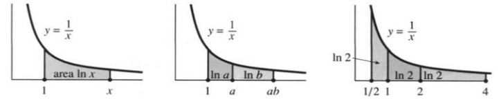

图6.11 对数的面积解释。相邻两段面积相加，就给出 $\ln a+\ln b=\ln(ab)$；面积相等时，$-\ln(1/2)=\ln2=\tfrac12\ln4$。area：面积。

$\ln x$ 从此有了直接定义——它就是一个积分。接下来两条关键性质，都得从这个定义推出来：这一步，是积分理论一次漂亮的施展。

**性质1：$\ln(ab)=\ln a+\ln b$。** 靠的是积分的区间可加性，

$$
\int_1^a\frac{dx}{x}+\int_a^{ab}\frac{dx}{x}
=\int_1^{ab}\frac{dx}{x}.\tag{2}
$$

右边就是 $\ln(ab)$，左边第一项是 $\ln a$；剩下的任务，是证明第二项等于 $\ln b$：

$$
\int_a^{ab}\frac{dx}{x}=\int_1^b\frac{du}{u}=\ln b.\tag{3}
$$

取 $u=x/a$：下限 $x=a$ 对应 $u=1$，上限 $x=ab$ 对应 $u=b$。又有 $x=au,dx=a\,du$，两边一除，得 $dx/x=du/u$。式(3)成立，性质1随之得证。

† $-1$ 的对数是 $\pi i$（一个虚数），因为 $e^{\pi i}=-1$。$i$ 的对数也是虚数——它是 $\pi i/2$。一般而言，对数是复数。


**性质2：$\ln(b^n)=n\ln b$。** 这相当于

$$
\int_1^{b^n}\frac{dx}{x}=n\int_1^b\frac{du}{u}.\tag{4}
$$

取 $x=u^n$：下限1对应1，上限 $b^n$ 对应 $b$。由 $dx=nu^{n-1}du$，两边除以 $x=u^n$，便得 $dx/x=n\,du/u$，要证的式子随之成立。

性质一条条都从面积定义推出来，用到定积分上同样管用。

**例1。**

$$
\int_x^{3x}\frac{dt}{t}=\ln(3x)-\ln x=\ln3.
$$

**例2。** $\int_{0.1}^1dx/x=\ln1-\ln0.1=\ln10$。为什么？

**例3。** $\int_1^{e^2}du/u=\ln(e^2)=2$：从1到 $e^2$ 的面积正好是2。

**说明。** 趁着搭理论，把从前欠下的账一并结清。$e^x,b^x,x^n$ 这几个函数，前面讨论过、算过，甚至求过导，可无理数指数始终没有正经定义。指数是 $\pi$ 时，“把 $e$ 连乘 $\pi$ 次”到底怎么算？一条路子是用有理数指数一步步逼近（本书不走这条）；另一条是本书现在要走的：用对数把 $e^\pi=23.1\ldots$ 定下来。先从 $e$ 本身说起：

- $e$ 的定义：自然对数等于1的那个数。
- $e^\pi$ 的定义：自然对数等于 $\pi$ 的那个数。

图6.12里，面积涨到1，上限就落在 $e$；涨到 $\pi$，上限就落在 $e^\pi$。这其实是在造 $\ln$ 的反函数。可凭什么说面积等于 $\pi$、1000或 $-1000$ 时，恰好各有一个上限与之对应？（面积在远处的 $e^{1000}$ 达到1000，在接近零的 $e^{-1000}$ 达到 $-1000$。）退一步，要定义 $e$，总得先知道面积在某个地方能达到1。

分两步看，回到图6.11右图。从1到2的面积大于 $1/2$——在这个长度为1的区间里，$1/x>1/2$。从1到4，两段合起来是 $2\ln2>1$。我们在到达4之前，面积先到1。（实际上是在 $e=2.718\ldots$ 处。）由于 $1/x$ 为正，面积递增，不会再回到1。

想让从1起算的面积翻倍，就得把上限平方——对数爬得就是这么慢：

$$
\ln x\to\infty,\qquad \frac{\ln x}{x}\to0
\quad(x\to\infty).\tag{5}
$$

指数函数长得快，对数就长得慢——两者互为反函数。还记得 $e^x$ 会超过每一个幂 $x^n$。因此 $\ln x$ 会被每一个根式 $x^{1/n}$ 超过。第60、61题讨论的就是这个极限。

拿 $\ln x$ 和 $\sqrt{x}$ 比一比：$x=10$ 时，两者约为2.3和3.2，差得不多；跑到 $x=e^{10}$，比的就是10和 $e^5$ 了，对数便落了下风。

† 第9章继续讨论虚指数，并证明这个出色的公式 $e^{\pi i}=-1$。


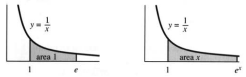

图6.12 面积是积分上限的自然对数。

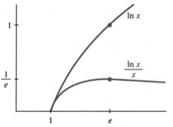

图6.13 $\ln x$ 的增长慢于 $x$。

#### 对数的近似

极限情形 $\ln0=-\infty$ 和 $\ln\infty=+\infty$ 都很重要。但更常用的是起点 $\ln1=0$ 附近：当 $x$ 接近0时，$\ln(1+x)$ 是多少？精确答案是积分，近似答案却简单得多。

对很小的正数或负数 $x$，

$$
\ln(1+x)\approx x,\qquad e^x\approx1+x.\tag{6}
$$

计算器给出 $\ln1.01\approx0.0099503$，离0.01不远。从1到 $1+x$，曲线下的面积差不多就是一块矩形：底为 $x$，高为1。图6.14画的是从矩形顶上切掉一个近似小三角形。

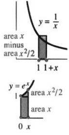

图6.14

实际值0.0099503与线性近似0.01相差约 $-0.0000497$；二阶导数给出的修正为

$$
\frac12(\Delta x)^2(\ln x)''\big|_{x=1}
=\frac12(0.01)^2(-1)=-0.00005,
$$

几乎正好就是那个差。于是

$$
\ln(1+x)\approx x-\frac12x^2.
$$

剩余误差约 $0.0000003$，接近 $x^3/3$，见第65题。

再看 $e^x$：在0处斜率是1，线性近似就是 $1+x$。于是 $\ln(e^x)\approx\ln(1+x)\approx x$——两步都只是近似，叠起来反倒恰好落回精确的恒等式 $\ln(e^x)=x$。计算器给出 $e^{0.01}\approx1.0100502$，而线性近似只到1.01，二阶修正还是那块小三角形，$x^2/2=0.00005$。完整级数在第10.1节和第6.6节：

$$
\ln(1+x)=x-\frac{x^2}{2}+\frac{x^3}{3}-\cdots,
$$
$$
e^x=1+x+\frac{x^2}{2}+\frac{x^3}{6}+\cdots.
$$

#### 利用对数求导

对数常常以原函数的身份出现。要扩充积分公式，先得会用链式法则求 $\ln u(x)$ 的导数。

> **6K** $\ln x$ 的导数是 $1/x$。$\ln u(x)$ 的导数为
>
> $$\frac d{dx}\ln u(x)=\frac1{u(x)}\frac{du}{dx}.$$


第6.2节推导对数导数时费了不少工夫；如今按这个积分定义，由微积分基本定理立即得到 $(\ln x)'=1/x$。复合函数 $\ln u(x)$ 则靠链式法则：内层是 $u$，外层是 $\ln$。记得要求 $u>0$。

$$
\begin{aligned}
\frac d{dx}\ln(cx)&=\frac c{cx}=\frac1x, &
\frac d{dx}\ln(x^3)&=\frac{3x^2}{x^3}=\frac3x,\\
\frac d{dx}\ln(x^2+1)&=\frac{2x}{x^2+1}, &
\frac d{dx}\ln(\cos x)&=-\tan x,\\
\frac d{dx}\ln(e^x)&=1, &
\frac d{dx}\ln(\ln x)&=\frac1{x\ln x}.
\end{aligned}
$$

这几式都值得再看一眼，尤其是第一式。有人会猜 $\ln(3x)$ 的斜率是 $3/x$——偏偏不是：3 会约掉，斜率跟 $\ln x$ 一样。根子在 $\ln(3x)=\ln3+\ln x$。反过来，$3/x$ 的原函数是 $3\ln x=\ln(x^3)$，不是 $\ln(3x)$。

进积分之前，先介绍一个新方法：**对数求导法**，英文简称LD。它管的是乘积，也管带变量的幂。乘积法则、幂法则当然一直都在，可用对数有时更省事：乘积取对数，就成了一串对数相加，再逐项求导，和法则一加即可。不过末尾还留着一手，看例子就明白。

**例4。** 设 $p(x)=x^x\sqrt{x-1}$。则

$$
\ln p=x\ln x+\frac12\ln(x-1),
$$
$$
\frac{p'}p=1+\ln x+\frac1{2(x-1)},
\qquad p'=p\left(1+\ln x+\frac1{2(x-1)}\right).
$$

难处就在最后这一步：乘回 $p$，答案立刻又复杂起来，可这一步省不掉。对数求导不含魔法。对 $p=fg$，有

$$
\frac{p'}p=\frac{f'}f+\frac{g'}g,
\qquad p'=p\left(\frac{f'}f+\frac{g'}g\right)=f'g+fg'.\tag{7}
$$

结果与乘积法则一字不差。三个因子时，取 $p=xe^x\sin x$，

$$
\ln p=\ln x+x+\ln\sin x,
\qquad p'=p\left(\frac1x+1+\frac{\cos x}{\sin x}\right).
$$

套路就一句话：先求 $\ln p$ 的导数 $p'/p$，再乘上 $p$。幂函数照办。

**例5。** $p=x^{1/x}$：

$$
\ln p=\frac{\ln x}{x},\qquad
p'=p\left(\frac1{x^2}-\frac{\ln x}{x^2}\right).
$$

**例6。** $p=x^{\ln x}$：$\ln p=(\ln x)^2$，所以 $p'=p(2\ln x/x)$。

**例7。** $p=x^{1/\ln x}$：$\ln p=(\ln x)/(\ln x)=1$，所以 $p'=0$。


#### 利用对数求积分

许多积分的结果里都会冒出对数，头号例子是 $1/x$。链式法则把它的地盘大大拓开了：$(\ln u)'=u'/u$，反过来就是

$$
\int\frac{u'(x)}{u(x)}\,dx=\ln u(x),\qquad\text{等价地，}\int\frac{du}{u}=\ln u.
$$

选 $u(x)$ 时，尽量让被积式正好凑成 $u'/u$。例如

$$
\int\frac{dx}{x+7}=\ln|x+7|,
\qquad \int\frac{dx}{cx+7}=\frac1c\ln|cx+7|.
$$

绝对值打哪儿来？$u<0$ 时，实数范围内 $\ln u$ 没有定义，可换成 $-u$ 就成：

$$
\int\frac{u'}u\,dx=\int\frac{-u'}{-u}\,dx
=\ln(-u).\tag{8}
$$

两种情况于是并成一支：$\ln|u|$。只有一处要躲开——$u=0$。例如

$$
\int_{-e}^{-1}\frac{dx}{x}=\left[\ln|x|\right]_{-e}^{-1}=-1,
$$
$$
\int_2^4\frac{dx}{x-5}=\left[\ln|x-5|\right]_2^4=-\ln3.
$$

这两个都是带符号面积，图像落在横轴下方。我们并没有取负数的实对数，也不能把后一个积分从2一直算到6：那要跨过禁区点 $x=5$，它的两侧都有无穷大的面积。

令 $u=\cos x$ 或 $u=\sin x$，正切、余切就都积出来了。别的例子也是同一招：

$$
\int\tan x\,dx=-\ln|\cos x|,\qquad
\int\cot x\,dx=\ln|\sin x|,
$$
$$
\int\frac{x\,dx}{x^2+7}=\frac12\ln(x^2+7),\qquad
\int\frac{dx}{x\ln x}=\ln|\ln x|.
$$

正割、余割的积分同样落到对数上，代价是先做一个巧妙的变形：

$$
\int\sec x\,dx
=\int\sec x\frac{\sec x+\tan x}{\sec x+\tan x}\,dx
=\ln|\sec x+\tan x|,\tag{9}
$$
$$
\int\csc x\,dx
=\int\csc x\frac{\csc x-\cot x}{\csc x-\cot x}\,dx
=\ln|\csc x+\cot x|.\tag{10}
$$

式(9)的分母 $u=\sec x+\tan x$，导数恰好就是分子 $\sec x\tan x+\sec^2x$；式(10)照同一路子，取 $u=\csc x-\cot x$。

† $1/x$（奇函数）的积分是 $\ln|x|$（偶函数）。避开 $x=0$。


最后来积 $\ln x$ 本身。$x\ln x$ 的导数是 $\ln x+1$，多出来的那个1要消掉，就减去 $x$：

$$
\int\ln x\,dx=x\ln x-x.
$$

$1/\ln x$ 就不同了：它的原函数写不出初等表达式，可偏偏是数学里最了不起的一桩近似——素数定理——的关键。面积 $\int_a^b dx/\ln x$ 约等于 $a$ 与 $b$ 之间的素数个数。在 $e^{1000}$ 附近，大约每1000个整数中有1个素数。

#### 6.4 习题

**通读填空。**

$\ln x=\int_1^x\text{a}$。由定义直接得到 $\ln(xy)=$ **b**、$\ln(x^n)=$ **c**。$e$ 就是对数（$1/x$ 曲线下从1起算的面积）等于 **d** 的那个数；$e^x$ 则定义为自然对数等于 **e** 的那个数。$x\to\infty$ 时 $\ln x\to$ **f**，而 $(\ln x)/\sqrt{x}\to$ **g**。$\ln x$ 的定义域和值域分别是 **h**。

$\ln x$ 的导数为 **i**，$\ln(1+x)$ 的导数为 **j**；$\ln(1+x)$ 在0处的一阶近似为 **k**，二阶近似为 **l**，$e^x$ 的二阶近似为 **m**。

由链式法则，$(\ln u(x))'=$ **n**，所以 $(\ln\cos x)'=$ **o**。$\tan x$ 的一个原函数为 **p**。乘积 $p=xe^{5x}$ 满足 $\ln p=$ **q**；求导得 **r**，乘回 $p$ 得 $p'=$ **s**。这一路走下来，就是对数求导法。

$u'/u$ 的不定积分为 **t**，$2x/(x^2+4)$ 的为 **u**，$1/(cx)$ 的为 **v**，$1/(ct+s)$ 关于 $t$ 的不定积分为 **w**。$1/\cos x$ 的不定积分为 **x**。把 $1/x$ 的原函数写成 $\ln|x|$，就可以允许 **y**；同理，$\int du/u$ 应写为 **z**。

求第1—10题的导数。

1. $y=\ln(2x)$。
2. $y=\ln(2x+1)$。
3. $y=(\ln x)^{-1}$。
4. $y=(\ln x)/x$。
5. $y=x\ln x-x$。
6. $y=\log_{10}x$。
7. $y=\ln(\sin x)$。
8. $y=\ln(\ln x)$。
9. $y=7\ln(4x)$。
10. $y=\ln((4x)^7)$。

求第11—24题的不定积分或定积分。

11. $\int dt/(3t)$。
12. $\int dx/(1+x)$。
13. $\int_0^1dx/(3+x)$。
14. $\int_0^1dt/(3+2t)$。
15. $\int_0^2x\,dx/(x^2+1)$。
16. $\int_0^2x^3\,dx/(x^2+1)$。
17. $\int_2^e dx/(x\ln x)$。
18. $\int_2^e dx/(x(\ln x)^2)$。
19. $\int(\cos x/\sin x)\,dx$。
20. $\int_0^{\pi/4}\tan x\,dx$。
21. $\int\tan(3x)\,dx$。
22. $\int\cot(3x)\,dx$。
23. $\int(\ln x)^2\,dx/x$。
24. $\int dx/(x\ln x\ln\ln x)$。
25. 画出 $y=\ln(1+x)$。
26. 画出 $y=\ln(\sin x)$。

第27—36题通过对 $\ln y$ 求导来计算 $dy/dx$。

27. $y=\sqrt{x^2+1}$。
28. $y=\sqrt{x^2+1}\sqrt{x^2-1}$。
29. $y=e^{\sin x}$。
30. $y=x^{-1/x}$。
31. $y=e^{e^x}$。
32. $y=x^e$。
33. $y=x^{e^x}$。
34. $y=\sqrt{x}\sqrt[3]{x}\sqrt[6]{x}$。
35. $y=x^{-1/\ln x}$。
36. $y=e^{-\ln x}$。

第37—42题可用任意方法。

37. $\displaystyle\int_5^{10}\frac{dt}{t}-\int_{5x}^{10x}\frac{dt}{t}$。
38. $\displaystyle\int_1^{e^\pi}\frac{dx}{x}+\int_{-2}^{-1}\frac{dx}{x}$。
39. $\displaystyle\frac d{dx}\int_x^1\frac{dt}{t}$。
40. $\displaystyle\frac d{dx}\int_x^{x^2}\frac{dt}{t}$。
41. $\displaystyle\frac d{dx}\ln(\sec x+\tan x)$。
42. $\displaystyle\int\frac{\sec^2x+\sec x\tan x}{\sec x+\tan x}\,dx$。

第43—46题给出实用的原函数公式，请逐一验证。

43. $\displaystyle\frac d{dx}\ln(x+\sqrt{x^2+1})=\frac1{\sqrt{1+x^2}}$。
44. $\displaystyle\frac d{dx}\ln\frac{x-a}{x+a}=\frac{2a}{x^2-a^2}$。
45. $\displaystyle\frac d{dx}\ln\frac{1+\sqrt{1-x^2}}x=-\frac1{x\sqrt{1-x^2}}$。
46. $\displaystyle\frac d{dx}\ln(x+\sqrt{x^2-a^2})=\frac1{\sqrt{x^2-a^2}}$。


第47—50题先作一阶估计，再作二阶估计，用 $e^x\approx1+x+x^2/2$，最后跟计算器对一对。

47. $\ln1.1$。
48. $e^{0.1}$。
49. $\ln0.99$。
50. $e^2$。
51. 求 $\lim_{x\to0}\ln(1+x)/x$。
52. 求 $\lim_{x\to0}(e^x-1)/x$。
53. 求 $\lim_{x\to0}\log_b(1+x)/x$。
54. 求 $\lim_{x\to0}(b^x-1)/x$。
55. 直线 $x=2,y=2$ 与双曲线 $y=1/x$ 围出一块“曲边四分之一圆”，在双曲线上方。求它的面积。
56. 用四个上矩形和四个下矩形，估计 $y=1/x$ 从4到8的面积，再把两个答案一平均——这就是梯形法。精确值是多少？
57. 为什么 $1/2+1/3+\cdots+1/n$ 会接近 $\ln n$？它落在 $\ln n$ 上方还是下方？
58. 对 $x>1$，比较 $\int_1^xdt/t$ 与 $\int_1^xdt/\sqrt t$，证明 $\ln x\le2(\sqrt{x}-1)$。
59. 将上一题不等式除以 $x$，推出 $(\ln x)/x\to0$。该函数的最大值在哪里取得？
60. 证明 $(\ln x)/x^{1/n}\to0$——可以从 $\ln(x^{1/n})/x^{1/n}\to0$ 出发。它的最大值在哪里取到？
61. 第6.2节第59题已经证明：对任何幂 $n$，充分大的 $x$ 满足 $e^x>x^n$。两边取对数，得 $x>n\ln x$。既然 $(\ln x)/x$ 最终小于任意给定的 $1/n$，它就趋于 ______。
62. 令 $y=1/x$，证明 $y\ln y\to0$（$y\to0^+$），再通过取对数求 $y^y$ 的极限。计算器给出的 $0.1^{0.1}$ 是多少？
63. 求 $\lim_{x\to\infty}\ln x/\log_{10}x$。
64. 已知 $\int_1^x t^{h-1}\,dt=(x^h-1)/h$，其在 $h\to0$ 时的极限为 ______。
65. 求 $e^{-x}$ 和 $2^x$ 在 $x=0$ 附近的一阶近似。
66. 加上三阶修正，$\ln(1+x)\approx x-x^2/2+x^3/3$。验证 $\ln1.01\approx0.0099503$，并估计 $\ln1.02$。
67. 蚂蚁沿一条原长2英尺的橡皮带爬行，速度是每秒1英尺；另一端被拉动，带长每秒增加1英尺。能否到达另一端？若能，求时间 $T$。令 $y(t)$ 为已爬位置占当前总长的比例，解释：(a) $y'=1/(t+2)$；(b) $y=\ln(t+2)-\ln2$；(c) $T=2e-2$。
68. 若橡皮带每秒伸长8英尺，同一蚂蚁能否到达另一端？何时到达？
69. 若蚂蚁相对橡皮带的爬行速度降为 $2/(t+2)$ 英尺/秒，则 $y'=2/(t+2)^2$。证明它在有限时间内到不了另一端。
70. 从 $\ln p=x\ln x$ 出发，用两种方法求 $p=x^x$ 的导数：(1) 对数求导法：先求 $(\ln p)'$，再乘上 $p$；(2) 指数求导法：把 $x^x$ 写成 $e^{x\ln x}$，求导后换回 $x^x$。
71. 若 $p=2^x$，则 $\ln p=$ ______。对数求导法给出 $p'=p(\ln p)'=$ ______；指数求导法把 $p$ 写成 $e^{\underline{\qquad}}$，再得 $p'=$ ______。
72. 用梯形法和/或辛普森法计算 $\ln2$，得到五位正确小数。
73. 步长取 $\Delta x=1$，用上面任一方法计算 $\ln10$，再与计算器比较。
74. 估计 $1/\ln90000$，作为90000附近素数密度的近似。紧随其后的10000个整数里有879个素数。
75. 找一对正整数，使 $x^y=y^x$。把方程化成 $(\ln x)/x=(\ln y)/y$，在图6.13里找出同一高度的两个点，并证明整数解已找全。
76. ★ 验证下列参数式满足 $(\ln x)/x=(\ln y)/y$：$x=((t+1)/t)^t$，$y=((t+1)/t)^{t+1}$。其中 $t\ne0$。画出这些点来表示曲线 $x^y=y^x$。当 $t\to\infty$ 时，它在 $x=$ ______ 处与直线 $y=x$ 相交。

## 6.5 可分离变量方程与逻辑斯谛方程


本节首先用积分求解两个基本的微分方程：

$$
\frac{dy}{dt}=cy,\qquad \frac{dy}{dt}=cy+s. \tag{1}
$$

我们已经知道它们的解，却还不知道：如果没有人提示“试一试 $e^{ct}$”，该怎样找到这些解？包括这两个方程在内，许多重要方程都能拆成两个积分：一个关于 $y$，一个关于 $t$。分别积分便得到答案。微分方程一旦化成已知或可查表求得的积分，求解就有了着落。

本节着重讨论**逻辑斯谛方程**。它描述增长先加快、后减慢的过程，其解是一条 **S形曲线**：开始时缓慢上升，随后迅速增长，最后趋于平缓。（如果世界人口预测正确，20世纪90年代接近这条S形曲线的中部。）S形曲线来自非线性方程，这是我们即将求解的第一个非线性模型，在生物学和其他生命科学中十分重要。

### 可分离变量方程

$dy/dt=cy$ 和带常数源项 $s$ 的 $dy/dt=cy+s$，都有一个直接解法：**把 $y$ 与 $t$ 分开**。

$$
\frac{dy}{y}=c\,dt,\qquad \frac{dy}{y+s/c}=c\,dt. \tag{2}
$$

所有含 $y$ 的量放在左边，所有含 $t$ 的量放在右边；常数 $c$ 放在哪边都可以。方程 $dy/dt=y+t$ 则不能这样分离。

式(2)含有微分，提示我们对两边积分。关于 $t$ 的积分给出 $ct$，关于 $y$ 的积分给出对数：

$$
\ln y=ct+C,\qquad \ln\left(y+\frac{s}{c}\right)=ct+C. \tag{3}
$$

**积分常数由初始条件确定。** 令 $t=0$ 时 $y=y_0$，得到

$$
\ln y=ct+\ln y_0,\qquad
\ln\left(y+\frac{s}{c}\right)=ct+\ln\left(y_0+\frac{s}{c}\right). \tag{4}
$$

最后解出 $y$。我们需要的是 $y$ 本身，而不是它的对数。两边取指数，便有

$$
y=y_0e^{ct},\qquad y+\frac{s}{c}=\left(y_0+\frac{s}{c}\right)e^{ct}. \tag{5}
$$

把结果代回原微分方程检验，是一个好习惯。

这是求解 $y'=cy+s$ 的第四种方法。方法一从一开始就设 $y=Ae^{ct}+B$；方法二把各时刻的输入乘以相应增长因子 $e^{c(t-T)}$，再把贡献相加；方法三求解 $y-y_\infty$；方法四就是**分离变量法**。这些方法给出同一个答案。分离变量法用途很广。下面再说一遍它的基本思想，然后举例演示。


图6.15 方程 $dy/dt=y^2$ 与 $dy/dt=ny/t$ 的解。左图标出解发散的时刻；右图为幂函数解。

**求解 $dy/dt=u(y)v(t)$ 时，把 $dy/u(y)$ 与 $v(t)\,dt$ 分开，再对两边积分：**

$$
\int\frac{dy}{u(y)}=\int v(t)\,dt+C. \tag{6}
$$

**代入初始条件确定 $C$，然后解出 $y(t)$。**

**例1** $dy/dt=y^2$ 可分离为 $dy/y^2=dt$。积分得到 $-1/y=t+C$。代入 $t=0$、$y=y_0$，有 $C=-1/y_0$，因此

$$
-\frac1y=t-\frac1{y_0},\qquad y=\frac{y_0}{1-ty_0}.
$$

当 $t$ 到达 $1/y_0$ 时，解趋于无穷大，见图6.15(a)。假如银行按存款的平方支付利息，即 $y'=y^2$，你很快就会拥有全世界的钱。

**例2** $dy/dt=ty$ 可分离为 $dy/y=t\,dt$。积分得 $\ln y=t^2/2+C$。代入初值并取指数，得到

$$y=y_0e^{t^2/2}.$$

当利率为 $c=t$ 时，指数是 $t^2/2$。

**例3** $dy/dt=y+t$ 不是可分离变量方程。方法一仍然适用：设 $y=Ae^t+B+Dt$，比以前多引入一个系数 $D$，见习题23。方法二也适用，但不能直接使用上述分离变量法。

**例4** 将 $dy/dt=ny/t$ 分离为 $dy/y=n\,dt/t$。积分，得 $\ln y=n\ln t+C$。不能把 $t=0$ 代入，因为原方程本身要除以 $t$。不过，可以在 $t=1$ 给定初值 $y_1$，于是得到幂函数解

$$y=y_1t^n.$$

这就是第2.2节介绍的本书第一个微分方程。相对变化 $dy/y$ 与 $dt/t$ 之比，在经济学中称为“弹性”。这些相对变化的单位形如“美元/美元”，因而没有量纲。函数 $y=t^n$ 的弹性恒为 $n$。$\ln y=n\ln t+C$ 在双对数坐标纸上是一条斜率为 $n$ 的直线。

### 逻辑斯谛方程

最简单的人口增长模型是 $dy/dt=cy$，其中 $c$ 为出生率与死亡率之差。如果 $c$ 是正常数，模型便预言人口会无限增长，最终超出模型适用的范围。人口不可能无限增加：食物和空间的竞争终将出现，指数增长必须放缓。


**实际的单位人口增长率依赖于人口规模 $y$。** 它应当是函数 $c(y)$，而不只是常数。模型的选择至少占问题的一半：

- 生物学或生态学的问题：确定 $c(y)$。
- 数学的问题：求解 $dy/dt=c(y)y$。

在很小的 $y$ 范围内，每个模型看起来都是线性的——但不会永远如此。增长率下降时，有两个特别重要的模型：米氏模型采用 $c(y)=c/(y+K)$，逻辑斯谛模型采用 $c(y)=c-by$。先讨论后者。

非线性效应来自“相互作用”。设两个群体的规模分别为 $y$ 和 $z$，它们的相互作用次数就与 $yz$ 成正比。**质量作用定律给出二次项 $byz$**，这是相互作用与竞争的一种基本模型。这里是同一群体内部的竞争，故令 $z=y$。方程中的负项 $-by^2$ 使增长减慢。

描述增长与竞争的基本模型称为**逻辑斯谛方程**：

$$\frac{dy}{dt}=cy-by^2. \tag{7}$$

通常，$b$ 与 $c$ 相比很小。增长像往常一样开始（接近 $e^{ct}$）。在 $y$ 自身变大之前，竞争项 $by^2$ 比 $cy$ 小得多；人口变大后，负的竞争项使增长逐渐放缓。解沿着一条可以精确求出的S形曲线变化。

换成人类人口，$b$ 和 $c$ 应取多少？生态学家估计自然增长率 $c=0.029/\text{年}$。由于竞争项的存在，这不是实际的净增长率。约1930年，世界人口为30亿。按该人口数计算，$cy$ 给出的年增长量为 $0.029\times30\text{亿}=8700\text{万}$，而所采用的实际年增长量约为6000万。两者相差的2700万就是 $by^2$：

$$
2700\text{万人/年}=b(30\text{亿人})^2,
\qquad b=3\times10^{-12}/\text{年}.
$$

$b$ 的数值虽小，作用却不小：它把8700万减少到6000万。更值得注意的是平衡状态：当 $by^2=cy$ 时，$dy/dt=0$，竞争损失与增长收益恰好抵消。平衡人口为

$$
y_\infty=\frac cb=\frac{0.029}{3}\times10^{12}\text{人}\approx100\text{亿人}.
$$

按照这个韦尔许尔斯特逻辑斯谛模型，世界人口将趋近100亿。这是模型给出的。从目前迹象看，我们增长得快得多。我们很可能超过100亿。第3.3节的联合国报告预测为110亿到140亿。

还有个特殊点：$y_\infty=c/b$ 的一半处（在这个模型中是50亿）。它是S形曲线开始向下弯曲的**拐点**，此处 $y''=0$，而增长速度 $y'$ 最大。直接从微分方程求这个点，比先求 $y(t)$ 更方便。再求一次导数：

$$y''=(cy-by^2)'=cy'-2byy'=(c-2by)y'. \tag{8}$$

拐点处 $c-2by=0$，故 $y=c/(2b)$，恰在S形曲线高度的一半处。


### S形曲线

分离变量可解逻辑斯谛方程：

$$
\frac{dy}{dt}=cy-by^2
\quad\Longrightarrow\quad
\int\frac{dy}{cy-by^2}=\int dt. \tag{9}
$$

第一个问题：这个关于 $y$ 的积分我们认得吗？不认得。第二个问题：封面的积分表是否列出了它？没有。最接近的是 $\int dx/(a^2-x^2)$，经过一些变形可以使用，见习题21。第三个问题：有没有一般方法？有。**部分分式法**正适合处理 $1/(cy-by^2)$，第7.4节将介绍该方法。积分并把等式乘以 $c$，有

$$
\ln\frac{y}{c-by}=ct+C,\qquad C=\ln\frac{y_0}{c-by_0}. \tag{10}
$$

这个常数保证解满足 $t=0$ 时的初值。两边取指数，消去对数：

$$\frac{y}{c-by}=e^{ct}\frac{y_0}{c-by_0}. \tag{11}$$

这里出现了与线性方程相同的增长因子 $e^{ct}$。但逻辑斯谛方程是非线性的：快速增长的不是 $y$，而是 $y/(c-by)$。当 $c-by$ 趋于0时，这个比值趋于无穷大，而 $y$ 趋于 $c/b$。在这个模型中，增长最终趋于停止——世界人口的极限会是100亿吗？

还需要一个显式的 $y$ 公式。标准S形曲线是

$$y=\frac1{1+e^{-t}}.$$

$t=\infty$ 时它等于1，$t=0$ 时等于 $1/2$，$t=-\infty$ 时等于0。它满足 $y'=y-y^2$，即 $c=b=1$。一般公式要允许不同的 $c,b,y_0$，因此稍显复杂。把式(11)乘以 $c-by$ 并解出 $y$，得

$$
y=\frac{c}{b+e^{-ct}(c-by_0)/y_0}
=\frac{c}{b+de^{-ct}}. \tag{12}
$$

当 $t\to+\infty$ 时，$e^{-ct}\to0$，公式中复杂的部分消失，$y$ 趋于平衡值 $c/b$，即图6.16中的水平渐近线。曲线的S形来自高度一半处的拐点。


图6.16 左：标准S形曲线 $y=1/(1+e^{-t})$。右：人口S形曲线（附预测）；图中 billion 为十亿。


有个意外的观察：**$z=1/y$ 满足线性方程。** 因为 $z'=-y'/y^2$，所以

$$z'=\frac{-cy+by^2}{y^2}=-\frac cy+b=-cz+b. \tag{13}$$

这个方程的解是指数函数 $e^{-ct}$ 的倍数加一个常数：

$$z=Ae^{-ct}+\frac ab=\left(\frac1{y_0}-\frac bc\right)e^{-ct}+\frac bc. \tag{14}$$

取倒数 $y=1/z$，便得到式(12)的S形曲线。$z$ 从 $1/y_0$ 出发，趋于 $b/c$；$y$ 则趋于 $c/b$。

**例1（美国人口）** 下表比较实际人口与模型人口，单位均为百万人。珀尔和里德用1790年、1850年和1910年的人口普查数据确定模型参数。在这些年份之间，拟合还不错，却并不完美。战争、经济萧条以及可能更重要的移民都会影响结果。事实上，他们模型的平衡值 $c/b$ 不到2亿，而美国人口已超过这一数值。模型当然可以改进，也确实已有改进。1990年的人口普查预测，人口会在达到3亿之前停止增长。

| 年份 | 美国人口 | 模型人口 |
|---|---:|---:|
| 1790 | 3.9 | 3.9 |
| 1800 | 5.3 | 5.3 |
| 1810 | 7.2 | 7.2 |
| 1820 | 9.6 | 9.8 |
| 1830 | 12.9 | 13.1 |
| 1840 | 17.1 | 17.5 |
| 1850 | 23.2 | 23.2 |
| 1860 | 31.4 | 30.4 |
| 1870 | 38.6 | 39.4 |
| 1880 | 50.2 | 50.2 |
| 1890 | 62.9 | 62.8 |
| 1900 | 76.0 | 76.9 |
| 1910 | 92.0 | 92.0 |
| 1920 | 105.7 | 107.6 |
| 1930 | 122.8 | 123.1 |
| 1940 | 131.7 | 136.7 |
| 1950 | 150.7 | 149.1 |

若移民流入量为常数 $s$，仍可以用部分分式法求解 $y'=cy-by^2+s$；不过，在实际工作中，计算机已经承担了大量求解任务。表格引自布劳恩的《微分方程》（Springer，1975）。

† 世界人口模型不涉及移民（至少目前如此）。

**说明。** 严肃的科学建模需要解释并论证 $y^2$ 项。它确实使我们得到一个可以完全求解的非线性模型，但简单并不必然意味着真实。基本理由是：规模为 $y$ 的群体中，个体相遇次数与 $y^2$ 成正比。如果相遇意味着争斗，就采用 $-by^2$；如果相遇促进人口增长，符号就要改变，产生合作项 $+by^2$，人口将增长得很快。

**例5** $y'=cy+by^2$。$y$ 在有限时间内趋于无穷大。

**例6** $y'=-dy+by^2$。当 $y_0<d/b$ 时，$y\to0$。

在例6中，死亡作用占上风。小种群尚未得到合作项 $by^2$ 的足够支持，便逐渐消亡。低于 $d/b$ 的种群是濒危物种。

逻辑斯谛方程不能预测振荡——这超出了 $dy/dt=f(y)$ 的范围。

**$y$ 相线。** 要理解 $y'=f(y)$，有个办法：画一条“$y$ 数轴”，用箭头标出 $f(y)$ 的符号。$f(y)>0$ 时，$y$ 增大，沿箭头向右运动；$f(y)<0$ 时向左运动；$f(y)=0$ 的点对应常值平衡解。


箭头显示解向左还是向右运动，是趋向平衡点还是趋向无穷远。箭头从两侧指向的平衡点是稳定吸引的；从两侧背离的平衡点是不稳定的。相线说明 $y$ 向哪里变化、可能趋于何处。


习题6.7.54的落体模型中，终端速度为 $v_\infty=\sqrt g$。$f(y)=\sin y$ 则有好几个平衡点：


左：$dv/dt=g-v^2$；右：$dy/dt=\sin y$。

**例7 化学反应动力学：$mA+nB\to pC$。**

反应把 $m$ 个 $A$ 分子与 $n$ 个 $B$ 分子结合，生成 $p$ 个 $C$ 分子。例如 $\mathrm H_2+\mathrm{Cl}_2\to2\mathrm{HCl}$ 的化学计量数为 $m=n=1,p=2$。质量作用定律说明，反应速率与浓度 $[A]$、$[B]$ 的乘积成正比，因而 $[A]$ 减少而 $[C]$ 增大：

$$\frac{d[A]}{dt}=-r[A][B],\qquad \frac{d[C]}{dt}=k[A][B]. \tag{15}$$

化学实验测定 $r,k$，数学则求解浓度随时间的变化。用 $y$ 表示 $[C]$，即单位体积中的 $C$ 分子数。形成浓度为 $y$ 的产物后，$[A]$ 从 $a_0$ 降为 $a_0-(m/p)y$，$[B]$ 从 $b_0$ 降为 $b_0-(n/p)y$。式(15)因而含有 $y^2$ 项：

$$\frac{dy}{dt}=k\left(a_0-\frac mp y\right)\left(b_0-\frac np y\right). \tag{16}$$

这属于前面的非线性模型，见习题33—34。生物学中也有同样形式的质量作用关系；见到两个浓度相乘，就该想到质量作用。

### 米氏方程 $dy/dt=-cy/(y+K)$

生化反应是生命的关键，在每个生物体中不断发生，但它们的数学描述并不容易。工程学和物理学靠着线性模型已经走得很远，生物学却很快就会遇到非线性。虽然 $y'=cy$ 对一级反应动力学十分有效（见第6.3节），自然界还是内置了非线性调节机制。

酶能加快反应。没有酶，生命活动就像慢动作：血液凝固要等上许多年，消化牛排要几十年，学习微积分要几百年。整个系统十分精妙：DNA指导氨基酸组合成有用的蛋白质，于是有了酶、大象和艾萨克·牛顿。

简单说，酶参加反应，随后又释放出来。它就是催化剂。酶与底物形成不稳定的中间复合物，后者分解为新产物与酶；酶便可再次参与反应。

下面列出催化剂的一些例子，有好也有坏：

1. 汽车催化转化器中的铂与发动机排出的污染物反应。（但铂也与铅反应——十加仑含铅汽油过后，你就别指望铂了。）
2. 喷雾推进剂（CFC）催化臭氧 $\mathrm O_3$ 转变为普通氧气 $\mathrm O_2$。这破坏了臭氧层——我们在大气中的盾牌。
3. 牛奶变成酸奶，葡萄汁变成葡萄酒。


4. 凝血需要一整串酶，在每一步放大反应。血友病——“沙皇病”——缺少称为因子VIII的酶。一次小意外就是灾难；血止不住。
5. Adolph牌嫩肉粉是来自番木瓜的蛋白质。它预先消化牛排。同一种酶（木瓜凝乳蛋白酶）还被注射用于软化突出的椎间盘。
6. 酵母使面包发起；酶参与形成酸面团的酸味。

当然，制造酶本身也需要酶。母体卵细胞包含一个细胞的物质，还包含一半DNA。受精卵包含完整的指令。

现在考察描述这类反应的**米哈埃利斯—门滕方程**，简称**米氏方程（MM方程）**。它基于质量作用定律：浓度为 $z$ 的酶使浓度为 $y$ 的底物转化，速率满足 $dy/dt=-byz$。这里 $b$ 为速率常数，右边含有“酶浓度乘底物浓度”。其他反应，包括某些逆反应，也遵循类似关系。完整方程组是非线性的，没有精确解；不过，应用数学和自然现象中经常能从复杂系统中找出规律。

酶浓度 $z(t)$ 很快降到 $z_0K/(y+K)$。**米氏常数** $K$ 取决于质量作用方程中的各速率常数。随后酶重新出现（$z_\infty=z_0$），但到那时第一个反应已结束。有效的反应方程是

$$\frac{dy}{dt}=-byz=-\frac{cy}{y+K},\qquad c=bz_0K. \tag{17}$$

这就是生物化学中的基本方程——米氏方程。速率在生物学中非常重要。观察 $cy/(y+K)$ 可见

$$
y\gg K:\quad \frac{dy}{dt}\approx-c;
\qquad y\ll K:\quad \frac{dy}{dt}\approx-\frac cK y.
$$

起步和收尾两个阶段速率不同，取决于 $y$ 与 $K$ 谁占优势。底物消耗速率的上限为 $c$。

分离变量可得

$$
\int\frac{y+K}{y}\,dy=-\int c\,dt
\quad\Longrightarrow\quad y+K\ln y=-ct+C. \tag{18}
$$

令 $t=0$，有 $C=y_0+K\ln y_0$。两边取指数得到

$$e^y y^K=e^{-ct}e^{y_0}y_0^K. \tag{19}$$

我们没有 $y$ 的简单公式，但已经取得很大进展。计算机可以很快画出 $y(t)$，显示酶反应的动态过程。

习题27—32继续讨论米氏理论。科学中的浓度和速率常数带有单位，数学处理时则可以引入无量纲变量，把若干常数化为1。我们求解

$$\frac{dY}{dT}=\frac{Y}{Y+1}.$$

求解后再换回 $y,t,c,K$。无量纲化也适用于其他方程。

**要点：微积分的许多应用，都通过微分方程展开。** 这是描述变化的数学语言：人口、化学反应与传染过程可能遵循形式相同的方程。下一节要讨论的差分方程，也与 $dy/dt=cy$ 相对应。


### 6.5 习题

#### 阅读填空

方程 $dy/dt=cy$、$dy/dt=cy+s$ 和 $dy/dt=u(y)v(t)$ 称为 **a**，因为可以把 $y$ 与 $t$ 分离。对 $\int dy/y=\int c\,dt$ 积分，得到 **b**；对 $\int dy/(y+s/c)=\int c\,dt$ 积分，得到 **c**。方程 $dy/dx=-x/y$ 导出 **d**，进而有 $y^2+x^2=\text{**e**}$，解保持在圆上。

逻辑斯谛方程为 $dy/dt=\text{**f**}$。$cy$ 表示增长，新增项 $-by^2$ 表示 **g**。分离变量得 $\int dy/(cy-by^2)=\int dt$，其中关于 $y$ 的积分为 $1/c$ 乘以 $\ln\text{**h**}$。在 $t=0$ 代入 $y_0$ 并取指数，得到 $y/(c-by)=e^{ct}(\text{**i**})$。当 $t\to\infty$ 时，$y$ 趋于 **j**，这是使 $cy-by^2=\text{**k**}$ 的平衡状态。$y$ 的图像呈 **l** 形，在 $y=\text{**m**}$ 处有拐点。

生物学和化学中，浓度为 $y,z$ 的物质按与 $y$ 乘 **n** 成正比的速率反应，这就是 **o** 定律。在模型 $dy/dt=c(y)y$ 中，增长率 $c$ 依赖于 **p**。米氏方程为 $dy/dt=\text{**q**}$。分离变量得到 $\int\text{**r**}\,dy=\text{**s**}=-ct+C$。

**1—8：分离变量、积分并求解。**

1. $dy/dt=y+5,\ y_0=2$。
2. $dy/dt=1/y,\ y_0=1$。
3. $dy/dx=x/y^2,\ y_0=1$。
4. $dy/dx=y^2+1,\ y_0=0$。
5. $dy/dx=(y+1)/(x+1),\ y_0=0$。
6. $dy/dx=\tan y\cos x,\ y_0=1$。
7. $dy/dt=y\sin t,\ y_0=1$。
8. $dy/dt=e^{t-y},\ y_0=e$。
9. 假设增长速度与 $\sqrt y$ 而非 $y$ 成正比。从 $y_0$ 出发，求解 $dy/dt=c\sqrt y$。
10. 恒定弹性方程 $dy/dx=ny/x$ 等价于 $d(\ln y)/d(\ln x)=\underline{\qquad}$；其解为 $\ln y=\underline{\qquad}$。
11. 当逻辑斯谛方程中 $c=0$ 时，仅余 $y'=-by^2$。平衡极限 $y_\infty$ 是多少？从 $y_0$ 降为 $y_0/2$ 需要多久？
12. 把第11题的符号反转，令 $y'=by^2$。从 $y_0=2$（亚当与夏娃）出发，人口在什么时刻趋于无穷大？

**13—26讨论逻辑斯谛方程及其变式。**

13. 证明 $y=1/(1+e^{-t})$ 满足 $y'=y-y^2$。分别画出初值为 $1/2$ 和 $1/3$ 的解曲线。
14. (a) $y=2/(1+e^{-t})$ 满足哪个逻辑斯谛方程？(b) 对于解 $y=1/(1+e^{-3t})$，求相应方程中的 $c,b$。
15. 求解 $z'=-z+1,\ z_0=2$。如式(13)那样取倒数，$y=1/z$ 是什么？
16. 从式(14)的 $y=1/z$ 出发，用代数变形得到式(12)。
17. 从 $y_0=c/(2b)$ 增长到 $y=3c/(4b)$ 需要多少年？使用式(10)，以1988年的拐点为时间起点。何时达到 $90\text{亿}=9c/b$？
18. 对 $u=y/(c-by)$ 求导，证明：若 $y'=cy-by^2$，则 $u'=cu$。这解释了式(11)：$u=u_0e^{ct}$。
19. 假设匹兹堡人口从1900年的100万增加到2000年的300万，两个年份的增长速度分别为每年12000人和30000人。代入逻辑斯谛方程求 $c,b$，并求平衡人口。附加题：何时达到 $y=y_\infty/2=c/(2b)$？
20. 令 $c=1,b=-1$，得到合作模型 $y'=y+y^2$。在 $y_0=1$ 时求 $y(t)$。何时趋于无穷大？
21. 画一条经过 $(0,0)$、水平渐近线为 $y=-1$ 与 $y=1$ 的S形曲线。证明 $y=(e^t-e^{-t})/(e^t+e^{-t})$ 具备这三个性质。$y^2$ 的图像形状像什么？
22. 为求解 $y'=cy-by^3$，令 $u=1/y^2$，在 $u'=-2y'/y^3$ 中代入 $y'$，得到关于 $u$ 的线性方程。仿照式(14)求解，初值为 $u_0=1/y_0^2$。然后取 $y=1/\sqrt u$。
23. 令 $y=rY,t=sT$，使 $dy/dt=cy-by^2$ 化为 $dY/dT=Y-Y^2$。求 $r,s$。
24. 在变换 $y=rY,t=sT$ 下，初值 $y_0,y'_0$ 与 $Y_0,Y'_0$ 有何关系？
25. 谣言按 $y'=y(N-y)$ 传播。已有 $y$ 人知道，另有 $N-y$ 人不知道，乘积 $y(N-y)$ 衡量可能传播谣言的相遇次数。(a) 从 $y_0=1$ 出发求解。(b) 何时有 $N/2$ 人听说谣言？记该时刻为 $T$。(c) 当 $N\to\infty$ 时，$T\to\underline{\qquad}$，所以这个模型很糟糕。较合理的模型写为 $y'=by(N-y)$。
26. 若把 $b,c$ 同时乘以10，S形曲线中部会变得更陡还是更平缓？

**27—34讨论质量作用关系与米氏方程 $y'=-cy/(y+K)$。**

27. 大多数药物按 $y'=-cy$ 清除，但阿司匹林遵循米氏方程。令 $c=K=y_0=1$，米氏模型中的衰减更快吗？
28. 若以恒定速率 $d$（维持剂量）服用阿司匹林，求满足 $d=cy/(y+K)$ 的平衡水平，此时 $y'=0$。


29. 证明米氏模型的消耗速率 $R=cy/(y+K)$ 随 $y$ 增大而增大，并求 $y\to\infty$ 时的最大值。
30. 取 $c=1$，分别在 $K=1$ 和 $K=10$ 时画出 $R$ 关于 $y$ 的图像。米氏常数增大时，速率如何变化？$y$ 取多少时 $R=c/2$？
31. 令 $y=KY,ct=KT$，求关于 $dY/dT$ 的无量纲米氏方程。从解 $e^Y Y=e^{-T}e^{Y_0}Y_0$ 恢复式(19)。
32. 用计算机对不同的 $c,K$ 画出式(19)给出的 $y(t)$。
33. 对反应 $A+B\to C$，质量作用模型为 $y'=k(a_0-y)(b_0-y)$。设 $y_0=0,a_0=b_0=3,k=1$，求 $y$，并求达到 $y=2$ 的时刻。
34. 除了 $d[C]/dt$ 的方程，质量作用模型还给出 $d[A]/dt=\underline{\qquad}$。
35. 设 $y=Ae^t+B+Dt$，求解 $y'=y+t,\ y_0=0$，确定 $A,B,D$。
36. 令 $x=\sqrt b\,y-c/(2\sqrt b)$，把 $cy-by^2$ 写为 $a^2-x^2$，其中 $a=\underline{\qquad}$。在下列查表积分中代入 $a,x$，得到正文的积分：

$$
\int\frac{dx}{a^2-x^2}=\frac1{2a}\ln\frac{a+x}{a-x},
\qquad
\int\frac{dy}{cy-by^2}=\frac1c\ln\frac{y}{c-by}.
$$

37. **重要。** 如正文那样画出 $y'=y/(1-y)$ 与 $y'=y-y^3$ 的相线并标箭头。各初值 $y_0$ 对应的解分别趋于哪些平衡点？
38. 用自己的话解释相线怎样发挥作用。
39. (a) 从 $y_0=\pi/6$ 出发求解 $y'=\tan y$，得到 $\sin y=e^t/2$。(b) 解释为什么永远到不了 $t=1$。(c) 在相线上标箭头，说明 $y$ 趋于 $\pi/2$；它何时到达那里？
40. 把逻辑斯谛方程写为 $y'=cy(1-y/K)$。当 $y'\to0$ 时，$y\to\underline{\qquad}$。求拐点处的 $y,y',y''$。

## 6.6 以幂代替指数函数


还记得我们初次认识 $e$ 吗？这个特殊的底，使 $e^x$ 在 $x=0$ 处的斜率等于1，由此得到指数增长的关键关系：**$e^x$ 的导数就是 $e^x$。** 不过，我们只短暂地考察过数值 $e=2.71828\ldots$。它以 $(1+1/n)^n$ 的极限出现；如此重要的数，为什么要用这种看似不自然的方式表示？

本节将说明 $(1+1/n)^n$ 和 $(1+x/n)^n$ 如何自然地产生。它们描述的是有限步长下的离散增长，能用在复利计算里。贷款、人寿保险、货币市场基金，用的都是 $y'=cy+s$ 的离散形式。本节也介绍一些银行利率知识，希望有一天能派上用场。科学与工程中的应用同样重要：科学计算和会计计算一样，都需要与微分方程相对应的**差分方程**。

这一节公式很多，我想先把最漂亮的一个告诉你：$e^x$ 的无穷级数。它之所以漂亮，是因为**导数等于它本身**。

从 $y=1+x$ 开始。在 $x=0$ 处，$y=1,y'=1$，但 $y''=0$ 而不是1。如此简单的函数不可能满足要求。多项式不可能等于自己的导数，因为最高次项 $x^n$ 求导后降为 $nx^{n-1}$。要实现“导数等于原函数”，就不能有最高次项：我们需要无穷多项，也就是**幂级数**。

要让导数中出现 $1+x$，原式就要有 $1+x+x^2/2$；$x^2/2$ 又是 $x^3/6$ 的导数，而后者是 $x^4/24$ 的导数。不妨一次把整个级数写出来：

$$e^x=1+x+\frac{x^2}{2}+\frac{x^3}{6}+\frac{x^4}{24}+\cdots. \tag{1}$$

这或许是人们发现过的最了不起的幂级数。它的导数仍是自身：

$$\frac{d e^x}{dx}=0+1+x+\frac{x^2}{2}+\frac{x^3}{6}+\cdots=e^x. \tag{2}$$

每项的导数是前一项，每项的积分是后一项，因此 $\int e^x\,dx=e^x+C$。近似式 $e^x\approx1+x$ 就是前两项。另一些性质，如 $(e^x)(e^x)=e^{2x}$，从级数形式中并不那么明显——级数相乘既有难度，也有趣味。甚至 $x=1$ 时为什么得到 $2.718\ldots$，目前都还不清楚。为什么 $1+1+1/2+1/6+\cdots=e$？这就要借助 $(1+1/n)^n$。

注意 $x^n$ 的分母是乘积 $1\cdot2\cdot3\cdots n$，称为 **$n$ 的阶乘**，记作 $n!$。例如 $4!=24,5!=120$。$x^5/120$ 的导数是 $x^4/24$，因为求导产生的5约去了阶乘中的5。一般地，$x^n/n!$ 的导数为 $x^{n-1}/(n-1)!$。约定 $0!=1$。

第10章将着重说明：随着 $n$ 增大，$x^n/n!$ 会非常小；而整个级数收敛，其和就是 $e^x$。现在转向离散增长；它在极限中产生同一个级数。

下面的标题登在1990年5月27日《纽约时报》的头版：

#### 借款213年后，山姆大叔遭追债

圣安东尼奥，5月26日电——两百多年前，宾夕法尼亚州富商雅各布·德黑文借给大陆会议45万美元，以救助福吉谷的军队。这笔贷款看来一直没有归还。


因此，德黑文家族的后人把美国政府告上法庭，追讨他们认为应得的款项。如果按照当时通行的6%利率逐日复利计算，总额达1410亿美元；若逐年复利计算，则“只有”980亿美元。

散居全国的数千名家族成员说，他们并非贪婪。住在圣安东尼奥、父系出自德黑文家族的卡罗琳·科克勒姆说：“这不是钱的问题，而是原则问题。你不得不想，如果这个人没有作出那样的牺牲，美国是否还会存在。他付出了自己的一切。”

这些后人表示，他们愿意灵活商谈和解金额，但也指出利息正以每秒190美元累积。

得克萨斯州斯塔福德的律师乔·贝丝·克勒克说：“这些人谁也没有打算让政府破产。”她刚从法学院毕业，接受了此案，约定的胜诉酬金比例低于惯常的30%。

究竟有多少后人，尚不清楚。克勒克估计，若按十代、每代每家四个孩子计算，人数可能多达50万。

最初的诉讼被驳回，理由是针对联邦政府的诉讼时效为六年。家族上诉称，这违反宪法第六条；该条确认宪法通过前政府所欠债务的效力。

德黑文于1812年去世，身无分文。他没有子女。

### 复利

复利的思想可以立刻应用。假设投资1000美元，年利率为100%——这样的机会很难找到。一年只计一次息，利息为1000美元，本息合计2000美元；若年内多次把利息计入本金，就会更多。

- 半年后：把500美元利息计入本金，得到1500美元。
- 年末：后半年的利息为 $1500\times50\%=750$ 美元，合计2250美元。

银行连续乘了两次1.5：1000变为1500，再变为2250。每季度复利则连续乘四次1.25，其中1对应本金，0.25对应当季利息：

$$
\begin{aligned}
\text{一季度后：}&\quad1000+0.25\times1000=1250,\\
\text{两季度后：}&\quad1250+0.25\times1250=1562.50,\\
\text{三季度后：}&\quad1562.50+0.25\times1562.50=1953.12,\\
\text{一年后：}&\quad1953.12+0.25\times1953.12=2441.41.
\end{aligned}
$$

每年计息 $n$ 次，每次乘以 $1+1/n$，记入的利息是全年利息的 $1/n$。仍取年利率100%，有

$$
\begin{aligned}
\text{按季：}&\quad1000(1+1/4)^4\approx2441.41,\\
\text{按月：}&\quad1000(1+1/12)^{12}\approx2613.04,\\
\text{按日：}&\quad1000(1+1/365)^{365}\approx2714.57.
\end{aligned}
$$

许多银行把一年按360天计算，尽管计算机已使这种做法过时；很少有银行按分钟计息（一年525600分钟），也没有银行按秒计息（一年31536000秒）。


有些银行提供**连续复利**。这对应 $n\to\infty$ 的极限，产生数 $e$：

$$1000\left(1+\frac1n\right)^n\longrightarrow1000e\approx2718.28.$$

**1. 快方法：取对数。** 利用 $\ln(1+x)\approx x$，令 $x=1/n$：

$$\ln\left(1+\frac1n\right)^n=n\ln\left(1+\frac1n\right)\approx n\frac1n=1. \tag{3}$$

随着 $1/n$ 变小，这个近似越来越好。极限为1。于是 $(1+1/n)^n$ 趋于对数等于1的那个数。第6.2节与第6.4节定义的是同一个数，即 $e$。

**2. 慢方法：把乘积完全展开，再令 $n\to\infty$。**

这是二项式定理的直接应用，不借助对数，却给出 $e$ 的一个精彩新公式。先取 $n=3$ 练习：

$$\left(1+\frac13\right)^3=1+3\left(\frac13\right)+\frac{3\cdot2}{1\cdot2}\left(\frac13\right)^2+\frac{3\cdot2\cdot1}{1\cdot2\cdot3}\left(\frac13\right)^3.$$

对任意正整数 $n$，二项式定理给出

$$
\left(1+\frac1n\right)^n
=1+n\frac1n+\frac{n(n-1)}{1\cdot2}\left(\frac1n\right)^2
+\frac{n(n-1)(n-2)}{1\cdot2\cdot3}\left(\frac1n\right)^3+\cdots+\left(\frac1n\right)^n. \tag{4}
$$

每一项在 $n\to\infty$ 时都有极限，例如

$$\frac{n(n-1)}{2n^2}\to\frac12,\qquad\frac{n(n-1)(n-2)}{6n^3}\to\frac16.$$

再下一项趋于 $1/(1\cdot2\cdot3\cdot4)$。所有这些极限之和，就是我们关于 $e$ 的新公式：

$$\lim_{n\to\infty}\left(1+\frac1n\right)^n=1+1+\frac1{2!}+\frac1{3!}+\frac1{4!}+\cdots=e. \tag{5}$$

用求和符号写，就是 $\sum_{k=0}^{\infty}1/k!=e$。阶乘使级数收敛得很快：

$$1+1+0.5+0.16667+0.04167+0.00833+0.00139+0.00020+0.00002=2.71828.$$

前九项就比一年复利365次的结果准确得多。不过，要得到整个无穷级数的和，仍须取极限。无论用导数、积分、幂 $(1+1/n)^n$ 还是无穷级数定义 $e$，都有某个量趋于0或无穷，必须仔细处理。

式(4)的各项都不超过式(5)中的对应项。**$(1+1/n)^n$ 从下方趋于 $e$**，并随 $n$ 增大而递增：计息越频繁，所得利息越多；年利率100%的连续复利给出增长因子 $e$。


**说明。** 把 $(1+1/n)^n$ 换成 $(1+x/n)^n$，二项式定理就产生 $e^x$：

$$
\left(1+\frac xn\right)^n=1+n\frac xn+\frac{n(n-1)}{2}\left(\frac xn\right)^2+\cdots
\longrightarrow1+x+\frac{x^2}{2!}+\cdots. \tag{6}
$$

右边正是式(1)的幂级数。下一项为 $x^3/6$；$x$ 可以为正，也可以为负。

**6L $\displaystyle\lim_{n\to\infty}(1+x/n)^n=e^x$。取 $x=1$ 即得 $e$。**

这个幂的对数为 $n\ln(1+x/n)\approx n(x/n)=x$。这个幂趋于 $e^x$。快方法用对数证明极限，慢方法把每一项都乘开，得到无穷级数；两条路都说明，这些定义彼此一致。

### 差分方程与微分方程

现在可以看到应用数学的一个重要方面。这不是一门微分方程课，也不能变成一门差分方程课，但我们学习的目的之一，是运用已有知识。此前 $e$ 的主要应用是求解 $y'=cy$ 和 $y'=cy+s$，现在求解对应的差分方程。

尤其重要的是看到它们之间的联系。数学的目的是理解并解释规律；从离散到连续这条路，下面的方程演示得清清楚楚。即使课堂不作完整展开，也值得先看最基本的规律：

$$y(t+1)=ay(t). \tag{7}$$

每一步都乘以同一个数 $a$。初值 $y_0$ 后面依次是 $ay_0,a^2y_0,a^3y_0$。在离散时刻 $t=0,1,2,\ldots$，解为

$$y(t)=a^t y_0.$$

它对应于微分方程的连续解 $y(t)=e^{ct}y_0$。


图6.17 $|a|>1$ 时增长，$|a|<1$ 时衰减。增长因子 $a$ 与 $e^c$ 相比较。

源项或汇项——出生、死亡、存款、提款——就相当于 $y'=cy+s$：

$$y(t+1)=ay(t)+s. \tag{8}$$

每步先乘 $a$，再加 $s$，于是

$$y(1)=ay_0+s,\quad y(2)=a^2y_0+as+s,\quad y(3)=a^3y_0+a^2s+as+s.$$

这与微分方程中见过的规律相同：每笔输入 $s$ 都成为一个新的起点，随后乘以 $a$ 的相应幂。由于输入晚于初始时刻，最高幂只有 $t-1$。


利用等比数列求和，得到简洁公式：

$$y(t)=a^ty_0+s(a^{t-1}+a^{t-2}+\cdots+a+1)=a^ty_0+s\frac{a^t-1}{a-1}. \tag{9}$$

**例1** 假设每年向个人退休账户（IRA）存入 $s=2000$ 美元，年利率8%，初值 $y_0=0$。第一笔款在 $t=1$ 年末存入。过一年，这笔钱乘上 $a=1.08$，同时再存入2000美元。到 $t=3$，第一笔已乘 $(1.08)^2$，第二笔乘1.08，又有第三笔2000美元。第 $t$ 年末余额为

$$y(t)=2000\frac{1.08^t-1}{1.08-1}. \tag{10}$$

$t=1$ 时为2000，$t=2$ 时为 $2000(1.08+1)$。注意利率 $a-1=0.08$ 出现在分母中。

**例2 当 $|a|<1$ 时趋于平衡状态，对应微分方程中的 $c<0$。**

$a>1$ 对应增长。事物也会消亡，钱也会花掉；此时，$a^ty_0\to0$，初始余额的影响逐渐消失。若还有持续输入会怎样？假设每年花掉当时余额的一半，再存入2000美元，则 $a=1/2$：

$$y(t+1)=\frac12y(t)+2000,\qquad y(t)=\left(\frac12\right)^ty_0+2000\frac{(1/2)^t-1}{1/2-1}.$$

当 $t\to\infty$ 时，$(1/2)^t\to0$，故

$$y_\infty=2000\frac{0-1}{1/2-1}=4000. \tag{11}$$

为什么4000能保持不变？花掉一半是2000，新增的2000恰好补足。递推式 $y_{n+1}=y_n/2+2000$ 的不动点满足 $y_\infty=y_\infty/2+2000$。

一般地，平衡方程 $y_\infty=ay_\infty+s$ 给出 $y_\infty=s/(1-a)$。与微分方程 $cy_\infty+s=0$ 比较：

$$y_\infty=-\frac sc\quad\text{（微分方程）},\qquad y_\infty=\frac{s}{1-a}\quad\text{（差分方程）}. \tag{12}$$

**例3 价格适当时，供给等于需求。**

差分方程是经济学的一种基本工具。农民可能每年作一次决策，银行可能每天作决策，股票市场则可能每分钟都在变化。考虑三个假设：

1. 下一期供给取决于本期价格：$S(t+1)=cP(t)$。
2. 下一期需求取决于下一期价格：$D(t+1)=-dP(t+1)+b$。
3. 下一期需求等于下一期供给：$D(t+1)=S(t+1)$。

第三条表示价格调整到市场供需相等。需求曲线斜率 $-d$ 为负，供给曲线斜率 $c$ 为正。两线交点给出均衡价格。把前两式代入第三式：

$$-dP(t+1)+b=cP(t).$$

平衡价格满足 $-dP_\infty+b=cP_\infty$，因此 $P_\infty=b/(c+d)$。初始价格高于平衡值时，下一期会降低；低于平衡值时，下一期会升高；恰等于平衡值时则保持不变。


不过，偏离平衡的价格只有在 $c<d$ 时才会收敛。也就是说，供给对价格的敏感程度低于需求时，经济就是稳定的。

发散例子：$c=2,b=d=1$，差分方程为 $-P(t+1)+1=2P(t)$。从 $P(0)=1$ 出发，后续价格为 $-1,3,-5,11,\ldots$，交替振荡且幅度增大。

稳定例子：$c=1/2,b=d=1$，从 $P(0)=1$ 出发，

$$-P(t+1)+1=\frac12P(t),\qquad P(t):\ 1,\frac12,\frac34,\frac58,\ldots\longrightarrow\frac23.$$

增大 $d$ 会带来更大的稳定性。这就是价格支持的作用。若 $d=0$（需求固定，不随价格改变），经济便失控。

### 金融数学

可以把直线改为曲线，使供需模型更真实。稳定性取决于斜率，微积分便由此进入。不过课堂时间有限，这里转向几个实用的金融计算问题。第6.3节回答过连续复利的六个问题，现在令年利率 $x=0.05=5\%$，每年计息 $n$ 次，再回答相同的问题。

先求**实际年利率**。由于复利，其数值高于5%：

$$
\begin{aligned}
\text{按季复利：}&\quad(1+0.05/4)^4\approx1.0509,\quad\text{实际年利率约 }5.09\%;\\
\text{连续复利：}&\quad e^{0.05}\approx1.0513,\quad\text{实际年利率约 }5.13\%.
\end{aligned}
$$

下面把离散答案与连续答案并列：前者用代数，后者用微积分。期限均为20年。若采用单利，利息为 $0.05\times20\times y_0=y_0$，即本金在20年内翻倍。

问题1—2联系终值 $y$ 与现值 $y_0$：

| 问题 | 每年计息 $n$ 次 | 连续复利 |
|---|---|---|
| 1. 本金 $y_0$ 增长后的终值 | $y=(1+0.05/n)^{20n}y_0$ | $y=e^{0.05\times20}y_0$ |
| 2. 为得到终值 $y$ 应投入的现值 | $y_0=(1+0.05/n)^{-20n}y$ | $y_0=e^{-0.05\times20}y$ |

每期乘以 $a=1+0.05/n$，20年共 $20n$ 期。问题2相当于把时间倒过来：除以增长因子，而不是乘它。终值大于现值（除非利率为负！）。当 $n\to\infty$ 时，离散结果趋于连续结果。

问题3—4联系终值与定期存款，初始余额为零。每笔钱存入后开始增长，最终余额是 $s+as+a^2s+\cdots$。

| 问题 | 每期末存入 $s$ | 连续存入 $s$ |
|---|---|---|
| 3. 由定期输入求终值 | $y=s\dfrac{(1+0.05/n)^{20n}-1}{0.05/n}$ | $y=s\dfrac{e^{0.05\times20}-1}{0.05}$ |
| 4. 为得到终值 $y$ 所需输入 | $s=y\dfrac{0.05/n}{(1+0.05/n)^{20n}-1}$ | $s=y\dfrac{0.05}{e^{0.05\times20}-1}$ |


问题5—6联系现值 $y_0$ 与支付金额。此时最终余额 $y=0$，全部结清。问题5中，一次投入 $y_0$，恰好支持随后各期支付 $s$，这就是年金计算：银行一边对余额计息，一边每年支付 $n$ 次，持续20年。因此，初始投入小于总支付额 $20ns$。

问题6是相反方向的贷款：开始时借入 $y_0$，随后逐期偿还。你可以在还款时赚取利息，因此总偿还额大于最初借款。这就是汽车贷款和住房抵押贷款的基本计算。

| 问题 | 离散支付，共 $20n$ 次 | 连续支付 $s$ |
|---|---|---|
| 5. 为每期领取 $s$ 所需现值 | $y_0=s\dfrac{1-(1+0.05/n)^{-20n}}{0.05/n}$ | $y_0=s\dfrac{1-e^{-0.05\times20}}{0.05}$ |
| 6. 为偿还 $y_0$ 所需支付 | $s=y_0\dfrac{0.05/n}{1-(1+0.05/n)^{-20n}}$ | $s=y_0\dfrac{0.05}{1-e^{-0.05\times20}}$ |

问题2、4、6分别是问题1、3、5的逆问题。留意其中的结构：$y,y_0,s$ 三个量，每次有一个为零；若三者都存在，回到式(9)。

推导这些公式的代数练习留在习题中。这里的有限时间间隔 $\Delta t$ 不是微分 $dt$。表中的各种因子可在金融表中查到。熟悉相应记号也有帮助：若每期利率为 $i$，共 $N$ 期，则 $a=1+i$；本例中 $i=0.05/n,N=20n$。

$$
\begin{aligned}
\text{1美元本金的终值：}&\quad (1+i)^N,\\
\text{1美元终值的现值：}&\quad (1+i)^{-N},\\
\text{每期末存1美元的终值因子：}&\quad s_{\overline N|i}=\frac{(1+i)^N-1}{i},\\
\text{每期末领1美元的现值因子：}&\quad a_{\overline N|i}=\frac{1-(1+i)^{-N}}{i}.
\end{aligned}
$$

老实讲，写这本书以前，我从不知道最后两个公式。我的住房贷款有 $N=12\times25$ 次月供，每月利率 $i=0.07/12$。1972年的现值，也就是借款额，为42000美元。我现在要看看银行是否诚实。

† 不诚实，$s$ 太大了。我早就知道。

**说明。** 有些贷款不按实际到账的金额算利息，而是从到期偿还额里预先扣掉，这里称为贴现放款。一笔面额1000美元、期限一年、贴现率5%的贷款，预扣利息50美元，实际到账950美元，到期偿还1000美元。普通的5%贷款则是收到1000美元、到期偿还1050美元。实际利率高于5%，因为50美元利息是按较小的950美元支付的。这里的“贴现率”为 $50/950=5.26\%$。

### 科学计算：用差分方程求解微分方程

生物学和商业中的许多事件是离散地发生的；工程学与物理学通常把时间、空间视为连续量。或许在某种量子层面两者有更深的联系，但从牛顿定律 $F=ma$ 开始，许多物理规律写成微分方程。


微积分的重要贡献，是用变化率建立自然现象的模型。要用计算机求解这些模型，就要把它们离散化。

下面考虑 $dy/dt=cy$。它是分析新数值方法时常用的测试方程。在 $y_0=1$ 时，精确解为 $e^{ct}$。这里检验历史悠久的**欧拉法**：把 $dy/dt$ 替换为 $\Delta y/\Delta t$。

$$\frac{y(t+\Delta t)-y(t)}{\Delta t}=cy(t). \tag{13}$$

左边在 $\Delta t\to0$ 的极限中就是 $dy/dt$。我们在 $\Delta t>0$ 时提前停下来。将式(13)乘以 $\Delta t$，得到

$$y(t+\Delta t)=(1+c\Delta t)y(t),\qquad y(0)=1.$$

每步乘以 $a=1+c\Delta t$，所以 $n$ 步之后

$$y=a^n=(1+c\Delta t)^n,\qquad \text{时刻为 }n\Delta t. \tag{14}$$

它增长还是衰减取决于 $a$；精确解 $e^{ct}$ 增长还是衰减则取决于 $c$。问题是：二者能否保持接近？会不会一个增长，另一个却衰减？我们希望差分方程模仿 $y'=cy$，但这个希望未必总能实现。

取 $y'=-y$，即 $c=-1$，精确解 $e^{-t}$ 衰减。计算器给出 $n=2,10,20$ 时的数值结果：

| 步长 $\Delta t$ | $a=1-\Delta t$ | $a^2$ | $a^{10}$ | $a^{20}$ |
|---|---:|---:|---:|---:|
| 3 | −2 | 4 | 1024 | 1048576 |
| 1 | 0 | 0 | 0 | 0 |
| 1/10 | 0.90 | 0.81 | 0.35 | 0.12 |
| 1/20 | 0.95 | 0.90 | 0.60 | 0.36 |

大步长 $\Delta t=3$ 完全不稳定：本应衰减的数值却越来越大。$\Delta t=1$ 那一行同样没有用处（全是0）。实际中，$c\Delta t$ 的绝对值必须降到0.10或0.05。要精确计算，还得更小，除非改用更好的差分方程。这才是正确做法。

注意0.35与0.36：它们分别来自 $n=10,\Delta t=1/10$ 和 $n=20,\Delta t=1/20$，实际时刻都是 $n\Delta t=1$，正趋近 $e^{-1}\approx0.37$：

$$\left(1-\frac1{10}\right)^{10}\approx0.35,\qquad\left(1-\frac1{20}\right)^{20}\approx0.36,\qquad\left(1-\frac1n\right)^n\to e^{-1}.$$

这再次展示 $(1+x/n)^n\to e^x$，这里 $x=-1$。

最后的问题是收敛速度。步长0.10时误差约0.02，步长0.05时误差约0.01。步长减半，误差大致减半。保留位数还不够多，但误差似乎接近 $\Delta t/5$。


用取对数的“快方法”验证。固定终点时刻 $n\Delta t=1$，有

$$\ln(1-\Delta t)^n=n\ln(1-\Delta t)\approx n\left(-\Delta t-\frac{(\Delta t)^2}{2}\right)=-1-\frac{\Delta t}2. \tag{15}$$

两边取指数：

$$a^n=(1-\Delta t)^n\approx e^{-1}e^{-\Delta t/2}\approx e^{-1}\left(1-\frac{\Delta t}2\right). \tag{16}$$

$a^n$ 与 $e^{-1}$ 的差是最后一项 $\tfrac12\Delta t e^{-1}$。归结为一个问题：这个误差与 $\tfrac15\Delta t$ 相同吗？答案是肯定的，因为 $e^{-1}/2$ 是 $1/5$。如果只保留一位数字，预测完全正确！

这段推导花了一个小时，我希望你读它所花的时间也超过一个 $\Delta t$。它展示了 $\ln x$ 与 $e^x$ 的实际用途：先用精确等式 $\ln a^n=n\ln a$，再用关键近似 $\ln(1+x)\approx x-x^2/2$，其中 $x=-\Delta t$；二次项来自第6.4节的二阶导数，最后再用 $e^x\approx1+x$。

线性近似说明收敛，二次近似揭示误差：它与 $\Delta t=1/n$ 成正比。这类似用矩形近似面积，误差与分割宽度 $\Delta x$ 同阶。这点最低限度的精度足以定义积分，这里也足以定义 $e$。但它完全不能用于科学计算。用于积分或 $y'=cy$ 的梯形法，误差为 $(\Delta x)^2$ 阶和 $(\Delta t)^2$ 阶。所有好的软件都比这更进一步。欧拉的一阶法无法在天气发生之前作出预报。

对于一般方程 $dy/dt=F(y,t)$，欧拉法为

$$\frac{y(t+\Delta t)-y(t)}{\Delta t}=F(y(t),t).$$

### 6.6 习题

#### 阅读填空

$e^x$ 的无穷级数为 **a**，其导数为 **b**。分母 $n!$ 称为 **c**，等于 **d**。取 $x=1$，得到 $e$ 的级数 **e**。

为与 $e$ 的原定义对应，展开 $(1+1/n)^n$ 的前三项，得到 **f**。当 $n\to\infty$ 时，这三项趋于 **g**，与 $e$ 的级数一致。$(1+x/n)^n$ 的前三项为 **h**，极限为 **i**，与 $e^x$ 一致。因此该幂趋于 **j**。更快的方法是先计算 $\ln(1+x/n)^n\approx\text{**k**}$，只取主要项，再取指数。

年利率 $x$、每年复利 $n$ 次时，一年的增长因子为 $(\text{**l**})^n$。当 $n\to\infty$ 时，连续复利增长因子为 **m**。若 $x=10\%$，连续复利下1美元一年后变为 **n**。

差分方程 $y(t+1)=ay(t)$ 给出 $y(t)=\text{**o**}\,y_0$。方程 $y(t+1)=ay(t)+s$ 的解为 $y=a^ty_0+s[1+a+\cdots+a^{t-1}]$，方括号内的和为 **p**。当 $a=1.08,y_0=0$，每年末存入1美元，$t$ 年后有 **q**。当 $a=1/2,y_0=0$，每年末存入6美元，$t$ 年后有 **r**，并趋于 $y_\infty=\text{**s**}$。平衡方程给出 $y_\infty=\text{**t**}$。

每期利率为 $i$ 时，1美元本金在 $N$ 期后的价值为 **u**；为得到1美元终值所需现值为 **v**。每期末存1美元，终值为 **w**；要达到1美元终值，每期末应存 **x**。

欧拉法把 $y'=cy$ 替换为 $\Delta y=cy\Delta t$，每步乘以 **y**。因此在时刻1，数值近似为 $(1+c\Delta t)^{1/t}y_0$，当 $\Delta t\to0$ 时趋于 **z**。误差与 **A** 同阶；这对于科学计算而言太 **B**。

1. 写出以 $1-x+\cdots$ 开头、导数等于 $-y$ 的幂级数 $y$。
2. 写出以 $1+2x+\cdots$ 开头、导数等于 $2y$ 的幂级数 $y$。


3. 写出两个等于自身二阶导数的级数。
4. 将 $e=1+1+1/2+1/6+1/24+\cdots$ 与一个更大且容易求和的级数比较，证明 $e<3$。
5. 年利率5%，分别每半年、每季度和每周复利，求1000美元一年后的本息。
6. 利用 $\ln(1+x)\approx x$，估计 $\ln(1-1/n)^n$ 与 $\ln(1+2/n)^n$，再取指数求出两个极限。
7. 用展开法分别写出 $(1-1/2)^2$ 的三项与 $(1-1/4)^4$ 的五项。$(1-1/n)^n$ 的前三项是什么？$n\to\infty$ 时它们分别趋于什么？
8. 展开法给出 $(1-1/n)^n$ 的极限为 $1-1+1/2!-1/3!+\cdots$。求其精确和与前五项之和。
9. 已知 $(1+1/n)^n\to e$，解释为什么 $(1+1/n)^{2n}\to e^2$，以及 $(1+2/N)^N\to e^2$。
10. 求 $(1+1/n^2)^n$ 与 $(1+1/n)^{n^2}$ 的极限。可以先用计算器猜测。
11. (a) 复利次数增多时，$(1+1/n)^n$ 随 $n$ 增大而增大还是减小？(b) $f(x)=x\ln(1+1/x)$ 的导数为多少？它应大于0还是小于0？用第12题验证。
12. 对 $x>0$，画出 $1/t$ 的图像，证明 $\ln(1+1/x)>1/(x+1)$。从 $t=1$ 到 $t=1+1/x$ 的曲线下面积为多少？其中的内接矩形面积为多少？
13. 从 $y_0=1$ 出发，对 $y(t+1)=2y(t)$ 迭代三步。
14. 从 $y_0=0$ 出发，对 $y(t+1)=2y(t)+1$ 迭代三步。

**15—22：求解差分方程。**

15. $y(t+1)=3y(t),\ y_0=4$。
16. $y(t+1)=y(t)/2,\ y_0=1$。
17. $y(t+1)=y(t)+1,\ y_0=0$。
18. $y(t+1)=y(t)-1,\ y_0=0$。
19. $y(t+1)=3y(t)+1,\ y_0=0$。
20. $y(t+1)=3y(t)+s,\ y_0=1$。
21. $y(t+1)=ay(t)+s,\ y_0=0$。
22. $y(t+1)=ay(t)+s,\ y_0=5$。

**23—26：哪个初值使 $y_1=y_0$，即处于平衡状态？**

23. $y(t+1)=2y(t)-6$。
24. $y(t+1)=y(t)/2-6$。
25. $y(t+1)=-y(t)+6$。
26. $y(t+1)=-y(t)/2+6$。
27. 对第23、24题，均从 $y_0=2$ 出发，迭代三步得到 $y_3$。是否正在趋于平衡状态？
28. 对哪些数 $a$，$(1-a^t)/(1-a)$ 在 $t\to\infty$ 时趋于一个极限？极限是多少？
29. 价格由供需相等决定，即 $-dP(t+1)+b=cP(t)$。哪个价格能逐年保持不变？
30. 在供需方程中取 $c=1,d=2,b=8,P(0)=0$，求 $P(t)$ 与极限平衡价格。

**31—38采用10%的年利率（因此 $a=1+i=1.1$）。**

31. 按季复利的实际年利率是多少？
32. 按日复利的实际年利率是多少？
33. 现在存100美元，20年后的终值是多少？
34. 20年后支付1000美元，其现值是多少？
35. 20年期、10万美元住房抵押贷款的月供是多少？
36. 6年期、1万美元汽车贷款的月供是多少？
37. 每年末存入1000美元，按年复利，20年后余额是多少？
38. 借款8000美元，每年末偿还1000美元，何时还清？不要忘记利息。
39. 每年售出可售住房的三分之二，同时新建1000套。平衡状态下，可售住房有多少套？
40. 假设你为支付勒索款借入1000美元，放贷者收取5%的月息，而你每月末偿还60美元。一个月后以及一年后还欠多少？
41. 假设欧拉因“发现 $e$”收取1美元，并按100%的年利率计息。一年后连本带息欠他多少：(a) 不在年内复利；(b) 每周复利；(c) 连续复利？
42. 仿照式(15)—(16)近似 $(1+1/n)^n$，说明欠欧拉的金额约为 $e-e/(2n)$。比较习题6.2.5。
43. 我的Visa账单列月利率1.42%、年利率17%。若按月复利，实际年利率是多少？写出公式或数值。
44. 借入80000美元买房，年利率9%。(a) 30年期贷款的月供是多少？(b) 总共支付多少？

## 6.7 双曲函数


本节把 $e^x$ 与 $e^{-x}$ 组合起来。此前它们各走各的路：一个递增，一个递减。不过有两种特别的组合，各得了自己的名称与记号：

$$
\text{双曲余弦}\quad\cosh x=\frac{e^x+e^{-x}}2,
\qquad
\text{双曲正弦}\quad\sinh x=\frac{e^x-e^{-x}}2.
$$

在英语里，cosh 读起来与 gosh 押韵，sinh 常读作 cinch。图6.18表明 $\cosh x>\sinh x$。$x$ 很大且为正时，两者都非常接近 $e^x/2$；$x$ 是绝对值很大的负数时，$e^{-x}$ 占主导，$\cosh x\to+\infty$，而 $\sinh x\to-\infty$，因为后者的 $e^{-x}$ 前面带着负号。


图6.18 双曲函数由 $e^x/2$ 与 $e^{-x}/2$ 组合而成。


图6.19 圣路易斯大拱门。原图由圣路易斯游客委员会提供。

由定义直接得到

$$\cosh(-x)=\cosh x,\qquad\cosh0=1;$$

$$\sinh(-x)=-\sinh x,\qquad\sinh0=0.$$

因此，双曲余弦与余弦一样是偶函数，双曲正弦与正弦一样是奇函数。

$\cosh x$ 的图像对应的是一条在自重下悬垂的缆索。把曲线倒过来，就是圣路易斯大拱门的形状。这一定是人们建造过的最大的倒置双曲余弦。缆索比拱门容易造，因为重力自己会把活干完。在习题55中适当选择坐标轴，缆索的高度是经过伸缩的双曲余弦函数，称为**悬链线**：

$$y=a\cosh(x/a).$$

这里 $a$ 为缆索张力与缆索密度之比。圣路易斯布施体育场有96条与大拱门呼应的悬链线形曲线。

双曲函数的性质可直接从定义导出。性质太多，没有必要逐条死记。一条重要线索是：关于正弦、余弦的每一条事实，都有相应的双曲函数事实，常常只相差一个符号。先看四条性质。


1. $\cosh^2x-\sinh^2x=1$，对应于 $\cos^2x+\sin^2x=1$。验证如下：

$$\left(\frac{e^x+e^{-x}}2\right)^2-\left(\frac{e^x-e^{-x}}2\right)^2
=\frac{e^{2x}+2+e^{-2x}-e^{2x}+2-e^{-2x}}4=1.$$

2. $\displaystyle\frac d{dx}\cosh x=\sinh x$；与余弦求导相比，少了负号。
3. $\displaystyle\frac d{dx}\sinh x=\cosh x$；形式与正弦求导相同。
4. $\displaystyle\int\sinh x\,dx=\cosh x+C$，$\displaystyle\int\cosh x\,dx=\sinh x+C$。


图6.20 左：单位圆 $\cos^2t+\sin^2t=1$；右：单位双曲线 $\cosh^2t-\sinh^2t=1$。

性质1揭示了这些函数与双曲线的联系，也解释了记号中的字母h。$\cos^2x+\sin^2x=1$ 把点 $(\cos x,\sin x)$ 放在单位圆上；$x$ 一变，这个点就沿圆移动，因此普通正弦、余弦也称圆函数。类似地，点 $(\cosh x,\sinh x)$ 沿图6.20中的单位双曲线运动。

另外四个双曲函数的定义也很自然：

$$
\begin{aligned}
\tanh x&=\frac{\sinh x}{\cosh x}=\frac{e^x-e^{-x}}{e^x+e^{-x}},
&\coth x&=\frac{\cosh x}{\sinh x}=\frac{e^x+e^{-x}}{e^x-e^{-x}},\\
\operatorname{sech}x&=\frac1{\cosh x}=\frac2{e^x+e^{-x}},
&\operatorname{csch}x&=\frac1{\sinh x}=\frac2{e^x-e^{-x}}.
\end{aligned}
$$

我觉得 tanh 可以读得出来，sech 也容易。其余的更难读。

把 $\cosh^2x-\sinh^2x=1$ 分别除以 $\cosh^2x$ 与 $\sinh^2x$，得到

$$1-\tanh^2x=\operatorname{sech}^2x,\qquad\coth^2x-1=\operatorname{csch}^2x.$$

进一步有

$$ (\tanh x)'=\operatorname{sech}^2x,\qquad
(\operatorname{sech}x)'=-\operatorname{sech}x\tanh x,$$

$$\int\tanh x\,dx=\int\frac{\sinh x}{\cosh x}\,dx=\ln(\cosh x)+C.$$

### 反双曲函数

还记得反三角函数 $\arcsin x,\arctan x,\operatorname{arcsec}x$ 吗？第4.4节用链式法则求出了它们的导数；这些导数主要用来算积分，比如 $\int dx/(1+x^2)=\arctan x+C$。


反双曲正弦、反双曲正切与反双曲正割的情形相似，但有符号差别。我们写下三个新的导数：

$$y=\sinh^{-1}x\quad(x=\sinh y),\qquad\frac{dy}{dx}=\frac1{\sqrt{x^2+1}}. \tag{1}$$

$$y=\tanh^{-1}x\quad(x=\tanh y),\qquad\frac{dy}{dx}=\frac1{1-x^2}. \tag{2}$$

$$y=\operatorname{sech}^{-1}x\quad(x=\operatorname{sech}y),\qquad
\frac{dy}{dx}=-\frac1{x\sqrt{1-x^2}}. \tag{3}$$

习题44—46利用 $dy/dx=1/(dx/dy)$ 推导这些公式。另一条路是使用对数。因为 $\ln x$ 是 $e^x$ 的反函数，反双曲函数也可写成对数。例如

$$
y=\frac12\ln\frac{1+x}{1-x},\qquad
\frac{dy}{dx}=\frac1{2(1+x)}-\frac1{2(1-x)}=\frac1{1-x^2}. \tag{4}
$$

求导只是对 $\tfrac12\ln(1+x)-\tfrac12\ln(1-x)$ 使用常规法则。新的只是答案。对数从何而来？若 $x=\tanh y$，把中间分式的分子、分母同乘 $\cosh y$：

$$\frac{1+x}{1-x}=\frac{1+\tanh y}{1-\tanh y}
=\frac{\cosh y+\sinh y}{\cosh y-\sinh y}
=\frac{e^y}{e^{-y}}=e^{2y}.$$

因此 $2y$ 就是左边的自然对数，这给出式(4)。常用对数表达式如下：

$$
\begin{aligned}
\sinh^{-1}x&=\ln\left(x+\sqrt{x^2+1}\right),\\
\cosh^{-1}x&=\ln\left(x+\sqrt{x^2-1}\right),\\
\tanh^{-1}x&=\frac12\ln\frac{1+x}{1-x},\\
\operatorname{sech}^{-1}x&=\ln\frac{1+\sqrt{1-x^2}}x.
\end{aligned}
$$

**说明1。** 列出这些公式是为了查阅，不必刻意死记。式(1)—(3)使原函数有两种写法：反双曲函数或对数。多数积分表使用对数，例如

$$\int\frac{dx}{1-x^2}=\frac12\ln\left(\frac{1+x}{1-x}\right)+C.$$

（替代 $\tanh^{-1}x+C$。）

**说明2。** 反正弦、反正切、反正割此前没有出现对数表达式，这是为什么？既然 $\tanh^{-1}x$ 能用对数表示，反正切是否也有类似公式？确实有，不过要引入复数。

这背后是数学中一个重要的公式。双曲余弦与双曲正弦分别是 $(e^x+e^{-x})/2$ 与 $(e^x-e^{-x})/2$，普通余弦、正弦是否也有对应形式？有，而且相当简单，只是要使用虚数。


$$\cos x=\frac12(e^{ix}+e^{-ix}),\qquad\sin x=\frac1{2i}(e^{ix}-e^{-ix}). \tag{5}$$

此前没有写出这些恒等式，是因为其中有虚指数。把第二式乘以 $i$，再与第一式相加，便得到优美的**欧拉公式**：

$$\cos x+i\sin x=e^{ix}. \tag{6}$$

它与那个不那么漂亮的双曲函数公式 $\cosh x+\sinh x=e^x$ 相呼应。我必须说，式(6)的重要性远超任何双曲函数关系。正弦与余弦比双曲正弦与双曲余弦有用得多。本节主要性质就介绍到这里，下面用习题来看它们的应用。

### 6.7 习题

#### 阅读填空

$\cosh x=\text{**a**}$，$\sinh x=\text{**b**}$，$\cosh^2x-\sinh^2x=\text{**c**}$；这三个表达式的导数分别为 **d**、**e**、**f**。点 $(x,y)=(\cosh t,\sinh t)$ 沿双曲线 **g** 运动。悬垂缆索的悬链线方程为 $y=\text{**h**}$。

反函数 $\sinh^{-1}x$ 与 $\tanh^{-1}x$ 分别等于 $\ln(x+\sqrt{x^2+1})$ 与 $\tfrac12\ln\text{**i**}$。它们的导数为 **j** 与 **k**，因而相应的 **l** 有两种写法。

与 $\cosh x+\sinh x=e^x$ 对应的是欧拉公式 **m**。$\cos x=(e^{ix}+e^{-ix})/2$ 使用了 **n** 指数；$\sin x$ 的对应公式为 **o**。

1. 求 $\cosh x+\sinh x$、$\cosh x-\sinh x$ 和 $\cosh x\sinh x$。
2. 由定义求双曲余弦与双曲正弦的导数。
3. 证明这两个函数都满足 $y''=y$。
4. 用商法则验证 $(\tanh x)'=\operatorname{sech}^2x$。
5. 由定义证明 $\cosh^2x+\sinh^2x=\cosh2x$。
6. 对第5题的恒等式求导，得到 $\sinh2x$ 的公式。
7. 与 $(\cos x+i\sin x)^n=\cos nx+i\sin nx$ 对应的双曲函数公式为 $(\cosh x+\sinh x)^n=\cosh nx+\underline{\qquad}$。
8. 化为指数形式，证明 $\sinh(x+y)=\sinh x\cosh y+\cosh x\sinh y$。再对 $x$ 求导，得到 $\cosh(x+y)=\underline{\qquad}$。

**9—18：求导。**

9. $\cosh(3x+1)$。
10. $\sinh(x^2)$。
11. $1/\cosh x$。
12. $\sinh(\ln x)$。
13. $\cosh^2x+\sinh^2x$。
14. $\cosh^2x-\sinh^2x$。
15. $\tanh\sqrt{x^2+1}$。
16. $(1+\tanh x)/(1-\tanh x)$。
17. $\sinh^6x$。
18. $\ln(\operatorname{sech}x+\tanh x)$。
19. 在 $x>0$ 上求 $\cosh(\ln x)$ 的最小值。
20. 已知 $\tanh x=3/5$，求 $\operatorname{sech}x,\cosh x,\sinh x,\coth x,\operatorname{csch}x$。
21. 若 $\tanh x=-12/13$，完成同样的计算。
22. 已知 $\sinh x=2$，求其他五个双曲函数值。
23. 已知 $\cosh x=1$，求其他五个函数值。
24. 计算 $\sinh(\ln5)$ 与 $\tanh(2\ln4)$。

**25—32：求原函数。**

25. $\cosh(2x+1)$。
26. $x\cosh(x^2)$。
27. $\cosh^2x\sinh x$。
28. $\tanh^2x\operatorname{sech}^2x$。
29. $\sinh x/(1+\cosh x)$。
30. $\coth x=(e^x+e^{-x})/(e^x-e^{-x})$。
31. $\sinh x+\cosh x$。
32. $(\sinh x+\cosh x)^n$。
33. 图6.20右图的直角三角形面积为 $\tfrac12\cosh t\sinh t$。(a) 用积分求双曲线下方的阴影面积。(b) 对双曲扇形区域面积 $A$，验证 $dA/dt=1/2$。(c) 推出 $A=t/2+C$，并证明 $C=0$。

**34—40：画图。**

34. $y=\tanh x$，标出拐点。
35. $y=\coth x$，考察 $x\to\infty$ 时的极限。
36. $y=\operatorname{sech}x$。


37. $y=\sinh^{-1}x$。
38. $y=\cosh^{-1}x,\ x\ge1$。
39. $y=\operatorname{sech}^{-1}x,\ 0<x\le1$。
40. $y=\tanh^{-1}x=\tfrac12\ln((1+x)/(1-x)),\ |x|<1$。
41. (a) 将 $x=\sinh y=(e^y-e^{-y})/2$ 乘以 $2e^y$，得到 $(e^y)^2-2x(e^y)-1=0$，把它当作 $e^y$ 的二次方程来解。(b) 取对数得到 $y=\sinh^{-1}x$，与正文比较。
42. (a) 将 $x=\cosh y=(e^y+e^{-y})/2$ 乘以 $2e^y$，得到 $(e^y)^2-2x(e^y)+1=0$，求 $e^y$。(b) 取对数，得到 $y=\cosh^{-1}x$，与正文比较。
43. 将式(4)倒过来，证明若 $y=\coth^{-1}x$，则 $y'=-1/(1-x^2)$。
44. 对 $x=\sinh y$ 求导，并利用 $\cosh^2y-\sinh^2y=1$，求得 $dy/dx=1/\sqrt{x^2+1}$。
45. 对 $x=\tanh y$ 求导，并利用 $\operatorname{sech}^2y+\tanh^2y=1$，求得 $dy/dx=1/(1-x^2)$。
46. 对 $x=\operatorname{sech}y$ 求导，得到 $dy/dx=-1/(x\sqrt{1-x^2})$。

**47—52：利用式(1)—(3)或其他方法求不定积分。**

47. $\displaystyle\int\frac{dx}{4-x^2}$。
48. $\displaystyle\int\frac{dx}{a^2-x^2}$。
49. $\displaystyle\int\frac{dx}{\sqrt{x^2+1}}$。
50. $\displaystyle\int\frac{x\,dx}{\sqrt{x^2+1}}$。
51. $\displaystyle\int\frac{dx}{x\sqrt{1-x^2}}$。
52. $\displaystyle\int\frac{dx}{\sqrt{1-x^2}}$。
53. 计算 $\displaystyle\int_0^{1/2}\frac{dx}{1-x^2}$ 与 $\displaystyle\int_0^1\frac{dx}{1-x^2}$。
54. 摩擦力等于速度平方的落体满足 $dv/dt=g-v^2$。(a) 证明 $v(t)=\sqrt g\tanh(\sqrt g\,t)$ 满足方程。(b) 分离并积分 $dv/(g-v^2)=dt$，自行推导这个解。(c) 对速度积分，求路程 $f(t)$。
55. 缆索在自重下悬垂，其斜率 $S=dy/dx$ 满足 $dS/dx=c\sqrt{1+S^2}$，其中 $c$ 是缆索密度与张力之比。(a) 证明 $S=\sinh(cx)$ 满足方程。(b) 积分 $dy/dx=\sinh(cx)$，在 $y(0)=1/c$ 条件下求高度 $y(x)$。(c) 画出两端位于 $x=-L,L$ 的缆索，求中心相对两端的下垂量。
56. 最简单的非线性波方程——伯格斯方程——给出的波形满足 $W''=WW'-W'$。积分一次，得 $W'=W^2/2-W$。(a) 分离变量并积分：$dx=dW/(W^2/2-W)=dW/(2-W)-dW/W$。(b) 验证所得解满足 $W'=W^2/2-W$。
57. 孤立水波的形状满足 KdV 方程 $y'''=y'-6yy'$。(a) 积分一次求得 $y''$，再把等式乘以 $y'$。(b) 再积分一次，求出关于 $y'$ 的关系；积分常数均取零。(c) 证明 $y=\tfrac12\operatorname{sech}^2(x/2)$ 给出这个孤立波的形状。
58. 利用式(5)推导 $\cos(ix)=\cosh x$。虚角 $i=\sqrt{-1}$ 的余弦是多少？
59. 利用式(5)推导 $\sin(ix)=i\sinh x$。$\sin i$ 是多少？
60. $e^{ix}=\cos x+i\sin x$ 的导数为多少？

# 第7章 积分方法


第5章把积分定义为和的极限，并开始用手算或计算机求面积。第6章打开了另一扇门：新函数 $e^x$ 与 $\ln x$ 把我们带进微分方程。其实，一直以来我们都在求解特殊的微分方程 $df/dx=v(x)$，其解为 $f=\int v(x)\,dx$；但走到 $dy/dx=cy$ 这一步，仍是一次重要突破。

我们已经能够做许多了不起的事。**数学有自己的语言，而你正在学会使用它。** 不久之前，$dy/dx$ 与 $\int v(x)\,dx$ 这些符号还很神秘；我班上的同学甚至对函数记号 $v(x)$ 本身也不十分熟悉。可光顾着看下一步，就容易忘记自己已经走了多远。

当然，还要继续向前。积分方面有两个方向：处理更多函数，探索更多应用。运用数学，才能使它鲜活起来。能求出积分，往往能让应用分析更加完整。这个短章将大大扩展我们能够积分的函数范围；符号计算软件还能进一步扩展它。

此前，积分主要依靠识别导数。若 $v(x)=\sec^2x$，可以取 $f(x)=\tan x$。对 $\tan x$ 积分则使用换元 $u=\cos x$：

$$\int\frac{\sin x}{\cos x}\,dx=-\int\frac{du}{u}=-\ln u=-\ln\cos x.$$

现在需要别的办法：把暂时处理不了的积分变个形，直到能下手。例如 $\int x\cos x\,dx$ 与 $\int\sqrt{1-x^2}\,dx$，都不能立即识别出原函数；分别使用分部积分和新的换元，它们就会简单起来。

这两个例子也表明本章的范围。花些合理的工夫，再查查表，就能求出许多重要积分；若投入更多时间，还能计算更复杂的积分。旧式教材常把大量篇幅用于这些技巧，例如 $\int(x+1)\,dx/\sqrt{2x^2-6x+4}$。必要时我们也能做，但时间宝贵。像长除法一样，基本思想应当理解，繁琐展开可以交给计算机。

本章先讲分部积分，再讲新的换元方法。部分分式也很有用，我们已经在逻辑斯谛方程 $y'=cy-by^2$ 中见过它。最后一节要处理这样一种情形：区间无界，或者被积函数无界，积分值却仍可能有限。这种**反常积分**很常见。第8章再展开应用。


## 7.1 分部积分法

为了简化积分，有两种主要的变形方法。换元法来自链式法则，后面还会继续讨论；这里介绍另一种方法，它来自乘积求导法则。把乘积法则反过来用于求积分，就是**分部积分法**。

此前提到过 $\int\cos^2x\,dx$ 与 $\int\ln x\,dx$，现在正好求出它们。你会看到 $\int\ln x\,dx$ 被换成 $\int1\,dx$，确实容易得多；$\int xe^x\,dx$ 则被换成 $\int e^x\,dx$。较难的积分与较易的积分，差的只是一个已知项——这正是关键。

开始前先说一句：分部积分并不只是空洞的技巧。它能体现力平衡这类基本物理关系，是微分方程理论乃至δ分布理论的一项基础。最后的选读部分将展示这些联系。

从乘积 $u(x)v(x)$ 的求导法则开始：

$$u(x)\frac{dv}{dx}+v(x)\frac{du}{dx}=\frac d{dx}[u(x)v(x)]. \tag{1}$$

两边积分。右边恢复为乘积，左边的一个积分移到右边并变号：

$$\int u(x)\frac{dv}{dx}\,dx=u(x)v(x)-\int v(x)\frac{du}{dx}\,dx. \tag{2}$$

这就是本节的核心。实际计算中常略去自变量，写成

**7A 分部积分公式：**

$$\int u\,dv=uv-\int v\,du. \tag{3}$$

原来求 $\int uv'\,dx$ 的问题变为求 $\int vu'\,dx$。要记住负号，以及显式的乘积项 $uv$。定积分里，这个乘积要在端点求值：

$$\int_a^b u\frac{dv}{dx}\,dx=u(b)v(b)-u(a)v(a)-\int_a^b v\frac{du}{dx}\,dx. \tag{4}$$

**关键是选择 $u$ 与 $v$，使新的积分比原来的容易。** 看例子最清楚。

**例1** 对 $\int\ln x\,dx$，取 $u=\ln x,dv=dx$，故 $v=x$：

$$\int\ln x\,dx=x\ln x-\int x\frac1x\,dx.$$

不必再直接寻找 $\ln x$ 的原函数；右边的被积函数 $x(1/x)=1$，其积分为 $x$。计入负号、乘积项和积分常数，有

$$\int\ln x\,dx=x\ln x-x+C. \tag{5}$$

求导检验：$\ln x+x(1/x)-1=\ln x$。从2到3，曲线 $y=\ln x$ 下的面积为 $3\ln3-3-2\ln2+2$。


再说一次：我们把 $\ln x$ 的积分换成了1的积分。

**例2** 对 $\int x\cos x\,dx$，取 $u=x,dv=\cos x\,dx$，故 $v=\sin x$：

$$\int x\cos x\,dx=x\sin x-\int\sin x\,dx, \tag{6}$$

因此

$$\int x\cos x\,dx=x\sin x+\cos x+C. \tag{7}$$

**注意。** 新积分未必更简单。若改取 $u=\cos x,dv=x\,dx$，则 $v=x^2/2$，得到

$$\int x\cos x\,dx=\frac{x^2}2\cos x+\int\frac{x^2}2\sin x\,dx.$$

这个等式没错，可对眼前的求解帮助不大：$x^2$ 比 $x$ 更复杂。不过反过来使用它，就能简化 $\int(x^2/2)\sin x\,dx$。选择的原则是：**尽量让 $u$ 容易求导，让 $dv$ 容易积分。**

**例3** 对 $\int\cos^2x\,dx$，取 $u=\cos x,dv=\cos x\,dx$，故 $v=\sin x$：

$$\int\cos^2x\,dx=\cos x\sin x+\int\sin^2x\,dx.$$

新的积分既没有更容易，也没有更难；但一看到 $\sin^2x$，就应想到 $1-\cos^2x$。代入得

$$\int\cos^2x\,dx=\cos x\sin x+x-\int\cos^2x\,dx.$$

把右边的积分移到左边，再除以2：

$$\int\cos^2x\,dx=\frac12(\cos x\sin x+x)+C. \tag{8}$$

答案绝不是 $\cos^3x/3$。

**问题。** 从0到 $2\pi$ 对 $\cos^2x$ 积分，为什么面积等于 $\pi$？

**解答。** 将端点代入式(8)，得到 $\pi$。也可以利用对称性：$\cos^2x+\sin^2x=1$，两者在一个完整周期内的积分相等，而常数1的积分为 $2\pi$，所以各为 $\pi$。

**例4** 求 $\int\arctan x\,dx$，取 $u=\arctan x,v=x$：

$$\int\arctan x\,dx=x\arctan x-\int\frac{x}{1+x^2}\,dx. \tag{9}$$

令 $w=1+x^2,dw=2x\,dx$，则

$$\int\frac{x}{1+x^2}\,dx=\frac12\int\frac{dw}{w}=\frac12\ln(1+x^2)+C.$$

因此原积分为 $x\arctan x-\tfrac12\ln(1+x^2)+C$。所有熟悉的反函数都可以用分部积分求积分：取 $v=x$，最后补上积分常数。

最后一个例子需要两次分部积分，因为第一次只完成了一半的简化。


**例5** 对 $\int x^2e^x\,dx$，取 $u=x^2,dv=e^x\,dx$，故 $v=e^x$：

$$\int x^2e^x\,dx=x^2e^x-2\int xe^x\,dx. \tag{10}$$

新的被积函数 $xe^x$ 已比 $x^2e^x$ 简单，但仍需再做一次，改取 $u=x$：

$$\int xe^x\,dx=xe^x-\int e^x\,dx=xe^x-e^x+C. \tag{11}$$

代回式(10)：

$$\int x^2e^x\,dx=x^2e^x-2(xe^x-e^x)+C. \tag{12}$$

这些例子属于适合分部积分的一组典型函数：

$$x^ne^x,\quad x^n\sin x,\quad x^n\cos x,\quad x^n\ln x,\quad e^x\sin x,\quad e^x\cos x,\quad\arcsin x,\quad\arctan x,\ldots$$

方法本身的介绍至此结束，简短而直接。图7.1(a)用几何说明：$\int u\,dv$ 与 $\int v\,du$ 两块面积合起来，等于大矩形 $u(b)v(b)$ 与小矩形 $u(a)v(a)$ 的面积之差。


图7.1 分部积分的几何意义。δ函数（面积为1）在 $x=0$ 处乘上 $v(x)$。

电影《为人师表》（Stand and Deliver）中，洛杉矶教师海梅·埃斯卡兰特用两次分部积分求出 $\int x^2\sin x\,dx$。成功来自练习，也来自选择 $u,v$ 的判断力。注意它与 $\int x\sin(x^2)\,dx$ 不同，后者用换元即可。他的学生在大学先修课程考试中表现优异。看过电影的人会记得，考官起初不相信这样的成绩可能实现；很久以后我跟他谈过一次，他确认关键就在练习。

### δ函数（选读）

从最熟悉的函数，我们转向最不熟悉的函数。**δ函数是阶跃函数的导数。** 阶跃函数 $U(x)$ 在 $x=0$ 从0跳到1。我们写 $\delta(x)=dU/dx$，同时也知道跳跃处没有真正的导数。δ函数是越来越高的尖峰的极限——来自第1.2节的“速度突增”。它们趋于集中在一点（$U$ 跳跃的位置）的无穷尖峰。这种“非函数”的处理也许不合常规——它当然是选读内容——但它足够重要，值得再谈。

除了阶跃函数跳跃的 $x=0$ 处，斜率 $dU/dx$ 都为0。因此除这一个点外，$\delta(x)=0$；在这一点，δ函数有一个“尖峰”。我们无法给出 $x=0$ 处δ的值，**但知道它跨越跳跃的积分。** 在从 $-A$ 到 $A$ 的每个区间上，$dU/dx$ 的积分恢复出 $U$：

$$\int_{-A}^{A}\delta(x)\,dx=\int_{-A}^{A}\frac{dU}{dx}\,dx=[U(x)]_{-A}^{A}=1. \tag{13}$$

“无限高、无限窄的尖峰 $\delta(x)$ 下的面积等于1。”


到目前为止，一切顺利。$\delta(x)$ 的积分是 $U(x)$。现在用分部积分做一件关键的事——**求 $v(x)\delta(x)$ 下的面积。** 这是普通函数乘以δ函数。从某种意义上说，$v(x)$ 乘 $\delta(x)$ 等于 $v(0)$ 乘 $\delta(x)$——因为在 $x=0$ 以外，乘积总是0。因此 $e^x\delta(x)=\delta(x)$，$\sin x\,\delta(x)=0$。$v(x)\delta(x)$ 下的面积是 $v(0)$——分部积分将证明这一点：

**7B $v(x)$ 乘 $\delta(x)$ 的积分为**

$$\int_{-A}^{A}v(x)\delta(x)\,dx=v(0).$$

面积为 $v(0)$，因为尖峰乘上了 $v(0)$——光滑函数 $v(x)$ 在尖峰处的值。但与无穷大相乘，至少可以说是危险的。（2乘无穷大仍是无穷大。）我们无法直接处理δ函数。**只能通过它的积分认识它！** 只要应用产生的是积分（确实如此），我们就可以避开δ不是真正函数这个事实。

$v(x)\delta(x)=v(x)dU/dx$ 的积分用“分部”计算：

$$\int_{-A}^{A}v(x)\delta(x)\,dx=[v(x)U(x)]_{-A}^{A}-\int_{-A}^{A}U(x)v'(x)\,dx. \tag{14}$$

因为 $x<0$ 时 $U=0$，$x>0$ 时 $U=1$，右边等于

$$v(A)-\int_0^A v'(x)\,dx=v(A)-[v(A)-v(0)]=v(0). \tag{15}$$

当 $v(x)=1$ 时，这个答案与 $\int\delta\,dx=1$ 相符。我们给出三个例子：

$$\int_{-2}^{2}\cos x\,\delta(x)\,dx=1,\qquad
\int_{-5}^{6}[U(x)+\delta(x)]\,dx=7,\qquad
\int_{-1}^{1}\delta(x)^2\,dx=\infty.$$

我自己又冒出一个更棘手的问题：δ的导数是什么？

### 工程中的分部积分

物理、工程和经济学常常出现乘积。功是力乘以距离，功率是电压乘以电流，收入是价格乘以数量。有几个力、电流或销售量时，我们把这些乘积相加；有无穷多个时，我们就积分（很可能用分部积分）。

我从杆在位置 $x$ 处的位移 $u$ 所满足的微分方程开始：

$$-\frac{dv}{dx}=f(x),\qquad v(x)=k\frac{du}{dx}. \tag{16}$$

这说的是悬杆被分布力 $f(x)$ 往下拉。位置 $x$ 处位移为 $u(x)$；上端固定，故 $u(0)=0$。杆的伸长是 $du/dx$，内力 $v=ku'$ 来自胡克定律，式(16)表达图7.2中一小段杆的力平衡。


图7.2 内力之差平衡分布外力：$-\Delta v=f\Delta x$，极限形式为 $-v'=f$；下端 $x=1$ 处 $v(1)=W$，平衡悬挂重物。

**例6** 设 $f(x)=F$ 为单位长度上的恒定外力。积分可得

$$v(x)=-Fx+C,\qquad ku(x)=-\frac12Fx^2+Cx+D. \tag{17}$$

积分常数由端点条件决定。$u(0)=0$ 给出 $D=0$，$v(1)=W$ 给出 $C=W+F$。于是得到了杆内力与位移。

为了看出分部积分的意义，把 $-v'=f$ 乘以 $u$ 并积分：

$$\int_0^1 f(x)u(x)\,dx=-\int_0^1v'(x)u(x)\,dx
=-[uv]_0^1+\int_0^1v(x)u'(x)\,dx. \tag{18}$$

左边是力乘位移，即外功。最后一项是内力乘伸长，即内功。端点项中 $u(0)=0$——固定支座不做功。它还含有 $-u(1)W$，即悬挂重物所做的功。力的平衡已被功的平衡代替。

这是对工程数学的一点介绍，重点在这里：**分部积分具有物理意义！** 当 $-dv/dx=f$ 乘以其他函数——称为试函数或虚位移——时，式(18)就成为**虚功原理**。它是力学最基本的原理。

### 7.1 习题

#### 阅读填空

分部积分是 **a** 法则的逆用，把 $\int u\,dv$ 变为 **b** 减 **c**。若 $u=x,dv=e^{2x}\,dx$，$\int xe^{2x}\,dx$ 变为 **d** 减 **e**。定积分 $\int_0^2xe^{2x}\,dx$ 变为 **f** 减 **g**。

选取 $u,dv$ 时，希望 $u$ 的 **h** 与 $dv/dx$ 的 **i** 尽量简单。通常把 $\ln x$ 选为 **j**，把 $e^x\,dx$ 选为 **k**。常见选择有 $u=x$ 或 $x^2$，$v=\sin x$ 或 **l** 或 **m**。当多项式因子为 $x^2$ 时，典型例子需要 **n** 次分部积分。对 $\int\arcsin x\,dx$ 取 $dv=dx$，得到 **o** 减 **p**。

若 $U$ 为单位阶跃函数，则$dU/dx=\delta$ 为单位 **q**。从 $-A$ 到 $A$ 的积分为 $U(A)-U(-A)=\text{**r**}$。$v(x)\delta(x)$ 的积分等于 **s**，$\int_{-1}^{1}\cos x\,\delta(x)\,dx=\text{**t**}$。工程中，把力平衡方程 $-v'=f$ 乘以位移再积分，得到 **u** 的平衡形式。

**1—16：求积分；多数使用分部积分，有时需要两次。**

1. $\int x\sin x\,dx$。
2. $\int xe^{4x}\,dx$。
3. $\int xe^{-x}\,dx$。
4. $\int x\cos3x\,dx$。
5. $\int x^2\cos x\,dx$，利用第1题。
6. $\int x\ln x\,dx$。
7. $\int\ln(2x+1)\,dx$。
8. $\int x^2e^{4x}\,dx$，利用第2题。
9. $\int e^x\sin x\,dx$。
10. $\int e^x\cos x\,dx$。

第9、10题需要两次分部积分。我想，$e^x$ 可选作 $u$，也可选作 $v$。


11. $\int e^{ax}\sin bx\,dx$。
12. $\int xe^{-x^2}\,dx$。
13. $\int\sin(\ln x)\,dx$。
14. $\int\cos(\ln x)\,dx$。
15. $\int(\ln x)^2\,dx$。
16. $\int x^2\ln x\,dx$。
17. $\int\arcsin x\,dx$。
18. $\int\arccos(2x)\,dx$。
19. $\int x\arctan x\,dx$。
20. $\int x^2\sin x\,dx$，即电影中的例子。
21. $\int x^3\cos x\,dx$。
22. $\int x^3\sin x\,dx$。
23. $\int x^3e^x\,dx$。
24. $\int x\operatorname{arcsec}x\,dx$。
25. $\int x\sec^2x\,dx$。
26. $\int x\cosh x\,dx$。

**27—34：求定积分。**

27. $\int_0^1\ln x\,dx$。
28. $\int_0^1e^{\sqrt x}\,dx$，令 $u=\sqrt x$。
29. $\int_0^1xe^{-2x}\,dx$。
30. $\int_1^e\ln(x^2)\,dx$。
31. $\int_0^\pi x\cos x\,dx$。
32. $\int_{-\pi}^\pi x\sin x\,dx$。
33. $\int_0^3\ln(x^2+1)\,dx$。
34. $\int_0^{\pi/2}x^2\sin x\,dx$。

**35—40：推导降低幂次的递推公式。**

35. $\int x^ne^x\,dx=x^ne^x-n\int x^{n-1}e^x\,dx$。
36. $\int x^ne^{ax}\,dx=\underline{\qquad}$。
37. $\int x^n\cos x\,dx=x^n\sin x-n\int x^{n-1}\sin x\,dx$。
38. $\int x^n\sin x\,dx=\underline{\qquad}$。
39. $\int(\ln x)^n\,dx=x(\ln x)^n-n\int(\ln x)^{n-1}\,dx$。
40. $\int x(\ln x)^n\,dx=\underline{\qquad}$。
41. 如何利用第9题计算 $\int x\sin x\,e^x\,dx$？只说明方法，不必算出结果。
42. 如何着手处理 $\int xe^x\arctan x\,dx$？不必完成计算。
43. (a) 结合换元与分部积分，计算 $\int x^3\sin(x^2)\,dx$。(b) 当 $n$ 为 ______ 时，$\int x^n\sin(x^2)\,dx$ 可以求出。

**44—54涉及本节末尾的选读内容。**

44. 求：(a) $\int_{-1}^{1}e^{2x}\delta(x)\,dx$；(b) $\int_{-1}^{3}v(x)\delta(x)\,dx$；(c) $\int_2^4\cos x\,\delta(x)\,dx$。
45. 求解 $y'=3\delta(x)$ 与 $y'=3\delta(x)+y(x)$。
46. $\delta(2x)$ 与 $\delta(x)$ 不同。分别计算它们从−1到1的积分。
47. δ的一个原函数是单位阶跃 $U$。画出后续积分 $R(x)=\int U(x)\,dx$ 与 $Q(x)=\int R(x)\,dx$ 的图像，并取 $R(0)=Q(0)=0$。$R$ 称为斜坡函数，$Q$ 为二次样条。
48. $\delta(x-1/2)$ 的集中点移到 $x=1/2$，它是 $U(x-1/2)$ 的导数。求：(a) $\int_0^1\delta(x-1/2)\,dx$；(b) $\int_0^1e^x\delta(x-1/2)\,dx$；(c) $\int_{-1}^{1}\delta(x)\delta(x-1/2)\,dx$。
49. δ的导数十分奇异，可看作“偶极子”，通过它的积分来认识。在(b)、(c)中用分部积分：(a) $\int_{-1}^{1}\delta'(x)\,dx$；(b) $\int_{-1}^{1}x\delta'(x)\,dx$；(c) 证明 $\int_{-1}^{1}v(x)\delta'(x)\,dx=-v'(0)$。
50. 为什么 $\int_{-1}^{1}U(x)\delta(x)\,dx=1/2$？（用分部积分。）
51. 为 $v(x)$ 选择关于 $f$ 的定积分上下限，使 $v'=-f$ 且 $v(1)=0$。
52. 在 $v(1)=0,-v'=f$ 时画出 $v$：(a) $f=x$；(b) $f=U(x-1/2)$；(c) $f=\delta(x-1/2)$。
53. 哪个积分表达式给出 $ku'=v,u(0)=0$ 的解？对第52题的三个 $v$（注意不是 $f$）分别求 $u$ 并画图。
54. 画出 $[U(x+\Delta x)-U(x)]/\Delta x$ 的图像。图下面积是多少？

**55—62需要不止一次积分。**

55. 设 $V'=v$，两次分部积分给出 $\int uv'\,dx=uv-Vu'+\int Vu''\,dx$。用 $\int x^2\sin x\,dx$ 检验。
56. 分部积分 $n$ 次后，$\int u(dv/dx)\,dx$ 变为

$$uv-u^{(1)}v_{(1)}+u^{(2)}v_{(2)}-\cdots+(-1)^n\int u^{(n)}v_{(n-1)}\,dx.$$

$u^{(n)}$ 是 $u$ 的 $n$ 阶导数，$v_{(n)}$ 是 $v$ 的第 $n$ 次积分。对最后一项再分部积分，把公式延伸到 $n+1$ 次。

57. 用第56题计算 $\int x^3e^x\,dx$。
58. 从 $f(x)-f(0)=\int_0^xf'(t)\,dt$ 出发，分部积分，注意积分变量是 $t$，得到

$$f(x)=f(0)+f'(0)x+\int_0^xf''(t)(x-t)\,dt.$$

继续使用第56题的方法，可得带积分余项的泰勒公式：

$$f(x)=f(0)+f'(0)x+\frac1{2!}f''(0)x^2+\cdots+\int_0^x f^{(n+1)}(t)\frac{(x-t)^n}{n!}\,dt.$$

59. $\int_0^1uw''\,dx$ 与 $\int_0^1u''w\,dx$ 之差是什么？
60. 计算 $A=\int_1^e\ln x\,dx$ 与 $B=\int_0^1e^y\,dy$，并在顶点为 $(0,0),(e,0),(e,1),(0,1)$ 的矩形中标出对应区域。
61. 找出下列推理的问题；它似乎会推出 $e^x\cosh x=e^x\sinh x$：

$$\begin{aligned}
\int e^x\sinh x\,dx
&=e^x\cosh x-\int e^x\cosh x\,dx\\
&=e^x\cosh x-e^x\sinh x+\int e^x\sinh x\,dx.
\end{aligned}$$

62. 选择常数 $C,D$，使 $Ce^{ax}\cos bx+De^{ax}\sin bx$ 的导数等于 $e^{ax}\cos bx$。这是否比两次分部积分更容易？

## 7.2 三角函数的积分


下一节要把这些旧积分变成新的形式。例如，$\int x^2\sqrt{1-x^2}\,dx$ 会变成 $\int\sin^2\theta\cos^2\theta\,d\theta$。根号消失了，看起来简单一些，但仍须对 $\sin^2\theta\cos^2\theta$ 积分。本节简要介绍如何对正弦、余弦、正割和正切的任意乘积积分。

有两种主要方法：分部积分，以及三角恒等式变形。目标都是把积分变简单，不过有时需要几个步骤。下面按惯例把自变量从 $\theta$ 改回 $x$。

注意 $\sin^4x\cos x\,dx$ 很容易积分：令 $u=\sin x$，它就是 $u^4\,du$。例1的目标正是分离出 $\cos x\,dx$，把它变为 $du$。

**例1** $\int\sin^2x\cos^3x\,dx$，余弦的指数3是奇数。

**解。** 留下一个 $\cos x\,dx$，把剩余的 $\cos^2x$ 换为 $1-\sin^2x$：

$$\int\sin^2x\cos^3x\,dx
=\int\sin^2x(1-\sin^2x)\cos x\,dx
=\frac{\sin^3x}{3}-\frac{\sin^5x}{5}+C.$$

**例2** $\int\sin^5x\,dx$，指数5是奇数。

**解。** 留下 $\sin x\,dx$，其余部分全部化为余弦。依据仍是 $\sin^2x+\cos^2x=1$：

$$\int(1-\cos^2x)^2\sin x\,dx
=\int(1-2\cos^2x+\cos^4x)\sin x\,dx.$$

令 $u=\cos x,du=-\sin x\,dx$，得到 $\int(-1+2u^2-u^4)\,du$。

**当 $m$ 或 $n$ 为奇数时，$\int\sin^mx\cos^nx\,dx$ 的一般方法：**

- 若 $n$ 为奇数，分离出 $\cos x\,dx$，把余下的偶数次余弦幂改写为正弦，令 $u=\sin x$。
- 若 $m$ 为奇数，分离出 $\sin x\,dx$，把其余部分改写为余弦，使它成为 $du$。
- 若两者都为奇数，两种方法都可用。
- 若两者都为偶数，则使用下面的方法。

**例3** $\int\cos^2x\,dx$，其中 $m=0,n=2$ 均为偶数。

有两种好方法可以积分 $\cos^2x$，但换元不在其中。如果 $u=\cos x$，这里就没有 $du$。成功的方法是分部积分与倍角公式。下面式(2)给出了两种答案——我看不出哪一个明显更好。上一节例3已经用过分部积分；另一方法使用

$$\cos^2x=\frac12(1+\cos2x),\qquad\sin^2x=\frac12(1-\cos2x). \tag{1}$$

因为 $\int\cos2x\,dx=\tfrac12\sin2x+C$，立即得到值得记住的两个积分：

$$\int\cos^2x\,dx=\frac12(x+\sin x\cos x)+C=\frac x2+\frac{\sin2x}{4}+C, \tag{2}$$

$$\int\sin^2x\,dx=\frac12(x-\sin x\cos x)+C=\frac x2-\frac{\sin2x}{4}+C. \tag{3}$$


**例4** $\int\cos^4x\,dx$，两指数仍为偶数。

只把 $\cos^2x$ 换成 $1-\sin^2x$，并没有什么实质进展，幂次依然全是偶数。可以使用分部积分，或把角度变成 $2x$。

**解法一：分部积分。** 取 $u=\cos^3x,dv=\cos x\,dx$，则

$$\int\cos^4x\,dx=\cos^3x\sin x+3\int\cos^2x\sin^2x\,dx.$$

看似仍然没有进展，但把 $\sin^2x$ 换为 $1-\cos^2x$，右边便出现原积分。移项得

$$4\int\cos^4x\,dx=\cos^3x\sin x+3\int\cos^2x\,dx. \tag{4}$$

这已把四次幂降为二次幂。利用已知结果：

$$\int\cos^4x\,dx=\frac14\cos^3x\sin x+\frac38(x+\sin x\cos x)+C. \tag{5}$$

**解法二：倍角公式。**

$$\int\cos^4x\,dx=\frac14\int(1+2\cos2x+\cos^2 2x)\,dx.$$

前两项容易积分，最后一项再用倍角公式：

$$\int\cos^2 2x\,dx=\frac12\int(1+\cos4x)\,dx=\frac x2+\frac18\sin4x+C.$$

所以

$$\int\cos^4x\,dx=\frac14\left(x+\sin2x+\frac x2+\frac18\sin4x\right)+C. \tag{6}$$

这个结果看起来与式(5)不同，但它不可能不同。式(5)只含角 $x$，式(6)出现 $2x,4x$。从 $\cos^4x$ 到 $\cos^2 2x$ 再到 $\cos4x$，角度加倍的同时，幂次降低了。

**偶数幂的倍角方法：** 将 $\sin^2x$ 与 $\cos^2x$ 分别换成式(1)，展开后处理较低次的三角幂；仍是偶次幂就再倍角一次，奇次幂则可换元、分离出一个微分因子。

**例5**

$$\begin{aligned}
\int\sin^2x\cos^2x\,dx
&=\frac14\int(1-\cos2x)(1+\cos2x)\,dx\\
&=\frac14\int(1-\cos^2 2x)\,dx\\
&=\frac14\int\left(\frac12-\frac12\cos4x\right)\,dx
=\frac x8-\frac{\sin4x}{32}+C.
\end{aligned}$$

结论是：每一个 $\sin^mx\cos^nx$ 都可以积分，包括负的 $m,n$，见下面的正切与正割。MACSYMA或Mathematica等符号系统可以直接给出答案；它们究竟采用倍角还是分部积分呢？


你或许更喜欢分部积分给出的答案，我通常也是这样，因为不必引入 $2x,4x$。不过没必要每次重新推导，可以使用从 $n$ 降到 $n-2$ 的递推公式：

$$n\int\cos^nx\,dx=\cos^{n-1}x\sin x+(n-1)\int\cos^{n-2}x\,dx. \tag{7}$$

$n=2$ 时，得到的就是你应当已经熟悉的那个平方积分；$n=4$ 时降为平方，六次幂则降为四次幂。正弦幂以及正弦、余弦幂的乘积也有类似递推公式，不必全部背下来。

### 含有角 $px$ 与 $qx$ 的积分

若遇到的不是 $\sin^8x\cos^6x$，而是 $\sin8x\cos6x$，该怎样积分？单个正弦或余弦都容易，新的问题是乘积。

**例6** 求 $\int_0^{2\pi}\sin8x\cos6x\,dx$，并推广到 $\int_0^{2\pi}\sin px\cos qx\,dx$，其中 $p,q$ 为非负整数。

这不是为了凭空制造习题。我认为这些是本章最重要的定积分。它们或许是整个数学中最重要的定积分，尤其是因为问题的答案如此漂亮：**它们都等于零。** 傅里叶级数以及整个信号处理行业的成功，都建立在这个事实之上。

一种方法（慢方法）是把 $\sin8x$ 和 $\cos6x$ 换成余弦的幂。这涉及 $\cos^{14}x$，积分过程并不好玩。更好的方法适用于所有角 $px$ 和 $qx$，它使用恒等式：

$$\sin px\cos qx=\frac12\sin((p+q)x)+\frac12\sin((p-q)x). \tag{8}$$

因此 $\sin8x\cos6x=\tfrac12\sin14x+\tfrac12\sin2x$，于是

$$\int_0^{2\pi}\sin8x\cos6x\,dx
=\left[-\frac{\cos14x}{28}-\frac{\cos2x}{4}\right]_0^{2\pi}=0.$$

余弦项在两个端点取相同值，作差后为零。对整数频率，正弦与余弦的乘积在 $[0,2\pi]$ 上的积分都如此。

那么 $\sin px\sin qx$ 与 $\cos px\cos qx$ 呢？只要 $p\ne q$，积分也为零；当 $p=q$ 时，被积函数是平方，正负不再抵消，积分为 $\pi$。

**例7** $\int_0^{2\pi}\sin8x\sin7x\,dx=0$，而 $\int_0^{2\pi}\sin^28x\,dx=\pi$。

使用第1.5节加法公式可得

$$\sin px\sin qx=-\frac12\cos((p+q)x)+\frac12\cos((p-q)x), \tag{9}$$

$$\cos px\cos qx=\frac12\cos((p+q)x)+\frac12\cos((p-q)x). \tag{10}$$

$p=8,q=7$ 时出现 $\cos15x$ 和 $\cos x$，积分均为零。$p=q=8$ 时则出现 $\cos16x$ 和 $\cos0x=1$。


计入系数 $1/2$：

$$\int_0^{2\pi}\sin8x\sin7x\,dx=-\frac12\int_0^{2\pi}\cos15x\,dx+\frac12\int_0^{2\pi}\cos x\,dx=0,$$

$$\int_0^{2\pi}\sin^28x\,dx=-\frac12\int_0^{2\pi}\cos16x\,dx+\frac12\int_0^{2\pi}1\,dx=\pi.$$

零与 $\pi$ 这两个结果在傅里叶级数中反复出现。取 $p=q=1$，又回到熟悉的 $\int\cos^2x\,dx=1/2+\sin2x/4$。

### 正割与正切

允许负次幂 $m,n$ 时，$\int\sin^mx\cos^nx\,dx$ 仍可用已知函数表示，只是会出现对数。最简单的例子就是正切与正割：

$$\int\tan x\,dx=-\ln|\cos x|+C\qquad(u=\cos x),$$

$$\int\sec x\,dx=\ln|\sec x+\tan x|+C\qquad(u=\sec x+\tan x).$$

处理较高次幂的关键恒等式为 $1+\tan^2x=\sec^2x$。它来自 $\sin^2x+\cos^2x=1$ 两边除以 $\cos^2x$。正切与正割之间的转换，类似前面的正弦与余弦转换；同时要利用 $(\tan x)'=\sec^2x$ 与 $(\sec x)'=\sec x\tan x$。

**例8**

$$\int\tan^2x\,dx=\int(\sec^2x-1)\,dx=\tan x-x+C.$$

**例9**

$$\int\tan^3x\,dx=\int\tan x(\sec^2x-1)\,dx=\frac12\tan^2x+\ln|\cos x|+C.$$

第一部分令 $u=\tan x$，变为 $\int u\,du$；第二部分为 $-\int\tan x\,dx$。加上绝对值，余弦为负的区间也能用；但 $\cos x=0$ 处必须避开。

**例10 递推公式。**

$$\int\tan^mx\,dx=\frac{\tan^{m-1}x}{m-1}-\int\tan^{m-2}x\,dx.$$

办法还是分出 $\tan^2x=\sec^2x-1$：第一部分令 $u=\tan x$，第二部分的幂次降低2。这样一路递推下去，最后就化成低次幂的积分。

**例11** 取 $u=\sec x,dv=\sec^2x\,dx$，故 $v=\tan x$：

$$\int\sec^3x\,dx=\sec x\tan x-\int\tan^2x\sec x\,dx.$$

把 $\tan^2x$ 换为 $\sec^2x-1$，有

$$\int\sec^3x\,dx=\sec x\tan x-\int\sec^3x\,dx+\int\sec x\,dx.$$

把右边的原积分移到左边，就把三次正割的积分化为了正割积分，完整计算留给习题62。

这些例子表明如何逐步化简。每一个乘积 $\tan^mx\sec^nx$ 都可化为这些例子之一。若 $n$ 为偶数，就令 $u=\tan x$；若 $m$ 为奇数，就令 $u=\sec x$；若 $m$ 为偶数而 $n$ 为奇数，就使用递推公式（始终使用 $\tan^2x=\sec^2x-1$）。


还有一种很不一样的换元：$u=\tan(x/2)$。初见时它似乎突如其来，却给出

$$\sin x=\frac{2u}{1+u^2},\qquad\cos x=\frac{1-u^2}{1+u^2},\qquad dx=\frac{2\,du}{1+u^2}. \tag{11}$$

原积分可以包含三角函数的和与商，而不只是幂乘积，例如 $1/(5+\sin x-\tan x)$。（没有平方根。）$u$ 的积分是普通多项式之比，用部分分式法求得。

### $\int\sec x\,dx$ 的应用：墨卡托投影中的距离

看似奇怪的 $\ln(\sec x+\tan x)$ 有一个日常应用：它在墨卡托世界地图上，测量从赤道到纬度 $x$ 的距离。

地图制作者都躲不开同一个难题：球面的一块，没法原样摊到平面上。橘子皮压平后，距离无法处处保持；但局部角度可以保持，墨卡托找到了这种投影方法。他的地图早于牛顿和莱布尼茨。惊人而偶然的是，有人把地图上的距离与对数表对上——在微积分出现之前就发现了 $\int\sec x\,dx$。正弦出现在地图中并不奇怪，但谁会事先想到 $\ln(\sec x+\tan x)$？

将球面分成各纬度的窄条。纬向长度与 $\cos x$ 成正比，南北宽度为 $dx$。把纬向长度放大 $1/\cos x$ 倍，各条就能在页面上对齐；南北方向也按同一比例放大，局部小正方形仍为正方形，因而保持角度。


图7.3 纬度为 $x$ 的窄条按 $\sec x$ 放大；因此高纬地区如格陵兰在图上显得过大。

从赤道往北的地图距离，就是把各条的高度 $dx/\cos x$ 一路累加起来，得到 $\int\sec x\,dx$。到北极的距离是无穷大！当水手想以与北极星保持固定夹角的方式从 $A$ 航行到 $B$ 时，就查看墨卡托地图来确定角度。

### 7.2 习题

#### 阅读填空

为积分 $\sin^4x\cos^3x$，将 $\cos^2x$ 换为 **a**，于是 $(\sin^4x-\sin^6x)\cos x\,dx=\text{**b**}\,du$。取 $u=\sin x$ 后，积分为 **c**。只要 $m,n$ 中至少一个为 **d**，这种思路便适用。

若两者均为 **e**，一种方法是 **f**。对 $\int\sin^4x\,dx$，取 $dv=\sin x\,dx$，则 $-\int v\,du$ 为 **g**。将 $\cos^2x$ 换为 **h**，得到一个新的 $\int\sin^4x\,dx$ 项，移项后降为 $\int\sin^2x\,dx$，其值为 **i**。

另一方法使用倍角公式 $\sin^2x=\text{**j**}$，因此 $\sin^4x$ 涉及 $\cos^2(\text{**k**})$。再次使用 $\cos^22x=\text{**l**}$，积分结果中会出现 **m** 的正弦。


为积分 $\sin6x\cos4x$，把它写为 $\tfrac12\sin10x+\text{**n**}$，原函数为 **o**，从0到 $2\pi$ 的定积分为 **p**。乘积 $\cos px\cos qx$ 可写为 $\tfrac12\cos((p+q)x)+\text{**q**}$。积分也为零，除非 **r**，这时答案为 **s**。

令 $u=\tan x$，$\int\tan^9x\sec^2x\,dx=\text{**t**}$。类似地，$\int\sec^9x(\sec x\tan x\,dx)=\text{**u**}$。处理 $\tan^mx\sec^nx$ 时使用 $\tan^2x=\text{**v**}$，降幂后可能需要 $\int\tan x\,dx=\text{**w**}$ 与 $\int\sec x\,dx=\text{**x**}$。

**1—8：使用分离出一个微分因子的换元方法。**

1. $\int\sin^3x\,dx$。
2. $\int\cos^3x\,dx$。
3. $\int\sin x\cos x\,dx$。
4. $\int\cos^5x\,dx$。
5. $\int\sin^5x\cos^2x\,dx$。
6. $\int\sin^3x\cos^3x\,dx$。
7. $\int\sqrt{\sin x}\cos x\,dx$。
8. $\int\sqrt{\sin x}\cos^3x\,dx$。
9. 从 $\sin x\cos x=\tfrac12\sin2x$ 出发，重做第6题。
10. 求 $\int\sin^2(ax)\cos(ax)\,dx$ 与 $\int\sin(ax)\cos(ax)\,dx$。

**11—16：使用倍角公式。**

11. $\int_0^\pi\sin^2x\,dx$。
12. $\int_0^\pi\sin^4x\,dx$。
13. $\int\cos^2(3x)\,dx$。
14. $\int\sin^2x\cos^2x\,dx$。
15. $\int\sin^2x\,dx+\int\cos^2x\,dx$。
16. $\int\sin^2x\cos^2(2x)\,dx$。
17. 用递推式(7)积分 $\cos^6x$。
18. 对 $n>1$，由式(7)证明 $\displaystyle\int_0^{\pi/2}\cos^nx\,dx=\frac{n-1}{n}\int_0^{\pi/2}\cos^{n-2}x\,dx$。
19. 对偶数 $n=2,4,6,\ldots$，由上题推出

$$\int_0^{\pi/2}\cos^nx\,dx=\frac\pi2\frac{1\cdot3\cdots(n-1)}{2\cdot4\cdots n}.$$

20. 对奇数 $n=3,5,7,\ldots$，推出

$$\int_0^{\pi/2}\cos^nx\,dx=\frac{2\cdot4\cdots(n-1)}{3\cdot5\cdots n}.$$

21. (a) 对 $\int\sin^nx\,dx$，取 $u=\sin^{n-1}x,dv=\sin x\,dx$ 作分部积分。(b) 用 $1-\sin^2x$ 替换 $\cos^2x$，推导类似式(7)的递推公式。
22. 对哪些 $n$，对称性给出 $\int_0^\pi\cos^nx\,dx=0$？
23. 判断下列积分为正、负还是零：(a) $\int_0^\pi\cos3x\sin3x\,dx$；(b) $\int_0^\pi\cos x\sin2x\,dx$；(c) $\int_{-2\pi}^0\cos x\sin x\,dx$；(d) $\int_0^\pi(\cos^2x-\sin^2x)\,dx$；(e) $\int_\pi^{3\pi}\cos px\sin qx\,dx$；(f) $\int_\pi^0\cos^4x\,dx$。
24. 在式(9)取 $p=q=1$，在式(10)取 $p=2,q=1$，分别写出结果。由第1.5节的 $\cos(s+t)$、$\cos(s-t)$ 公式推导式(9)。

**25—32：先求原函数，再计算定积分。**

25. $\int_0^{2\pi}\cos x\sin2x\,dx$。
26. $\int_0^\pi\sin3x\sin5x\,dx$。
27. $\int_0^\pi\cos99x\sin101x\,dx$。
28. $\int_{-\pi}^{\pi}\cos^2(3x)\,dx$。
29. $\int_0^\pi\cos99x\cos101x\,dx$。
30. $\int_0^{2\pi}\sin x\sin2x\sin3x\,dx$。
31. $\int_0^{4\pi}\cos(x/2)\sin(x/2)\,dx$。
32. $\int_0^\pi x\cos x\,dx$，用分部积分。
33. 假设傅里叶正弦级数 $A\sin x+B\sin2x+C\sin3x+\cdots$ 在0到 $\pi$ 的区间上的和为 $x$。将等式两边乘以 $\sin x$，从0到 $\pi$ 积分，求 $A$；其他频率项的积分消失。
34. 假设同样形式的级数在0到 $\pi$ 的区间上的和为1。将两边乘以 $\sin3x$ 并积分，求 $C$。
35. 第33题的级数是奇函数，在 $-\pi<x<0$ 上也等于 $x$。画出从 $-\pi$ 到 $\pi$ 等于 $x$、周期为 $2\pi$ 的锯齿波。级数在 $x=\pi$ 处的和是多少？
36. 第34题的级数在 $-\pi<x<0$ 上等于−1。画出正负1交替的方波，并求 $A,B$。
37. $\sin x$ 在 $[0,\pi]$ 上的面积为正。哪些频率 $p$ 满足 $\int_0^\pi\sin px\,dx=0$？
38. 哪些频率 $q$ 满足 $\int_0^\pi\cos qx\,dx=0$？
39. 对哪些 $p,q$，$\int_0^\pi\sin px\cos qx\,dx=0$？
40. 证明 $\int_0^\pi\sin px\sin qx\,dx$ 总是等于0。

**41—52：求不定积分。**

41. $\int\sec x\tan x\,dx$。
42. $\int\tan5x\,dx$。
43. $\int\tan^2x\sec^2x\,dx$。
44. $\int\tan^2x\sec x\,dx$。
45. $\int\tan x\sec^3x\,dx$。
46. $\int\sec^4x\,dx$。
47. $\int\tan^4x\,dx$。
48. $\int\tan^5x\,dx$。
49. $\int\cot x\,dx$。
50. $\int\csc x\,dx$。
51. $\int\sin x/\cos^3x\,dx$。
52. $\int\sin^6x/\cos^3x\,dx$。
53. 求 $A$，使 $\cos x-\sin x=A\cos(x+\pi/4)$，再求 $\int dx/(\cos x-\sin x)$。
54. 求 $A$，使 $\cos x-\sqrt3\sin x=A\cos(x+\pi/3)$，再求 $\int dx/(\cos x-\sqrt3\sin x)^2$。
55. 计算 $\int_0^{2\pi}|\cos x-\sin x|\,dx$。


56. 证明 $a\cos x+b\sin x=\sqrt{a^2+b^2}\cos(x-\alpha)$，并确定正确的相位角 $\alpha$。
57. 墨卡托图上同一水平宽度在纬度 $30^\circ$ 对应1000英里，在纬度 $60^\circ$ 对应多少英里？
58. 长度按 $\sec x$ 放大时，面积放大 ______ 倍。为什么从赤道到纬度 $x$ 的面积与 $\tan x$ 成正比？
59. 使用式(11)的换元，求 $\int dx/(1+\cos x)$。
60. 从面积解释 $\int_0^\pi\sin^2x\,dx=\int_0^\pi\cos^2x\,dx$。两者之和等于 $\int_0^\pi1\,dx$，故各是多少？
61. 下图是哪一个乘积 $\sin px\sin qx$？验证

$$\frac{p\cos px\sin qx-q\sin px\cos qx}{q^2-p^2}$$

的导数就是该乘积。


62. 完成例11中的 $\int\sec^3x\,dx$。抛物线与螺线的弧长计算会用到它，见习题7.3.8及第8.2、9.3节。

## 7.3 三角换元


用纸笔和脑子求积分时，我们最有力的工具是换元法。要让它奏效，就要想出能简化积分的好换元。本节集中介绍最有价值的一组换元。它们是唯一需要记住的换元，马上给出两个例子。

遇到含 $\sqrt{1-x^2}$ 的积分，就试 $x=\sin\theta$。不要令 $u=1-x^2$（缺少 $du/dx$）。

$$\int\sqrt{1-x^2}\,dx\longrightarrow\int\cos\theta(\cos\theta\,d\theta),$$

$$\int\frac{dx}{\sqrt{1-x^2}}\longrightarrow\int\frac{\cos\theta\,d\theta}{\cos\theta}.$$

$\sqrt{1-x^2}$ 作为 $x$ 的函数不太好处理，作为 $\theta$ 的函数却很简单。恒等式 $1-\sin^2\theta=\cos^2\theta$ 几乎是在邀请我们这样做。只要余弦为正，平方根就是 $\cos\theta$。

**注意 $dx$ 也要改变。** 当 $x=\sin\theta$，$dx=\cos\theta\,d\theta$。图7.4(a)用新字母画出原来的面积，图7.4(b)则把积分改写为 $\int\cos^2\theta\,d\theta$：高度换了，底宽也换了，面积没有变。

直说吧：若把 $\sqrt{1-x^2}$ 换成 $\cos\theta$，却忘了 $dx$ 和 $d\theta$ 并不一样，只算 $\int\cos\theta\,d\theta$，答案就全错了。


图7.4 $\sqrt{1-x^2}\,dx$ 与 $\cos^2\theta\,d\theta$ 的面积相同。第三个面积错误：$dx\ne d\theta$。

接下来要积 $\cos^2\theta$。这个积分在第7.1节例3和第7.2节式(6)里都求过，值得记住。

**例1**

$$\int\cos^2\theta\,d\theta=\frac12\sin\theta\cos\theta+\frac\theta2,$$

换回 $x$ 得

$$\int\sqrt{1-x^2}\,dx=\frac x2\sqrt{1-x^2}+\frac12\arcsin x.$$

这里 $\sin\theta=x$，$\cos\theta=\sqrt{1-x^2}$，$\theta=\arcsin x$。圆弧下的面积，答案比想象中稍复杂；图7.5说明，这两项分别是三角形和扇形的面积。

**例2**

$$\int\frac{dx}{\sqrt{1-x^2}}=\int d\theta=\theta+C=\arcsin x+C.$$

记住，我们已经知道 $\arcsin x$。它的导数 $1/\sqrt{1-x^2}$ 已在第4.4节算出，这就解出了例题。但换元 $x=\sin\theta$ 让解法自动完成，而不必凭第4章的记忆认出这个特殊问题。由 $\int d\theta=\theta$，我们回到 $\arcsin x$。


图7.5 $\int\sqrt{1-x^2}\,dx$ 是较简单面积的和。图像无穷，面积却有限。

下面讨论与 $x=\sin\theta$ 密切相关的其他换元，并用表格汇总三种主要选择：正弦、正切、正割。

### 三角换元的基本形式

从 $\sqrt{1-x^2}$ 推进到 $\sqrt{4-x^2}$。单用 $x=\sin\theta$ 会留下 $\sqrt{4-\sin^2\theta}$，没有帮助；只需加入一个因子2，令 $x=2\sin\theta$，便有

$$\sqrt{4-x^2}=2\cos\theta,\qquad dx=2\cos\theta\,d\theta.$$

两个因子2都要保留，所以积分变为 $4\int\cos^2\theta\,d\theta$。但换回 $x$ 后，不能简单把例1的答案乘以4，因为这次 $\theta=\arcsin(x/2)$。

**例3**

$$\int\sqrt{4-x^2}\,dx=4\int\cos^2\theta\,d\theta
=x\sqrt{1-(x/2)^2} +2\arcsin(x/2).$$

一般地，遇到 $\sqrt{a^2-x^2}$，就试 $x=a\sin\theta$，于是

$$\sqrt{a^2-x^2}=a\cos\theta,\qquad dx=a\cos\theta\,d\theta.$$

**例4**

$$\int_0^4\frac{dx}{\sqrt{16-x^2}}
=\int_0^{\pi/2}\frac{4\cos\theta\,d\theta}{4\cos\theta}
=\frac\pi2.$$

这里 $a=4,x=4\sin\theta$，上下限随之变为0与 $\pi/2$。积分表会直接给出 $\arcsin(x/4)$，而换元说清了它为什么来自 $\int d\theta=\theta$。

如果把 $16-x^2$ 改为 $x^2-16$ 呢？

**例5** 求 $\displaystyle\int_4^8\frac{dx}{\sqrt{x^2-16}}$。

根号内的符号以及积分区间都变了。例4的区间在 $|x|\le4$ 之内，例5却在它外面，不能再用 $x=4\sin\theta$。


改用 **$x=4\sec\theta$**：

$$dx=4\sec\theta\tan\theta\,d\theta,\qquad x^2-16=16\tan^2\theta.$$

根号就成了 $4\tan\theta$，上下限变为0与 $\pi/3$，得到

$$\int_4^8\frac{dx}{\sqrt{x^2-16}}
=\int_0^{\pi/3}\sec\theta\,d\theta
=[\ln(\sec\theta+\tan\theta)]_0^{\pi/3}
=\ln(2+\sqrt3).$$

我想强调这三个步骤。首先作换元 $x=4\sec\theta$，一个认不出的积分变成了 $\int\sec\theta\,d\theta$。其次改变上下限（$x=4$ 时 $\theta=0$，$x=8$ 时 $\theta=\pi/3$）。然后我对 $\sec\theta$ 积分。

**例6** 同样令 $x=4\sec\theta$：

$$\int_8^\infty\frac{16\,dx}{(x^2-16)^{3/2}}
=\int_{\pi/3}^{\pi/2}\frac{64\sec\theta\tan\theta}{(4\tan\theta)^3}\,d\theta
=\int_{\pi/3}^{\pi/2}\frac{\cos\theta}{\sin^2\theta}\,d\theta.$$

$x\to\infty$ 对应 $\theta\to\pi/2$，$x=8$ 对应 $\theta=\pi/3$。这个积分还需要再换元！（或者认出 $\cot\theta\csc\theta$。）令 $u=\sin\theta$，得到 $\int du/u^2=-1/u=-1/\sin\theta$：

$$\int_{\pi/3}^{\pi/2}\frac{\cos\theta}{\sin^2\theta}\,d\theta
=\left[-\frac1{\sin\theta}\right]_{\pi/3}^{\pi/2}=-1+\frac2{\sqrt3}.$$

若把下限改为 $\theta=0$，即 $x=4$，此积分就发散。不过例5的被积函数也在4处趋于无穷，积分却有限。最直接的比较是

$$\int_0^1x^{-1/2}\,dx=2,\qquad\int_0^1x^{-3/2}\,dx=+\infty.$$

两者在0处都无界，但增长程度不同。第7.5节将系统区分这类收敛与发散。

最后还有 $16+x^2$。你也许想问 $\sqrt{-16-x^2}$：不过理由很明显，我们不取它的平方根。前者则用第三种换元 $x=4\tan\theta$，因为 $16+x^2=16\sec^2\theta$。

**例7**

$$\int_0^\infty\frac{dx}{16+x^2}
=\int_0^{\pi/2}\frac{4\sec^2\theta}{16\sec^2\theta}\,d\theta
=\frac\pi8.$$

三种基本换元汇总如下：

| 换元 | 二次式的变化 | 微分 |
|---|---|---|
| $x=a\sin\theta$ | $a^2-x^2=a^2\cos^2\theta$ | $dx=a\cos\theta\,d\theta$ |
| $x=a\tan\theta$ | $a^2+x^2=a^2\sec^2\theta$ | $dx=a\sec^2\theta\,d\theta$ |
| $x=a\sec\theta$ | $x^2-a^2=a^2\tan^2\theta$ | $dx=a\sec\theta\tan\theta\,d\theta$ |


**注意。** “把 $x$ 写成 $\sin\theta$”与“把已有的 $\sin\theta$ 写成 $u$”有一点不同：例1中主动把 $dx$ 替换为 $\cos\theta\,d\theta$；例6中则已有 $\cos\theta\,d\theta$，把它识别为 $du$。一个引入微分因子，一个利用现成的微分因子。

我要说的是，第5章需要积分中有 $du/dx$，然后 $(du/dx)dx$ 变成 $du$。现在不必看得那么远。我们可以试任何换元；只要奏效就赢了。本节中，$x=\sin\theta$、$\sec\theta$ 或 $\tan\theta$ 必定成功。例如

$$\int\frac{dx}{1+x^2}=\int d\theta\quad(x=\tan\theta),$$

而旧式识别法为

$$\int\frac{x\,dx}{1+x^2}=\frac12\int\frac{du}{u}\quad(u=1+x^2).$$

也可以使用双曲函数换元。它们给同一个积分带来另一种形式；你要是熟悉双曲函数，这种形式有时反而更简单。

| 换元 | 二次式的变化 | 微分 |
|---|---|---|
| $x=a\tanh\theta$ | $a^2-x^2=a^2\operatorname{sech}^2\theta$ | $dx=a\operatorname{sech}^2\theta\,d\theta$ |
| $x=a\sinh\theta$ | $a^2+x^2=a^2\cosh^2\theta$ | $dx=a\cosh\theta\,d\theta$ |
| $x=a\cosh\theta$ | $x^2-a^2=a^2\sinh^2\theta$ | $dx=a\sinh\theta\,d\theta$ |

**例8** 令 $x=\cosh\theta$：

$$\int\frac{dx}{\sqrt{x^2-1}}=\int\frac{\sinh\theta\,d\theta}{\sinh\theta}
=\theta+C=\cosh^{-1}x+C.$$

$\int d\theta$ 很简单。糟糕的是最后的 $\cosh^{-1}x$。比较一下 $x=\sec\theta$，则

$$\int\frac{dx}{\sqrt{x^2-1}}=\int\sec\theta\,d\theta
=\ln(\sec\theta+\tan\theta)+C
=\ln(x+\sqrt{x^2-1})+C.$$

这条路看起来更难，不过大多数积分表更喜欢最后的对数。它比 $\cosh^{-1}x$ 更清楚，即使占的地方更多。如果习题35正确，所有答案都一致。

### 配方法

碰到 $\sqrt{x^2-2x+2}$ 或 $\sqrt{-x^2+2x}$，根号下就多了一次项。消去一次项的办法叫作**配方**：

$$x^2-2x+2=(x-1)^2+1=u^2+1,$$

$$-x^2+2x=-(x-1)^2+1=1-u^2.$$

先把二次项、一次项组合进平方，再调整常数项，最后令 $u=x-1$。于是

$$\int\frac{dx}{\sqrt{x^2-2x+1}}=\int\frac{du}{\sqrt{u^2+1}},\qquad
\int\frac{dx}{\sqrt{2x-x^2}}=\int\frac{du}{\sqrt{1-u^2}}.$$


一般公式为

$$x^2+2bx+c=(x+b)^2+(c-b^2),$$

$$-x^2+2bx+c=-(x-b)^2+(c+b^2).$$

例如

$$x^2+10x+16=(x+5)^2-9,\qquad-x^2+10x+16=-(x-5)^2+41.$$

**例9** 令 $u=x+5$：

$$\int\frac{dx}{x^2+10x+16}=\int\frac{dx}{(x+5)^2-9}=\int\frac{du}{u^2-9}.$$

现在可以选择——继续用 $u=3\sec\theta$ 费力计算，或者在前封面内侧查找 $\int du/(u^2-a^2)$。然后令 $a=3$：

$$\int\frac{du}{u^2-9}=\frac16\ln\left|\frac{u-3}{u+3}\right|+C
=\frac16\ln\left|\frac{x+2}{x+8}\right|+C.$$

若二次项系数是5或−5，先提出5。例如

$$5x^2-10x+25=5(x^2-2x+5)=5[(x-1)^2+4].$$

令 $u=x-1$ 后得到 $5(u^2+4)$，可以查表或令 $u=2\tan\theta$。

**例10**

$$\int\frac{dx}{5x^2-10x+25}
=\int\frac{du}{5(u^2+4)}
=\int\frac{2\sec^2\theta\,d\theta}{20\sec^2\theta}
=\frac\theta{10}+C
=\frac1{10}\arctan\frac{x-1}{2}+C.$$

从 $x$ 到 $u$ 再到 $\theta$ 的两次换元需要练习；求出积分后再沿相反方向回代。

最后，配方后的常数符号决定形式：$u^2+a^2$ 可用 $u=a\tan\theta$，$u^2-a^2$ 用 $u=a\sec\theta$。回到原式 $x^2+2bx+c$，分界就在 $c>b^2$ 与 $c<b^2$。若恰有 $c=b^2$，原式是完全平方 $(x+b)^2$，完全不需要三角换元。

### 7.3 习题

#### 阅读填空

$\sqrt{1-x^2}$ 提示换元 $x=\text{**a**}$。平方根变为 **b**，$dx$ 变为 **c**，$\int(1-x^2)^{3/2}\,dx$ 变为 $\int\text{**d**}\,d\theta$。区间 $1/2\le x\le1$ 变为 $\text{**e**}\le\theta\le\text{**f**}$。

对 $\sqrt{a^2-x^2}$，令 $x=\text{**g**}$，$dx=\text{**h**}$。对 $x^2-a^2$，令 $x=\text{**i**}$，$dx=\text{**j**}$。另用 $x=\tan\theta$ 时，$\int dx/(1+x^2)=\int d\theta$，因为 $1+\tan^2\theta=\text{**k**}$。结果是 $\theta=\arctan x$，其导数为 **l**。

$x^2+2bx+c$ 中的 $2bx$ 是 **m** 项，为消去它，要作 **n**，得到 $(x+b)^2+C$，其中 $C=\text{**o**}$。例如 $x^2+4x+9=\text{**p**}$，再令 $u=x+2$。而 $-x^2+4x+9=(\text{**q**})^2+\text{**r**}$。若二次项为 $4x^2$，先提出 **s**。

**1—20：换元求积分，最后换回 $x$。**

1. $\int dx/\sqrt{4-x^2}$。
2. $\int dx/\sqrt{x^2-a^2}$。


3. $\int\sqrt{4-x^2}\,dx$。
4. $\int dx/\sqrt{1+9x^2}$。
5. $\int x^2\,dx/\sqrt{1-x^2}$。
6. $\int dx/(x^2\sqrt{1-x^2})$。
7. $\int dx/(1+x^2)^2$。
8. $\int\sqrt{x^2+a^2}\,dx$，见习题7.2.62。
9. $\int\sqrt{x^2-25}\,dx/x$。
10. $\int x^3\,dx/\sqrt{9-x^2}$。
11. $\int dx/\sqrt{x^6-x^4}$。
12. $\int\sqrt{x^6-x^8}\,dx$。
13. $\int dx/(1+x^2)^{3/2}$。
14. $\int dx/(1-x^2)^{3/2}$。
15. $\int dx/(x^2-9)^{3/2}$。
16. ★ $\int\sqrt{1+x^2}\,dx/x$。
17. ★ $\int x^2\,dx/\sqrt{x^2-1}$。
18. $\int x^2\,dx/(x^2+4)$。
19. $\int dx/(x^2\sqrt{x^2+1})$。
20. ★ $\int x^2\,dx/\sqrt{1+x^2}$。
21. **重要。** 本节通过 $x=\sin\theta$ 得到 $\int dx/\sqrt{1-x^2}=\arcsin x+C$。(a) 改用 $x=\cos\theta$ 得到另一种写法。(b) 同一个积分为什么能有两种答案？
22. 用 $x=\sec\theta$ 求 $\int dx/(x\sqrt{x^2-1})$，再用 $x=\csc\theta$ 重算。为什么两个答案都正确？
23. 用 $x=\tan\theta$ 积分 $x/(x^2+1)$，再直接用对数求积，说明两者一致。
24. 证明 $\int dx/(x\sqrt{x^4-1})=\tfrac12\operatorname{arcsec}(x^2)+C$。

**25—32：求定积分。**

25. $\int_{-a}^{a}\sqrt{a^2-x^2}\,dx$，它是哪种图形的面积？
26. $\int_{-1}^{1}(1-x^2)^{3/2}\,dx$。
27. $\int_{1/2}^{1}dx/\sqrt{1-x^2}$。
28. $\int_1^4dx/\sqrt{x^2-1}$。
29. $\int_2^\infty dx/(x^2-1)^{3/2}$。
30. $\int_{-1}^{1}x\,dx/(x^2+1)$。
31. $\int_{-\infty}^{\infty}dx/(x^2+9)$。
32. $\int_{1/2}^{1}\sqrt{1-x^2}\,dx$，它表示哪个区域的面积？
33. 合并积分，证明对 $n\ne0$有

$$\int\frac{x^{n+1}}{x^2+1}\,dx=\frac{x^n}{n}-\int\frac{x^{n-1}}{x^2+1}\,dx.$$

34. 分别积分 $1/\cos x$、$1/(1+\cos x)$ 与 $\sqrt{1+\cos x}$。
35. (a) 换元 $x=\underline{\qquad}$ 可使 $\int dx/\sqrt{x^2-1}$ 化为 $\ln(\sec\theta+\tan\theta)+C$。(b) 由图中三角形换回 $f=\ln(x+\sqrt{x^2-1})$，检验 $f'=1/\sqrt{x^2-1}$。(c) 验证 $\cosh f=(e^f+e^{-f})/2=x$，故 $f=\cosh^{-1}x$。
36. (a) 换元 $x=\underline{\qquad}$ 可将 $\int dx/\sqrt{x^2+1}$ 化为正割积分。(b) 由第二个三角形得到 $g=\ln(x+\sqrt{x^2+1})$，验证 $g'=1/\sqrt{x^2+1}$。(c) 验证 $\sinh g=x$，故 $g=\sinh^{-1}x$。(d) 直接令 $x=\sinh g$ 求同一积分。


**37—42：用 $\sinh\theta,\cosh\theta$ 或 $\tanh\theta$ 换元，积分后换回 $x$。**

37. $\int dx/\sqrt{x^2-1}$。
38. $\int dx/(x\sqrt{1-x^2})$。
39. $\int\sqrt{x^2-1}\,dx$。
40. $\int\sqrt{x^2-1}\,dx/x^2$。
41. $\int dx/(1-x^2)$。
42. $\int\sqrt{1+x^2}\,dx/x^2$。

**43—48：配方，写为平方加常数或负的平方加常数。**

43. $x^2-4x+8$。
44. $-x^2+2x+8$。
45. $x^2-6x$。
46. $-x^2+10$。
47. $x^2+2x+1$。
48. $x^2+4x-12$。
49. 对第43、45、47题的三个函数 $f(x)$，分别求 $\int dx/f(x)$。
50. 对第44、46、48题的三个函数 $g(x)$，分别求 $\int dx/\sqrt{g(x)}$。
51. $\int dx/(x^2+2bx+c)$ 的答案为何在 $b^2>c$ 与 $b^2<c$ 时具有不同形式？$b^2=c$ 时是什么？
52. 分别选取平移换元以消去一次项：(a) $\int dx/(x^2-4x+c)$；(b) $\int dx/(3x^2+6x)$；(c) $\int dx/(-x^2+10x+c)$；(d) $\int dx/(2x^2-x)$。
53. 找出错误：令 $x=\sin\theta$，写成 $\sqrt{1-x^2}=\cos\theta$，并代入 $dx=\cos\theta\,d\theta$，似乎把 $\int_0^{2\pi}\cos^2\theta\,d\theta$ 变成了 $\int_0^0\sqrt{1-x^2}\,dx$。


54. (a) 若 $x=\tan\theta$，则 $\int\sqrt{1+x^2}\,dx=\int\underline{\qquad}\,d\theta$。(b) 将 $\tfrac12[\sec\theta\tan\theta+\ln(\sec\theta+\tan\theta)]$ 换回 $x$。(c) 若 $x=\sinh\theta$，则 $\int\sqrt{1+x^2}\,dx=\int\underline{\qquad}\,d\theta$。(d) 将 $\tfrac12[\sinh\theta\cosh\theta+\theta]$ 换回 $x$。两种答案相同；第8.2节将用它们求抛物线弧长。与第7.2节第62题比较。
55. 对图7.5(b)中的 $x,y$ 作尺度变换，使之成为图7.5(c)且保持面积 $\int y\,dx$ 不变。$y$ 和 $dx$ 分别怎样变化？
56. 用相同的坐标比例画 $y=1/\sqrt{1-x^2}$ 与 $y=1/\sqrt{16-x^2}$：前者横向、纵向各取1英寸；后者横向取4英寸，纵向取 $1/4$ 英寸。
57. 下式是否有错？若有，错在哪里？$\displaystyle\int_0^2\frac{dx}{\sqrt{1-x^2}}=\arcsin2$。

## 7.4 部分分式


本节讨论有理函数 $P(x)/Q(x)$。它们的原函数有时仍是有理函数，即两个多项式之比，但更多时候并非如此。有理函数的积分中常出现对数。最简单的例子是 $1/(x-2)$，它的不定积分为 $\ln|x-2|+C$。几个简单分式相加时，对数又会出现：

$$
\int\left[\frac1{x-2}+\frac3{x+2}-\frac4x\right]dx
=\ln|x-2|+3\ln|x+2|-4\ln|x|+C.
$$

**我们的办法是把 $P/Q$ 拆成这样的和，再逐项积分。** 上面这个和来自哪个有理函数？通分可得

$$
\frac1{x-2}+\frac3{x+2}-\frac4x
=\frac{(x+2)x+3(x-2)x-4(x-2)(x+2)}{(x-2)(x+2)x}
=\frac{-4x+16}{(x-2)(x+2)x}.
$$

这就是 $P/Q$，分子为一次多项式，分母为三次多项式。分子的各项合并成 $-4x+16$，公分母为 $Q=(x-2)(x+2)x=x^3-4x$。这里我故意不把分母乘开，因为从 $P/Q$ 出发做分解时，先要知道的就是 $Q$ 的因式。

通常题目给的是 $P/Q$，要积分，我们就得把它拆开。部分分式法的目标，就是把这些较简单的分式找出来，为积分做好准备。下面直接从例子学起。

**例1**　分母仍为上述 $Q$，但换一个分子：

$$
\frac PQ=\frac{3x^2+8x-4}{(x-2)(x+2)x}
=\frac A{x-2}+\frac B{x+2}+\frac Cx.\tag{1}
$$

注意各项的形式：这些分式就叫**部分分式**，它们相加就是 $P/Q$。每一项都是常数除以 $Q$ 的一个因式。因式 $x-2,x+2,x$ 已知，常数 $A,B,C$ 未知。前面那个例子里，它们是 $1,3,-4$。这里有两种求法。

方法3（较慢）：将式(1)右端通分：

$$
\frac{3x^2+8x-4}{Q}
=\frac{A(x+2)x+B(x-2)x+C(x-2)(x+2)}{(x-2)(x+2)x}.\tag{2}
$$

为什么 $A$ 要乘 $(x+2)x$？因为约去这两个因式后，才得到式(1)的 $A/(x-2)$；另两项同理。选择 $A,B,C$，使两端的分子恒等，分解就正确了。

方法4（较快）：式(1)两端乘 $x-2$，左端分母便约去这个因式：

$$
\frac{3x^2+8x-4}{(x+2)x}
=A+\frac{B(x-2)}{x+2}+\frac{C(x-2)}x.\tag{3}
$$

**此时令 $x=2$，立即得到 $A$。** 右端后两项为零；左端为

$$
\frac{3(2)^2+8(2)-4}{(2+2)2}=\frac{24}8=3=A.
$$


乘 $x-2$ 相当于在左端分母中遮去这个因式，因此方法2称为**遮盖法**：遮去 $x-2$，再代入 $x=2$，便得到所需的 $3=A+0+0$。

方法1要求式(2)两端的分子恒等。在 $x=2$ 时，含 $B,C$ 的项同样为零，所以得到相同的 $A$；遮盖法只是省去了写出式(2)这一步。

求 $B$：将式(1)两端乘 $x+2$，遮去分母中的 $x+2$：

$$
\frac{3x^2+8x-4}{(x-2)x}
=\frac{A(x+2)}{x-2}+B+\frac{C(x+2)}x.\tag{4}
$$

令 $x=-2$，含 $A,C$ 的项消失，于是

$$
\frac{3(-2)^2+8(-2)-4}{(-2-2)(-2)}=\frac{-8}8=-1=B.
$$

其实连式(4)也不用写：直接遮去 $Q$ 中相应的因式，再代入使该因式为零的 $x$ 值即可。

求 $C$（最快）：在式(1)中遮去因式 $x$，令 $x=0$：

$$
\frac{3(0)^2+8(0)-4}{(0-2)(0+2)}=\frac{-4}{-4}=1=C.\tag{5}
$$

再说一次，方法1也会给出同样的结果 $A=3,B=-1,C=1$。

**例2**

$$
\frac{x+2}{(x-1)(x+3)}=\frac A{x-1}+\frac B{x+3}.
$$

先遮去左端的 $x-1$ 并令 $x=1$；再遮去 $x+3$ 并令 $x=-3$：

$$A=\frac{1+2}{1+3}=\frac34,\qquad B=\frac{-3+2}{-3-1}=\frac14.$$

所以不定积分为 $\tfrac34\ln|x-1|+\tfrac14\ln|x+3|+C$。

**例3**　第6.5节求解逻辑斯谛方程时用过这个分解：

$$\frac1{y(c-by)}=\frac Ay+\frac B{c-by}.\tag{6}$$

先乘 $y$，左端与含 $A$ 的项约去 $y$，含 $B$ 的项则多出因子 $y$。令 $y=0$，得 $A=1/c$。

为求 $B$，两端乘 $c-by$。令 $y=c/b$，含 $A$ 的项为零，右端剩下 $B$，左端为 $1/y=b/c$。因此 $A=1/c,B=b/c$，得到第6.5节式(9)所用的积分：

$$
\int\frac{dy}{cy-by^2}
=\int\frac{dy}{cy}+\int\frac{b\,dy}{c(c-by)}
=\frac{\ln y}{c}-\frac{\ln(c-by)}{c}.\tag{7}
$$


必须承认，一般的部分分式算起来可能很繁琐。首先要把分母 $Q$ 分解。当 $Q$ 是二次多项式 $ax^2+bx+c$ 时，我们能求出它的根和因式。三次、四次多项式也能分解，但实际只有少数情形可行。


例如 $x^4-1=(x^2-1)(x^2+1)$。就连这么简单的例子，也有两个非实根。$x^2-1$ 可拆为 $(x+1)(x-1)$，而 $x^2+1$ 若要继续拆成一次因式，就必须引入虚数单位 $i$。不过，部分分式法可以直接处理 $x^2+1$。

**例4**　求 $\displaystyle\int\frac{3x^2+2x+7}{x^2+1}\,dx$。

这里还有一个问题：分子和分母的次数相同，均为2。**应先用多项式除法，使剩余分式的分子次数低于分母次数。** 把最高次项 $3x^2$ 除以 $x^2$，得到3，把它单独拎出来：

$$\frac{3x^2+2x+7}{x^2+1}=3+\frac{2x+4}{x^2+1}.\tag{8}$$

分出的3对应原分子中的 $3x^2+3$，余下 $2x+4$。二次因式上方的分子应允许是一次式，如 $2x+4$ 或 $Ax+B$，而不只是常数 $A$。

其中 $2x/(x^2+1)$ 积出来是 $\ln(x^2+1)$，$4/(x^2+1)$ 积出来是 $4\arctan x$。若分母为 $x^2+x+1$，则先配方再积分；第7.2、7.3节的方法正为此服务。本节负责先把分式拆成适当的部分。

关键在于：因式次数不必超过2。**每个分母 $Q$ 都能分解为一次因式与二次因式。** 找出这些因式未必容易，所以多数例题直接给出分解形式。每个因式各配一个分式，分子就是我们一直在算的那种常数或一次式。

最后还要回答：因式重复出现时怎么办？

**例5**

$$\frac{2x+3}{(x-1)^2}=\frac A{x-1}+\frac B{(x-1)^2}.$$

关键是增加 $B/(x-1)^2$ 这一项。如果分母是 $(x-1)(x-2)$，第二项应为 $B/(x-2)$；现在 $x-1$ 重复出现，就要换成平方项。两端乘 $(x-1)^2$，再令 $x=1$：

$$2x+3=A(x-1)+B\quad\Longrightarrow\quad B=5.$$

遮盖法给出 $B$，随后容易求出 $A=2$。积分为 $2\ln|x-1|-5/(x-1)$。可见 $5/(x-1)^2$ 的积分不含对数。

**例6**

$$
\frac{2x^3+9x^2+4}{x^2(x^2+4)(x-1)}
=\frac Ax+\frac B{x^2}+\frac{Cx+D}{x^2+4}+\frac E{x-1}.
$$

最后这个例子几乎把各种情形都包括了！它更像一个游戏，而非微积分题：不走到积分那一步，根本用不上微积分，而积分本身也没有新内容。求 $A,B,C,D,E$ 之前，先总结规则。

1. 分子 $P$ 的次数应低于分母 $Q$ 的次数；否则先像式(8)那样做多项式除法，再分解余下的真分式。本例为 $3<5$。
2. 按例6的形式设置部分分式。一次因式 $x,x+1$ 及重复因式对应的 $x^2$ 上方放常数；二次因式 $x^2+4$ 上方放一次式。若还有 $(x^2+4)^2$，就增加 $(Fx+G)/(x^2+4)^2$。


3. 用遮盖法等方法求出 $A,B,C,\ldots$。
4. 逐项积分，再相加。

可以证明这套方法总能成立；不过更值得做的，是在例6里演示一遍。

遮去左端的 $x-1$ 并令 $x=1$，得 $E=3$。遮去 $x^2$ 并令 $x=0$，得 $B=4/[(0+4)(0-1)]=-1$。遮盖法已完成这一部分任务。求剩下的 $A,C,D$ 有多种办法，这里先乘公分母 $Q$，比较分子：

$$
\begin{aligned}
2x^3+9x^2+4={}&Ax(x^2+4)(x-1)-(x^2+4)(x-1)\\
&+(Cx+D)x^2(x-1)+3x^2(x^2+4).
\end{aligned}
$$

将右端已知的两项移到左端：

$$-3x^4+3x^3-4x^2+4x=Ax(x^2+4)(x-1)+(Cx+D)x^2(x-1).$$

两端都可约去 $x(x-1)$，这也检验了 $B,E$ 的计算：

$$-3x^2-4=A(x^2+4)+(Cx+D)x.$$

最后令 $x=0$，得 $A=-1$；余下 $-2x^2=(Cx+D)x$，故 $C=-2,D=0$。

你们本不该被要求做这样的题！我也不打算再做一道。整个过程依赖于写对分解形式并使分子恒等。也可以比较 $x^4,x^3,x^2,x,1$ 的系数，列出关于五个未知数的五个方程，但这样容易算错。通常先用遮盖法，往往就能完成全部计算；有重复因式或二次因式时，再在最后比较分子。

### 7.4 习题

**阅读填空**

**(a)** 分式法把 $P(x)/Q(x)$ 表示为若干易于积分的简单项的 **(b)**。首先，$P$ 的次数应 **(c)** $Q$ 的次数。将 $Q$ 分解为像 $x-5$ 这样的 **(d)** 因式及像 $x^2+x+1$ 这样的二次因式，各因式都可能重复。这些二次因式有两个 **(e)** 根，不能再分为实一次因式。

因式 $x-5$ 对应分式 $A/\text{(f)}$，其不定积分为 **(g)**。求 $A$ 时，遮去 $P/Q$ 分母中的 **(h)**，再令 $x=\text{(i)}$，余下的式子就等于 $A$。另一种等价方法是将所有分式通分，公分母为 **(j)**，然后比较 **(k)**。在同一个点 $x=\text{(l)}$，也可求出 $A$。

重复因式 $(x-5)^2$ 除对应 $A/(x-5)$，还对应 $B/\text{(m)}$。二次因式 $x^2+x+1$ 对应 $\text{(n)}/(x^2+x+1)$，分子含常数 $C,D$。重复二次因式或三重一次因式还会带来 $(Ex+F)/(x^2+x+1)^2$ 或 $G/(x-5)^3$。因此，任何有理函数都可以拆成部分 **(o)**，并逐项积分。

1. 求 $A,B$，使 $1/[x(x-1)]=A/x+B/(x-1)$。遮去 $x$ 并令 $x=0$ 求 $A$；遮去 $x-1$ 并令 $x=1$ 求 $B$。然后积分。
2. 求 $A,B$，使 $1/(x^2-1)=A/(x-1)+B/(x+1)$。分别乘 $x-1$ 后令 $x=1$，以及乘 $x+1$ 后令 $x=-1$，再积分。然后用方法1重新求 $A,B$：使分子 $A(x+1)+B(x-1)$ 恒等于1。

**3—16：将有理函数分解为部分分式。**

3. $1/[(x-3)(x-2)]$。
4. $x/[(x-3)(x-2)]$。
5. $(x^2+1)/[x(x+1)(x+2)]$。
6. $1/(x^3-x)$。


7. $(3x+1)/x^2$。
8. $(3x+1)/(x-1)^2$。
9. $3x^2/(x^2+1)$（先做除法）。
10. $1/[(x-1)(x^2+1)]$。
11. $1/[x^2(x-1)]$。
12. $x/(x^2-4)$。
13. $1/[x(x-1)(x-2)(x-3)]$。
14. $(x^2+1)/(x+1)$（先做除法）。
15. $1/(x^4-1)=1/[(x+1)(x-1)(x^2+1)]$。
16. $1/[x^2(x-1)]$（别漏掉 $A/x$ 项）。
17. 用方法1（比较分子）处理例3：$1/(cy-by^2)=A/y+B/(c-by)=[A(c-by)+By]/[y(c-by)]$。比较最左端与最右端分子。为什么 $Ac=1$？为什么 $-bA+B=0$？$A,B$ 是多少？
18. 若试图令 $x^2/[(x-3)(x+3)]=A/(x-3)+B/(x+3)$，会遇到什么问题？通分并尝试比较分子。应先做什么？
19. 将 $3x^2/(x^3-1)=3x^2/[(x-1)(x^2+x+1)]$ 分解为 $A/(x-1)+(Bx+C)/(x^2+x+1)$。(a) 遮去 $x-1$ 并令 $x=1$ 求 $A$。(b) 从左端减去 $A/(x-1)$，求 $Bx+C$。(c) 逐项积分。为什么已知 $\ln(x^3-1)=\ln(x-1)+\ln(x^2+x+1)$？
20. 分离变量，以 $\int dy/(1-y^2)=\int dt$ 求解 $dy/dt=1-y^2$。使用 $1/(1-y^2)=(1/2)/(1-y)+(1/2)/(1+y)$。积分得 $\tfrac12\ln\underline{\qquad}=t+C$。若 $y_0=0$，则 $C=\underline{\qquad}$。取指数得 **______**，从而解为 $y=\underline{\qquad}$。这就是S形曲线。

**21—28：通过换元，化为有理函数的积分。第23题不需要特殊技巧就能求 $1/\sin\theta$ 的积分。**

21. $\displaystyle\int\frac{e^x\,dx}{e^{2x}-e^x}$。
22. $\displaystyle\int\frac{1-\sqrt x}{1+\sqrt x}\,dx$。
23. $\displaystyle\int\frac{\sin\theta\,d\theta}{1-\cos^2\theta}$。
24. $\displaystyle\int\frac{dt}{(e^t-e^{-t})^2}$。
25. $\displaystyle\int\frac{1+e^x}{1-e^x}\,dx$。
26. $\displaystyle\int\frac{\sqrt[3]{x-8}}x\,dx$。
27. $\displaystyle\int\frac{dx}{1+\sqrt{x+1}}$。
28. $\displaystyle\int\frac{dx}{\sqrt x+\sqrt[4]x}$。
29. 在部分分式分解 $1/Q(x)=A/(x-a)+\cdots$ 中，两端乘 $x-a$，再令 $x\to a$，证明 $A=1/Q'(a)$。当 $a$ 是二重根时，这个公式失效，因为 $Q'(a)=\underline{\qquad}$。
30. 使用第29题，求 $1/(x^8-1)=A/(x-1)+\cdots$ 中的 $A$。
31. （仅供教师）哪些有理函数 $P/Q$ 是另一个有理函数的导数，（没有对数）？

## 7.5 反常积分


积分 $\int_a^b y(x)\,dx$ 称为**反常积分**，是因为某个部分变成无穷，可能是 $b$、$a$ 或函数 $y$。可能是 $b=+\infty$、$a=-\infty$，也可能是 $y$ 趋于正无穷或负无穷。图像与横轴之间的区域向右、向左、向上或向下无限延伸，但积分仍可能**收敛**。区域无界，并不意味着面积必定无限。本节要判断：何时反常积分有有限的值？

先看三个有限面积的例子：上限为 $+\infty$，下限为 $-\infty$，以及 $y=1/\sqrt x$ 在 $x=0$ 附近无界。图7.6中的面积分别为1、1、2：

$$
\int_1^\infty\frac{dx}{x^2}=\left[-\frac1x\right]_1^\infty=1,\qquad
\int_{-\infty}^0 e^x\,dx=[e^x]_{-\infty}^0=1,\qquad
\int_0^1\frac{dx}{\sqrt x}=[2\sqrt x]_0^1=2.
$$


图7.6　阴影面积有限，但区域延伸到无穷远。

实际计算常把危险的端点形式上代入，再观察结果。例如原函数为 $-1/x$ 时写“$-1/\infty=0$”，原函数为 $e^x$ 时写“$e^{-\infty}=0$”。我认为这样做公平，而且知道它能成功，但并不完全精确。

严格的定义离不开极限。整个无界区域没法一口吞下，只能用有限区间一点点逼近：

$$
\boxed{\int_a^\infty y(x)\,dx=\lim_{b\to\infty}\int_a^b y(x)\,dx,\qquad
\int_{-\infty}^b y(x)\,dx=\lim_{a\to-\infty}\int_a^b y(x)\,dx.}
$$

上述三个例子仍分别得到1、1、2。再看两个上限为 $+\infty$ 的例子：

$$\int_1^\infty\frac{dx}x=[\ln x]_1^\infty=+\infty,\tag{1}$$

$$\int_1^\infty\frac{dx}{x^p}=\left[\frac{x^{1-p}}{1-p}\right]_1^\infty=\frac1{p-1}\quad(p>1).\tag{2}$$

$1/x$ 下方的面积与 $1+1/2+1/3+1/4+\cdots$ 类似，都趋于无穷。矩形面积的和近似曲线下的面积，两者一起缓慢增长而无界。

$p$ 越大，图像趋于零越快。图7.7(a)中，有限面积为 $1/(p-1)=100$。区域仍无界，却有可能把它整个盖住：拿一块面积有限的正方形，裁成条带铺上去。有限面积的分界是 $p=1$，而边界值本身落在发散一侧。


**在零点附近向上无界时，分界参数也为 $p=1$。** 在 $x=0$ 处，$y=1/x^p$ 的图像趋于无穷。$p=1$ 的面积仍无限；不过在这一端，给出有限积分的是较小的 $p$，即 $p<1$：

$$
\int_0^1\frac{dx}x=+\infty,\qquad
\int_0^1\frac{dx}{x^p}=\left[\frac{x^{1-p}}{1-p}\right]_0^1=\frac1{1-p}\quad(p<1).\tag{3}
$$

非严格地说是“$-\ln0=\infty$”；严格地说，先从靠近零的 $a>0$ 积到1，得到 $-\ln a$，再令 $a\to0^+$，结果趋于正无穷。$1/x^2$ 在零点附近增长更快，相应面积也无限。

对 $1/\sqrt x$，$p=1/2$，从0到1的面积为2。若 $p=99/100$，面积为 $1/(1-p)=100$。图7.7中 $p=1$ 的分界看似鲜明，但在更广的函数类别中，情况还可以细分。


图7.7　$p=1$ 两侧的 $1/x^p$ 图像。我画的是相同的曲线！

**更细的分界。** $1/x$ 从 $e$ 到无穷的积分发散；再除以 $\ln x$ 或 $(\ln x)^2$，则一者发散，一者收敛：

$$
\int_e^\infty\frac{dx}{x\ln x}=[\ln(\ln x)]_e^\infty=+\infty,\qquad
\int_e^\infty\frac{dx}{x(\ln x)^2}=\left[-\frac1{\ln x}\right]_e^\infty=1.\tag{4}
$$

令 $u=\ln x$，第一个积分变为 $\int du/u$。$\ln(\ln x)$ 最终仍趋于无穷，不过很慢：$x=10^{10}$ 时，$\ln x$ 约为23，而 $\ln(\ln x)$ 约为3。第11题中的 $\ln(\ln(\ln x))$ 更慢。所以，没有哪个函数能当所有收敛与发散情形的最终界线。

式(4)的第二个积分收敛于1。令 $u=\ln x$，它就是 $\int du/u^2$。起初我写的积分区间是从0到无穷，得出了一个我无法相信的答案：

$$\int_0^\infty\frac{dx}{x(\ln x)^2}=\left[-\frac1{\ln x}\right]_0^\infty=0\ (??).$$

被积函数为正，面积怎么可能为零？虽然 $b\to\infty$ 时 $1/\ln b\to0$，$a\to0^+$ 时 $1/\ln a\to0$，但区间内部还藏着奇点 $x=1$。那里 $\ln x=0$，邻近面积无限，不能越过奇点直接相减。

**例1**　指数衰减因子 $e^{-x}$ 在 $x\to\infty$ 时能压过任何固定幂 $x^p$，但在零点附近并非如此：

$$\int_0^\infty x^{50}e^{-x}\,dx=50!,\qquad
\int_0^\infty x^{-1}e^{-x}\,dx=+\infty.$$

第一个积分为 $50\cdot49\cdot48\cdots1$，连续分部积分50次可得，但不建议真把这50步全写出来。把50换成 $1/2$，这个积分定义“$1/2$ 的阶乘”。


乘积 $(1/2)(-1/2)(-3/2)\cdots$ 没法停下来，但不知怎的， $(1/2)!=\sqrt\pi/2$，见第28题。而 $\int_0^\infty x^0e^{-x}\,dx=1$ 就是“零的阶乘”等于1的原因。这似乎是所有事情中最令人惊讶的。

$e^{-x}/x$ 下的面积无限，为 $(-1)!=\infty$。$e^{-x}$ 对零点处的发散毫无帮助。这是一个我们不知道原函数，却仍能作出判定的例子（这样的例子还有很多）。要求 $e^{-x}/x$ 的积分，我们需要计算机；判断反常积分是有限还是无限，则得靠比较判别法。

**7C　比较判别法。** 设 $0\le u(x)\le v(x)$，则 $u$ 下的面积不超过 $v$ 下的面积。因此

$$
\int v(x)\,dx<\infty\ \Longrightarrow\ \int u(x)\,dx<\infty;
\qquad
\int u(x)\,dx=+\infty\ \Longrightarrow\ \int v(x)\,dx=+\infty.
$$

比较法未必给出确切面积，却能判断是否有限。诀窍是构造一个简单函数，比如 $1/x^p$，让它落在待考察函数的一侧——而且要一直贴着它。

**例2**　$\int_1^\infty dx/(x^2+4x)$ 与 $\int_1^\infty dx/x^2=1$ 比较，收敛。

**例3**　$\int_1^\infty dx/(\sqrt x+1)$ 与 $\int_1^\infty dx/(2\sqrt x)=+\infty$ 比较，发散。

**例4**　$\int_0^1 dx/(x^2+4x)$ 与 $\int_0^1 dx/(5x)=+\infty$ 比较，发散。

**例5**　$\int_0^1 dx/(\sqrt x+1)$ 与 $\int_0^1 dx/1=1$ 比较，收敛。

例2、例5里，把分母中的 $4x$ 或 $\sqrt x$ 拿掉，函数就变大，所得积分为1，所以原积分夹在0和1之间。例3、4则增大分母，得到较小但仍发散的积分，原积分自然也发散。以下例子和图7.8进一步展示比较法。

**例6**

$$\int_0^\infty e^{-x^2}\,dx
\le\int_0^1 1\,dx+\int_1^\infty e^{-x}\,dx=1+1.$$

**例7**

$$\int_1^e\frac{dx}{\ln x}\ge\int_1^e\frac{dx}{x\ln x}=+\infty.$$

**例8**

$$\int_0^1\frac{dx}{\sqrt{x-x^2}}
\le\int_0^1\frac{dx}{\sqrt x}+\int_0^1\frac{dx}{\sqrt{1-x}}=2+2.$$


图7.8　比较 $u(x)$ 与 $v(x)$：$\int_1^e dx/\ln x=\infty$，$\int_0^1 dx/\sqrt{x-x^2}<4$。但是 $\infty-\infty\ne0$。

还有两种常见情况。第一种是积分区间从 $-\infty$ 到 $+\infty$，必须拆成两部分，且**每部分都须收敛**。按定义，两端的极限是分开取的：

$$
\begin{aligned}
\int_{-\infty}^{\infty}y(x)\,dx
&=\int_{-\infty}^0y(x)\,dx+\int_0^\infty y(x)\,dx\\
&=\lim_{a\to-\infty}\int_a^0y(x)\,dx+\lim_{b\to\infty}\int_0^b y(x)\,dx.
\end{aligned}
$$

钟形曲线 $y=e^{-x^2}$ 下的面积有限，恰为 $\sqrt\pi$；区域向两侧无限延伸，但每一侧的面积都是 $\sqrt\pi/2$。相反，虽然任意 $b>0$ 都有 $\int_{-b}^b x\,dx=0$，**$\int_{-\infty}^{\infty}x\,dx$ 仍不收敛**。零点右侧的带符号积分趋于 $+\infty$，左侧趋于 $-\infty$，不能相消。两侧都必须分别有有限值。

**例9**　$1/x$ 在零点两侧的图形对称，求 $\int_{-1}^1 dx/x$。

这个积分不存在。甚至图7.8(c)中的区域也没有答案。（它们互为镜像，因为 $1/x$ 是奇函数。）你也许觉得，从 $-1$ 到1的合并积分应该为零。柯西同意这一点——他的“主值积分”为零。但规则说不行：$\infty-\infty$ 不是0。

### 7.5 习题

**阅读填空**

反常积分 $\int_a^b y(x)\,dx$ 的下限可能为 $a=\text{(a)}$，上限可能为 $b=\text{(b)}$，或者 $y$ 在区间上变得 **(c)**。$\int_1^\infty dx/x^3$ 是反常积分，因为 **(d)**。应研究 **(e)** 时 $\int_1^b dx/x^3$ 的极限。计算中常简记为 $[-\tfrac12x^{-2}]_1^\infty=\text{(f)}$。$p>1$ 时反常积分 **(g)** 有限，$p<1$ 时反常积分 **(h)** 有限。$y=e^{-x}$ 从0到无穷的积分为 **(i)**。

设 $0\le u(x)\le v(x)$。积分 **(j)** 收敛可推出积分 **(k)** 收敛；$\int u(x)\,dx$ 发散 **(l)** $\int v(x)\,dx$ 发散。$1/(e^x+e^{-x})$ 从 $-\infty$ 到 $+\infty$ 的积分可与 **(m)** 比较以证明收敛。严格地说，要把区间拆为 $(\text{(n)},0)$ 和 $(0,\text{(o)})$。若改为 $1/(e^x-e^{-x})$，则发散，因为 **(p)**。$\int_{-\pi}^{\pi}dx/\sin x$ 也可通过与 **(q)** 比较判定发散；零点左右不能相消，因为 $\infty-\infty$ **(r)**。


**1—16：判断收敛或发散；若收敛，求积分值。**

1. $\int_1^\infty dx/x^e$。
2. $\int_0^1 dx/x^\pi$。
3. $\int_0^1 dx/\sqrt{1-x}$。
4. $\int_0^1 dx/(1-x)$。
5. $\int_{-\infty}^0 dx/(x^2+1)$。
6. $\int_{-1}^1 dx/\sqrt{1-x^2}$。
7. $\int_0^1(\ln x)/x\,dx$。
8. $\int_{-\infty}^{\infty}\sin x\,dx$。
9. $\int_0^e\ln x\,dx$（用分部积分）。
10. $\int_0^\infty xe^{-x}\,dx$（用分部积分）。
11. $\int_{100}^\infty dx/[x(\ln x)(\ln\ln x)]$。
12. $\int_{-\infty}^{\infty}x\,dx/(x^2-1)^2$。
13. $\int_0^\infty\cos^2x\,dx$。
14. $\int_0^{\pi/2}\tan x\,dx$。
15. $\int_0^\infty dx/x^p$。
16. $\int_0^\infty e^x\,dx/(e^x-1)^p$。

**17—26：找出较大且收敛的比较积分，或较小且发散的比较积分；**

17. $\int_1^\infty dx/(x^6+1)$。
18. $\int_0^1 dx/(x^6+1)$。
19. $\int_0^\infty\sqrt x\,dx/(x^2+1)$。
20. $\int_0^1 e^{-x}\,dx/(1-x)$。
21. $\int_1^\infty e^{-x}\sin x\,dx$。
22. $\int_1^\infty x^{-x}\,dx$。
23. $\int_0^\infty e^{2x}e^{-x^2}\,dx$。
24. $\int_0^1\sqrt{-\ln x}\,dx$。
25. $\int_0^\infty(\sin^2x)/x^2\,dx$。
26. $\int_1^\infty[1/x-1/(1+x)]\,dx$。
27. 对 $p>0$，用分部积分证明 $\int_0^\infty x^pe^{-x}\,dx=p\int_0^\infty x^{p-1}e^{-x}\,dx$。第一个积分定义 $p!$，所以该式为 $p!=\underline{\qquad}$。特别地，$0!=\underline{\qquad}$。$p!$ 也记为 $\Gamma(p+1)$；使用伽马函数记号强调 $p$ 不必是整数。
28. 令 $x=u^2$，求 $(-1/2)!$：$\int_0^\infty x^{-1/2}e^{-x}\,dx=\underline{\qquad}=\sqrt\pi$（最后的高斯积分值已知）。再用第27题求 $(1/2)!$。
29. 用分部积分求 $\int_0^\infty x^2e^{-x^2}\,dx$。
30. 贝塔函数 $B(m,n)=\int_0^1x^{m-1}(1-x)^{n-1}\,dx$ 在 $m,n$ 均大于 **______** 时有限。
31. 永续年金以每年 $s$ 美元的速率连续支付。连续复利率为 $c$ 时，现值为 $y_0=\int_0^\infty se^{-ct}\,dt$。若每年收取1000美元、$c=10\%$，则应存入 $y_0=\underline{\qquad}$。
32. 每年末支付一次的永续年金，现值为 $y_0=s/a+s/a^2+\cdots=\underline{\qquad}$。年利率10%，即 $a=1.1$，每年收取1000美元，也应存入 $y_0=\underline{\qquad}$。无穷级数与反常积分很相似。
33. 将质量为 $m$ 的卫星从地球表面移到无限远处，克服引力做功 $W=\int_R^\infty GMm\,dx/x^2$，其中 $R,M$ 为地球半径、质量。求 $W$。发射时多大的逃逸速度 $v_0$，能使动能 $mv_0^2/2$ 等于 $W$？
34. 黑洞的逃逸速度超过光速：$v_0>3\times10^8$ 米/秒。地球的 $GM=4\times10^{14}$ 米$^3$/秒$^2$。如果把它压缩到半径 $R=$ ______，地球就会变成黑洞。
35. 画图说明，$y=1/2^x$ 从0到无穷下方的区域可以用总面积为 $1+1/2+1/4+\cdots=2$ 的矩形覆盖。精确面积是多少？
36. 解释看似矛盾的现象：任意 $b>0$ 都有 $\int_{-b}^b x\,dx/(1+x^2)=0$，但 $\int_{-\infty}^{\infty}x\,dx/(1+x^2)$ 发散。
37. 求 $0\le x\le\pi/2$ 上 $y=\sec x$ 与 $y=\tan x$ 之间的面积。这里哪里涉及反常性？
38. ★求出下列天才们找到的任意积分：$\int x^{-1/2}\,dx/(1+x)=\pi$；$\int_0^\infty(e^{-x}-e^{-2x})\,dx/x=\ln2$；$\int_0^\infty xe^{-x}\cos x\,dx=0$；$\int_0^\infty\cos(x^2)\,dx=\sqrt{\pi/8}$。
39. 哪些实数 $p$ 使 $\int_0^\infty dx/(x^p+x^{-p})=+\infty$？
40. 图7.6(a)红色面积为1，由此解释图7.6(c)为什么为2。

# 第8章　积分的应用


有一种积分的应用我们早就熟悉——求曲线下的面积。曲线是函数 $y=v(x)$ 的图像，左端为 $x=a$，右端为 $x=b$。曲线与 $x$ 轴之间的面积就是相应的定积分。

我是这么理解这个积分的：把区域分成许多细条。每条的宽为 $dx$，高为 $v(x)$，面积便是 $v(x)\,dx$。把所有细条的面积加起来，就得到 $\int_a^b v(x)\,dx$。严格说来，一条细条的面积没有意义——真正的矩形宽度是 $\Delta x$。我想说的是：细条的图像能帮我们找对积分。

要对哪个函数积分，看图就明白；怎么算，这门课讲过，或者交给计算器。接着求体积、长度、表面积，区域又得换一种切法，可还是这些小块告诉我们该怎么做。本章中，**确定被积函数比计算积分更重要**。


## 8.1　用切片求面积和体积

本节先讲两条曲线之间的面积，再转到体积：平面的细条这时成了立体的薄片。这就好比把一条面包切成片，再把各片的重量相加，求出整条面包的重量。下面的讨论主要靠例题和图形，理论压到最少。真正要解决的，是把积分列对。最后还会介绍另一种切分立体的办法：切成薄壳。所有公式汇总在本节末尾的表中。

图8.1表示两条曲线之间的面积。上方曲线为 $y=v(x)$，下方曲线为 $y=w(x)$。细条的高是两条曲线之间的竖直距离 $v(x)-w(x)$，宽照旧记作 $dx$，虽说这仍是非正式的说法。总面积是“上减下”的积分：

$$
\boxed{\text{两曲线之间的面积}=\int_a^b[v(x)-w(x)]\,dx.} \tag{1}
$$

**例1**　上方曲线是直线 $y=6x$，下方曲线是抛物线 $y=3x^2$，所求区域位于两曲线的交点之间。

先解方程 $v(x)=w(x)$，即 $6x=3x^2$，求交点。


图8.1　两曲线之间的面积为 $v-w$ 的积分。例2先考察 $x\ge0$ 的部分。

两交点的横坐标分别为 $0$ 和 $2$，所以

$$
A=\int_0^2(6x-3x^2)\,dx
=[3x^2-x^3]_0^2=4.
$$

**例2**　求上半圆 $v(x)=\sqrt{1-x^2}$ 与倾角为 $45^\circ$ 的直线 $w(x)=x$ 之间图示区域的面积。

首先要确定：求哪个区域？积分上下限是什么？先看图8.1b中扇形的一部分：区域从 $y$ 轴开始，到上半圆与直线的交点结束。交点满足

$$
\sqrt{1-x^2}=x
\quad\Longrightarrow\quad
1-x^2=x^2
\quad\Longrightarrow\quad 2x^2=1.
$$


于是 $x^2=1/2$；端点为 $x=1/\sqrt2$。对细条的高度 $v-w$ 积分：

$$
\begin{aligned}
A&=\int_0^{1/\sqrt2}(\sqrt{1-x^2}-x)\,dx\\
&=\left[\frac12\arcsin x+\frac12x\sqrt{1-x^2}-\frac12x^2\right]_0^{1/\sqrt2}\\
&=\frac12\arcsin\frac1{\sqrt2}+\frac14-\frac14
=\frac12\cdot\frac\pi4=\frac\pi8.
\end{aligned}
$$

面积为 $\pi/8$，即单位圆面积的八分之一。求 $\int\sqrt{1-x^2}\,dx$ 时，我们使用第7章的方法：令 $x=\sin\theta$，化成 $\int\cos^2\theta\,d\theta=\tfrac12(\theta+\sin\theta\cos\theta)+C$，再用 $\theta=\arcsin x$ 换回。图形这么熟悉，积分却比预想的费事。

**说明**　假如问题要求圆与直线之间的整个面积。图中显示 $v=w$ 在两点成立，即 $x=1/\sqrt2$（已经用过）和 $x=-1/\sqrt2$。不再从 $x=0$ 开始得到圆的八分之一，我们现在把左边的面积也包括进来。

关键在于：**仅把 $v-w$ 从 $-1/\sqrt2$ 积分到 $1/\sqrt2$，不能得到正确答案。** 这样会漏掉最左侧向外突出的部分。在那里，细条的高度为 $2v$，而不是 $v-w$。要正确求出这个半圆的面积，必须看清图形。

### 用水平细条代替竖直细条

分割区域的方法不止一种。竖直细条对应关于 $x$ 的积分，水平细条对应关于 $y$ 的积分。我们可以自由选择，有时对 $y$ 积分更方便。


图8.2　竖直切分给出关于 $x$ 的积分，水平切分给出关于 $y$ 的积分。

图8.2中的平行四边形底为 $1$，高也为 $1$。用竖直细条求面积，得分成三个积分。为什么？你该看得出来！换成水平细条，长 $1$、宽 $dy$，只需算 $\int_0^1dy=1$。

**例3**　求曲线 $y=\ln x$ 下方、$x$ 轴上方，一直到 $x=e$ 为止的面积；也可以把它看成曲线 $x=e^y$ 右侧的区域。

图8.2c给出竖直切分，图8.2d给出水平切分。下面两个积分相等，可以任选其一（我更愿意选 $y$）：

$$
\int_1^e\ln x\,dx=[x\ln x-x]_1^e=1,
\qquad
\int_0^1(e-e^y)\,dy=[ey-e^y]_0^1=1.
$$


### 用切片求体积

现在是本书第一次专门讨论体积。区域成了三维的立体：有三个坐标 $x,y,z$，切分的方法也很多。

图8.3展示一种基本方法：切片。薄片厚度记作 $dx$，与平面细条的宽度类似。细条的高 $y$ 现在换成了截面积 $A$。不同位置的截面积可以不同，即 $A$ 依赖于 $x$。薄片的体积微元为面积乘厚度：$dV=A(x)\,dx$。整个立体的体积为

$$
\boxed{V=\int A(x)\,dx.} \tag{2}
$$

**注意**　真正切下来的一片，其两侧截面的面积一般并不相同！它的厚度为 $\Delta x$，体积近似等于 $A(x)\Delta x$，而非恰好相等。在极限过程中，薄片厚度趋于零，各薄片近似体积之和趋于积分。

柱体是例外：各截面都一样。图8.3b就是一个底面非圆形的柱体。截面积是常数 $A$，所以积分很简单，体积为 $Ah$。这里 $h$ 表示高度，提醒我们也可以把柱体竖起来，使切片水平，此时关于 $y$ 或 $z$ 的积分从 $0$ 到 $h$。圆柱的截面是半径为 $r$ 的圆，因此体积为 $\pi r^2h$。


图8.3　截面积为 $A(x)$，体积为 $\int A(x)\,dx$。

**例4**　图8.3b中的三棱柱具有相同的三角形截面，面积为 $A=\tfrac12(3)(4)=6$，体积为 $6h$。

**例5**　图8.3c中的三棱锥，截面积 $A(x)$ 从 $6$ 减小到 $0$。一般地，同底同高的棱锥或圆锥，其体积是柱体的三分之一。因此这里的体积为 $2h$，而非 $6h$。底面积为 $\pi r^2$ 的圆锥，体积为 $\tfrac13\pi r^2h$。截面积沿高度一路缩到零，就只剩同底同高柱体体积的三分之一。

为什么出现 $1/3$？从棱锥中切出的三角形，其边长逐渐缩短。两条直角边从 $3$ 和 $4$ 变为 $3(1-x/h)$ 和 $4(1-x/h)$，并在 $x=h$ 时减为零。因此

$$
A(x)=6(1-x/h)^2.
$$

注意：边长按一次关系减小，面积则按二次关系减小。系数 $1/3$ 本质上来自 $x^2$ 的积分是 $x^3/3$：

$$
\int_0^h A(x)\,dx
=\int_0^h6\left(1-\frac xh\right)^2dx
=\left[-2h\left(1-\frac xh\right)^3\right]_0^h=2h.
$$


**例6**　半径为 $R$ 的半球，体积是已知的：$\tfrac12(\tfrac43\pi R^3)$。采用图8.4a中的竖直切片，截面是半圆。图中直角三角形给出关键关系 $x^2+r^2=R^2$，所以截面积为

$$
A(x)=\frac12\pi r^2=\frac12\pi(R^2-x^2).
$$

对截面积积分，得到

$$
V=\int_{-R}^RA(x)\,dx
=\frac\pi2\left[R^2x-\frac{x^3}3\right]_{-R}^R
=\frac23\pi R^3.
$$

**例7**　用水平切片求同一半球的体积（图8.4b）。

新的直角三角形给出 $y^2+r^2=R^2$。截面是整圆，面积为 $\pi r^2=\pi(R^2-y^2)$。注意，这次使用的是 $A(y)$，积分下限是 $0$：

$$
V=\int_0^RA(y)\,dy
=\pi\left[R^2y-\frac{y^3}3\right]_0^R
=\frac23\pi R^3.
$$


图8.4　半球的两种切片方式；圆环形截面的面积为 $\pi f^2-\pi g^2$。

### 旋转体

圆锥、球和圆柱都是旋转体。水平线绕 $x$ 轴旋转形成圆柱。斜线旋转形成圆锥。半圆旋转形成球。若将一个圆移离旋转轴，旋转后会形成环面，形似甜甜圈。任何曲线 $y=f(x)$ 旋转都产生旋转体。

旋转体的体积容易计算，因为每个截面都是圆：薄片像煎饼，或者比萨。曲线 $y=f(x)$ 绕 $x$ 轴旋转，得到半径为 $y$ 的圆盘，面积为 $A=\pi y^2=\pi[f(x)]^2$。把薄片体积相加：

$$
\boxed{V=\int_a^b\pi y^2\,dx=\int_a^b\pi[f(x)]^2\,dx.}
$$

**例8**　旋转 $y=\sqrt x$，截面积为 $A=\pi(\sqrt{x^2})^2$，产生“车灯”（图8.5a）：

$$
V=\int_0^2\pi x\,dx=\left[\frac12\pi x^2\right]_0^2=2\pi.
$$

若将同一条曲线绕 $y$ 轴旋转，它围出的形状像香槟杯。切片是水平的。截面积为 $\pi x^2$；由 $y=\sqrt x$ 得 $x=y^2$，所以截面积为 $\pi y^4$。积分结果为 $\pi(\sqrt2)^5/5$。绕 $y$ 轴用圆盘法，一般就写成

$$
V=\int\pi x^2\,dy.
$$


**例9**　在车灯形立体的中心沿轴钻一个孔（图8.5b），剩余体积是多少？

孔的半径为 $1$。在 $\sqrt x$ 达到 $1$ 以前，立体被全部挖去。从 $x=1$ 到 $x=2$，每个截面都是挖去中心圆盘后的圆环。外半径为 $f=\sqrt x$，内半径为 $g=1$，截面积为

$$
A(x)=\pi f^2-\pi g^2=\pi(\sqrt x)^2-\pi(1)^2=\pi x-\pi.
$$

这就是圆环法所用的截面积。积分得到

$$
V=\int_1^2(\pi x-\pi)\,dx
=\left[\frac12\pi x^2-\pi x\right]_1^2=\frac\pi2.
$$

请注意：圆环的面积不是 $\pi(f-g)^2$，而是 $\pi f^2-\pi g^2$。


图8.5　$y=\sqrt x$ 绕轴旋转；其内部的 $y=1$ 绕轴旋转；圆绕轴旋转形成圆环体。

**例10（把甜甜圈切成圆环）**　把半径为 $a$ 的圆绕 $x$ 轴旋转，圆心到旋转轴的距离为 $b>a$。证明所得圆环体的体积为 $2\pi^2a^2b$。

圆上离轴较远的半部形成外侧表面，较近的半部形成内孔表面。经过圆心的最大截面，其外半径为 $b+a$，内半径为 $b-a$。

沿轴移动 $x$ 后，外半径和内半径分别为

$$
f=b+\sqrt{a^2-x^2},\qquad g=b-\sqrt{a^2-x^2}.
$$

图8.5c中的圆环截面积为

$$
\begin{aligned}
A(x)&=\pi\left(b+\sqrt{a^2-x^2}\right)^2
-\pi\left(b-\sqrt{a^2-x^2}\right)^2\\
&=4\pi b\sqrt{a^2-x^2}.
\end{aligned}
$$

因此

$$
V=\int_{-a}^a A(x)\,dx
=4\pi b\int_{-a}^a\sqrt{a^2-x^2}\,dx
=(4\pi b)\left(\frac12\pi a^2\right)=2\pi^2a^2b.
$$

其中的积分就是半径为 $a$ 的半圆面积。若令 $x=a\sin\theta$，也可化为 $\int a^2\cos^2\theta\,d\theta$。以后还会遇到 $\cos^2\theta$。

最难的是想象这些圆环切片，因为我们平时往往沿另一方向掰开甜甜圈。不妨想象把百吉饼沿圆环所在的平面切开，好抹黄油。


### 用圆柱壳求体积

最后介绍旋转体的另一种分割方法。前面用的切片垂直于旋转轴；现在沿平行于轴的方向切分，使每一部分成为薄圆柱壳。新公式得到相同的体积，但所需积分有时更简单。

图8.6a中的圆锥内部有一个圆柱壳。内半径为 $x$，外半径为 $x+dx$。外圆柱减去内圆柱，得到

$$
\pi(x+dx)^2h-\pi x^2h
=\pi x^2h+2\pi x(dx)h+\pi(dx)^2h-\pi x^2h. \tag{3}
$$

重要的一项是 $2\pi x(dx)h$。薄壳体积本质上是 $2\pi x$（周长）乘 $dx$（厚度）乘 $h$（高度）。把薄壳合在一起，就得到

$$
\boxed{V=\int2\pi xh\,dx.} \tag{4}
$$

这是圆柱壳法的核心公式。下面通过例题说明。

**关于体积公式的说明**　在积分的极限过程中，二阶小量的贡献消失，这是很典型的现象。道理是这样：等厚薄壳的个数约与 $1/\Delta x$ 成正比，而每层壳里 $O((\Delta x)^2)$ 的项加起来是 $O(\Delta x)$，趋于零。所以要抓准的是含 $\Delta x$ 的一次项；这些项加起来取极限，就得到 $\int2\pi xh\,dx$。关键是把立体分成壳，并写出每个小块的近似体积。

**例11**　用圆柱壳法求底面积为 $\pi r^2$、高为 $b$ 的圆锥体积。

靠近轴的壳较高，$h$ 接近 $b$；外缘的壳较矮，$h$ 接近零。壳高随 $x$ 线性减小，在 $x=r$ 时为零。图8.6a给出 $h=b-bx/r$。于是

$$
V=\int_0^r2\pi x\left(b-\frac{bx}r\right)dx
=\left[\pi bx^2-\frac{2\pi bx^3}{3r}\right]_0^r
=\frac13\pi r^2b.
$$


图8.6　圆锥、带孔球体和抛物面体内体积为 $2\pi xh\,dx$ 的壳。


**例12**　在半径为 $b$ 的球体中心钻一个半径为 $a<b$ 的通孔。

钻孔把离轴小于 $a$ 的点全部挖掉，剩下的壳从 $x=a$ 开始。壳高为 $h=2\sqrt{b^2-x^2}$。关键仍是图8.6b中的直角三角形：轴向向上的距离 $\sqrt{b^2-x^2}$ 只是壳高的一半。因此剩余体积为

$$
V=\int_a^b2\pi xh\,dx=\int_a^b4\pi x\sqrt{b^2-x^2}\,dx.
$$

令 $u=b^2-x^2$，则 $du=-2x\,dx$；被积式还需乘上 $-2\pi$。可直接换积分上下限，也可先求原函数再换回：

$$
V=-2\pi\int_{b^2-a^2}^0\sqrt u\,du
=\left[-\frac{4\pi}3(b^2-x^2)^{3/2}\right]_a^b
=\frac{4\pi}3(b^2-a^2)^{3/2}.
$$

若 $a=b$，孔与球一样大，体积为零；若 $a=0$，没有钻孔，体积为完整球体的 $4\pi b^3/3$。

**问：**若改用切片法，而非圆柱壳法，会怎样？

**答：**水平切片是圆环，见习题66；竖直切片不太方便。

**例13**　把抛物线 $y=x^2$ 绕 $y$ 轴旋转，形成碗状立体。

取到 $x=\sqrt2$，即 $y=2$。图8.6c中，壳高为 $h=2-x^2$。这个抛物面体与例8的车灯形立体全等，只是现在用壳法：

$$
V=\int_0^{\sqrt2}2\pi x(2-x^2)\,dx
=\left[2\pi x^2-\frac{2\pi x^4}4\right]_0^{\sqrt2}=2\pi.
$$

**面积与体积公式表**：

| 情形 | 公式 |
|---|---|
| 上曲线 $v$ 与下曲线 $w$ 之间的面积 | $A=\int(v(x)-w(x))\,dx$ |
| 切片法求体积 | $V=\int A(x)\,dx$ 或 $V=\int A(y)\,dy$ |
| 旋转体的圆盘截面积 | $A=\pi y^2$ 或 $A=\pi x^2$ |
| 有内孔的圆环截面积 | $A=\pi f^2-\pi g^2$ |
| 圆柱壳法求体积 | $V=\int2\pi xh\,dx$ |

究竟选切片还是壳？先拿一条竖直线段，让它从 $x$ 轴往上伸到 $y=\cos x$。绕 $x$ 轴转一圈，它扫出半径为 $\cos x$ 的圆盘；绕 $y$ 轴转一圈，它扫出高为 $\cos x$ 的圆柱壳侧面。图8.7展示这两种情形。求体积时，分别积分 $\pi\cos^2x\,dx$ 或 $2\pi x\cos x\,dx$。

这是常用的选择：绕 $x$ 轴时用垂直于轴的切片，绕 $y$ 轴时用壳。此时 $y=f(x)$ 直接给出圆盘半径或壳高。若还有内半径 $g(x)$，圆盘就变成圆环，仍然只需积分小块的体积。

如果绕 $y$ 轴旋转却采用切片法呢？图8.7b中的圆盘半径是 $x$，本例中为 $x=\arccos y$；一般得写成 $x=f^{-1}(y)$。也就是说，必须从 $y=f(x)$ 解出 $x$。类似地，绕 $x$ 轴采用壳法时，也要这样表示壳长。


壳长为 $x=f^{-1}(y)$，积分可能困难，甚至无法求出。

将 $y=\cos x$ 绕 $x$ 轴旋转，求体积可选

$$
\underbrace{\int\pi\cos^2x\,dx}_{\text{切片法较方便}},
\qquad
\underbrace{\int2\pi y\arccos y\,dy}_{\text{壳法较繁}}.
$$


图8.7　绕 $x$ 轴用圆盘、绕 $y$ 轴用壳较方便；反过来通常要用 $f^{-1}(y)$。

### 8.1　习题

**通读填空**

曲线 $y=x^3$ 与 $y=x^4$ 之间的面积等于对 **a** 积分。若区域止于两曲线的交点，求 $x$ 的积分上下限时，应解方程 **b**，所得面积为 **c**。将 $y=\sqrt x$ 与 $y$ 轴之间的区域水平切分，所需积分为 **d**。

在三维空间中，薄片的体积为厚度 $dx$ 乘 **e**。若截面是边长为 $1-x$ 的正方形，体积由 $\int\text{**f**}$ 给出。取 $x$ 从 $0$ 到 $1$，得到一个正方 **h** 的体积 **g**。若截面是半径为 $1-x$ 的圆，体积由 $\int\text{**i**}$ 给出，得到圆 **k** 的体积 **j**。

旋转体的截面是 **l**。$y=f(x)$ 绕 $x$ 轴所围成立体的体积为 $\int\text{**m**}$；绕 $y$ 轴时可写成 $\int\text{**n**}$。将 $y=f(x)$ 与 $y=g(x)$ 之间的区域绕 $x$ 轴旋转，薄片形似 **o**，其面积为 **p**，所以体积为 $\int\text{**q**}$。

另一种方法是把立体切成薄圆柱 **r**。把 $y=f(x)$ 下方的区域绕 $y$ 轴旋转，壳高为 **s**、厚度为 $dx$，体积微元为 **t**，总体积为 $\int\text{**u**}$。

**1—12题：求曲线交点，画出大致图形，并计算所围区域的面积。**

1. $y=x^2-3$ 与 $y=1$。
2. $y=x^2-2$ 与 $y=0$。
3. $y^2=x$ 与 $x=9$。
4. $y^2=x$ 与 $x=y+2$。
5. $y=x^4-2x^2$ 与 $y=2x^2$。
6. $x=y^5$ 与 $y=x^4$。
7. $y=x^2$ 与 $y=-x^2+18x$。
8. $y=1/x$、$y=1/x^2$ 与 $x=3$。
9. $y=\cos x$ 与 $y=\cos^2x$。
10. $y=\sin\pi x$、$y=2x$ 与 $x=0$。
11. $y=e^x$、$y=e^{2x-1}$ 与 $x=0$。
12. $y=e$、$y=e^x$ 与 $y=e^{-x}$。
13. 求三条直线 $y=4-x$、$y=3x$、$y=x$ 所围区域的面积。
14. 求 $y=12-x$、$y=\sqrt x$、$y=1$ 所围区域的面积。
15. 抛物线 $y=1-x^2$ 延伸到 $x=1$ 的那一段，位于单位圆 $x^2+y^2=1$ 内侧还是外侧？求二者之间“薄皮”区域的面积。
16. 求底边在 $x$ 轴上、能够放入下列区域的最大三角形面积：(a)单位圆内；(b)上题抛物线与 $x$ 轴所围区域内。
17. 将椭圆 $x^2/a^2+y^2/b^2=1$ 绕 $x$ 轴旋转，求所得橄榄球形立体的体积。绕 $y$ 轴旋转时体积又是多少？若 $a=2,b=1$，找出一个点 $(x,y,z)$，使其在其中一个立体内部而不在另一个内部。
18. 把 $y=\sin x$ 在 $0\le x\le\pi$ 的图像与 $x$ 轴所围区域绕 $x$ 轴旋转，所得面包形立体的体积是多少？
19. 把同一区域绕 $y$ 轴旋转，所得飞碟形立体的体积是多少？
20. 先按第18题绕 $x$ 轴旋转，再把整个立体绕 $y$ 轴旋转，求所得“星系”形立体的体积。

**21—28题：画出给定曲线围成的区域，求其分别绕 (a)$x$轴、(b)$y$轴旋转所得立体的体积。**

21. $x+y=8$，$x=0$，$y=0$。
22. $y-e^x=1$，$x=1$，$y=0$，$x=0$。
23. $y=x^4$，$y=1$，$x=0$。


24. $y=\sin x$，$y=\cos x$，$x=0$。
25. $xy=1$，$x=2$，$y=3$。
26. $x^2-y^2=9$，$x+y=9$（旋转 $y\ge0$ 的区域）。
27. $x^2=y^3$，$x^3=y^2$。
28. $(x-2)^2+(y-1)^2=1$。

**29—34题：求体积，并画出一个典型截面。**

29. 从半径为 $R$ 的球顶切下高为 $h$ 的球冠。从 $y=R-h$ 开始作水平切片。
30. 棱锥 $P$ 高为 $6$，底面是边长为 $2$ 的正方形，体积为 $\tfrac13(6)(2)^2=8$。(a)用水平切片求从底面到高度 $3$ 的体积。高度 $y$ 处的截面边长是多少？(b)从 $P$ 中减去一个小棱锥，重新计算。
31. 底面是半径为 $a$ 的圆盘，垂直于底面的截面，每个截面均为正方形。
32. 底面是抛物线 $y=1-x^2$ 下方的区域；垂直于 $x$ 轴的截面是正方形。
33. 底面同上；垂直于 $y$ 轴的截面是正方形。
34. 底面是顶点为 $(0,0),(1,0),(0,1)$ 的三角形；垂直于 $x$ 轴的截面是半圆。
35. **面积的卡瓦列里原理：**若两个区域的细条等长，则面积相等。画一个平行四边形和一个曲边区域，使它们都与单位正方形具有相同的细条。为什么面积相等？
36. **体积的卡瓦列里原理：**若两个立体的薄片面积相等，则体积相等。求图中斜圆柱的体积。
37. 再画一个立体，使其截面积与图中斜圆柱相同。当所有相应的 $A(x)$ 相同时，体积 $\int\underline{\qquad}$ 也相同。
38. 求两个半径均为 $a$、轴线相交且相互垂直的圆柱的公共部分体积。图中画出了公共部分的八分之一；水平截面为正方形。


39. 从圆柱形树干中切下图示楔块。一刀沿地面切到 $x$ 轴，另一刀与地面成角 $\theta$，也切到 $x$ 轴。(a)曲线 $C$ 是（圆／椭圆／抛物线）的一部分。(b)用 $x$ 表示点 $P$ 的高度：______。(c)三角形截面的面积 $A(x)=$______。(d)楔块的体积为______。


40. 对同一楔块，改作垂直于 $y$ 轴的切片。(a)截面现在是（三角形／矩形／曲边图形）。(b)截面积为______，其中截面高为 $y\tan\theta$。(c)体积的积分式为______。(d)若圆柱半径由 $1$ 变为 $r$，体积乘以______。
41. 半径为 $r$、高为 $h$ 的圆柱容器中装有一半体积的水。将它倾斜，直到水面恰好覆盖底面。(a)凭常识求水的体积。(b)垂直于图中 $x$ 轴的截面是（矩形／梯形／曲边图形）。我不得不拿一个真杯子来倾斜。
42. ★求第41题中的截面积。倾角满足 $\tan\theta=2h/r$。积分求水的体积。

**43—46题的截面为圆环。求截面积和体积。**

43. 将由 $x=1,x=3,y=2,y=5$ 围成的矩形绕 $x$ 轴旋转。
44. 将同一矩形绕 $y$ 轴旋转。
45. 将同一矩形绕直线 $y=1$ 旋转。
46. 画出顶点为 $(1,0),(1,1),(0,1)$ 的三角形。绕 $x$ 轴旋转后，描述所得立体并求体积。
47. 沿圆锥轴钻一个半径为 $a$ 的通孔，穿过半径为 $b$ 的底面。若为 $45^\circ$ 圆锥，即高也为 $b$，剩余体积是多少？检验 $a=0$ 和 $a=b$。
48. 两个半径均为 $r$ 的球体，其球心距离为 $2(r-h)$，求公共部分的体积。可利用第29题的球冠结果。
49. **壳法与圆盘法：**将 $y=3-x$ 在 $0\le x\le2$ 下方的区域绕 $x$ 轴旋转。分别写出圆盘法和壳法的体积积分。
50. **壳法与圆盘法：**将 $y=x^3$ 与 $y$ 轴之间、$0\le y\le8$ 的区域绕 $y$ 轴旋转。分别写出壳法和圆盘法的体积积分，并用两种方法计算。


51. 酸奶杯可看成旋转体。将直线 $y=mx$ 绕 $y$ 轴旋转，求 $y=a$ 与 $y=b$ 之间围成的体积。
52. 设 $y=f(x)$ 从 $f(0)=b$ 递减到 $f(1)=0$。曲线绕 $y$ 轴旋转，比较壳法与圆盘法：

    $$\int_0^1 2\pi xf(x)\,dx=\int_0^b\pi[f^{-1}(Y)]^2\,dy.$$

    在右侧令 $y=f(x)$、$dy=f'(x)\,dx$，再用分部积分得到左侧。
53. 一卷纸的内半径为 $2\text{ cm}$，外半径为 $10\text{ cm}$；沿径向每厘米约有10层纸。展开后纸有多长？
54. 估算你的脑部体积。可以把眼睛以上的部分全都算进去，包括颅骨。

**55—63题：用壳法求体积。旋转区域均位于给定曲线与 $x$ 轴之间。**

55. $y=1-x^2$，$0\le x\le1$，绕 $y$ 轴。
56. $y=1/x$，$1\le x\le100$，绕 $y$ 轴。
57. $y=\sqrt{1-x^2}$，$0\le x\le1$，分别绕两坐标轴。
58. $y=1/(1+x^2)$，$0\le x\le3$，绕 $y$ 轴。
59. $y=\sin(x^2)$，$0\le x\le\sqrt\pi$，绕 $y$ 轴。
60. $y=1/\sqrt{1-x^2}$，$0\le x\le1$，绕 $y$ 轴。
61. $y=x^2$，$0\le x\le2$，绕 $x$ 轴。
62. $y=e^x$，$0\le x\le1$，绕 $x$ 轴。
63. $y=\ln x$，$1\le x\le e$，绕 $x$ 轴。
64. 将 $y=x^2$ 与 $y=x$ 所围区域绕 $y$ 轴旋转。(a)用圆柱壳法求体积；(b)用圆环法求体积。
65. 将 $y=f(x)$ 与 $y=1+f(x)$ 之间、$0\le x\le a$ 的区域绕 $y$ 轴旋转。壳高为______，体积为______。它与一个______的体积相等，因为对应壳的高度相同。
66. 图8.6b中钻孔球体的水平截面是圆环，其面积为 $\pi x^2-\pi a^2=\pi(b^2-y^2-a^2)$。(a)求 $y$ 的上限，即孔的上端高度；(b)对截面积积分，验证例12的体积公式。
67. 若球中通孔的轴向长度为 $2$，证明不论半径 $a,b$ 取何值，剩余体积都为 $4\pi/3$。
68. ★一个半径为 $r$ 的直立圆柱，被两个与水平面成角 $\alpha$ 的平行平面截取；两平面的竖直高度差为 $h$。(a)画图说明截得体积为 $\pi r^2h$。(b)将整幅图转过 $\alpha$，使上下底面水平。底面是什么形状？面积 $A$ 是多少？此时斜柱体的垂直高度 $H$ 是多少？
69. **判断正误并说明理由。** (a)立方体只能切出正方形截面。(b)立方体不能分割成圆柱壳。(c)内、外半径为 $r,R$ 的圆环，其面积为 $\pi(R-r)^2$。(d)平面 $w=1/2$ 从四维球 $x^2+y^2+z^2+w^2=1$ 中截出一个三维球。

## 8.2　平面曲线的弧长


函数 $y=x^{3/2}$ 的图像是 $xy$ 平面内的一条曲线。它有多长？定积分需要指定端点，这里取 $x=0$ 和 $x=4$。先要弄清一件事：该拿哪个“长度函数”去积分。

沿曲线量得的长度叫作**弧长**。为建立积分，我们把曲线分成小段。粗略地说，光滑曲线的一小段近似于直线。短线段的长度 $\Delta s$ 可以精确计算；图8.8说明它如何逼近相应曲线段的长度。


图8.8　短直线段的长度为 $\Delta s$。极短曲线段的长度为 $ds$。

先作一个非正式推导。短线段满足 $(\Delta s)^2=(\Delta x)^2+(\Delta y)^2$。对应直角三角形的高为 $\Delta y=(\Delta y/\Delta x)\Delta x$。割线斜率近似等于切线斜率，因此 $\Delta y\approx(dy/dx)\Delta x$，从而

$$
\Delta s\approx\sqrt{(\Delta x)^2+(dy/dx)^2(\Delta x)^2}
=\sqrt{1+(dy/dx)^2}\,\Delta x. \tag{1}
$$

把各段相加，并不断缩小每段。微分形式的勾股关系为 $(ds)^2=(dx)^2+(dy)^2$。可写 $ds=\sqrt{1+(dy/dx)^2}\,dx$，于是

$$
\boxed{\text{曲线弧长}=\int ds=\int\sqrt{1+(dy/dx)^2}\,dx.} \tag{2}
$$

**例1**　仍取 $y=x^{3/2}$，其导数为 $dy/dx=\tfrac32x^{1/2}$。注意系数 $3/2$ 平方后成为 $9/4$：

$$
L=\int_0^4\sqrt{1+\frac94x}\,dx
=\left[\frac23\cdot\frac49\left(1+\frac94x\right)^{3/2}\right]_0^4
=\frac8{27}(10^{3/2}-1). \tag{3}
$$

结果略大于 $9$。连接 $(0,0)$ 与 $(4,8)$ 的直线段长度为 $\sqrt{80}$，因为 $4^2+8^2=80$。$\sqrt{80}$ 略小于 $9$，可见这段曲线相当接近直线。

你或许不喜欢这些数字，或不满意前面的推导。推导可以补严密，数字却没办法变得更漂亮。挑 $y=x^{3/2}$ 是动过脑筋的，为的是让积分能够求出。弧长积分因为含有平方根，通常不好算，许多情形需要数值积分。

**例2**　直线 $y=2x$ 从 $x=0$ 到 $x=4$，导数为 $2$。于是

$$
L=\int_0^4\sqrt{1+4}\,dx=4\sqrt5=\sqrt{80},
$$

与刚才相同，只是作一次检验。

现在回到推导。设曲线为 $y=f(x)$。由中值定理，每个小区间内都存在一点 $c$，使割线斜率等于切线斜率：$\Delta y/\Delta x=f'(c)$。


这里假设 $f'$ 连续：图像够光滑，中值定理就用得上。短弦的长度恰为 $\sqrt{(\Delta x)^2+[f'(c)\Delta x]^2}$。将 $n$ 段相加，得到逼近曲线的折线长度：

$$
\sum_{i=1}^n\Delta s_i
=\sum_{i=1}^n\sqrt{1+[f'(c_i)]^2}\,\Delta x_i.
$$


当分割的最大长度 $\Delta x_{\max}\to0$ 时，这个和就逼近给出弧长的那个积分。

**8A　曲线 $y=f(x)$ 从 $x=a$ 到 $x=6$ 的弧长为**

$$
\boxed{L=\int ds=\int_a^b\sqrt{1+[f'(x)]^2}\,dx
=\int_a^b\sqrt{1+(dy/dx)^2}\,dx.} \tag{4}
$$

**例3**　求单位圆第一象限部分 $y=\sqrt{1-x^2}$ 的弧长。

导数为 $dy/dx=-x/\sqrt{1-x^2}$。由图8.9a，积分范围取 $0\le x\le1$，于是

$$
L=\int_0^1\sqrt{1+\frac{x^2}{1-x^2}}\,dx
=\int_0^1\frac{dx}{\sqrt{1-x^2}}=\frac\pi2.
$$

原函数为 $\arcsin x$。它在 $x=1$ 处等于 $\pi/2$，正好是整个圆周长 $2\pi$ 的四分之一。

**例4**　求椭圆 $y^2+2x^2=2$ 在第一象限部分的弧长。

由 $y=\sqrt{2-2x^2}$，得 $dy/dx=-2x/\sqrt{2-2x^2}$，所以

$$
L=\int_0^1\sqrt{1+\frac{4x^2}{2-2x^2}}\,dx
=\int_0^1\sqrt{\frac{2+2x^2}{2-2x^2}}\,dx
=\int_0^1\sqrt{\frac{1+x^2}{1-x^2}}\,dx. \tag{5}
$$

这个积分无法用闭式求出。椭圆的弧长只能通过数值计算求出。在 $x=1$ 处分母为零。盲目地使用梯形法或辛普森法，会给出长度为 $\infty$。中点法用数千个小区间，给出长度为 $1.91$。


图8.9　圆与椭圆，直接用 $y=f(x)$ 表示，或用参数式 $x(t)$ 和 $y(t)$ 表示。


#### 用参数方程求弧长：$x(f)$ 与 $y(f)$

我们见过单位圆的两种表示：$x^2+y^2=1$，以及 $x=\cos t,y=\sin t$。因为 $\cos^2t+\sin^2t=1$，参数方程中的点确实沿单位圆运动。参数 $t$ 还多一层好处：它不仅告诉我们点在哪里，还告诉我们何时到达那里。第1章中，$t$ 既是时间也是角度，因为点以单位速率绕单位圆运动。

用时间 $t$ 表示质点或航天器的位置十分自然。若知道每个时刻的 $x,y$，就能求出速度。方程 $y=f(x)$ 只描述路径的形状，不说明沿路径运动的快慢。

第12章将讨论曲线的参数方程。这里只管路径长度，让你先认识参数这个想法，不必钻进太多细节。给定 $x=x(t)$ 和 $y=y(t)$，仍用短线段逼近曲线，每段满足 $(\Delta s)^2=(\Delta x)^2+(\Delta y)^2$。但这次分别近似两个坐标增量：

$$
\Delta x\approx\frac{dx}{dt}\Delta t,\qquad
\Delta y\approx\frac{dy}{dt}\Delta t,\qquad
\Delta s\approx\sqrt{\left(\frac{dx}{dt}\right)^2+\left(\frac{dy}{dt}\right)^2}\,\Delta t.
$$

**8B　参数曲线的弧长由关于 $t$ 的积分给出：**

$$
\boxed{\int ds=\int\frac{ds}{dt}\,dt
=\int\sqrt{\left(\frac{dx}{dt}\right)^2+\left(\frac{dy}{dt}\right)^2}\,dt.} \tag{6}
$$

**例5**　用 $x=\cos t,y=\sin t$ 求四分之一圆的弧长：

$$
L=\int_0^{\pi/2}\sqrt{\sin^2t+\cos^2t}\,dt
=\int_0^{\pi/2}dt=\frac\pi2.
$$

这比积分 $1/\sqrt{1-x^2}$ 简单，还多一个新优点：整个圆周都能一路积下来，毫不费劲。参数方程允许路径闭合，甚至自交。时间 $t$ 不断前进，点 $(x(t),y(t))$ 不断运动；而 $y=f(x)$ 必须让每个 $x$ 只对应一个 $y$。

**例6**　求参数曲线 $x=\cos t,y=\sqrt2\sin t$ 的四分之一椭圆弧长。

在这条路径上，$y^2+2x^2=2\sin^2t+2\cos^2t=2$，仍是同一个椭圆。消去 $t$ 可得 $y=\sqrt{2-2x^2}$，但现在保留参数：

$$
L=\int_0^{\pi/2}\sqrt{\sin^2t+2\cos^2t}\,dt. \tag{7}
$$

式(7)与式(5)必定相等，二者由 $x=\cos t$ 联系；一个不能积分，另一个也一样。但式(7)的被积函数在端点不发散。不到100个小区间，梯形法便给出 $1.9101$。第5.8节提过，计算器会自动作换元，把式(5)变成类似式(7)的形式。

**例7**　路径 $x=t^2,y=t^3$ 从 $(0,0)$ 出发，在 $t=2$ 时到达 $(4,8)$。

为了消去参数，先解出 $t=\sqrt x$，再代入 $y=t^3$，得到 $y=x^{3/2}$。这正是例1中的曲线。对 $t$ 积分和对 $x$ 积分得到的两个弧长积分相等，习题22要求验证这一点。


**例8**　参数的一种特殊选择是直接令 $t=x$。此时曲线为 $x=t,y=t^{3/2}$。

由于 $dx/dt=1$，式(6)根号中的表达式变成式(4)中的表达式。因此普通形式 $y=f(x)$ 是参数形式的特例，只要取 $t=x$ 即可。

比较 $x=t,y=t^{3/2}$ 与 $x=t^2,y=t^3$：两者描出的是同一段曲线，弧长相同，运动速率却不同。

**例9**　用短距离除以短时间来定义“速率”，即

$$
\frac{ds}{dt}=\sqrt{\left(\frac{dx}{dt}\right)^2+\left(\frac{dy}{dt}\right)^2}.
$$

把球竖直向上抛出时，$dx/dt=0$，但速率不是 $dy/dt$，而是 $|dy/dt|$。无论向上还是向下运动，速率均为正。

#### 8.2　习题

**通读填空**

水平增量为 $\Delta x$、竖直增量为 $\Delta y$ 的直线段，长度为 $\Delta s=$**a**。在 $y=y(x)$ 图像的两相邻点之间，$\Delta y$ 近似为 $dy/dx$ 乘 **b**。相应短弦长度近似为 $\sqrt{(\Delta x)^2+\text{**c**}}$。曲线的弧长微元为 $ds=$**d**，因此弧长积分为 $\int\text{**e**}$。

直线 $y=4-x$ 从 $x=0$ 到 $x=3$ 的弧长为 $\int\text{**f**}=$**g**。曲线 $y=x^3$ 的弧长积分为 **h**。参数方程 $x=\cos t,y=\sin t$ 所表示的曲线是 **i**。由 $x(t),y(t)$ 给出的路径，其长度为 $\int\sqrt{\text{**j**}}\,dt$。例如 $x=\cos t,y=\sin t$ 从 $t=\pi/3$ 到 $t=\pi/2$ 的弧长为 **k**。速率 $ds/dt=$**l**。特殊地，令 $x=t,y=f(t)$，弧长公式又变成 $\int\sqrt{\text{**m**}}\,dx$。

**1—8题：求曲线的弧长。**

1. $y=x^{3/2}$，从 $(0,0)$ 到 $(1,1)$。
2. $y=x^{2/3}$，从 $(0,0)$ 到 $(1,1)$。与第1题比较，或在弧长积分中令 $u=4/9+x^{2/3}$。
3. $y=\tfrac13(x^2+2)^{3/2}$，$0\le x\le1$。
4. $y=\tfrac13(x^2-2)^{3/2}$，$2\le x\le4$。
5. $y=x^3/3+1/(4x)$，$1\le x\le3$。
6. $y=x^4/4+1/(8x^2)$，$1\le x\le2$。
7. $y=\tfrac23x^{3/2}-\tfrac12x^{1/2}$，$1\le x\le4$。
8. $y=x^2$，从 $(0,0)$ 到 $(1,1)$。
9. 曲线 $x=\cos^3t,y=\sin^3t$ 称为星形线，是一种内摆线。消去参数后为 $x^{2/3}+y^{2/3}=1$。画出 $0\le t\le\pi/2$ 的曲线段，并求弧长。
10. 求 $x=\cos t+\sin t,y=\cos t-\sin t$ 在 $0\le t\le\pi$ 上的弧长。证明轨迹是圆，并求半径。
11. 求 $x=\cos t,y=t-\sin t$ 在 $0\le t\le\pi/2$ 上的弧长。
12. 哪个积分给出阿基米德螺线 $x=t\cos t,y=t\sin t$ 的弧长？
13. 若 $x=\tfrac12t^2,y=\tfrac13(2t+1)^{3/2}$，求第一秒内，即从 $t=0$ 到 $t=1$ 所走的路程。
14. 参数式 $x=(1-\tfrac12\cos2t)\cos t$、$y=(1+\tfrac12\cos2t)\sin t$ 给出关系 $4(1-x^2-y^2)^3=27(x^2-y^2)^2$。求 $0\le t\le\pi/4$ 的弧长。

**15—18题：用数值积分求弧长。**

15. $y=\sin x$ 的一拱，$0\le x\le\pi$。
16. $y=e^x$，$0\le x\le1$。
17. $y=\ln x$，$1\le x\le e$。
18. $x=\cos t,y=3\sin t$，$0\le x\le2\pi$。
19. 画出 $y=x^{10}$ 的大致图像。不直接计算 $y=x^n$ 从 $(0,0)$ 到 $(1,1)$ 的弧长，求该弧长在 $n\to\infty$ 时的极限。
20. 从 $(1,1)$ 到 $(2,1/2)$，双曲线 $y=1/x$ 与直线 $x+2y=3$，哪一段更长？
21. 求圆周运动 $x=2\cos3t,y=2\sin3t$ 的速率 $ds/dt$。
22. 例1和例7分别使用 $y=x^{3/2}$ 与 $x=t^2,y=t^3$，给出的弧长积分为

    $$\int_0^4\sqrt{1+\frac94x}\,dx,\qquad\int_0^2\sqrt{4t^2+9t^4}\,dt.$$

    通过换元 $x=$______，说明二者相等。


23. 曲线除可写成 $y=f(x)$ 外，也可以写成 $x=g(y)$。此时

    $$ds=\sqrt{(dx)^2+(dy)^2}=\sqrt{(dx/dy)^2+1}\,dy.$$

    画出 $x=5y$ 在 $0\le y\le1$ 的部分，并求长度。
24. 曲线 $x=y^{3/2}$ 从 $(0,0)$ 到 $(1,1)$ 的弧长为 $\int_0^1\sqrt{\tfrac94y+1}\,dy$。与第1题比较：长度相同吗？曲线相同吗？
25. 求 $x=\tfrac12(e^y+e^{-y})$ 在 $-1\le y\le1$ 的弧长，并画出曲线。
26. $x=g(y)$ 的弧长公式是式(6)中 $y=t,x=g(t)$ 的特例。弧长积分变为______。
27. 标出 $x=3\cos t,y=4\sin t$ 在 $t=0,\pi/2,\pi,3\pi/2,2\pi$ 五个时刻的位置。曲线方程为 $(x/3)^2+(y/4)^2=1$，它不是圆，而是______。整条曲线不能写成 $y=f(x)$，因为______。
28. (a)求 $x=\cos^2t,y=\sin^2t$，$0\le y\le\pi$ 的路径长度。(b)为什么路径始终位于直线 $x+y=1$ 上？(c)为什么路径长度不是 $\sqrt2$？
29. **重要：**直线 $y=x$ 可以由水平段与竖直段组成的阶梯逼近。用100段长为 $\Delta x=1/100$ 或 $\Delta y=1/100$ 的线段，求沿阶梯铺设的地毯长度。倾角为 $45^\circ$ 的直线段长度是 $\sqrt2$。阶梯在位置上可以很接近直线，长度却不接近。
30. 椭圆的面积为 $\pi ab$。若把其周围宽为 $\Delta$ 的带状区域面积写成 $\pi(a+\Delta)(b+\Delta)-\pi ab\approx\pi(a+b)\Delta$，似乎得到椭圆周长为 $\pi(a+b)$。但这个周长是无法求出的。上述推理错在哪里？
31. 点 $x=\cos t,y=\sin t,z=t$ 沿空间曲线运动。(a)三维空间中 $(ds)^2=(dx)^2+$______，所以式(6)中的 $ds=$______$\,dt$。(b)对此曲线，$ds=$______，求从 $t=0$ 到 $t=2\pi$ 的弧长。(c)描述曲线及其在 $xy$ 平面上的投影。
32. 用50个词说明普通方程 $y=f(x)$ 与两个参数方程 $x=x(t),y=y(t)$ 的区别。
33. 写出 $y=x^2$ 从 $(0,0)$ 到 $(1,1)$ 的弧长积分 $L$。证明 $y=\tfrac12x^2$ 从 $(0,0)$ 到 $(2,2)$ 的弧长恰为 $2L$。若可能，从图形上解释。
34. **给教师的题：**比较抛物线 $y=x^2$ 和直线 $y=bx$ 从 $(0,0)$ 到 $(b,b^2)$ 的长度。两者之差在 $b\to\infty$ 时趋于一个极限吗？

## 8.3　旋转曲面的面积


本节先从构造曲面说起。将曲线 $y=f(x)$ 绕一条轴旋转，就得到一个**旋转曲面**，它关于这条轴对称。旋转斜线段可得到圆锥面；若线段平行于轴，就得到圆柱面，形如一段管子。旋转曲线还可以得到台灯底座、灯罩，甚至灯泡的表面。

第8.1节计算曲面内部的体积，本节计算曲面的面积。此前我们把立体分成薄片或薄壳，现在得找个好办法，把曲面切开。

关键是旋转短直线段，其斜率为 $\Delta y/\Delta x$。上一节求弧长用的那些短线段就能派上用场，长度同为 $\Delta s$；这回拿它们算面积。每段旋转后形成一条窄环带（图8.10），这些环带逼近 $y=f(x)$ 旋转所得的曲面。第一步是求出一条环带的面积。

补充说明：也可以把曲面分成许多近似平坦的小片，像小正方形一样。小片面积一相加，就引出二重积分，例如含 $dx\,dy$ 的积分。但这里仍只需一维积分，使用 $dx$、$dy$ 或 $dt$。旋转曲面有其特殊性：可以用围绕轴一整圈的环带来逼近。环带就是一条倾斜的腰带，而倾斜程度会影响面积。


图8.10　直线段和曲线分别绕 $y$ 轴与 $x$ 轴旋转。

旋转一条短直线段，注意它的长度是 $\Delta s$，不是 $\Delta x$。线段中点沿半径为 $r$ 的圆运动。形成的环带是圆锥侧面的一部分，将它展开（习题11—13）即可求面积：母线段长 $\Delta s$ 乘中点圆周长 $2\pi r$，即

$$
\Delta S=2\pi r\,\Delta s
=2\pi r\sqrt{1+(\Delta y/\Delta x)^2}\,\Delta x.
$$

绕 $y$ 轴时，半径 $r=x$；绕 $x$ 轴时，半径 $r=y=f(x)$。图8.10画出了这两种环带；该用哪个，题目会告诉我们。各环带面积之和逼近曲面面积 $S$，极限给出 $\int2\pi r\,ds$。

**8C　曲线 $y=f(x)$ 在 $a\le x\le b$ 的部分旋转所成曲面的面积为**

$$
S=\int_a^b2\pi y\sqrt{1+(dy/dx)^2}\,dx,
\quad\text{绕 $x$ 轴；} \tag{1}
$$

$$
S=\int_a^b2\pi x\sqrt{1+(dy/dx)^2}\,dx,
\quad\text{绕 $y$ 轴。} \tag{2}
$$


**例1**　把整个上半圆 $y=\sqrt{R^2-x^2}$ 绕 $x$ 轴旋转。

所得曲面是球面，其已知面积为 $4\pi R^2$。积分范围为 $[-R,R]$，导数为 $dy/dx=-x/\sqrt{R^2-x^2}$。因此

$$
S=\int_{-R}^R2\pi\sqrt{R^2-x^2}
\sqrt{1+\frac{x^2}{R^2-x^2}}\,dx
=\int_{-R}^R2\pi R\,dx=4\pi R^2.
$$

**例2**　将直线 $y=2x$ 的一段绕 $x$ 轴旋转。

所得曲面为圆锥侧面，且 $(dy/dx)^2=4$。从 $x=0$ 到 $x=1$ 生成的部分，面积为

$$
S=\int2\pi y\,ds=\int_0^12\pi(2x)\sqrt{1+4}\,dx=2\pi\sqrt5.
$$

这个结果必须和最初的公式 $2\pi r\Delta s$ 对得上。连接 $(0,0)$ 和 $(1,2)$ 的线段长 $\Delta s=\sqrt5$，中点为 $(1/2,1)$。绕 $x$ 轴时，中点半径为 $r=1$，所以面积确为 $2\pi\sqrt5$。

**例3**　把同一线段绕 $y$ 轴旋转。

半径现在是 $x$，而不是 $y=2x$，所以面积减为例2的一半：

$$
S=\int2\pi x\,ds=\int_0^12\pi x\sqrt{1+4}\,dx=\pi\sqrt5.
$$

与弧长一样，曲面面积也只有少数例子能得到方便的答案。习题中有西瓜、篮球和灯泡。本节不再拉长篇幅，最后给出一个面积公式，并说明用法。

这个公式适用于参数曲线。曲线上的点不再写成 $(x,f(x))$，改写成 $(x(t),y(t))$。随着 $t$ 变化，点沿曲线运动。把弧长关系 $(ds)^2=(dx)^2+(dy)^2$ 用 $t$ 表示，绕 $x$ 轴的面积就成为关于 $t$ 的积分。

**8D　曲面面积为**

$$
\boxed{S=\int2\pi y\,ds
=\int2\pi y(t)\sqrt{\left(\frac{dx}{dt}\right)^2+\left(\frac{dy}{dt}\right)^2}\,dt.} \tag{3}
$$

**例4**　点 $x=\cos t,y=5+\sin t$ 沿圆心为 $(0,5)$ 的圆运动。把此圆绕 $x$ 轴旋转，形成环面，求其面积。

**解：**$(dx/dt)^2+(dy/dt)^2=\sin^2t+\cos^2t=1$。参数从 $0$ 到 $2\pi$ 时，圆恰好走一周。因此

$$
S=\int_0^{2\pi}2\pi(5+\sin t)\,dt
=[2\pi(5t-\cos t)]_0^{2\pi}=20\pi^2.
$$


#### 8.3　习题

**通读填空**

旋转曲面由 **a** 绕 **b** 旋转而成。本节计算 **c**。若曲线是一条长为 $\Delta s$ 的短直线段，生成的曲面是 **d**，面积 $\Delta S=$**e**。此公式中的 $r$ 是 **f** 的半径，见习题13。从 $(0,0)$ 到 $(1,1)$ 的线段长为 **g**，绕坐标轴旋转所成曲面面积为 **h**。

曲线 $y=f(x)$ 绕 $x$ 轴旋转时，曲面面积积分为 **i**。对 $y=x^2$，所求积分为 **j**。若 $y=x^2$ 绕 $y$ 轴旋转，面积为 $S=$**k**。对参数曲线 $x=2t,y=t^2$，将 $ds$ 换成 **l**$\,dt$。

**1—6题：求曲线绕 $x$ 轴旋转所得曲面的面积。**

1. $y=\sqrt x$，$2\le x\le6$。
2. $y=x^3$，$0\le x\le1$。
3. $y=7x$，$-1\le x\le1$（注意符号）。
4. $y=\sqrt{4-x^2}$，$0\le x\le2$。
5. $y=\sqrt{4-x^2}$，$-1\le x\le1$。
6. $y=\cosh x$，$0\le x\le1$。

**7—10题：求曲线绕 $y$ 轴旋转所得曲面的面积。**

7. $y=x^2$，$0\le x\le2$。
8. $y=\tfrac12x^2+\tfrac12$，$0\le x\le1$。
9. $y=x+1$，$0\le x\le3$。
10. $y=x^{1/3}$，$0\le x\le1$。
11. 将底面半径为 $R$、母线长为 $s$ 的圆锥侧面展开成平面扇形。说明为什么扇形圆心角为 $\theta=2\pi R/s$（弧度）。其面积为整个圆面积的一部分：

    $$S=\frac\theta{2\pi}\pi s^2=\frac Rs\pi s^2=\pi Rs.$$

    

12. 将母线长为 $\Delta s=s-s'$、两端半径为 $R,R'$ 的圆台环带展开。用一句话说明其面积为什么是 $\pi Rs-\pi R's'$。

    

13. 由相似三角形，$R/s=R'/s'$，即 $Rs'=R's$。中点半径 $r=(R+R')/2$。把 $r$ 与 $\Delta s$ 代入面积公式 $2\pi r\Delta s$，验证结果是 $\pi Rs-\pi R's'$。
14. 把篮球表面用相互平行的平面分成球带，只要两平面间的距离相同，球带面积就相同。(a)将 $y=\sqrt{1-x^2}$ 绕 $x$ 轴旋转，证明 $dS=2\pi\,dx$。(b)$x=a$ 与 $x=a+h$ 之间的球带面积为______。(c)地球总面积的四分之一位于哪条纬线以北？
15. 把例4的圆改为 $x=a\cos t,y=b+a\sin t$。其半径为______，圆心为______。将此圆绕 $x$ 轴旋转，求所得环面的面积。
16. 要生成上半球面，应把圆 $x=R\cos t,y=R\sin t$ 的哪一部分绕 $y$ 轴旋转？选定 $t$ 的上下限，并验证面积。
17. 将四分之一圆弧 $y=\sqrt{2x-x^2}$、$1\le x\le2$ 绕 $y$ 轴旋转，形成台灯底座表面。画出圆弧，列出面积积分并计算。
18. 灯泡是一个半径为 $1/2$ 的球，底部切去一小块，好接到半径为 $1/4$、长为 $1/3$ 的圆柱上。画出灯泡并求表面积，不计圆柱两端面。
19. 灯罩由 $y=1/x$ 绕 $y$ 轴旋转并保留 $1\le y\le2$ 的部分得到。列出其面积的定积分。
20. 计算上题灯罩的面积。
21. 说明当 $y=1/x$、$1\le x<\infty$ 绕 $x$ 轴旋转时，曲面面积为什么是无穷大；但所围“加百列号角”的体积为______。它不能足够的油漆来涂其表面。
22. 一个半径为1英寸的圆盘，可以用四条宽各为 $1/2$ 英寸的胶带覆盖。证明：若四条胶带不相互平行，就不能覆盖该圆盘。提示：考虑单位球，被间距为 $1/2$ 的平行平面截取的球带；由习题14，每条球带的面积为 $\pi$。
23. 西瓜，也可能是橄榄球，可由椭圆 $x=\sqrt2\cos t,y=\sin t$（即 $x^2+2y^2=2$）的一半旋转得到。用参数式或普通方程求曲面面积。
24. 估算一个鸡蛋的表面积。

## 8.4 概率与微积分


离散概率通常需要仔细计数：样本不多，试验次数也不多，可以列出所有可能结果，并知道每种结果的概率。不过，概率问题远不止抽到红牌还是黑牌。实际问题往往是：

1. 一个航班出现到场乘客超过座位数的情况，有多大可能？
2. 你在一次测验中会犯多少个随机错误？
3. 一次大型彩票活动恰有一名中奖者的概率是多少？

我们将建立模型来回答这些重要问题。还有一点：上述离散模型本身不需要微积分。错误数、无法登机的乘客数、中奖人数都是整数。**连续概率则要用到微积分。**我们不再只问结果是否恰好等于1、2或3，而是问结果是否落在某个数值范围内。连续概率至少会在两种情形里出现：

（A）多次重复一个试验，并取结果的平均值；

（B）结果可以落在一个数值区间内的任意位置。

在连续情形下，恰好取某个指定值 $x=n$ 的概率 $p_n$ 变为零。取而代之的是**概率密度** $p(x)$，这是关键概念。随机变量 $X$ 落在 $a$ 与 $b$ 之间的概率，是密度 $p(x)$ 在该区间上的积分：

$$
\Pr\{a\le X\le b\}=\int_a^b p(x)\,dx. \tag{1}
$$

粗略地说，$p(x)\,dx$ 表示落在 $x$ 与 $x+dx$ 之间的概率。当然，$p(x)\ge0$。如果积分覆盖所有可能结果，即从 $-\infty$ 到 $+\infty$，总概率必为1：

$$
\Pr\{-\infty<X<+\infty\}=\int_{-\infty}^{\infty}p(x)\,dx=1. \tag{2}
$$

在这里，无穷积分限十分自然。研究概率时，这些无穷积分限不会造成困难——面积一路算到无穷，往往反而更容易。以下是需要连续概率与微积分的典型问题：

4. 对2500名选民的调查得出 $53\%$ 对 $47\%$ 的结果，这个结果有多大说服力？
5. 随机选出的16名橄榄球运动员，乘坐限载3600磅的电梯，是否会超载？
6. 距离你的汽车下一次发生事故，还有多长时间？

传统微积分课程不常讨论这些问题。这些问题光算积分还不够，还得多想一步，所以本节比一般章节难一些。不过，概率比某些传统内容更重要，也更有趣。药物检验、基因鉴定和市场调查都是重要应用。比较问题1—3与问题4—6，可以看出离散概率与连续概率的差异和联系。

这里不可能全面讲授概率论。我希望这些例子足以说明基本思想，以及微积分的用途。弗兰克·摩根的讲义为本节提供了很有价值的参考。


### 离散随机变量

**离散随机变量** $X$ 的可能取值可以逐一列出。例如，两个骰子的点数和可以取 $X=2,3,\ldots,12$。下面掷硬币的试验，取值列表就是无限的：$X=1,2,3,\ldots$。连续随机变量则可以在一个区间内取值。

**例1**　抛掷一枚均匀硬币，直到第一次出现正面。用 $X$ 表示抛掷次数。$X$ 可以等于1、2、3等。第一次就出现正面的概率为 $p_1=1/2$；先反面、后正面的概率为 $p_2=1/4$。一般地，

$$p_n=\Pr\{X=n\}=\left(\frac12\right)^n,$$

因为这要求先连续出现 $n-1$ 次反面，再出现一次正面。所有概率之和为1：

$$p_1+p_2+p_3+\cdots=\frac12+\frac14+\frac18+\cdots=1.$$

**例2**　假设某位学生（不是你）在一小时考试中平均犯2个本可避免的错误。下一次考试的实际错误数可以是 $X=0,1,2,\ldots$。当这些错误随机且相互独立时，错误数的一个合理概率模型是**泊松模型**（Poisson，读作“普瓦松”）：

$$p_n=\Pr\{X=n\}=\frac{2^n}{n!}e^{-2}.$$

没有错误、一个错误和两个错误的概率分别为

$$p_0=\frac{2^0}{0!}e^{-2}\approx0.135,\qquad p_1=\frac{2^1}{1!}e^{-2}\approx0.27,\qquad p_2=\frac{2^2}{2!}e^{-2}\approx0.27.$$

超过两个错误的概率为 $1-0.135-0.27-0.27=0.325$。

这个泊松模型可以从理论上推导，也可以通过实验检验。利用第6.6节中 $e^2$ 的无穷级数，总概率仍为1：

$$
p_0+p_1+p_2+\cdots=\left(\frac{2^0}{0!}+\frac{2^1}{1!}+\frac{2^2}{2!}+\cdots\right)e^{-2}=e^2e^{-2}=1. \tag{3}
$$

**例3**　假设每100名订座乘客平均有3人不到场。飞机只能容纳98人，那么至少一人不能登机的概率是多少？

把不到场人数记为 $X$。如果乘客相互独立地来到机场，就使用泊松模型，把2换成3：

$$p_n=\frac{3^n}{n!}e^{-3},\qquad p_0=e^{-3},\qquad p_1=3e^{-3}.$$

100人订座、98个座位，只要 $X=0$ 或 $X=1$ 就有人无法登机。因此

$$\Pr\{\text{有人无法登机}\}=p_0+p_1=e^{-3}+3e^{-3}\approx\frac4{20}.$$

我们即将定义 $X$ 的平均值，也叫**期望**或**均值**。这个泊松模型的均值是 $\mu=3$。


### 连续随机变量

如果 $X$ 是一台录像机的寿命，则所有非负数都可能。如果 $X$ 是SAT考试的分数，则 $200\le X\le800$。如果 $X$ 是600人调查样本中拥有计算机者的比例，那么 $0\le X\le1$。你可能会说：考试分数是整数，调查比例也只能取 $0,1/600,2/600,\ldots$。不过，要处理601种离散可能性，完全不切实际。我们改把 $X$ 当成连续随机变量，让它在 $X\ge0$、$[200,800]$ 或 $0\le X\le1$ 这些范围内任意取值。当然，各个取值的概率一般并不相同。

**例4**　录像机的平均寿命为4年。故障时间的一个合理模型是**指数随机变量**。它的概率密度为

$$p(x)=\frac14e^{-x/4},\qquad 0\le x<\infty,$$

录像机最终发生故障的概率为1：

$$
\int_0^\infty\frac14e^{-x/4}\,dx=\left[-e^{-x/4}\right]_0^\infty=0-(-1)=1. \tag{4}
$$

12年内发生故障的概率约为 $0.95$：

$$
\int_0^{12}\frac14e^{-x/4}\,dx=\left[-e^{-x/4}\right]_0^{12}=1-e^{-3}\approx0.95. \tag{5}
$$

一般的指数密度是 $p(x)=ae^{-ax}$。从0到 $x$ 积分，得到 $F(x)=1-e^{-ax}$。图8.11画出 $a=1$ 的情形，并标出 $x=1$ 左侧的面积。

再强调一次：**$X$ 落在 $a$ 与 $b$ 之间的概率，就是 $p(x)$ 从 $a$ 到 $b$ 的积分。**


图8.11　离散概率之和为 $\sum p_n=1$；连续密度的积分为 $\int p(x)\,dx=1$。右图阴影面积为 $1-1/e$。

**例5**　现在定义最重要的一类概率密度。假设SAT成绩均值为500，标准差为200。标准差将在下文定义，它衡量数据在均值附近的分散程度。对应的**正态分布**密度为

$$p(x)=\frac1{200\sqrt{2\pi}}e^{-(x-500)^2/[2(200)^2]},\qquad -\infty<x<\infty.$$

这也称为**高斯分布**，均值500，标准差200。图8.12中的著名**钟形曲线**就是其密度图像。

这里又有一个问题：真实成绩在200到800之间，而正态密度却延伸到整个实数轴。我想，教育考试服务中心会把超过800的分数全算作800。这样的分数比例相当小——事实上，正态分布给出

$$
\Pr\{X\ge800\}=\int_{800}^\infty\frac1{200\sqrt{2\pi}}e^{-(x-500)^2/[2(200)^2]}\,dx\approx0.0013. \tag{6}
$$


图8.12　左：正态分布的钟形密度曲线；右：相应的累积分布函数 $F(x)$。

遗憾的是，$e^{-x^2}$ 没有初等原函数，因此通常用数值积分求值。这并没有什么问题！这个积分叫作“**误差函数**”，专门的数表给出了精度很高的数值。$e^{-x^2/2}$ 在整个实数轴上的积分恰好是 $\sqrt{2\pi}$，所以除以 $\sqrt{2\pi}$ 后，总概率就是1。

正态分布有两个参数：均值 $\mu$ 和标准差 $\sigma$。本例分别是500和200。特别地，$\mu=0,\sigma=1$ 给出**标准正态分布**：

$$p(x)=\frac1{\sigma\sqrt{2\pi}}e^{-(x-\mu)^2/(2\sigma^2)}\quad\longrightarrow\quad p(x)=\frac1{\sqrt{2\pi}}e^{-e^2/2}.$$

钟形图像关于 $x=\mu$ 对称。参数 $\sigma$ 控制宽度：横向拉伸时，纵向相应压缩，使总面积保持1。图中既标出标准情形的坐标，也标出一般 $\mu,\sigma$ 的坐标。

现在给密度的积分命名。积分下限为 $-\infty$，上限为 $x$，得到随机变量不超过 $x$ 的概率：

$$
\Pr\{X\le x\}=\int_{-\infty}^x p(t)\,dt=F(x). \tag{7}
$$

$F$ 称为**累积密度函数**。它把密度给出的概率累积起来；因此 $dF/dx=p(x)$。总概率为 $F(\infty)=1$。从 $-\infty$ 到 $\infty$ 的积分涵盖所有结果。

图8.12右图是正态密度的积分。由对称性，$F(\mu)=1/2$，结果落在均值左右两侧的概率各为一半。在 $\mu-\sigma$ 处，$F$ 约为 $0.16$；在 $\mu+\sigma$ 处，约为 $0.84$。因此落在两者之间的概率约为 $0.84-0.16=0.68$，也就是约 $68\%$ 的结果与均值相差不到一个标准差。

扩大到 $\mu-2\sigma$ 与 $\mu+2\sigma$，其中包含约 $95\%$ 的面积。正态随机变量约有 $95\%$ 的概率与均值相差不到两个标准差。落在外侧的概率约为二十分之一，每侧略低于四十分之一。

注意，$\sigma=200$ 只是本例设定，并非SAT成绩标准差的精确实际值。

### 均值、方差与标准差

例1中，$X$ 是第一次出现正面所需的抛掷次数，各概率为 $p_1=1/2,p_2=1/4,p_3=1/8,\ldots$。平均需要抛掷多少次？现在我们定义一般分布的均值 $\mu$，而不只讨论正态分布——这种分布靠对称性就能认出均值。

**将每个结果乘以它的概率，再求和：**

$$
\mu=\sum_n np_n=1p_1+2p_2+3p_3+\cdots. \tag{8}
$$


平均抛掷次数为 $1(1/2)+2(1/4)+3(1/8)+\cdots$。第10.1节将证明，这个级数的和是 $\mu=2$。请把这个试验做10次。我几乎可以肯定，平均次数会接近2。

当平均错误数为 $\lambda=2$，或平均不到场人数为 $\lambda=3$ 时，泊松概率为 $p_n=\lambda^ne^{-\lambda}/n!$。检验式(8)确实给出均值 $\lambda$：

$$\left(1\frac\lambda{1!}+2\frac{\lambda^2}{2!}+3\frac{\lambda^3}{3!}+\cdots\right)e^{-\lambda}=\lambda\left(1+\frac\lambda{1!}+\frac{\lambda^2}{2!}+\cdots\right)e^{-\lambda}=\lambda.$$

在连续情形中，求和改为积分：$\mu=\int xp(x)\,dx$。将数值 $x$ 乘以密度，再积分。在录像机模型中，用分部积分得到平均故障时间为4年：

$$
\int_0^\infty x\left(\frac14e^{-x/4}\right)dx=\left[-xe^{-x/4}-4e^{-x/4}\right]_0^\infty=4. \tag{9}
$$

和均值一起，我们还要引入**方差**，记作 $\sigma^2$。在正态分布中，它衡量曲线的宽度。方差为 $200^2$ 时，成绩分布很分散。如果改成 $1^2$，约 $95\%$ 的成绩都会挤在均值上下2分以内，几乎没有区分度。教师宣布平均分72时，最好也宣布方差：如果方差很大，得60分的学生至少知道，离平均分远的，不止他一个。

> **8E 均值与方差**　均值 $\mu$ 是 $X$ 的期望；方差 $\sigma^2$ 是 $(X-\mu)^2$ 的期望。
>
> 离散情形（取值为 $n$）：
> $$\mu=\sum_n np_n,\qquad \sigma^2=\sum_n(n-\mu)^2p_n.$$
>
> 连续情形：
> $$\mu=\int_{-\infty}^{\infty}xp(x)\,dx,\qquad \sigma^2=\int_{-\infty}^{\infty}(x-\mu)^2p(x)\,dx.$$

**标准差** $\sigma$ 是方差的平方根。

**例6（只调查一人的“是—否”民调）**　回答“是”和“否”的概率分别为 $p$ 和 $1-p$。假设总体中 $p=1/3$ 的人赞成，其余 $2/3$ 的人反对。只随机询问一人，令“是”对应 $X=1$，“否”对应 $X=0$。则

$$\mu=0\left(\frac23\right)+1\left(\frac13\right)=\frac13,$$

$$\sigma^2=\left(0-\frac13\right)^2\frac23+\left(1-\frac13\right)^2\frac13=\frac29.$$

标准差为 $\sqrt{2/9}$。当 $p$ 接近0或1时，分散程度较小，随机选一人的回答更可能与多数人一致。方差 $p(1-p)$ 在 $p=1/2$ 处取最大值，此时 $\sigma=1/2$。

下表列出几个重要分布的均值与方差。

| 模型 | 均值 | 方差 | 应用 |
|---|---|---|---|
| $p_1=p,\ p_0=1-p$ | $p$ | $p(1-p)$ | 是—否结果 |
| 泊松分布 $p_n=\lambda^ne^{-\lambda}/n!$ | $\lambda$ | $\lambda$ | 随机事件次数 |
| 指数密度 $p(x)=ae^{-ax},\ x\ge0$ | $1/a$ | $1/a^2$ | 等待时间 |
| 正态密度 $p(x)=e^{-(x-\mu)^2/(2\sigma^2)}/(\sigma\sqrt{2\pi})$ | $\mu$ | $\sigma^2$ | 均值附近的分布 |


### 大数定律与中心极限定理

现在来到概率论的核心，但不在这里给出证明。关键思想是把一个试验重复许多次，例如调查许多选民、掷许多次骰子，或者打上许多局牌戏。设每次独立试验产生结果 $X_i$。$N$ 次结果的平均值记为 $\overline X_N$，读作“X拔”：

$$\overline X_N=\frac{X_1+X_2+\cdots+X_N}{N}.$$

我们对 $p(x)$ 所知道的，只是它的均值 $\mu$ 和方差 $\sigma^2$。仅凭这两点就能知道这么多关于平均值 $\overline X_N$ 的信息，实在令人惊讶：

> **8F 大数定律与中心极限定理**
>
> **大数定律：**当 $N\to\infty$ 时，$\overline X_N$ 几乎必然趋于 $\mu$。
>
> **中心极限定理：**平均值 $\overline X_N$ 的概率密度 $p_N(x)$ 趋近于均值相同、方差为 $\sigma^2/N$ 的正态分布。

**不论 $X$ 的概率是什么，$\overline X_N$ 的概率都会趋向正态钟形曲线。**实验重复 $N$ 次时，标准差接近 $\sigma/\sqrt N$。大数定律中的“几乎必然”是说，$\overline X_N$ 不趋近 $\mu$ 的概率为零。这种事可能发生，但不会发生。

**评注1**　《波士顿环球报》不懂大数定律。我引用1988年9月的报道：“如果红袜队突然陷入低潮，会发生什么？如果传说中的“大数定律”开始起作用，使连胜时那些不会失手的决定接连出错，又会怎样？”他们以为大数定律会把一切拉平，连续几次反面之后便偏向正面。参见习题20。

**例7**　调查 $N=2500$ 名选民，结果为 $53\%$ 对 $47\%$，能否说明问题？

总体中赞成者的比例 $p$ 未知，否则就不必调查。单个回答的标准差 $\sqrt{p(1-p)}$ 也未知，但它不超过 $1/2$。所以对2500个独立回答，样本比例的标准差不超过

$$\frac{1/2}{\sqrt{2500}}=1\%.$$

民调的结果是 $\overline X_N=53\%$。我们有 $95\%$ 的信心说，这个样本离均值不到两个标准差（这里是 $2\%$）。因此有 $95\%$ 的信心说，**整个总体的未知均值 $\mu=p$ 在 $51\%$ 与 $55\%$ 之间**。这次民调的结论是明确的。

如果真正的总体比例是 $50\%$，那么正态近似给出样本比例达到或超过 $53\%$ 的概率约为 $0.0013$。民调两侧的误差限简单得惊人：它总是 $1/\sqrt N$。

**评注2**　《纽约时报》的数学家比《波士顿环球报》的强。布什击败杜卡基斯两天后，该报公布对11645名选民的调查，并解释：理论上，20次调查中约有19次，其结果与问遍全体美国选民的结果相差不超过一个百分点。

**例8**　加州理工学院的橄榄球运动员（如果有的话）的平均体重为210磅，标准差为30磅。16名随机选出的运动员乘坐限载3600磅的电梯，会不会超载？平均总重为 $16\times210=3360$ 磅。


平均体重 $\overline X_{16}$ 近似是一个正态随机变量，均值为210，标准差为 $30/\sqrt{16}=7.5$。平均体重超过 $210+2(7.5)=225$ 磅的概率约为 $2\%$。因为 $16\times225=3600$，这个模型给出约 $98\%$ 的概率不超载。在这个例子中，$98\%$ 还不够——我不会上去。

**例9（著名的韦尔登掷骰子试验）**　韦尔登每次掷12枚骰子，共掷26306次，记录出现5点或6点的次数。在315672个单骰结果中，这两种点数占 $33.77\%$。样本比例为 $\overline X_N=0.3377$，而均匀骰子的理论比例是 $p=1/3$。这些骰子均匀吗？

每次是否出现5或6的指示变量，其方差为 $p(1-p)=2/9$。样本比例的标准差为

$$\sigma_N=\frac{\sqrt{2/9}}{\sqrt{315672}}\approx0.00084.$$

对于均匀的骰子，$\overline X_N$ 有 $95\%$ 的概率与 $1/3$ 相差不到 $2\sigma_N$。（对于泊松概率，这就不成立。这里的 $\overline X_N$ 是正态的。）可是 $0.3377$ 与 $0.3333$ 相差超过 $5\sigma_N$。离均值5个标准差的概率大约只有万分之一。†

所以这些骰子不均匀。刻有5个或6个凹点的面比其他面轻，因而略容易朝上。现代骰子的制作会补偿这一点，但韦尔登没有重做实验。

† 乔·迪马乔连续56场击出安打的概率还要小得多——我认为这是主要体育运动中统计上最突出的纪录。

### 8.4 习题

#### 阅读填空

离散概率使用计数，___（a）概率使用微积分。函数 $p(x)$ 是概率___（b）。随机变量落在 $a$ 与 $b$ 之间的概率为___（c）。总概率 $\int_{-\infty}^{\infty}p(x)\,dx=$ ___（d）；离散情形中 $\sum p_n=$ ___（e）。连续情形下，均值或期望为 $\mu=\int$ ___（f）；在___（g）情形下，$\mu=\sum np_n$。

均值为 $\lambda$ 的泊松分布有 $p_n=$ ___（h）。$\sum p_n=1$ 可由___（i）级数得到。指数密度可以是 $e^{-x}$、$2e^{-2x}$ 或___（j）。标准高斯分布，也称标准___（k）分布，满足 $\sqrt{2\pi}p(x)=e^{-x^2/2}$，其图像是著名的___（l）曲线。变量不超过 $x$ 的概率为 $F(x)=$ ___（m）。$F$ 是___（n）函数。差 $F(x+dx)-F(x)$ 近似等于___（o），表示 $X$ 落在 $x$ 与 $x+dx$ 之间的概率。

方差衡量结果在均值附近的分散程度。连续情形下 $\sigma^2=\int$ ___（p），离散情形下 $\sigma^2=\sum$ ___（q）。其平方根 $\sigma$ 是___（r）。正态密度为 $p(x)=$ ___（s）。若 $\overline X_N$ 是来自均值 $\mu$、方差 $\sigma^2$ 的任意总体的 $N$ 个样本的___（t），大数定律说明它趋于___（u）。中心极限定理说明，$\overline X_N$ 的分布趋近于___（v），均值为___（w），方差为___（x）。

在赞成与反对各占一半的总体中，单个回答的均值为 $\mu=0(1/2)+1(1/2)=$ ___（y），方差为 $(0-\mu)^2p_0+(1-\mu)^2p_1=$ ___（z）。若调查 $N=100$ 人，$\sigma_N=$ ___（A）。样本赞成比例有 $95\%$ 的概率在___（B）与___（C）之间。

1. 若 $p_1=1/2,p_2=1/4,p_3=1/8,\ldots$，求 $X<4$、$X=4$ 和 $X>4$ 的概率。
2. 仍取 $p_n=(1/2)^n$，求 $X$ 为奇数的概率。为什么 $p_n=(1/3)^n$（$n\ge1$）不可能构成概率分布？乘以什么常数 $c$ 后可以？
3. 为什么 $p(x)=e^{-2x}$ 不能作为 $x\ge0$ 上的概率密度？为什么 $p(x)=4e^{-2x}-e^{-x}$ 也不能？
4. ★ 若 $p_n=(1/2)^n$，证明 $X$ 为素数的概率 $P$ 满足 $6/16\le P\le7/16$。
5. 若 $p(x)=e^{-x}$（$x\ge0$），求 $X\ge2$ 的概率，并近似求 $1\le X\le1.01$ 的概率。
6. 若 $p(x)=C/x^3$ 是 $x\ge1$ 上的概率密度，求常数 $C$ 和 $X\le2$ 的概率。
7. 在 $[0,\pi]$ 上均匀随机选取一个数，写出概率密度 $p(x)$ 和分布函数 $F(x)$。

**第8—13题求均值 $\mu=\sum np_n$ 或 $\mu=\int xp(x)\,dx$。**

8. $p_0=1/2,p_1=1/4,p_2=1/4$。
9. $p_1=p_2=\cdots=p_7=1/7$。
10. $p_n=1/(n!e)$，$n=0,1,2,\ldots$。


11. $p(x)=2/[\pi(1+x^2)]$，$x\ge0$。
12. $p(x)=e^{-x}$，$x\ge0$。（使用分部积分。）
13. $p(x)=ae^{-ax}$，$x\ge0$。（使用分部积分。）
14. 用换元证明

    $$\int_{-\infty}^{\infty}e^{-x^2/(2\sigma^2)}\,dx=\sqrt2\sigma\int_{-\infty}^{\infty}e^{-u^2}\,du=\sqrt{2\pi}\sigma.$$

15. 求第11、12、13题中的分布函数 $F$。如何用 $F$ 表示随机变量落在 $a$ 与 $b$ 之间的概率？
16. “能行航空公司”的飞机只有98个座位，却接受100人订座。若平均有2人不到场，用泊松模型求至少一人无法登机的概率。
17. 等公交车的时间密度为 $(1/10)e^{-x/10}$，均值为10分钟。等待超过10分钟的概率是多少？
18. 你打一个3分钟的电话。如果等到下一次来电的时间密度为 $p(x)=e^{-x}$（时间以分钟计），这次来电遇到占线的概率是多少？
19. 超新星预计大约每100年出现一次。你能活着看到下一次超新星的概率是多少？使用 $\lambda=0.01$ 的泊松模型，并估计自己的寿命。（超新星实际出现于1054年〔蟹状星云〕、1572年、1604年和1987年。但未来的分布不依赖上一次出现的日期。）
20. （a）均匀硬币连续10次出现正面。下次正面或反面，哪一个更可能？（b）前 $N$ 次抛掷的正面比例为 $\alpha$。已知这一结果，抛到 $2N$ 次时正面比例的条件期望为___。
21. 通过换元 $y=$ ___，说明正态密度在 $\mu$ 到 $\mu+\sigma$ 之间的面积是固定常数（接近 $1/3$）：

    $$\int_\mu^{\mu+\sigma}\frac1{\sigma\sqrt{2\pi}}e^{-(x-\mu)^2/(2\sigma^2)}\,dx=\int_0^1\frac1{\sqrt{2\pi}}e^{-y^2/2}\,dy.$$

    $\mu-\sigma$ 到 $\mu$ 之间的面积是多少？区间 $(\mu-\sigma,\mu+\sigma)$ 外的总面积是多少？

22. 对两位选民做是—否调查，令 $X$ 为赞成人数。说明为什么 $p_0=(1-p)^2,p_1=2p-2p^2,p_2=p^2$。求 $\mu$ 和 $\sigma^2$。调查 $N$ 人时，相应计数服从“二项分布”。
23. 解释下面方差公式变形的最后一步：

    $$\begin{aligned}\sigma^2&=\int(x-\mu)^2p(x)\,dx\\&=\int(x^2-2x\mu+\mu^2)p(x)\,dx\\&=\int x^2p(x)\,dx-2\mu\int xp(x)\,dx+\mu^2\int p(x)\,dx\\&=\int x^2p(x)\,dx-\mu^2.\end{aligned}$$

24. 对均匀分布 $p(x)=1$（$0\le x\le1$），分别用 $\int(x-\mu)^2p(x)\,dx$ 和 $\int x^2p(x)\,dx-\mu^2$ 求方差。
25. 若 $p_0=p_1=p_2=1/3$，分别用 $\sum(n-\mu)^2p_n$ 和 $\sum n^2p_n-\mu^2$ 求方差。
26. 指数密度 $p(x)=2e^{-2x}$（$x\ge0$）的均值为 $1/2$。用习题23和分部积分（第7.1节式(10)）求方差。
27. 假设距离下一次汽车事故的等待时间密度为 $p(x)=\tfrac12e^{-x/2}$（$x\ge0$，时间以年计）。均值是多少？未来4年不发生事故的概率是多少？
28. 对 $p_1=1/2,p_2=1/4,p_3=1/8,\ldots$，将 $p_1+2p_2+3p_3+\cdots$ 改写成 $(p_1+p_2+p_3+\cdots)+(p_2+p_3+p_4+\cdots)+(p_3+p_4+p_5+\cdots)+\cdots$，由此求第一次出现正面所需抛掷次数的均值。
29. 调查900名美国人，其中30人赞成战争。你有 $95\%$ 的信心说，爱好和平的美国人所占比例在哪个范围内？
30. 分别粗略画出均匀硬币抛4次、抛16次时，正面比例 $x$ 的概率分布图。两者均值都是 $1/2$。
31. 一位法官抛硬币2500次。需要出现多少次正面，才能以 $95\%$ 的信心证明这枚硬币不均匀？
32. 长寿命灯泡的平均寿命为2000小时，标准差为150小时。你有 $95\%$ 的信心说，灯泡寿命会在___小时到___小时。
33. 成绩服从均值70、标准差10的正态分布。300名学生参加考试，及格线为55，预计多少人不及格？由图8.12右图估计。若希望不及格率为 $1/10$，及格线应设为多少？
34. 行李重量均值为30磅，标准差为8磅。求64名乘客的行李总重超过2000磅的概率。如果改成256名乘客、总重上限8000磅，答案如何变化？
35. 1000人各自独立地猜一个1到1000之间的数。这类似彩票。（a）第一个人没猜中的概率是多少？（b）所有人都没猜中的概率 $P_0$ 是多少？（c）解释为什么 $P_0$ 近似为 $1/e$。
36. （a）在习题35中，第一个人猜中、其余人全猜错的概率是多少？（b）证明恰有一名中奖者的概率 $P_1$ 也接近 $1/e$。（c）猜想恰有 $n$ 名中奖者的近似概率 $P_n$。（有鱼腥味的问题。）

## 8.5 质量与矩


本章最后两节与工程和物理有关。每一种应用都从有限个质量或力出发，把它们相加，得到总质量或合力。接着转入“连续情形”：质量不再集中于若干点，而是分布在一片区域中。分布由**密度函数** $\rho$（希腊字母 rho）给出，求和也随之变成积分。

第一步（也许是最难的一步）是弄清物理量。第二步是从和过渡到积分，即从离散过渡到连续、从集中分布过渡到连续分布。如今我们几乎不再停下来思考这一步，尽管它正是积分学的关键思想。第三步是计算积分，可以使用换元法、分部积分法、积分表或计算机。

图8.13表示一维情形：质量分布在 $x$ 轴上。总质量就是各质量之和。这里的新概念是**矩**：用质量或力乘以距离。例如，

$$
\text{对 }y\text{ 轴的质量矩}=mx=(\text{质量})\times(\text{到轴的有向距离}).
$$


图8.13　质心位于 $\bar x=(\text{总质量矩})/(\text{总质量})$，即平均距离。

图中的三个质量分别为 $1,3,2$，总质量为 $6$。相应的“力臂”位置为 $x=1,3,7$，质量矩分别为 $1,9,14$，总质量矩为 $24$。于是平衡点为 $\bar x=M_x/M=24/6=4$。

总质量是各个 $m$ 之和；总质量矩是各个 $m_nx_n$ 之和（位于 $x=0$ 另一侧的坐标取负值）。如果这些质量是坐在跷跷板上的孩子，那么平衡点就是**重心** $\bar x$，也称**质心**。

**定义**

$$
\boxed{\bar x=\frac{\sum m_nx_n}{\sum m_n}=\frac{\text{总质量矩}}{\text{总质量}}.}\tag{1}
$$

若把所有质量移到 $\bar x$，总质量矩仍为 $6\times4=24$，即总质量 $\sum m_n$ 乘以 $\bar x$。**这些质量就像位于 $\bar x$ 的一个质量。**

反过来，若孩子们保持原位，把支点移到 $\bar x$，跷跷板也会平衡。$\bar x=4$ 左边的质量与右边的质量相互平衡。因为相对新轴的有向距离是 $x_n-\bar x$，由式(1)，

$$
\text{对新轴的质量矩}=\sum m_n(x_n-\bar x)
=\sum m_nx_n-\sum m_n\bar x=0.
$$

现在考虑质量沿直线分布的连续情形。每段长度 $\Delta x$ 的平均密度为 $\rho_n=\Delta m/\Delta x$。当小段不断缩短时，这个比值趋于该点的密度 $dm/dx$。也就是说，**小段质量与小段长度之比的极限，就是密度** $\rho(x)$。

把导数 $\rho=dm/dx$ 积分，便得到总质量：$\sum\rho_n\Delta x$ 变为

$$
\boxed{M=\int\rho(x)\,dx.}\tag{2}
$$

质量均匀分布时，$\rho$ 为常数，因而 $M=\rho L=\text{密度}\times\text{长度}$。


质量矩的公式类似：每小段的质量 $\rho_n\Delta x$ 乘以位置 $x$，然后相加。在连续极限中，以 $x$ 乘 $\rho(x)\,dx$ 再积分：

$$
\boxed{M_y=\int x\rho(x)\,dx.}\tag{3}
$$

质量矩是质量乘以距离。除以总质量 $M$，便得到“平均位置”：

$$
\boxed{\bar x=\frac{M_y}{M}=\frac{\int x\rho(x)\,dx}{\int\rho(x)\,dx}.}\tag{4}
$$

**说明**　读过第8.4节概率的读者会发现，这些公式彼此对应。质量 $\int\rho(x)\,dx$ 对应总概率 $\int p(x)\,dx$；质量矩 $\int x\rho(x)\,dx$ 对应均值积分 $\int xp(x)\,dx$；关于质心的转动惯量 $\int(x-\bar x)^2\rho(x)\,dx$ 则对应方差。数学总在反复运用相同的基本思想！区别在于总概率总是 $1$。其实，均值对应的就是质心，在概率中，我们没有注意到除以 $\int p(x)\,dx=1$ 这一步。

**例1**　在 $0$ 到 $L$ 上密度为常数 $\rho$，则 $M=\rho L$，而

$$
M_y=\int_0^Lx\rho\,dx=\left[\frac12\rho x^2\right]_0^L=\frac12\rho L^2.
$$

质心 $\bar x=M_y/M=L/2$，就在中点。

**例2**　在 $[0,\infty)$ 上密度为 $e^{-x}$，则质量、质量矩和质心坐标都为 $1$：

$$
\int_0^\infty e^{-x}\,dx=[-e^{-x}]_0^\infty=1,
\qquad
\int_0^\infty xe^{-x}\,dx=[-xe^{-x}-e^{-x}]_0^\infty=1.
$$

### 平面上的质量与质量矩

不再把质量放在 $x$ 轴上，而设质量 $m_1$ 位于平面内的点 $(x_1,y_1)$，一般地，$m_n$ 位于 $(x_n,y_n)$。现在要考虑两个质量矩：对 $y$ 轴有 $M_y=\sum m_nx_n$，对 $x$ 轴有 $M_x=\sum m_ny_n$。**注意，$x$ 坐标出现在 $M_y$ 中**，因为它给出到 $y$ 轴的有向距离！

对 $x$ 轴，有向距离为 $y$，相应的质量矩为 $M_x$。质心是使物体平衡的点 $(\bar x,\bar y)$：

$$
\boxed{\bar x=\frac{M_y}{M}=\frac{\sum m_nx_n}{\sum m_n},
\qquad \bar y=\frac{M_x}{M}=\frac{\sum m_ny_n}{\sum m_n}.}\tag{5}
$$

连续情形中的求和变成二维积分。如果 $\rho(x,y)$ 表示单位面积的质量，总质量就是 $\iint\rho(x,y)\,dx\,dy$。这些“二重积分”留待第14.1节讨论。这里先考虑重要的常密度情形。设有一块均匀薄板，并取 $\rho=1$。要算质量和质量矩，就把薄板分割成条带（图8.14）：

$$
M=\text{薄板面积},\tag{6}
$$

$$
M_y=\int x(\text{竖直条带的长度})\,dx,\tag{7}
$$

$$
M_x=\int y(\text{水平条带的长度})\,dy.\tag{8}
$$


图8.14　把薄板分割成条带，以计算质量、质量矩和形心。

由于 $\rho=1$，质量在所选单位下等于面积。竖直微元条带里，各点到 $y$ 轴的有向距离都是 $x$，所以质量矩为 $x$ 乘以面积，即 $x$ 乘以条带长度再乘 $dx$；积分把所有条带加起来。类似地，水平条带对 $x$ 轴的质量矩为 $y$ 乘以条带长度再乘 $dy$。

**例3**　薄板的边界为 $x=0,y=0,y=4-2x$。求 $M,M_y,M_x$。

$$
M=\text{面积}=\int_0^2y\,dx=\int_0^2(4-2x)\,dx=[4x-x^2]_0^2=4.
$$

竖直条带的上端是 $y=4-2x$，水平条带的右端是 $x=(4-y)/2$，因此

$$
M_y=\int_0^2x(4-2x)\,dx=\left[2x^2-\frac23x^3\right]_0^2=\frac83,
$$

$$
M_x=\int_0^4\frac12y(4-y)\,dy=\left[y^2-\frac16y^3\right]_0^4=\frac{16}3.
$$

质心坐标为 $\bar x=2/3,\bar y=4/3$。它也是三角形的**形心**（也是“重心”）。当 $\rho=1$ 时，这些名称都指同一个平衡点 $(\bar x,\bar y)$。把薄板支在这个点上，它就不会翻倒。

**例4**　求$x^2+y^2=r^2$ 下方半圆的 的 $M_y$ 和 $M_x$。

由对称性，$M_y=0$：图8.14中的区域关于 $y$ 轴平衡。计算 $M_x$ 时，用 $y$ 乘水平条带长度再积分，注意因子 $2$：

$$
M_x=\int_0^ry\cdot2\sqrt{x^2-y^2}\,dy
=\left[-\frac23(r^2-y^2)^{3/2}\right]_0^r=\frac23r^3.
$$

除以质量，即面积 $\pi r^2/2$，得到形心的高度 $\bar y=4r/(3\pi)$。它小于 $r/2$，因为半圆板下部比上部宽。

### 转动惯量

把每个质量乘以到转轴距离的**平方**，再相加，就得到转动惯量。绕 $y$ 轴，距离的平方是 $x^2$；绕通过原点、垂直于平面的轴，距离是 $r$：

$$
I_y=\sum x_n^2m_n,\qquad I_x=\sum y_n^2m_n,\qquad I_0=\sum r_n^2m_n.
$$

注意 $I_x+I_y=I_0$，因为 $x_n^2+y_n^2=r_n^2$。连续情形则用积分。


对 $y$ 轴的转动惯量为 $I_y=\iint x^2\rho(x,y)\,dx\,dy$。若 $\rho=1$，仍可按条带分组：竖直条带有共同的 $x$，水平条带有共同的 $y$，于是

$$
I_y=\int x^2(\text{竖直条带长度})\,dx,
\qquad I_x=\int y^2(\text{水平条带长度})\,dy.
$$

在工程和物理中，转动惯量来自**转动**问题。质量为 $m$ 的质点沿半径 $r$ 的圆运动，其 $I_0=mr^2$，动能为

$$
\frac12mv^2=\frac12m(r\omega)^2=\frac12I_0\omega^2.\tag{9}
$$

角速度 $\omega$ 的单位是弧度每秒，速率 $v=r\omega$ 的单位是米每秒。

滑冰者把双臂向上举，而不向两侧伸，$I_0$ 就会减小。她紧靠转轴（$r$ 很小）。由于她的转动动能 $\frac12I_0\omega^2$ 不变，$I_0$ 减小时 $\omega$ 就增大，于是她旋转得更快。

再看旋转门。推它需要力，更准确地说，需要**力矩**。力乘以力臂得到 $T=Fx$，所以沿相同方向推门时，离轴越远越有效。

把牛顿定律 $F=ma=m\,dv/dt$ 换成它的转动形式，就看到了这里的物理：$T=I\,d\omega/dt$。力改变平动，力矩改变转动；质量衡量的是改变平动速度有多难，转动惯量衡量的是改变角速度有多难。

**例5**　求均匀细杆绕(a)端点及(b)中点的转动惯量。

相对端点的坐标从 $0$ 到 $L$，相对中点的坐标从 $-L/2$ 到 $L/2$。绕中点转动较容易，因为转动惯量较小：

$$
I_{\text{端点}}=\int_0^Lx^2\,dx=\frac13L^3,
\qquad
I_{\text{中点}}=\int_{-L/2}^{L/2}x^2\,dx=\frac1{12}L^3.\tag{10}
$$


图8.15　杆与桨叶的转动惯量。滚动的球胜过圆柱。

### 转动惯量实验

**实验：**让实心圆柱（硬币）、空心圆柱（圆环）、实心球（弹珠）和空心球（原书特别注明不要用乒乓球）沿斜面滚下。伽利略从斜塔上往下扔东西——这个实验需要一张“斜桌”。从塔上同时落地的物体，不会同时滚到桌子底端。

**问题1**　它们到达终点的先后次序怎样？先记录你的预测！

**问题2**　形状和密度相同时，尺寸会影响结果吗？

**问题3**　尺寸和形状相同时，密度会影响结果吗？


**问题4**　求速率 $v$ 和到达终点所需时间 $T$ 的公式。

计算 $v$ 的关键是势能与动能之和近似不变，滚动阻力造成的能量损失很小。设物体质量为 $m$，竖直下降高度为 $h$——起点处的能量全是重力势能 $mgh$。终点的动能由两部分组成：沿斜面平移的 $mv^2/2$，以及绕质心转动的 $I\omega^2/2$。关键关系是：半径为 $r$ 的圆柱或球滚动时，$v=\omega r$。令始末能量相等并代入 $\omega=v/r$，得到

$$
mgh=\frac12mv^2+\frac12I\omega^2
=\frac12mv^2\left(1+\frac{I}{mr^2}\right).\tag{11}
$$

比值 $I/(mr^2)$ 至关重要。记它为 $J$，由式(11)解得

$$
\boxed{v^2=\frac{2gh}{1+J}}\qquad(J\text{ 越小，速率越大}).\tag{12}
$$

不同形状与尺寸所对应的 $J$ 决定比赛结果。显然密度并不重要，因为它同时是 $I$ 和 $m$ 的因子，所以在 $J=I/(mr^2)$ 里就约掉了。空心圆柱的 $J=1$，这是可能的最大值——它的质量全在距轴 $r$ 处。因此理论上空心圆柱最后到达。这个实验由 Daniel Drucker 设计。

第35—37题求另外三种物体的 $J$，第40题用积分求时间 $T$。你自己的实验会告诉你，理论值和测量值有多接近。

### 8.5 习题

#### 通读填空

若质量 $m_n$ 位于坐标 $x_n$，总质量 $M=\text{a}\underline{\qquad}$，对 $x=0$ 的总质量矩 $M_y=\text{b}\underline{\qquad}$，质心 $\bar x=\text{c}\underline{\qquad}$。连续情形中，质量分布由 $\text{d}\underline{\qquad}\ \rho(x)$ 给出，总质量 $M=\text{e}\underline{\qquad}$，质心 $\bar x=\text{f}\underline{\qquad}$。取 $\rho=x$，从 $0$ 积分到 $L$，得到 $M=\text{g}\underline{\qquad}$，$\int x\rho(x)\,dx=\text{h}\underline{\qquad}$，$\bar x=\text{i}\underline{\qquad}$。把全部质量 $M$ 集中在 $\text{j}\underline{\qquad}$，总质量矩不变。

在平面内，若质量 $m_n$ 位于 $(x_n,y_n)$，对 $y$ 轴的质量矩为 $\text{k}\underline{\qquad}$，质心坐标为 $\bar x=\text{l}\underline{\qquad}$、$\bar y=\text{m}\underline{\qquad}$。密度 $\rho=1$ 的薄板，其质量 $M$ 等于 $\text{n}\underline{\qquad}$。若把薄板分成高度为 $y(x)$ 的竖直条带，则 $M=\int y(x)\,dx$，$M_y=\int\text{o}\underline{\qquad}\,dx$。对正方形薄板 $0\le x,y\le L$，$M=\text{p}\underline{\qquad}$，$M_y=\text{q}\underline{\qquad}$，$(\bar x,\bar y)=\text{r}\underline{\qquad}$。这个点称为 $\text{s}\underline{\qquad}$，薄板在此平衡。

质量 $m$ 距转轴为 $x$ 时，转动惯量 $I=\text{t}\underline{\qquad}$。密度 $\rho=1$、从 $x=a$ 延伸到 $x=b$ 的杆有 $I_y=\text{u}\underline{\qquad}$。密度 $\rho=1$、竖直条带高度为 $y(x)$ 的薄板则有 $I_y=\int\text{v}\underline{\qquad}$。力矩 $T$ 等于 $\text{w}\underline{\qquad}$ 乘以 $\text{x}\underline{\qquad}$。

#### 练习

第1—6题，求 $x$ 轴上分布的总质量 $M$、对 $x=0$ 的质量矩 $M_y$ 和质心 $\bar x=M_y/M$。

1. $m_1=2$ 位于 $x_1=1$；$m_2=4$ 位于 $x_2=2$。
2. 在 $x=0,1,2,6$ 各有一个质量 $m=3$。
3. $-1\le x\le3$ 上，$\rho=1$。
4. $0\le x\le L$ 上，$\rho=x^2$。
5. $0\le x<1$ 上，$\rho=1$；$1\le x\le2$ 上，$\rho=2$。
6. $0\le x\le\pi$ 上，$\rho=\sin x$。

第7—10题，求质量 $M$、质量矩 $M_y,M_x$ 及质心 $(\bar x,\bar y)$。

7. 在 $(1,0),(0,1),(1,1)$ 各放一个单位质量。
8. 在 $(1,0)$ 放质量 $m_1=1$，在 $(0,1)$ 放质量 $m_2=4$。
9. 正方形 $0\le x\le1,0\le y\le1$ 上，$\rho=7$。
10. 顶点为 $(0,0),(a,0),(0,b)$ 的三角形内，$\rho=3$。

第11—16题，求所给曲线围成区域的面积 $M$ 和形心 $(\bar x,\bar y)$。

11. $y=\sqrt{1-x^2},y=0,x=0$（四分之一圆）。
12. $y=x,y=2-x,y=0$（三角形）。


13. $y=e^{-2x},y=0,x=0$（无限长的匕首）。
14. $y=x^2,y=x$（透镜形区域）。
15. $x^2+y^2=1,x^2+y^2=4$（圆环）。
16. $x^2+y^2=1,x^2+y^2=4,y=0$（半圆环）。

第17—20题，验证密度 $\rho=1$ 时下列工程公式。

17. 矩形的边界为 $x=0,x=a,y=0,y=b$：$I_y=a^3b/3$。
18. 正方形的边界为 $x=-a/2,x=a/2,y=-a/2,y=a/2$：$I_y=a^4/12$。
19. 三角形的边界为 $x=0,y=0,x+y=a$：$I_y=a^4/12$。
20. 以原点为圆心、半径为 $a$ 的圆板：$I_y=\pi a^4/4$。
21. 细杆的密度为 $\rho(x)$，绕通过 $x=t$ 且垂直于杆的轴的转动惯量为 $I=\int(x-t)^2\rho(x)\,dx$。将 $(x-t)^2$ 和 $I$ 分别展开为三项。证明 $t=\bar x$ 时 $dI/dt=0$。绕质心的转动惯量最小。
22. 若 $M_y=\int x(\text{条带高度})\,dx=0$，则区域的 $\bar x=0$。对任意平行轴 $x=c$，转动惯量为 $I=\int(x-c)^2(\text{条带高度})\,dx$。证明 $I=I_y+(\text{面积})c^2$。这就是**平行轴定理**：关于平衡轴 $c=0$ 的转动惯量最小。
23. （感谢智力问答游戏 Trivial Pursuit。）美国的重心，即“地理中心”或形心，位于哪个州？
24. 古希腊数学家帕普斯发现：面积为 $M$ 的区域绕 $x$ 轴旋转时，体积为

$$
V=\int2\pi y(\text{条带宽度})\,dy=2\pi M_x=2\pi\bar yM.
$$

第一步把旋转体切分成了 $\underline{\qquad}$。


25. 用帕普斯定理求圆环体的体积：把半径为 $a$、圆心高度为 $\bar y=b>a$ 的圆板绕 $x$ 轴旋转。
26. 将例3的三角形绕 $x$ 轴旋转，求所得圆锥的体积。先用 $V=2\pi\bar yM$，再用 $V=\pi r^2h/3$。
27. 求沿半圆弧 $y=\sqrt{1-x^2}$ 分布的细线的 $M_x,M_y$。取线密度 $\rho=1$，故质量等于弧长，即 $M=\pi$。
28. 帕普斯的另一条定理指出：长度为 $L$ 的细线绕 $x$ 轴旋转，所得曲面面积为 $A=2\pi\bar yL$。分别对水平细线 $y=3,0\le x\le L$，以及从 $y=1$ 到 $y=L+1$ 的竖直细线验证此公式。


图示：长度为 $L$ 的曲线旋转，其面积为 $2\pi\bar yL$；右图表示圆板关于垂直中心轴的转动惯量 $I_0$，polar 指极惯量。

29. 单位球面的面积为 $A=4\pi$。结合 $A=2\pi\bar yL$，可得第27题半圆弧的 $\bar y=\underline{\qquad}$。
30. 将 $y=mx$ 在 $0\le x\le1$ 的部分绕 $x$ 轴旋转，所得曲面面积 $A=\underline{\qquad}$。
31. 把质量 $m$ 放在 $(x,0)$。重力对原点的力矩大小为力 $mg$ 乘以距离 $x$，它等于 $g$ 乘以 $\underline{\qquad}\ mx$。
32. 在 $x=1,2,\ldots,10$ 处施加十个大小均为 $F$ 的力，方向依次向下、向上交替。求它们对原点的总力矩。
33. 太阳系有九个质量 $m_n$，与太阳的距离为 $r_n$，角速度为 $\omega_n$。它们绕太阳的转动惯量是多少？转动动能是多少？太阳所提供的力矩是多少？
34. 圆板 $x^2+y^2\le a^2$ 有 $I_0=\int_0^ar^2\,2\pi r\,dr=\pi a^4/2$。它为什么不同于第20题的 $I_y$？求**回转半径** $\bar r=\sqrt{I_0/M}$。因为 $I_0\omega^2/2=M\bar r^2\omega^2/2$，所以把全部质量放在半径 $\bar r$ 上转动，会得到相同的转动动能。

第35—42题与转动惯量实验有关。

35. 半径为 $r$ 的实心圆柱可看作由圆柱薄壳组成。每层长度为 $l$，半径为 $x$，体积为 $(2\pi x)l\,dx$。因此

$$
M=\int_0^r2\pi xl\rho\,dx,\qquad I=\int_0^rx^2\,2\pi xl\rho\,dx.
$$

取 $\rho=7$，求 $M,I,J=I/(Mr^2)$。

36. 第14.4节第40题求得实心球的 $J=2/5$。它比实心圆柱的 $J$ 小，因为球的质量更集中在 $\underline{\qquad}$ 附近。
37. 第14.4节第39题求得空心球的 $J=\frac12\int_0^\pi\sin^3\phi\,d\phi=\underline{\qquad}$。四个滚动物体到达终点的顺序为 $\underline{\qquad}$。
38. 怎样改变球内的密度分布，才能使它比上述各种均匀物体滚得都快？


39. 回答实验的问题2。
40. 竖直下降 $y$ 时，式(12)给出沿斜面的速率 $v^2=2gy/(1+J)$。因而 $v=c\sqrt y$，其中 $c=\underline{\qquad}$。设斜面倾角为 $\alpha$，竖直向下的速度为 $dy/dt=v\sin\alpha$，所以

$$
\frac{dy}{dt}=c\sqrt y\sin\alpha,
\qquad \int y^{-1/2}\,dy=\int c\sin\alpha\,dt.
$$

积分求 $y(t)$。证明到达底端（$y=h$）的时刻为 $T=2\sqrt h/c\sin\alpha$。

41. 四种物体到达终点所需时间的理论比值是多少？
42. 判断正误：
   - (a) 篮球沿斜面滚下时比棒球快。
   - (b) 质心总是在形心处。
   - (c) 把双臂举起会减小 $I_x$ 和 $I_y$。
   - (d) 跳高运动员成功越杆时，质心必定从横杆上方越过。

## 8.6 力、功和能量


第1章介绍了导数 $df/dt$ 和 $df/dx$。自变量可以是 $t$，也可以是 $x$。研究速度时，自然会用字母 $t$。本节讨论两个重要的物理量——**力和功**；研究它们时，选用 $x$ 更合适。

基本公式是 $W=Fx$。**功等于力乘以沿力方向移动的距离**。用100磅的力推一辆汽车，使它移动20英尺，所做的功就是2000英尺·磅。如果汽车向前滚动，而你向后推，所做的功就是 $-2000$ 英尺·磅。如果你的力只有80磅，汽车没有移动，那么功就是零。这些例子中的力都是恒力。

$W=Fx$ 与 $f=vt$ 完全对应。当 $v$ 为常量时，乘一下就够了。速度一变，才轮到微积分。积分 $\int v(t)\,dt$ 做的，就是把短时间里的一个个小乘积累加起来。力在变也一样：我们把各段短距离上的微小功 $F\,dx$ 累加起来：

$$
W=Fx\quad\text{（恒力）},\qquad W=\int F(x)\,dx\quad\text{（变力）}.
$$

第一种情形是把一个重 $F=30$ 磅的手提箱沿楼梯向上提起 $x=20$ 英尺，所做的功为 $W=600$ 英尺·磅。上楼时，手提箱并没有变重——只是我们觉得它变重了。实际上，它还变轻了（下面我们将研究引力）。

第二种情形是拉伸弹簧；随着 $x$ 增大，需要的力也增大。**胡克定律**指出，$F(x)=kx$。力与伸长量 $x$ 成正比。从 $x=0$ 开始，功随 $x$ 的平方增长：

$$
F=kx,\qquad W=\int_0^x kx\,dx=\frac12kx^2.\tag{1}
$$

公制里，力用牛顿，距离用米；功的单位是牛顿·米，也就是焦耳。在美国提起那个手提箱，做的功是600英尺·磅；到了法国，就大约是800焦耳。

**例1**　假设 $F=20$ 磅的力使一根弹簧伸长1英尺。

(a) 求 $k$。弹性系数为 $k=F/x=20$ 磅/英尺。

(b) 求 $W$。所做的功为 $\frac12kx^2=\frac12\cdot20\cdot1^2=10$ 英尺·磅。

(c) 当 $F=-10$ 磅时，求 $x$。这时弹簧受到压缩而不是拉伸：$x=-\frac12$ 英尺。

*把同一根弹簧压缩相同的距离，需要做同样多的功。* 压缩时，$x$ 和 $F$ 都是负的，但功 $W=\frac12kx^2$ 仍为正。请注意，$W$ 并不等于 $kx$ 乘以 $x$！这正是变力问题的要点：要把 $Fx$ 换成 $\int F(x)\,dx$。

我还想再介绍一个重要的物理量，可以吗？它来自弹簧自身的视角。在自然状态下，弹簧安安稳稳地待着，既不受拉伸或压缩，也没有能量。拉伸或压缩使它具有**势能**。拉伸或压缩得越多，能量就越大。**能量的变化等于所做的功。** 手提箱被提起20英尺时，它的势能增加600英尺·磅。

用 $V(x)$ 表示势能。这里，$x$ 是手提箱的高度或弹簧的伸长量。从 $x=a$ 移动到 $x=b$ 时，**功等于势能的增加量**：

$$
W=\int_a^b F(x)\,dx=V(b)-V(a).\tag{2}
$$

这真是一个美妙的关系。功 $W$ 是**定积分**，势能 $V$ 是**不定积分**。如果我们把手提箱提上楼，再提下来，所做的总功


就是零。我们可能觉得累，但下楼的过程本应把能量还给我们。（能量原先储存在手提箱中。）如果开始时弹簧被压缩1英尺，结束时弹簧被拉长1英尺，我们所做的净功同样为零。在 $x=-1$ 和 $x=1$ 时，$V=\frac12kx^2$ 相同。不过，把弹簧从 $x=1$ 拉伸到 $x=3$，就需要做功：

$$
W=V\text{ 的变化量}=\frac12k(3)^2-\frac12k(1)^2.
$$

像 $V$ 这样的不定积分有个我们很熟悉的性质：里面含一个任意常数 $C$。势能的完整表达式不只是 $\frac12kx^2$，而是 $\frac12kx^2+C$。计算势能的变化时，不需要知道 $C$，因为常数会抵消。但要确定 $V$ 本身，就必须选定 $C$。在某一点规定 $V=0$，其他各点的势能就都确定了。常见的选择是在 $x=0$ 时令 $V=0$。有时则在 $x=\infty$ 处令 $V=0$（引力问题中就是如此）。电场可以在任意一点“接地”。

势能 $V$ 与力 $F$ 之间还有另一种联系。根据式(2)，$V$ 是 $F$ 的不定积分，因此 $F(x)$ 是 $V(x)$ 的导数。在物理学里，微积分基本定理同样是根本的：

$$
\text{施加在弹簧上的力：}\quad F=\frac{dV}{dx},\tag{3a}
$$

$$
\text{弹簧施加的力：}\quad F=-\frac{dV}{dx}.\tag{3b}
$$

这两行表达的是同一件事：一个是我们拉弹簧的力，另一个是向回拉的“恢复力”。式(3a)和(3b)提醒我们，$F$ 的符号取决于所取的视角。电气工程师和物理学家使用负号；在力学中，正号更常见。颇有意思的是，这里是 $F=V'$；到了距离与速度那边，这两个字母却调了个个儿：$v=f'$。注意，这里改用了大写字母，自变量也变成了 $x$。


图8.16　拉伸的弹簧；升到20英尺高处的手提箱；质量为 $m$ 的月亮；振动的弹簧。

**例2　牛顿万有引力定律（平方反比定律）**：

$$
\text{克服引力所需的力}=\frac{GMm}{x^2},\qquad
\text{引力施加的力}=-\frac{GMm}{x^2}.
$$

发动机把火箭向前推进，引力则把它向后拉。$G$ 是引力常数，$M$ 是地球的质量。火箭、卫星或手提箱的质量为 $m$，势能是不定积分：

$$
V(x)=\int F(x)\,dx=-\frac{GMm}{x}+C.\tag{4}
$$

通常取 $C=0$，于是 $x=\infty$ 处的势能为零。

**说明**　提着手提箱上楼时，$x$ 改变了20英尺。我们把重量当成常量——它也确实几乎不变。但是，要精确计算功，就应当对 $F(x)$ 积分，而不是只把30乘以20。把手提箱带到 $x=\infty$ 时，两种算法的差别就很大了。如果力保持不变，所需的功是无穷大。真正该用的是随距离减小的力；用它来算，功就等于无穷远处的 $V$（即零）减去出发点 $x_0$ 处的 $V$。势能的变化量为 $W=GMm/x_0$。


### 动能

下面这段是选读，把物理再往前推一步。假设你松开弹簧，或让手提箱自由下落。外加的力变成 $F=0$，但内部的力仍作用于弹簧，引力仍作用于手提箱，两者都开始运动。手提箱的势能转化为**动能**，直到它撞到楼梯底部。

无论采用牛顿的定律还是爱因斯坦的定律，时间都会进入问题：

$$
\text{（牛顿）}\quad F=ma=m\frac{dv}{dt},\qquad
\text{（爱因斯坦）}\quad F=\frac{d}{dt}(mv).\tag{5}
$$

这里我们仍采用牛顿的理论，假装质量恒定。习题21采用爱因斯坦的理论，质量随速率增大。在那里，$m=m_0/\sqrt{1-v^2/c^2}$；当 $v$ 趋近光速 $c$ 时，$m$ 趋于无穷大。这一修正来自相对论；手提箱则用不上。

手提箱下落时会发生什么？从楼梯顶部的 $x=a$ 到底部的 $x=b$，势能减少，动能 $\frac12mv^2$ 却增加。把牛顿定律积分，就能看出来：

$$
\text{力}\quad F=m\frac{dv}{dt}
=m\frac{dv}{dx}\frac{dx}{dt}
=mv\frac{dv}{dx},
$$

$$
\text{功}\quad\int_a^b F\,dx
=\int_a^b mv\frac{dv}{dx}\,dx
=\frac12mv^2(b)-\frac12mv^2(a).\tag{6}
$$

同一个力 $F$ 也等于 $-dV/dx$。因此，功也可以用 $V$ 的变化表示：

$$
\text{功}\quad\int_a^b F\,dx
=\int_a^b\left(-\frac{dV}{dx}\right)dx
=-V(b)+V(a).\tag{7}
$$

由于式(6)等于式(7)，总能量 $\frac12mv^2+V$（动能加势能）保持不变：

$$
\frac12mv^2(b)+V(b)=\frac12mv^2(a)+V(a).\tag{8}
$$

这就是**能量守恒定律**：总能量守恒。

**例3**　把质量为 $m$ 的物体接在一根拉伸的弹簧末端，然后松手。弹簧的能量 $V=\frac12kx^2$ 逐渐转化为物体的动能。在 $x=0$ 处，势能全部转化成动能：原来的 $\frac12kx^2$ 变成了 $\frac12mv^2$。越过 $x=0$ 后，势能增加，力改变符号并向回拉，动能随之减少。最终，当物体到达另一端的极限位置时，全部能量又变成势能。这就是**简谐运动**，和第1章讲的完全一样（在那里，物体是作圆周运动的小球的投影）。运动方程说的就是**能量的变化率等于零**（约去 $v=dx/dt$）：

$$
\frac{d}{dt}\left(\frac12mv^2+\frac12kx^2\right)
=mv\frac{dv}{dt}+kx\frac{dx}{dt}=0,
\qquad\text{即}\qquad m\frac{d^2x}{dt^2}+kx=0.\tag{9}
$$

这不过是换了一种形式的 $F=ma$。弹簧的解 $x=\cos(\sqrt{k/m}\,t)$，本书会给出；结构一复杂，工程师们每年就要花十亿美元去求解。


### 压强与静水压力

前面讨论的力都集中作用于一个点。压强的情形不同：流体会在容器的整个底面和侧面上施加力。假设一个水箱或游泳池的水深恒为 $h$（以米或英尺计）。水的重量密度为 $w\approx9800\ \mathrm{N/m^3}\approx62\ \mathrm{lb/ft^3}$。底面的压强为 $w$ 乘以 $h$；作用力则为 $wh$ 乘以底面积 $A$：

$$
F=whA\quad\text{（磅或牛顿）},\qquad
p=\frac FA=wh\quad\text{（磅/英尺}^2\text{或牛顿/米}^2\text{）}.\tag{10}
$$

因此，**压强是单位面积所受的力**。这里，水深 $h$ 不变，所以用乘法就能算出 $p$ 和 $F$。压强与深度成正比（潜水员都知道这一点）。沿侧壁向下，$h$ 会变化，于是就需要微积分。

侧壁处的压强仍是 $wh$——同一点上，各方向都一样。把侧壁分成厚度为 $\Delta h$ 的水平窄条。根据几何关系，可以求出深度 $h$ 处的长度 $l(h)$（图8.17）。窄条的面积为 $l(h)\Delta h$。在一条窄条上，深度只变化 $\Delta h$，所以压强 $wh$ 近似不变。**作用在窄条上的力为 $\Delta F=whl\Delta h$。** 把这些力加起来。再让窄条不断变窄，$\Delta h\to0$，总作用力就趋于一个积分：

$$
\text{总作用力}\quad F=\int whl(h)\,dh.\tag{11}
$$


图8.17　水箱与水坝：侧面窄条的长度为 $l$，水层面积为 $A$。

**例4**　求图8.17中梯形水坝所受的总作用力。

在 $h=0$ 处，坝面宽度为 $l=60$。深度 $h$ 从0增加到20。主要问题是求出中间深度 $h$ 处的 $l$。两侧边缘都是直线，所以关系是线性的：$l=60+ch$。选取 $c$，使 $h=20$ 时 $l=50$。由 $50=60+c(20)$ 得 $c=-\frac12$。

总作用力是 $whl$ 的积分。代入 $l=60-\frac12h$：

$$
F=\int_0^{20}wh\left(60-\frac12h\right)dh
=\left[30wh^2-\frac16wh^3\right]_0^{20}
=12000w-\frac16(8000w).
$$

如果距离以英尺计，取 $w=62\ \mathrm{lb/ft^3}$，那么 $F$ 的单位是磅。如果距离以米计，取 $w=9800\ \mathrm{N/m^3}$，那么作用力的单位是牛顿。

注意，重量密度 $w$ 等于质量密度 $\rho$ 乘以 $g$，即 $(1000)(9.8)$。国际单位制这样选定，就是为了使 $0^\circ\mathrm C$ 时水的密度恰好为 $\rho=1000\ \mathrm{kg/m^3}$。

**例5　求把水从水箱中抽出所需的功。深度 $h$ 处的横截面积为 $A(h)$。**

设想每次提起一层水。这一层水的重量为 $wA(h)\Delta h$。把它提到箱顶所需的功，等于它的重量乘以提升距离 $h$，即 $whA(h)\Delta h$。把整个水箱抽空所需的功


就是积分：

$$
W=\int whA(h)\,dh.\tag{12}
$$

假设水箱是半径为 $R$ 的球的下半球。在深度 $h$ 处，横截面积为 $A=\pi(R^2-h^2)$。于是，所需的功就是式(12)从0到 $R$ 的积分，结果为 $W=\pi wR^4/4$。

单位核对：$w$ 的量纲是力/距离$^3$；再乘上量纲为距离$^4$ 的 $R^4$，就是功 $W$ 的量纲：力乘以距离。

### 8.6 习题

#### 阅读填空

功等于 **a** ______ 乘以 **b** ______。对于弹簧，力为 $F=$ **c** ______，与伸长量 $x$ 成正比（这就是 **d** ______ 定律）。在这种变力作用下，把弹簧从0拉伸到 $x$ 所做的功为 $W=\int$ **e** ______ $=$ **f** ______。这等于 **g** ______ 能 $V$ 的增加量。因此，$W$ 是 **h** ______ 积分，$V$ 是相应的 **i** ______ 积分，其中包含任意的 **j** ______。导数 $dV/dx$ 等于 **k** ______。引力为 $F=$ **l** ______，势能为 $V=$ **m** ______。

下落时，$V$ 转化为 **n** ______ 能 $K=$ **o** ______。总能量 $K+V$ **p** ______（这是没有外力时的 **q** ______ 定律）。

压强是单位 **r** ______ 所受的力。在深度为 $h$、底面积为 $A$ 的水池中，重量密度为 $w$ 的水对池底施加的向下作用力为 $F=$ **s** ______，压强为 $p=$ **t** ______。在侧壁深度 $h$ 处，**u** ______ 仍为 $wh$，所以总作用力为 $\int whl\,dh$，其中 $l$ 是 **v** ______。在边长为 $s$ 的立方体水池中，池底所受的作用力为 $F=$ **w** ______，四周侧壁的总长度为 $l=$ **x** ______，四个侧面所受作用力的总和为 $F=$ **y** ______。把水抽出水池所需的功为 $W=\int whA\,dh=$ **z** ______。

1. (a) 恒力 $F=12$ 磅使一个物体从 $x=0.9$ 英尺移动到 $x=1.1$ 英尺，求所做的功 $W$。  
   (b) 当力 $F=12/x^2$ 随 $x$ 变化时，用积分计算 $W$。

2. 一根长12英寸的弹簧，在75磅的力作用下被拉长到15英寸。  
   (a) 求弹簧的弹性系数 $k$，以磅/英尺为单位。  
   (b) 求拉伸这根弹簧所做的功。  
   (c) 求再拉长3英寸所需的功。

3. 1吨重物把减振器压下去1英寸。求它的弹性系数 $k$，以磅/英尺为单位。减振器中储存了多少势能？

4. 力 $F=20x-x^3$ 使一根非线性弹簧伸长 $x$。  
   (a) 把它从 $x=0$ 拉伸到 $x=2$，需要做多少功？  
   (b) 若 $V(0)=5$，它在 $x=2$ 时的势能 $V$ 是多少？  
   (c) 在 $x=2$ 处再作一个很小的伸长时，$k=dF/dx$ 是多少？

5. (a) 一个体重120磅的人使体重秤下压 $x$ 英寸，所做的功是多少？  
   (b) 如果这个人沿楼梯下降 $x$ 英寸，势能减少多少？

6. 一枚火箭以恒定速率燃烧它所携带的100千克燃料，到达25千米的高度。  
   (a) 求高度为 $h$ 时剩余燃料的重量。  
   (b) 提升燃料共做了多少功？

7. 一条悬垂的缆绳长100英尺，线重量密度为5磅/英尺。用积分求把它卷起所需的功。如果缆绳末端还挂着一个200磅的重物，又需要多做多少功？

8. 大金字塔高500英尺（从开罗就能看到），正方形底面的边长为800英尺。求高度 $h$ 处的横截面积 $A$。如果石料的重量密度为 $w=100\ \mathrm{lb/ft^3}$，把全部石料提升到位大约需要做多少功？

9. 质量为 $m$ 的物体受到的引力为 $F=-GMm/x^2$。取 $G=6\cdot10^{-17}$，地球质量 $M=6\cdot10^{24}$，火箭质量 $m=1000$，计算把火箭从 $x=6400$ 提升到 $x=6500$ 所需的功。（单位采用千克、千米和牛顿，因而功的单位为牛顿·千米。）

10. 把一个30磅的手提箱提起20英尺，近似需要做600英尺·磅的功。精确的功等于势能 $V=-GmM/x$ 的变化量。证明：当 $x$ 从 $R-10$ 变到 $R+10$ 时，$\Delta V$ 等于600乘以修正因子 $R^2/(R^2-10^2)$。（当 $R$ 为地球半径时，这个因子实际上非常接近1。）

11. 求把第9题中的火箭从 $x=6400$ 提升到 $x=\infty$ 所需的功。如果这个功等于初始动能 $\frac12mv^2$，初速度 $v$（逃逸速度）是多少？

12. 火箭的动能 $\frac12mv^2$ 转化为势能 $-GMm/x$。从地球表面 $x=R$ 出发，火箭能到达多大的 $x$？若它到达 $x=\infty$，证明 $v=\sqrt{2GM/R}$。这个逃逸速度为每小时25,000英里。

13. 把一根弹簧拉长2英尺需要做20英尺·磅的功。再把它拉长1英尺，需要做多少功？


14. 一个装满啤酒的桶高4英尺、半径为1英尺，底部有一个开口。啤酒从桶中流出时，损失多少势能？

15. 一个矩形水坝高40英尺、宽60英尺。计算以下两种情形中水对坝面的总侧向作用力 $F$：(a) 水位达到坝顶；(b) 水位达到坝高的一半。

16. 一个三角形水坝的底边长80米，位于水下30米处。如果水淹没了这个三角形，求：  
   (a) 深度 $h$ 处的压强；  
   (b) 深度 $h$ 处坝面的宽度 $l$；  
   (c) 水坝所受的总作用力。

17. 一个竖直放置的圆柱形容器，深度为 $H$，横截面积为 $A$，装满重量密度为 $w$ 的水。  
   (a) 计算把全部水提升到容器顶部所需的功 $W=\int wAh\,dh$。  
   (b) 核对 $W$ 的单位。  
   (c) 如果圆柱形容器只装了一半的水，所需的功 $W$ 是多少？

18. 在第17题中，若 $H=20$ 英尺，$w=62\ \mathrm{lb/ft^3}$，底面是半径 $r=5$ 英尺的圆，分别计算两种情形中的 $W$。

19. 一个游泳池的底面积为800平方英尺，水深4英尺，池顶比水面高1英尺。把池水抽出需要做多少功？

20. 圆锥形水箱的横截面积随深度增加：$A=\pi r^2h^2/H^2$。证明：把它抽空所需的功，是抽空同高、同底面积圆柱形水箱所需功的一半。两者所盛水的体积之比是多少？

21. 在相对论中，质量为 $m=m_0/\sqrt{1-v^2/c^2}$。求牛顿方程 $F=m_0a$ 中的修正因子，使之成为爱因斯坦的方程：

    $$
    F=\frac{d(mv)}{dt}
    =\frac{d(mv)}{dv}\frac{dv}{dt}
    =\underline{\qquad\qquad}\,m_0a.
    $$

22. 估计泰坦尼克号沉船所在的深度、该深度处的压强，以及一扇舱门所受的力。为什么在大西洋海底，并不是每扇门都会被压坏？

23. 一个游泳池宽4米、长10米、深2米。求水的重量以及池底所受的总作用力。

24. 如果第23题中游泳池的浅水端只有1米深，能节省原有水量的几分之几？画出一个横截面（梯形），并标明侧壁和倾斜池底上的作用力方向。

25. 功在哪些方面类似于定积分，能量在哪些方面类似于不定积分？它们的导数是 ______。

# 第9章　极坐标与复数

## 9.1 极坐标


到目前为止，我们一直用 $x$ 坐标和 $y$ 坐标确定点的位置。但如果你是一名空中交通管制员，屏幕上出现一架飞机，你就不会这么报出它的位置。你会读出飞机的**方向**和**距离**，而不是 $x$ 和 $y$。方向用角 $\theta$ 表示，距离用正数 $r$ 表示。这两个量就是点的**极坐标**，而 $x$ 和 $y$ 则是它的**直角坐标**。

角 $\theta$ 从水平方向量起。假设距离为2，方向为 $30^\circ$，也就是 $\pi/6$（空中交通管制员喜欢用角度，数学家喜欢用弧度）。飞行员沿着 $x$ 轴往前看，会说飞机在“11点钟方向”。拿小时来量方向，把我们的单位制完全打乱了。不过，角度和距离确实能确定飞机的位置。

它离位于 $r=1$、$\theta=-\pi/2$ 的跑道有多远？碰上这个问题，极坐标就不好用了。它非常适合表示到原点的距离（就是 $r$），但对于大多数其他距离，我会改用 $x$ 和 $y$。由 $r$ 和 $\theta$ 确定 $x$ 和 $y$ 极其简单，我们会经常这样做。本章最常用的公式来自图9.1：那个直角三角形的一个角是 $\theta$，斜边是 $r$，两条直角边就是 $x$ 和 $y$：

$$
x=r\cos\theta,\qquad y=r\sin\theta.\tag{1}
$$

$r=2$、$\theta=\pi/6$ 那个点，有 $x=2\cos(\pi/6)$、$y=2\sin(\pi/6)$。$\pi/6$ 的余弦为 $\sqrt3/2$，正弦为 $\frac12$，所以 $x=\sqrt3$、$y=1$。从极坐标换到 $xy$ 坐标很容易；现在我们倒过来换。

**总有 $x^2+y^2=r^2$。** 在这个例子中，$(\sqrt3)^2+(1)^2=(2)^2$。有勾股定理，就能从 $x$ 和 $y$ 求出 $r$。方向 $\theta$ 也能求出，不过公式就没有那么漂亮了：

$$
r=\sqrt{x^2+y^2},\qquad \tan\theta=\frac yx,
\qquad\text{并且（几乎可以说）}\quad\theta=\tan^{-1}\frac yx.\tag{2}
$$

我们这个点满足 $y/x=1/\sqrt3$。有一个角的正切正是这个值：$\theta=\tan^{-1}(1/\sqrt3)=\pi/6$。


图9.1　极坐标 $r,\theta$ 与直角坐标 $x=r\cos\theta$、$y=r\sin\theta$。

**例1**　图9.1c中的点 $B$ 对应一个负角 $\theta=-\pi/4$。它的 $x$ 坐标 $r\cos(-\pi/4)$ 与 $r\cos(\pi/4)$ 相同（余弦函数是偶函数），但 $y$ 坐标 $r\sin(-\pi/4)$ 为负。由 $x=1$、$y=1$ 计算 $r$ 和 $\theta$，得距离 $r=\sqrt{1+1}$，而 $\tan\theta=-1/1$。

**注意**　任意一个角 $\theta$，都能加上或减去 $2\pi$；这相当于转过完整的 $360^\circ$，方向不变。因此，$-\pi/4$ 或 $-45^\circ$ 与 $7\pi/4$ 或 $315^\circ$ 是同终边角；$15\pi/4$ 或 $675^\circ$ 也是如此。

如果加上或减去 $180^\circ$，正切值不会改变。点 $(1,-1)$ 位于 $-45^\circ$ 方向上，$r=\sqrt2$；点 $(-1,1)$ 位于 $135^\circ$ 方向上，也有 $r=\sqrt2$。两者都满足 $\tan\theta=-1$。式(2)中不得不加上“几乎可以说”，因为一个点可以对应许多个 $\theta$，而两个不同的点也可以具有相同的 $r$ 和 $\tan\theta$。

更复杂的是，我们还可以说，$B=(1,-1)$ 位于 $135^\circ$ 方向上，但“距离”为负：$r=-\sqrt2$。负的 $r$ 会把这个点沿 $135^\circ$ 方向往回带，退着走，就到 $B$ 了。报 $B$ 的位置时，我总会保持 $r>0$；但在绘制极坐标方程的图像时，允许 $r<0$。现在我们转向这些图像。

### 圆 $r=\cos\theta$

第1—8章以 $y=f(x)$ 为基础；本章的关键则是 $r=F(\theta)$。这是极坐标之间的关系。满足 $r=\cos\theta$ 这样一个方程的点，构成一条**极坐标曲线**。

为什么 $r=\cos\theta$ 给出一个圆，并不是一眼就能看出来的。方程 $r=\cos2\theta$、$r=\cos^2\theta$ 和 $r=1+\cos\theta$ 给出的图像完全不同——都不是圆。直接的办法是取 $\theta=0^\circ,30^\circ,60^\circ,\ldots$，沿每条射线取有向距离 $r=\cos\theta$。图9.2a标出了这些点，并把它们连接成一条曲线。看起来是个圆，半径为 $\frac12$，圆心在 $(\frac12,0)$。我们总得能从数学上证出来：$r=\cos\theta$ 确实是一个平移过的圆。

有一点必须说明：**角度从0变化到 $\pi$，就能描出整个圆。** 超过 $\pi/2$ 后，$r=\cos\theta$ 变为负数，于是我们沿每条射线反向移动。


图9.2　圆 $r=\cos\theta$ 及其向 $x,y$ 坐标的转换；圆 $r=\sin\theta$。


当 $\theta=\pi$（指向原点左方）时，余弦为 $-1$。反向移动会把我们带到与 $\theta=0$、$r=+1$ 相同的点，至此正好绕圆一周。

当 $\theta$ 继续从 $\pi$ 变到 $2\pi$ 时，我们又绕了一周。这个极坐标方程把同一个圆描了两遍。（如果 $\theta$ 继续超过 $2\pi$，还会再描更多遍。）如果你不喜欢负的 $r$ 和重复描圆，可以把 $\theta$ 限制在 $-\pi/2$ 到 $\pi/2$ 之间。我们仍需说明，为什么 $r=\cos\theta$ 的图像是一个圆。

**方法5**　两边乘以 $r$，再转换为直角坐标 $x,y$：

$$
r=\cos\theta\quad\Longrightarrow\quad r^2=r\cos\theta
\quad\Longrightarrow\quad x^2+y^2=x.\tag{3}
$$

由于出现了 $x^2+y^2$，这表示一个圆。把它改写成 $(x-\frac12)^2+y^2=(\frac12)^2$，就能认出它的圆心和半径：圆心为 $x=\frac12$、$y=0$，半径为 $\frac12$。证明完毕。

**方法6**　分别把 $x$ 和 $y$ 写成 $\theta$ 的函数。此时，$\theta$ 是一个“参数”：

$$
x=r\cos\theta=\cos^2\theta,\qquad
 y=r\sin\theta=\sin\theta\cos\theta.\tag{4}
$$

这不是极坐标方程，而是**参数方程**。参数 $\theta$ 是角度，但它也可以代表时间，曲线仍是同一条。第12章会详细研究参数方程；这里我们继续讨论这个圆。

把 $x$ 和 $y$ 分别平方再相加，就能得到圆的方程。第26题会由此得到 $x^2+y^2=x$。不过，这里我们换一个新做法：**从圆出发，求出式(4)。** 即使你还没有读到第12章，也可以先了解这个想法：把指向圆心的向量 $\overrightarrow{OC}$ 与沿半径向外的向量 $\overrightarrow{CP}$ 相加：

$$
\text{图9.2中的点 }P\text{ 满足}\quad
(x,y)=\overrightarrow{OC}+\overrightarrow{CP}
=\left(\frac12,0\right)+\left(\frac12\cos t,\frac12\sin t\right).
$$

参数 $t$ 是圆心处的角。相应的方程为 $x=\frac12+\frac12\cos t$、$y=\frac12\sin t$。熟悉三角学的人会看出这里可以用倍角公式，并令 $t=2\theta$。于是就得到圆的式(4)：

$$
x=\frac12+\frac12\cos2\theta=\cos^2\theta,\qquad
 y=\frac12\sin2\theta=\sin\theta\cos\theta.\tag{5}
$$

这一步重新发现了几何学的一个基本定理：**圆心角 $t$ 是圆周角 $\theta$ 的两倍。** 关于参数的简短介绍就到这里。

第二个圆是 $r=\sin\theta$，画在图9.2c中。第三个圆是 $r=\cos\theta+\sin\theta$，图中没有画出。第27题要求你求它的 $xy$ 方程和半径。所有计算都要回到 $x=r\cos\theta$ 和 $y=r\sin\theta$——这就是极坐标的基本关系！最后一道习题里的参数方程，图像很漂亮，因为现在你也许已经画得出来了。下一节将集中讨论 $r=F(\theta)$，曲线远远不止圆。

### 9.1 习题

#### 阅读填空

极坐标 $r$ 和 $\theta$ 对应于 $x=$ **a** ______ 和 $y=$ **b** ______。满足 $r>0$、$\theta=\pi$ 的点位于 **c** ______。满足 $r=1$、$0\le\theta\le\pi$ 的点位于 **d** ______。把 $\theta$ 的符号反过来，会把点 $(x,y)$ 移到 **e** ______。

给定 $x$ 和 $y$，到原点的距离为 $r=$ **f** ______。$\theta$ 的正切为 **g** ______。点 $(6,8)$ 满足 $r=$ **h** ______、$\theta=$ **i** ______。具有相同 $\theta$ 的另一个点是 **j** ______；具有相同 $r$ 的另一个点是 **k** ______；同时具有相同 $r$ 和 $\tan\theta$ 的另一个点是 **l** ______。

极坐标方程 $r=\cos\theta$ 给出一个经过平移的 **m** ______。最高点对应于 $\theta=$ **n** ______，从而 $r=$ **o** ______。当 $\theta$ 从0变到 $2\pi$ 时，我们沿图像绕行 **p** ______ 周。把方程改写为 $r^2=r\cos\theta$，可得 $xy$ 方程 **q** ______。将 $r=\cos\theta$ 代入 $x=r\cos\theta$，得 $x=$ **r** ______；类似地，$y=$ **s** ______。在这种形式下，$x$ 和 $y$ 都是 **t** ______ $\theta$ 的函数。


**求第1—6题各点的极坐标，要求 $r\ge0$、$0\le\theta<2\pi$。**

1. $(x,y)=(0,1)$。

2. $(x,y)=(-4,0)$。

3. $(x,y)=(\sqrt2,\sqrt2)$。

4. $(x,y)=(-1,\sqrt3)$。

5. $(x,y)=(-1,-1)$。

6. $(x,y)=(3,4)$。

**由第7—12题的极坐标求直角坐标 $(x,y)$。**

7. $(r,\theta)=(2,\pi/2)$。

8. $(r,\theta)=(1,3\pi/2)$。

9. $(r,\theta)=(\sqrt{20},\pi/4)$。

10. $(r,\theta)=(3\pi,3\pi)$。

11. $(r,\theta)=(2,-\pi/6)$。

12. $(r,\theta)=(2,5\pi/6)$。

13. 从 $(x,y)=(\sqrt3,1)$ 到 $(1,-\sqrt3)$ 的距离是多少？

14. 点 $r=3$、$\theta=\pi/2$ 与点 $r=4$、$\theta=\pi$ 相距多远？

15. 点 $(x,y)=(r\cos\theta,r\sin\theta)$ 与点 $(X,Y)=(R\cos\phi,R\sin\phi)$ 相距多远？利用 $\cos(\theta-\phi)=\cos\theta\cos\phi+\sin\theta\sin\phi$ 化简 $(x-X)^2+(y-Y)^2$。

16. 下列各点，各另找一组极坐标（$r$ 或 $\theta$ 与原来不同）：

    $$
    (r,\theta)=(-1,\pi/2),\quad(-1,3\pi/4),\quad(1,-\pi/2),\quad(0,0).
    $$

17. 用极坐标描述：  
    (a) 半平面 $x>0$；  
    (b) 半平面 $y\le0$；  
    (c) $x^2+y^2$ 介于4与5之间的圆环；  
    (d) 楔形区域 $x\ge|y|$。

18. 判断正误，并说明理由或举例：  
    (a) 把 $r,\theta$ 换成 $-r,-\theta$，得到的还是同一个点。  
    (b) 若不允许 $r<0$，每个点就只有一组 $r$ 和 $\theta$。  
    (c) $r=1/\sin\theta$ 的图像是一条直线。

19. 已知 $x$ 和 $\theta$，求 $y$ 和 $r$。

20. 哪个不同的点与图9.1b中的 $x=\sqrt3$、$y=1$ 具有相同的 $r$ 和 $\tan\theta$？

21. 把下列直角坐标方程转换为极坐标方程：  
    (a) $y=x$；  
    (b) $x+y=1$；  
    (c) $x^2+y^2=x+y$。

22. 证明：三个顶点的极坐标为 $(0,0)$、$(r_1,\theta_1)$ 和 $(r_2,\theta_2)$ 的三角形，其面积为 $A=\frac12r_1r_2\sin(\theta_2-\theta_1)$。假设 $0\le\theta_1\le\theta_2\le\pi$，求它的底和高。

**第23—28题讨论表示圆的极坐标方程。**

23. 把 $r=\sin\theta$ 转换为 $xy$ 方程。先把两边乘以 $r$。

24. 取 $\theta=0^\circ,30^\circ,60^\circ,\ldots,360^\circ$，绘制 $r=\sin\theta$ 的图像。这13个 $\theta$ 值在图像上给出 ______ 个不同的点。$\theta$ 在什么范围内变化时，恰好沿圆绕行一周？

25. 把 $r=\sin\theta$ 代入 $x=r\cos\theta$ 和 $y=r\sin\theta$，把 $x,y$ 表示为参数 $\theta$ 的函数。再计算 $x^2+y^2$，得到 $xy$ 方程。

26. 从式(4)的参数方程 $x=\cos^2\theta$、$y=\sin\theta\cos\theta$ 恢复出 $xy$ 方程：平方、相加，消去 $\theta$。

27. (a) 把 $r=\cos\theta+\sin\theta$ 两边乘以 $r$，转换成 $xy$ 方程。  
    (b) 把方程改写成 $(x-\frac12)^2+(y-\frac12)^2=R^2$，求半径 $R$。  
    (c) 画出图像。

28. 求 $r=a\cos\theta+b\sin\theta$ 所表示的圆的半径。（两边乘以 $r$。）

29. 把 $x+y=1$ 转换成 $r,\theta$ 的方程，并解出 $r$。再把这个 $r$ 代入 $x=r\cos\theta$ 和 $y=r\sin\theta$，求出这条直线的参数方程。

30. 方程 $x=\cos^2\theta$ 和 $y=\sin^2\theta$ 也能推出 $x+y=1$，但它们与第29题的答案不同。解释是：这里的 $\theta$ 已不再是极角，本来应该写成 $t$。找出一个点 $x=\cos^2\theta$、$y=\sin^2\theta$，使其实际极角不是 $\theta$。

31. 把 $r=\cos^2\theta$ 转换为 $xy$ 方程（这是一个六次方程！）。

32. 如果你有能够绘制参数曲线的软件，画出几条**内摆线**。它们的方程为

    $$
    x=(1-b)\cos t+b\cos\left(\frac{(1-b)t}{b}\right),\qquad
    y=(1-b)\sin t-b\sin\left(\frac{(1-b)t}{b}\right).
    $$

    下图给出 $b=\frac3{10}$ 的曲线，以及 $b=0.31831$ 时曲线的一部分。


## 9.2 极坐标方程与图像


极坐标里最重要的方程是 $r=1$，其他方程都差得远。角 $\theta$ 甚至没有出现。这个方程看起来过于简单，但这恰恰就是它的妙处！它的图像是以原点为圆心的圆，即单位圆。请把它与直线 $x=1$ 比一比；更要紧的是，把 $r=1$ 的简洁和 $y=\pm\sqrt{1-x^2}$ 的复杂比一比。圆在应用里太常见了，正是因为它们，人们才需要极坐标。

本节研究极坐标曲线 $r=F(\theta)$。心形线是大家感情上的偏爱；不过抛物线也许更实用。心形线是 $r=1+\cos\theta$，抛物线是 $r=1/(1+\cos\theta)$。第12.2节还将介绍摆线和星形线。绘图软件能画出这些曲线，我们也能。

有 $r=\text{常数}$ 的圆，也就有直线 $\theta=\text{常数}$。方程 $\theta=\pi/4$ 表示从原点出发、方向固定的射线。如果像绘图时那样允许 $r<0$，单向射线就变成整条直线。关键在于：**圆与射线垂直相交。** 我们得到了“正交坐标”，它比 $x,y$ 网格（互相垂直的两族直线）更有趣。原则上，可以把 $x$ 与 $\theta$ 混合使用（这样不正交），但实际中从不这样做。

其他曲线在极坐标中也很有吸引力。先看五个例子。有时我们会转回 $x=r\cos\theta$ 和 $y=r\sin\theta$，以辨认图像。

**例1**　$r=1/\cos\theta$ 的图像是**直线** $x=1$，因为 $r\cos\theta=1$。

**例2**　$r=\cos2\theta$ 的图像是图9.3中的**四瓣玫瑰线**。

图中标出了 $\theta=30^\circ,-30^\circ,150^\circ,-150^\circ$ 对应的点，它们都满足 $r=\cos2\theta=\frac12$。**有三种重要的对称性：关于 $x$ 轴、关于 $y$ 轴、关于原点。** 这条四瓣曲线三者兼具。竖向的花形曲线 $r=\sin2\theta$ 也如此，但令人意外的是，两者通过的检验却不一样。

*关于 $x$ 轴（把 $y$ 换成 $-y$）：* 有两种实现方式。第一，把 $\theta$ 换成 $-\theta$，方程 $r=\cos2\theta$ 不变。第二，把 $\theta$ 换成 $\pi-\theta$，同时把 $r$ 换成 $-r$，方程 $r=\sin2\theta$ 不变。两条花形曲线都关于 $x$ 轴对称。

*关于 $y$ 轴（把 $x$ 换成 $-x$）：* 也有两种方式。第一，把 $\theta$ 换成 $\pi-\theta$，方程 $r=\cos2\theta$ 不变。第二，把 $\theta$ 换成 $-\theta$、$r$ 换成 $-r$；此时 $r=\sin2\theta$ 不变，因为正弦函数是奇函数。两条曲线都关于 $y$ 轴对称。

*关于原点：* 把 $r$ 换成 $-r$，或者把 $\theta$ 换成 $\theta+\pi$。这两个花形方程只通过第二种检验：$\cos2(\theta+\pi)=\cos2\theta$，$\sin2(\theta+\pi)=\sin2\theta$。所有形如 $r^2=F(\theta)$ 的方程都通过第一种检验，因为 $(-r)^2=r^2$。

圆 $r=\cos\theta$ 关于 $x$ 轴对称，但不关于 $y$ 轴或原点对称。螺线 $r=\theta^3$ 关于 $y$ 轴对称，因为 $-r=(-\theta)^3$ 仍是原来的方程。

**问题**　如果把 $r$ 换成 $-r$，同时把 $\theta$ 换成 $\theta+\pi$，会怎样？  
**回答**　什么也没有改变，因为 $(r,\theta)$ 与 $(-r,\theta+\pi)$ 总表示同一个点。

**例3**　$r=\theta$ 的图像是**阿基米德螺线**，也可以说是两条螺线。

$\theta$ 增大越过 $2\pi$ 时，螺线还会添出新的点。其他例子都是“周期性的”：$\theta=2\pi$ 与 $\theta=0$ 给出同一点。周期曲线会重复自身，而螺线每绕一周就向外延伸 $2\pi$。如果允许负角以及负的 $r=\theta$，就出现第二条螺线。


图9.3　四瓣玫瑰线 $r=\cos2\theta$ 与螺线 $r=\theta$（$r>0$ 的部分为红色）。

**例4**　$r=1+\cos\theta$ 的图像是**心形线**，见图9.4c。

心形线没有简单的 $xy$ 方程，但这条曲线仍很漂亮。它在原点有一个尖点，整体呈心形，因而得名。作图时，每隔 $30^\circ$ 标出 $r=1+\cos\theta$ 对应的点，再将它们连接起来。因为 $\cos\theta$ 不会小于 $-1$，这条曲线的 $r$ 从不为负。

有个有趣的事实：你心脏里的电向量描出的轨迹，近似一条心形线。有关心电图，参见第11.1节。如果它恰好是一条完美的心形线，你可就有点麻烦了。


图9.4　蚶线 $r=1+b\cos\theta$，包括心形线，以及从地球看火星画出的曲线。

**例5**　$r=1+b\cos\theta$ 的图像是**蚶线**（limaçon）；当 $b=1$ 时，它就是心形线。

Limaçon 中的 c 发软音，是法语中“蜗牛”的意思。它没有 escargot 那么有名，但同样不能吃。（我说的只是蜗牛壳。Excusez-moi——请原谅！）图9.4显示，随着 $b$ 增大，曲线出现凹陷；当 $b>1$ 时，又出现内环（$b=1$ 的心形线正在孕育一个环）。$b$ 很大时，曲线越来越像两个圆。极限情形是重合的圆：内环与外环相同。请记住，$r=\cos\theta$ 会沿同一个圆走两遍。

我们可以把蚶线放大 $c$ 倍，得到 $r=c(1+b\cos\theta)$，也可以把它旋转 $180^\circ$，得到 $r=1-b\cos\theta$。但真正有趣的是，这些图形是否出现在应用中。唐纳德·萨里（Donald Saari）给我看过一个很好的例子。


**从地球看火星**　地球绕太阳公转，火星也是如此。粗略地说，火星到太阳的距离是地球的 $1\frac12$ 倍，每两个地球年绕行一周。把轨道看作圆：地球为 $r=2$，火星为 $r=3$。这些方程告诉我们轨道在哪里，却没有告诉我们何时到达何处。以时间为参数，每个时刻 $t$ 的坐标为

$$
x_E=2\cos2\pi t,\quad y_E=2\sin2\pi t,
\qquad x_M=3\cos\pi t,\quad y_M=3\sin\pi t.
$$

当 $t=1$ 年时，地球绕行了一周（角度为 $2\pi$），火星则绕行了半周。关键的一步是相减，求出**火星相对于地球的位置**：

$$
x_{M-E}=3\cos\pi t-2\cos2\pi t,\qquad
 y_{M-E}=3\sin\pi t-2\sin2\pi t.
$$

将 $\cos2\pi t$ 换成 $2\cos^2\pi t-1$，将 $\sin2\pi t$ 换成 $2\sin\pi t\cos\pi t$，得到

$$
x_{M-E}=(3-4\cos\pi t)\cos\pi t+2,\qquad
 y_{M-E}=(3-4\cos\pi t)\sin\pi t.
$$

从地球看来，火星在天空中绕出了一个环！有两个时刻 $t$ 满足 $3-4\cos\pi t=0$，即 $\cos\pi t=\frac34$。这两个时刻，火星到地球的距离都是2个单位，$x_{M-E}=2$、$y_{M-E}=0$。把原点移到这一点，就能减掉那个2。相应坐标成为 $x=r\cos\pi t$、$y=r\sin\pi t$，其中 $r=3-4\cos\pi t$。这是一条有内环的蚶线，与图9.4d类似。

**校样补记**　我原先不知道，3比2的比值还让水星上相对两侧的两个区域格外受热。以下摘自1990年6月13日的报纸：

> 天文学家今天报告了首次观测结果，表明水星上有两个极热区域。这是因为水星这颗离太阳最近的行星，每59.6天自转一周，这就是水星上的一天；它每88天绕太阳公转一周，这就是水星上的一年。由于自转与公转之间的这种3比2的比例，太阳看起来会在天空中停下来，再向后移动，在每个热区上空描出一个环。

### 圆锥曲线的极坐标方程

习题还包含其他极坐标曲线，例如双纽线和200瓣的花形曲线。不过，还是说正经的。最重要的曲线是**椭圆、抛物线和双曲线**。第3.5节中，它们的方程含有 $1,x,y,x^2,xy,y^2$。当一个焦点位于原点时，它们的极坐标方程更加简洁。

**9A**　$r=A/(1+e\cos\theta)$ 的图像是“离心率”为 $e$ 的圆锥曲线：

$$
\begin{array}{c|c}
e=0&\text{圆}\\
0<e<1&\text{椭圆}\\
e=1&\text{抛物线}\\
e>1&\text{双曲线}
\end{array}
$$

**例6**　$(e=1)$　$r=1/(1+\cos\theta)$ 的图像是一条抛物线。方程可写为 $r+r\cos\theta=1$，即 $r=1-x$。两边平方得 $x^2+y^2=1-2x+x^2$。约去 $x^2$，留下 $y^2=1-2x$，就是图9.5b中的抛物线。

放大因子 $A$ 把所有这些曲线放大，形状却不变。

**例7**　$(e=2)$　同样的步骤把 $r(1+2\cos\theta)=1$ 化为 $r=1-2x$。平方得 $x^2+y^2=1-4x+4x^2$。这次 $x^2$ 项不能抵消，得到的是 $y^2-3x^2=1-4x$。这是图9.5c中的双曲线，一个焦点位于 $(0,0)$。如果没有 $-4x$ 项，双曲线 $y^2-3x^2=1$ 的中心就在 $(0,0)$。


**例8**　$(e=\frac12)$　同样的步骤把 $r(1+\frac12\cos\theta)=1$ 化为 $r=1-\frac12x$，平方得到椭圆 $x^2+y^2=1-x+\frac14x^2$。极坐标方程让人从新的角度看圆锥曲线，而这恰好与太阳和行星的情形吻合：**位于 $(0,0)$ 的太阳不是轨道系统的中心，而是一个焦点。**

最后，$e=0$ 给出圆 $r=1$。圆心与两个焦点都重合于 $(0,0)$。


图9.5　$r=1/(1+e\cos\theta)$：$e=\frac12$ 时为椭圆，$e=1$ 时为抛物线，$e=2$ 时为双曲线。

**准线**　图中每条曲线都画了一条直线 $d$，也就是“准线”。曲线上所有点 $P$ 都满足 $r=|PF|=e|Pd|$：**到焦点的距离是到准线距离的 $e$ 倍。**（这里的 $e$ 仍是离心率，与指数函数无关。）

几何学家会从性质 $r=e|Pd|$ 出发构造曲线。我们则从方程推出这一性质：

$$
r=\frac A{1+e\cos\theta}
\quad\Longrightarrow\quad r+ex=A
\quad\Longrightarrow\quad r=e\left(\frac Ae-x\right).\tag{1}
$$

准线是 $x=A/e$。最后一个等式正是 $|PF|=e|Pd|$。

注意，只需两个数就能确定这些曲线。这里是 $A$ 和 $e$；第3.5节中则是 $a$ 和 $b$，椭圆方程为 $x^2/a^2+y^2/b^2=1$。使用 $A,e$，可以从椭圆平滑地过渡到抛物线（$e=1$），再到双曲线。再加三个数，就能把焦点移到任意位置，并将曲线旋转任意角度。**圆锥曲线由五个数确定。**

### 9.2 习题

#### 阅读填空

以原点为圆心、半径为3的圆，其极坐标方程为 **a** ______。$45^\circ$ 直线的极坐标方程为 **b** ______。这两条曲线以 **c** ______ 的角相交。把 $r=4\cos\theta$ 两边乘以 $r$，得到 $xy$ 方程 **d** ______。它的图像是一个 **e** ______，中心位于 **f** ______。$r=4/\cos\theta$ 的图像是直线 $x=$ **g** ______。将 $\theta$ 换为 $-\theta$，方程 $r^2=\cos2\theta$ 不变，所以图像关于 **h** ______ 对称；把 $\theta$ 换为 $\pi+\theta$，或者把 $r$ 换为 **i** ______，方程也不变。$r=1+\cos\theta$ 的图像是 **j** ______。

$r=A/($ **k** ______ $)$ 的图像是一个焦点位于 **l** ______ 的圆锥曲线。当 **m** ______ 时，它是椭圆；当 **n** ______ 时，它是双曲线。方程 $r=1/(1+\cos\theta)$ 可化为 $r+x=1$，给出一条 **o** ______。此时，$r$ 是到原点的距离，等于 $1-x$，即到 **p** ______ 的距离。方程 $r=3(1-x)$ 与 $r=\frac13(1-x)$ 分别表示 **q** ______ 和 **r** ______。包括平移和旋转在内，圆锥曲线由 **s** ______ 个数确定。

**第1—6题：转换为 $xy$ 坐标，画出并辨认曲线。**

1. $r\sin\theta=1$。

2. $r(\cos\theta-\sin\theta)=2$。

3. $r=2\cos\theta$。

4. $r=-2\sin\theta$。

5. $r=1/(2+\cos\theta)$。

6. $r=1/(1+2\cos\theta)$。

**第7—14题：画出曲线草图，并检验它关于 $x$ 轴、$y$ 轴及原点的对称性。**

7. $r^2=4\cos2\theta$（双纽线）。

8. $r^2=4\sin2\theta$（双纽线）。

9. $r=\cos3\theta$（三瓣曲线）。


10. $r^2=10+6\cos4\theta$。

11. $r=e^\theta$（对数螺线）。

12. $r=1/\theta$（双曲螺线）。

13. $r=\tan\theta$。

14. $r=1-2\sin3\theta$（玫瑰线内嵌玫瑰线）。

15. 把 $r=6\sin\theta+8\cos\theta$ 转换成圆的 $xy$ 方程。半径和圆心分别是什么？

16. ★ 将火星与地球的相对位置方程平方相加，得到 $x_{M-E}^2+y_{M-E}^2=13-12\cos\pi t$。$r^2=13-12\cos\theta$ 的图像却完全不像图9.4d。哪里出了问题？

**第17—23题：求两条曲线的全部交点。**

17. $r=2\cos\theta$ 与 $r=1+\cos\theta$。  
    注意：你可能会令 $2\cos\theta=1+\cos\theta$，得到 $\cos\theta=1$。但两条曲线还有另一个交点，它们在不同的 $\theta$ 值到达该点。请画图找出全部交点。

18. $r^2=\sin2\theta$ 与 $r^2=\cos2\theta$。

19. $r=1+\cos\theta$ 与 $r=1-\sin\theta$。

20. $r=1+\cos\theta$ 与 $r=1-\cos\theta$。

21. $r=2$ 与 $r=4\sin2\theta$。

22. $r^2=4\cos\theta$ 与 $r=1-\cos\theta$。

23. $r\sin\theta=1$ 与 $r\cos(\theta-\pi/4)=\sqrt2$（两条直线）。

24. $r=1+b\cos\theta$ 什么时候出现凹陷？从 $x=(1+b\cos\theta)\cos\theta$ 求 $\theta=\pi$ 处的 $dx/d\theta$ 和 $d^2x/d\theta^2$。当二阶导数为负时，蚶线有凹陷。

25. $r=\cos5\theta$ 有多少瓣？$r=\cos\theta$ 有一瓣，$r=\cos2\theta$ 有四瓣。

26. 解释为什么 $r=\cos100\theta$ 有200瓣，而 $r=\cos101\theta$ 只有101瓣。另外101瓣 ______。$r=\cos(\theta/2)$ 的情形又如何？

27. 求心形线 $r=1+\cos\theta$ 的一个 $xy$ 方程。

28. (a) 花形曲线 $r=\cos2\theta$ 关于 $x$ 轴和 $y$ 轴对称。这是否使它也关于原点对称？两个对称性是否蕴含第三个，从而 $-r=\cos2\theta$ 给出同一条曲线？  
    (b) 为什么 $r=1$、$\theta=\pi/2$ 对应的点可以在曲线上，却不满足该方程？

29. 求花形曲线 $r=\cos2\theta$ 的一个 $xy$ 方程。

30. 求满足下列性质的曲线方程：  
    (a) 关于原点对称，但不关于 $x$ 轴对称；  
    (b) 关于 $45^\circ$ 直线对称，但不关于 $x$ 轴、$y$ 轴或原点对称；  
    (c) 像花形曲线那样关于 $x$ 轴、$y$ 轴和原点对称，但交换 $x,y$ 后发生变化，即不关于 $45^\circ$ 直线对称。

**第31—37题讨论圆锥曲线，尤其是椭圆。**

31. 求 $y=r\sin\theta=\sin\theta/(1+\frac12\cos\theta)$ 的最大值，找出图9.5a中椭圆的最高点。

32. (a) 证明，所有圆锥曲线 $r=1/(1+e\cos\theta)$ 都经过 $x=0,y=1$。  
    (b) 求椭圆和双曲线的另一个焦点。抛物线（$e=1$）的另一个焦点在哪里？

33. 图9.5c中的点 $Q$ 满足 $y=1$。利用对称性求 $x$，再求 $r$（它是负数！）。检验 $x^2+y^2=r^2$ 和 $|QF|=2|Qd|$。

34. 当 $C=$ ______、$D=$ ______ 时，方程 $r=A/(1+e\cos\theta)$ 与 $r=1/(C+D\cos\theta)$ 相同。要得到关于 $y$ 轴的镜像，应把 $\theta$ 换成 ______。这样得到 $r=1/(C-D\cos\theta)$，如图12.10中绕太阳运行的行星。

35. 椭圆 $r=A/(1+e\cos\theta)$ 沿 $x$ 轴的全长为 $2a$。把 $\theta=0$ 与 $\theta=\pi$ 时的 $r$ 相加，证明 $a=A/(1-e^2)$。地球轨道的 $a=92,600,000$ 英里，等于一个天文单位（AU）。

36. 当 $y=r\sin\theta=A\sin\theta/(1+e\cos\theta)$ 满足 $dy/d\theta=0$ 时，达到最大高度 $b$。证明 $b=y_{\max}=A/\sqrt{1-e^2}$。

37. 综合第35—36题中的 $a,b$，求得 $c=\sqrt{a^2-b^2}=Ae/(1-e^2)$。于是离心率 $e=c/a$。哈雷彗星的轨道为椭圆，其中 $a=18.1\ \mathrm{AU}$、$b=4.6\ \mathrm{AU}$，所以 $e=$ ______。

    **彗星的离心率较大，行星的 $e$ 则小得多：** 水星0.21，金星0.01，地球0.02，火星0.09，木星0.05，土星0.05，天王星0.05，海王星0.01，冥王星0.25，科胡特克彗星0.9999。

38. 如果你有能绘制极坐标图像的计算机软件，可以从以下曲线开始：  
    (1) 花形曲线：$r=A+\cos n\theta$，取 $n=\frac12,3,7,8$，$A=0,1,2$；  
    (2) 花瓣：$r=(\cos m\theta+4\cos n\theta)/\cos\theta$，取 $(m,n)=(5,3),(3,5),(9,1),(2,3)$；  
    (3) 对数螺线：$r=e^{\theta/(2\pi)}$；  
    (4) 茶杯底部产生的肾形线：$r=1+2\sin(\theta/2)$；  
    (5) 费伊博士的蝴蝶曲线：$r=e^{\cos\theta}-2\cos4\theta+\sin^5(\theta/12)$。  
    然后创造你自己的曲线，并为它命名。

## 9.3 极坐标曲线的斜率、弧长与面积


前几节介绍了极坐标、极坐标方程及其图像，却还没有用到微积分！现在方程是 $r=F(\theta)$，我们就来处理面积问题（积分学）和斜率问题（微分学）。这里用 $F$ 而不用 $f$，是为了提醒我们：斜率不是 $dF/d\theta$，面积也不是 $\int F(\theta)\,d\theta$。

先看面积。我们总是把区域分成许多小块，这次小块是什么形状？观察图9.6a中角度 $\theta$ 与 $\theta+\Delta\theta$ 之间的部分。曲线内部是一块很窄的楔形，近似一个三角形，小角为 $\Delta\theta$。半径不变时，这楔形就是圆的一个扇形——好比以极窄的角度 $\Delta\theta$ 切下的一角馅饼。这一小块占整个圆面积 $\pi r^2$ 的比例，就是角 $\Delta\theta$ 与周角 $2\pi$ 的比：


图9.6　楔形区域的面积、圆的面积，以及两个圆相交时的面积。

$$
\text{楔形面积}=\frac{\Delta\theta}{2\pi}\pi r^2
=\frac12r^2\Delta\theta=\frac12[F(\theta)]^2\Delta\theta.\tag{1}
$$

当然，实际边界并不是圆弧。真实的半径 $F(\theta)$ 随 $\theta$ 变化，但在很窄的角度范围内，变化很小。把这些楔形面积相加，再令 $\Delta\theta$ 趋于零，面积就成为积分。

**9B**　极坐标曲线 $r=F(\theta)$ 内部的面积是和 $\sum\frac12r^2\Delta\theta=\sum\frac12F^2\Delta\theta$ 的极限：

$$
\text{面积}=\int\frac12r^2\,d\theta
=\int\frac12[F(\theta)]^2\,d\theta.\tag{2}
$$

**例1**　求圆 $r=\cos\theta$ 内部的面积。它的半径为 $\frac12$，见图9.6。

$$
\text{面积}=\int_0^{2\pi}\frac12\cos^2\theta\,d\theta
=\left[\frac{\cos\theta\sin\theta+\theta}{4}\right]_0^{2\pi}
=\frac{2\pi}{4}.
$$

**这是错的！** 半径 $\frac12$ 的圆，正确面积是 $\pi/4$。错误在于，$\theta$ 增加到 $2\pi$ 时，我们沿圆绕了两周。从 $\theta$ 积分到 $\pi$，得到 $\pi/4$。

**例2**　求圆 $r=\cos\theta$ 与圆 $r=\frac12$ 之间的面积。

两圆在 $r=\cos\theta$ 与 $r=\frac12$ 相等的位置相交。图9.6上，交点在 $\pm60^\circ$，也就是 $\theta=\pm\pi/3$。这两个值就是积分限，那里 $\cos\theta=\frac12$。


积分把两个楔形区域的面积差累加起来：较大的一个延伸到 $r=\cos\theta$，较小的一个延伸到 $r=\frac12$：

$$
\text{面积}=\int_{-\pi/3}^{\pi/3}\frac12
\left[(\cos\theta)^2-\left(\frac12\right)^2\right]d\theta.\tag{3}
$$

注意，切掉内侧一块的楔形，面积是 $\frac12(F_1^2-F_2^2)\Delta\theta$，而不是 $\frac12(F_1-F_2)^2\Delta\theta$。

**例3**　求心形线 $r=1+\cos\theta$ 与圆 $r=1$ 之间的面积。

$$
\text{面积}=\int_{-\pi/2}^{\pi/2}\frac12[(1+\cos\theta)^2-1^2]\,d\theta,
\qquad\left(1+\cos\theta=1\text{ 时，积分限为 }\theta=\pm\frac\pi2\right).
$$

### 极坐标曲线的斜率

心形线 $r=1+\cos\theta$ 的最高点在哪里？$\theta=\pi/4$ 时的斜率是多少？这些虽不是微积分里最重要的问题，我们仍该知道怎么回答。换到直角坐标，方法很快就能说清：

$$
x=r\cos\theta=(1+\cos\theta)\cos\theta,\qquad
 y=r\sin\theta=(1+\cos\theta)\sin\theta.
$$

要求最高点，就令 $y$ 的导数为零，寻找其最大值：

$$
\frac{dy}{d\theta}=(1+\cos\theta)\cos\theta+(-\sin\theta)\sin\theta=0.\tag{3}
$$

于是 $\cos\theta+\cos2\theta=0$，$60^\circ$ 时满足这个等式。高度为 $y=(1+\frac12)(\sqrt3/2)$。

求斜率时，使用链式法则 $dy/d\theta=(dy/dx)(dx/d\theta)$：

$$
\frac{dy}{dx}=\frac{dy/d\theta}{dx/d\theta}
=\frac{(1+\cos\theta)\cos\theta+(-\sin\theta)\sin\theta}
{(1+\cos\theta)(-\sin\theta)+(-\sin\theta)\cos\theta}.\tag{4}
$$

式(3)和式(4)避开了消去 $\theta$ 这一步，因为消元可能很麻烦，甚至无法做到。我们不必设法把 $y$ 写成 $x$ 的函数，只需让 $x,y$ 一直是 $\theta$ 的函数。$\theta=\pi/4$ 时，式(4)给出 $dy/dx=-1/(1+\sqrt2)$。

第18题用 $dy/dx=(dy/d\theta)/(dx/d\theta)$ 求出斜率的一般公式。第20题从另一个角度看待问题，得到一个更优美的公式。

### 极坐标曲线的弧长

弧长积分总是从 $ds=\sqrt{(dx)^2+(dy)^2}$ 出发。极坐标曲线有 $x=r\cos\theta=F(\theta)\cos\theta$、$y=F(\theta)\sin\theta$。用乘积法则求导：

$$
dx=[F'(\theta)\cos\theta-F(\theta)\sin\theta]d\theta,
\qquad dy=[F'(\theta)\sin\theta+F(\theta)\cos\theta]d\theta.
$$


平方后相加，注意 $\cos^2\theta+\sin^2\theta$，就得到弧长微元 $ds$：

$$
ds=\sqrt{[F'(\theta)]^2+[F(\theta)]^2}\,d\theta.\tag{5}
$$

图中给出 $(ds)^2=(dr)^2+(r\,d\theta)^2$，这是同一公式的另一种写法。总弧长为 $\int ds$。


图9.7

旋转曲面的面积为 $\int2\pi y\,ds$（绕 $x$ 轴），或 $\int2\pi x\,ds$（绕 $y$ 轴）。把 $x,y,ds$ 都用 $\theta,d\theta$ 表示，再积分即可。

**例4**　圆 $r=\cos\theta$ 有 $ds=\sqrt1\,d\theta$，所以周长为 $\pi$，不是 $2\pi$——不要绕两遍！把这个圆绕 $y$ 轴旋转，得到一个没有孔的面包圈形曲面。由于 $x=r\cos\theta=\cos^2\theta$，其面积为

$$
\int2\pi x\,ds=\int_0^\pi2\pi\cos^2\theta\,d\theta=\pi^2.
$$

**例5**　利用对称性，$r=1+\cos\theta$ 的弧长等于从0到 $\pi$ 的积分的两倍：

$$
\begin{aligned}
\text{心形线的弧长}
&=2\int_0^\pi\sqrt{(-\sin\theta)^2+(1+\cos\theta)^2}\,d\theta\\
&=2\int_0^\pi\sqrt{2+2\cos\theta}\,d\theta
=4\int_0^\pi\cos\frac\theta2\,d\theta=8.
\end{aligned}
$$

我们把根号内的 $2+2\cos\theta$ 换成了 $4\cos^2(\theta/2)$。也可以不利用对称性，直接从0积分到 $2\pi$，但那就要带上绝对值 $|\cos(\theta/2)|$，平方根才能保持非负。

**例6**　对数螺线 $r=e^{-\theta}$ 有 $ds=\sqrt{e^{-2\theta}+e^{-2\theta}}\,d\theta$。$\theta$ 趋于无穷大时，螺线向原点盘旋，总弧长却有限：

$$
\int ds=\int_0^\infty\sqrt2\,e^{-\theta}\,d\theta
=\left[-\sqrt2\,e^{-\theta}\right]_0^\infty=\sqrt2.
$$

把这条螺线旋转，就得到一个数学上的贝壳，其面积为 $\int_0^\infty(2\pi e^{-\theta}\cos\theta)\sqrt2\,e^{-\theta}\,d\theta$。

### 9.3 习题

#### 阅读填空

圆扇形的角为 $\Delta\theta$，它占整个圆的 **a** ______。如果半径为 $r$，扇形面积为 **b** ______。因此，$r=F(\theta)$ 内部的面积为 $\int$ **c** ______。$r=\theta^2$ 从0到 $\pi$ 所扫过的面积为 **d** ______。这条螺线在 $\theta=$ **e** ______ 处与圆 $r=1$ 相交。圆内、螺线外的面积为 **f** ______。介于 $r_1$ 与 $r_2$ 之间、角为 $\Delta\theta$ 的截短扇形，其面积为 **g** ______。

曲线 $r=F(\theta)$ 满足 $x=r\cos\theta=$ **h** ______，$y=$ **i** ______。斜率 $dy/dx$ 等于 $dy/d\theta$ 除以 **j** ______。对于弧长，$(ds)^2=(dx)^2+(dy)^2=$ **k** ______。螺线 $r=\theta$ 从起点到 $\theta=\pi$ 的弧长为 $\int$ **l** ______（不必计算积分）。把 $r=\theta$ 绕 $x$ 轴旋转所得的曲面面积为 $\int2\pi y\,ds=\int$ **m** ______。相应旋转体的体积为 $\int\pi y^2\,dx=\int$ **n** ______。

**第1—6题：画出曲线，求其内部的面积。**

1. $r=1+\cos\theta$。

2. $r=\sin\theta+\cos\theta$，$\theta$ 从0到 $\pi$。

3. $r=2+\cos\theta$。

4. $r=1+2\cos\theta$，只计算内环。

5. $r=\cos2\theta$，只计算一瓣。

6. $r=\cos3\theta$，只计算一瓣。


**第7—12题：先作图并找出交点，再求曲线之间的面积。**

7. 圆 $r=\cos\theta$ 与圆 $r=\sin\theta$。

8. 螺线 $r=\theta$ 与 $y$ 轴（第一段弧）。

9. 心形线 $r=1+\cos\theta$ 外、圆 $r=3\cos\theta$ 内。

10. 双纽线 $r^2=4\cos2\theta$ 内、$r=\sqrt2$ 外。

11. 圆 $r=8\cos\theta$ 内、直线 $r\cos\theta=4$ 远离原点的一侧。

12. 圆 $r=10$ 内、直线 $r\cos\theta=6$ 远离原点的一侧。

13. 找出以下计算中的错误，并求双纽线 $r^2=\cos2\theta$ 的正确面积：

    $$
    \text{面积}=\int_0^\pi\frac12r^2\,d\theta
    =\int_0^\pi\frac12\cos2\theta\,d\theta=0.
    $$

14. 求例2中两个圆之间的面积。

15. 计算例3中心形线与圆之间的面积。

16. 仔细求出螺线 $r=e^{-\theta}$（$\theta\ge0$）与原点之间的全部面积。

17. 心形线 $r=1+\cos\theta$ 在哪些 $\theta$ 值处有无穷大斜率？哪些点最靠左，即 $x$ 最小？

18. 对 $x=F(\theta)\cos\theta$、$y=F(\theta)\sin\theta$ 使用链式法则 $dy/dx=(dy/d\theta)/(dx/d\theta)$，化简得到

    $$
    \frac{dy}{dx}=\frac{F+\tan\theta\,dF/d\theta}{-F\tan\theta+dF/d\theta}.
    $$

19. 唱片上的沟槽近似螺线 $r=c\theta$：

    $$
    \text{弧长}=\int\sqrt{r^2+(dr/d\theta)^2}\,d\theta
    =\int_6^{14}\sqrt{r^2+c^2}\,\frac{dr}{c}.
    $$

    取 $c=0.002$，在外半径14厘米与内半径6厘米之间约有636圈（$14-6$ 等于 $0.002(636)2\pi$）。  
    (a) 略去 $c^2$，只对 $r\,dr/c$ 积分。  
    (b) 计算完整的弧长积分。可以使用积分表和计算器。你会从此再也不相信积分。

20. 证明：从原点引出的射线与切线之间的角 $\psi$ 满足 $\tan\psi=F/(dF/d\theta)$。  
    提示：若切线与水平方向的夹角为 $\phi$，那么 $\tan\phi$ 就是第18题中的斜率 $dy/dx$。因此

    $$
    \tan\psi=\tan(\phi-\theta)
    =\frac{\tan\phi-\tan\theta}{1+\tan\phi\tan\theta}.
    $$

    代入 $\tan\phi$，然后尽力化简。

21. 圆 $r=F(\theta)=4\sin\theta$ 满足 $\psi=\theta$。画一张标出 $\theta,\phi,\psi$ 的图，并检验 $\tan\psi$。

22. 画出心形线 $r=1-\cos\theta$，注意这里是减号。标出角 $\theta,\phi,\psi$，并证明 $\psi=\theta/2$。

23. 图9.4中的第一条蚶线看起来像以 $(\frac13,0)$ 为圆心的圆。证明它不是圆。

24. 求圆 $r=\cos\theta$ 在 $\theta=\pi/6$ 处的切线方程。

**第25—28题：计算曲线的弧长。**

25. $r=\theta$，$\theta$ 从0到 $2\pi$。

26. $r=\sec\theta$，$\theta$ 从0到 $\pi/4$。

27. $r=\sin^3(\theta/3)$，$\theta$ 从0到 $3\pi$。

28. $r=\theta^2$，$\theta$ 从0到 $\pi$。

29. 图9.6中的狭窄楔形区域近似一个三角形。我们把它当圆扇形处理，可三角形更熟悉。为什么其面积近似为 $\frac12r^2\Delta\theta$？

30. 把例4中的圆绕 $x$ 轴旋转，求曲面面积。实际上，只需旋转一个半圆。

31. 用两次分部积分计算贝壳面积 $2\pi\sqrt2\int_0^\infty e^{-2\theta}\cos\theta\,d\theta$。

32. 求心形线 $r=1+\cos\theta$ 绕 $x$ 轴旋转所得的曲面面积。

33. 求双纽线 $r^2=\cos2\theta$ 绕 $x$ 轴旋转所得的曲面面积。描完一瓣后，$\theta$ 是多少？

34. 当 $y=f(x)$ 绕 $x$ 轴旋转时，体积为 $\int\pi y^2\,dx$。把圆 $r=\cos\theta$ 旋转时，将其转换为从0到 $\pi/2$ 的 $\theta$ 积分，并核对球的体积。

35. 求心形线 $r=1+\cos\theta$ 绕 $x$ 轴旋转所得旋转体的体积。

36. 求 $r=1/\cos\theta$ 的图像在 $0\le\theta\le\pi/4$ 范围内绕 $y$ 轴旋转时的曲面面积和旋转体体积。

37. 证明螺线 $r=\theta$ 与 $r=1/\theta$ 在 $\theta=1$ 相交时互相垂直。

38. 画出三个半径为1、两两相切的圆，求它们之间曲边三角形的面积。

39. 画出单位正方形 $0\le x\le1$、$0\le y\le1$。用极坐标表示，其右边界为 $r=$ ______。用 $\int\frac12r^2\,d\theta$ 求面积。

40. （解开这个悖论）椭圆 $x=4\cos\theta$、$y=3\sin\theta$ 的面积为 $\pi\cdot4\cdot3=12\pi$，但 $\frac12r^2\,d\theta$ 的积分却是

    $$
    \int_0^{2\pi}\frac12(16\cos^2\theta+9\sin^2\theta)\,d\theta
    =12\frac12\pi.
    $$

## 9.4 复数


微积分的大部分内容只用实数就足够了。从 $x^2+4$ 出发，它的积分 $\frac13x^3+4x+C$ 仍是实数。给定 $x^3-1$，它的导数 $3x^2$ 也是实数。但这些多项式的**根或零点**会涉及复数：

$$
x^2+4=0\qquad\text{和}\qquad x^3-1=0\qquad\text{都有复数解。}
$$

我们期待 $-4$ 有两个平方根。1有三个立方根。要让每个 $n$ 次多项式都有 $n$ 个根，就非引入复数不可。

本节讲怎样做复数运算。你会看到它们与极坐标的联系，最后我们还会用它们求解微分方程。

**从虚数单位 $i$ 开始。** 大家都知道，$x^2=-1$ 没有实数解。实数的平方不可能为负，所以人们约定用 $i$ 表示一个解。（不过，电气工程师把它叫作 $j$。）虚数遵守通常的加、减、乘、除法则，只有一点不同：**每当出现 $i^2$，就把它换成 $-1$。** 特别地，$-i$ 乘以 $-i$ 得到 $+i^2=-1$。换句话说，$-i$ 也是 $-1$ 的平方根。方程 $x^2+1=0$ 有两个解：$i$ 和 $-i$。

求1的立方根，会把我们往前再推一步。我们需要复数，也就是实数部分加上虚数部分。

**9B**　一个**复数**（例如 $1+3i$）是一个实数（1）与一个纯虚数（$3i$）之和。相加时，这两部分分别相加；相乘时，使用 $i^2=-1$：

$$
\begin{aligned}
\text{加法：}\quad &(1+3i)+(1+3i)=1+1+i(3+3)=2+6i,\\
\text{乘法：}\quad &(1+3i)(1+3i)=1+3i+3i+9i^2=-8+6i.
\end{aligned}
$$

把 $1+3i$ 与 $5-i$ 相加很容易，结果是 $6+2i$。乘法稍长一些，但法则仍然清楚：

$$
(1+3i)(5-i)=5+15i-i-3i^2=8+14i.
$$

要点是：我们不必再设想其他新种类的数。接受了 $i$，其余运算就顺理成章。实数不过是虚部为零的复数！把 $1+3i$ 与它的**共轭复数** $1-3i$ 相加或相乘，结果都是实数：

$$
\begin{aligned}
(1+3i)+(1-3i)&=2\quad\text{（实数）},\\
(1+3i)(1-3i)&=1-3i+3i-9i^2=10\quad\text{（实数）}.
\end{aligned}\tag{1}
$$

共轭复数给出了一条做除法的路子：把分母变成实数。

$$
\frac1{1+3i}=\frac1{1+3i}\frac{1-3i}{1-3i}=\frac{1-3i}{10},
\qquad
\frac1{x+iy}=\frac1{x+iy}\frac{x-iy}{x-iy}=\frac{x-iy}{x^2+y^2}.
$$

**9C**　复数 $x+iy$ 的实部为 $x$，虚部为 $y$；它的共轭复数为 $x-iy$。乘积 $(x+iy)(x-iy)$ 等于 $x^2+y^2=r^2$。其**绝对值或模**为

$$
r=|x+iy|=\sqrt{x^2+y^2}.
$$


### 复平面

**复数对应于平面上的点。** 数 $1+3i$ 对应于点 $(1,3)$。类似地，$x+iy$ 对应于 $(x,y)$，即沿“实轴”移动 $x$ 个单位、沿“虚轴”向上移动 $y$ 个单位。普通平面由此成为**复平面**。绝对值 $r$ 与极坐标中的 $r$ 相同，见图9.8a。

图中还画了另外两个复平面。中间的图用直角坐标做加减；右边的图用极坐标做乘除和平方。把一个复数平方，$r$ 就平方，$\theta$ 就加倍——右图和式(3)都表明了这一点。


图9.8　复平面显示 $x,y,r,\theta$。用 $x,y$ 做加法，用 $r,\theta$ 做乘法。

复数相加就像向量相加（第11章）。实部相加得 $3-1$，虚部相加得 $1+1$。向量和 $(2,2)$ 对应于复数和 $2+2i$。共轭复数 $3-i$ 是 $3+i$ 关于实轴的镜像，即把 $i$ 换成 $-i$。它们与 $r,\theta$ 的关系和以前相同，可以从直角三角形中看出：

$$
x=r\cos\theta,\qquad y=r\sin\theta,
\quad\text{因此}\quad x+iy=r(\cos\theta+i\sin\theta).\tag{2}
$$

第三幅图中的 $1+i$ 满足 $r=\sqrt2$、$\theta=\pi/4$。极坐标形式是 $\sqrt2\cos(\pi/4)+\sqrt2i\sin(\pi/4)$。平方后，原来的 $45^\circ$ 变成 $90^\circ$：$(1+i)^2=1+2i-1=2i$。它的极坐标形式为 $2\cos(\pi/2)+2i\sin(\pi/2)$。

**9D**　相乘时角度相加，相除时角度相减，平方时角度加倍。模则分别相乘、相除或平方：

$$
(r\cos\theta+ir\sin\theta)^2
=r^2\cos2\theta+ir^2\sin2\theta.\tag{3}
$$

取 $n$ 次幂，得到 $r^n$ 与 $n\theta$；开平方时，$r$ 变为 $\sqrt r$，$\theta$ 变为 $\theta/2$。数 $-1$ 位于 $180^\circ$ 方向，所以它的一个平方根 $i$ 位于 $90^\circ$ 方向。

要看清式(3)为何使角度加倍，提取 $r^2$，按通常方式相乘：

$$
(\cos\theta+i\sin\theta)(\cos\theta+i\sin\theta)
=\cos^2\theta-\sin^2\theta+2i\sin\theta\cos\theta.
$$

右边正是 $\cos2\theta+i\sin2\theta$。三角学的倍角公式与复数平方完全吻合。立方会得到 $\cos3\theta+i\sin3\theta$，因为 $2\theta+\theta=3\theta$，而 $r$ 仍为1。$n$ 次幂由**棣莫弗公式**给出：

$$
(\cos\theta+i\sin\theta)^n=\cos n\theta+i\sin n\theta.\tag{4}
$$


取 $n=-1$，得到 $\cos(-\theta)+i\sin(-\theta)$，即共轭复数 $\cos\theta-i\sin\theta$：

$$
\frac1{\cos\theta+i\sin\theta}
=\frac1{\cos\theta+i\sin\theta}\frac{\cos\theta-i\sin\theta}{\cos\theta-i\sin\theta}
=\frac{\cos\theta-i\sin\theta}{1}.\tag{5}
$$

我们几乎摸到**欧拉公式**了——单位圆上所有复数，靠它就能说清：

$$
\text{欧拉公式：}\qquad\cos\theta+i\sin\theta=e^{i\theta}.\tag{6}
$$

两边平方，得 $(e^{i\theta})(e^{i\theta})=e^{2i\theta}$，这就是式(3)。取 $-1$ 次幂，得 $1/e^{i\theta}=e^{-i\theta}$，这就是式(5)。任意 $e^{i\theta}$ 与 $e^{i\phi}$ 相乘，都得到 $e^{i(\theta+\phi)}$。$\phi=\theta$ 的特例给出平方，$\phi=-\theta$ 的特例给出 $e^{i\theta}e^{-i\theta}=1$。

欧拉公式已在第6.7节出现过：把 $e^x$ 级数中的 $x$ 换为 $i\theta$，

$$
e^x=1+x+\frac{x^2}{2}+\frac{x^3}{6}+\cdots
\quad\text{变为}\quad
e^{i\theta}=1+i\theta-\frac{\theta^2}{2}-i\frac{\theta^3}{6}+\cdots.
$$

第10章的一个精彩之处，就是认出右侧的两个新级数。实数项 $1-\frac12\theta^2+\cdots$ 相加等于 $\cos\theta$；虚部 $\theta-\frac16\theta^3+\cdots$ 相加等于 $\sin\theta$。所以 $e^{i\theta}=\cos\theta+i\sin\theta$。数学中最重要的周期函数竟以如此优美的方式结合在一起，实在令人赞叹。

欧拉（Euler，读音近似“欧伊勒”）告诉我们，$e^{2\pi i}=1$。$2\pi$ 的余弦是1，正弦是0。若把 $x=2\pi i$ 代入无穷级数，所有项不知怎的都抵消了，只剩下1，简直像奇迹。从角度看，$\theta=2\pi$ 带着我们整整绕一圈，又回到 $e^{2\pi i}=1$。

欧拉公式乘以 $r$，复数就有了第三种写法：

$$
\text{每个复数都可写为}\quad
x+iy=r\cos\theta+ir\sin\theta=re^{i\theta}.\tag{7}
$$

**例1**　$2e^{i\theta}$ 乘以 $3e^{i\theta}$ 等于 $6e^{2i\theta}$。当 $\theta=\pi/2$ 时，$2i$ 乘以 $3i$ 就是 $-6$。

**例2**　当 $w=e^{i\pi/4}$ 时，求 $w^2,w^4,w^8,w^{25}$。

**解**　$e^{i\pi/4}=1/\sqrt2+i/\sqrt2$。注意 $r^2=\frac12+\frac12=1$。现在观察角度：

$$
w^2=e^{i\pi/2}=i,\qquad w^4=e^{i\pi}=-1,\qquad
w^8=1,\qquad w^{25}=w^8w^8w^8w=w.
$$

图9.9显示 $w$ 的八个幂，它们就是**1的八次方根**。


图9.9　$w$ 的八个幂与1的三个立方根。

**例3**　$(x^2+4=0)$　$-4$ 的平方根是 $2i$ 和 $-2i$。与 $(i)(i)=-1$ 对应，有 $(2i)(2i)=-4$。如果欧拉坚持要求，我们就把 $2i$ 和 $-2i$ 写成 $2e^{i\pi/2}$ 和 $2e^{3i\pi/2}$。


**例4（1的立方根）**　在直角坐标中，需要解 $(x+iy)^3=1$，这并不容易。在极坐标中，同一个方程变成 $r^3e^{3i\theta}=1$，立即得到 $r=1$。角 $\theta$ 可以取 $2\pi/3,4\pi/3,6\pi/3$，图中的三个立方根等距分布：

$$
(e^{2\pi i/3})^3=e^{2\pi i}=1,\quad
(e^{4\pi i/3})^3=e^{4\pi i}=1,\quad
(e^{6\pi i/3})^3=e^{6\pi i}=1.
$$

你可以看出，角 $8\pi/3$ 不会给出新结果，因为它转过一整周，又回到 $2\pi/3$ 的方向。

**1的 $n$ 次方根为 $e^{2\pi i/n},e^{4\pi i/n},\ldots,1$，共 $n$ 个。它们位于单位圆上，角度分别为 $2\pi/n,4\pi/n,\ldots,2\pi$。**

### 微分方程的解

现在把复数代数用到复值函数的微积分上。复数是 $c$，复值函数是 $e^{ct}$。把 $y''=-4y$ 与 $y'''=y$ 分别联系到 $c^2=-4$ 与 $c^3=1$，这两个方程就解出来了。第16章照样处理所有常系数线性微分方程；这里只是选读的预览。

请记住唯一的关键想法：**把 $y=e^{ct}$ 代入微分方程，并解出 $c$。** 每求一次导数就多一个因子 $c$，所以 $y'=ce^{ct}$、$y''=c^2e^{ct}$：

$$
\frac{d^2y}{dt^2}=-4y\quad\Longrightarrow\quad c^2e^{ct}=-4e^{ct}
\quad\Longrightarrow\quad c^2=-4.\tag{8}
$$

在这个方程里，$c$ 必须是 $-4$ 的平方根，候选值为 $c=2i$ 和 $c=-2i$。方程有两个“纯指数解” $e^{ct}$：

$$
y=e^{2it},\qquad y=e^{-2it}.\tag{9}
$$

它们的线性组合 $y=Ae^{2it}+Be^{-2it}$ 给出全部解。在第16章，我们将选择 $A,B$，使解满足 $t=0$ 时的两个初始条件。

解 $y=e^{2it}=\cos2t+i\sin2t$ 是复值的，而微分方程的系数是实数。要得到实值的 $y$，只需取复数解的实部和虚部：

$$
y_{\mathrm{real}}=\cos2t,\qquad y_{\mathrm{imaginary}}=\sin2t.\tag{10}
$$

它们是“纯振荡解”。当 $y=e^{2it}$ 沿单位圆运动时，虚部 $\sin2t$ 上下运动；就像第1.4节中的小球与投影，但因为是 $2t$，速度加倍。实部 $\cos2t$ 则来回运动。由链式法则，$\cos2t$ 的二阶导数是 $-4\cos2t$，因此 $d^2y/dt^2=-4y$，确实得到了实数解。

**例5**　求 $d^3y/dt^3=y$ 的三个解，再求三个实数解。

**关键步骤：代入 $y=e^{ct}$。** 得 $c^3e^{ct}=e^{ct}$，所以 $c^3=1$，$c$ 是1的立方根。$c=1$ 给出第一个解 $y=e^t$。下一个 $c$ 是复数：

$$
c=e^{2\pi i/3}=-\frac12+i\frac{\sqrt3}{2}
\quad\Longrightarrow\quad y=e^{ct}=e^{-t/2}e^{i\sqrt3t/2}.\tag{11}
$$

**指数的实部决定了模 $|y|=e^{-t/2}$。** 随着 $t$ 增大，它逐渐减小，使 $y$ 向零靠近。同时，因子 $e^{i\sqrt3t/2}$ 沿单位圆旋转，所以 $y$ 沿螺线趋于零，见图9.10。它的共轭复数也如此；


这就是第三个指数解。把式(11)中的 $i$ 换为 $-i$，就得到1的第三个立方根，以及第三个解 $e^{-t/2}e^{-i\sqrt3t/2}$。

第一个实数解为 $y=e^t$，另外两个来自螺线的实部和虚部：

$$
y_{\mathrm{real}}=e^{-t/2}\cos\left(\frac{\sqrt3t}{2}\right),\qquad
 y_{\mathrm{imaginary}}=e^{-t/2}\sin\left(\frac{\sqrt3t}{2}\right).\tag{12}
$$

它们就是 $r\cos\theta$ 与 $r\sin\theta$。在第16章之前，极坐标与复数还没有用得这么深过。$y''=-4y$ 的 $\cos2t$ 和 $\sin2t$，不借助复数这套工具，我们也可能发现；但 $y'''=y$ 的这些解，我不认为能找出来。

**例6**　代入 $y=e^{ct}$，求 $d^4y/dt^4=y$ 的四个解。

求四次导数得到 $c^4=1$，所以 $c$ 为 $i,-1,-i,1$。相应的解为 $y=e^{it},e^{-t},e^{-it},e^t$。若需要实数解，就把 $e^{it}$ 与 $e^{-it}$ 组合成 $\cos t$ 和 $\sin t$。所有情形都满足 $y''''=y$。


图9.10　解在复平面中运动：依次对应 $y''=-4y$、$y'''=y$ 和 $y''''=y$。

### 9.4 习题

#### 阅读填空

复数 $3+4i$ 的实部是 **a** ______，虚部是 **b** ______。它的模为 $r=$ **c** ______，共轭复数为 **d** ______，在复平面中的位置为（**e** ______）。极坐标形式为 $r\cos\theta+ir\sin\theta=$ **f** ______ $e^{i\theta}$。它的平方为 **g** ______ $+i$ **h** ______，$n$ 次幂为 **i** ______ $e^{in\theta}$。

$1+i$ 与 $1-i$ 的和为 **j** ______，乘积为 **k** ______。在极坐标形式中，这个乘积是 $\sqrt2e^{i\pi/4}$ 乘以 **l** ______。商 $(1+i)/(1-i)$ 等于虚数 **m** ______。$(1+i)^8=$ **n** ______。1的一个八次方根为 $w=$ **o** ______，其余八次方根为 **p** ______。

求解 $d^8y/dt^8=y$ 时，寻找形如 $y=$ **q** ______ 的解。代入并约去 $e^{ct}$，得到方程 **r** ______。$c$ 有 **s** ______ 种选择，其中一种是 $(-1+i)/\sqrt2$。取这个值时，$|e^{ct}|=$ **t** ______，实数解为 $\operatorname{Re}e^{ct}=$ **u** ______ 与 $\operatorname{Im}e^{ct}=$ **v** ______。

**第1—6题：在复平面中标出各个数。**

1. $2+i$，它的共轭复数 $2-i$，以及它们的和与积。

2. $1+i$，它的平方 $(1+i)^2$，以及倒数 $1/(1+i)$。

3. $2e^{i\pi/6}$，它的倒数 $\frac12e^{-i\pi/6}$，以及两者的平方。

4. 1的六次方根，共六个。

5. $\cos(3\pi/4)+i\sin(3\pi/4)$，以及它的平方和立方。

6. $4e^{i\pi/3}$ 及其平方根。

7. 设复数 $c=x+iy=re^{i\theta}$，其共轭复数 $\bar c=x-iy=re^{-i\theta}$，求下列各式在复平面中所有可能的位置：(1) $c+\bar c$；(2) $c-\bar c$；(3) $c\bar c$；(4) $c/\bar c$。

8. 单位圆上角度为 $45^\circ,90^\circ,135^\circ$ 的复数 $x+iy$，求其对应的 $x,y$。直接验证，第一个数的平方是第二个数，立方是第三个数。

9. 若 $c=2+i$、$d=4+3i$，求 $cd$ 和 $c/d$。验证 $|cd|=|c||d|$，且 $|c/d|=|c|/|d|$。

10. 分别求 $e^{ix}=i$ 和 $e^{ix}=1/e$ 的一个解 $x$，再各求第二个解。


**第11—14题：求各组数的和与积。**

11. $e^{i\theta}$ 与 $e^{-i\theta}$；另求 $e^{2\pi i/3}$ 与 $e^{4\pi i/3}$ 的和与积。

12. $e^{i\theta}$ 与 $e^{i\phi}$；另求 $e^{\pi i/4}$ 与 $e^{-\pi i/4}$ 的和与积。

13. 1的六个六次方根，全部相加与全部相乘。

14. 方程 $c^2-4c+5=0$ 的两个根。

15. 若 $c=re^{i\theta}\ne0$，$c^4,c^{-1},c^{-4}$ 分别是什么？

16. 展开 $(\cos\theta+i\sin\theta)^3=e^{i3\theta}$，用 $\cos\theta$ 和 $\sin\theta$ 表示实部 $\cos3\theta$ 及虚部 $\sin3\theta$。

17. 在复平面中标出一般复数 $re^{i\theta}$ 的三个立方根，并说明为什么它们的和为零。其中一个立方根为 $r^{1/3}e^{i\theta/3}$。

18. 证明 $re^{i\theta}$ 的四个四次方根的乘积为 $-re^{i\theta}$。

**第19—22题：求所有形如 $y=e^{ct}$ 的解。**

19. $y''+y=0$。

20. $y'''+y=0$。

21. $y'''-y'=0$。

22. $y''+6y'+5y=0$。

**由 $e^{ct}$ 的实部和虚部构造两个实数解，先求 $c$。**

23. $y''+49y=0$。

24. $y''-2y'+2y=0$。

**画出 $t$ 从0增大时 $y=e^{ct}$ 的运动轨迹，并标出 $y=e^c$。**

25. $c=1-i$。

26. $c=-1+i$。

27. $c=\pi i/4$。

28. 从 $y_0=1$ 出发，$dy/dt=iy$ 的解是什么？比较这个解的 $dy/dt=iy$ 两边实部与虚部，可得 ______ 和 ______。

29. 图9.10b中，螺线在什么时刻 $t$ 经过实轴上最靠左的交点？这时 $y$ 等于什么？

30. 证明 $\cos\theta=\frac12(e^{i\theta}+e^{-i\theta})$，并求 $\sin\theta$ 的类似公式。

31. 判断正误或选择适当的选项，并举例说明：  
    (a) 若 $c_1+c_2$ 为实数，$c_1,c_2$ 就互为共轭。  
    (b) 若 $|c_1|=2$、$|c_2|=4$，则 $c_1c_2$ 的模为8。  
    (c) 若 $|c_1|=1$、$|c_2|=1$，则 $|c_1+c_2|$（至少为1）（至多为2）（等于2）。  
    (d) 若 $e^{ct}$ 在 $t\to\infty$ 时趋于零，则（$c$ 为负）（$c$ 的实部为负）（$|c|$ 小于1）。

32. $re^{i\theta}$ 与 $Re^{i\phi}$ 的乘积，其极坐标形式为 ______，直角坐标形式为 ______。圈出组成 $rR\cos(\theta+\phi)$ 的各项。

33. 复数 $1/(re^{i\theta})$ 的极坐标形式为 ______，直角坐标形式为 ______，平方根为 ______。

34. 证明 $\cos(ix)=\cosh x$、$\sin(ix)=i\sinh x$。$i$ 的余弦是多少？

# 第10章　无穷级数

## 10.1 几何级数


无穷级数有时能带来乐趣。它们优美地照亮了 $\sin x$ 和 $\cos x$，给出 $\pi$ 和 $e$ 这样的著名常数，也常常产生完全陌生的函数——这也许是件好事。但令人头疼的是，无穷级数包含无穷多项。

这些项的和不容易求出，甚至不能保证这个和存在。我们需要判别方法，确定级数是否收敛；也需要巧妙的想法，找出它收敛到什么。看三个例子——收敛、发散到无穷大、振荡：

$$
1+\frac12+\frac14+\cdots=2,\qquad
1+1+1+\cdots=\infty,\qquad
1-1+1-1+\cdots\,=?
$$

第一个级数收敛。下一项是 $1/8$，再下一项是 $1/16$；每一步都把与2的差距缩短一半。第二个级数是无穷多个1的和，显然发散到无穷大。由1与 $-1$ 交替组成的例子也不收敛。

这些例子，还有更多，都是同一个无穷级数的特例——所有级数里最重要的那一个：

$$
\text{几何级数为}\quad 1+x+x^2+x^3+\cdots=\frac1{1-x}.
$$

这是函数项级数，也是一个“幂级数”。把数代入 $x$，左侧级数可能收敛到右侧的和；可我们还得知道，什么时候它不收敛。取 $x=\frac12,1,-1$：

$$
1+\frac12+\left(\frac12\right)^2+\cdots
\quad\text{收敛，其和为 }\frac1{1-1/2}=2;
$$

$$
1+1+1+\cdots\quad\text{发散，其和为 }\frac1{1-1}=\frac10=\infty;
$$

$$
1+(-1)+(-1)^2+\cdots\quad\text{振荡，其和应为 }
\frac1{1-(-1)}=\frac12.
$$

最后一个级数的部分和在1与0之间来回跳动，所以至少它们的平均值为 $\frac12$。当 $x=2$ 时，$1+2+4+8+\cdots$ 无论如何都不可能等于 $1/(1-2)$。

这种表现是幂级数的典型特征：在某个区间内收敛，当 $x$ 很大时发散。几何级数就是如此：$x$ 在 $-1$ 与1之间是安全的，超出这一范围就发散。


下一个例子是循环小数 $1.111\ldots$。令 $x=1/10$：

$$
1+\frac1{10}+\left(\frac1{10}\right)^2+\left(\frac1{10}\right)^3+\cdots.
$$

小数 $1.111\ldots$ 也是分数 $1/(1-1/10)=10/9$。**每个分数都可以写成循环小数；每个循环小数也都能用几何级数求和，化成分数。**

要得到 $3.333\ldots$，只需乘以3，结果为 $10/3$。要得到 $1.0101\ldots$，令 $x=1/100$，相应的分数为 $1/(1-1/100)=100/99$。

下面是一个不寻常的小数，它最终也会循环。我实在说不清它为什么这样：

$$
\frac1{243}=0.004\ 115\ 226\ 337\ 448\ldots.
$$

大多数数不是分数，也不是循环小数。$\pi$ 就是一个好例子：

$$
\pi=3+\frac1{10}+\frac4{100}+\frac1{1000}+\frac5{10000}+\cdots.
$$

这就是 $3.1415\ldots$，它当然收敛。我们碰巧知道前十亿项（第十亿位后面会给出），第二十亿项却没人知道。请把它与下面同样等于 $\pi$ 的级数比较：

$$
\pi=4-\frac43+\frac45-\frac47+\cdots.
$$

这个交错级数确实非同寻常。它的规律十分清楚，正是本章典型的研究对象。我们知道第二十亿项，而且知道它带负号。它不是几何级数，但第10.1节会从几何级数推出它。

**问题**　这个级数真的收敛吗？如果所有符号都换成加号，又怎样？  
**回答**　交错级数收敛到 $\pi$，见第10.3节；正项级数发散到无穷大，见第10.2节。项本身趋于零，但它们的和却是无穷大。

这个例子开始说明本章要做什么。一部分内容讨论特殊级数，它们的和为 $10/9,\pi,e^x$；另一部分讨论一般级数，它们的和可能是没人听说过的数或函数。积分也一样：有时给出 $\ln x$ 这样熟悉的答案，有时给出 $\int x^x\,dx$ 这样的陌生答案。$1+1/8+1/27+\cdots$ 的和也还未知，尽管许多数学家都试过求它。

本章不长，但内容充实。后半章研究幂级数。先从 $1+x$ 这样的线性近似开始，再考虑 $1+x+x^2$ 这样的二次近似，最后让它与 $f(x)$ 的所有阶导数匹配。这就是“泰勒级数”，构造函数的新路子：不靠公式，也不靠积分，靠的是无穷级数。

没有比 $1/(1-x)$ 更好的例子了，它贯穿第10.1节。接着定义收敛，并讨论收敛判别法；多数判别法，其实都是拿几何级数去比。数学中第二重要的级数是指数级数 $e^x=1+x+\frac12x^2+\frac16x^3+\cdots$。由于 $e^{ix}=\cos x+i\sin x$，它还包含正弦和余弦的级数。最后，大量新旧函数都将从泰勒级数中出现。

到最后，微积分中所有关键函数都会以“无穷多项式”的面貌出现，阶跃函数除外。这是一趟从线性函数 $y=mx+b$ 出发的漫长旅程，终点就在这里。


### 10.1 几何级数

先看几何级数等式的两边：

$$
1+x+x^2+x^3+\cdots=\frac1{1-x}.\tag{1}
$$

左边的级数怎样产生右边的函数？$1/(1-x)$ 又怎样产生这个级数？先把前两项相加，再加前三项，最后加前 $n$ 项：

$$
1+x=\frac{1-x^2}{1-x},\qquad
1+x+x^2=\frac{1-x^3}{1-x},\qquad
1+\cdots+x^{n-1}=\frac{1-x^n}{1-x}.\tag{2}
$$

第一个等式来自普通代数：$(1+x)(1-x)=1-x^2$。第二个开始显出规律：$(1+x+x^2)(1-x)=1-x+x-x^2+x^2-x^3$。除了开头的1与结尾的 $-x^3$，其余全部抵消。一般情形也一样：$(1+\cdots+x^{n-1})(1-x)$ 只剩下开头的1和结尾的 $-x^n$。这就证明了前 $n$ 项和公式(2)。

整个级数呢，就要让 $n$ 趋于无穷大。这一步发生了什么，看图就清楚。图10.1画出了 $n=1,2,3,\infty$ 的情形。


图10.1　先取两项，再取三项，最后取整个级数：$1+x+x^2+\cdots=1/(1-x)$。

**只要 $x$ 在 $-1$ 与1之间，无穷和就给出有限的答案。** 此时 $x^n$ 趋于零，所以

$$
\frac{1-x^n}{1-x}\longrightarrow\frac1{1-x}.
$$

**现在从函数 $1/(1-x)$ 出发。** 它怎样产生级数？一种初等但费力的方法，是像图旁那样做长除法。另一种是查 $(1-x)^{-1}$ 的二项式公式，但这等于作弊：我们想发现级数，而不只是记住它。真正管用的办法是微积分——算出 $f(x)=1/(1-x)$ 的各阶导数：

$$
f'=(1-x)^{-2},\qquad f''=2(1-x)^{-3},\qquad
f'''=6(1-x)^{-4},\quad\ldots.\tag{3}
$$


在 $x=0$ 处，这些导数为 $1,2,6,24,\ldots$。注意，链式法则产生的 $-1$ 使结果始终为正。$x=0$ 处的 $n$ 阶导数为 $n$ 的阶乘：

$$
f(0)=1,\quad f'(0)=1,\quad f''(0)=2,\quad f'''(0)=6,\quad\ldots,\quad f^{(n)}(0)=n!.
$$

想法来了：**要让级数与 $1/(1-x)$ 匹配，就让它们在 $x=0$ 处的所有阶导数匹配。** 每个幂 $x^n$ 恰好匹配一个导数。它在0处的 $n$ 阶导数是 $n!$，其余各阶导数都为零。把所有幂相加，就能匹配每一阶导数——于是几何级数就与这个函数匹配：

$$
1+x+x^2+x^3+\cdots\quad\text{与 }1/(1-x)\text{ 在0处有相同的各阶导数。}
$$

线性近似是 $1+x$，下一项是 $\frac12f''(0)x^2=x^2$。三阶导数应当为6，$x^3$ 恰好满足要求。函数就这样借导数造出了自己的级数。

这个例子已经展现了主题的一部分。当 $|x|\ge1$ 时，几何级数发散；否则，它的和就是产生它的那个函数（$-1<x<1$ 时）。为了熟悉其他级数，我们现在对级数做代数或微积分运算，得到 $1/(1-x)$ 的平方、导数或积分。

我能想到的最好办法，是给你看八种运算，每一种都能算出点有用的东西。最后，我们会发现 $\ln2$ 和 $\pi$ 的级数。

**1. 将几何级数乘以 $a$ 或 $ax$：**

$$
a+ax+ax^2+\cdots=\frac a{1-x},\qquad
ax+ax^2+ax^3+\cdots=\frac{ax}{1-x}.\tag{4}
$$

第一个级数适用于小数 $3.333\ldots$，此时 $a=3$。$x=1/10$ 时的几何级数给出 $1.111\ldots=10/9$，而这里是它的三倍，所以和是 $10/3$。

第二个级数适用于其他伪装成小数的分数。要得到 $12/99$，取 $a=12$、$x=1/100$：

$$
0.121212\ldots=\frac{12}{100}+\frac{12}{100^2}+\frac{12}{100^3}+\cdots
=\frac{12/100}{1-1/100}=\frac{12}{99}.
$$

第13题讨论 $0.8787\ldots$ 与 $0.123123\ldots$。在微积分预备课程里，这个式子通常写成 $a+ar+ar^2+\cdots=a/(1-r)$。这里改用 $x$ 代替 $r$，为的是强调它是一个函数——现在可以对它求导了。

**2. 几何级数 $1+x+x^2+\cdots$ 的导数是 $1/(1-x)^2$：**

$$
1+2x+3x^2+4x^3+\cdots
=\frac d{dx}\left(\frac1{1-x}\right)=\frac1{(1-x)^2}.\tag{5}
$$

在 $x=1/10$ 时，左边开始呈现 $1.23456789$；右边为 $1/(1-1/10)^2=1/(9/10)^2=100/81$。如果有计算器，请算一算100除以81。答案也应接近 $(1.11111111)^2=1.2345678987654321$。

**3. 像函数相减一样，从 $1+2x+3x^2+\cdots$ 中减去 $1+x+x^2+\cdots$：**

$$
x+2x^2+3x^3+\cdots=\frac1{(1-x)^2}-\frac1{1-x}
=\frac x{(1-x)^2}.\tag{6}
$$

有趣的是，式(5)乘以 $x$ 也给出相同的级数。它回答了第8.4节留下的问题：直到首次出现正面，平均要抛多少次硬币？取 $x=\frac12$，这就是概率里的和 $1p_1+2p_2+\cdots$：


$$
1\left(\frac12\right)+2\left(\frac12\right)^2+3\left(\frac12\right)^3+\cdots
=\frac{1/2}{(1-1/2)^2}=2.\tag{7}
$$

直到第 $n$ 次才出现正面的概率为 $p_n=(1/2)^n$，所以期望为两次。我曾建议做实验，而现在这个平均值是精确算出来的。

**4. 级数相乘：几何级数与自身相乘，就是 $1/(1-x)$ 的平方：**

$$
(1+x+x^2+\cdots)(1+x+x^2+\cdots)=1+2x+3x^2+\cdots.\tag{8}
$$

右边并不陌生！在式(5)中，它是 $y=1/(1-x)$ 的导数；现在又是同一个 $y$ 的平方。几何级数满足 $dy/dx=y^2$，对应的函数也满足。我们无意间碰到了一个微分方程。

注意级数如何平方。例如，式(8)中的 $3x^2$ 来自左边的 $1\cdot x^2$、$x\cdot x$ 和 $x^2\cdot1$。直接将 $1/(1-x)$ 平方当然快得多，可即使不知道其他级数加出来是什么函数，照样能把它们相乘。

**5. 从任意初值求解 $dy/dx=y^2$：级数的新应用。**

假设 $x=0$ 时初值为 $y=1$。方程 $y'=y^2$ 给出初始导数 $1^2$。关键步骤是对方程求导，得到 $y''=2yy'$；在0处为 $2\cdot1\cdot1$。继续求导，$2yy'$ 的导数是 $2yy''+2(y')^2$，在0处得 $y'''=4+2=6$。

所有阶导数都是阶乘：$1,2,6,24,\ldots$。它们与几何级数 $1+x+x^2+x^3+\cdots$ 的导数匹配。逐项计算，我们重新发现了 $y'=y^2$ 的解：从 $y(0)=1$ 出发，解为 $y=1/(1-x)$。

另一个初值是 $-1$。这时仍有 $y'=(-1)^2=1$，链式法则给出 $y''=2yy'=-2$，继而 $y'''=6$。用交错符号匹配这些导数，从 $-1$ 出发的解为

$$
y=-1+x-x^2+x^3+\cdots=-\frac1{1+x}.\tag{9}
$$

从左边级数认出右边函数，是个小挑战：先用 $-x$ 代替 $x$，再乘以 $-1$。和函数 $y=-1/(1+x)$ 也满足 $y'=y^2$。我们可以用无穷级数求出不同初值对应的解：本质上，是把未知级数代入方程，再逐项算出系数。

**6. $1+x+x^2+\cdots$ 与 $1-x+x^2-\cdots$ 的积分是对数：**

$$
x+\frac12x^2+\frac13x^3+\cdots=\int_0^x\frac{dx}{1-x}=-\ln(1-x),\tag{10a}
$$

$$
x-\frac12x^2+\frac13x^3-\cdots=\int_0^x\frac{dx}{1+x}=+\ln(1+x).\tag{10b}
$$

对式(10a)求导，就恢复几何级数。对数的系数是 $1/n$，不是 $1/n!$。第一项 $x$ 和第二项 $\frac12x^2$ 给出线性及二次近似；现在我们有了整个级数。我当然忍不住要代入1和 $\frac12$，考察 $\ln(1-1)$、$\ln(1+1)$ 和 $\ln(1-\frac12)$：

$$
x=1:\quad1+\frac12+\frac13+\frac14+\cdots=-\ln0=+\infty,\tag{11a}
$$

$$
x=1:\quad1-\frac12+\frac13-\frac14+\cdots=\ln2=0.693,\tag{11b}
$$

$$
x=\frac12:\quad\frac12+\frac18+\frac1{24}+\frac1{64}+\cdots
=-\ln\frac12=\ln2.\tag{12}
$$


第一个级数发散到无穷大。这个**调和级数** $1+\frac12+\frac13+\cdots$ 曾在第2.6节头一回讲极限时就出现过。第二个级数符号交错，收敛到 $\ln2$；第三个全部为正，也收敛到 $\ln2$。往后讲到无穷级数的一大主题——收敛判别法——时，就要用它们当例子。

这是本书第一次能够计算一个对数！其中有件值得注意的事：式(11)、(12)里那些数项级数的和，是从式(10)里函数项级数的和看出来的。你也许以为，只跟数字打交道，算 $\ln2$ 会更容易；但那样我们就不会对 $1/(1-x)$ 的级数积分，也不会发现式(10)。先使用变量 $x$，最后才代入 $\frac12$ 这样的特殊值，反而更好。

这些级数有两个实际问题：计算 $\ln2$ 时收敛较慢；计算 $\ln e$ 时会发散。正确答案是 $\ln e=1$，但那个级数得不到它。把(10a)与(10b)相加，消去偶次幂，就能解决这两个问题：

$$
2\left(x+\frac{x^3}{3}+\frac{x^5}{5}+\cdots\right)
=\ln(1+x)-\ln(1-x)=\ln\frac{1+x}{1-x}.\tag{13}
$$

在 $x=\frac13$ 时，右边为 $\ln\frac43-\ln\frac23=\ln2$。$\frac13$ 的各次幂远小于1或 $\frac12$ 的相应幂，所以 $\ln2$ 算得很快。所有对数都能用改进的式(13)求出。

**7. 在几何级数中换变量，用 $x^2$ 或 $-x^2$ 代替 $x$：**

$$
1+x^2+x^4+x^6+\cdots=\frac1{1-x^2},\tag{14}
$$

$$
1-x^2+x^4-x^6+\cdots=\frac1{1+x^2}.\tag{15}
$$

这产生了新的函数，正是我们一直追求的目标。它们只含 $x$ 的偶次幂。第二个级数很快就会用于计算 $\pi$。其他替换也有用：

$$
\text{用 }x/2\text{ 代替 }x:\quad
1+\frac x2+\left(\frac x2\right)^2+\cdots
=\frac1{1-x/2}=\frac2{2-x},\tag{16}
$$

$$
\text{用 }1/x\text{ 代替 }x:\quad
1+\frac1x+\frac1{x^2}+\cdots=\frac1{1-1/x}=\frac x{x-1}.\tag{17}
$$

式(17)是负幂 $x^{-n}$ 的级数，当 $|x|>1$ 时收敛——也就是说，$|x|$ 要够大；式(16)则要求 $|x|<2$。

**8. 对 $1-x^2+x^4-x^6+\cdots$ 积分，得到 $x$ 的反正切：**

$$
x-\frac13x^3+\frac15x^5-\frac17x^7+\cdots
=\int\frac{dx}{1+x^2}=\tan^{-1}x.\tag{18}
$$

对式(15)积分后得到奇次幂。令 $x=1$，就得到莱布尼茨发现的神奇的 $\pi$ 公式。正切为1的角是 $\pi/4$：

$$
1-\frac13+\frac15-\frac17+\cdots=\frac\pi4.\tag{19}
$$

前三项给出 $\pi\approx3.47$，还不太接近。第5000项仍约为0.0001，所以小数点后第四位仍未确定。天文学家哈雷和助手在等彗星的时候，改取 $x=1/\sqrt3$，求出了 $\pi/6$ 的71位正确数字。这只是漫长而惊人的圆周率计算史中的一步。


丘德诺夫斯基兄弟最近借助超级计算机又向前迈了一步，求出了 $\pi$ 的十亿多位小数，见1989年6月的《科学》。正如大家预期的那样，这些数字看起来完全随机，但目前仍未证明十个数字各以十分之一的频率出现。

**历史说明**　阿基米德把 $\pi$ 夹在3.14与 $3\frac17$ 之间。他的办法是在圆里画多边形；这套办法的各种变式，过了1800年才把位数推到34位。后来，哈雷用式(18)求得 $\pi/6$ 的71位数字。为了收敛更快，人们改用别的反正切，取的 $x$ 更小：

$$
\frac\pi4=\tan^{-1}\frac12+\tan^{-1}\frac13
=4\tan^{-1}\frac15-\tan^{-1}\frac1{239}.\tag{20}
$$

一位名叫达泽（Dase）的计算奇才，能够在8小时内心算两个100位数的乘积，终于把 $\pi$ 算到了200位以上。手算的高潮出现在尚克斯（Shanks）发表607位数字时。很遗憾，其中只有527位正确；又经过多年计算，他继续算到707位，但正确的仍只有527位。这个错误直到1945年才被发现！后来，弗格森（Ferguson）用台式计算器算到了808位。

接下来轮到计算机。1949年，ENIAC花三天算出2000位；1958年，IBM 704花100分钟算出10,000位。另一位与前者无关的尚克斯算到了100,000位。终于在1973年，CDC 7600用一天求出一百万位。这些计算都使用了式(20)的变式。

此后，纪录在Cray、日立之间交替，后来又到了IBM手中。不过方法变了。计算依赖于一种精度惊人的算法，以高斯的“算术—几何平均迭代”为基础。综合来看，它也惊人地简单：

$$
a_{n+1}=\frac{a_n+b_n}{2},\qquad b_{n+1}=\sqrt{a_nb_n},\qquad
\pi_n=\frac{2a_{n+1}^2}{1-\sum_{k=0}^{n}2^k(a_k^2-b_k^2)}.
$$

每一步后，正确位数都会增加一倍以上。到 $n=9$ 时，已经远远超过手算的尚克斯。我们还看不到终点。几乎任何人都能越过十亿位，因为采用丘德诺夫斯基方法，不必从头算起。

该停下来了。你也许觉得，或者希望，几何级数已不可能再做更多事情。我们从 $1/(1-x)$ 出发已经走了很远，但有些函数，靠这些办法怎么也够不着。一个是 $e^x$，以及它的亲属 $\sin x,\cos x,\sinh x,\cosh x$；另一个是 $\sqrt{1-x}$，及其亲属 $1/\sqrt{1-x^2},\sin^{-1}x,\sec^{-1}x,\ldots$。第10.4节讨论指数函数，它的级数对所有 $x$ 都收敛。第10.5节讨论平方根，那类级数更像几何级数，在 $|x|<1$ 时收敛。在此之前，我们必须先说明收敛是什么意思。

级数一个接一个地出现，希望你已看到可以做哪些运算：相减、相乘、求导、积分。加法容易，除法较难，这些运算都可以进行。某些意想不到的数，正是无穷级数的和。

**校样补记**　我刚从电子邮件得知，$\pi$ 的纪录又回到日本：$2^{30}$ 位，也就是超过10.7亿位。实际耗时100小时，其中NEC机器的CPU时间为75小时。小数点后第十亿位数字是9。


### 10.1 习题

#### 阅读填空

几何级数 $1+x+x^2+\cdots$ 的和为 **a** ______。只要 $|x|<$ **b** ______，它就收敛。前 $n$ 项和为 **c** ______。在 $x=$ **d** ______ 处，级数的各阶导数与 $1/(1-x)$ 的导数匹配，其中 $n$ 阶导数为 **e** ______。小数 $1.111\ldots$ 是取 $x=$ **f** ______ 时的几何级数，等于分数 **g** ______。小数 $0.666\ldots$ 是它乘以 **h** ______。小数 $0.999\ldots$ 与 **i** ______ 相同。

几何级数的导数为 **j** ______ $=$ **k** ______。它也可以由 **l** ______ 级数平方得到。取 $x=0.01$ 时，小数 $1.02030405$ 接近 **m** ______。微分方程 $dy/dx=y^2$ 可由几何级数求解，从 $y(0)=$ **n** ______ 开始逐项求出。

几何级数的积分为 **o** ______ $=$ **p** ______。取 $x=1$，得到发散的 **q** ______ 级数。取 $x=$ **r** ______，得到 $\ln2=$ **s** ______。将 $x$ 换成 $-x$，得 $1/(1+x)=$ **t** ______ 及 $\ln(1+x)=$ **u** ______。

把几何级数中的 $x$ 换成 $x^2$ 或 $-x^2$，得到 $1/(1-x^2)=$ **v** ______，以及 $1/(1+x^2)=$ **w** ______。对后者积分，得 $x-\frac13x^3+\frac15x^5-\cdots=$ **x** ______。正切为 $x=1$ 的角是 $\tan^{-1}1=$ **y** ______。代入 $x=1$，得到级数 $\pi=$ **z** ______。

1. 几何级数 $1+x+x^2+\cdots=G$。求 $G$ 还有另一个办法：先乘以 $x$，得 $x+x^2+x^3+\cdots=xG$，再从原级数中减去它。剩下什么？$G$ 是多少？

2. 一个篮球从10英尺高处落下，反弹到6英尺。每次落下后，它都能反弹到原高度的 $3/5$。如果永远弹跳，总共走过多长的路程？

3. 求下列各和：$\frac13+\frac19+\frac1{27}+\cdots$；$1-\frac14+\frac1{16}-\cdots$；$10-1+0.1-0.01+\cdots$；$3.040404\ldots$。

4. 把几何级数中的 $x$ 换成 $1-x$，求 $1/x$ 的级数；再积分，求 $\ln x$ 的级数。这些是“以 $x=1$ 为中心”的幂级数。它们在 $x=0$ 处的和是什么？

5. 几何级数的二阶导数是什么？它在 $x=\frac12$ 处的和是多少？

6. 将级数 $(1+x+x^2+\cdots)(1-x+x^2-\cdots)$ 相乘，并与式(14)比较，求其乘积。

7. 从分数 $1/7$ 开始，用长除法或计算器把1.000…除以7，直到数字开始重复。最先重复的是什么？为什么接下来的数字会与前面的相同？

    **关于分数 $1/q,10/q,100/q,\ldots$ 的说明**　所有余数都小于 $q$，所以最终必有两个余数相同。相减可知，$q$ 整除某个较大的10的幂与较小的10的幂之差 $10^N-10^{N-n}$。因此，存在 $c$ 使 $qc=10^N-10^{N-n}$，而 $1/q$ 有循环小数表示：

    $$
    \frac1q=\frac c{10^N-10^{N-n}}
    =\frac c{10^N}\frac1{1-10^{-n}}
    =\frac c{10^N}\left(1+\frac1{10^n}+\frac1{10^{2n}}+\cdots\right).
    $$

    **结论：每个分数都等于一个循环小数。**

8. 求 $1/13$ 的循环小数，并读出 $c$。循环节有多少位，即 $n$ 是多少？

9. 利用每个 $q$ 都整除某个 $10^N$ 与较小的10的幂之差，证明除2和5之外的所有素数都整除 $9,99,999,\ldots$ 中的某一个。

10. 解释为什么 $0.010010001\ldots$ 不能是分数，其中相邻两个1之间的零越来越多。

11. 证明 $0.123456789101112\ldots$ 不是分数。

12. 用几何级数说明循环小数 $1.065065\ldots$ 等于哪个分数。解释为什么每个循环小数都等于分数。

13. 把 $0.878787\ldots$ 和 $0.123123\ldots$ 分别写成分数与几何级数。

14. 将 $1.111\ldots$ 的平方写成无穷级数。

**第15—24题：求各级数的和函数。**

15. $x+x^3+x^5+\cdots$。

16. $1-2x+4x^2-\cdots$。

17. $x^3+x^6+x^9+\cdots$。

18. $\frac12x-\frac14x^2+\frac18x^3-\cdots$。

19. $\ln x+(\ln x)^2+(\ln x)^3+\cdots$。

20. $x-2x^2+3x^3-\cdots$。

21. $\frac1x+\frac1{x^2}+\frac1{x^3}+\cdots$。

22. $x+\frac x{1+x}+\frac x{(1+x)^2}+\cdots$。

23. $\tan x-\frac13\tan^3x+\frac15\tan^5x-\cdots$。

24. $e^x+e^{2x}+e^{3x}+\cdots$。

25. 把 $1/(1-x)$ 与 $1/(1+x)$ 的级数相乘，求 $x,x^2,x^3,x^n$ 的系数。

26. 将 $1+x^2+x^4+\cdots$ 的积分与式(13)比较，求 $\int dx/(1-x^2)$。

27. 哪些分数接近 $0.2468$ 和 $0.987654321$？

28. 求 $1/(1-x)^3$ 的级数的前三项。

**第29—34题：求级数的和。第34题来自式(18)。**

29. $\frac23+\frac2{3^2}+\frac2{3^3}+\cdots$。

30. $0.1+0.02+0.003+\cdots$。

31. $0.1+\frac12(0.01)+\frac13(0.001)+\cdots$。

32. $0.1-\frac12(0.01)+\frac13(0.001)-\cdots$。

33. $0.1+\frac13(0.001)+\frac15(0.00001)+\cdots$。

34. $1-\frac1{3\cdot3}+\frac1{5\cdot3^2}-\cdots$。


35. 求 $1+2x+3x^2+\cdots$ 在 $x=0$ 处的 $n$ 阶导数，并求 $(1-x)^{-2}$ 的 $n$ 阶导数。

36. 微分方程 $dy/dx=y^2$ 的初值为 $y(0)=b$。从方程及其导数求出0处的 $y',y'',y'''$，构造一个匹配这些导数的级数的开头几项。你能认出 $y(x)$ 吗？

37. 方程 $dy/dx=y^2$ 的微分形式为 $dy/y^2=dx$。两边积分，选择常数，使 $x=0$ 时 $y=b$。解出 $y(x)$，并与第36题比较。

38. 桥牌游戏中，平均要发多少次牌才轮到你拿到最好的手牌？记这个平均值为 $\mu$。第一轮的概率为 $p_1=\frac14$；$p_2=(\frac34)(\frac14)$，即第一轮没拿到的概率乘以第二轮拿到的概率。一般地，$p_n=(\frac34)^{n-1}(\frac14)$。均值 $\mu=p_1+2p_2+3p_3+\cdots=$ ______。

39. 说明 $(\sum a_n)(\sum b_n)=\sum a_nb_n$ 为什么荒谬。

40. 在式(10b)中选取 $x$，求 $\ln\frac13$ 的级数；在式(13)中选取 $x$，求 $\ln3$ 的级数。$\ln\frac13$ 与 $\ln3$ 有什么关系？哪个级数收敛更快？

41. 不用计算器，将 $\ln3$ 算到小数点后第二位；可以用计算器核对。

42. 求正切为 $x=1/10$ 的角，精确到小数点后四位。

43. 两名网球运动员一边对打，一边向球网移动。他们同时出发，各自以13英尺/秒的速度向前走39英尺；球以26英尺/秒来回飞行。在球网处相遇之前，球共飞行多远？请找一种简单方法，也用无穷级数求解。

44. 级数 $1-\frac12+\frac13-\frac14+\cdots$ 需要多少项，才能使小数点后第一位不再改变？$1/4$ 的几次幂等于 $1/2$ 的100次幂？哪个幂 $1/a^n$ 等于 $1/2^{100}$？

45. 若 $\tan y=\frac12$、$\tan z=\frac13$，则 $\tan(y+z)=(\tan y+\tan z)/(1-\tan y\tan z)=1$。若 $\tan y=\frac15$、$\tan z=$ ______，仍有 $\tan(y+z)=1$。为什么用它计算 $\pi/4$ 不如式(20)？

46. 用 $4\tan^{-1}(1/2)$ 和 $4\tan^{-1}(1/3)$ 的级数，在3.14之后再求出 $\pi$ 的一位小数。每个级数各需要多少项？

47. （计算器）用同样的方法，在3.14159之后再求出 $\pi$ 的一位小数。你各取了多少项？

48. 根据式(10a)，$\sum e^{in}/n$ 是多少？

49. 芝诺悖论说：如果你先走一半，再走剩下的一半，然后再走剩下的一半，如此继续，你永远到不了终点。你认为 $\frac12+\frac14+\frac18+\cdots$ 到底等不等于1？

## 10.2 收敛判别法：正项级数


这是我们第三次暂停计算，来处理定义。第2章说明了什么是导数，第5章说明了什么是积分。现在要说明级数的和是什么——如果这个和存在。这三种情形都涉及极限。这是数学中形式严谨、细致谨慎的一面，用来判断那些积极推进的运算是否有意义。

级数 $\frac12+\frac14+\frac18+\cdots$ 收敛到1，$1+\frac12+\frac13+\cdots$ 发散到无穷大，$1-\frac12+\frac13-\cdots$ 收敛到 $\ln2$。谈到级数收敛或发散时，实际上谈的是它的“部分和”收敛或发散。

**定义1**　级数 $a_1+a_2+a_3+\cdots$ 的部分和 $s_n$ 截止于 $a_n$：

$$
s_n=\text{前 }n\text{ 项的和}=a_1+a_2+\cdots+a_n.
$$

所以，$s_n$ 只是整个和的一部分。例子 $\frac12+\frac14+\frac18+\cdots$ 的部分和为

$$
s_1=\frac12,\qquad s_2=\frac34,\qquad s_3=\frac78,\qquad s_n=1-\frac1{2^n}.
$$

它们累加的项越来越多，整个级数的和又是什么？回答是：**级数 $\frac12+\frac14+\cdots$ 收敛到1，因为它的部分和 $s_n$ 收敛到1。** 当 $a_1+a_2+a_3+\cdots$ 的部分和越加越长、趋于极限 $s$ 时，就说级数收敛到 $s$。相加的是各个 $a$，不是各个 $s$。

**定义2　级数的和，是其部分和 $s_n$ 的极限。**

再强调一次：前提是极限存在。数列 $s_n$ 可能没有极限。部分和若不断跳动，整个级数就没有和，也就是不收敛。若部分和趋于 $s$，那么足够靠后的项 $a_n$ 必须趋于零；不仅如此，尾部各项的和也必须趋于零。

新概念 $\sum a_n=s$ 已转换成旧概念 $s_n\to s$。

**例1**　几何级数 $\frac1{10}+\frac1{100}+\frac1{1000}+\cdots$ 收敛到 $s=\frac19$。

部分和 $s_1,s_2,s_3,s_4$ 为 $0.1,0.11,0.111,0.1111$，趋于 $s=\frac19$。再次注意，$a$ 构成的级数与 $s$ 构成的数列不同。级数 $1+1+1+\cdots$ 发散，因为部分和数列为 $1,2,3,\ldots$。更能说明问题的是调和级数：$1+\frac12+\frac13+\cdots$ 发散，因为部分和 $1,1\frac12,\ldots$ 最终会超过任意给定的数 $s$。第2.6节已经看过这一点，这里还会再看。

不要混淆 $a_n\to0$ 与 $s_n\to s$。仅凭 $a_n\to0$，不能确定级数收敛。调和级数就是最好的例子：$a_n=1/n\to0$，但 $s_n\to\infty$。这让无穷级数成为一场精细的游戏，数学家对此乐在其中。收敛与发散的边界很难找到，却很容易跨过。稍微推一把，让 $a_n$ 趋于零的速度快一点，$s_n$ 就会收敛。虽然 $a_n\to0$ 本身不保证收敛，但它是首要的必要条件。

**10A**　若级数收敛，即 $s_n\to s$，则其通项必须趋于零，即 $a_n\to0$。

**证明**　假设 $s_n\to s$。则 $s_{n-1}$ 也趋于 $s$，两者之差 $s_n-s_{n-1}$ 趋于零。这个差就是 $a_n$，故 $a_n\to0$。


**例1（续）**　对于几何级数 $1+x+x^2+\cdots$，检验 $a_n\to0$ 就是检验 $x^n\to0$。若 $|x|\ge1$，$x$ 的各次幂不趋于零，未通过检验，级数必发散。若 $-1<x<1$，则通过检验。但要证明收敛，不能只依靠通项趋于零，必须证明部分和收敛：

$$
s_n=1+x+\cdots+x^{n-1}=\frac{1-x^n}{1-x},
\qquad s_n\longrightarrow\frac1{1-x}=s.
$$

换成别的级数，先检查 $a_n\to0$，否则根本没有收敛的可能。一般的 $a_n$ 不具备 $x^n$ 的特殊形式，所以需要更有力的判别方法。我们一直记着几何级数，是因为许多收敛判别法都在与它比较。合适的比较能给出足够的信息：

$$
|a_1|<\frac12,\quad |a_2|<\frac14,\quad\ldots
\quad\Longrightarrow\quad
 a_1+a_2+\cdots\text{ 比 }\frac12+\frac14+\cdots\text{ 收敛得更快。}
$$

更一般地，$a_1+a_2+a_3+\cdots$ 的各项可以小于 $ax+ax^2+ax^3+\cdots$ 的对应项。只要 $x<1$，第二个级数收敛，第一个也收敛。现在转入比较：用比较判收敛，也用比较判发散。本节余下部分，假定各项 $a_n$ 均为正数。

### 比较判别法与积分判别法

实际中，很少能直接算出部分和 $s_n=a_1+\cdots+a_n$，通常找不到简单的公式。我们也许永远不知道精确的极限 $s$，但仍可以拿一个已知收敛的级数来比一比，判断有没有和。

**10B（比较判别法）**　若 $0\le a_n\le b_n$，且 $\sum b_n$ 收敛，则 $\sum a_n$ 收敛。

较小的项加成较小的和：$\sum a_n$ 不超过 $\sum b_n$，所以必收敛。反过来，若 $a_n\ge c_n$ 且 $\sum c_n=\infty$，比较就迫使 $\sum a_n=\infty$。**一个正项级数若逐项不小于另一个发散级数，也必发散。**

注意，正项级数只能发散到无穷大，不能振荡，因为每一项都使部分和增大。$s_n$ 要么逐渐逼近某个 $s$，超过所有小于 $s$ 的数；要么超过一切界限而发散。递增数列 $s_n$ 若有上界，就必收敛。实数轴是完备的，没有空缺。

**调和级数 $1+\frac12+\frac13+\frac14+\cdots$ 发散到无穷大。**

用来比较的级数为 $1+\frac12+\frac14+\frac14+\frac18+\frac18+\frac18+\frac18+\cdots$。调和级数逐项不小于它。而比较级数按组相加，实际就是 $1+\frac12+\frac12+\frac12+\cdots$，因为 $\frac12=\frac24=\frac48$。比较级数发散，在它上面的调和级数也必发散。

要用比较判别法，就要找到比较对象。例2中想到了另一个级数，成组的 $\frac12$ 让它很方便。但不同级数需要不同的比较对象，到哪里找？积分判别法给出了一条自动生成比较对象的路子。

让我对同一个例子再用一次积分判别法。要理解它，请看图10.2中的面积：我们比较矩形面积与曲线下的面积。


图10.2　积分判别法：$p=1$ 时，和与积分都发散；$p>1$ 时，两者都收敛。

**例2（再次讨论）**　把 $1+\frac12+\frac13+\cdots$ 与 $y=1/x$ 下方的面积比较。

每一项 $a_n=1/n$ 都是一个矩形的面积。将它与曲边区域面积 $c_n$ 比较，两者都位于 $x=n$ 与 $x=n+1$ 之间，而矩形在曲线上方，所以 $a_n>c_n$：

$$
\text{矩形面积 }a_n=\frac1n
\quad>\quad \text{曲边区域面积 }c_n=\int_n^{n+1}\frac{dx}{x}.
$$

要点在于，$c_n$ 看起来复杂，却可以加起来。$c_1+\cdots+c_n$ 是从1到 $n+1$ 的整个面积，等于 $\ln(n+1)$，因为我们知道 $1/x$ 的积分，也知道对数趋于无穷大。

矩形面积 $1+1/2+\cdots+1/n$ 大于曲线下面积。比较可知，调和级数发散到无穷大，比 $\ln(n+1)$ 发散得略快一些。

**说明**　用 $1/x$ 积分，比起拿一组组 $\frac12$ 来凑，还有别的优势。首先，积分判别法很自然：级数中的 $1/n$ 直接对应积分中的 $1/x$。其次，比较更精确。项数翻倍时，先前的比较只保证多出 $\frac12$；真正的部分和却像 $\ln n$ 那样增长。要证明这一点，把矩形放到曲线下方。

曲线下方的矩形面积小于积分。图10.2b略去第一个矩形，使其余矩形位于曲线下方。现在得到反向的比较：

$$
\frac12+\frac13+\cdots+\frac1n<\int_1^n\frac{dx}{x}=\ln n.
$$

两边加1，得 $s_n<1+\ln n$。之前又有 $s_n>\ln(n+1)$。这是个很窄的范围，给出了很好的估计。$1/n$ 的和与 $1/x$ 的积分一起发散。第43题会证明，$s_n-\ln n$ 趋于“欧拉常数” $\gamma=0.577\ldots$。

**要点：** 矩形总面积是 $s_n$，曲线下面积与它接近。我们现在用积分帮助求和，以前则相反。

**问题**　假设计算机每秒加一百万项，连续加一百万年，调和级数的部分和有多大？  
**回答**　项数为 $n=60^2\cdot24\cdot365\cdot10^{12}<3.2\cdot10^{19}$。所以 $\ln n<\ln3.2+19\ln10<45$。由 $s_n<1+\ln n$，一百万年后的部分和仍不到46。


碰上别的级数，就把 $1/x$ 换成另一个函数 $y(x)$。在 $x=n$ 时，须有 $y(n)=a_n$，并且 $y(x)$ 递减。于是，高为 $a_n$ 的那个矩形，在 $x=n$ 右边位于曲线上方，在左边位于曲线下方。**级数与积分彼此夹住：左端点和 $\ge$ 积分 $\ge$ 右端点和。** 推理与 $a_n=1/n$、$y(x)=1/x$ 相同：曲线下方面积有限，当且仅当矩形总面积有限。

各项不能直接相加时，就对 $y(x)$ 积分，比较面积。

**10C（积分判别法）**　若 $y(x)$ 递减，且 $y(n)=a_n$，则

$$
a_1+a_2+a_3+\cdots\qquad\text{与}\qquad\int_1^\infty y(x)\,dx
$$

同时收敛或同时发散。

**例3**　$p$ 级数 $\frac1{2^p}+\frac1{3^p}+\frac1{4^p}+\cdots$ 在 $p>1$ 时收敛。对 $y=1/x^p$ 积分：

$$
\frac1{n^p}<\int_{n-1}^n\frac{dx}{x^p},
\quad\text{所以}\quad\sum_{n=2}^\infty\frac1{n^p}<\int_1^\infty\frac{dx}{x^p}.
$$

图10.2c中，$p>1$ 时面积有限。积分为 $[x^{1-p}/(1-p)]_1^\infty=1/(p-1)$。**面积有限意味着级数收敛。** 如果第一项是 $1/1^p$，在曲线下面积上加1：

$$
\frac1{1^p}+\frac1{2^p}+\frac1{3^p}+\cdots
<1+\frac1{p-1}=\frac p{p-1}.
$$

临界情形 $p=1$ 就是发散的调和级数。由比较判别法，每个 $p<1$ 也给出一个发散级数。因此，$\sum1/\sqrt n$ 与 $\int dx/\sqrt x$ 一比即判为发散，与 $\sum1/n$ 比也一样。第7.5节的反常积分，与这里的“反常和”——无穷级数——相互对应。

注意 $p=2$ 和 $p=3$ 的特殊情形。$1+\frac14+\frac19+\cdots$ 收敛，欧拉求得其和为 $\pi^2/6$。$1+\frac18+\frac1{27}+\cdots$ 也收敛，可以将 $\sum1/n^3$ 与 $\sum1/n^2$ 或 $\int dx/x^3$ 比较来证明，但 $p=3$ 的和仍未知。

**加分问题**　$p$ 级数的和引向纯数学中最重要的问题。“泽塔函数”为 $Z(p)=\sum1/n^p$，所以 $Z(2)=\pi^2/6$，而 $Z(3)$ 未知。黎曼研究满足 $Z(p)=0$ 的复数 $p$，这样的零点有无穷多个。他猜想，这些 $p$ 的实部总是 $\frac12$。这一点已在前十亿个零点上验过，但还没有证明。

### 与几何级数比较

可以把任何新的级数 $a_1+a_2+\cdots$ 与 $1+x+\cdots$ 比较。记住，前一百万项与收敛性无关。比较站不站得住，要看更远处，即 $n\to\infty$ 时的表现。仍假定 $a_n>0$。

**10D（比值判别法）**　若 $a_{n+1}/a_n$ 趋于极限 $L<1$，则级数收敛。

**10E（根值判别法）**　若 $n$ 次方根 $(a_n)^{1/n}$ 趋于 $L<1$，则级数收敛。

粗略地说，这些判别法把 $a_n$ 与 $L^n$ 联系起来，因此得到收敛。若 $L>1$，它们也能判定发散；若 $L=1$，就判断不了。不巧，$L=1$ 恰恰是最重要、最困难的情形。


不过，你马上会看到，比值判别法用起来相当容易。

**例4**　几何级数 $x+x^2+\cdots$ 的相邻项比恰好为 $x$，通项的 $n$ 次方根也恰好为 $x$，所以 $L=x$。$x<1$ 时收敛，$x>1$ 时发散，这些我们已知。$1+1+\cdots$ 的发散居然“太精细”，比值判别法与根值判别法都处理不了，因为 $L=1$。

**例5**　$p$ 级数满足 $a_n=1/n^p$、$a_{n+1}/a_n=n^p/(n+1)^p$。无论 $p$ 为何，$n\to\infty$ 时的极限都为1。比值判别法察觉不出它们的差别：$p=2$ 时收敛，$p=1$ 时发散，甚至 $p=-1$ 时强烈发散。根值判别法也一样；这里积分判别法更有力。

**例6**　现在可以判断 $p$ 级数与几何级数的组合：

$$
\frac x{1^p}+\frac{x^2}{2^p}+\cdots+\frac{x^n}{n^p}+\cdots,
\qquad \frac{a_{n+1}}{a_n}=\frac{x^{n+1}}{(n+1)^p}\frac{n^p}{x^n}\longrightarrow L=x.
$$

决定收敛的是 $|x|<1$，而不是 $p$。**指数幂 $x^n$ 的作用强于任意固定幂 $n^p$。** 接着轮到阶乘 $n!$：它会证明自己比任何 $x^n$ 都强。

**例7　指数级数 $e^x=1+x+\frac12x^2+\frac16x^3+\cdots$ 对所有 $x$ 都收敛。**

通项为 $x^n/n!$，相邻项之比为

$$
\frac{x^{n+1}/(n+1)!}{x^n/n!}=\frac x{n+1}\longrightarrow0.
$$

取 $x=1$，比值判别法给出 $\sum1/n!$ 收敛，其和为 $e$。取 $x=4$，更大的级数 $\sum4^n/n!$ 也收敛，和为 $e^4$。而且，$\sum x^nn^p/n!$ 对任意 $x,p$ 都收敛，仍有 $L=0$，离临界情况远得很。阶乘占了上风，保证收敛。

下面证明这件事：相邻项之比趋于 $L<1$ 时，级数就收敛。在 $L$ 与1的中点选一个 $x$，所以 $x<1$。最终，各个比值都小于 $x$，并始终如此：

$$
a_{N+1}/a_N<x,\quad a_{N+2}/a_{N+1}<x,\quad a_{N+3}/a_{N+2}<x,\quad\ldots.
$$

先将前两个不等式相乘，再将前三个相乘：

$$
a_{N+1}/a_N<x,\qquad a_{N+2}/a_N<x^2,\qquad a_{N+3}/a_N<x^3,\quad\ldots.
$$

因此，$a_{N+1}+a_{N+2}+\cdots<a_N(x+x^2+x^3+\cdots)$。由于 $x<1$，与几何级数比较即得收敛。

**例8**　级数 $\sum1/n^n$ 很适合根值判别法。通项的 $n$ 次方根为 $1/n$，极限为0。它甚至比 $e=\sum1/n!$ 收敛得更快。根值判别法也很容易解释：$(a_n)^{1/n}<x$ 推出 $a_n<x^n$，而 $x$ 可取为接近 $L$ 且小于1的数，仍是与几何级数比较。

### 正项级数小结

几何级数、$p$ 级数、指数级数的收敛性已经确定。把它们的通项排成一列，从发散最强到收敛最快：


$$
1+1+\cdots,\quad \frac1{n^p}\ (p<1),\quad \frac1n,\quad
\frac1{n^p}\ (p>1),\quad \frac n{2^n},\quad\frac1{2^n},\quad
\frac{4^n}{n!},\quad\frac1{n!},\quad\frac1{n^n}.
$$

由发散转为收敛的位置在 $1/n$ 之后。前面常用10A的通项不趋零检验；幂函数附近用10B、10C的比较及积分判别法；后面用10D、10E的比值及根值判别法。

但这条分界并不像看起来那么鲜明。在收敛一侧，$1/[n(\ln n)^2]$ 排在所有 $p>1$ 的 $p$ 级数前面。在发散一侧，$1/(n\ln n)$ 和 $1/[n(\ln n)(\ln\ln n)]$ 都应排在 $1/n$ 之后。不管级数发散还是收敛，总能找到另一个发散或收敛更慢的级数。

因此，不可能期待一种最终的、包办所有问题的比较判别法。但比较仍是最有用的方法。这一列中的每个级数都能与相邻者比较，其他级数也能插入其间。理解这个主题，最好的办法是看例子。

**例9**　$\sum1/\ln n$ 发散，因为 $\sum1/n$ 发散；比较使用 $\ln n<n$。

**例10**

$$
\sum\frac1{n(\ln n)^2}\approx\int\frac{dx}{x(\ln x)^2}<\infty,
\qquad
\sum\frac1{n\ln n}\approx\int\frac{dx}{x\ln x}=\infty.
$$

两个不定积分分别为 $-1/\ln x$ 与 $\ln(\ln x)$。前者在 $x\to\infty$ 时趋于零，反常积分与级数都收敛。后者虽然增长极慢，最终仍趋于无穷大，所以第二个级数发散。这些例子把新级数挤进这一列，进一步靠近分界。

**例11**

$$
\frac1{n^2+1}<\frac1{n^2},\quad\text{所以}\quad
\frac12+\frac15+\frac1{10}+\cdots<1+\frac14+\frac19+\cdots\quad\text{（收敛）}.
$$

分母中的常数1不影响收敛性，下一个例子也一样。

**例12**

$$
\frac1{2n-1}>\frac1{2n},\quad\text{所以}\quad
1+\frac13+\frac15+\cdots>\frac12+\frac14+\frac16+\cdots.
$$

$\sum1/(2n)$ 是 $\sum1/n$ 的一半，所以两者都发散。若比值 $a_n/b_n$ 趋于 $L>0$，两个级数就具有相同的收敛性。例11、12中，$n^2/(n^2+1)\to1$，$2n/(2n-1)\to1$。这引出最后一个判别法。

**10F（极限比较判别法）**　若 $a_n/b_n$ 趋于正极限 $L$，则 $\sum a_n$ 与 $\sum b_n$ 同时收敛或同时发散。

理由是：至少对充分大的 $n$，有 $\frac12Lb_n<a_n<2Lb_n$，所以两者收敛性相同。例如，$\sum\sin(7/n^p)$ 在 $p>1$ 时收敛，在 $p\le1$ 时不收敛；它表现得像 $\sum1/n^p$，这里 $L=7$。级数的尾部，即大 $n$，决定收敛性；前部，即小 $n$，则决定和的主要部分。

还有许多级数值得用比较法研究。


### 10.2 习题

#### 阅读填空

$a_1+a_2+\cdots$ 的收敛性由部分和 $s_n=$ **a** ______ 决定。若 $s_n\to s$，则 $\sum a_n=$ **b** ______。对于 **c** ______ 级数 $1+x+\cdots$，部分和为 $s_n=$ **d** ______。此时 $s_n\to1/(1-x)$ 当且仅当 **e** ______。所有情况下，$s_n\to s$ 都要求 $a_n\to$ **f** ______。但调和级数 $a_n=1/n$ 表明，可以有 $a_n\to$ **g** ______，而级数仍然 **h** ______。

比较判别法指出，若 $0\le a_n\le b_n$，则 **i** ______。若递减函数 $y(x)$ 在 $x=n$ 时等于 $a_n$，可用 **j** ______ 判别法；$\sum a_n$ 收敛当且仅当 **k** ______。由此，$p$ 级数 $\sum1/n^p$ 收敛当且仅当 $p$ **l** ______。对于调和级数，即 $p=1$，部分和 $s_n=1+\cdots+1/n$ 接近积分 $f(n)=$ **m** ______。

当 $a_{n+1}/a_n\to L$ 时，可用 **n** ______ 判别法；若 **o** ______ 则收敛，若 **p** ______ 则发散，若 **q** ______ 则无法判断。当 $(a_n)^{1/n}\to L$ 时，**r** ______ 判别法也有相同结论。

对几何级数与 $p$ 级数组合的 $a_n=x^n/n^p$，比值 $a_{n+1}/a_n=$ **s** ______，极限 $L=$ **t** ______，所以当 **u** ______ 时收敛。对于指数级数 $e^x=\sum x^n/n!$，比值极限为 $L=$ **v** ______。该级数总是 **w** ______，因为 $n!$ 比任何固定的 $x^n$ 或 $n^p$ 增长更快。

**x** ______ 与 **y** ______ 之间没有一条简单鲜明的界线。但若 $\sum b_n$ 收敛且 $a_n/b_n\to L$，就可由 **z** ______ 判别法推出 $\sum a_n$ 收敛。

1. 下面迅速证明 $1+\frac12+\frac13+\cdots$ 不可能有有限和 $s$。除以2应有 $\frac12+\frac14+\frac16+\cdots=\frac12s$；相减则留下 $1+\frac13+\frac15+\cdots=\frac12s$。这两个级数不可能都等于 $\frac12s$，因为 ______。

2. 每个小数 $s=0.abc\ldots$ 都对应一个收敛级数 $a/10+b/100+$ ______ $+\cdots$。用比较判别法证明它收敛。

3. 从下列部分和 $s_n$ 求通项 $a_n$ 及 $s=\sum_{n=1}^\infty a_n$：  
   (a) $s_n=1-1/n$；(b) $s_n=4n$；(c) $s_n=\ln[2n/(n+1)]$。

4. 求部分和 $s_n=a_1+\cdots+a_n$：  
   (a) $a_n=1/3^{n-1}$；(b) $a_n=\ln[n/(n+1)]$；(c) $a_n=n$。

5. 假设 $0<a_n<b_n$ 且 $\sum a_n$ 收敛。关于 $\sum b_n$ 能推断什么？举例说明。

6. (a) 假设 $b_n+c_n<a_n$，各项均正，且 $\sum a_n$ 收敛。关于 $\sum b_n$ 和 $\sum c_n$ 能说什么？  
   (b) 假设 $a_n<b_n+c_n$，各项均正，且 $\sum a_n$ 发散。关于 $\sum b_n$ 和 $\sum c_n$ 能说什么？

**第7—10题：判断收敛或发散，并说明理由。**

7. $\frac1{100}+\frac1{200}+\frac1{300}+\cdots$。

8. $\frac1{100}+\frac1{105}+\frac1{110}+\cdots$。

9. $\frac1{101}+\frac1{104}+\frac1{109}+\cdots$。

10. $\frac1{101}+\frac2{108}+\frac3{127}+\cdots$。

**第11—20题：用比较判别法确定收敛或发散。**

11. $\sum\frac1{n^2+10}$。

12. $\sum\frac1{\sqrt{n^2+10}}$。

13. $\sum\frac1{n+\sqrt n}$。

14. $\sum\frac{\sqrt n}{n^2+4}$。

15. $\sum\frac{n^3}{n^2+n^4}$。

16. $\sum\frac1{n^2}\cos\frac1n$。

17. $\sum\frac1{2^n-1}$。

18. $\sum\sin^2\frac1n$。

19. $\sum\frac1{3^n-2^n}$。

20. $\sum\frac1{e^n-n^e}$。

**第21—28题：求比值判别法或根值判别法中的极限 $L$。**

21. $\sum\frac{3^n}{n!}$。

22. $\sum\frac1{n^2}$。

23. $\sum\frac{n^22^n}{n!}$。

24. $\sum\left(\frac{n-1}{n}\right)^n$。

25. $\sum\frac n{2^n}$。

26. $\sum\frac{n!}{e^{n^2}}$。

27. $\sum\left(\frac{n-1}{n}\right)^{n^2}$。

28. $\sum\frac{n!}{n^n}$。

29. $(1-\frac12)+(\frac12-\frac13)+(\frac13-\frac14)$ 称为“望远镜式相消”，因为 $\frac12,\frac13$ 分别与 $-\frac12,-\frac13$ 抵消。求无穷望远镜级数的和：

    $$s=\sum_{n=1}^\infty\left(\frac1n-\frac1{n+1}\right)
    =\sum_{n=1}^\infty\frac1{n(n+1)}.$$

30. 求其他望远镜级数的和 $s$：  
    (a) $(1-\frac13)+(\frac12-\frac14)+(\frac13-\frac15)+\cdots$；  
    (b) $\ln\frac12+\ln\frac23+\ln\frac34+\cdots$。

31. 在积分判别法中，哪个和大于 $\int_1^n y(x)\,dx$，哪个和小于它？画图说明。

32. 把和与积分比一比，分别给出以下部分和的上、下界：

    $$s_n=1+\frac13+\cdots+\frac1{2n-1},\qquad
    s_n=1+\frac18+\cdots+\frac1{n^3}.$$

33. 哪个积分判别法能说明 $\sum_{n=1}^\infty1/e^n$ 收敛？其和是多少？

34. 哪个积分判别法能说明 $\sum_{n=1}^\infty n/e^n$ 收敛？其和是多少？


**第35—42题：根据 $\int y(x)\,dx$ 判定收敛性。**

35. $\sum\frac1{n^2+1}$。

36. $\sum\frac1{3n+5}$。

37. $\sum\frac n{n^2+1}$。

38. $\sum\frac{\ln n}{n}$。（$\ln x/x$ 递减吗？）

39. $\sum n^e/n^\pi$。

40. $\sum_{n=2}^\infty\frac1{n(\ln n)(\ln\ln n)}$。

41. $\sum e^n/\pi^n$。

42. $\sum n/e^{n^2}$。

43. (a) 像图10.2那样使用矩形，说明 $D_n=(1+\frac12+\cdots+\frac1n)-\ln n$ 为正。  
    (b) 证明 $1/(n+1)<\int_n^{n+1}dx/x$，从而说明 $D_{n+1}<D_n$。  
    (c) （计算器）递减的 $D_n$ 必趋于一个极限。计算到它们低于0.6和0.58，分别在什么时候？其极限就是欧拉常数 $\gamma=0.577\ldots$。

44. 对调和级数，使用 $s_n\approx0.577+\ln n$，说明 $s_n=1+\frac12+\cdots+\frac1n$ 需要超过600项才有 $s_n>7$。要使 $s_n>10$，需要多少项？

45. (a) 在两边加上 $2(\frac12+\frac14+\cdots+\frac1{2n})$，证明

    $$1-\frac12+\frac13-\frac14+\cdots-\frac1{2n}
    =\frac1{n+1}+\cdots+\frac1{2n}.$$

    (b) 为什么右边接近 $\ln(2n)-\ln n$？据此推出 $1-\frac12+\frac13-\frac14+\cdots$ 收敛到 $\ln2$。

46. 计算机每秒对 $\sum1/(n\ln n)$ 累加一百万项。与 $\int dx/(x\ln x)$ 比较，估计一百万年后的部分和，参见正文问题。

47. 通过与积分比较，估计 $\sum_{n=100}^{1000}1/n^2$。

48. 若 $\sum a_n$ 收敛且 $a_n>0$，证明 $\sum a_n^2$ 收敛。

49. 若 $\sum a_n$ 收敛且 $a_n>0$，证明 $\sum\sin a_n$ 收敛。怎样才能出现 $\sum a_n$ 发散而 $\sum\sin a_n$ 收敛的情形？

50. 第 $n$ 个素数 $p_n$ 满足 $p_n/(n\ln n)\to1$。证明

    $$\sum\frac1{p_n}=\frac12+\frac13+\frac15+\frac17+\frac1{11}+\cdots$$

    发散。

**构造级数 $\sum a_n$，使它比 $\sum b_n$ 收敛快，但比 $\sum c_n$ 收敛慢，即 $a_n/b_n\to0$、$a_n/c_n\to\infty$。**

51. $b_n=1/n^2$，$c_n=1/n^3$。

52. $b_n=n(\frac12)^n$，$c_n=(\frac12)^n$。

53. $b_n=1/n!$，$c_n=1/n^n$。

54. $b_n=1/n^e$，$c_n=1/e^n$。

第53题使用斯特林公式 $\sqrt{2\pi n}\,n^n/(e^nn!)\to1$。

55. 对级数 $\frac12+\frac12+\frac14+\frac14+\frac18+\frac18+\cdots$，说明比值判别法失效。但 $(a_n)^{1/n}$ 确实趋于极限 $L$。从偶数项 $a_{2k}=1/2^k$ 求 $L$。级数收敛吗？

56. （供教师参考）若 $a_{n+1}/a_n$ 趋于正的极限 $L$，证明 $(a_n)^{1/n}$ 也趋于 $L$。

**第57—66题：判断收敛性，并说明所用判别法。**

57. $\sum\frac1{(\ln n)^n}$。

58. $\sum\frac1{n^{\ln n}}$。

59. $\sum\frac1{10^n}$。

60. $\sum\frac1{\ln(10^n)}$。

61. $\sum\ln\frac{n+2}{n+1}$。

62. $\sum n^{-1/n}$。

63. $\sum\frac1{(\ln n)^p}$，讨论所有 $p$。

64. $\sum\frac{\ln n}{n^p}$，讨论所有 $p$。

65. $\sum\frac{3^n}{4^n-2^n}$。

66. $\sum\frac{n^p}{(n!)^q}$，讨论所有 $p,q$。

67. 在极限比较判别法中，假设 $a_n/b_n\to0$。证明若 $\sum b_n$ 收敛，则 $\sum a_n$ 收敛。

68. 你能构造一个连你和老师都无法判断收敛性的级数吗？

## 10.3 收敛判别法：一般级数


本节终于允许 $a_n$ 为负数。几何级数 $1-\frac12+\frac14-\frac18+\cdots=\frac13$ 当然可以讨论，级数 $\pi=4-\frac43+\frac45-\frac47+\cdots$ 也可以。如果把所有符号改为加号，几何级数仍收敛，不过和增大为2。这就是第一个检验：每项取绝对值 $|a_n|$，把级数变回正项级数。

**定义**　如果 $\sum|a_n|$ 收敛，就称 $\sum a_n$ **绝对收敛**。

把负数 $a_n$ 换成 $|a_n|$ 会使和增大。要点是：只要 $\sum|a_n|$ 收敛，原来的 $\sum a_n$ 就一定收敛。

**10G**　若 $\sum|a_n|$ 收敛，则 $\sum a_n$ 绝对收敛。但即使 $\sum|a_n|$ 发散到无穷大，$\sum a_n$ 仍可能收敛，$\pi$ 的级数就是例子。

**例1**　从正项级数 $\frac12+\frac14+\frac18+\cdots$ 出发，把任意几项改成负号，新级数仍绝对收敛。适当选择符号，可以使它收敛到 $-1$ 与1之间的任何一个数。

**例2**　从收敛到 $\ln2$ 的交错级数 $1-\frac12+\frac13-\frac14+\cdots$ 出发，把所有符号改为加号，得到发散到无穷大的调和级数。原来的交错级数不是绝对收敛，而只是**条件收敛**。即使 $\sum|a_n|=\infty$，符号选得巧，级数仍可能条件收敛。

“绝对收敛推出收敛”有一个简短证明。$a_n+|a_n|$ 在 $a_n<0$ 时为零，否则为 $2|a_n|$。与收敛级数 $\sum2|a_n|$ 比较，$\sum(a_n+|a_n|)$ 也收敛。再减去收敛的 $\sum|a_n|$，得到 $\sum a_n$ 收敛，证明完毕。由于转而考察 $|a_n|$，所有正项级数判别法，包括积分、比值、比较等，都能直接拿来判断绝对收敛。

**例3**　从收敛到 $\frac12$ 的几何级数 $\frac13+\frac19+\frac1{27}+\cdots$ 出发，任意改变某些项的符号，新级数都绝对收敛。但这一次，改变符号不能得到 $-\frac12$ 与 $\frac12$ 之间的所有和。所得的和落在第3.7节介绍的那个著名却极稀疏的康托集里。

**例4（预告）**　假设幂级数 $\sum a_nx^n$ 在某个特定的 $x$ 处收敛，那么在每个比它更接近零的 $x$ 处都绝对收敛。第10.6节会证明并使用这一结论，它是幂级数理论中最重要的一步。

**例5**　因为 $\sum1/n^2$ 收敛，所以 $\sum(\cos n)/n^2$ 也收敛。后者的符号没有规律，但 $|\cos n|<1$，跟前者一比就知道它绝对收敛。$\sum(\tan n)/n^2$ 大概不收敛，因为正切不像余弦那样有界。

### 交错级数

级数 $1-\frac12+\frac13-\frac14+\cdots$ 收敛到 $\ln2$，此前我们没有证明。这是交错级数的例子，符号正负交替。此外，它的绝对值 $1,\frac12,\frac13,\frac14,\ldots$ 递减


并趋于零。“绝对值递减到零”与“符号交替”这两个条件保证收敛。

**10H**　交错级数 $a_1-a_2+a_3-a_4+\cdots$ 若满足每个 $a_{n+1}\le a_n$ 且 $a_n\to0$，就收敛（至少条件收敛，可能不是绝对收敛）。

最好的证明就在图10.3中。观察 $a_1-a_2+a_3$：它小于 $a_1$，因为正项 $a_3$ 小于被减去的 $a_2$。五项和小于三项和，因为 $a_5<a_4$。所以奇数项部分和 $s_1,s_3,s_5,\ldots$ 递减。


图10.3　绝对值递减到零的交错级数收敛。

再看两项和 $a_1-a_2$，然后看四项和、六项和。加上 $a_3-a_4$ 使部分和增大，因为 $a_3\ge a_4$。类似地，$s_6>s_4$，因为多加了正的 $a_5-a_6$。所以 $s_2,s_4,s_6,\ldots$ 递增。

$s_{n-1}$ 与 $s_n$ 只差一个数 $\pm a_n$，10H要求它趋于零。因此，递减的奇数项部分和与递增的偶数项部分和趋于同一个极限 $s$。级数收敛到 $s$，而 $s$ 总位于 $s_{n-1}$ 与 $s_n$ 之间。

这种正负交替的模式虽然特殊，却很重要。正项级数 $\sum a_n$ 不一定收敛；相应的交错级数是 $\sum(-1)^{n+1}a_n$。

**例6**　$4-\frac43+\frac45-\frac47+\cdots$ 条件收敛到 $\pi$，因为绝对值递减到零。它绝对收敛吗？不。换成加号后，$4(1+\frac13+\frac15+\cdots)$ 像调和级数一样发散。

**例7**　交错级数 $1-1+1-1+\cdots$ 根本不收敛。10H中的哪个条件不满足？奇数项部分和全部为1，偶数项部分和全部为0，两者没有共同的极限。

### 级数的乘法与重排

第10.1节做过级数的加、减、乘。收敛级数的加减是安全的。若一个级数的部分和 $s_n\to s$，另一个的部分和 $t_n\to t$，则相加后的部分和满足 $s_n+t_n\to s+t$。可乘法更危险：相乘的次序不同，结果就可能不同。更准确地说，条件收敛时，各项的次序很重要；绝对收敛时，次序无关紧要。


绝对收敛级数可以任意重排，也可以按任意次序累加乘积项，得到正确的和与积。

**10I**　假设 $\sum a_n$ 绝对收敛，$A_1,A_2,\ldots$ 是原各项的任意重排，则 $\sum A_n=\sum a_n$，而重排后的级数也绝对收敛。

**10J**　假设 $\sum a_n=s$ 与 $\sum b_n=t$ 都绝对收敛，则乘积里那无穷多个项 $a_ib_j$，无论按什么次序相加，和都是 $st$。

这里不证明10I、10J，而看只有条件收敛时会发生什么。最熟悉的例子是条件收敛到 $\ln2$ 的 $1-\frac12+\frac13-\frac14+\cdots$。经过重排，它可以条件收敛到任何实数！假设希望和为1000，先依次取正项 $1+\frac13+\cdots$，直到超过1000；再加负项 $-\frac12-\frac14-\cdots$，直到降到1000以下；然后再用尚未使用的正项使其超过1000，如此反复。每一步至少使用一个新项，最终所有项都会用到。极限就是1000。

若不绝对收敛，乘积也会出现奇怪现象：

$$
\begin{aligned}
&\left(1-\frac1{\sqrt2}+\frac1{\sqrt3}-\cdots\right)
\left(1-\frac1{\sqrt2}+\frac1{\sqrt3}-\cdots\right)\\
&\qquad=1-\left(\frac1{\sqrt2}+\frac1{\sqrt2}\right)
+\left(\frac1{\sqrt3}+\frac1{\sqrt4}+\frac1{\sqrt3}\right)-\cdots.
\end{aligned}
$$

左边两个级数都条件收敛，交错项趋于零。右边的级数却发散：括号里成组的项甚至都不趋于零，这个乘积级数完全不对。

最后再强调：绝对收敛才是关键。最重要的级数是幂级数 $\sum a_nx^n$。像几何级数那样，它们在某个 $x$ 的区间上绝对收敛，给出 $x$ 的函数，这正是微积分需要的东西。

接下来研究 $e^x$ 的级数，它处处绝对收敛。从收敛判别的角度看，它过于容易，危险已消失；但从微积分及其应用的角度看，$e^x$ 无条件地是最棒的。

### 10.3 习题

#### 阅读填空

若级数 **a** ______ 收敛，就称 $\sum a_n$ 绝对收敛。此时原级数也 **b** ______。但 $\sum a_n$ 可以收敛而不绝对收敛，这称为 **c** ______ 收敛，例子是 **d** ______。

交错级数中，每个 $a_{n+1}$ 的符号都与 $a_n$ **e** ______。再加上条件 **f** ______ 和 **g** ______，级数就收敛（至少条件收敛）。部分和 $s_1,s_3,\ldots$ **h** ______，而 $s_2,s_4,\ldots$ **i** ______。$s_n$ 与 $s_{n-1}$ 的差为 **j** ______，所以这两列部分和趋于同一个 $s$。绝对收敛、条件收敛和不收敛的交错级数例子分别为 **k** ______、**l** ______、**m** ______。绝对收敛时，重排能否改变和？条件收敛时呢？

**第1—12题：判断绝对收敛还是条件收敛。**

1. $\sum(-1)^{n+1}\frac n{n+3}$。

2. $\sum\frac{(-1)^{n-1}}{\sqrt{n+3}}$。

3. $\sum(-1)^{n+1}\frac1{n!}$。

4. $\sum(-1)^{n+1}\frac{3^n}{n!}$。

5. $\sum(-1)^{n+1}\frac{3\sqrt n}{n+1}$。

6. $\sum(-1)^{n+1}\sin^2n$。

7. $\sum(-1)^{n+1}\ln(1/n)$。

8. $\sum(-1)^{n+1}\frac{\sin^2n}{n}$。

9. $\sum(-1)^{n+1}\frac{n^2}{1+n^4}$。

10. $\sum(-1)^{n+1}2^{1/n}$。

11. $\sum(-1)^{n+1}n^{1/n}$。

12. $\sum(-1)^{n+1}(1-n^{1/n})$。


13. 假设 $\sum a_n$ 绝对收敛，解释为什么只保留正项也得到收敛级数。

14. 如果所有 $a_n$ 都为负，$\sum a_n$ 能绝对收敛吗？

15. 计算 $s_2,s_4,\ldots$，证明交错级数 $1-\frac12+\frac12-\frac14+\frac13-\frac16+\cdots$ 不收敛。10H的哪个条件不满足？

16. 证明 $\frac23-\frac35+\frac47-\frac59+\cdots$ 不收敛。10H的哪个条件不满足？

17. (a) 绝对值递减到零的交错级数，它的和 $s$ 为什么总在 $s_{n-1}$ 与 $s_n$ 之间？  
    (b) 如果 $s_n$ 截止于正项，$s-s_n$ 为正还是为负？

18. 用第17题为 $s_5=1-\frac12+\frac13-\frac14+\frac15$ 与无穷级数和 $s=\ln2$ 的差给出一个界。

19. 求 $1-\frac1{2!}+\frac1{3!}-\frac1{4!}+\cdots=s$。部分和 $s_4$（高于 $s$）（低于 $s$），相差小于 ______。

20. 为 $s_{100}=\frac1{1^2}-\frac1{2^2}+\frac1{3^2}-\cdots-\frac1{100^2}$ 与 $s=\sum(-1)^{n+1}/n^2$ 的差给出一个界。

21. 从正项级数 $\frac1{1^2}+\frac1{2^2}+\frac1{3^2}+\cdots=\pi^2/6$ 出发，说明第20题交错级数的和为 $\pi^2/12$。

22. 第20题交错级数与第21题正项级数，哪个更快给出 $\pi^2$？比较 $1/101^2-1/102^2+\cdots$ 与 $1/101^2+1/102^2+\cdots$。

23. 若 $\sum a_n$ 不收敛，证明 $\sum|a_n|$ 也不收敛。

24. 寻找能保证 $a_1+a_2-a_3+a_4+a_5-a_6+\cdots$ 收敛的条件，其中每两个正项之后跟一个负项。

25. 把 $\ln2=1-\frac12+\frac13-\frac14+\cdots$ 重排为 $1-\frac12-\frac14+\frac13-\frac16-\frac18+\cdots$，证明新和为 $\frac12\ln2$。（把每个正项与紧随其后的第一个负项合并。）

26. 证明 $1+\frac13-\frac12+\frac15+\frac17-\frac14+\cdots$ 收敛到 $\frac32\ln2$。

27. $1+\frac13-\frac12+\frac15-\frac14+\frac17-\frac16+\cdots$ 的和是多少？

28. 综合 $1+\cdots+1/n-\ln n\to\gamma$ 与 $1-\frac12+\frac13-\cdots\to\ln2$，证明 $1+\frac13+\frac15-\frac12-\frac14-\frac16+\cdots=\ln2$。

29. (a) 证明下列交错级数收敛：

    $$1-\int_1^2\frac{dx}{x}+\frac12-\int_2^3\frac{dx}{x}
    +\frac13-\int_3^4\frac{dx}{x}+\cdots.$$

    (b) 证明其和是欧拉常数 $\gamma$。

30. 证明下列级数收敛，其和为 $\pi/2$：

    $$\int_0^\pi\frac{\sin x}{x}\,dx+
    \int_\pi^{2\pi}\frac{\sin x}{x}\,dx+\cdots
    =\int_0^\infty\frac{\sin x}{x}\,dx.$$

31. $\theta=1$ 弧度的余弦为 $1-1/2!+1/4!-\cdots$。把 $\cos1$ 算到五位正确小数，需要多少项？

32. $\theta=\pi$ 弧度的正弦为 $\pi-\pi^3/3!+\pi^5/5!-\cdots$。把 $\sin\pi$ 算到八位正确小数，需要多少项？

33. 若 $\sum a_n^2$ 与 $\sum b_n^2$ 收敛，证明 $\sum a_nb_n$ 绝对收敛。提示：由 $(a\pm b)^2\ge0$ 得 $2|ab|\le a^2+b^2$。

34. 当 $a_n=(\frac12)^n$、$b_n=(\frac13)^n$ 时，验证施瓦茨不等式 $(\sum a_nb_n)^2\le(\sum a_n^2)(\sum b_n^2)$。

35. $\sum_{n=0}^\infty(a_{n+1}-a_n)$ 在什么条件下收敛？其和是什么？

36. 对一个条件收敛的级数，说明如何重排，使它发散到 $+\infty$。每一项最终都必须纳入，包括负项。

37. 描述乘积 $(1+\frac12+\frac14+\cdots)(1+\frac13+\frac19+\cdots)$ 中的各项，并求其和。

38. 判断正误：  
    (a) 每个交错级数都收敛。  
    (b) 如果 $\sum|a_n|$ 发散，则 $\sum a_n$ 条件收敛。  
    (c) 收敛的正项级数必绝对收敛。  
    (d) 若 $\sum a_n$ 与 $\sum b_n$ 都收敛，则 $\sum(a_n+b_n)$ 收敛。

39. 把 $1+\frac12+\frac14+\cdots$ 删掉某些项，就能得到0与2之间的每个数 $x$。为什么？

40. 适当选择符号，$-1$ 与1之间每个数 $s$ 都能表示为 $\pm\frac12\pm\frac14\pm\frac18\pm\cdots$。（加上 $1=\frac12+\frac14+\frac18+\cdots$，就得到第39题。）哪些符号能给出 $s=-1,0,\frac13$？

41. 证明，无论怎样选择符号，$\pm\frac13\pm\frac19\pm\frac1{27}\pm\cdots$ 都不等于零。

42. 第41题中所有可能的和构成以零为中心的康托集。集合中最小的正数是什么？选择符号，说明 $\frac14$ 属于这个集合。

43. ★ 证明角 $\theta=\frac12(\pi-1)$ 的正切为 $\sin1/(1-\cos1)$。这个角是 $s=-\ln(1-e^i)$ 的虚部。从 $s=\sum e^{in}/n$ 推出非同寻常的等式 $\sum(\sin n)/n=\frac12(\pi-1)$。

44. 假设 $\sum a_n$ 收敛且 $|x|<1$。证明 $\sum a_nx^n$ 绝对收敛。

## 10.4　$e^x$、$\sin x$ 与 $\cos x$ 的泰勒级数


本节从数回到函数。我们研究的不再是 $\sum a_n=s$，而是 $\sum a_nx^n=f(x)$。**和是 $x$ 的函数。**几何级数的各个 $a_n$ 都等于1（包括常数项 $a_0$），其和为 $f(x)=1/(1-x)$。$1+x+x^2+\cdots$ 的各阶导数与 $f$ 的各阶导数相吻合。现在我们另选一组 $a_n$，使它们与另一个函数相吻合。

这个新函数是 $e^x$。它的各阶导数都是 $e^x$。在 $x=0$ 处，函数及其各阶导数都等于1。为了与这些1相吻合，我们在分母中引入阶乘。逐项写出级数为

$$
e^x=1+\frac{x}{1!}+\frac{x^2}{2!}+\frac{x^3}{3!}+\cdots.\tag{1}
$$

$x^n/n!$ 的 $n$ 阶导数正好等于1。**由 $x=0$ 处的各阶导数，我们重建了函数！**当 $x=1$ 时，右边是 $1+1+\tfrac12+\tfrac16+\cdots$，左边是 $e=2.71828\ldots$。当 $x=-1$ 时，这个级数成为 $1-1+\tfrac12-\tfrac16+\cdots$，其和为 $e^{-1}$。

同样的逐项构造也适用于微分方程：

**例1**　求解 $dy/dx=-y$，初始条件为 $x=0$ 时 $y=1$。

**解**　在 $x=0$ 处，零阶导数就是函数本身：$y=1$。方程 $y'=-y$ 给出 $y'=-1$ 和 $y''=-y'=+1$。导数值交替为 $1,-1,1,-1,\ldots$，与 $e^{-x}$ 的交错级数对得上：

$$
y=1-x+\tfrac12x^2-\tfrac16x^3+\cdots=e^{-x}
\qquad\text{（这正是 $y'=-y$ 的解）。}
$$

**例2**　求解 $d^2y/dx^2=-y$，初始条件为 $y=1$、$y'=0$（答案是 $\cos x$）。

**解**　方程给出 $y''=-1$（仍在 $x=0$ 处）。对方程求导得 $y'''=-y'=0$。接着 $y^{(4)}=-y''=+1$。偶数阶导数交替为 $+1$ 与 $-1$，奇数阶导数均为零。能跟这组导数匹配的，是只含偶次幂的级数——它构造出了 $\cos x$：

$$
y=1-\frac{x^2}{2!}+\frac{x^4}{4!}-\frac{x^6}{6!}+\cdots=\cos x.
$$

前两项 $1-\tfrac12x^2$ 在本书前面已出现过。现在我们得到了整个交错级数。与 $e^x$ 的级数作比较（去掉奇次幂项），可知它对所有 $x$ 都绝对收敛。图10.4 里，部分和一次比一次贴得更远，然后才跟 $\cos x$ 脱开。


**图10.4**　余弦级数 $1-x^2/2+x^4/24-\cdots$ 的部分和。


要是想让各项都带加号、不再一正一负，可以取 $e^x$ 与 $e^{-x}$ 的平均。$\cosh x$ 的微分方程是 $d^2y/dx^2=+y$，它给出的各项都是加号：

$$
\tfrac12(e^x+e^{-x})=1+\frac{x^2}{2!}+\frac{x^4}{4!}+\frac{x^6}{6!}+\cdots
\qquad\text{（这就是 $\cosh x$）。}
$$

### 泰勒级数

**用幂来匹配导数**的思想正逐渐成为本章的核心。给定的是某个基点（例如 $x=0$）处的各阶导数，它们是数 $f(0),f'(0),\ldots$。只要选取 $a_n=f^{(n)}(0)/n!$，$a_nx^n$ 的 $n$ 阶导数就等于 $f^{(n)}(0)$。于是级数 $\sum a_nx^n$ 在基点处与 $f(x)$ 有相同的各阶导数。

**10K**　在 $x=0$ 处与 $f(x)$ 及其所有阶导数相吻合的**泰勒级数（Taylor series）**是

$$
f(0)+f'(0)x+\tfrac12f''(0)x^2+\tfrac16f'''(0)x^3+\cdots
=\sum_{n=0}^{\infty}\frac{f^{(n)}(0)}{n!}x^n.
$$

前几项给出我们熟悉的一次近似和二次近似。前面曾提到 $x^3$ 项，但没有使用。现在所有项都齐了——这个“无穷近似”就是要等于 $f(x)$。

这里需要两件事。第一，级数必须收敛。第二，在离开 $x=0$ 的地方，函数也必须符合级数的预测。对于 $e^x$、$\cos x$ 和 $\sin x$，这两点都成立：级数的和等于函数。我们据此继续。

以特殊基点 $x=0$ 展开的泰勒级数也叫作“麦克劳林级数（Maclaurin series）”。

**例3**　求 $f(x)=\sin x$ 在 $x=0$ 附近的泰勒级数。

**解**　所谓 $f^{(n)}(0)$，就是 $f=\sin x$、$f'=\cos x$、$f''=-\sin x$、……在 $x=0$ 处的值。这些值依次是 $0,1,0,-1,0,1,\ldots$。偶数阶导数均为零。把这些值除以相应的阶乘，就得到泰勒级数的系数：

$$
\sin x=x-\tfrac16x^3+\tfrac1{120}x^5-\cdots.\tag{2}
$$

**例4**　求 $f(x)=(1+x)^5$ 在 $x=0$ 附近的泰勒级数。

**解**　这个函数的初始值为 $f(0)=1$。它的导数为 $5(1+x)^4$，所以 $f'(0)=5$。二阶导数为 $5\cdot4\cdot(1+x)^3$，所以 $f''(0)=5\cdot4$。接下来的三个导数值为 $5\cdot4\cdot3$、$5\cdot4\cdot3\cdot2$、$5\cdot4\cdot3\cdot2\cdot1$。**此后的各阶导数均为零。**因此泰勒级数到 $x^5$ 项就终止了：

$$
1+5x+\frac{5\cdot4}{2!}x^2+\frac{5\cdot4\cdot3}{3!}x^3
+\frac{5\cdot4\cdot3\cdot2}{4!}x^4
+\frac{5\cdot4\cdot3\cdot2\cdot1}{5!}x^5.\tag{3}
$$

你也许认出了 $1,5,10,10,5,1$：它们是帕斯卡三角形中出现的二项式系数（第2.2节）。靠匹配导数，我们就看出分母里为什么需要 $0!,1!,2!,\ldots$。

毫无疑问，$x=0$ 是最方便的基点。不过也可以在其他点 $x=a$ 附近构造泰勒级数。原理相同——用幂来匹配导数——只是这回要用的幂换成了 $(x-a)^n$，各阶导数 $f^{(n)}(a)$ 也得在新基点 $x=a$ 处算。


**泰勒级数的开头是 $f(a)+f'(a)(x-a)$。**这就是 $x=a$ 处的切线近似。整个“无穷近似”以 $a$ 为中心，就在这一点上，它的各阶导数与 $f(x)$ 相同。

**10L**　$f(x)$ 在基点 $x=a$ 附近的泰勒级数为

$$
f(x)=f(a)+f'(a)(x-a)+\tfrac12f''(a)(x-a)^2+\cdots
=\sum_{n=0}^{\infty}\frac{f^{(n)}(a)}{n!}(x-a)^n.\tag{4}
$$

**例5**　求 $f(x)=(1+x)^5$ 在 $x=a=1$ 附近的泰勒级数。

**解**　在 $x=1$ 处，函数值为 $(1+1)^5=32$，一阶导数 $5(1+x)^4$ 的值为 $5\cdot16=80$。计算 $n$ 阶导数，除以 $n!$，再乘以 $(x-1)^n$，得到

$$
32+80(x-1)+80(x-1)^2+40(x-1)^3+10(x-1)^4+(x-1)^5.\tag{5}
$$

这个泰勒级数到 $n=5$ 就终止了，它应当等于 $(1+x)^5$——事实也确实如此。也可以把 $1+x$ 写成 $2+(x-1)$，直接取五次方。这样，$32,16,8,4,2,1$ 分别乘以通常的系数 $1,5,10,10,5,1$，便得到泰勒系数 $32,80,80,40,10,1$。这个级数会终止，任何多项式的泰勒级数都会终止，因为高阶导数为零。

**例6**　求 $f(x)=e^x$ 在基点 $x=1$ 附近的泰勒级数。

**解**　在 $x=1$ 处，函数及其所有阶导数都等于 $e$。因此，泰勒级数各项都有这个常数因子（注意使用的是 $x-1$ 的幂）：

$$
e^x=e+e(x-1)+\frac{e}{2!}(x-1)^2+\frac{e}{3!}(x-1)^3+\cdots.\tag{6}
$$

### 用级数定义函数

我们通常借助三角形的边来定义 $\sin x$ 和 $\cos x$。但也可以从级数出发，用式(2)定义 $\sin x$。逻辑顺序反过来了，却仍然正确：

- 首先，证明级数收敛。
- 其次，证明 $(\sin x)'=\cos x$ 等性质。
- 最后，把用级数给出的定义与三角形的边联系起来。

我们不准备完成这整套工作。通常的定义已经足够好。不过先注意：收敛性没有问题。$\sin x$、$\cos x$ 和 $e^x$ 的级数，其项都具有 $\pm x^n/n!$ 的形式。阶乘使这些级数对所有 $x$ 都收敛。$e^x$ 乘 $e^y$ 的一般法则，也能从级数推出来。式(6)就是典型例子：$e$ 乘以 $(x-1)$ 的各次幂项，这些项相加等于 $e^{x-1}$。所以级数证明了 $e^x=ee^{x-1}$。这只是乘法公式 $(e^x)(e^y)=e^{x+y}$ 的一个例子：

$$
\left(1+x+\frac{x^2}{2}+\cdots\right)
\left(1+y+\frac{y^2}{2}+\cdots\right)
=1+x+y+\frac{x^2}{2}+xy+\frac{y^2}{2}+\cdots.\tag{7}
$$

逐项相乘，得到 $e^{x+y}$ 的级数。对 $e^x$ 的级数逐项求导，仍得到 $e^x$。逐项求导也给出 $\sin x$ 的导数为 $\cos x$：

$$
\frac{d}{dx}\left(x-\frac{x^3}{3!}+\frac{x^5}{5!}-\cdots\right)
=1-\frac{x^2}{2!}+\frac{x^4}{4!}-\cdots.\tag{8}
$$


这里不需要著名极限 $(\sin x)/x\to1$；在几何推导中，我们曾用它求出导数。三角恒等式变成了无穷级数的恒等式。甚至可以把 $\pi$ 定义为使 $x-\tfrac16x^3+\cdots$ 等于零的第一个正数 $x$。可这个正弦级数还会再回到零，这一点确实不显然；而它回到零的地方在 3.14 附近，就更不显然了。

接下来，我们想用无穷级数来定义 $e^{i\theta}$——也就是虚数 $i\theta$（$i=\sqrt{-1}$ 的一个倍数）的指数函数值。结果 $e^{i\theta}$ 是一个复数，我们要确定它是什么。（这将验证第9.4节的结果。）方法是把 $i\theta$ 同其他实数或复数一样看待，直接代入级数：

**定义**　$e^{i\theta}$ 是下列级数的和：

$$
1+(i\theta)+\frac{1}{2!}(i\theta)^2+\frac{1}{3!}(i\theta)^3+\cdots.\tag{9}
$$

现在利用 $i^2=-1$。偶次幂为 $i^4=+1$、$i^6=-1$、$i^8=+1$、……，无非是让 $-1$ 一次次乘 $-1$，又回到 1。奇次幂为 $i^3=-i$、$i^5=+i$、……。因此 $e^{i\theta}$ 分成实部（不含 $i$）和虚部（乘在 $i$ 前面的部分）：

$$
e^{i\theta}=\left(1-\frac{\theta^2}{2!}+\frac{\theta^4}{4!}-\cdots\right)
+i\left(\theta-\frac{\theta^3}{3!}+\frac{\theta^5}{5!}-\cdots\right).\tag{10}
$$

你认得这两个级数：它们分别是 $\cos\theta$ 和 $\sin\theta$。于是：

**欧拉公式为 $e^{i\theta}=\cos\theta+i\sin\theta$。注意 $e^{2\pi i}=1$。**


**图10.5**

实部是 $x=\cos\theta$，虚部是 $y=\sin\theta$。这两个坐标确定了“复平面”中的点 $e^{i\theta}$。由于 $(\cos\theta)^2+(\sin\theta)^2=1$，它到原点 $(0,0)$ 的距离为 $r=1$，其角度为 $\theta$，如图10.5所示。数 $-1$ 就是 $e^{i\pi}$，距离为 $r=1$，角度为 $\pi$；它位于实轴上零点的左侧。若将 $e^{i\theta}$ 乘以 $r=2$、$r=\tfrac12$ 或任意 $r\geq0$，得到的复数到原点的距离便为 $r$：

$$
\text{复数：}\quad re^{i\theta}=r(\cos\theta+i\sin\theta)
=r\cos\theta+ir\sin\theta=x+iy.
$$

有了 $e^{i\theta}$，负数也有了对数。**$-1$ 的对数是虚数**（它是 $i\pi$，因为 $e^{i\pi}=-1$）。负数也有分数次幂：$-1$ 的四次方根为 $(-1)^{1/4}=e^{i\pi/4}$。对微积分更要紧的是：$x^{5/4}$ 的导数为 $\tfrac54x^{1/4}$。这听着再熟悉、再平常不过，但在 $x=-1$ 处，它从来就不许用。

**实数自身的局限留下了缺口，复数把它补全。**

公式 $e^{i\theta}=\cos\theta+i\sin\theta$ 曾被称为“本科数学最大的奥秘之一”。一些作者为了避开无穷级数，不惜采用很勉强的方法。式(10)的证明也许最清楚（我记得曾把它寄给一位正在学习微积分的囚犯）；不过还可以从 $\frac{d}{dx}(e^{ix})=ie^{ix}$ 出发。

**欧拉公式的另一种证明**　任何复数都可写成 $e^{ix}=r(\cos\theta+i\sin\theta)$，其中 $r$ 和 $\theta$ 适当选取。等式两边对 $x$ 求导，并代入 $ie^{ix}$ 的表达式：

$$
(\cos\theta+i\sin\theta)\frac{dr}{dx}
+r(-\sin\theta+i\cos\theta)\frac{d\theta}{dx}
=ir(\cos\theta+i\sin\theta).
$$

比较实部和虚部，得到 $dr/dx=0$、$d\theta/dx=1$。由 $e^{i0}=1$ 可知初值为 $r=1$、$\theta=0$。因此 $r$ 始终为1，$\theta$ 等于 $x$。代回证明开头的式子，便得到欧拉公式 $e^{i\theta}=1(\cos\theta+i\sin\theta)$。


### 10.4　习题

#### 阅读填空

选择 __a__ 级数，是为了在基点处与 $f(x)$ 及其所有 __b__ 相吻合。在 $x=0$ 附近，级数以 $f(0)+\text{__c__}\,x+\text{__d__}\,x^2$ 开始。$x^n$ 的系数为 __e__。对 $f(x)=e^x$，这个级数是 __f__；对 $f(x)=\cos x$，是 __g__；对 $f(x)=\sin x$，是 __h__。若后两个级数中的符号全部为正，对应函数就变成 $\cosh x$ 和 __i__。相加得 $\cosh x+\sinh x=\text{__j__}$。

在 $f(x)$ 围绕 $x=a$ 的泰勒级数中，$(x-a)^n$ 的系数为 $b_n=\text{__k__}$。于是 $b_n(x-a)^n$ 在基点处与 $f$ 有相同的 __l__。例如 $f(x)=x^2$，泰勒系数为 $b_0=\text{__m__}$、$b_1=\text{__n__}$、$b_2=\text{__o__}$。级数 $b_0+b_1(x-a)+b_2(x-a)^2$ 与原来的 __p__ 相等。$e^x$ 在 $x=a$ 附近的级数系数为 $b_n=\text{__q__}$，因此泰勒级数重现了恒等式 $e^x=(\text{__r__})(\text{__s__})$。

我们用级数定义 $e^x$、$\sin x$、$\cos x$，也定义 $e^{i\theta}$。求导式 $\frac{d}{dx}(1+x+\tfrac12x^2+\cdots)=1+x+\cdots$ 对应于 __t__。$1-\tfrac12x^2+\cdots$ 的导数为 __u__。利用 $i^2=-1$，级数 $1+i\theta+\tfrac12(i\theta)^2+\cdots$ 分解为 $e^{i\theta}=\text{__v__}$。将其平方得到 $e^{2i\theta}=\text{__w__}$；其倒数为 $e^{-i\theta}=\text{__x__}$。乘以 $r$ 得到 $re^{i\theta}=\text{__y__}+i\,\text{__z__}$，这联系了一个 __A__ 数的极坐标形式与直角坐标形式。$e^{i\theta}$ 的对数为 __B__。

1. 写出 $e^{2x}$ 的级数，并计算在 $x=0$ 处的各阶导数。给出一个和为 $e^2$ 的数项级数。
2. 写出 $\sin2x$ 的级数，并核对在 $x=0$ 处的三阶导数。给出一个和为 $\sin2\pi=0$ 的数项级数。

第3—8题：求 $f(x)$ 在 $x=0$ 处的各阶导数，并写出具有这些导数值的泰勒级数（按 $x$ 的幂展开）。

3. $f(x)=e^{ix}$。
4. $f(x)=1/(1+x)$。
5. $f(x)=1/(1-2x)$。
6. $f(x)=\cosh x$。
7. $f(x)=\ln(1-x)$。
8. $f(x)=\ln(1+x)$。

第9—14题用级数求解微分方程。

9. 由 $dy/dx=y-2$ 和初值 $y(0)=1$，求 $y$ 在 $x=0$ 处的各阶导数。构造 $y$ 的无穷级数，认出它是哪一个已知函数，并验证该函数满足 $y'=y-2$。
10. 对方程 $y'=cy+s$（$c,s$ 为常数）求导，以求出 $y$ 在 $x=0$ 处的各阶导数。若初值为 $y_0=0$，构造 $y$ 的泰勒级数，并把它与第6.3节中 $y'=cy+s$ 的解对应起来。
11. 求满足 $y''=-y$ 且在 $x=0$ 处 $y=0$、$y'=1$ 的无穷级数。
12. 求满足 $y'=y$ 且在 $x=3$ 处 $y=1$ 的无穷级数（使用 $x-3$ 的幂）。认出 $y$ 是哪一个已知函数。
13. 求满足 $y''=2y'-y$ 且在 $x=0$ 处 $y=0$、$y'=1$ 的无穷级数（按 $x$ 的幂展开）。
14. 用级数求解 $y''=y$，初始条件为 $x=0$ 时 $y=1$、$y'=0$，并认出 $y$ 是哪一个已知函数。
15. 分别求 $f(x)=(1+x)^2$ 在 $x=a=0$ 和 $x=a=1$ 附近的泰勒级数（后者按 $x-1$ 的幂展开）。验证两个级数的和都为 $(1+x)^2$。
16. 求 $f(x)=x^3$ 在 $x=a$ 处的各阶导数，写出以该点为中心的泰勒级数。验证其和为 $x^3$。
17. $(1-x)^5$ 以 $a=1$ 为基点的级数是什么？
18. 写出 $f=\cos x$ 在 $x=2\pi$ 附近的泰勒级数，以及 $f=\cos(x-2\pi)$ 在 $x=0$ 附近的泰勒级数。

第19—24题：计算 $f$ 的各阶导数及其在 $x=1$ 附近的泰勒级数。

19. $f(x)=1/x$。
20. $f(x)=1/(2-x)$。
21. $f(x)=\ln x$。
22. $f(x)=x^4$。
23. $f(x)=e^{-x}$。
24. $f(x)=e^{2x}$。

第25—33题：利用 $e^x$、$\cos x$ 和 $\sin x$ 的级数，写出所给函数在 $x=0$ 附近的泰勒级数的前三个非零项。

25. $xe^{2x}$。
26. $\cos\sqrt{x}$。
27. $(1-\cos x)/x^2$。
28. $\sin x/x$。
29. $\displaystyle\int_0^x\frac{\sin x}{x}\,dx$。
30. $\sin x^2$。
31. $e^{x^2}$。
32. $b^x=e^{x\ln b}$。
33. $e^x\cos x$。
34. **★** 对 $x<0$，$x^n$ 的导数仍为 $nx^{n-1}$：
    $$\frac{d}{dx}(x^n)=\frac{d}{dx}(|x|^ne^{in\pi})=n|x|^{n-1}e^{in\pi}\frac{d|x|}{dx}.$$
    $d|x|/dx$ 是多少？将上述结果改写为 $nx^{n-1}$。
35. 为什么 $f(x)=\sqrt{x}$ 在 $x=0$ 附近没有泰勒级数？求它在 $x=1$ 附近的前两项。
36. 求 $2^x$ 在 $x=0$ 附近的泰勒级数。

第37—44题：求在 $x=0$ 附近的泰勒级数的前三项。

37. $f(x)=\tan^{-1}x$。
38. $f(x)=\sin^{-1}x$。
39. $f(x)=\tan x$。
40. $f(x)=\ln(\cos x)$。
41. $f(x)=e^{\sin x}$。
42. $f(x)=\tanh^{-1}x$。
43. $f(x)=\cos^2x$。
44. $f(x)=\sec^2x$。


45. 将 $e^{i\theta}=\cos\theta+i\sin\theta$ 与 $e^{-i\theta}=\cos\theta-i\sin\theta$ 相加、相减，求出 $\cos\theta$ 与 $\sin\theta$。
46. $(e^{i\theta})^2$ 等于 $\cos^2\theta+i\sin^2\theta$，还是 $\cos\theta^2+i\sin\theta^2$？
47. 求 $e^{i\pi}$、$e^{i\pi/2}$、$e^{i\pi/4}$ 和 $e^{-i\pi/6}$ 的实部、虚部及99次幂。
48. 1的三个立方根是 $1,e^{2\pi i/3},e^{4\pi i/3}$。（a）求 $e^{2\pi i/3}$ 的实部与虚部。（b）说明为什么 $(e^{2\pi i/3})^3=1$。（c）在直角坐标形式下验证这个等式。
49. $-1=e^{i\pi}$ 的三个立方根是 $e^{i\pi/3}$、______ 和 ______。求它们的和与积。
50. 分别用极坐标形式和直角坐标形式，求 $2e^{i\pi/3}=1+\sqrt3i$ 与 $4e^{i\pi/4}=2\sqrt2+i2\sqrt2$ 的平方。
51. 将 $e^{is}=\cos s+i\sin s$ 与 $e^{it}=\cos t+i\sin t$ 相乘，求 $\cos(s+t)$ 和 $\sin(s+t)$ 的公式。
52. 将 $e^{is}$ 与 $e^{-it}$ 相乘，求 $\cos(s-t)$ 和 $\sin(s-t)$ 的公式。
53. 求 $i$ 的一个对数，再求另一个对数。（在 $e^{\ln i}$ 的指数上加上什么，结果保持不变？）
54. （证明 $e$ 是无理数。）若 $e=p/q$，则
    $$N=p!\left[\frac1e-\left(1-\frac1{1!}+\frac1{2!}-\cdots\pm\frac1{p!}\right)\right]$$
    应为整数。（为什么？）方括号中的数——该交错级数部分和与其和 $1/e$ 之间的差——绝对值小于最后一项的大小 $1/p!$。推出 $|N|<1$ 并得到矛盾，从而证明 $e$ 不可能等于 $p/q$。
55. 用无穷级数求解 $dy/dx=y$，初值为 $x=0$ 时 $y=2$。

## 10.5　幂级数


本节研究幂级数的性质。基点为零时，幂就是 $x^n$，级数为 $\sum a_nx^n$；基点是 $x=a$ 时，幂就是 $(x-a)^n$。我们想知道级数在什么条件下、什么范围内，以及以多快的速度收敛到相应函数。$e^x$、$\cos x$ 和 $\sin x$ 的级数对所有 $x$ 都收敛，但 $1/(1-x)$ 显然不是这样。函数光滑时，收敛最好。

首先我要强调：幂级数并不是唯一的级数。在许多应用中，它也不是最佳选择。另一种选择是正弦函数之和 $f(x)=\sum b_n\sin nx$，称为“傅里叶正弦级数（Fourier sine series）”。它平等地对待各个 $x$，不特别选定一个基点。傅里叶级数容许图像中有跳跃和尖角，既容纳光滑部分，也容纳不光滑部分。相比之下，幂级数在基点附近表现出色，离基点越远，表现越差。泰勒系数 $a_n$ 完全由基点处的信息决定——所有导数都在该点计算。记住泰勒级数的规则：

$$
a_n=\frac{\text{基点处的 $n$ 阶导数}}{n!}=\frac{f^{(n)}(a)}{n!}.\tag{1}
$$

一个很值得注意的事实是：收敛发生在以 $x=a$ 为中心的对称区间内。

**10M**　幂级数 $\sum a_nx^n$ 或者对所有 $x$ 都收敛，或者只在基点 $x=0$ 处收敛，或者有一个**收敛半径（radius of convergence）** $r$：

$$
\sum a_nx^n\quad\text{当 $|x|<r$ 时绝对收敛，当 $|x|>r$ 时发散。}
$$

级数 $\sum x^n/n!$ 对所有 $x$ 都收敛，其和为 $e^x$。级数 $\sum n!x^n$ 除了 $x=0$ 以外，在任何地方都不收敛。几何级数 $\sum x^n$ 当 $|x|<1$ 时绝对收敛，当 $|x|>1$ 时发散，它的收敛半径为 $r=1$。注意，当 $|x|>1$ 时，函数 $1/(1-x)$ 本身完全没有问题；函数仍然存在，但级数已经放弃了。若在距离 $r$ 处出了问题，幂级数就无法越过那里。

当基点为 $x=a$ 时，收敛区间平移为 $|x-a|<r$。在 $a-r$ 与 $a+r$ 之间（关于 $a$ 对称），级数收敛。我们不能预先断定端点 $a\pm r$ 处是发散还是收敛，也不能预先断定是绝对收敛还是条件收敛。区间内部，下面用一个简单的比较判别法就能证明收敛。

**10M的证明**　设 $\sum a_nX^n$ 在某个点 $X$ 收敛。我们将证明，当 $|x|<|X|$ 时，$\sum a_nx^n$ 收敛。因此，在 $X$ 处收敛，就意味着在所有更近的点 $x$ 处都收敛（这里“更近”是指更靠近基点0）。证明如下：既然 $\sum a_nX^n$ 收敛，其通项就趋于零。最终有 $|a_nX^n|<1$，从而

$$
|a_nx^n|=|a_nX^n|\,|x/X|^n<|x/X|^n.
$$

与公比为 $|x/X|$ 的几何级数比较，可知 $\sum a_nx^n$ 绝对收敛，因为 $|x/X|<1$。

**例1**　级数 $\sum nx^n/4^n$ 的收敛半径为 $r=4$。

**比值判别法和根值判别法最适合幂级数。**相邻项之比趋于 $x/4$（$nx^n/4^n$ 的 $n$ 次方根也是如此）：

$$
\frac{(n+1)x^{n+1}}{4^{n+1}}\bigg/\frac{nx^n}{4^n}
=\frac{x}{4}\frac{n+1}{n}\longrightarrow L=\frac{x}{4}.
$$


比值判别法说明，当 $L<1$ 时收敛，即 $|x|<4$。

**例2**　正弦级数 $x-x^3/3!+x^5/5!-\cdots$ 的 $r=\infty$，即处处收敛。

$x^{n+2}/(n+2)!$ 与 $x^n/n!$ 的比为 $x^2/[(n+2)(n+1)]$，它趋于 $L=0$。

**例3**　级数 $\sum (x-5)^n/n^2$ 以 $a=5$ 为基点，收敛半径为 $r=1$。

相邻项之比趋于 $L=x-5$，因为 $n^2/(n+1)^2\to1$。当 $|x-5|<1$ 时，级数绝对收敛。这就是以基点为中心的对称区间 $4<x<6$。因为有了因子 $1/n^2$，这个级数恰好也在端点4与6处收敛。端点收不收敛这个微妙问题，就由它决定；但无论把 $n$ 换成什么固定次幂，内部的收敛区间都是 $4<x<6$。

### 收敛到函数：余项与半径 $r$

记住，泰勒级数是从函数 $f(x)$ 出发的——基点处的导数生成了这个级数。假设级数收敛：**它收敛到原函数吗？**要回答这个问题，得看余项 $R_n(x)=f(x)-s_n(x)$，即 $f$ 与部分和 $s_n=a_0+\cdots+a_n(x-a)^n$ 的差。**若级数截断在 $n$ 阶导数对应的项 $a_n(x-a)^n$，余项 $R_n$ 就是误差。**

**10N**　假设 $f$ 在从基点 $a$ 到 $x$ 的区间上有 $n+1$ 阶导数。那么，在两者之间的某个点 $c$（位置还不知道），$x$ 处的余项满足

$$
R_n(x)=f(x)-s_n(x)=\frac{f^{(n+1)}(c)(x-a)^{n+1}}{(n+1)!}.\tag{2}
$$

截断在 $n$ 阶导数项时的误差，由 $n+1$ 阶导数控制。

你会猜到，这个未知点 $c$ 来自中值定理；猜得对。$n=1$ 时的证明见第3.8节末尾，那里研究的是一次近似的误差 $e(x)$：

$$
R_1(x)=f(x)-f(a)-f'(a)(x-a)=\tfrac12f''(c)(x-a)^2.
$$

对于任意 $n$，证明都要比较 $R_n$ 与 $(x-a)^{n+1}$。它们的 $n+1$ 阶导数分别为 $f^{(n+1)}$ 和 $(n+1)!$。广义中值定理说明，$R_n$ 与 $(x-a)^{n+1}$ 的比，等于这两个导数在某个适当点 $c$ 处的比，这就是式(2)。细节留在第3.8节及第23题，我们主要关心结论：**误差的形式恰好像下一项 $a_{n+1}(x-a)^{n+1}$，只是 $n+1$ 阶导数在 $c$ 处取值，而非在基点 $a$ 处取值。**

**例4**　若 $f=e^x$，则 $n+1$ 阶导数仍为 $e^x$，因此误差为

$$
R_n=e^x-\left(1+x+\cdots+\frac{x^n}{n!}\right)
=e^c\frac{x^{n+1}}{(n+1)!}.\tag{3}
$$

当 $x=1$、$n=2$ 时，误差为 $e-(1+1+\tfrac12)\approx0.218$，右边为 $e^c/6$。未知点为 $c=\ln(0.218\cdot6)\approx0.27$，确实位于基点 $a=0$


与计算误差的点 $x=1$ 之间。由于 $R_n\to0$，级数收敛到函数。

实际计算中，$n$ 表示需要计算的导数阶数。我们也许希望把误差 $|R_n|$ 压得比 $10^{-6}$ 还小。遗憾的是，式(2)中的高阶导数通常难以估计（$e^x$ 是例外），式(1)中的高阶导数也难以计算。多数实际计算只使用泰勒级数的少数几项。若要提高精度，就把基点移近一些，或者改用其他级数。

函数与收敛半径 $r$ 之间有直接联系。$f(x)=1/(1-x)$ 已经给出一个线索：函数在 $x=1$ 处趋于无穷，而这里也恰好是级数收敛区间的边界。另一个线索来自 $f=1/x$ 在 $x=a=1$ 附近的展开：

$$
\frac1x=\frac1{1-(1-x)}=1+(1-x)+(1-x)^2+\cdots.\tag{4}
$$

这个几何级数在 $|1-x|<1$ 时收敛。收敛在端点 $x=0$ 处终止，那里恰好是 $1/x$ 趋于无穷的地方。**函数出问题的地方阻止了级数继续收敛。**但注意，$1/(1+x^2)$ 似乎从来不出问题，它的收敛半径也只有 $r=1$：

$$
\frac1{1+x^2}=1-x^2+x^4-x^6+\cdots
\quad\text{只在 $|x|<1$ 时收敛。}
$$

看懂原因之后，你就会明白为什么 $r$ 叫作“半径”。这里有一个圆，函数在圆周上出了问题。圆内不仅有实数，还有复数。虚数点 $i$ 和 $-i$ 位于圆周上。**函数在这些点出问题，因为 $1/(1+i^2)=\infty$。**

复数在幕后起作用。收敛圆一直延伸到 $f(x)$ 最近的“奇点（singularity）”，无论该点是实数、虚数还是一般复数。就拿 $1/(1+x^2)$ 来说，$i$ 和 $-i$ 处的奇点使 $r=1$。若以 $a=3$ 为中心展开，到 $i$ 和 $-i$ 的距离为 $r=\sqrt{10}$。若把函数换成 $\ln(1+x)$，它在 $x=-1$ 处趋于无穷，级数 $x-\tfrac12x^2+\tfrac13x^3-\cdots$ 的收敛半径便为 $r=1$。


**图10.6**　收敛半径 $r$ 是基点 $a$ 到最近奇点的距离。

### 二项式级数

用最后一个级数结束本章：$(1+x)^p$ 在基点 $x=0$ 附近的泰勒级数。典型指数是 $p=\tfrac12$，此时我们要找出

$$
\sqrt{1+x}=1+\tfrac12x+a_2x^2+\cdots
$$

中的各项。


慢办法是把两边平方，右边得到 $1+x+(2a_2+\tfrac14)x^2+\cdots$。左边是 $1+x$，所以必须取 $a_2=-\tfrac18$ 来消去 $x^2$ 项，接着才能求 $a_3$。快办法是匹配 $f=(1+x)^{1/2}$ 的各阶导数：

$$
\begin{aligned}
f'&=\tfrac12(1+x)^{-1/2},\\
f''&=(\tfrac12)(-\tfrac12)(1+x)^{-3/2},\\
f'''&=(\tfrac12)(-\tfrac12)(-\tfrac32)(1+x)^{-5/2}.
\end{aligned}
$$

在 $x=0$ 处，这些导数分别为 $\tfrac12,-\tfrac14,\tfrac38$。除以 $1!,2!,3!$ 得到

$$
a_1=\tfrac12,\qquad a_2=-\tfrac18,\qquad a_3=\tfrac1{16},\qquad
a_n=\frac1{n!}\left(\tfrac12\right)\left(\tfrac12-1\right)\cdots\left(\tfrac12-n+1\right).
$$

这些就是指数 $p=\tfrac12$ 时的二项式系数。

注意它与第2章二项式的区别。那里指数 $p$ 是正整数；$(1+x)^2=1+2x+x^2$ 的级数到 $x^2$ 就终止。$p=2$ 时的系数为 $1,2,1,0,0,0,\ldots$。若 $p$ 是分数或负数，后面的系数并不为零，可以从 $(1+x)^p$ 的导数求出：

$$
(1+x)^p,\quad p(1+x)^{p-1},\quad p(p-1)(1+x)^{p-2},\quad\ldots,
\quad f^{(n)}=p(p-1)\cdots(p-n+1)(1+x)^{p-n}.
$$

在 $x=0$ 处分别除以 $0!,1!,2!,\ldots,n!$，得到二项式系数

$$
1,\quad p,\quad\frac{p(p-1)}2,\quad\ldots,\quad
\frac{f^{(n)}(0)}{n!}=\frac{p(p-1)\cdots(p-n+1)}{n!}.\tag{5}
$$

当 $p=n$ 时，最后这个二项式系数为 $n!/n!=1$，给出 $(1+x)^n$ 最后的 $x^n$ 项。换成别的 $p$ 值，二项式级数就不会终止，**它在 $|x|<1$ 时收敛**：

$$
(1+x)^p=1+px+\frac{p(p-1)}2x^2+\cdots
=\sum_{n=0}^{\infty}\frac{p(p-1)\cdots(p-n+1)}{n!}x^n.\tag{6}
$$

当 $p=1,2,3,\ldots$ 时，二项式系数 $p!/[n!(n-p)!]$ 表示从 $p$ 位朋友中选出 $n$ 位组成一组的方法数。若有20位朋友，就能以 $(20)(19)/2=190$ 种方式选出其中2位。

假设 $p$ 不是正整数。$(1+x)^p$ 在哪儿出了问题，让收敛在 $|x|=1$ 处停下？问题出在 $x=-1$。若 $p<0$，$(1+x)^p$ 趋于无穷；若 $p>0$，例如 $\sqrt{1+x}$，则高阶导数趋于无穷。只有当 $p=n$ 是正整数时，收敛半径才扩大到 $r=\infty$；这时 $(1+x)^n$ 的级数到 $x^n$ 终止，$f$ 不会出问题。

幂级数是函数的一种新形式。它并不简单，但有时却是唯一可用的形式。要计算 $f$，必须对级数求和；要计算 $f$ 的平方，必须把级数乘起来。但微积分运算——求导和积分——反而比较容易。这解释了为什么幂级数有助于求解微分方程，而微分方程又是新函数的丰富来源。（在数值计算方面，级数不一定总是好用。）我该补一句：容易求导、容易积分的是每一个单独的项 $a_nx^n$；幸运的是，整个级数的收敛半径不会改变。

**若 $f(x)=\sum a_nx^n$ 的收敛半径为 $r$，它的导数和积分也有相同的收敛半径：**

$$
\frac{df}{dx}=\sum na_nx^{n-1},\qquad
\int f(x)\,dx=\sum\frac{a_nx^{n+1}}{n+1}
\quad\text{也在 $|x|<r$ 时收敛。}
$$

**例5**　$1/(1-x)$、它的导数 $1/(1-x)^2$ 和它的积分 $-\ln(1-x)$ 的级数都有 $r=1$，因为它们在 $x=1$ 处都有问题。这三个级数分别为 $\sum x^n$、$\sum nx^{n-1}$ 和 $\sum x^{n+1}/(n+1)$。


**例6**　把级数逐项积分，就能求出 $e^{x^2}$ 的积分——以前这是做不到的：

$$
\int e^{x^2}\,dx=\int\left(1+x^2+\frac{x^4}{2!}+\cdots\right)dx
=x+\frac{x^3}{3}+\frac1{2!}\frac{x^5}{5}+\frac1{3!}\frac{x^7}{7}+\cdots.
$$

这个级数处处收敛（$r=\infty$）。$e^{x^2}$ 的导数则从来没有造成困难。

### 10.5　习题

#### 阅读填空

若 $|x|<|X|$ 且 $\sum a_nX^n$ 收敛，则级数 $\sum a_nx^n$ 也 __a__。收敛发生在以 __c__ 为中心的 __b__ 区间内。对 $\sum(2x)^n$，收敛半径为 $r=\text{__d__}$；对 $\sum x^n/n!$，半径为 $r=\text{__e__}$。$\sum(x-3)^n$ 在 $|x-3|<\text{__f__}$ 时收敛，此时 $x$ 位于 __g__ 与 __h__ 之间。

从 $f(x)$ 出发，其泰勒级数 $\sum a_nx^n$ 的系数为 $a_n=\text{__i__}$。以 $a$ 为基点时，$(x-a)^n$ 的系数为 __j__。截断在 $x^n$ 项之后的误差称为 __k__ $R_n(x)$，它等于 __l__，其中未知点 $c$ 位于 __m__ 之间。因此，误差由 __n__ 阶导数控制。

收敛圆延伸到 $f(x)$ 首次出问题的点。对 $f=4/(2-x)$，该点为 $x=\text{__o__}$；以 $a=5$ 为基点时，收敛半径为 $r=\text{__p__}$。对 $\sin x$ 与 $\cos x$，半径为 $r=\text{__q__}$。

$\sqrt{1+x}$ 的级数是 $p=\tfrac12$ 时的 __r__ 级数。其系数为 $a_n=\text{__s__}$，收敛半径为 __t__。它的平方是非常短的级数 $1+x$。

第1—6题：求 $f(x)$ 在 $x=0$ 附近的泰勒级数及收敛半径 $r$。$f(x)$ 在哪个点趋于无穷？

1. $f(x)=1/(1-4x)$。
2. $f(x)=1/(1-4x^2)$。
3. $f(x)=e^{1-x}$。
4. $f(x)=\tan x$（展开到 $x^3$ 项）。
5. $f(x)=\ln(e+x)$。
6. $f(x)=1/(1+4x^2)$。

第7—10题：求收敛区间及其所表示的函数。

7. $\displaystyle f(x)=\sum_{n=0}^{\infty}\left(\frac{x-1}{2}\right)^n$。
8. $\displaystyle f(x)=\sum_{n=0}^{\infty}n(x-a)^{n-1}$。
9. $\displaystyle f(x)=\sum_{n=0}^{\infty}\frac1{n+1}(x-a)^{n+1}$。
10. $\displaystyle f(x)=(x-2\pi)-\frac{(x-2\pi)^3}{3!}+\cdots$。
11. 根据 $e^x$ 的级数，写出 $(e^x-1)/x$ 的泰勒级数。该表达式在 $x=0$ 处呈 $0/0$ 型。计算级数在 $x=0$ 处的值，再对 $(e^x-1)/x$ 使用洛必达法则验证。
12. 写出 $xe^x$ 在 $x=0$ 附近的泰勒级数。积分后代入 $x=1$，求 $1/[n!(n+2)]$ 的级数之和。
13. 若 $f(x)$ 是偶函数，即 $f(-x)=f(x)$，那么 $f=\sum a_nx^n$ 中的泰勒系数有什么性质？
14. 试求下列级数的和：（a）$x+x^2-x^3+x^4+x^5-x^6+\cdots$；（b）$1+x^4/4!+x^8/8!+\cdots$；（c）$(x-1)-\tfrac12(x-1)^2+\tfrac13(x-1)^3-\cdots$。
15. 由 $(1-\cos x)/x^2$ 的级数求 $x\to0$ 时的极限，要比洛必达法则更快。
16. 构造一个在 $0<x<2\pi$ 时收敛的幂级数。

第17—24题讨论余项，第25—36题讨论二项式级数。

17. 若余弦级数截断在 $x^8/8!$ 项之前，用式(2)说明余项 $R_7$ 小于 $x^8/8!$。能否也由级数是交错级数得出这个结论？
18. 若以 $x=2\pi$ 为中心的正弦级数保留到第10题中列出的项，用式(2)估计余项。
19. 用式(2)估计几何级数的余项 $R_n=x^{n+1}+x^{n+2}+\cdots$。再精确计算 $R_n$，并在 $n=2$、$x=\tfrac12$ 时求未知点 $c$。
20. 对 $-\ln(1-x)=x+\tfrac12x^2+\tfrac13x^3+R_3$，用式(2)证明在 $x=\tfrac12$ 处 $R_3\leq\tfrac18$。
21. 求第20题中的 $R_n$，并说明级数在 $x=\tfrac12$ 处收敛到原函数（证明 $R_n\to0$）。
22. 估计 $R_n$，证明 $e^x$ 在 $x=1$ 附近的泰勒级数在 $n\to\infty$ 时收敛到 $e^x$。
23. （证明 $n=2$ 时的余项公式。）
    （a）求 $R_2,R_2',R_2'',R_2'''$ 在 $x=a$ 处的值。
    （b）计算 $g(x)=(x-a)^3$ 及 $g',g'',g'''$ 在 $x=a$ 处的值。
    （c）哪一个定理给出
    $$\frac{R_2(x)-R_2(a)}{g(x)-g(a)}=\frac{R_2'(c_1)}{g'(c_1)}\ ?$$


    （d）在
    $$\frac{R_2'(c_1)-R_2'(a)}{g'(c_1)-g'(a)}=\frac{R_2''(c_2)}{g''(c_2)},\qquad
    \frac{R_2''(c_2)-R_2''(a)}{g''(c_2)-g''(a)}=\frac{R_2'''(c)}{g'''(c)}$$
    中，$c_1,c_2,c$ 分别位于哪里？
    （e）合并（a）—（d），得出余项公式(2)。

24. 函数 $f(x)=e^{-1/x^2}$ 在 $x=0$ 处的所有阶导数都等于零，包括 $f(0)=0$。$f(0.1)$ 是多少？在 $x=0$ 附近的泰勒级数是什么？收敛半径是多少？级数在哪些点收敛到 $f(x)$？当 $x=1$、$n=1$ 时，式(2)给出的余项估计是什么？
25. （a）求 $1/\sqrt{1-x^2}$ 的二项式级数前三项。（b）积分，求 $\sin^{-1}x$ 的泰勒级数前三项。
26. 证明 $1/\sqrt{1-x}=\sum a_nx^n$ 的二项式系数为 $a_n=1\cdot3\cdot5\cdots(2n-1)/(2^nn!)$。
27. 对 $p=-1$ 和 $p=-2$，求二项式系数的简洁公式。
28. 改换求和指标并补上求和下限，使 $\sum^{\infty}nx^{n-1}=\sum^{\infty}(n+1)x^n$ 成立。
29. 在 $(1-x)^{-1}=\sum x^n$ 中，$x^n$ 的系数是从1位朋友中组成含 $n$ 个成员的一组的方法数（这里不同于通常的二项式选择，允许重复！）。系数为1，也确实只有一种组合：同一位朋友重复 $n$ 次。（a）描述从2位朋友中组成含 $n$ 个成员的一组的所有方法（共有 $n+1$ 种）。（b）从3位朋友中组成含5个成员的一组，有多少种方法？
30. （a）$1+x+x^2+\cdots$ 与自身相乘时，$x^n$ 的系数是什么？写出前三项。（b）$(\sum x^k)^3$ 中 $x^5$ 的系数是什么？
31. 证明 $\sqrt{1+4x}$ 的二项式级数具有整数系数。（注意 $x^n$ 变成 $(4x)^n$。这些系数在树、路径、括号等的计数中很重要。）
32. 在 $1/\sqrt{1+4x}$ 的级数中，证明 $x^n$ 的系数为 $(2n)!/(n!)^2$。

第33—36题：用二项式级数计算，误差小于 $1/1000$。

33. $15^{1/4}$。
34. $1001^{1/3}$。
35. $1.1^{1.1}$。
36. $e^{1/1000}$。
37. 从 $\sec x=1/[1-(1-\cos x)]$ 出发，求 $\sec x$ 到 $x^6$ 项的泰勒级数。收敛半径 $r$（到趋于无穷之点的距离）是多少？
38. 从 $\sec^2x=1/[1-\sin^2x]$ 出发，求到 $x^2$ 项的泰勒级数。将第37题的正割级数平方，验证结果；再对第39题的正切级数求导，验证结果。
39. （级数相除。）对 $\sin x/\cos x$ 作长除法，求 $\tan x$：
    $$\left(x-\frac{x^3}{6}+\frac{x^5}{120}-\cdots\right)\bigg/\left(1-\frac{x^2}{2}+\frac{x^4}{24}-\cdots\right)
    =x+\frac{x^3}{3}+\frac{2x^5}{15}+\cdots.$$
40. （级数复合。）若 $f=a_0+a_1x+a_2x^2+\cdots$、$g=b_1x+b_2x^2+\cdots$，求 $f(g(x))$ 中常数项、$x$ 项和 $x^2$ 项的系数。用 $f=1/(1+x)$、$g=x/(1-x)$ 验证，此时 $f(g(x))=1-x$。
41. （级数相乘。）根据 $\sin x$ 与 $1/(1-x)$ 的级数，求 $f=\sin x/(1-x)$ 的前四项。
42. （级数求逆。）若 $f=a_1x+a_2x^2+\cdots$，求 $g=b_1x+b_2x^2+\cdots$ 中的 $b_1,b_2$，使 $f(g(x))=x$。对 $f=e^x-1$、$g=f^{-1}=\ln(1+x)$，计算 $b_1,b_2$。
43. 把 $(\sin x)(\sin x)$ 乘开，或者用 $f(x)=\sin^2x$ 的各阶导数，求级数的前三项。再用一个简单技巧求 $\cos^2x$ 的前四项。
44. 设法求 $f=(1-x)/(1-x^3)$ 的前六个非零项。
45. 求 $1/\sqrt{1-x}$ 的级数的四项，再将级数平方，得到一个几何级数。
46. 对幂级数逐项积分，计算 $\int_0^1e^{-x^2}\,dx$，精确到小数点后三位。
47. 用幂级数计算 $\int_0^1\sin^2t\,dt$，精确到小数点后四位。
48. 说明 $\sum x^n/n$ 在 $x=-1$ 处收敛，但它的导数级数 $\sum x^{n-1}$ 在该处发散。两者怎么会有相同的收敛半径？
49. 由级数计算 $\displaystyle\lim_{x\to0}\frac{\sin x-\tan x}{x^3}$。
50. 若 $a_n$ 的 $n$ 次方根趋于 $L>0$，说明为什么 $\sum a_nx^n$ 的收敛半径为 $r=1/L$。
51. 根据 $(1+\tan x)/(1+x^2)$ 趋于无穷的点，求分别以 $a=0$、$a=1$ 为基点的收敛半径 $r$。

# 第11章　向量与矩阵


本章开启微积分的一个新部分：多维微积分，因为我们的研究将进入更多维度。在前十章中，函数依赖于时间 $t$ 或位置 $x$，但不同时依赖两者。我们研究 $f(t)$ 或 $y(x)$，图像是平面曲线，有一个自变量（$x$ 或 $t$）和一个因变量（$y$ 或 $f$）。现在我们遇到同时依赖 $x$ 与 $t$ 的函数 $f(x,t)$，它们的图像是曲面而非曲线。这便把我们带入多元微积分。

从表示函数 $f(x,t)$、$f(x,y)$ 或 $f(x,y,t)$ 的曲面开始。我强调函数，因为函数是微积分的研究对象。

**例7**　$f(x,t)=\cos(x-t)$ 是行波，即运动的余弦曲线。

当 $t=0$ 时，曲线为 $f=\cos x$。时间推移后，曲线向右移动（图11.1）。每取一个 $t$，就得到整个 $x$-$t$ 曲面的一个截面。沿弦传播的波，高度既依赖位置，也依赖时间。

一个类似的函数可以描述绕体育场传播的人浪。每个人起立、坐下，人浪便这样传播开来。

**例8**　$f(x,y)=3x+y+1$ 是一个倾斜的屋顶，不随时间变化。

这个曲面是二维的，你可以在上面四处走动。由于 $3x+y+1$ 是线性函数，它是平的。沿 $y$ 方向，曲面以 $45^\circ$ 的角度上升：$y$ 增加1，$f$ 也增加1，斜率为1。沿 $x$ 方向，屋顶更陡，斜率为3。在两者之间的某个方向上，屋顶最陡，斜率为 $\sqrt{10}$。

**例9**　$f(x,y,t)=\cos(x-y-t)$ 表示带有行波的海面。

这个曲面在运动。每一时刻 $t$，都有一个新的 $x$-$y$ 曲面。这里有三个变量：$x,y$ 表示位置，$t$ 表示时间。我画不出整个函数，因为那需要四个维度！底部坐标是 $x,y,t$，高度是 $f$。另一个办法是放一段动画，让 $x$-$y$ 曲面跟着 $t$ 变。

在 $t=0$ 时，海面由 $\cos(x-y)$ 给出。波峰沿直线排列：$x-y=0$ 沿着一个波峰，因为 $\cos0=1$；下一个波峰位于平行直线 $x-y=2\pi$ 上，因为 $\cos2\pi=1$。图11.1展示固定时刻的海面。


直线 $x-y=t$ 给出时刻 $t$ 的一个波峰。水上下运动，就像体育场里的人。**波向岸边传播，水仍留在海中。**


**图11.1**　运动的余弦波带来一个小小的视觉错觉：改变观察角度时，较暗的条带似乎会从上向下移动。


**图11.2**　线性函数给出平面。

当然，多维微积分不只是用来研究波。在商业中，需求是价格和日期的函数；在工程中，速度和温度依赖位置 $x$ 与时间 $t$；生物学同时处理许多变量，而统计学总在寻找 $z=x+2y$ 这样的线性关系。把导数和积分推广到更多维度，是我们面前的一项重要工作。


## 11.1　向量与点积

在平面内，每一点由两个数描述。用 $x$ 量横向距离，用 $y$ 量向上距离。从原点出发，就到达坐标为 $(x,y)$ 的点。我想用一个向量来描述这次移动：它是从 $(0,0)$ 出发、到 $(x,y)$ 结束的有向线段。这个向量 $\mathbf v$ 有方向，由 $(0,0)$ 指向 $(x,y)$，而非反向。

图中用箭头表示向量。在代数中，$\mathbf v$ 由两个分量给出。若写成列向量，就把 $x$ 写在 $y$ 上面：

$$
\mathbf v=\begin{bmatrix}x\\y\end{bmatrix}
\qquad\text{（$x,y$ 是 $\mathbf v$ 的分量）。}\tag{1}
$$

注意，向量 $\mathbf v$ 用粗体，分量 $x,y$ 用普通字体。† 方向相反的向量 $-\mathbf v$，各分量改变符号。$\mathbf v$ 与 $-\mathbf v$ 相加得到零向量，它与数零不同，也用粗体表示：

$$
-\mathbf v=\begin{bmatrix}-x\\-y\end{bmatrix},\qquad
\mathbf v-\mathbf v=\begin{bmatrix}x-x\\y-y\end{bmatrix}
=\begin{bmatrix}0\\0\end{bmatrix}=\mathbf0.\tag{2}
$$

注意，向量加减，就是把 $x$ 分量和 $y$ 分量分别相加减：

$$
\mathbf v+\mathbf w=\begin{bmatrix}3\\1\end{bmatrix}
+\begin{bmatrix}-1\\2\end{bmatrix}=\begin{bmatrix}2\\3\end{bmatrix}.\tag{3}
$$


**图11.3**　$\mathbf v+\mathbf w$ 对应平行四边形法则，$2\mathbf v$ 对应伸长，$-\mathbf v$ 对应反向。

向量 $\mathbf v$ 的分量为 $v_1=3$、$v_2=1$。（我用 $v_1$ 表示第一分量，$v_2$ 表示第二分量；也会用 $x,y$，在只有两个分量时这样很方便。）向量 $\mathbf w$ 的分量为 $w_1=-1$、$w_2=2$。相加时把对应分量相加。**作图时，把 $\mathbf w$ 的起点放在 $\mathbf v$ 的终点上。**图11.3显示了这种首尾相接的方式。

### 不依赖坐标的向量

在 $\mathbf v+\mathbf w$ 的首尾相接加法中，我们做了一件新事情：把向量 $\mathbf w$ 从原点挪开。它的长度与方向都没有改变！新箭头与原箭头平行，只是起点不同；向量仍是原来的向量。

定义向量不需要原点，也不需要 $x,y$ 轴。坐标轴的用途是给出分量，也就是横向、纵向的距离 $x,y$。计算时需要这些数，

† 另一种向量记号是 $\vec v$。即使没有箭头，你也会认出向量。


但首尾相接的加法 $\mathbf v+\mathbf w$、伸长为 $2\mathbf v$，或线性组合 $2\mathbf v+3\mathbf w$，都不需要 $x,y$ 坐标。有些应用依赖坐标，有些不依赖。

一般说来，物理可以不借助坐标轴工作，也就是“与坐标无关”。速度有方向和大小，但不固定在某一点。力也有方向和大小，可以作用在任何地方，而非只能作用在原点。相比之下，一个表示五种股票价格的向量并不在空间中自由漂移：每个分量都有意义，相当于五个坐标轴，而且我们知道价格为零意味着什么。先看几个不依赖坐标轴的几何与物理例子，再回到带坐标的向量。

**例1（几何）**　取空间中的任意四边形，连接四条直边的中点。一个令人惊讶的事实是：**这四个中点共面。**不仅如此，它们还构成平行四边形。

坦率说，这很奇妙。图11.4a印在平面纸张上，没法把它画到位。请想象向量 $\mathbf A,\mathbf D$ 向上伸出，$\mathbf B,\mathbf C$ 以不同角度向下。注意，把四条边表示成向量多么容易，完全不用管坐标轴与原点。

我要证明 $\mathbf V=\mathbf W$。这就说明四个中点形成平行四边形。$\mathbf V$ 是什么？它从 $\mathbf A$ 的中点出发，终止于 $\mathbf B$ 的中点。底部的小三角形给出 $\mathbf V=\tfrac12\mathbf A+\tfrac12\mathbf B$。这是向量加法：$\tfrac12\mathbf B$ 的尾端接在 $\tfrac12\mathbf A$ 的头端，两者合起来，就是那条直达终点的 $\mathbf V$。同理，$\mathbf W=\tfrac12\mathbf C+\tfrac12\mathbf D$。看出这些关系就是证明的核心。

还剩一步：为什么 $\tfrac12\mathbf A+\tfrac12\mathbf B$ 等于 $\tfrac12\mathbf C+\tfrac12\mathbf D$？也就是为什么 $\mathbf A+\mathbf B=\mathbf C+\mathbf D$？（两边乘以2。）问题问对了，答案自己就跳出来。首尾相接的 $\mathbf A+\mathbf B$ 把我们带到点 $R$，$\mathbf C+\mathbf D$ 也把我们带到 $R$。证明归结为一行：

$$
\mathbf A+\mathbf B=\overrightarrow{PR}=\mathbf C+\mathbf D;
\quad\text{所以 }\mathbf V=\tfrac12\mathbf A+\tfrac12\mathbf B
=\mathbf W=\tfrac12\mathbf C+\tfrac12\mathbf D.
$$


**图11.4**　四个中点组成平行四边形（$\mathbf V=\mathbf W$）；三条中线交于 $P$。

**例2（仍是几何）**　在任意三角形中，从各顶点连到对边中点。用向量证明：**这三条线交于一点。**第38题求图11.4c中的交点。第37题指出，三个中线向量之和为零。


**例3（医学）**　心电图显示许多小向量的和，这些小向量表示心壁中的电压。心脏科医生关注的下面两种情况，会让这个和——心电向量 $\mathbf V$——怎么变？

- 情况1：心脏的一部分坏死（梗死，infarction）。
- 情况2：心脏的一部分异常增厚（肥厚，hypertrophy）。

心脏病发作会使部分心肌坏死。瓣膜缺陷或高血压会使心脏负荷过重。在情况1中，供血中断导致缺氧，细胞死亡；在情况2中，压力过高可使心壁增厚到原来的三倍。原因可能是化学性的，也可能是机械性的；我们看到的效应则是电性的。

**仪器把小向量相加，再向十二个方向作“投影”。**

双臂、左腿与胸部的导联给出身体中的十二个方向。每张曲线图表示 $\mathbf V$ 在其中一个方向上的分量。三个投影——竖直平面内的两个，加上用于前后方向的第2导联——给出图11.5中的“平均QRS向量”。它是心室开始收缩时的合向量 $\mathbf V$。左心室较大，所以心电向量通常指向左下方。


**图11.5**　去极化瞬间，$\mathbf V$ 是许多小电压向量的和。


**图11.6**　$\mathbf V$ 的变化显示坏死心肌与负荷过重的心肌。

我们很快会讨论投影，但这里关心的是 $\mathbf V$ 本身。心电图如何识别这些问题？


**情况1：心脏病发作。**坏死细胞不再对电势作贡献，一些小向量消失了，因此合向量 $\mathbf V$ 转向远离梗死部分的方向。

**情况2：心肌肥厚。**负荷过重增加了对电势的贡献，一些向量比正常时更大，因此 $\mathbf V$ 转向增厚的部分。

当 $\mathbf V$ 指向异常方向时，心电图曲线便可定位问题。各幅曲线中的 $P,Q,R,S,T$ 波都可能提示不同部位的肥厚。梗死一般发生在左心室，因为那里的血液供应需求最大。供氧减少时，左心室首先受到影响，结果可能是心脏病发作（=心肌梗死=冠状动脉闭塞）。第11.2节将说明心电图上的投影如何指示位置。

先来介绍向量的基本事实：分量、长度和点积。

### 坐标向量与长度

用向量计算需要坐标轴与坐标。心脏的示意图可以不依赖坐标，但计算需要数值。向量由分量确定。**沿坐标轴的单位向量，在平面中是 $\mathbf i,\mathbf j$，在空间中是 $\mathbf i,\mathbf j,\mathbf k$：**

$$
\begin{aligned}
\text{二维：}\quad&\mathbf i=\begin{bmatrix}1\\0\end{bmatrix},\quad
\mathbf j=\begin{bmatrix}0\\1\end{bmatrix};\\
\text{三维：}\quad&\mathbf i=\begin{bmatrix}1\\0\\0\end{bmatrix},\quad
\mathbf j=\begin{bmatrix}0\\1\\0\end{bmatrix},\quad
\mathbf k=\begin{bmatrix}0\\1\\0\end{bmatrix}.
\end{aligned}
$$

注意，进入三维多么容易！唯一的变化是向量有三个分量。$\mathbf i,\mathbf j$（或 $\mathbf i,\mathbf j,\mathbf k$）的组合产生平面内所有向量 $\mathbf v$（或空间内所有向量 $\mathbf V$）：

$$
\mathbf v=3\mathbf i+\mathbf j=\begin{bmatrix}3\\1\end{bmatrix},\qquad
\mathbf V=\mathbf i+2\mathbf j-2\mathbf k=\begin{bmatrix}1\\2\\-2\end{bmatrix}.
$$

**这些向量也写成 $\mathbf v=(3,1)$、$\mathbf V=(1,2,-2)$。**向量的分量也是一个点的坐标，因为向量从原点指向该点。点和向量贴得这么近，我们干脆让它们共用同一套坐标记号：$P=(x,y,z)$，$\mathbf v=(x,y,z)=x\mathbf i+y\mathbf j+z\mathbf k$。

和 $\mathbf v+\mathbf V$ 完全没有意义，因为这两个向量属于不同维度。

由分量可求长度。$(3,1)$ 的长度为 $\sqrt{3^2+1^2}=\sqrt{10}$，直接来自直角三角形。在三维中，还要把第三个分量的平方加进去。$\mathbf V=(x,y,z)$ 的长度为 $|\mathbf V|=\sqrt{x^2+y^2+z^2}$。

**竖线表示长度，作用相当于绝对值。**$\mathbf v=3\mathbf i+\mathbf j$ 的长度是从 $(0,0)$ 到 $(3,1)$ 的距离：

$$
|\mathbf v|=\sqrt{v_1^2+v_2^2}=\sqrt{10},\qquad
|\mathbf V|=\sqrt{1^2+2^2+(-2)^2}=3.
$$

**单位向量是长度为1的向量。**将 $\mathbf v,\mathbf V$ 分别除以自身长度，得到同方向的单位向量：


$$
\frac{\mathbf v}{|\mathbf v|}=\begin{bmatrix}3/\sqrt{10}\\1/\sqrt{10}\end{bmatrix},\qquad
\frac{\mathbf V}{|\mathbf V|}=\begin{bmatrix}1/3\\2/3\\-2/3\end{bmatrix}.
$$

**11A**　每个非零向量都有正的长度 $|\mathbf v|$。$\mathbf v$ 的方向由单位向量 $\mathbf u=\mathbf v/|\mathbf v|$ 给出。长度乘以方向向量等于 $\mathbf v$。

平面内的单位向量由它与 $x$ 轴的夹角 $\theta$ 决定：

$$
\mathbf u=\begin{bmatrix}\cos\theta\\\sin\theta\end{bmatrix}
=(\cos\theta)\mathbf i+(\sin\theta)\mathbf j,
\qquad |\mathbf u|^2=\cos^2\theta+\sin^2\theta=1.
$$

在三维空间中，单位向量的分量就是它的“方向余弦”：

$$
\mathbf U=(\cos\alpha)\mathbf i+(\cos\beta)\mathbf j+(\cos\gamma)\mathbf k;
\quad\alpha,\beta,\gamma\text{ 分别是与 }x,y,z\text{ 轴的夹角。}
$$

于是 $\cos^2\alpha+\cos^2\beta+\cos^2\gamma=1$。我们一边用数做代数，一边用向量做几何。看出怎样同时研究代数和几何，是笛卡尔的伟大贡献。


**图11.7**　坐标向量 $\mathbf i,\mathbf j,\mathbf k$。垂直向量满足 $\mathbf v\cdot\mathbf w=(6)(1)+(-2)(3)=0$。

### 两个向量的点积

向量有两种基本运算：第一是相加，$\mathbf v+\mathbf w$；第二是与标量相乘，如 $7\mathbf v$ 或 $-2\mathbf w$。自然会问：两个向量怎样相乘？主要的回答是——不相乘。但有一种极其重要的运算，从两个向量得到一个数。通常在两向量之间写一个点，如 $\mathbf v\cdot\mathbf w$，因此称为**点积（dot product）**。

**定义1**　点积等于长度 $|\mathbf v|$ 乘以长度 $|\mathbf w|$，再乘以夹角的余弦：

$$
\mathbf v\cdot\mathbf w=|\mathbf v||\mathbf w|\cos\theta,
\qquad\theta=\mathbf v\text{ 与 }\mathbf w\text{ 的夹角。}
$$

**例**　$\begin{bmatrix}3\\0\end{bmatrix}$ 长为3，$\begin{bmatrix}2\\2\end{bmatrix}$ 长为 $\sqrt8$，夹角为 $45^\circ$。

点积为 $|\mathbf v||\mathbf w|\cos\theta=(3)(\sqrt8)(1/\sqrt2)$，化简得6。长度中的平方根被余弦中的平方根“抵消”了。还有第二种更简单的计算方法，从一开始就不需要平方根。


**定义2**　点积 $\mathbf v\cdot\mathbf w$ 是对应分量分别相乘后再相加：

$$
\mathbf v\cdot\mathbf w=v_1w_1+v_2w_2,\qquad
\begin{bmatrix}3\\0\end{bmatrix}\cdot\begin{bmatrix}2\\2\end{bmatrix}
=(3)(2)+(0)(2)=6.
$$

第一种形式 $|\mathbf v||\mathbf w|\cos\theta$ 不依赖坐标；第二种形式 $v_1w_1+v_2w_2$ 用坐标计算。后面的说明4会解释两者为什么相等。

**11B**　三维向量的**点积**，也称**数量积（scalar product）**或**内积（inner product）**，为

$$
\mathbf V\cdot\mathbf W=|\mathbf V||\mathbf W|\cos\theta
=V_1W_1+V_2W_2+V_3W_3.\tag{4}
$$

若两向量垂直，则 $\theta=90^\circ$，$\cos\theta=0$，所以 $\mathbf V\cdot\mathbf W=0$。

$$
\begin{bmatrix}1\\2\\3\end{bmatrix}\cdot\begin{bmatrix}4\\5\\6\end{bmatrix}=32
\quad\text{（不垂直）};\qquad
\begin{bmatrix}2\\2\\-1\end{bmatrix}\cdot\begin{bmatrix}-1\\2\\2\end{bmatrix}=0
\quad\text{（垂直）}.
$$

这两个点积32和0都等于 $|\mathbf V||\mathbf W|\cos\theta$。第二个例子中，$\cos\theta$ 必须为零。角度是 $\pi/2$ 或 $-\pi/2$，两种情形都是直角。幸好 $\theta$ 与 $-\theta$ 的余弦相同，所以不必决定角度的正负。

**说明1**　当 $\mathbf V=\mathbf W$ 时，角度为零，余弦却不为零！此时 $\cos\theta=1$，$\mathbf V\cdot\mathbf V=|\mathbf V|^2$。**向量与自身的点积等于长度平方：**

$$
\mathbf V\cdot\mathbf V=(V_1,V_2,V_3)\cdot(V_1,V_2,V_3)
=V_1^2+V_2^2+V_3^2=|\mathbf V|^2.\tag{5}
$$

**说明2**　$\mathbf i=(1,0,0)$ 与 $\mathbf j=(0,1,0)$ 的点积为 $\mathbf i\cdot\mathbf j=0$，因为坐标轴互相垂直。同理 $\mathbf i\cdot\mathbf k=0$、$\mathbf j\cdot\mathbf k=0$。它们又是单位向量，所以 $\mathbf i\cdot\mathbf i=\mathbf j\cdot\mathbf j=\mathbf k\cdot\mathbf k=1$。

**说明3**　点积的三个性质使代数运算保持简单：

$$
\begin{aligned}
1.\quad&\mathbf V\cdot\mathbf W=\mathbf W\cdot\mathbf V,\\
2.\quad&(c\mathbf V)\cdot\mathbf W=c(\mathbf V\cdot\mathbf W),\\
3.\quad&(\mathbf U+\mathbf V)\cdot\mathbf W=\mathbf U\cdot\mathbf W+\mathbf V\cdot\mathbf W.
\end{aligned}
$$

$\mathbf V$ 加倍（$c=2$），点积也加倍。将 $\mathbf V$ 分成 $\mathbf i,\mathbf j,\mathbf k$ 分量，点积就分成三部分。由于交换律，同样也能拆开 $\mathbf W$。$\mathbf i,\mathbf j,\mathbf k$ 两两形成的九个点积只可能是0或1；同时展开 $\mathbf V$ 和 $\mathbf W$，便重新得到正确的点积公式。


**图11.8**　分别用坐标与余弦定理计算长度平方 $(\mathbf V-\mathbf W)\cdot(\mathbf V-\mathbf W)$。


$$
\mathbf V\cdot\mathbf W=V_1\mathbf i\cdot W_1\mathbf i
+V_2\mathbf j\cdot W_2\mathbf j+V_3\mathbf k\cdot W_3\mathbf k+\text{六个零项}
=V_1W_1+V_2W_2+V_3W_3.
$$

**说明4**　**点积的两种形式相等。**分别用坐标与余弦定理计算 $|\mathbf V-\mathbf W|^2$：

$$
\begin{aligned}
\text{用坐标：}\quad&|\mathbf V-\mathbf W|^2=(V_1-W_1)^2+(V_2-W_2)^2+(V_3-W_3)^2,\\
\text{用余弦定理：}\quad&|\mathbf V-\mathbf W|^2=|\mathbf V|^2+|\mathbf W|^2-2|\mathbf V||\mathbf W|\cos\theta.
\end{aligned}
$$

比较这两行。第一行中 $V_1^2,V_2^2,V_3^2$ 的和与余弦定理中的 $|\mathbf V|^2$ 相等；$W_1^2+W_2^2+W_3^2$ 同样对应 $|\mathbf W|^2$。因此含因子 $-2$ 的部分也相等（可以在心中把 $-2$ 约去）。两种定义一致：

$$
-2(V_1W_1+V_2W_2+V_3W_3)=-2|\mathbf V||\mathbf W|\cos\theta=-2\mathbf V\cdot\mathbf W.
$$

余弦定理不依赖坐标，适用于所有三角形，甚至在 $n$ 维空间中也成立。图11.8给出的向量形式为 $|\mathbf V-\mathbf W|^2=|\mathbf V|^2-2\mathbf V\cdot\mathbf W+|\mathbf W|^2$。在点积中的这个应用，是余弦定理短暂的高光时刻。

**说明5**　点积是计算夹角余弦的最佳方式：

$$
\cos\theta=\frac{\mathbf V\cdot\mathbf W}{|\mathbf V||\mathbf W|}.\tag{6}
$$

以下例子覆盖从0到 $\pi$ 的一系列夹角：

| 向量及关系 | $\cos\theta$ | $\theta$ |
|---|---|---|
| $\mathbf i$ 与 $3\mathbf i$ 同向 | $1$ | $0$ |
| $\mathbf i\cdot(\mathbf i+\mathbf j)=1>0$ | $1/\sqrt2$ | $\pi/4$ |
| $\mathbf i$ 与 $\mathbf j$ 垂直，点积为0 | $0$ | $\pi/2$ |
| $\mathbf i\cdot(-\mathbf i+\mathbf j)=-1<0$ | $-1/\sqrt2$ | $3\pi/4$ |
| $\mathbf i$ 与 $-3\mathbf i$ 反向 | $-1$ | $\pi$ |

**说明6**　**柯西—施瓦茨不等式（Cauchy–Schwarz inequality）** $|\mathbf V\cdot\mathbf W|\leq|\mathbf V||\mathbf W|$ 来自 $|\cos\theta|\leq1$。

左边等于 $|\mathbf V||\mathbf W||\cos\theta|$，永远不超过右边 $|\mathbf V||\mathbf W|$。这是数学中的一个关键不等式，许多其他不等式可由它导出：

$$
\text{几何平均数 }\sqrt{xy}\leq\text{算术平均数 }\tfrac12(x+y)
\quad(x\geq0,\ y\geq0),
$$

$$
\text{三角不等式：}\quad |\mathbf V+\mathbf W|\leq|\mathbf V|+|\mathbf W|
\quad\text{（三个模长是三角形边长）。}
$$

这些例子及其他例子见第39—44题。当 $|\cos\theta|=1$ 且两向量 ______ 时，施瓦茨不等式 $|\mathbf V\cdot\mathbf W|\leq|\mathbf V||\mathbf W|$ 取等号。


### 11.1　习题

#### 阅读填空

向量有长度和 __a__。若 $\mathbf v$ 的分量为6和 $-8$，则长度为 $|\mathbf v|=\text{__b__}$，方向单位向量为 $\mathbf u=\text{__c__}$。$|\mathbf v|$ 与 $\mathbf u$ 的乘积为 __d__。这个向量从 $(0,0)$ 指向点 $x=\text{__e__}$、$y=\text{__f__}$。将坐标向量 $\mathbf i=\text{__g__}$、$\mathbf j=\text{__h__}$ 组合，得到 $\mathbf v=\text{__i__}\,\mathbf i+\text{__j__}\,\mathbf j$。

向量相加时，把它们的 __k__ 相加。$(6,-8)$ 与 $(1,0)$ 的和为 __l__。为了从几何上看出 $\mathbf v+\mathbf i$，把 $\mathbf i$ 的 __m__ 放在 $\mathbf v$ 的 __n__ 上。这些向量形成一个 __o__，其一条对角线为 $\mathbf v+\mathbf i$，另一条为 __p__。向量 $2\mathbf v$ 和 $-\mathbf v$ 分别为 __q__ 和 __r__，长度分别为 __s__ 和 __t__。

在没有坐标轴和坐标的空间中，$\mathbf V$ 的尾端可以放在 __u__。两个具有相同 __v__ 的向量是同一个向量。若三角形先沿 $\mathbf V$，再沿 $\mathbf W$ 前进，则第三边为 __w__。从 $\mathbf V$ 中点连到 $\mathbf W$ 中点的向量为 __x__，它与第三边 __y__。不依赖坐标的点积形式为 $\mathbf V\cdot\mathbf W=\text{__z__}$。

用分量表示，$\mathbf V\cdot\mathbf W=\text{__A__}$，$(1,2,1)\cdot(2,-3,7)=\text{__B__}$。若 __C__，两向量垂直；若 __D__，两向量平行。$\mathbf V\cdot\mathbf V$ 等于 __E__。$\mathbf U+\mathbf V$ 与 $\mathbf W$ 的点积等于 __F__。两向量夹角满足 $\cos\theta=\text{__G__}$。当 $\mathbf V\cdot\mathbf W<0$ 时，$\theta$ 是 __H__。$\mathbf i+\mathbf j$ 与 $\mathbf i+\mathbf k$ 的夹角为 __I__。柯西—施瓦茨不等式为 __J__；对 $\mathbf V=\mathbf i+\mathbf j$、$\mathbf W=\mathbf i+\mathbf k$，它成为 $1\leq\text{__K__}$。

第1—4题：计算 $\mathbf V+\mathbf W$、$2\mathbf V-3\mathbf W$、$|\mathbf V|^2$、$\mathbf V\cdot\mathbf W$ 和 $\cos\theta$。

1. $\mathbf V=(1,1,1)$，$\mathbf W=(-1,-1,-1)$。
2. $\mathbf V=\mathbf i+\mathbf j$，$\mathbf W=\mathbf j-\mathbf k$。
3. $\mathbf V=\mathbf i-2\mathbf j+\mathbf k$，$\mathbf W=\mathbf i+\mathbf j-2\mathbf k$。
4. $\mathbf V=(1,1,1,1)$，$\mathbf W=(1,2,3,4)$。
5. （a）求一个垂直于 $(v_1,v_2)$ 的向量。（b）求两个垂直于 $(v_1,v_2,v_3)$ 的向量。
6. 求两个既垂直于 $(1,1,0)$、又彼此垂直的向量。
7. 什么向量垂直于所有二维向量？什么向量平行于所有三维向量？
8. 对第1—4题，构造与 $\mathbf V$ 同方向的单位向量。
9. 若 $\mathbf v,\mathbf w$ 都是单位向量，$\mathbf v\cdot\mathbf w$ 的几何意义是什么？$(\mathbf v\cdot\mathbf w)\mathbf v$ 的几何意义是什么？对 $\mathbf v=\mathbf i$、$\mathbf w=(3/5)\mathbf i+(4/5)\mathbf j$ 作图。
10. 写出所有与 $(1,0)$ 成角 $\theta$ 的单位向量，再写出所有与它成该角的向量。
11. 判断下列三维空间中的说法正误：（1）若 $\mathbf U,\mathbf V$ 都与 $\mathbf W$ 成 $30^\circ$，则 $\mathbf U+\mathbf V$ 也如此。（2）若它们都与 $\mathbf W$ 成 $90^\circ$，则 $\mathbf U+\mathbf V$ 也如此。（3）若它们都与 $\mathbf W$ 成 $90^\circ$，则它们互相垂直，即 $\mathbf U\cdot\mathbf V=0$。
12. 从 $\mathbf W=(1,2,3)$ 中减去 $\mathbf V=(1,1,1)$ 的一个倍数，使 $\mathbf W-c\mathbf V$ 垂直于 $\mathbf V$。画出 $\mathbf V,\mathbf W,\mathbf W-c\mathbf V$。
13. （a）从钟面中心指向十二个小时刻度的十二个向量，和 $\mathbf V$ 是多少？（b）去掉指向4点的向量，求其余十一个的和。（c）若指向1、2、3点的向量各缩短一半，求十二个向量的和。
14. （a）从十二个钟面向量中去掉一个或多个，使合向量长度 $|\mathbf V|$ 尽可能大。（b）若向量改从顶端出发，即原点移到12点，$\mathbf v_{12}=\mathbf0$，新和 $\mathbf V^*$ 是多少？
15. 若 $P=(1,1,0)$、$O=(0,0,0)$、$Q=(1,2,-2)$，用向量方法求角 $POQ$。
16. （a）画单位向量 $\mathbf u_1=(\cos\theta,\sin\theta)$ 与 $\mathbf u_2=(\cos\phi,\sin\phi)$，用点积求 $\cos(\theta-\phi)$ 的公式。（b）将 $\mathbf u_2$ 旋转 $90^\circ$，画出所得单位向量 $\mathbf u_3$，用点积求 $\sin(\theta+\phi)$ 的公式。
17. 描述所有使 $\mathbf v=x\mathbf i+y\mathbf j$ 满足下列条件的点 $(x,y)$：（a）$|\mathbf v|=2$；（b）$|\mathbf v-\mathbf i|=2$；（c）$\mathbf v\cdot\mathbf i=2$；（d）$\mathbf v\cdot\mathbf i=|\mathbf v|$。
18. **重要。**若 $\mathbf A,\mathbf B$ 是从原点出发的两个不平行向量，描述：（a）$t$ 取所有实数时 $t\mathbf B$ 的终点；（b）$\mathbf A+t\mathbf B$ 的终点；（c）$s,t$ 取所有实数时 $s\mathbf A+t\mathbf B$ 的终点；（d）满足 $\mathbf v\cdot\mathbf A=\mathbf v\cdot\mathbf B$ 的向量 $\mathbf v$。
19. （a）若 $\mathbf v+2\mathbf w=\mathbf i$、$2\mathbf v+3\mathbf w=\mathbf j$，求 $\mathbf v,\mathbf w$。（b）若 $\mathbf v=\mathbf i+\mathbf j$、$\mathbf w=3\mathbf i+4\mathbf j$，则 $\mathbf i=\underline{\qquad}\mathbf v+\underline{\qquad}\mathbf w$。
20. 若 $P=(0,0)$、$R=(0,1)$，选择 $Q$ 使角 $PQR=90^\circ$。所有可能的 $Q$ 位于一个 ______ 上。
21. （a）选取 $d$，使 $\mathbf A=2\mathbf i+3\mathbf j$ 垂直于 $\mathbf B=9\mathbf i+d\mathbf j$。（b）求同时垂直于 $\mathbf A=\mathbf i+\mathbf j+\mathbf k$ 和 $\mathbf B=\mathbf i-\mathbf k$ 的向量 $\mathbf C$。
22. 若船相对水的速度为 $\mathbf V$，水相对陆地的速度为 $\mathbf W$，那么 ______。船的速率不是 $|\mathbf V|+|\mathbf W|$，而是 ______。


23. 求立方体体对角线与下列直线的夹角：（a）一条棱；（b）一个面的对角线；（c）另一条体对角线。选择相交的直线。
24. 画出例1中空间四边形里的三角形 $PQR$。用几何方法而非向量，说明 $PR$ 的长度是 $\mathbf V$ 的两倍。同理，$|PR|=2|\mathbf W|$。而且 $\mathbf V$ 与 $\mathbf W$ 平行，因为它们都平行于 ______。于是仍得到 $\mathbf V=\mathbf W$。
25. （a）若 $\mathbf A,\mathbf B$ 为单位向量，证明它们与 $\mathbf A+\mathbf B$ 所成的角相等。（b）若单位向量 $\mathbf A,\mathbf B,\mathbf C$ 满足 $\mathbf A+\mathbf B+\mathbf C=\mathbf0$，则它们构成一个 ______ 三角形，任意两个向量的夹角为 ______。
26. （a）在平面内求一组不同于 $\mathbf i,\mathbf j$ 的互相垂直单位向量 $\mathbf I,\mathbf J$。（b）求一组不同于 $\mathbf i,\mathbf j,\mathbf k$ 的两两垂直单位向量 $\mathbf I,\mathbf J,\mathbf K$。
27. 若 $\mathbf I,\mathbf J$ 垂直，分别与 $\mathbf A=a\mathbf I+b\mathbf J$ 作点积，求 $a,b$。
28. 设 $\mathbf I=(\mathbf i+\mathbf j)/\sqrt2$、$\mathbf J=(\mathbf i-\mathbf j)/\sqrt2$。验证 $\mathbf I\cdot\mathbf J=0$，并把 $\mathbf A=2\mathbf i+3\mathbf j$ 写成 $a\mathbf I+b\mathbf J$。（最佳方法：使用第27题的 $a,b$ 公式。另一方法：由 $\mathbf I,\mathbf J$ 解出 $\mathbf i,\mathbf j$，代入 $\mathbf A$。）
29. （a）点 $P$ 以速率1沿单位圆运动（见图），求位置向量 $\overrightarrow{OP}$ 和速度向量 $\overrightarrow{PQ}$。（b）改为速率2。
30. 和 $(\mathbf A\cdot\mathbf i)^2+(\mathbf A\cdot\mathbf j)^2+(\mathbf A\cdot\mathbf k^2)$ 等于 ______。
31. 在半圆中，用 $\mathbf A,\mathbf B$ 表示 $\mathbf C,\mathbf D$，证明 $\mathbf C\cdot\mathbf D=0$，即它们成直角。


32. 对角线 $PR$ 满足 $|PR|^2=(\mathbf A+\mathbf B)\cdot(\mathbf A+\mathbf B)=\mathbf A\cdot\mathbf A+\mathbf A\cdot\mathbf B+\mathbf B\cdot\mathbf A+\mathbf B\cdot\mathbf B$。加上另一条对角线的 $|QS|^2$，证明平行四边形法则：$|PR|^2+|QS|^2$ 等于四条边长的平方和。
33. 若 $(1,2,3)$、$(3,4,7)$、$(2,1,2)$ 是平行四边形的三个顶点，求所有可能的第四个顶点。
34. 平行四边形的两条对角线为 $\mathbf A+\mathbf B$ 和 ______。若它们等长，证明 $\mathbf A\cdot\mathbf B=0$，该图形是一个 ______。
35. 从地心指向西雅图的向量为 $a\mathbf i+b\mathbf j+c\mathbf k$。（a）沿西雅图所在的纬线圆移动时，$a,b,c$ 的哪两个函数保持不变？$\mathbf k$ 指向北极。（b）沿西雅图所在经度的经线移动时，$a,b,c$ 的哪两个函数保持不变？（c）附加题：估计你当前位置的 $a,b,c$。经过格林尼治的 $0^\circ$ 经线满足 $b=0$。
36. 若 $|\mathbf A+\mathbf B|^2=|\mathbf A|^2+|\mathbf B|^2$，证明 $\mathbf A$ 垂直于 $\mathbf B$。
37. 图11.4中，中线从顶点指向对边中点。用 $\mathbf A,\mathbf B,\mathbf C$ 表示 $\mathbf M_1,\mathbf M_2,\mathbf M_3$，证明 $\mathbf M_1+\mathbf M_2+\mathbf M_3=\mathbf0$。$\mathbf A,\mathbf B,\mathbf C$ 之间满足什么关系？
38. 沿每条中线从顶点出发走全长的 $2/3$，到达的是同一点。这意味着 $\mathbf A+\tfrac23\mathbf M_3=\tfrac23\mathbf M_2=\underline{\qquad}$。证明这三个向量相等。
39. （a）对 $\mathbf V=\mathbf i+2\mathbf j+2\mathbf k$、$\mathbf W=2\mathbf i+2\mathbf j+\mathbf k$，验证施瓦茨不等式 $|\mathbf V\cdot\mathbf W|\leq|\mathbf V||\mathbf W|$。（b）当 $\mathbf V=(\sqrt x,\sqrt y)$、$\mathbf W=(\sqrt y,\sqrt x)$ 时，不等式变成什么？
40. 在施瓦茨不等式中适当选取 $\mathbf W$，证明 $(V_1+V_2+V_3)^2\leq3(V_1^2+V_2^2+V_3^2)$。$\mathbf W$ 是什么？
41. 对 $a\mathbf i+b\mathbf j$ 和 $c\mathbf i+d\mathbf j$，施瓦茨不等式为 $(a^2+b^2)(c^2+d^2)\geq(ac+bd)^2$。展开说明两边之差非负。
42. 若 $\mathbf A+\mathbf B+\mathbf C=\mathbf0$，这些向量形成三角形。三角不等式 $|\mathbf A+\mathbf B|\leq|\mathbf A|+|\mathbf B|$ 表明任一边长小于 ______。证明来自施瓦茨不等式：
    $$|\mathbf A+\mathbf B|^2=\mathbf A\cdot\mathbf A+2\mathbf A\cdot\mathbf B+\mathbf B\cdot\mathbf B
    \leq|\mathbf A|^2+\underline{\qquad}+|\mathbf B|^2=(|\mathbf A|+|\mathbf B|^2).$$
43. 判断正误，并给出理由或例子：（a）$|\mathbf V+\mathbf W|^2$ 永不大于 $|\mathbf V|^2+|\mathbf W|^2$。（b）在真正的三角形中，$|\mathbf V+\mathbf W|$ 永不等于 $|\mathbf V|+|\mathbf W|$。（c）$\mathbf V\cdot\mathbf W=\mathbf W\cdot\mathbf V$。（d）垂直于 $\mathbf i+\mathbf j+\mathbf k$ 的向量沿一条直线排列。
44. 若 $\mathbf V=\mathbf i+2\mathbf k$，选择 $\mathbf W$ 使 $\mathbf V\cdot\mathbf W=|\mathbf V||\mathbf W|$，并且 $|\mathbf V+\mathbf W|=|\mathbf V|+|\mathbf W|$。


45. 甲烷分子中，碳原子位于 $(0,0,0)$，氢原子位于 $(1,1,-1)$、$(1,-1,1)$、$(-1,1,1)$、$(-1,-1,-1)$。求：（a）氢原子之间的距离；（b）从碳原子指向各氢原子的向量之间的夹角。
46. （a）求一个同时与 $\mathbf i,\mathbf j$ 成 $45^\circ$ 的向量 $\mathbf V$。（b）求一个同时与 $\mathbf i,\mathbf j$ 成 $60^\circ$ 的向量 $\mathbf W$。（c）说明为什么没有向量同时与 $\mathbf i,\mathbf j$ 成 $30^\circ$。

## 11.2　平面与投影


最重要的“曲线”是直线，最重要的函数是线性函数。这两句话把我们带回本书开头：$mx+b$ 的图像是一条直线。现在的目标是进入三维，那里函数的图像是曲面。最终会遇到弯曲的曲面，但微积分从与直线相对应的平坦曲面开始：

最重要的曲面是什么？**平面。**最重要的函数是什么？**仍是线性函数。**

求出平面的方程，就把平面的几何概念转化为代数。我们要的不只是一般公式，还有某个具体平面的具体方程。

直线由一点 $(x_0,y_0)$ 和斜率 $m$ 确定。点斜式为 $y-y_0=m(x-x_0)$。这是一次方程，在 $y=y_0$、$x=x_0$ 时成立，并且 $dy/dx=m$。换到平面，仍然从一个特定点出发，只不过这个点现在是 $(x_0,y_0,z_0)$。但平面的斜率不那么简单：许多平面都以 $45^\circ$ 的角度上升，即“斜率为1”，所以还需要更多信息。

平面的方向用向量 $\mathbf N$ 描述。这个向量不沿平面，而是垂直于平面。平面内的方向很多，垂直于平面的方向却只有一个。沿着这个垂直方向的向量，就叫**法向量（normal vector）**。

法向量 $\mathbf N$ 可以指向“上”或“下”。它有多长并不关键，我们常常把它换成单位向量，记作 $\mathbf n$。知道 $\mathbf N$ 和点 $P_0=(x_0,y_0,z_0)$，就知道平面（图11.9）。要写方程，我们就转向代数，用上判断垂直关系的关键工具——点积。

$\mathbf N$ 的分量为 $(a,b,c)$，也就是 $\mathbf N=a\mathbf i+b\mathbf j+c\mathbf k$。**它垂直于平面内的每一个方向。**一个典型方向，是从 $P_0$ 指向平面内另一点 $P=(x,y,z)$。


**图11.9**　平面的法向量。平行平面可以使用同一个法向量 $\mathbf N$。

从 $P_0$ 到 $P$ 的向量分量为 $(x-x_0,y-y_0,z-z_0)$。该向量在平面内，所以与 $\mathbf N$ 的点积为零。

**11C**　经过 $P_0$、垂直于 $\mathbf N=(a,b,c)$ 的平面，其方程为

$$
(a,b,c)\cdot(x-x_0,y-y_0,z-z_0)=0,
\quad\text{即}\quad a(x-x_0)+b(y-y_0)+c(z-z_0)=0.\tag{1}
$$

当点 $P$ 的坐标 $x,y,z$ 满足此方程时，$P$ 就在平面上。


**例1**　经过 $P_0=(1,2,3)$、垂直于 $\mathbf N=(1,1,1)$ 的平面，方程为 $(x-1)+(y-2)+(z-3)=0$，也可写成 $x+y+z=6$。

注意三点。第一，$P_0$ 在平面上，因为 $1+2+3=6$。第二，从 $x+y+z=6$ 中 $x,y,z$ 的系数可直接认出 $\mathbf N=(1,1,1)$。第三，把 $\mathbf N$ 换成 $(2,2,2)$、把 $P_0$ 换成 $(8,2,-4)$ 都可以：前者仍垂直于平面，后者仍在平面上，因为 $8+2-4=6$。

新法向量 $\mathbf N=(2,2,2)$ 给出 $2(x-1)+2(y-2)+2(z-3)=0$，即 $2x+2y+2z=12$。法线方向相同，平面也相同。

新点 $P_0=(8,2,-4)$ 给出 $(x-8)+(y-2)+(z+4)=0$，仍是 $x+y+z=6$ 的另一种形式。我们只需要一个垂直于平面的 $\mathbf N$ 和一个位于平面上的 $P_0$。

**例2**　经过 $(1,2,4)$、具有相同法向量 $\mathbf N=(1,1,1)$ 的平面，方程不同：$(x-1)+(y-2)+(z-4)=0$，即 $x+y+z=7$，而不是6。**这两个平面的常数分别是7和6，它们平行。**

从 $a(x-x_0)+b(y-y_0)+c(z-z_0)=0$ 出发，常把 $ax_0+by_0+cz_0$ 移到右边，并将这个常数记为 $d$。

**11D**　将含 $P_0$ 坐标的项移到右侧，平面方程为 $\mathbf N\cdot P=d$：

$$
ax+by+cz=ax_0+by_0+cz_0=d.\tag{2}
$$

不同的 $d$ 给出平行平面；$d=0$ 给出经过原点的平面。

**例3**　平面 $x-y+3z=0$ 经过原点 $(0,0,0)$。由方程可直接读出法向量 $\mathbf N=(1,-1,3)$。点 $P_0=(1,1,0)$ 和 $P=(1,4,1)$ 都满足方程；坐标相减得到沿平面的向量 $\mathbf V=(0,3,1)$，并有 $\mathbf N\cdot\mathbf V=0$。

平行平面 $x-y+3z=d$ 具有相同的 $\mathbf N$，但 $d$ 不同。若 $d\ne0$，它们不经过原点，因为左边代入 $x=y=z=0$ 后，右边必须为0。注意 $3x-3y+9z=-15$ 也与上述平面平行。图11.9中 $\mathbf N$ 变成 $3\mathbf N$，方向却不变。

**例4**　**两平面的夹角等于其法向量的夹角。**

平面 $x-y+3z=0$ 与 $3y+z=0$ 垂直，因为 $(1,-1,3)\cdot(0,3,1)=0$。平面 $z=0$ 与 $y=0$ 也垂直，因为 $(0,0,1)\cdot(0,1,0)=0$；它们就是 $xy$ 平面和 $xz$ 平面。平面 $x+y=0$ 与 $x+z=0$ 成 $60^\circ$，因为

$$
\cos60^\circ=\frac{(1,1,0)\cdot(1,0,1)}{\sqrt2\sqrt2}=\tfrac12.
$$

两平面夹角的余弦为 $|\mathbf N_1\cdot\mathbf N_2|/(|\mathbf N_1||\mathbf N_2|)$，见图11.10。


**图11.10**　平面间的角等于法线间的角；与直线平行和垂直的方向；经过 $P_0,Q$ 的空间直线。

**说明1**　直线的“点斜式”用斜率 $m$，平面的“点法式”用 $\mathbf N$，这两种式子我们都写过了。直线的法向量 $\mathbf N$ 是什么？

向量 $\mathbf V=(1,m)$ 平行于直线 $y=mx+b$：横向走1，就向上走 $m$。垂直向量是 $\mathbf N=(-m,1)$，点积 $\mathbf N\cdot\mathbf V=-m+m=0$。于是点法式与点斜式一致：

$$
-m(x-x_0)+1(y-y_0)=0\quad\text{等价于}\quad y-y_0=m(x-x_0).\tag{3}
$$

**说明2**　平面的点斜式是什么？困难在于，平面沿 $x$ 方向和 $y$ 方向有不同斜率。函数 $f(x,y)=m(x-x_0)+M(y-y_0)$ 有两个导数 $m,M$。

暂且说到这里。第13章中，“斜率”将变成“偏导数”。

### 空间中的直线

在三维中，直线不像平面那样简单。**空间直线需要两个方程。**每个方程给出一个平面，直线是两个平面的交集。

**方程 $x+y+z=3$ 与 $2x+3y+z=6$ 确定一条直线。**

直线上两点为 $P_0=(1,1,1)$、$Q=(3,0,0)$。它们同时满足两个方程，所以都在两个平面上，也就位于交线上。用 $Q$ 的坐标减去 $P_0$ 的坐标，得到直线的方向向量 $\mathbf V=2\mathbf i-\mathbf j-\mathbf k$。

**直线经过 $P_0=(1,1,1)$，方向为 $\mathbf V=2\mathbf i-\mathbf j-\mathbf k$。**

从 $(x_0,y_0,z_0)=(1,1,1)$ 出发，加上任意倍数 $t\mathbf V$，得到 $x=1+2t$、$y=1-t$、$z=1-t$。它们是向量方程 $P=P_0+t\mathbf V$ 的各个分量，这个方程生成整条直线。

问题在这里：直线需要两个方程，或者一个带参数 $t$ 的向量方程，两种形式都不如 $ax+by+cz=d$ 简单。有些书仍会继续详细介绍两种形式。我尝试过后认为，这些细节可以暂缓。参数方程是第12章的主题，空间直线将是第一个例子。向量和平面已经够我们研究一阵了，尤其是把一个向量投影到另一个向量或一个平面上。

### 向量的投影

向量 $\mathbf B$ 在另一向量 $\mathbf A$ 上的投影是什么？$\mathbf B$ 有一部分沿着 $\mathbf A$，那就是投影；另一部分垂直于 $\mathbf A$。现在计算这两部分，分别记为 $\mathbf P$ 与 $\mathbf B-\mathbf P$。


几何中，投影涉及 $\cos\theta$；代数里，我们改用点积——它跟 $\cos\theta$ 关系密切。应用中，$\mathbf B$ 可能是速度 $\mathbf V$ 或力 $\mathbf F$：

一架飞机向东北飞行，同时有每小时100英里的风向正东吹。$\mathbf V=(100,0)$ 在飞行方向 $\mathbf A$ 上的投影是什么？

重力使球沿平面 $2x+2y+z=0$ 向下滚动。$\mathbf F=(0,0,-mg)$ 沿平面以及垂直于平面的投影各是什么？

$\mathbf V$ 沿 $\mathbf A$ 的分量给出顺风风速，另一分量给出侧风风速。类似地，平行于斜面的力使球运动。把两个分量加起来，便重新得到 $\mathbf V$ 或 $\mathbf F$。


**图11.11**　风速 $\mathbf V$、力 $\mathbf F$ 和向量 $\mathbf B$ 沿 $\mathbf A$ 的投影。

现在计算 $\mathbf B$ 在 $\mathbf A$ 上的投影，记作 $\mathbf P$。既然已知它沿着 $\mathbf A$，可以用两种方式描述：一是给出沿 $\mathbf A$ 的长度，二是把投影向量 $\mathbf P$ 表示为 $\mathbf A$ 的倍数。

图11.11b给出投影 $\mathbf P$ 及其长度，斜边长为 $|\mathbf B|$。图中的长度为 $|\mathbf P|=|\mathbf B|\cos\theta$，垂直分量 $\mathbf B-\mathbf P$ 的长度为 $|\mathbf B|\sin\theta$。夹角小于 $90^\circ$ 时，余弦为正；$\mathbf A,\mathbf B$ 垂直时，余弦与投影 $\mathbf P$ 都为零。夹角大于 $90^\circ$ 时，$|\mathbf B|\cos\theta$ 为负，投影指向 $-\mathbf A$，实际长度是 $|\mathbf B||\cos\theta|$。除非角度是 $0^\circ,30^\circ,45^\circ,60^\circ,90^\circ$，否则我们并不想专门去算余弦——也确实不必算：点积会自动完成这件事。

$$
|\mathbf A||\mathbf B|\cos\theta=\mathbf A\cdot\mathbf B,
\quad\text{所以沿 $\mathbf A$ 的长度为}\quad
|\mathbf B|\cos\theta=\frac{\mathbf A\cdot\mathbf B}{|\mathbf A|}.\tag{4}
$$

注意，在式(4)中，$\mathbf A$ 的长度最终会约去。$\mathbf A$ 加倍，$\mathbf P$ 不变；$\mathbf B$ 加倍，投影才加倍。

向量 $\mathbf P$ 又是什么？它沿 $\mathbf A$ 的长度是 $(\mathbf A\cdot\mathbf B)/|\mathbf A|$。若 $\mathbf A$ 是单位向量，则 $|\mathbf A|=1$，投影就是 $(\mathbf A\cdot\mathbf B)\mathbf A$。一般情形下，$\mathbf A$ 不是单位向量，得除以 $|\mathbf A|$ 才是。于是 $\mathbf B$ 沿 $\mathbf A$ 的投影为

$$
\mathbf P=(\text{长度})(\text{单位向量})
=\left(\frac{\mathbf A\cdot\mathbf B}{|\mathbf A|}\right)
\left(\frac{\mathbf A}{|\mathbf A|}\right)
=\frac{\mathbf A\cdot\mathbf B}{|\mathbf A|^2}\mathbf A.\tag{5}
$$


**例5**　风速 $\mathbf V=(100,0)$，飞行方向 $\mathbf A=(1,1)$，求 $\mathbf P$。$\mathbf V$ 指向东，$\mathbf A$ 指向东北。$\mathbf V$ 在 $\mathbf A$ 上的投影为

$$
|\mathbf P|=\frac{\mathbf A\cdot\mathbf V}{|\mathbf A|}=\frac{100}{\sqrt2},\qquad
\mathbf P=\frac{\mathbf A\cdot\mathbf V}{|\mathbf A|^2}\mathbf A
=\frac{100}{2}(1,1)=(50,50).
$$

**例6**　将 $\mathbf F=(0,0,-mg)$ 投影到法向量为 $\mathbf N=(2,2,1)$ 的平面上。

$\mathbf F$ 沿 $\mathbf N$ 的投影还不是答案，但先计算它：

$$
\frac{\mathbf F\cdot\mathbf N}{|\mathbf N|}=-\frac{mg}{3},\qquad
\mathbf P=\frac{\mathbf F\cdot\mathbf N}{|\mathbf N|^2}\mathbf N
=-\frac{mg}{9}(2,2,1).
$$

$\mathbf P$ 是 $\mathbf F$ 垂直于平面的分量，不使球沿平面移动。平面内的分量为差 $\mathbf F-\mathbf P$。任意向量 $\mathbf B$ 都可分成沿 $\mathbf A$ 和垂直于 $\mathbf A$ 的两部分：

**投影 $\mathbf P=\dfrac{\mathbf A\cdot\mathbf B}{|\mathbf A|^2}\mathbf A$ 垂直于剩余分量 $\mathbf B-\mathbf P$。**

**例7**　将 $\mathbf B=\mathbf i-\mathbf j$ 写成两个向量的和，其中 $\mathbf P$ 平行于 $\mathbf A=3\mathbf i+\mathbf j$，$\mathbf B-\mathbf P$ 垂直于 $\mathbf A$。注意 $\mathbf A\cdot\mathbf B=2$。

**解**

$$
\mathbf P=\frac{\mathbf A\cdot\mathbf B}{|\mathbf A|^2}\mathbf A
=\frac2{10}\mathbf A=\frac6{10}\mathbf i+\frac2{10}\mathbf j,
\qquad\mathbf B-\mathbf P=\frac4{10}\mathbf i-\frac{12}{10}\mathbf j.
$$

检查：$\mathbf P\cdot(\mathbf B-\mathbf P)=(6/10)(4/10)-(2/10)(12/10)=0$，两投影互相垂直。

勾股关系：$|\mathbf P|^2+|\mathbf B-\mathbf P|^2=|\mathbf B|^2$。也核对一下：$0.4+1.6=2.0$。

**问**　什么时候 $\mathbf P=\mathbf0$？**答**　当 $\mathbf A$ 与 $\mathbf B$ 垂直时。

**例8**　求平面 $x+2y+2z=5$ 上距离原点最近的点。

从原点出发的最短路线沿法向量 $\mathbf N$。指向最近点的向量 $\mathbf P$（图11.12）是 $\mathbf N$ 的 $t$ 倍，其中 $t$ 待求。只要让 $\mathbf P=t\mathbf N$ 落在平面上，就能定出 $t$。

平面的法向量为 $\mathbf N=(1,2,2)$，所以 $\mathbf P=t\mathbf N=(t,2t,2t)$。要位于平面上，必须满足

$$
t+2(2t)+2(2t)=5,\quad\text{即 }9t=5,\quad t=\tfrac59.\tag{6}
$$

因此 $\mathbf P=\tfrac59\mathbf N=(5/9,10/9,10/9)$。这确定了最近点，距离为 $\tfrac59|\mathbf N|=5/3$。

这个例子很重要，值得记住其字母形式：

**11E**　平面 $ax+by+cz=d$ 上距离 $(0,0,0)$ 最近的点是

$$
P=\frac{(da,db,dc)}{a^2+b^2+c^2},\qquad
\text{距离为 }\frac{|d|}{\sqrt{a^2+b^2+c^2}}.\tag{7}
$$

步骤完全相同。$\mathbf N$ 的分量为 $a,b,c$，最近点是它的倍数 $(ta,tb,tc)$。该点在平面上的条件为 $a(ta)+b(tb)+c(tc)=d$，


所以 $t=d/(a^2+b^2+c^2)$。点 $(ta,tb,tc)=t\mathbf N$ 就是式(7)中的点。到平面的距离为 $|t\mathbf N|=|d|/|\mathbf N|$。


**图11.12**　指向最近点 $P$ 的位移向量是 $t\mathbf N$。距离由式(7)、(9)给出。

**问**　平面到任意点 $Q=(x_1,y_1,z_1)$ 的距离是多少？

**答**　从 $Q$ 到 $P$ 的向量是倍数 $t\mathbf N$，即 $P=Q+t\mathbf N$。它到达平面的条件为 $P\cdot\mathbf N=d$，于是再次求 $t$：

$$
(Q+t\mathbf N)\cdot\mathbf N=d
\quad\Longrightarrow\quad t=\frac{d-Q\cdot\mathbf N}{|\mathbf N|^2}.\tag{8}
$$

新出现的 $Q\cdot\mathbf N$ 进入点到平面的距离公式：

$$
\text{距离}=|t\mathbf N|=\frac{|d-Q\cdot\mathbf N|}{|\mathbf N|}
=\frac{|d-ax_1-by_1-cz_1|}{\sqrt{a^2+b^2+c^2}}.\tag{9}
$$

点在平面上时，距离为零，因为 $ax_1+by_1+cz_1=d$。当 $Q=\mathbf i+3\mathbf j+2\mathbf k$ 时，图中 $Q\cdot\mathbf N=11$，距离为2。

### 心电向量的投影

心电图的导联连接右臂、左臂和左腿。电压由你的身体产生，仪器把读数放大并记录。还有六个胸导联，补上一个前后方向的维度，在心脏各处监测。我们将集中讨论较大的“爱因托芬三角形（Einthoven triangle）”，它以心电图发明者命名。

曲线展示电压随时间的变化。第一条记录两臂之间的电势差；导联II连接左腿与右臂；导联III补成三角形，三边大致相等（尤其是你身子有点歪的时候）。所以这些投影是按 $60^\circ$ 和 $120^\circ$ 来算的。

心电向量 $\mathbf V$ 是许多小向量的和，所有向量都移到同一原点。它表示细胞动作电位的净效应，即许多小电偶极子合成为一个电偶极子。起搏点（窦房结，S-A node）启动冲动。心房去极化，在图上形成P波。实际上，心电向量走过一个P环，而曲线只显示它的投影。冲动到达房室结，停顿后迅速通过心室，于是产生QRS波群，即曲线上大而尖锐的变化。


**图A**　曲线显示运动的心电向量在各导联方向上的分量。这些插图经许可转载自医学博士 Frank H. Netter 的《CIBA医学插图集》（CIBA Collection of Medical Illustrations）。©1978 CIBA-GEIGY，保留所有权利。

**整个QRS时限不应超过 $1/10$ 秒**（记录纸上的 $2\tfrac12$ 小格）。$\mathbf V$ 起初指向右肩，与导联方向相反，所以曲线略向下偏移，这就是小而负的Q波。随后心电向量扫向左腿，在位置3和4，它在导联I（两臂之间）上的投影很大且为正。R波是各导联中的第一次向上偏移。闭合向量环时出现负的S波，在导联I与aVR中最明显。

**问题1**　由双臂与左腿得到的曲线，真正独立的有几条？

**答**　只有两条！在一个平面内，心电向量 $\mathbf V$ 有两个分量。知道两个投影，就能算出其余投影，心电图仪替我们完成这些计算。不同向量在不同投影中更容易看清。数学家会采用 $90^\circ$ 的夹角，把一个电极放到你的喉部。

**问题2**　这些电压有什么关系？aVR导联是什么？

**答**　将心电向量 $\mathbf V$ 投影到三角形各边：

$$
\mathbf L_{\mathrm I}-\mathbf L_{\mathrm {II}}+\mathbf L_{\mathrm {III}}=\mathbf0
\quad\text{（导联向量形成三角形）},
$$

$$
V_{\mathrm I}-V_{\mathrm {II}}+V_{\mathrm {III}}
=\mathbf V\cdot\mathbf L_{\mathrm I}-\mathbf V\cdot\mathbf L_{\mathrm {II}}
+\mathbf V\cdot\mathbf L_{\mathrm {III}}=0.
$$

aVR导联为 $-\tfrac12\mathbf L_{\mathrm I}-\tfrac12\mathbf L_{\mathrm {II}}$。这是纯粹的代数关系，不需要新增导线。由向量相加，它指向右臂电极。若其他导联长度为2，它的长度就是 $\sqrt3$。再加上指向左臂和左足的aVL、aVF，就有六个按等角排列的导联。可以想象它们从胸部同一原点伸出。

**问题3**　若心电向量 $\mathbf V=2\mathbf i-\mathbf j$，记录到哪些电势差？

**答**　三角形各边的导联长度为2，仪器对 $\mathbf V$ 作投影：

- 导联I为水平向量 $2\mathbf i$，所以 $\mathbf V\cdot\mathbf L_{\mathrm I}=4$。
- 导联II为角度 $-60^\circ$ 的向量 $\mathbf i-\sqrt3\mathbf j$，所以 $\mathbf V\cdot\mathbf L_{\mathrm {II}}=2+\sqrt3$。
- 导联III为角度 $-120^\circ$ 的向量 $-\mathbf i-\sqrt3\mathbf j$，所以 $\mathbf V\cdot\mathbf L_{\mathrm {III}}=-2+\sqrt3$。

第一与第三个结果相加等于第二个。最大的R波出现在导联I和II中。在aVR上，$\mathbf V$ 的投影为负（第46题），将标为S波。

**问题4**　电势本身（而不仅是电势差）怎样？中心处为零吗？


**图B**　心电向量沿QRS环运动，投影表现为心电图上的尖峰。

**答**　我们规定它为零，它就为零。电势含有任意常数 $C$，就像不定积分；电势差则像定积分。心脏科医生定义一个电势为零的“中心端”。

$\mathbf V$ 在一个环内的平均值是平均心电向量 $\mathbf H$。根据第5章，求平均值需要积分 $\int\mathbf V\,dt$。医生没有时间逐一积分，就寻找QRS波群下面积为零的导联；此时 $\mathbf H$ 的方向（电轴）垂直于该导联。微积分在医学里能讲的东西，还多着呢。

### 11.2　习题

#### 阅读填空

空间平面由一点 $P_0=(x_0,y_0,z_0)$ 和一个分量为 $(a,b,c)$ 的 __a__ 向量 $\mathbf N$ 确定。点 $P=(x,y,z)$ 在平面上的条件，是 $\mathbf N$ 与 __b__ 的点积为零（答案不是 $P$！）。该平面方程为 $a(\text{__c__})+b(\text{__d__})+c(\text{__e__})=0$，也可写成 $ax+by+cz=d$，其中 $d=\text{__f__}$。平行平面具有相同的 __g__ 和不同的 __h__。经过原点的平面有 $d=\text{__i__}$。

经过 $P_0=(2,1,0)$、垂直于 $\mathbf N=(3,4,5)$ 的平面方程为 __j__。平面上另一个点为 $P=(0,0,\text{__k__})$。从 $P_0$ 到 $P$ 的向量为 __l__，它与 $\mathbf N$ __m__（用点积检查）。经过 $P_0=(2,1,0)$、垂直于 $z$ 轴的平面，其 $\mathbf N=\text{__n__}$，方程为 __o__。

$\mathbf B$ 沿 $\mathbf A$ 方向的分量为 __p__，其中 $\theta$ 是两向量夹角。它等于 $\mathbf A\cdot\mathbf B$ 除以 __q__。投影向量 $\mathbf P$ 是 $|\mathbf B|\cos\theta$ 乘以沿 $\mathbf A$ 方向的 __r__ 向量。于是 $\mathbf P=(|\mathbf B|\cos\theta)(\mathbf A/|\mathbf A|)$ 化简为 __s__。当 $\mathbf B$ 加倍时，$\mathbf P$ __t__；当 $\mathbf A$ 加倍时，$\mathbf P$ __u__。若 $\mathbf B$ 反向，$\mathbf P$ __v__；若 $\mathbf A$ 反向，$\mathbf P$ __w__。

当 $\mathbf B$ 为速度向量时，$\mathbf P$ 表示 __x__；当 $\mathbf B$ 为力向量时，$\mathbf P$ 是 __y__。$\mathbf B$ 垂直于 $\mathbf A$ 的分量等于 __z__。从 $(0,0,0)$ 到平面 $ax+by+cz=d$ 的最短路线沿 __A__ 向量，距离为 __B__，平面上最近点为 $P=\text{__C__}$。从 $Q=(x_1,y_1,z_1)$ 到该平面的距离为 __D__。

第1—6题：在平面上找两点 $P,P_0$ 及一个法向量 $\mathbf N$，验证 $\mathbf N\cdot(P-P_0)=0$。

1. $x+2y+3z=0$。
2. $x+2y+3z=6$。
3. $yz$ 平面。
4. 经过 $(0,0,0)$、垂直于 $\mathbf i+\mathbf j-\mathbf k$ 的平面。
5. 经过 $(1,1,1)$、垂直于 $\mathbf i+\mathbf j-\mathbf k$ 的平面。
6. 经过 $(0,0,0)$、$(1,0,0)$、$(0,1,1)$ 的平面。

第7—10题：求平面的 $x,y,z$ 方程。

7. 经过 $P_0=(1,2,-1)$，垂直于 $\mathbf N=\mathbf i+\mathbf j$。
8. 经过 $P_0=(1,2,-1)$，垂直于 $\mathbf N=\mathbf i+2\mathbf j-\mathbf k$。
9. 经过 $(1,0,1)$，平行于 $x+2y+z=0$。


10. 经过 $(x_0,y_0,z_0)$，平行于 $x+y+z=1$。
11. 法向量为 $\mathbf N$ 的平面，何时平行于向量 $\mathbf V$？何时垂直于 $\mathbf V$？
12. （a）若两个平面互相垂直，如前墙与侧墙，一个平面内的每条直线是否都垂直于另一个平面内的每条直线？（b）若第三个平面垂直于第一个，它与第二个可能是（平行）（垂直）（成 $45^\circ$ 角）。
13. 说明为什么一个平面不能：（a）同时包含 $(1,2,3)$ 与 $(2,3,4)$，并垂直于 $\mathbf N=\mathbf i+\mathbf j$；（b）垂直于 $\mathbf N=\mathbf i+\mathbf j$，同时平行于 $\mathbf V=\mathbf i+\mathbf k$；（c）同时包含 $(1,0,0)$、$(0,1,0)$、$(0,0,1)$、$(1,1,1)$；（d）在法向量为 $\mathbf i+\mathbf j-\mathbf k$ 时包含 $(1,1,-1)$（也许可以）；（e）经过原点，而方程为 $ax+by+cz=1$。
14. 方程 $3x+4y+7z-t=0$ 给出四维空间中的一个超平面。求法向量 $\mathbf N$ 及超平面上的两点 $P,Q$，检查 $(P-Q)\cdot\mathbf N=0$。
15. 经过 $(x,y,z)$、垂直于 $a\mathbf i+b\mathbf j+c\mathbf k$ 的平面，在 ______ 时经过 $(0,0,0)$，在 ______ 时经过 $(x_0,y_0,z_0)$。
16. 三维中的一条曲线是 ______ 个曲面的交集；四维中的一条直线是 ______ 个超平面的交集。
17. （平面间夹角。）求 $x+2y+2z=0$ 与以下平面夹角的余弦：（a）$x+2z=0$；（b）$x+2z=5$；（c）$x=0$。
18. $\mathbf N$ 垂直于平面，$\mathbf V$ 沿一条直线。画出直线与平面的夹角 $\theta$，说明为什么 $(\mathbf V\cdot\mathbf N)/(|\mathbf V||\mathbf N|)$ 对应 $\sin\theta$，而非 $\cos\theta$。求 $xy$ 平面与 $\mathbf V=\mathbf i+\mathbf j+\sqrt2\mathbf k$ 的夹角。

第19—26题：求 $\mathbf B$ 沿 $\mathbf A$ 的投影 $\mathbf P$，并求 $|\mathbf P|$。

19. $\mathbf A=(4,2,4)$，$\mathbf B=(1,-1,0)$。
20. $\mathbf A=(1,-1,0)$，$\mathbf B=(4,2,4)$。
21. $\mathbf B$ 是与 $\mathbf A$ 成 $60^\circ$ 的单位向量。
22. $\mathbf B$ 是与 $\mathbf A$ 成 $60^\circ$、长度为2的向量。
23. $\mathbf B=-\mathbf A$。
24. $\mathbf A=\mathbf i+\mathbf j$，$\mathbf B=\mathbf i+\mathbf k$。
25. $\mathbf A$ 垂直于 $x-y+z=0$，$\mathbf B=\mathbf i+\mathbf j$。
26. $\mathbf A$ 垂直于 $x-y+z=5$，$\mathbf B=\mathbf i+\mathbf j+5\mathbf k$。
27. 力 $\mathbf F=3\mathbf i-4\mathbf k$ 作用于点 $(1,2,2)$。朝向原点的力分量有多大？竖直向下的力分量有多大？物体在力 $\mathbf F$ 作用下沿什么方向运动？
28. $\mathbf B$ 沿 $\mathbf A$ 的投影为 $\mathbf P=\underline{\qquad}$；垂直于 $\mathbf A$ 的投影为 ______。检查两投影的点积。
29. 点 $P=(x,y,z)$ 在平面 $ax+by+cz=5$ 上，条件为 $P\cdot\mathbf N=|P||\mathbf N|\cos\theta=5$。由于 $\cos\theta$ 最大为1，$|P|$ 的最小值为 ______，这就是 ______ 之间的距离。
30. 喷气式飞机的空速为500，风速为50。还需要什么信息才能计算飞机相对地面的速率？该速率是多少？
31. 平面 $x+y-z=1$ 到 $(0,0,0)$、$(1,1,-1)$ 的距离分别是多少？求各自最近的点。
32. 描述所有到平面 $x+2y+2z=3$ 的距离为1的点。
33. 从 $Q=(2,1,1)$ 到平面 $x+y+z=0$ 的最短路线沿向量 ______。点 $P=Q+t\mathbf N=(2+t,1+t,1+t)$ 在平面上的条件为 $t=\text{______}$。此时 $P=\text{______}$，最短距离为 ______。（这个距离不是 $|P|$。）
34. 经过 $(1,1,1)$、垂直于 $\mathbf N=\mathbf i+2\mathbf j+2\mathbf k$ 的平面，到 $(0,0,0)$ 的距离为 ______。
35. （两平面间距离。）$2x-2y+z=1$ 平行于 $2x-2y+z=3$，因为 ______。在第一个平面上选位置向量 $Q$，求 $t$ 使 $Q+t\mathbf N$ 位于第二个平面。距离为 $|t\mathbf N|=\text{______}$。
36. 平面 $x+y+5z=7$ 与 $3x+2y+z=1$ 的距离为零，因为 ______。

第37—41题中，所有点与向量都在 $xy$ 平面内。

37. 直线 $3x+4y=10$ 垂直于向量 $\mathbf N=\text{______}$。直线上距离原点最近的点为 $P=t\mathbf N$。求 $t,P,|P|$。
38. 画直线 $x+2y=4$ 与向量 $\mathbf N=\mathbf i+2\mathbf j$。距离 $Q=(3,3)$ 最近的点为 $P=Q+t\mathbf N$。求 $t$ 和 $P$。
39. 用一种新方法求第37题中的 $P$：使 $x^2+y^2=x^2+(10/4-3x/4)^2$ 最小。用微积分求最优的 $x,y$。
40. 要追上以每秒8米从 $(0,0)$ 前往 $(4,0)$ 的毒贩，你必须以每秒 ______ 米从 $(0,3)$ 前往 $(4,0)$。你的速度向量在对方速度向量上的投影长度为 ______。
41. 用向量证明，点 $(x_1,y_1)$ 到直线 $ax+by=d$ 的距离为 $|d-ax_1-by_1|/\sqrt{a^2+b^2}$。
42. 三个点就能确定一个平面，为什么 $ax+by+cz=d$ 含有四个数 $a,b,c,d$？什么时候 $ex+fy+gz=1$ 表示同一平面？
43. （用微积分求投影。）$\mathbf B-t\mathbf A$ 与自身的点积为 $|\mathbf B|^2-2t\mathbf A\cdot\mathbf B+t^2|\mathbf A|^2$。（a）它在 $t=\text{______}$ 时取得最小值。（b）此时 $t\mathbf A$ 是 ______ 的投影。画一张包含 $\mathbf B,t\mathbf A,\mathbf B-t\mathbf A$ 的图，胜过千言万语。
44. 从方程怎样判断两个平面：（a）平行；（b）垂直；（c）成 $45^\circ$ 角？

第45—48题讨论心电图与心电向量。


45. aVR导联为 $-\tfrac12\mathbf L_{\mathrm I}-\tfrac12\mathbf L_{\mathrm {II}}$。求指向左臂与左足的aVL、aVF导联，证明 $\mathrm{aVR}+\mathrm{aVL}+\mathrm{aVF}=\mathbf0$。它们从中心以 $120^\circ$ 间隔伸出。
46. 求问题3中 $\mathbf V=2\mathbf i-\mathbf j$ 在aVR导联上的投影。
47. 若电势为 $\varphi_{\mathrm{RA}}=1$（右臂）、$\varphi_{\mathrm{LA}}=2$、$\varphi_{\mathrm{LL}}=-3$，求心电向量 $\mathbf V$。电势差就是 $\mathbf V$ 的投影。
48. 若 $\mathbf V$ 垂直于导联 $\mathbf L$，该导联读数为 ______。若 $\int\mathbf V(t)\,dt$ 垂直于 $\mathbf L$，为什么该读数曲线下的面积为零？

## 11.3　叉积与行列式


我们说过向量不能直接相乘，接着又介绍了点积。现在再“自相矛盾”一次，定义叉积。$\mathbf A\cdot\mathbf B$ 是数，而**叉积 $\mathbf A\times\mathbf B$ 是向量**，有长度和方向：

**长度为 $|\mathbf A||\mathbf B||\sin\theta|$，方向垂直于 $\mathbf A$ 和 $\mathbf B$。**

叉积（cross product），也称向量积（vector product），仅在三维中定义。$\mathbf A,\mathbf B$ 位于经过原点的平面内，$\mathbf A\times\mathbf B$ 沿法向量 $\mathbf N$，垂直于该平面。剩下还没说的是：它沿 $\mathbf N$ 指“上”还是指“下”。

叉积的长度依赖于 $\sin\theta$，而点积涉及 $\cos\theta$。点积偏爱平行的向量（$\cos0=1$）；叉积的模在两向量垂直时最大（$\sin(\pi/2)=1$）。对任意夹角都有

$$
|\mathbf A\cdot\mathbf B|^2+|\mathbf A\times\mathbf B|^2
=|\mathbf A|^2|\mathbf B|^2\cos^2\theta+|\mathbf A|^2|\mathbf B|^2\sin^2\theta
=|\mathbf A|^2|\mathbf B|^2.\tag{1}
$$

这将成为几何与代数之间的桥梁。**本节从定义出发，经公式、体积，走到行列式。**式(6)、(14)是计算叉积的关键公式。

注意 $\mathbf A\times\mathbf A=\mathbf0$，这里是零向量而不是数零。两向量平行时，夹角为零，正弦也为零，所以 $\mathbf A\times\mathbf B=\mathbf0$。垂直时 $\sin\theta=1$，$|\mathbf A\times\mathbf B|=|\mathbf A||\mathbf B|$，等于以它们为边的矩形面积。

下面四个例子引出叉积。

**例1（几何）**　求平行四边形与三角形的面积。

从原点出发的 $\mathbf A,\mathbf B$ 构成三角形的两条边，也生成图11.13中的平行四边形，面积是三角形的两倍。

平行四边形面积等于底乘以高，这里的高是垂直高度而不是斜边长。底为 $|\mathbf A|$，高为 $|\mathbf B||\sin\theta|$；取绝对值是因为高度和面积不能为负。因此面积等于叉积的长度：

$$
\text{平行四边形面积}=|\mathbf A||\mathbf B||\sin\theta|=|\mathbf A\times\mathbf B|.\tag{2}
$$


**图11.13**　面积 $|\mathbf A\times\mathbf B|$ 与力矩大小 $|\mathbf R\times\mathbf F|$。叉积垂直于纸面。

**例2（物理）**　力矩向量 $\mathbf T=\mathbf R\times\mathbf F$ 产生转动。

力 $\mathbf F$ 作用在点 $(x,y,z)$ 上。当它平行于位置向量 $\mathbf R=x\mathbf i+y\mathbf j+z\mathbf k$ 时，力沿径向作用，不产生绕原点的转动。当 $\mathbf F$ 垂直于 $\mathbf R$ 时，力产生转动。角度介于两者之间时，力就分成径向分量


$|\mathbf F|\cos\theta$ 和转动分量 $|\mathbf F|\sin\theta$。后者乘以距离 $|\mathbf R|$，就是力矩 $|\mathbf R||\mathbf F|\sin\theta$。

这个力矩给出力矩向量 $\mathbf T=\mathbf R\times\mathbf F$ 的大小和符号；$\mathbf T$ 的方向沿转轴，垂直于 $\mathbf R$ 和 $\mathbf F$。

**例3**　叉积向上还是向下？使用右手法则。

对物理学家来说，力与力矩大概已经很清楚。不那么有物理直觉的人则想亲眼看见东西转起来。† 想象一张唱片或光盘绕穿过中心的轴转动。

在盘上某一点推一下。若沿径向向外推（这不太容易做到），盘不会转动；转动来自“绕轴”的力。盘可以向两个方向转，取决于力与位置向量之间的角度。因此需要符号约定，这就是右手法则：

**右手四指从 $\mathbf A$ 弯向 $\mathbf B$ 时，拇指指向 $\mathbf A\times\mathbf B$。**

对图11.14中的 $\mathbf i,\mathbf j,\mathbf k$，规则最简单，而这已足够。四指从 $\mathbf i$ 弯向 $\mathbf j$，拇指就沿 $\mathbf k$。$x,y,z$ 轴构成“右手系”。由于 $|\mathbf i|=|\mathbf j|=1$、$\sin(\pi/2)=1$，$\mathbf i\times\mathbf j$ 的长度为1，所以 $\mathbf i\times\mathbf j=\mathbf k$。在位置 $\mathbf i$ 处沿 $\mathbf j$ 方向施力，盘逆时针转，角速度向量朝上。

把 $\mathbf i,\mathbf j$ 的次序颠倒，力作用在位置 $\mathbf j$，方向朝 $\mathbf i$，盘就顺时针转（唱片与光盘实际就是这样转动的）。四指从 $\mathbf j$ 弯向 $\mathbf i$，拇指向下，所以 $\mathbf j\times\mathbf i=-\mathbf k$。这是一个惊人规则的特例：

$$
\text{叉积满足反交换律：}\quad\mathbf B\times\mathbf A=-(\mathbf A\times\mathbf B).\tag{3}
$$

这相当不寻常。汉密尔顿发现这条规律时，19世纪的代数学完全习惯了 $AB=BA$；这一发现引起了一场思想革命。交换律对数来说古老而平常，对点积来说新鲜但仍平常；到了向量积这里，看到的却是相反的规律。矩阵乘法一般既不满足交换律，也不满足这种反交换律。


**图11.14**　$\mathbf i\times\mathbf j=\mathbf k=-(\mathbf j\times\mathbf i)$；$\mathbf i\times\mathbf k=-\mathbf j=-(\mathbf k\times\mathbf i)$；$\mathbf j\times\mathbf k=\mathbf i=-(\mathbf k\times\mathbf j)$。

**例4**　螺钉旋入或旋出墙壁也遵循右手法则。

刚才盘和力都在 $xy$ 平面内。（我们可不想把唱片弄坏。）转轴上下延伸。想把叉积看得更全面，就得把一颗螺钉拧进墙里。

图11.14b把 $xz$ 平面当作墙面，螺钉沿 $y$ 方向。从 $x$ 转向 $z$，螺钉旋入墙壁，也就是沿负 $y$ 方向。

† 每个人都是天生的数学家，这是本书背后的公理。


也就是说，$\mathbf i\times\mathbf k=-\mathbf j$。顺时针拧，螺钉进入；要取出螺钉，就从 $\mathbf k$ 转向 $\mathbf i$，于是 $\mathbf k\times\mathbf i=+\mathbf j$。

概括起来，$\mathbf k\times\mathbf i=\mathbf j$、$\mathbf j\times\mathbf k=\mathbf i$ 都取正号，因为 $kij,jki$ 与 $ijk$ 具有相同的“循环次序”；反循环次序取负号。$z,x,y$ 轴和 $y,z,x$ 轴也像 $x,y,z$ 一样组成右手系。

### 叉积的公式

现在开始讲叉积的代数。它是计算中绕不过去的一步，而且算出来很漂亮。$|\mathbf A||\mathbf B||\sin\theta|$ 中的平方根将在式(6)的叉积公式中消失。（点积 $|\mathbf A||\mathbf B|\cos\theta$ 中的平方根也消失了；但若用 $|\mathbf A||\mathbf B|\tan\theta$，情况就糟糕了。）叉积是向量，因此要找三个分量。

从二维情况开始。向量 $a_1\mathbf i+a_2\mathbf j$ 和 $b_1\mathbf i+b_2\mathbf j$ 位于 $xy$ 平面，它们的叉积必沿 $z$ 方向。因此 $\mathbf A\times\mathbf B=\underline{\qquad}\mathbf k$，只有一个非零分量。它必为带适当符号的 $|\mathbf A||\mathbf B|\sin\theta$，但我们希望有更好的公式。有两种简洁办法：代数方法（a），以及用点积把几何接进来的方法（b）。

**（a）**

$$
\begin{aligned}
(a_1\mathbf i+a_2\mathbf j)\times(b_1\mathbf i+b_2\mathbf j)
={}&a_1b_1(\mathbf i\times\mathbf i)+a_1b_2(\mathbf i\times\mathbf j)\\
&+a_2b_1(\mathbf j\times\mathbf i)+a_2b_2(\mathbf j\times\mathbf j).
\end{aligned}\tag{4}
$$

右边依次为 $\mathbf0,a_1b_2\mathbf k,-a_2b_1\mathbf k,\mathbf0$。所以叉积为 $(a_1b_2-a_2b_1)\mathbf k$。

**（b）**　将 $\mathbf B=b_1\mathbf i+b_2\mathbf j$ 顺时针旋转 $90^\circ$，得到 $\mathbf B^*=b_2\mathbf i-b_1\mathbf j$。长度不变，且 $\mathbf B\cdot\mathbf B^*=0$。于是 $|\mathbf A||\mathbf B^*|\sin\theta$ 等于 $|\mathbf A||\mathbf B^*\cos\theta$，即 $\mathbf A\cdot\mathbf B^*$：

$$
|\mathbf A||\mathbf B|\sin\theta=\mathbf A\cdot\mathbf B^*
=\begin{bmatrix}a_1\\a_2\end{bmatrix}\cdot\begin{bmatrix}b_2\\-b_1\end{bmatrix}
=a_1b_2-a_2b_1.\tag{5}
$$

**11F**　在 $xy$ 平面内，$\mathbf A\times\mathbf B=(a_1b_2-a_2b_1)\mathbf k$。以 $\mathbf A,\mathbf B$ 为边的平行四边形面积为 $|a_1b_2-a_2b_1|$；三角形 $OAB$ 的面积为 $\tfrac12|a_1b_2-a_2b_1|$。

**例5**　若 $\mathbf A=\mathbf i+2\mathbf j$、$\mathbf B=4\mathbf i+5\mathbf j$，则叉积为 $(1\cdot5-2\cdot4)\mathbf k=-3\mathbf k$。平行四边形面积为3，三角形面积为 $3/2$。叉积中的负号不出现在面积里。

**注意**　把叉积拆成四个叉积是正确的，但不能轻易从 $|\mathbf A||\mathbf B|\sin\theta$ 推出。方法（a）的依据，要到下面说明1才交代。代数学家可能改换定义，从分配律和反交换律出发：

$$
\mathbf A\times(\mathbf B+\mathbf C)=(\mathbf A\times\mathbf B)+(\mathbf A\times\mathbf C),
\qquad\mathbf A\times\mathbf B=-(\mathbf B\times\mathbf A).
$$

### 三个分量的叉积公式

进入三维后，目标是计算叉积的三个分量，而不只是长度。方法（a）把两个向量都分解为 $\mathbf i,\mathbf j,\mathbf k$ 分量，产生九个叉积：

$$
(a_1\mathbf i+a_2\mathbf j+a_3\mathbf k)\times(b_1\mathbf i+b_2\mathbf j+b_3\mathbf k)
=a_1b_2(\mathbf i\times\mathbf i)+a_1b_2(\mathbf i\times\mathbf j)+\text{另外七项}.
$$


记住 $\mathbf i\times\mathbf i=\mathbf j\times\mathbf j=\mathbf k\times\mathbf k=\mathbf0$，所以三项消失。其余六项两两配对，请注意循环模式：

$$
\boxed{\mathbf A\times\mathbf B=(a_2b_3-a_3b_2)\mathbf i
+(a_3b_1-a_1b_3)\mathbf j+(a_1b_2-a_2b_1)\mathbf k.}\tag{6}
$$

当 $a_3=b_3=0$ 时，$\mathbf k$ 分量正是前面的二阶结果。$\mathbf i$ 分量涉及下标2、3；$\mathbf j$ 分量涉及3、1；$\mathbf k$ 分量涉及1、2。式(14)将把这个公式写成“行列式”，许多人用那种形式计算叉积。

**例6**

$$
\begin{aligned}
&(\mathbf i+2\mathbf j+3\mathbf k)\times(4\mathbf i+5\mathbf j+6\mathbf k)\\
&=(2\cdot6-3\cdot5)\mathbf i+(3\cdot4-1\cdot6)\mathbf j
+(1\cdot5-2\cdot4)\mathbf k=-3\mathbf i+6\mathbf j-3\mathbf k.
\end{aligned}
$$

$-3,6,-3$ 是三个分量，千万不要把它们相加。

**说明1**　三维公式(6)还需要与几何定义的叉积吻合。一种方法是像刚才那样，在 $\mathbf A,\mathbf B$ 所在平面内把 $\mathbf B$ 旋转成 $\mathbf B^*$。幸好还有更简单的检查方法。式(6)中的向量满足叉积的四个几何要求：垂直于 $\mathbf A$、垂直于 $\mathbf B$、长度正确、满足右手法则。长度在第16题中检查；这里检查它与 $\mathbf A$ 的点积为零：

$$
\mathbf A\cdot(\mathbf A\times\mathbf B)
=a_1(a_2b_3-a_3b_2)+a_2(a_3b_1-a_1b_3)+a_3(a_1b_2-a_2b_1)=0.\tag{7}
$$

**说明2（选读）**　勾股公式 $a^2+b^2=c^2$ 有一个优美推广：不再考虑三角形边长，而考虑在 $yz,xz,xy$ 平面上的投影面积。例6中平行四边形面积的平方为 $3^2+6^2+3^2$。

换成三角形，各面积减半。图11.15a的三个投影三角形面积均为 $1/2$，其勾股关系为 $(1/2)^2+(1/2)^2+(1/2)^2=(\text{三角形 }PQR\text{ 的面积})^2$。

**例7**　$P=(1,0,0)$、$Q=(0,1,0)$、$R=(0,0,1)$ 位于一个平面上，求其方程。

一般思路是：对任意 $P,Q,R$，先找平面内的两个向量 $\mathbf A,\mathbf B$，再计算法向量 $\mathbf N=\mathbf A\times\mathbf B$。

**解**　从 $P$ 到 $Q$ 的向量分量为 $-1,1,0$，即 $\mathbf A=\mathbf j-\mathbf i$；同理，从 $P$ 到 $R$ 的向量为 $\mathbf B=\mathbf k-\mathbf i$。两者位于图11.15的平面内，所以 $\mathbf N=\mathbf A\times\mathbf B$ 与平面垂直：

$$
(\mathbf j-\mathbf i)\times(\mathbf k-\mathbf i)
=(\mathbf j\times\mathbf k)-(\mathbf i\times\mathbf k)
-(\mathbf j\times\mathbf i)+(\mathbf i\times\mathbf i)
=\mathbf i+\mathbf j+\mathbf k.\tag{8}
$$

法向量为 $\mathbf i+\mathbf j+\mathbf k$，平面方程是 $x+y+z=d$。选择 $d=1$，就使平面包含 $P,Q,R$。所求方程为 $x+y+z=1$。

**例8**　同一个三角形 $PQR$ 的面积是多少？

**解**　面积为叉积长度 $|\mathbf A\times\mathbf B|=|\mathbf i+\mathbf j+\mathbf k|=\sqrt3$ 的一半。


**图11.15**　$PQR$ 的面积为 $\sqrt3/2$；$\mathbf N=\overrightarrow{PQ}\times\overrightarrow{PR}$；平行六面体体积为 $|\mathbf A\cdot(\mathbf B\times\mathbf C)|$。

### 行列式与体积

我们接近一段漂亮的代数了。平面向量 $a_1\mathbf i+a_2\mathbf j$ 和 $b_1\mathbf i+b_2\mathbf j$ 是平行四边形的两条边，面积是 $a_1b_2-a_2b_1$，必要时取相反数使其非负。把这四个数写成一个“方阵”，求面积所用的组合称为“矩阵的行列式”：

$$
\text{矩阵 }\begin{bmatrix}a_1&a_2\\b_1&b_2\end{bmatrix},\qquad
\text{行列式 }\begin{vmatrix}a_1&a_2\\b_1&b_2\end{vmatrix}=a_1b_2-a_2b_1.
$$

这是一个 $2\times2$ 矩阵（用方括号）和一个二阶行列式（用竖线）。矩阵是四个数的排列，行列式则是一个数。例如：

$$
\begin{vmatrix}2&1\\4&3\end{vmatrix}=6-4=2,\quad
\begin{vmatrix}2&1\\2&1\end{vmatrix}=0,\quad
\begin{vmatrix}1&0\\0&1\end{vmatrix}=1.
$$

第二个没有面积，因为 $\mathbf A=\mathbf B$；第三个是单位正方形，$\mathbf A=\mathbf i,\mathbf B=\mathbf j$。

现在进入行列式最有用的三维情形。平行四边形变成平行六面体（parallelepiped）。“盒子”这个词短得多，所以我们也用它，但请记住这个盒子可能是斜的，就像矩形变成平行四边形，夹角一般不等于 $90^\circ$。从原点出发的三条棱为 $\mathbf A=(a_1,a_2,a_3)$、$\mathbf B=(b_1,b_2,b_3)$、$\mathbf C=(c_1,c_2,c_3)$。只有当 $\mathbf A\cdot\mathbf B=\mathbf A\cdot\mathbf C=\mathbf B\cdot\mathbf C=0$ 时，三条棱才两两垂直。

**盒子的体积是多少？**直角情形很容易，是长乘宽乘高，即 $|\mathbf A||\mathbf B||\mathbf C|$。盒子一斜（图11.15），就得用垂直高度，而不是斜棱长。

有一个漂亮的体积公式。$\mathbf B,\mathbf C$ 给出底面的平行四边形，$|\mathbf B\times\mathbf C|$ 是底面积，这个叉积垂直向上。第三个向量 $\mathbf A$ 斜向上，垂直高度为 $|\mathbf A|\cos\theta$。因此体积是底面积乘以 $|\mathbf A|\cos\theta$，也就是 $\mathbf A$ 与 $\mathbf B\times\mathbf C$ 的点积。

**11G**　**标量三重积（混合积）**是 $\mathbf A\cdot(\mathbf B\times\mathbf C)$。平行六面体体积为 $|\mathbf A\cdot(\mathbf B\times\mathbf C)|$。

重要的是：混合积是数，不是向量。若 $\mathbf A$ 与 $\mathbf B,\mathbf C$ 共面，盒子完全压平，体积为零；此时 $\mathbf B\times\mathbf C$ 垂直于


$\mathbf A$，点积便为零。

有用的关系是

$$
\mathbf A\cdot(\mathbf B\times\mathbf C)=(\mathbf A\times\mathbf B)\cdot\mathbf C
=\mathbf C\cdot(\mathbf A\times\mathbf B)=\mathbf B\cdot(\mathbf C\times\mathbf A).
$$

这些都来自同一个盒子，只是选不同的面作底，体积不变。图11.15以 $\mathbf B,\mathbf C$ 作底，也可以选择 $\mathbf A,\mathbf B$ 或 $\mathbf A,\mathbf C$。但混合积 $\mathbf A\cdot(\mathbf C\times\mathbf B)$ 符号相反，因为 $\mathbf C\times\mathbf B=-(\mathbf B\times\mathbf C)$。次序 $ACB$ 与 $ABC,CAB,BCA$ 的循环次序不同。

用式(6)计算 $\mathbf B\times\mathbf C$，得到

$$
\mathbf A\cdot(\mathbf B\times\mathbf C)
=a_1(b_2c_3-b_3c_2)+a_2(b_3c_1-b_1c_3)+a_3(b_1c_2-b_2c_1).\tag{9}
$$

数 $a_1,a_2,a_3$ 分别乘以二阶行列式，得到三阶行列式！有三项取正号，如 $a_1b_2c_3$；另三项取负号，如 $-a_1b_3c_2$。正项的下标为循环次序 $123,231,312$，负项为反循环次序 $132,213,321$。把九个分量写成 $3\times3$ 矩阵，式(9)所给的组合就是三阶行列式：

$$
\text{矩阵}=\begin{bmatrix}a_1&a_2&a_3\\b_1&b_2&b_3\\c_1&c_2&c_3\end{bmatrix},\qquad
\text{行列式}=\mathbf A\cdot(\mathbf B\times\mathbf C)
=\begin{vmatrix}a_1&a_2&a_3\\b_1&b_2&b_3\\c_1&c_2&c_3\end{vmatrix}.
$$

式(9)将九个数变成一个数。每次取三个相乘，但并非任何组合都允许，例如 $a_1b_1c_2$ 就不允许。**每一行、每一列都必须恰好出现一次。**于是得到六项：

$$
\begin{vmatrix}a_1&a_2&a_3\\b_1&b_2&b_3\\c_1&c_2&c_3\end{vmatrix}
=a_1b_2c_3+a_2b_3c_1+a_3b_1c_2-a_1b_3c_2-a_2b_1c_3-a_3b_2c_1.\tag{10}
$$

诀窍在正负号。向右下方的循环乘积取正号：

$$
\begin{vmatrix}2&1&1\\1&2&1\\1&1&2\end{vmatrix}
=2\cdot2\cdot2+1\cdot1\cdot1+1\cdot1\cdot1
-2\cdot1\cdot1-1\cdot1\cdot2-1\cdot2\cdot1
=8+1+1-2-2-2=4.
$$

熟练以后，可以心算六个乘积，只写 $8+1+1-2-2-2=4$。它既是行列式的值，也是此处的体积。

特别地，若三个向量为 $\mathbf i,\mathbf j,\mathbf k$，盒子就是单位立方体：

$$
\text{立方体体积}=\begin{vmatrix}1&0&0\\0&1&0\\0&0&1\end{vmatrix}
=1+0+0-0-0-0=1.
$$

**若 $\mathbf A,\mathbf B,\mathbf C$ 共面，体积为零。**行列式为零是判定三个向量共面的条件。下例中，第 $A$ 行等于第 $B$ 行减第 $C$ 行：

$$
\begin{aligned}
\begin{vmatrix}0&1&-1\\-1&1&0\\-1&0&1\end{vmatrix}
={}&0\cdot1\cdot1+1\cdot0\cdot(-1)+(-1)\cdot(-1)\cdot0\\
&-0\cdot0\cdot0-1\cdot(-1)\cdot1-(-1)\cdot1\cdot(-1)=0.
\end{aligned}\tag{11}
$$

矩阵里的零让计算简单了：三个正号乘积均为零，仅有的两个非零项互相抵消。


若把三个 $-1$ 都改为 $+1$，行列式就变成 $-2$。即使九个元素都为正，行列式也可能为负！负行列式只是意味着行向量 $\mathbf A,\mathbf B,\mathbf C$ 构成“左手系”。符号多给的这份左右手信息很有用，只是体积要取绝对值。

在更高维中，行列式也给出体积。物理中的四维描述时空，十维用于超弦；数学使用所有维度。一个 $8\times8$ 矩阵中的64个数，给出八维盒子的体积，其展开有 $8!=40\,320$ 项，而非 $3!=6$ 项。学生一施压，这个公式我就略去了。

**问**　点 $(x,y,z)$ 什么时候位于经过原点、包含 $\mathbf B,\mathbf C$ 的平面？

位置向量 $\mathbf A=x\mathbf i+y\mathbf j+z\mathbf k$ 要位于该平面，混合积必须为零。因此平面方程就是“行列式等于零”。以 $\mathbf B=\mathbf j-\mathbf i$、$\mathbf C=\mathbf k-\mathbf i$ 为例：

$$
\begin{aligned}
\begin{vmatrix}x&y&z\\-1&1&0\\-1&0&1\end{vmatrix}
={}&x\cdot1\cdot1+y\cdot0\cdot(-1)+z\cdot0\cdot(-1)\\
&-x\cdot0\cdot0-y\cdot1\cdot(-1)-z\cdot1\cdot(-1)=0.
\end{aligned}\tag{12}
$$

这就是 $x+y+z=0$。法向量 $\mathbf N=\mathbf B\times\mathbf C$ 的分量为 $1,1,1$。

### 用行列式表示叉积

三阶与二阶行列式之间有一个必须了解的联系：第一行的数分别乘以由其他行组成的行列式：

$$
\begin{vmatrix}a_1&a_2&a_3\\b_1&b_2&b_3\\c_1&c_2&c_3\end{vmatrix}
=a_1\begin{vmatrix}b_2&b_3\\c_2&c_3\end{vmatrix}
-a_2\begin{vmatrix}b_1&b_3\\c_1&c_3\end{vmatrix}
+a_3\begin{vmatrix}b_1&b_2\\c_1&c_2\end{vmatrix}.\tag{13}
$$

着重标出的 $a_1(b_2c_3-b_3c_2)$ 给出六项中的两项。六个乘积都含有一个 $a$、一个 $b$、一个 $c$，分别来自不同列。列1、2、3共有 $3!=6$ 种排列。注意 $a_3$ 乘的是由第1、2列形成的行列式。

式(13)与式(9)、(10)完全相同，只是用不同方式看到同样六项。新的形式突出 $a_2$ 前面的负号，常见错误正是忘掉这个负号。四阶行列式展开时，$a_1,-a_2,a_3,-a_4$ 将分别乘以三阶行列式。

关键一步来了：把叉积写成行列式。第一行放向量 $\mathbf i,\mathbf j,\mathbf k$，另两行放 $\mathbf A,\mathbf B$ 的分量。这个“行列式”恰好就是叉积：

$$
\mathbf A\times\mathbf B
=\begin{vmatrix}\mathbf i&\mathbf j&\mathbf k\\a_1&a_2&a_3\\b_1&b_2&b_3\end{vmatrix}
=\mathbf i\begin{vmatrix}a_2&a_3\\b_2&b_3\end{vmatrix}
-\mathbf j\begin{vmatrix}a_1&a_3\\b_1&b_3\end{vmatrix}
+\mathbf k\begin{vmatrix}a_1&a_2\\b_1&b_2\end{vmatrix}.\tag{14}
$$

这次着重强调带负号的 $\mathbf j$ 分量。式(14)没有什么深奥数学，把三个向量与六个数混在一个行列式中也许“不合规矩”，


但它确实有效，是记忆与计算叉积的好办法。式(8)的例子 $(\mathbf j-\mathbf i)\times(\mathbf k-\mathbf i)$ 中，把两向量分量放入最后两行：

$$
\begin{vmatrix}\mathbf i&\mathbf j&\mathbf k\\-1&1&0\\-1&0&1\end{vmatrix}
=\mathbf i\begin{vmatrix}1&0\\0&1\end{vmatrix}
-\mathbf j\begin{vmatrix}-1&0\\-1&1\end{vmatrix}
+\mathbf k\begin{vmatrix}-1&1\\-1&0\end{vmatrix}
=\mathbf i+\mathbf j+\mathbf k.
$$

这里突出 $\mathbf k$ 分量，再次看出 $a_1b_2-a_2b_1$。与式(11)比较，那里第一行为 $0,1,-1$，混合积是一个数0；这里叉积则是向量 $\mathbf i+\mathbf j+\mathbf k$。

**复习问题1**　把第一行 $\mathbf i,\mathbf j,\mathbf k$ 换成 $3,4,5$，行列式是多少？

**答**　$3\cdot1+4\cdot1+5\cdot1=12$。这个混合积是一个盒子的体积。

**复习问题2**　什么时候 $\mathbf A\times\mathbf B=\mathbf0$？什么时候 $\mathbf A\cdot(\mathbf B\times\mathbf C)=0$？前者是零向量，后者是数零。

**答**　前者在 $\mathbf A,\mathbf B$ 共线时成立；后者在 $\mathbf A,\mathbf B,\mathbf C$ 共面时成立。

**复习问题3**　平行四边形面积 $|\mathbf A\times\mathbf B|$ 等于一个二阶行列式吗？

**答**　若 $\mathbf A,\mathbf B$ 位于 $xy$ 平面，可以这样计算；一般情况则不行。

**复习问题4**　向量三重积 $(\mathbf A\times\mathbf B)\times\mathbf C$ 和 $\mathbf A\times(\mathbf B\times\mathbf C)$ 是什么？

**答**　还没计算。它们是第47题中的两个新向量。

**复习问题5**　求经过原点、包含 $\mathbf A=\mathbf i+\mathbf j+2\mathbf k$ 和 $\mathbf B=\mathbf i+\mathbf k$ 的平面，并求这两个向量的叉积。

**答**　位置向量 $\mathbf P=x\mathbf i+y\mathbf j+z\mathbf k$ 垂直于 $\mathbf N=\mathbf A\times\mathbf B$，因此

$$
\mathbf P\cdot(\mathbf A\times\mathbf B)
=\begin{vmatrix}x&y&z\\1&1&2\\1&0&1\end{vmatrix}=x+y-z=0,
\quad\mathbf A\times\mathbf B=
\begin{vmatrix}\mathbf i&\mathbf j&\mathbf k\\1&1&2\\1&0&1\end{vmatrix}
=\mathbf i+\mathbf j-\mathbf k.
$$

### 11.3　习题

#### 阅读填空

叉积 $\mathbf A\times\mathbf B$ 是一个 __a__，长度为 __b__，方向与 $\mathbf A,\mathbf B$ __c__。该长度是一个 __d__ 的面积，其底为 $|\mathbf A|$，高为 __e__。当 $\mathbf A=a_1\mathbf i+a_2\mathbf j$、$\mathbf B=b_1\mathbf i+b_2\mathbf j$ 时，面积为 __f__，可由一个二阶 __g__ 求出。一般有 $|\mathbf A\cdot\mathbf B|^2+|\mathbf A\times\mathbf B|^2=\text{__h__}$。

叉积的规则为 $\mathbf A\times\mathbf A=\text{__i__}$、$\mathbf A\times\mathbf B=-(\text{__j__})$、$\mathbf A\times(\mathbf B+\mathbf C)=\mathbf A\times\mathbf B+\text{__k__}$。特别地，要用 __l__ 手法则决定叉积方向。四指从 $\mathbf A$ 弯向 $\mathbf B$，不超过 $180^\circ$，则 __m__ 指向 __n__。由此 $\mathbf i\times\mathbf j=\text{__o__}$、$\mathbf i\times\mathbf k=\text{__p__}$、$\mathbf j\times\mathbf k=\text{__q__}$。

$a_1\mathbf i+a_2\mathbf j+a_3\mathbf k$ 与 $b_1\mathbf i+b_2\mathbf j+b_3\mathbf k$ 的叉积为 $\text{__r__}\,\mathbf i+\text{__s__}\,\mathbf j+\text{__t__}\,\mathbf k$。向量 $\mathbf A=\mathbf i+\mathbf j+\mathbf k$、$\mathbf B=\mathbf i+\mathbf j$ 的叉积为 __u__，也可写成三阶行列式 __v__。垂直于经过 $(0,0,0)$、$(1,1,1)$、$(1,1,0)$ 的平面的法向量为 $\mathbf N=\text{__w__}$。以三点为顶点的三角形面积为 __x__，它是以 __y__ 为第四顶点的平行四边形面积的一半。

从原点出发的向量 $\mathbf A,\mathbf B,\mathbf C$ 确定一个 __z__。其体积 $|\mathbf A\cdot(\text{__A__})|$ 来自一个三阶 __B__。展开共有六项，其中 __C__ 项取正号，__D__ 项取负号；每项都从每一行和每一 __E__ 各取一个元素。以 $(1,0,0)$、$(0,0,1)$ 和


$(0,1,0)$ 为行的行列式等于 __F__。该盒子是一个 __G__，但按给定顺序，三条棱构成 __H__ 手系。

若 $\mathbf A,\mathbf B,\mathbf C$ 共面，混合积为 __I__。取 $\mathbf A=x\mathbf i+y\mathbf j+z\mathbf k$，第一行包含字母 __J__，于是包含 $\mathbf B,\mathbf C$ 的平面方程为 $\text{__K__}=0$。若 $\mathbf B=\mathbf i+\mathbf j$、$\mathbf C=\mathbf k$，方程为 __L__，$\mathbf B\times\mathbf C=\text{__M__}$。

一个三阶行列式可拆成 __N__ 个二阶行列式，它们来自第2、3行，分别乘以第1行元素。如果第一行为 $\mathbf i,\mathbf j,\mathbf k$，这个行列式等于 __O__ 积。其 $\mathbf j$ 分量为 __P__，含有很容易忘记的 __Q__ 号。

第1—8题：用式(6)或行列式(14)计算叉积，其中任选一题用两种方法计算。

1. $(\mathbf i\times\mathbf j)\times\mathbf k$。
2. $(\mathbf i\times\mathbf j)\times\mathbf i$。
3. $(2\mathbf i+3\mathbf j)\times(\mathbf i+\mathbf k)$。
4. $(2\mathbf i+3\mathbf j+\mathbf k)\times(2\mathbf i+3\mathbf j-\mathbf k)$。
5. $(2\mathbf i+3\mathbf j+\mathbf k)\times(\mathbf i-\mathbf j-\mathbf k)$。
6. $(\mathbf i+\mathbf j-\mathbf k)\times(\mathbf i-\mathbf j+\mathbf k)$。
7. $(\mathbf i+2\mathbf j+3\mathbf k)\times(4\mathbf i-9\mathbf j)$。
8. $(\mathbf i\cos\theta+\mathbf j\sin\theta)\times(\mathbf i\sin\theta-\mathbf j\cos\theta)$。
9. 什么时候 $|\mathbf A\times\mathbf B|=|\mathbf A||\mathbf B|$？什么时候 $|\mathbf A\cdot(\mathbf B\times\mathbf C)|=|\mathbf A||\mathbf B||\mathbf C|$？
10. 判断正误：（a）$\mathbf A\times\mathbf B$ 永远不等于 $\mathbf A\cdot\mathbf B$。（b）若叉积与点积都为零，则 $\mathbf A=\mathbf0$ 或 $\mathbf B=\mathbf0$。（c）若 $\mathbf A\times\mathbf B=\mathbf A\times\mathbf C$ 且 $\mathbf A\ne\mathbf0$，则 $\mathbf B=\mathbf C$。

第11—16题：先用式(1)求叉积长度，再直接计算叉积及其长度。

11. $\mathbf A=\mathbf i+\mathbf j+\mathbf k$，$\mathbf B=\mathbf i$。
12. $\mathbf A=\mathbf i+\mathbf j$，$\mathbf B=\mathbf i-\mathbf j$。
13. $\mathbf A=-\mathbf B$。
14. $\mathbf A=\mathbf i+\mathbf j$，$\mathbf B=\mathbf j+\mathbf k$。
15. $\mathbf A=a_1\mathbf i+a_2\mathbf j$，$\mathbf B=b_1\mathbf i+b_2\mathbf j$。
16. $\mathbf A=(a_1,a_2,a_3)$，$\mathbf B=(b_1,b_2,b_3)$。

第16题是一般情况；式(1)证明式(6)所得向量的长度正确。

17. 用 $\mathbf A=\mathbf i,\mathbf B=\mathbf j,\mathbf C=\mathbf k$ 检验，判断正误：（a）$\mathbf A\times(\mathbf A\times\mathbf B)=\mathbf0$；（b）$\mathbf A\cdot(\mathbf B\times\mathbf C)=(\mathbf A\times\mathbf B)\cdot\mathbf C$；（c）$\mathbf A\cdot(\mathbf B\times\mathbf C)=\mathbf C\cdot(\mathbf B\times\mathbf A)$；（d）$(\mathbf A-\mathbf B)\times(\mathbf A+\mathbf B)=2(\mathbf A\times\mathbf B)$。
18. （a）由反交换律推出 $\mathbf A\times\mathbf A=\mathbf0$。（b）将 $(\mathbf A+\mathbf B)\times(\mathbf A+\mathbf B)$ 拆成四项，推出 $\mathbf A\times\mathbf B=-(\mathbf B\times\mathbf A)$。

第19—22题：求平面的法向量。

19. $(2,1,0)\cdot(x,y,z)=4$。
20. $3x+4z=5$。
21. $\begin{vmatrix}x&y&z\\1&1&0\\0&1&1\end{vmatrix}=2$。
22. $\begin{vmatrix}x&y&z\\1&1&1\\1&1&2\end{vmatrix}=0$。

第23—29题：求所述平面的法向量 $\mathbf N$ 及方程。

23. 包含 $(2,1,1)$、$(1,2,1)$、$(1,1,2)$。
24. 包含 $(0,1,2)$、$(1,2,3)$、$(2,3,4)$。
25. 经过 $(0,0,0)$、$(1,1,1)$、$(a,b,c)$。若 $a=b=c$ 会怎样？
26. 平行于 $\mathbf i+\mathbf j$ 和 $\mathbf k$。
27. $\mathbf N$ 与 $\mathbf i,\mathbf j$ 都成 $45^\circ$。
28. $\mathbf N$ 与 $\mathbf i,\mathbf j$ 都成 $60^\circ$。
29. $\mathbf N$ 与 $\mathbf i,\mathbf j$ 都成 $90^\circ$。
30. 以 $\mathbf i,\mathbf j$ 为边的三角形，其面积是相应平行四边形的 ______。以 $\mathbf i,\mathbf j,\mathbf k$ 为棱的四面体，其体积是相应盒子的 ______。附加题：四维中，以 $\mathbf i,\mathbf j,\mathbf k,\mathbf l$ 为棱的“单纯形”体积为 ______。
31. 若 $(x,y,z)$、$(1,1,0)$、$(1,2,1)$ 位于同一个过原点平面上，哪个行列式为零？它给出什么平面方程？
32. 各举一个右手向量组和左手向量组的例子，不要只用 $\mathbf i,\mathbf j,\mathbf k$。
33. $\mathbf B=3\mathbf i+\mathbf j$ 在 $xy$ 平面内顺时针旋转 $90^\circ$ 后，$\mathbf B^*=\text{______}$；逆时针旋转 $90^\circ$ 后为 ______；旋转 $180^\circ$ 后为 ______。
34. 由式(6)验证 $\mathbf B\cdot(\mathbf A\times\mathbf B)=0$。
35. 计算 $\begin{vmatrix}1&2&3\\2&3&4\\3&4&6\end{vmatrix}$、$\begin{vmatrix}2&1&0\\1&2&1\\0&1&2\end{vmatrix}$、$\begin{vmatrix}1&0&2\\0&3&0\\2&0&1\end{vmatrix}$。
36. 下列哪些等于 $\mathbf A\times\mathbf B$？$(\mathbf A+\mathbf B)\times\mathbf B$；$(-\mathbf B)\times(-\mathbf A)$；$|\mathbf A||\mathbf B||\sin\theta|$；$(\mathbf A+\mathbf C)\times(\mathbf B-\mathbf C)$；$\tfrac12(\mathbf A-\mathbf B)\times(\mathbf A+\mathbf B)$。
37. 比较两边六项，证明
    $$\begin{vmatrix}a_1&b_1&c_1\\a_2&b_2&c_2\\a_3&b_3&c_3\end{vmatrix}
    =\begin{vmatrix}a_1&a_2&a_3\\b_1&b_2&b_3\\c_1&c_2&c_3\end{vmatrix}.$$
    矩阵经过“转置”，行列式不变。
38. 比较六项，证明
    $$\begin{vmatrix}a_1&a_2&a_3\\b_1&b_2&b_3\\c_1&c_2&c_3\end{vmatrix}
    =-b_1\begin{vmatrix}a_2&a_3\\c_2&c_3\end{vmatrix}
    +b_2\begin{vmatrix}a_1&a_3\\c_1&c_3\end{vmatrix}
    -b_3\begin{vmatrix}a_1&a_2\\c_1&c_2\end{vmatrix}.$$
    这叫“按第2行展开”。注意负号。


39. 在下式中选定符号并补出二阶行列式：
    $$\begin{vmatrix}a_1&a_2&a_3\\b_1&b_2&b_3\\c_1&c_2&c_3\end{vmatrix}
    =\pm c_1\begin{vmatrix}a_2&a_3\\b_2&b_3\end{vmatrix}
    \pm c_2\underline{\qquad}\pm c_3\underline{\qquad}.$$
40. 证明 $(\mathbf A\times\mathbf B)+(\mathbf B\times\mathbf C)+(\mathbf C\times\mathbf A)$ 垂直于 $\mathbf B-\mathbf A$、$\mathbf C-\mathbf B$、$\mathbf A-\mathbf C$。

第41—44题计算三角形面积。

41. 由说明2中的三维勾股关系，例7三角形面积的平方为 $(\sqrt3/2)^2=(1/2)^2+(1/2)^2+(1/2)^2$。若 $P=(a,0,0)$、$Q=(0,b,0)$、$R=(0,0,c)$，求 $PQR$ 面积，并用 $\tfrac12|\mathbf A\times\mathbf B|$ 检查。
42. $xy$ 平面内的三角形顶点为 $(a_1,b_1)$、$(a_2,b_2)$、$(a_3,b_3)$。其面积 $A$ 是某平行四边形的一半。找出该平行四边形的两条边，说明为什么
    $$A=\tfrac12|(a_2-a_1)(b_3-b_1)-(a_3-a_1)(b_2-b_1)|.$$
43. 用第42题求顶点为 $(2,1)$、$(4,2)$、$(1,2)$ 的三角形面积 $A$。第四顶点放在哪里可以形成平行四边形？
44. 将第42题的三角形提升到 $z=1$ 平面，顶点成为 $(a_1,b_1,1)$、$(a_2,b_2,1)$、$(a_3,b_3,1)$。三角形面积的 $1/3$，就是以原点与三顶点构成的倒置棱锥体积。该棱锥体积是相应盒子体积的 $1/6$，所以 $\tfrac13(\text{三角形面积})=\tfrac16(\text{盒子体积})$，从而
    $$\text{三角形面积}=\tfrac12\begin{vmatrix}a_1&b_1&1\\a_2&b_2&1\\a_3&b_3&1\end{vmatrix}.$$
    用这个行列式求第43题的面积 $A$。
45. （1）$\mathbf A=a_1\mathbf i+a_2\mathbf j+a_3\mathbf k$ 与 $\mathbf B=b_1\mathbf i+b_2\mathbf j+b_3\mathbf k$ 在 $xy$ 平面上的投影为 ______。（2）以两者为边的平行四边形，其投影面积为 ______。（3）一般事实：向法向单位向量为 $\mathbf n$ 的平面投影，所得面积为 $(\mathbf A\times\mathbf B)\cdot\mathbf n$。对 $\mathbf n=\mathbf k$ 验证。
46. （a）对 $\mathbf A=\mathbf i+\mathbf j-4\mathbf k$、$\mathbf B=-\mathbf i+\mathbf j$，计算叉积分别与 $\mathbf i,\mathbf j,\mathbf k$ 的点积。由第45题，它们对应在 $yz,xz,xy$ 平面上的投影面积。（b）平方后相加，求 $|\mathbf A\times\mathbf B|^2$；这就是说明2中的空间勾股公式。
47. （a）三重叉积 $(\mathbf A\times\mathbf B)\times\mathbf C$ 在 $\mathbf A,\mathbf B$ 的平面内，因为它垂直于叉积 ______。（b）当 $\mathbf A=a_1\mathbf i+a_2\mathbf j+a_3\mathbf k$、$\mathbf B=b_1\mathbf i+b_2\mathbf j+b_3\mathbf k$、$\mathbf C=\mathbf i$ 时，计算 $(\mathbf A\times\mathbf B)\times\mathbf C$。（c）当 $\mathbf C=\mathbf i$ 时，计算 $(\mathbf A\cdot\mathbf C)\mathbf B-(\mathbf B\cdot\mathbf C)\mathbf A$，应与（b）相同。对 $\mathbf C=\mathbf j$、$\mathbf C=\mathbf k$，乃至 $\mathbf C=c_1\mathbf i+c_2\mathbf j+c_3\mathbf k$ 都如此。这证明了不易记住的公式
    $$(\mathbf A\times\mathbf B)\times\mathbf C=(\mathbf A\cdot\mathbf C)\mathbf B-(\mathbf B\cdot\mathbf C)\mathbf A.\tag{*}$$
48. 将式(*)两边与 $\mathbf D$ 作点积，证明
    $$(\mathbf A\times\mathbf B)\cdot(\mathbf C\times\mathbf D)
    =(\mathbf A\cdot\mathbf C)(\mathbf B\cdot\mathbf D)-(\mathbf B\cdot\mathbf C)(\mathbf A\cdot\mathbf D).$$
49. 经过 $P=(0,1,1)$、$Q=(1,0,1)$、$R=(1,1,0)$ 的平面，垂直于叉积 $\mathbf N=\text{______}$。求平面方程和三角形 $PQR$ 的面积。
50. 设 $P=(1,0,-1)$、$Q=(1,1,1)$、$R=(2,2,1)$。选择 $S$ 使 $PQRS$ 成为平行四边形，并计算其面积。再选择 $T,U,V$ 使 $OPQRSTUV$ 成为盒子（平行六面体），计算其体积。

## 11.4　矩阵与线性方程


我们正从几何走向代数。最终还是要回到微积分，那里研究的是非线性函数——不过线性方程得先讲。第1章中，$y=mx+b$ 给出一条直线。两个方程给出两条直线；若它们相交，交点就同时满足两个方程，我们要找的正是它。

三个含 $x,y,z$ 的方程给出三个平面，通常交于一点。问题仍是求交点，也就是三个方程的共同解。

最终的问题是解含 $n$ 个未知数的 $n$ 个方程。$n$ 维空间中的 $n$ 个超平面在解处相交。我们需要一个判据来确定它们是否相交，也需要求出解。这些都是线性代数的目标。线性代数与微积分共同处于纯数学和应用数学的核心。†

像任何学科一样，线性代数需要良好的记号。为了表达和求解方程，我们引入“矩阵”。**问题将写成 $A\mathbf u=\mathbf d$，解将写成 $\mathbf u=A^{-1}\mathbf d$。**接下来要理解方程从何而来、答案从何而来，以及矩阵 $A$ 和 $A^{-1}$ 的含义。

### 两个未知数的两个方程

线性代数没有理由特别偏爱某个变量。$y-y_0=m(x-x_0)$ 把 $y$ 与 $x$ 区别对待，更合适的直线方程是 $ax+by=d$。当 $b=0$ 时，它包含 $x=5$ 这样的竖直线；前一种形式不允许斜率 $m=\infty$。本节研究两条直线：

$$
\begin{cases}a_1x+b_1y=d_1,\\a_2x+b_2y=d_2.\end{cases}\tag{1}
$$

同时求解两个方程，就是要求 $(x,y)$ 位于两条直线上。实际问题是：两直线在哪里相交？数学家的问题是：解是否存在？是否唯一？

理解一切是不可能的。生活里有些事，你永远不知道是怎么回事，等你明白过来，已经太晚。但两个未知数的两个方程不应留下任何谜团。这个方程组有三种写法：按行、按列、用矩阵。请都看看，因为建立问题通常比求解更难，也更重要。随后我们才回到现实，计算 $x,y$。

**例1**　若货币市场账户年利率为5%，存款账户年利率为10%，应怎样分配5000美元，使每年利息为400美元？

**按行建立方程。**$x$ 美元按5%计息，利息为 $0.05x$；$y$ 美元按10%计息，利息为 $0.10y$。一行表示本金，一行表示利息：

$$
\begin{cases}x+y=5000,\\0.05x+0.10y=400.\end{cases}\tag{2}
$$

† 有些应用以线性代数为主，另一些以微积分为主，两者都不可缺少。更完整的论述见作者《线性代数及其应用》（Linear Algebra and Its Applications，Harcourt Brace Jovanovich，1988年第3版）以及许多其他教材。


**同一方程组按列写。**式(2)的左边是 $x$ 乘一个向量，再加 $y$ 乘另一个向量；右边是第三个向量：

$$
x\begin{bmatrix}1\\0.05\end{bmatrix}+y\begin{bmatrix}1\\0.10\end{bmatrix}
=\begin{bmatrix}5000\\400\end{bmatrix}.\tag{3}
$$

**同一方程组用矩阵写。**再看左边。两个未知数 $x,y$ 放入向量 $\mathbf u$，与它们相乘的四个数 $1,0.05,1,0.10$ 放入二阶矩阵 $A$，左侧就成为矩阵乘向量：

$$
A\mathbf u=\begin{bmatrix}1&1\\0.05&0.10\end{bmatrix}\begin{bmatrix}x\\y\end{bmatrix}
=\begin{bmatrix}5000\\400\end{bmatrix}.\tag{4}
$$

现在你看出“行”和“列”来自哪里了：就是矩阵的行和列。行给出式(2)中的各个方程，列给出式(3)中的向量方程。矩阵乘向量之所以这样定义，就是要让这些写法彼此一致：

$$
\text{按行：}\quad
\begin{bmatrix}a_1&b_1\\a_2&b_2\end{bmatrix}\begin{bmatrix}x\\y\end{bmatrix}
=\begin{bmatrix}a_1x+b_1y\\a_2x+b_2y\end{bmatrix}
\quad\text{（每行给出一个点积）};
$$

$$
\text{按列：}\quad
\begin{bmatrix}a_1&b_1\\a_2&b_2\end{bmatrix}\begin{bmatrix}x\\y\end{bmatrix}
=x\begin{bmatrix}a_1\\a_2\end{bmatrix}+y\begin{bmatrix}b_1\\b_2\end{bmatrix}
\quad\text{（列向量的线性组合）}.
$$

$A$ 是**系数矩阵**，$\mathbf u$ 是未知向量，右边的已知向量是 $\mathbf d$，分量为5000、400。矩阵方程是 $A\mathbf u=\mathbf d$。


**图11.16**　$A\mathbf u=\mathbf d$ 的每一行给出一条直线，每一列给出一个向量。

当方程和未知数更多时，记号 $A\mathbf u=\mathbf d$ 仍然适用。每个方程对应矩阵的一行，通常共 $m$ 行；每个未知数对应一列，通常共 $n$ 列。两个方程、三个未知数给出 $2\times3$ 长方形矩阵；六个方程、六个未知数给出 $6\times6$ 方阵。熟悉矩阵的最好办法就是使用它。还要注意英文复数 matrices 的发音，读作“matrisees”，不是“matrixes”。

**实际问题的答案**　$x=2000,y=3000$。它是行图像中两直线的交点，也给出列图像中正确的线性组合。矩阵方程同时验证两者，因为既可按行也可按列相乘，结果都是 $\mathbf d$：

$$
\begin{bmatrix}1&1\\0.05&0.10\end{bmatrix}\begin{bmatrix}2000\\3000\end{bmatrix}
=\begin{bmatrix}2000+3000\\0.05(2000)+0.10(3000)\end{bmatrix}
=\begin{bmatrix}5000\\400\end{bmatrix}=\mathbf d.
$$


**奇异情形**　行图像中的直线在解处相交。但有一种情况会出问题：两条直线平行时永不相交，没有解；若两直线重合，则有无穷多个解：

$$
\text{平行直线：}\begin{cases}2x+y=0,\\2x+y=1;\end{cases}
\qquad\text{同一直线：}\begin{cases}2x+y=0,\\4x+2y=0.\end{cases}\tag{5}
$$

列图像中也出现同样的问题。设列向量为 $\mathbf a,\mathbf b$，方程 $A\mathbf u=\mathbf d$ 就是 $x\mathbf a+y\mathbf b=\mathbf d$。我们要找出系数 $x,y$，让这个组合给出 $\mathbf d$。奇异情形中，$\mathbf a,\mathbf b$ 沿同一直线（图11.17），除非 $\mathbf d$ 恰好也在这条直线上，否则任何组合都不能得到它。


**图11.17**　行、列两种图像：奇异情形（无解）与非奇异情形（$x=y=1$）。

投资问题是非奇异的，$2000\mathbf a+3000\mathbf b=\mathbf d$。图中还画出了下例。

**例2**　矩阵 $A$ 乘 $\mathbf u=(1,1)$，解出 $x+2y=3$ 与 $x-y=0$：

$$
A\mathbf u=\begin{bmatrix}1&2\\1&-1\end{bmatrix}\begin{bmatrix}1\\1\end{bmatrix}
=\begin{bmatrix}1+2\\1-1\end{bmatrix}=\begin{bmatrix}3\\0\end{bmatrix};
\quad\text{按列：}\begin{bmatrix}1\\1\end{bmatrix}+\begin{bmatrix}2\\-1\end{bmatrix}
=\begin{bmatrix}3\\0\end{bmatrix}.
$$

行图像中的交点为 $(1,1)$，列图像中的系数为 $x=y=1$。一倍 $\mathbf a$ 加一倍 $\mathbf b$ 就是右侧 $\mathbf d$。

### 用行列式求解

到目前为止，只是直接写出了答案。真正的问题是：$x,y$ 还未知的时候，怎么把它们求出来。用字母写出方程：

$$
a_1x+b_1y=d_1,\qquad a_2x+b_2y=d_2.
$$

关键是消去 $x$。第一式乘 $a_2$，第二式乘 $a_1$，后者减前者，得到

$$
(a_1b_2-a_2b_1)y=a_1d_2-a_2d_1.\tag{6}
$$

若要消去 $y$，用第一式的 $b_2$ 倍减去第二式的 $b_1$ 倍：

$$
(b_2a_1-b_1a_2)x=b_2d_1-b_1d_2.\tag{7}
$$


括号中的量正是二阶行列式！回顾第11.3节：

$$
\begin{bmatrix}a_1&b_1\\a_2&b_2\end{bmatrix}\text{ 的行列式为 }
\begin{vmatrix}a_1&b_1\\a_2&b_2\end{vmatrix}=a_1b_2-a_2b_1.
$$

这个数出现在式(6)、(7)左边。式(7)右边也是行列式，只是把 $a$ 列换成 $d$ 列；式(6)右边则把 $b$ 列换成 $d$ 列。因此 $x,y$ 是行列式之比，由克拉默法则给出。

**11H　克拉默法则（Cramer's Rule）**

$$
x=\frac{\begin{vmatrix}d_1&b_1\\d_2&b_2\end{vmatrix}}
{\begin{vmatrix}a_1&b_1\\a_2&b_2\end{vmatrix}},\qquad
y=\frac{\begin{vmatrix}a_1&d_1\\a_2&d_2\end{vmatrix}}
{\begin{vmatrix}a_1&b_1\\a_2&b_2\end{vmatrix}}.
$$

投资例子用三个行列式求解，它们分别取自三列：

$$
\begin{vmatrix}1&1\\0.05&0.10\end{vmatrix}=0.05,\quad
\begin{vmatrix}5000&1\\400&0.10\end{vmatrix}=100,\quad
\begin{vmatrix}1&5000\\0.05&400\end{vmatrix}=150.
$$

克拉默法则给出 $x=100/0.05=2000$、$y=150/0.05=3000$。奇异情形是 $A$ 的行列式为零，不能用它作除数。

**11I**　当 $\det A=0$ 时，克拉默法则失效，这就是奇异情形。行图像中的直线平行，一列是另一列的倍数。

**例3**　直线 $2x+y=0$ 与 $2x+y=1$ 平行，行列式为零：

$$
\begin{bmatrix}2&1\\2&1\end{bmatrix}\begin{bmatrix}x\\y\end{bmatrix}
=\begin{bmatrix}0\\1\end{bmatrix},\qquad
\det A=\begin{vmatrix}2&1\\2&1\end{vmatrix}=0.
$$

图11.17a中两直线不相交。注意列向量：$(2,2)^T$ 是 $(1,1)^T$ 的倍数。

最后说一点：二阶方程组足够小，各种求解方法都适用。克拉默法则用行列式，较大系统用消元法，三阶正处在两者的交界处。还有第三种办法，解仍是同一个，来自下面要介绍的逆矩阵 $A^{-1}$。不过逆矩阵更多是表达答案的符号，而非新的计算办法，因为求 $A^{-1}$ 仍需用行列式或消元法。

### 矩阵的逆

符号 $A^{-1}$ 读作“A的逆”，表示一个能解 $A\mathbf u=\mathbf d$ 的矩阵。我把 $A$ 看作将 $\mathbf u$ 变成 $\mathbf d$ 的矩阵，$A^{-1}$ 则把 $\mathbf d$ 变回 $\mathbf u$。若 $A\mathbf u=\mathbf d$，则 $\mathbf u=A^{-1}\mathbf d$，前提是逆矩阵存在。这恰好类似函数与反函数：$g(x)=y$、$x=g^{-1}(y)$。目标是由已知的 $A$ 求 $A^{-1}$。


第一种方法很直接。克拉默法则给出 $\mathbf u$ 的分量 $x,y$，可从中读出 $A^{-1}$，前提是 $D=a_1b_2-a_2b_1\ne0$。$D=\det A$，我们除以它：

$$
\mathbf u=\frac1D\begin{bmatrix}b_2d_1-b_1d_2\\-a_2d_1+a_1d_2\end{bmatrix}
=A^{-1}\mathbf d=\frac1D\begin{bmatrix}b_2&-b_1\\-a_2&a_1\end{bmatrix}
\begin{bmatrix}d_1\\d_2\end{bmatrix}.\tag{8}
$$

右边的矩阵（四个元素都要乘 $1/D$）就是 $A^{-1}$。注意符号与下标的排列。**$D\ne0$ 时逆矩阵存在，这很重要。**解由矩阵与向量相乘得到。重复一次乘法规则：

**定义**　矩阵 $M$ 乘向量 $\mathbf v$，得到由各行点积组成的向量：

$$
M\mathbf v=\begin{bmatrix}\text{第1行}\\\text{第2行}\end{bmatrix}[\mathbf v]
=\begin{bmatrix}(\text{第1行})\cdot\mathbf v\\(\text{第2行})\cdot\mathbf v\end{bmatrix}.\tag{9}
$$

式(8)对应 $M=A^{-1}$、$\mathbf v=\mathbf d$。看例1：

$$
A=\begin{bmatrix}1&1\\0.05&0.10\end{bmatrix},\quad\det A=0.05,\quad
A^{-1}=\frac1{0.05}\begin{bmatrix}0.10&-1\\-0.05&1\end{bmatrix}
=\begin{bmatrix}2&-20\\-1&20\end{bmatrix}.
$$

这就是逆矩阵。它乘以 $\mathbf d$，给出解 $\mathbf u$：

$$
A^{-1}\mathbf d=\begin{bmatrix}2&-20\\-1&20\end{bmatrix}\begin{bmatrix}5000\\400\end{bmatrix}
=\begin{bmatrix}2(5000)-20(400)\\-5000+20(400)\end{bmatrix}
=\begin{bmatrix}2000\\3000\end{bmatrix}.
$$

公式完全有效，可你还得看到一条直接的办法，能走到 $A^{-1}\mathbf d$：**将 $A\mathbf u=\mathbf d$ 两边左乘 $A^{-1}$。**乘法在左边“消去” $A$，剩下 $\mathbf u=A^{-1}\mathbf d$。下面解释它。

### 矩阵乘法

要了解矩阵的威力，必须把矩阵相乘。$A^{-1}$ 乘 $A\mathbf u$ 是矩阵乘向量，但也可以先让 $A^{-1}$ 乘 $A$。这是矩阵乘矩阵，得到另一个很特殊的矩阵 $A^{-1}A$，再让它乘 $\mathbf u$。

矩阵乘矩阵的规则直接来自矩阵乘向量的规则。向量可看成只有一列的矩阵；列一多，$MV$ 就按列拆开，成为并排的矩阵乘向量。

**定义**　矩阵 $M$ 乘矩阵 $V$，得到由点积组成的矩阵：

$$
MV=\begin{bmatrix}\text{第1行}\\\text{第2行}\end{bmatrix}
\begin{bmatrix}\mathbf v_1&\mathbf v_2\end{bmatrix}
=\begin{bmatrix}
(\text{第1行})\cdot\mathbf v_1&(\text{第1行})\cdot\mathbf v_2\\
(\text{第2行})\cdot\mathbf v_1&(\text{第2行})\cdot\mathbf v_2
\end{bmatrix}.\tag{10}
$$

**例4**

$$
\begin{bmatrix}1&2\\3&4\end{bmatrix}\begin{bmatrix}5&6\\7&8\end{bmatrix}
=\begin{bmatrix}1\cdot5+2\cdot7&1\cdot6+2\cdot8\\3\cdot5+4\cdot7&3\cdot6+4\cdot8\end{bmatrix}
=\begin{bmatrix}19&22\\43&50\end{bmatrix}.
$$


**例5**　$A^{-1}$ 乘 $A$ 得到“单位矩阵” $\begin{bmatrix}1&0\\0&1\end{bmatrix}$：

$$
A^{-1}A=\frac1D\begin{bmatrix}b_2&-b_1\\-a_2&a_1\end{bmatrix}
\begin{bmatrix}a_1&b_1\\a_2&b_2\end{bmatrix}
=\frac1D\begin{bmatrix}a_1b_2-a_2b_1&0\\0&-a_2b_1+a_1b_2\end{bmatrix}
=\begin{bmatrix}1&0\\0&1\end{bmatrix}.\tag{11}
$$

单位矩阵记为 $I$，主对角线上为1，其余为0。它像数1一样起作用：**每个向量都满足 $I\mathbf u=\mathbf u$。**

**11J（逆矩阵与单位矩阵）**　$AA^{-1}=I$、$A^{-1}A=I$、$I\mathbf u=\mathbf u$。

$$
A=\begin{bmatrix}a&b\\c&d\end{bmatrix},\qquad
A^{-1}=\frac1D\begin{bmatrix}d&-b\\-c&a\end{bmatrix},\qquad
\begin{bmatrix}1&0\\0&1\end{bmatrix}\begin{bmatrix}x\\y\end{bmatrix}
=\begin{bmatrix}x\\y\end{bmatrix}.\tag{12}
$$

注意 $a,b,c,d$ 的位置，采用这些字母时 $D=ad-bc$。

下一节进入三个方程，代数会更复杂，四阶更甚。要写出 $A^{-1}$ 并不容易，所以二阶公式我们多停留一会儿——那里每一步都容易核对。$A\mathbf u=\mathbf d$ 两边左乘逆矩阵，得到 $A^{-1}A\mathbf u=A^{-1}\mathbf d$，左边就是 $I\mathbf u=\mathbf u$。


**图11.18**　正向旋转将 $\mathbf v$ 变成 $A\mathbf v$；反向旋转将 $\mathbf d$ 变成 $A^{-1}\mathbf d$。

**例6**　$A=\begin{bmatrix}\cos\theta&-\sin\theta\\\sin\theta&\cos\theta\end{bmatrix}$ 将任意 $\mathbf v$ 旋转角度 $\theta$，得到 $A\mathbf v$。

**问题1**　$\mathbf v=(1,0)^T$ 被旋转到哪里？

**问题2**　$A^{-1}$ 是什么？

**问题3**　哪个向量 $\mathbf u$ 被旋转为 $\mathbf d=(0,1)^T$？

**解1**

$$
A\mathbf v=\begin{bmatrix}\cos\theta&-\sin\theta\\\sin\theta&\cos\theta\end{bmatrix}
\begin{bmatrix}1\\0\end{bmatrix}=\begin{bmatrix}\cos\theta\\\sin\theta\end{bmatrix}.
$$


**解2**　$\det A=1$，所以

$$
A^{-1}=\begin{bmatrix}\cos\theta&\sin\theta\\-\sin\theta&\cos\theta\end{bmatrix},
$$

它表示旋转 $-\theta$。

**解3**　若 $A\mathbf u=\mathbf d$，则

$$
\mathbf u=A^{-1}\mathbf d=\begin{bmatrix}\cos\theta&\sin\theta\\-\sin\theta&\cos\theta\end{bmatrix}
\begin{bmatrix}0\\1\end{bmatrix}=\begin{bmatrix}\sin\theta\\\cos\theta\end{bmatrix}.
$$

**历史附记**　我很惊讶地得知，我们今天用的矩阵记号，竟然又是莱布尼茨提出来的。第 $i$ 行、第 $j$ 列的元素记为 $a_{ij}$。单位矩阵中 $a_{11}=a_{22}=1$、$a_{12}=a_{21}=0$。这些内容出现在查尔斯·道奇森的一本线性代数书中；世人更熟悉他的笔名刘易斯·卡罗尔，也就是《爱丽丝漫游奇境》的作者。遗憾的是，他更喜欢用自己的记号——在 $i,j$ 之间放一个向左弯的积分形符号——代替 $a_{ij}$。“我把这个符号转向左边，以避免与 $\int$ 混淆的任何可能。”这可把他的排字工逼疯了。


### 向平面投影＝用直线作最小二乘拟合

用一个真正的应用结束本节。从三维向量 $\mathbf a,\mathbf b,\mathbf d$ 出发，最终得到二元方程组。有两个优点：第一，即使这些向量变成 $n$ 维，代数形式也不变，实际当中就是这样；第二，背后有一个微积分问题，即用直线拟合数据点。

问题有三种看似不同的表述：

1. 尽可能好地求解 $x\mathbf a+y\mathbf b=\mathbf d$，这里有三个方程、两个未知数 $x,y$。
2. 将向量 $\mathbf d$ 投影到 $\mathbf a,\mathbf b$ 所在平面。
3. 找到与三个给定点最接近的直线，即“最小二乘”直线。

图11.19显示三维向量 $\mathbf d$ 位于 $\mathbf a,\mathbf b$ 所在平面之上，投影为 $\mathbf p=x\mathbf a+y\mathbf b$。系数 $x,y$ 未知，我们要找出它们。计算仍用点积，因为点积总是处理直角的关键。

差 $\mathbf d-\mathbf p$ 是“误差”。这里必有误差，因为 $\mathbf a,\mathbf b$ 的组合不能精确产生 $\mathbf d$，否则 $\mathbf d$ 本来就在平面内。投影 $\mathbf p$ 是最靠近 $\mathbf d$ 的点，服从基本规律：**误差垂直于平面。**因此误差同时垂直于 $\mathbf a,\mathbf b$：

$$
\mathbf a\cdot(x\mathbf a+y\mathbf b-\mathbf d)=0,\qquad
\mathbf b\cdot(x\mathbf a+y\mathbf b-\mathbf d)=0.\tag{13}
$$

把它们写成关于两个未知数的方程：

$$
\begin{cases}
(\mathbf a\cdot\mathbf a)x+(\mathbf a\cdot\mathbf b)y=\mathbf a\cdot\mathbf d,\\
(\mathbf b\cdot\mathbf a)x+(\mathbf b\cdot\mathbf b)y=\mathbf b\cdot\mathbf d.
\end{cases}\tag{14}
$$

这就是统计学中著名的**正规方程（normal equations）**，用于求 $x,y,\mathbf p$。

**例7**　取 $\mathbf a=(1,1,1)$、$\mathbf b=(1,2,3)$、$\mathbf d=(0,5,4)$，求解式(14)：

$$
\begin{cases}3x+6y=9,\\6x+14y=22\end{cases}
\quad\Longrightarrow\quad x=-1,\ y=2,
\quad\mathbf p=-\mathbf a+2\mathbf b=(1,3,5).
$$

注意，我们并没有精确求解下面三个方程，因为它们无解：

$$
x\mathbf a+y\mathbf b=\mathbf d:\quad
\begin{cases}x+y=0,\\x+2y=5,\\x+3y=4,\end{cases}
\qquad A=\begin{bmatrix}1&1\\1&2\\1&3\end{bmatrix}.\tag{15}
$$


右侧为 $\mathbf d=(0,5,4)$ 时没有解，因为它不在 $\mathbf a,\mathbf b$ 的平面内；换成 $\mathbf p=(1,3,5)$ 就有解 $x=-1,y=2$，因为 $\mathbf p$ 在平面内。误差 $\mathbf d-\mathbf p=(-1,2,-1)$ 垂直于两列 $(1,1,1)$、$(1,2,3)$，也就垂直于它们张成的平面。

**同一个例子，改写为直线拟合问题**　用一条直线尽可能贴近点 $(1,0)$、$(2,5)$、$(3,4)$——按最小二乘的意义。

两点确定一条直线，可这里要 $f=x+yt$ 穿过三个点，于是得到式(15)的三个方程——两个未知数满足不了。因此只能将就着取图11.19b中那条最接近的直线。下面还会用微积分重新求出它。

注意，数据点高度为 $0,5,4$，最接近直线的对应高度为 $1,3,5$，这正是 $\mathbf d$ 与 $\mathbf p$ 的分量！高度 $1,3,5$ 能落在同一直线上，$0,5,4$ 则不能。第一幅图中，$\mathbf p=(1,3,5)$ 在平面内，$\mathbf d=(0,5,4)$ 不在。平面内的向量对应于能排在一条直线上的高度。

还有一个对应：系数 $x=-1,y=2$ 既给出投影 $-\mathbf a+2\mathbf b$，也给出最佳直线 $f=-1+2t$。所有数字同时出现在两幅图中。


**图11.19**　平面投影为 $(1,3,5)$，系数为 $-1,2$；最佳直线的高度为 $1,3,5$，系数同样为 $-1,2$；两幅图中的误差都是 $-1,2,-1$。

**说明**　求最佳直线是一个微积分问题：使平方和最小。使 $E$ 最小的 $x,y$ 给出最小二乘解：

$$
E(x,y)=(x+y-0)^2+(x+2y-5)^2+(x+3y-4)^2.\tag{16}
$$

这是式(15)三个误差的平方和，也是直线与三个数据点之间误差的平方和。几何上投影使误差最小，代数上正规方程使误差最小，现在微积分把 $E$ 的导数设为零，也达到同一个目的。

新的特点是：$E$ 依赖 $x,y$ 两个变量，因此有两个偏导数。在最小点，两者都为零，于是得到两个方程：

$$
\begin{aligned}
\text{对 }x\text{ 的导数为零：}\quad&2(x+y)+2(x+2y-5)+2(x+3y-4)=0,\\
\text{对 }y\text{ 的导数为零：}\quad&2(x+y)+2(x+2y-5)(2)+2(x+3y-4)(3)=0.
\end{aligned}
$$

两边除以2，正是正规方程 $3x+6y=9$、$6x+14y=22$。微积分得到的最优 $x,y$ 仍是 $-1,2$。


对 $x$ 求导时把 $y$ 当作常数，对 $y$ 求导时把 $x$ 当作常数，这些就是偏导数。第13章将把这种最小二乘方法作为偏导数的重要应用。

现在概括最小二乘问题：寻找最接近 $n$ 个数据点的直线。实际中 $n$ 可能是1000，而非3。各点横坐标为 $b_1,b_2,\ldots,b_n$，纵坐标为 $d_1,d_2,\ldots,d_n$。向量 $\mathbf b,\mathbf d$ 与 $\mathbf a=(1,1,\ldots,1)$ 一起确定投影，即最靠近 $\mathbf d$ 的组合 $\mathbf p=x\mathbf a+y\mathbf b$。在 $n$ 维中问题仍一样：误差 $\mathbf d-\mathbf p$ 垂直于 $\mathbf a,\mathbf b$。用点积检验，$\mathbf p\cdot\mathbf a=\mathbf d\cdot\mathbf a$、$\mathbf p\cdot\mathbf b=\mathbf d\cdot\mathbf b$，得到

$$
\begin{cases}(\mathbf a\cdot\mathbf a)x+(\mathbf a\cdot\mathbf b)y=\mathbf a\cdot\mathbf d,\\
(\mathbf b\cdot\mathbf a)x+(\mathbf b\cdot\mathbf b)y=\mathbf b\cdot\mathbf d,
\end{cases}
\quad\text{即}\quad
\begin{cases}nx+(\sum b_i)y=\sum d_i,\\
(\sum b_i)x+(\sum b_i^2)y=\sum b_id_i.
\end{cases}\tag{17}
$$

**11K**　最小二乘问题把 $\mathbf d$ 投影到 $\mathbf a,\mathbf b$ 张成的平面。在 $n$ 维中，投影是 $\mathbf p=x\mathbf a+y\mathbf b$；在二维数据图中，最佳直线是 $f=x+yt$。正规方程(17)给出最佳 $x,y$。

### 11.4　习题

#### 阅读填空

方程 $3x+y=8$、$x+y=6$ 合成向量方程 $x\,\text{__a__}+y\,\text{__b__}=\text{__c__}=\mathbf d$。左边是 $A\mathbf u$，系数矩阵为 $A=\text{__d__}$，未知向量为 $\mathbf u=\text{__e__}$。$A$ 的行列式为 __f__，所以问题不是 __g__ 的。行图像显示两条相交的 __h__；列图像显示 $x\mathbf a+y\mathbf b=\mathbf d$，其中 $\mathbf a=\text{__i__}$、$\mathbf b=\text{__j__}$。逆矩阵 $A^{-1}=\text{__k__}$，解为 $\mathbf u=A^{-1}\mathbf d=\text{__l__}$。

矩阵乘向量产生一个由各行点 __m__ 组成的向量，也产生各 __n__ 的线性组合：

$$
\begin{bmatrix}\mathbf A\\\mathbf B\end{bmatrix}[\mathbf u]
=\begin{bmatrix}\underline{\qquad}\\\underline{\qquad}\end{bmatrix},\qquad
\begin{bmatrix}\mathbf a&\mathbf b\end{bmatrix}\begin{bmatrix}x\\y\end{bmatrix}
=[\underline{\qquad}],\qquad
\begin{bmatrix}3&1\\1&1\end{bmatrix}\begin{bmatrix}1\\5\end{bmatrix}
=\begin{bmatrix}\underline{\qquad}\\\underline{\qquad}\end{bmatrix}.
$$

若元素为 $a,b,c,d$，行列式 $D=\text{__o__}$，逆矩阵是 $[\text{__p__}]$ 除以 $D$。克拉默法则把解的分量写为行列式之比：$x=\text{__q__}/D$、$y=\text{__r__}/D$。

矩阵乘矩阵 $MV$ 给出由点积组成的矩阵，点积来自 __s__ 的行与 __t__ 的列：

$$
\begin{bmatrix}\mathbf A\\\mathbf B\end{bmatrix}[\mathbf v_1\ \mathbf v_2]
=\begin{bmatrix}\_&\_\\\_&\_\end{bmatrix},\qquad
\begin{bmatrix}3&1\\1&1\end{bmatrix}\begin{bmatrix}1&2\\5&6\end{bmatrix}
=\begin{bmatrix}\_&\_\\\_&\_\end{bmatrix},
$$

$$
\begin{bmatrix}3&1\\1&1\end{bmatrix}\begin{bmatrix}1/2&-1/2\\-1/2&3/2\end{bmatrix}
=\begin{bmatrix}\_&\_\\\_&\_\end{bmatrix},\qquad
\begin{bmatrix}1&0\\0&1\end{bmatrix}[A]=\begin{bmatrix}\_&\_\\\_&\_\end{bmatrix}.
$$

最后一行包含 __u__ 矩阵，记为 $I$。它满足对每个矩阵 $A$ 都有 $IA=AI=\text{__v__}$，对每个向量都有 $I\mathbf u=\text{__w__}$。逆矩阵满足 $A^{-1}A=\text{__x__}$。因此，将 $A\mathbf u=\mathbf d$ 两边左乘 __y__，得 $\mathbf u=\text{__z__}$。当 __A__ 时，没有逆矩阵。

组合 $x\mathbf a+y\mathbf b$ 是 $\mathbf d$ 的投影，当误差 __B__ 垂直于 __C__ 和 __D__。若 $\mathbf a=(1,1,1)$、$\mathbf b=(1,2,3)$、$\mathbf d=(0,8,4)$，则关于 $x,y$ 的方程为 __E__。求解也得到最接近数据点 $(1,0)$、__G__、$(3,4)$ 的 __F__。解为 $x=0,y=2$，所以最佳直线为 __H__。投影 $0\mathbf a+2\mathbf b=\text{__I__}$，三个误差分量为 __J__。检查垂直性：$\text{__K__}=0$、$\text{__L__}=0$。用微积分求解时，$x,y$ 使平方和 $E=\text{__M__}$ 最小。

第1—8题：求两条直线的交点 $(x,y)$，若相交的话；说明右侧向量怎样表示为左侧列向量的线性组合，若能表示的话；并求行列式 $D$。

1. $x+y=7$，$x-y=3$。
2. $2x+y=11$，$x+y=6$。


3. $3x-y=8$，$x-3y=0$。
4. $x+2y=3$，$2x+4y=7$。
5. $2x-4y=0$，$x-2y=0$。
6. $10x+y=1$，$x+y=1$。
7. $ax+by=0$，$2ax+2by=2$。
8. $ax+by=1$，$cx+dy=1$。
9. 用克拉默法则解第3题。
10. 尝试用克拉默法则解第4题。
11. 第5题中，克拉默法则给出的比值是什么形式？
12. 若 $A=I$，说明克拉默法则怎样解 $A\mathbf u=\mathbf d$。
13. 画出第1题的行图像与列图像。
14. 画出第6题的行图像与列图像。
15. 求第1题中的 $A^{-1}$。
16. 若 $ad-bc=1$，求第8题中的 $A^{-1}$。
17. 当行图像中的两条直线 ______ 时，二阶方程组是奇异的。若一个方程是另一个方程的 ______，方程组仍可解；此时两直线 ______，解的个数为 ______。
18. 在无解或有无穷多个解时，尝试使用克拉默法则：$3x+y=0,\ 6x+2y=2$；或者 $3x+y=1,\ 6x+2y=2$。
19. 当 $A$ 的列向量 ______ 时，$A\mathbf u=\mathbf d$ 为奇异系统。若右侧 $\mathbf d$ ______，解存在；在这种可解情形中，解的个数为 ______。
20. 方程 $x-y=d_1$、$9x-9y=d_2$ 可解的条件为 ______。
21. 假设美国人口 $x=0.25$ 十亿，国外人口 $y=5$ 十亿。美国境内4%的人迁出，国外2%的人迁入，求迁移后的境内人口 $d_1$ 与境外人口 $d_2$。写成 $A\mathbf u=\mathbf d$，并求矩阵 $A$。
22. 第21题中，矩阵列和 $a_1+a_2$、$b_1+b_2$ 有什么特别之处？说明为什么 $d_1+d_2=x+y$。
23. 按相同百分比迁移后，境内人口为 $d_1=0.58$ 十亿，境外人口为 $d_2=4.92$ 十亿。建立并求解两个方程，求原来的人口 $x,y$。
24. 求第21—23题中 $A$ 的行列式和逆矩阵，检查 $A^{-1}A=I$。
25. 方程 $ax+y=0$、$x+ay=0$ 总有解 $x=y=0$。$a$ 取哪两个值时还有其他解？其他解是什么？
26. 方程 $ax+by=0$、$cx+dy=0$ 总有解 $x=y=0$。当两直线 ______ 时还有其他解；这发生在 $a,b,c,d$ 满足 ______ 时。
27. 求 $A=\begin{bmatrix}2&4\\3&5\end{bmatrix}$ 的行列式及逆矩阵，再对 $2A,A^{-1},-A,I$ 做同样计算。
28. 证明 $\det(A^{-1})=1/\det A$，其中
    $$A^{-1}=\begin{bmatrix}d/(ad-bc)&-b/(ad-bc)\\-c/(ad-bc)&a/(ad-bc)\end{bmatrix}.$$
29. 计算 $AB,BA,BC,CB$，其中
    $$A=\begin{bmatrix}1&4\\2&-1\end{bmatrix},\quad B=\begin{bmatrix}3&1\\1&1\end{bmatrix},\quad C=\begin{bmatrix}1&1\\0&2\end{bmatrix}.$$
    验证结合律：$(AB)C=A(BC)$。
30. （a）求上题 $A,B,AB,BA$ 的行列式。（b）猜想 $BC$ 行列式的规律，并检验。
31. 对 $A=\begin{bmatrix}a&b\\c&d\end{bmatrix}$、$B=\begin{bmatrix}e&f\\g&h\end{bmatrix}$，写出 $AB$，将其行列式因式分解为 $(ad-bc)(eh-fg)$，从而得到 $\det(AB)=(\det A)(\det B)$。
32. 一般 $\det(A+B)\ne\det A+\det B$。各找一个不等与相等的例子。
33. 求 $A=\begin{bmatrix}1&4\\0&2\end{bmatrix}$ 与 $B=\begin{bmatrix}2&2\\0&1\end{bmatrix}$ 的逆矩阵，检查 $A^{-1}A=I$、$BB^{-1}=I$。
34. 在第33题中计算 $AB$ 及其逆矩阵，检查后者等于 $B^{-1}A^{-1}$。
35. 矩阵乘积 $ABB^{-1}A^{-1}$ 等于 ______ 矩阵，因此 $AB$ 的逆为 ______。重要的是，第29题的结合律允许先计算 $BB^{-1}$。
36. 矩阵乘积 $C^{-1}B^{-1}A^{-1}ABC$ 等于 ______ 矩阵，因此 $ABC$ 的逆为 ______。
37. 方程 $x+2y+3z$ 与 $4x+5y+cz=0$ 总有非零解。要求向量 $\mathbf u=(x,y,z)$ 与 $\mathbf v=(1,2,3)$、$\mathbf w=(4,5,c)$ ______，所以取 $\mathbf u=\text{______}$。
38. 求 $\mathbf a=(1,1,1)$、$\mathbf b=(-1,0,1)$ 的组合 $\mathbf p=x\mathbf a+y\mathbf b$，使它最接近 $\mathbf d=(2,6,4)$。（a）解正规方程(14)，求 $x,y$。（b）检查 $\mathbf d-\mathbf p$ 垂直于 $\mathbf a,\mathbf b$。
39. 在平面中标出 $(-1,2)$、$(0,6)$、$(1,4)$。用第38题的 $x,y$ 画直线 $x+yt$，标出数据点与直线之间向上或向下的三个误差，并与第38题比较。
40. 解式(14)，求 $\mathbf a=(1,1,1)$、$\mathbf b=(-1,1,2)$ 最接近 $\mathbf d=(1,1,3)$ 的组合。画出对应于数据点 $(-1,1)$、$(1,1)$、$(2,3)$ 的直线。三个误差组成什么向量？它垂直于什么？


41. $d_1,d_2,d_3$ 满足什么条件时，点 $(0,d_1)$、$(1,d_2)$、$(2,d_3)$ 共线？
42. 求完成交换 $x,y$ 以及投影的矩阵：
    $$M\begin{bmatrix}x\\y\end{bmatrix}=\begin{bmatrix}y\\x\end{bmatrix},\qquad
    P\begin{bmatrix}x\\y\end{bmatrix}=\begin{bmatrix}x\\0\end{bmatrix}.$$
43. 乘以 $P=\begin{bmatrix}0.5&0.5\\0.5&0.5\end{bmatrix}$，将 $\mathbf u$ 投影到与横轴成 $45^\circ$ 的直线。（a）求 $\mathbf u=(1,0)^T$ 的投影 $P\mathbf u$。（b）为什么 $P^2=P$？（c）$P^{-1}$ 存在吗？哪些向量满足 $P\mathbf u=\mathbf0$？
44. 设 $\mathbf u\ne\mathbf0$，但 $A\mathbf u=\mathbf0$。则 $A^{-1}$ 不可能存在，否则它将乘以 ______，却产生 $\mathbf u$。

## 11.5 线性代数


本节从二维进入三维。有三个未知数 $x,y,z$，也有三个方程。这里正处在公式与算法的交汇处——这是真正的线性代数。公式靠行列式直接给出解；算法则用消元法，最后得出数值 $x,y,z$。实际计算中，结果来得很快。**计算机用消元法解线性方程组。**

非线性方程也有类似情形。二次方程 $ax^2+bx+c=0$ 用公式求解。三次方程用牛顿法求解（虽然也有公式）。方程里带 $x^5$ 或 $x^{10}$ 时，求解就完全交给算法了。

既然处在交汇点，我们就向两边都看一看。本节要把几何、行列式和三阶矩阵联系起来，内容不少：

1. 行图像：三个平面在解处相交。
2. 列图像：向量方程把各列组合起来。
3. 公式：行列式与克拉默法则。
4. 矩阵乘法与 $A^{-1}$。
5. 算法：高斯消元法。

我们的目标一部分是三维微积分，另一部分是 $n$ 维代数。还有第三种可能：你明年不再学习数学。如果真是这样，我希望你仍会用数学。线性方程在如此广泛的应用中都那么基本、那么重要，因此值得在本节投入精力。

我们需要一个例子。矩阵含有零，既方便又符合实际。实际问题中的大多数方程都相当简单——一千个方程，每个都有990个零系数，是完全合理的。下面是一个三元一次方程组：

$$
\begin{aligned}x+y&=1,\\x+2z&=0,\\-2y+2z&=-4.\end{aligned}\tag{1}
$$

在矩阵—向量形式中，未知向量 $\mathbf u$ 的分量为 $x,y,z$。右端的 $1,0,-4$ 放进 $\mathbf d$。包括三个零在内的九个系数构成矩阵 $A$：

$$
\begin{bmatrix}1&1&0\\1&0&2\\0&-2&2\end{bmatrix}
\begin{bmatrix}x\\y\\z\end{bmatrix}
=\begin{bmatrix}1\\0\\-4\end{bmatrix},
\qquad\text{即 }A\mathbf u=\mathbf d.\tag{2}
$$

目标是从几何上理解这个方程组，然后求解。

### 行图像：相交的平面

先看第一个方程 $x+y=1$。在 $xy$ 平面内，它给出一条直线；在三维中，它是一个平面。它具有通常的形式 $ax+by+cz=d$，只是 $c$ 恰好为零。这个平面容易想象（图11.20a），因为它沿那条直线竖直向下延伸。方程 $x+y=1$ 允许 $z$ 取任何值，因此图像包含直线上方和下方的所有点。

第二个方程 $x+2z=0$ 给出经过原点的第二个平面。**右端为零时，点 $(0,0,0)$ 满足方程。**这次方程不含 $y$，所以平面包含整条 $y$ 轴。所有点


$(0,y,0)$ 都满足 $x+2z=0$。平面的法向量为 $\mathbf N=\mathbf i+2\mathbf k$。在图11.20b中，这个平面横向穿过，而不是竖直向下。

在引入第三个方程以前，先把前两个合起来看。**两个平面的交集是一条直线。**在三维空间里，描述一条直线要用两个方程，不是一个。直线上的点必须同时满足 $x+y=1$ 和 $x+2z=0$。一个方便的点是 $P=(0,1,0)$，另一个是 $Q=(-1,2,\tfrac12)$。经过 $P,Q$ 的直线向两端延伸。

解在这条直线上。第三个平面决定它的具体位置。


图11.20　第一个平面、第二个平面，以及它们的交线在解处与第三个平面相交。

第三个方程 $-2y+2z=-4$ 给出第三个平面。右端不为零，因此它不经过原点。重要的是**三个平面相交的那个点**。前两个平面的交线穿过第三个平面。我们用行列式（但消元法更好）求得 $x=-2,y=3,z=1$。这个解满足三个方程，也位于三个平面上。

简单说说四元一次方程组。第一个方程可能是 $x+y+z-t=0$。它表示四维空间中的一个三维“超平面”。（在物理中，这就是时空。）第二个方程给出第二个超平面，它与第一个的交集是二维的。第三个方程（第三个超平面）把交集缩减为一条直线。第四个超平面与这条直线交于一点，也就是解。它满足四个方程，位于四个超平面上。本课程中，三维就够了。

### 列图像：列向量的组合

有一种极其重要的方法，可以重写这三个方程。在式(1)中它们彼此分开，在式(2)中它们进入了一个矩阵。现在把它们写成一个向量方程：

$$
x\begin{bmatrix}1\\1\\0\end{bmatrix}
+y\begin{bmatrix}1\\0\\-2\end{bmatrix}
+z\begin{bmatrix}0\\2\\2\end{bmatrix}
=\begin{bmatrix}1\\0\\-4\end{bmatrix}.\tag{3}
$$

**矩阵的各列分别乘以 $x,y,z$。**这是看待矩阵与向量相乘的一种特别方式：**$A\mathbf u$ 是 $A$ 的各列的一个组合。**我们要寻找数 $x,y,z$，使这个组合产生右端 $\mathbf d$。

列向量 $\mathbf a,\mathbf b,\mathbf c$ 见图11.21a。向量方程是 $x\mathbf a+y\mathbf b+z\mathbf c=\mathbf d$。满足它的组合必然仍为 $x=-2,y=3,z=1$。这与行图像中三个平面的交点一致。


图11.21　列向量组合得到 $\mathbf d$；列向量组合得到零向量（奇异情形）。

### 行列式与逆矩阵

介绍叉积的一节给出了三阶行列式的两个公式。一个是混合积 $\mathbf a\cdot(\mathbf b\times\mathbf c)$，另一个把六项写出来：

$$
\det A=\mathbf a\cdot(\mathbf b\times\mathbf c)
=a_1(b_2c_3-b_3c_2)+a_2(b_3c_1-b_1c_3)+a_3(b_1c_2-b_2c_1).
$$

从几何上看，这是一个平行六面体的体积。列向量 $\mathbf a,\mathbf b,\mathbf c$ 是从原点出发的三条棱。本例的行列式和体积都是2：

$$
\begin{vmatrix}a_1&b_1&c_1\\a_2&b_2&c_2\\a_3&b_3&c_3\end{vmatrix}
=\begin{vmatrix}1&1&0\\1&0&2\\0&-2&2\end{vmatrix}
=\begin{aligned}[t]&(1)(0)(2)-(1)(-2)(2)+(1)(-2)(0)\\&-(1)(1)(2)+(0)(1)(2)-(0)(0)(0)\end{aligned}
=2.
$$

这次计算中有一点小小的“不老实”，现在交代清楚。第11.3节的向量 $\mathbf A,\mathbf B,\mathbf C$ 是各行；本节的 $\mathbf a,\mathbf b,\mathbf c$ 是各列。这没有关系，因为两种方式得到的行列式相同。任何矩阵都可以“转置”——交换行与列——而不改变行列式。六项（第一项为 $a_1b_2c_3$）的次序可能不同，但仍是同样的六项。本例中矩阵含零，因此四项为零。六项的和为 $D=\det A=2$。

因为 $D$ 不为零，所以方程组可解。三个平面交于一点。列向量 $\mathbf a,\mathbf b,\mathbf c$ 构成一个真正的平行六面体，没有被压平到同一平面内（体积为零）。求解要**除以 $D$**，只有 $D=\det A$ 不为零才可以这样做。

> **11L**　当行列式 $D$ 不为零时，$A$ 有逆矩阵：$AA^{-1}=A^{-1}A=I$。于是方程组 $A\mathbf u=\mathbf d$ 有且只有一个解 $\mathbf u=A^{-1}\mathbf d$。

三阶单位矩阵 $I$ 写在式(5)的末尾。总有 $I\mathbf u=\mathbf u$。

现在求 $A^{-1}$，先用字母，再用数值。最简洁的公式，要用 $A$ 各列向量的叉积——这是三阶矩阵特有的公式。

$$
\text{每个元素都除以 }D:\qquad
A^{-1}=\frac1D\begin{bmatrix}\mathbf b\times\mathbf c\\\mathbf c\times\mathbf a\\\mathbf a\times\mathbf b\end{bmatrix}.\tag{4}
$$

要检验此公式，就乘以 $A$。**矩阵乘法产生的矩阵，元素全是点积**：第一个矩阵的行乘第二个矩阵的列。$A^{-1}A=I$：


$$
\frac1D\begin{bmatrix}\mathbf b\times\mathbf c\\\mathbf c\times\mathbf a\\\mathbf a\times\mathbf b\end{bmatrix}
\begin{bmatrix}\mathbf a&\mathbf b&\mathbf c\end{bmatrix}
=\frac1D\begin{bmatrix}
\mathbf a\cdot(\mathbf b\times\mathbf c)&\mathbf b\cdot(\mathbf b\times\mathbf c)&\mathbf c\cdot(\mathbf b\times\mathbf c)\\
\mathbf a\cdot(\mathbf c\times\mathbf a)&\mathbf b\cdot(\mathbf c\times\mathbf a)&\mathbf c\cdot(\mathbf c\times\mathbf a)\\
\mathbf a\cdot(\mathbf a\times\mathbf b)&\mathbf b\cdot(\mathbf a\times\mathbf b)&\mathbf c\cdot(\mathbf a\times\mathbf b)
\end{bmatrix}
=\begin{bmatrix}1&0&0\\0&1&0\\0&0&1\end{bmatrix}.\tag{5}
$$

右侧有六个混合积为零。它们位于非对角位置，例如 $\mathbf b\cdot(\mathbf b\times\mathbf c)$，同一个向量出现两次。因为 $\mathbf b\times\mathbf c$ 垂直于 $\mathbf b$，所以这个混合积为零。其他各项也一样，例如 $\mathbf a\cdot(\mathbf a\times\mathbf b)=0$。这是两条棱相同的平行六面体的体积。六个非对角位置的零，是完全压平的平行六面体的体积。

**主对角线上的混合积都等于 $D$。**向量的顺序可以是 $abc,bca,cab$，平行六面体的体积不变。除以专门放在矩阵外面的这个数 $D$，就得到单位矩阵 $I$ 中的1。

现在改用数值。目标是求出 $A^{-1}$ 并检验。

**例1**　矩阵

$$
A=\begin{bmatrix}1&1&0\\1&0&2\\0&-2&2\end{bmatrix}
\quad\text{的逆矩阵为}\quad
A^{-1}=\frac12\begin{bmatrix}4&-2&2\\-2&2&-2\\-2&2&-1\end{bmatrix}.
$$

这是由公式得到的，必须检查。一定不要忘记计算 $A^{-1}A$（或 $AA^{-1}$）。矩阵乘法远比计算 $A^{-1}$ 的公式容易。我们突出显示第三行与第一列相乘，点积为零：

$$
\frac12\begin{bmatrix}4&-2&2\\-2&2&-2\\-2&2&-1\end{bmatrix}
\begin{bmatrix}1&1&0\\1&0&2\\0&-2&2\end{bmatrix}
=\frac12\begin{bmatrix}4-2&4-4&-4+4\\-2+2&-2+4&4-4\\-2+2&-2+2&4-2\end{bmatrix}
=\begin{bmatrix}1&0&0\\0&1&0\\0&0&1\end{bmatrix}.
$$

**关于 $A^{-1}$ 的说明。**求逆需要 $D\ne0$。我们要除以 $D=\det A$。叉积 $\mathbf b\times\mathbf c,\mathbf c\times\mathbf a,\mathbf a\times\mathbf b$ 给出了简洁的 $A^{-1}$ 表达式，但容易出错。我们宁愿不写 $\mathbf i,\mathbf j,\mathbf k$。需要计算九个二阶行列式；下面是完整的 $A^{-1}$，其中包含九个“代数余子式”，每个都除以 $D$：

$$
A^{-1}=\frac1D\begin{bmatrix}
b_2c_3-b_3c_2&b_3c_1-b_1c_3&b_1c_2-b_2c_1\\
c_2a_3-c_3a_2&c_3a_1-c_1a_3&c_1a_2-c_2a_1\\
a_2b_3-a_3b_2&a_3b_1-a_1b_3&a_1b_2-a_2b_1
\end{bmatrix}.\tag{6}
$$

**要点：**除了那个 $1/D$，$A^{-1}$ 的第一行用不到 $A$ 的第一列。换句话说，$\mathbf b\times\mathbf c$ 不含 $\mathbf a$。下面的二阶行列式给出 $4,-2,2$；这些数在 $A^{-1}$ 第一行中都要除以 $D=2$：


（7）

第二个突出显示的行列式看起来是 $+2$，而不是 $-2$。但右边的**符号矩阵**规定，$A^{-1}$ 中那个位置要带负号。把 $b_1c_3-b_3c_1$ 变号，就得到式(6)第一行的代数余子式 $b_3c_1-b_1c_3$。

再说一次：**要求 $A^{-1}$ 的某一行，划去 $A$ 中相应的列；求出三个二阶行列式，使用符号矩阵，再除以 $D$。**


**例2**

$$
B=\begin{bmatrix}1&1&1\\0&1&1\\0&0&1\end{bmatrix},
\qquad D=1,\qquad
B^{-1}=\begin{bmatrix}1&-1&0\\0&1&-1\\0&0&1\end{bmatrix}.\tag{8}
$$

计算 $BB^{-1}=I$ 可以检查算术是否正确。注意，$B$ 中的 $\begin{smallmatrix}1&1\\1&1\end{smallmatrix}$ 怎样在 $B^{-1}$ 第一行产生零。要求 $B^{-1}$ 的第一行第三列，就忽略 $B$ 的第一列和第三行。（还要注意：三角矩阵求逆，结果仍是三角矩阵。）负号来自符号矩阵。

### 解 $\mathbf u=A^{-1}\mathbf d$

我们求 $A^{-1}$，是为了解方程 $A\mathbf u=\mathbf d$。乘以 $A^{-1}$ 得到 $I\mathbf u=A^{-1}\mathbf d$。矩阵变成单位矩阵，$I\mathbf u$ 等于 $\mathbf u$，立即得到解：

$$
\mathbf u=A^{-1}\mathbf d
=\frac1D\begin{bmatrix}\mathbf b\times\mathbf c\\\mathbf c\times\mathbf a\\\mathbf a\times\mathbf b\end{bmatrix}\begin{bmatrix}\mathbf d\end{bmatrix}
=\frac1D\begin{bmatrix}\mathbf d\cdot(\mathbf b\times\mathbf c)\\\mathbf d\cdot(\mathbf c\times\mathbf a)\\\mathbf d\cdot(\mathbf a\times\mathbf b)\end{bmatrix}.\tag{9}
$$

把分量 $x,y,z$ 写成**行列式之比**，就得到克拉默法则：

> **11M（克拉默法则）**　解为
> $$
> x=\frac{|\mathbf d\ \mathbf b\ \mathbf c|}{|\mathbf a\ \mathbf b\ \mathbf c|},\qquad
> y=\frac{|\mathbf a\ \mathbf d\ \mathbf c|}{|\mathbf a\ \mathbf b\ \mathbf c|},\qquad
> z=\frac{|\mathbf a\ \mathbf b\ \mathbf d|}{|\mathbf a\ \mathbf b\ \mathbf c|}.\tag{10}
> $$

右端 $\mathbf d$ 依次替换列 $\mathbf a,\mathbf b,\mathbf c$。所有分母都为 $D=\mathbf a\cdot(\mathbf b\times\mathbf c)$。$x$ 的分子就是式(9)中的行列式 $\mathbf d\cdot(\mathbf b\times\mathbf c)$。第二个分子与第二个分量 $\mathbf d\cdot(\mathbf c\times\mathbf a)$ 相同，因为循环次序正确。第三个行列式以 $\mathbf a,\mathbf b,\mathbf d$ 为列，等于 $A^{-1}\mathbf u$ 中的混合积 $\mathbf d\cdot(\mathbf a\times\mathbf b)$。因此式(10)与式(9)相同。

**例A：**乘以 $A^{-1}$，求出已知的解 $x=-2,y=3,z=1$：

$$
\mathbf u=A^{-1}\mathbf d
=\frac12\begin{bmatrix}4&-2&2\\-2&2&-2\\-2&2&-1\end{bmatrix}\begin{bmatrix}1\\0\\-4\end{bmatrix}
=\frac12\begin{bmatrix}4-8\\-2+8\\-2+4\end{bmatrix}
=\begin{bmatrix}-2\\3\\1\end{bmatrix}.
$$

**例B：**当 $\mathbf d$ 为列向量 $(6,5,4)$ 时，乘以 $B^{-1}$ 解 $B\mathbf u=\mathbf d$：

$$
\mathbf u=B^{-1}\mathbf d
=\begin{bmatrix}1&-1&0\\0&1&-1\\0&0&1\end{bmatrix}\begin{bmatrix}6\\5\\4\end{bmatrix}
=\begin{bmatrix}1\\1\\4\end{bmatrix}.
\qquad\text{检验： }B\mathbf u
=\begin{bmatrix}1&1&1\\0&1&1\\0&0&1\end{bmatrix}\begin{bmatrix}1\\1\\4\end{bmatrix}
=\begin{bmatrix}6\\5\\4\end{bmatrix}.
$$


**例C：**把 $\mathbf d=(6,5,4)$ 依次放入 $B$ 的各列。克拉默法则给出 $\mathbf u=(1,1,4)$：

$$
\begin{vmatrix}6&1&1\\5&1&1\\4&0&1\end{vmatrix}=1,\qquad
\begin{vmatrix}1&6&1\\0&5&1\\0&4&1\end{vmatrix}=1,\qquad
\begin{vmatrix}1&1&6\\0&1&5\\0&0&4\end{vmatrix}=4,
\quad\text{都除以 }D=\begin{vmatrix}1&1&1\\0&1&1\\0&0&1\end{vmatrix}=1.
$$

这个法则让满页都是行列式。这几个行列式，用眼睛就能核对，不必写出六项（三项为正，三项为负）。

$A^{-1}$ 的公式虽备受尊重，却很少实际登场。这套公式的代数形式在某些方面很美，可计算机不用它们。在大型计算中，计算机并不求 $A^{-1}$，而是直接求解。

现在来看奇异情形 $D=0$。几何—代数—算法都必然出现障碍。之后再介绍算法：高斯消元法。

### 奇异情形

改变矩阵的一个元素，就可能使行列式变成零。混合积 $\mathbf a\cdot(\mathbf b\times\mathbf c)$，也就是体积，变成 $D=0$。平行六面体被压平，矩阵成为奇异矩阵。本例中，把右下角元素从2改为4就会发生这种情况：

$$
S=\begin{bmatrix}1&1&0\\1&0&2\\0&-2&4\end{bmatrix}
\qquad\text{的行列式为 }D=0.
$$

这改变的不止是逆矩阵——它**使逆矩阵不再存在**。我们不能再除以 $D$。没有 $S^{-1}$。

行图像和列图像会怎样？二元一次方程组遇到奇异情形，两条直线平行。现在行图像有三个平面，它们未必平行。本例中，**平面并不平行**。法向量是 $S$ 的各行，指向不同方向。但这些平面却无法经过同一个点。

情况更微妙一些。两个平面的交线不与第三个平面相交。交线平行于该平面，一直位于它的上方（图11.22a）。把三个平面都画出来，它们形成一个敞开的隧道。三个平面怎么会交不到一点上，图像比数字说得更多。第三幅图是端视图，平面直入纸面。每两个平面交于一条直线，但这些直线不相交于一点。


图11.22　奇异情形的行图像：没有共同交点，没有解。

两个平面平行时，行列式同样为零。矩阵的一行是另一行的倍数。极端情形是三个平面全部平行，例如九个元素全为1的矩阵。


列图像也必然出现问题。在前一节的二阶奇异情形中，各列在同一直线上。**现在三个列向量在同一平面内。**只有 $\mathbf d$ 恰好落在这个特定平面内，各列的组合才能凑出它。大多数向量 $\mathbf d$ 都在平面外，所以大多数奇异方程组无解。

**当行列式为零时，$A\mathbf u=\mathbf d$ 要么无解，要么有无穷多个解。**

### 消元算法

回到三阶例子 $A\mathbf u=\mathbf d$。如果直接给你这几个方程，你不会想到行列式。你会从第一个方程入手——而且完全正确。它给出 $x=1-y$，代入下一个方程就消去了 $x$：

$$
\begin{cases}x+y=1,\\x+2z=0,\\-2y+2z=-4\end{cases}
\xrightarrow{x=1-y}
\begin{cases}1-y+2z=0,\\-2y+2z=-4.\end{cases}
$$

先停一下。右侧是关于 $y,z$ 的二元一次方程组。第一个方程和第一个未知数被消去了，正合我们的心意。但这一步的安排还不够好，因为一个“1”跑到了左边。常数该留在右边，格式该保持原样。更好的办法是**用第二个方程减去第一个方程**，完成同一步骤：

$$
\begin{cases}x+y=1,\\x+2z=0,\\-2y+2z=-4\end{cases}
\longrightarrow
\begin{cases}-y+2z=-1,\\-2y+2z=-4.\end{cases}\tag{11}
$$

方程相同，安排更好。现在看左上角的项 $-y$。其系数 $-1$ 是**第二个主元**。（第一个主元是 $+1$，即第一个左上角位置 $x$ 的系数。）接着做下一步消元：

- 计划：用下面的方程减去“主元方程”的某个倍数。
- 目标：在主元下方产生零，从而消去 $y$。
- 方法：减去主元方程的2倍，以消去 $-2y$。

$$
\begin{cases}-y+2z=-1,\\-2y+2z=-4\end{cases}
\longrightarrow -2z=-2.\tag{12}
$$

**回代**之后，答案就出来了。式(12)给出 $z=1$，式(11)给出 $y=3$，再由第一个方程得到 $x=-2$。这比行列式快得多。你可能会问：为什么还用克拉默法则？问得好。

算具体的数值，消元法更好：更快，也更可靠。（要检查错误，把 $-2,3,1$ 代回原方程。）该算法**既不求行列式，也不求逆矩阵**，就能得到答案。用字母做运算时，才用得上 $\det A$ 和 $A^{-1}$。

按确定的次序（从上往下），步骤如下：

- 从方程2减去方程1的某个倍数，使其中出现 $0x$。
- 从方程3减去方程1的某个倍数，使其中出现 $0x$。
- 从方程3减去新的方程2的某个倍数，使其中出现 $0y$。


**例**（注意主元下方出现的零）：

$$
\begin{cases}x+y+z=1,\\2x+5y+3z=7,\\4x+7y+6z=11\end{cases}
\longrightarrow
\begin{cases}x+y+z=1,\\3y+z=5,\\3y+2z=7\end{cases}
\longrightarrow
\begin{cases}x+y+z=1,\\3y+z=5,\\z=2.\end{cases}
$$

消元得到**三角形方程组**。对角线下方的系数都是零。先有 $z=2$，再得 $y=1$，最后得 $x=-2$。**回代可以快速解三角形方程组。**

最后一个例子，试一试把右下角元素从2改为4之后的奇异方程组 $S\mathbf u=\mathbf d$。由于 $D=0$，不存在逆矩阵 $S^{-1}$。消元也不能得到解，因为它产生不可能的等式 $0=-2$：

$$
\begin{cases}x+y=1,\\x+2z=0,\\-2y+4z=-4\end{cases}
\longrightarrow
\begin{cases}x+y=1,\\-y+2z=-1,\\-2y+4z=-4\end{cases}
\longrightarrow
\begin{cases}x+y=1,\\-y+2z=-1,\\0=-2.\end{cases}
$$

三个平面没有共同交点——一开始这并不明显。代数从 $D=0$ 发现这一情况，消元则从 $0=-2$ 发现它。本章结束的地方，正是我的线性代数教材开始的地方。

最后说明一点。实际计算时，你会用专业人员写好的程序。步骤与上面相同：从第一个方程下方的每个方程中减去第一个方程的某个倍数，以消去第一个未知数 $x$。未知数和方程都少了一个，消元重新开始。（并行计算机会同时执行许多步骤。）程序里还有些额外指令，专门用来减少舍入误差。你只看到结果！但知道计算机在做什么，会更令人满意。

归根结底，解线性方程组是解非线性方程组的关键步骤。微分学的核心思想，就是在一点附近做线性化。

### 11.5 习题

#### 阅读填空

三个未知数的三个方程可以写成 $A\mathbf u=\mathbf d$。**(a)____** $\mathbf u$ 的分量是 $x,y,z$，而 $A$ 是一个 **(b)____**。行图像为每个方程给出一个 **(c)____**。前两个平面交于一条 **(d)____**，三个平面交于一个 **(e)____**，它就是 **(f)____**。列图像从 **(g)____** 的各列得到向量 $\mathbf a,\mathbf b,\mathbf c$，把它们组合起来得到 **(h)____**。向量方程为 **(i)____** $=\mathbf d$。

$A$ 的行列式是混合积 **(j)____**。它是一个平行六面体的体积，从原点出发的三条棱为 **(k)____**。若 $\det A=$ **(l)____**，方程组就是 **(m)____**。否则存在一个 **(n)____**矩阵，使 $A^{-1}A=$ **(o)____**（**(p)____**矩阵）。这时 $A\mathbf u=\mathbf d$ 的解为 $\mathbf u=$ **(q)____**。

$A^{-1}$ 的各行是叉积 $\mathbf b\times\mathbf c$、**(r)____**、**(s)____**，再除以 $D$。$A^{-1}$ 的元素是二阶 **(t)____** 除以 $D$。左上角元素等于 **(u)____**。计算 $A^{-1}$ 某一行所需的二阶行列式，不使用 $A$ 中相应的 **(v)____**。

解为 $\mathbf u=A^{-1}\mathbf d$。第一个分量 $x$ 是行列式之比：$|\mathbf d\ \mathbf b\ \mathbf c|$ 除以 **(w)____**。当 $\det A=$ **(x)____** 时，克拉默法则失效。此时列向量 $\mathbf a,\mathbf b,\mathbf c$ 位于同一 **(y)____** 内。若 $\mathbf d$ 不在这个 **(z)____** 上，$x\mathbf a+y\mathbf b+z\mathbf c=\mathbf d$ 无解。在奇异的行图像中，平面1与平面2的交线与第三个平面 **(A)____**。

实际计算中，用 **(B)____** 计算 $\mathbf u$。算法先减去第一行的某个倍数，从 **(c)____** 中消去 $x$。若前两个方程为 $x-y=1$ 与 $3x+z=7$，这一步消元剩下


**(D)____**。同样，从第三个方程中消去 $x$，然后消去 **(E)____**。方程组通过回 **(F)____** 求解。方程组无解时，会得到像 **(G)____** 这样的不可能等式。对于 $x-y=1,3x+z=7$，如果第三个方程为 **(H)____**，方程组就无解。

**第1–4题改写为矩阵方程 $A\mathbf u=\mathbf d$（不要求解）。**

1. $\mathbf d=(0,0,8)$ 是 $\mathbf a=(1,2,0)$、$\mathbf b=(2,3,2)$ 与 $\mathbf c=(2,5,2)$ 的一个组合。
2. 平面 $x+y=0$、$x+y+z=1$ 与 $y+z=0$ 相交于 $\mathbf u=(x,y,z)$。
3. 点 $\mathbf u=(x,y,z)$ 在平面 $x=y$、$y=z$、$x-z=1$ 上。
4. $\mathbf a=(1,0,0)$、$\mathbf b=(0,2,0)$ 与 $\mathbf c=(0,0,3)$ 的一个组合等于 $\mathbf d=(5,2,0)$。
5. 用两种方法说明第3题无解：求 $A$ 的行列式；组合各方程得到 $0=1$。
6. 用两种方法解第2题：凭直觉以及使用克拉默法则。
7. 用两种方法解第4题：直接观察，以及计算对角矩阵 $A=\begin{bmatrix}1&0&0\\0&2&0\\0&0&3\end{bmatrix}$ 的行列式和逆矩阵。
8. 用消元法解第1题中的三个方程。
9. 向量 $\mathbf b,\mathbf c$ 在一个垂直于向量 ____ 的平面内。若向量 $\mathbf a$ 也在该平面内，它也与这个向量垂直，于是 $\mathbf a\cdot$ ____ $=0$。各列共面的矩阵，其 ____ 为 ____。
10. 平面 $a_1x+b_1y+c_1z=d_1$ 垂直于其法向量 $\mathbf N_1=$ ____。平面 $a_2x+b_2y+c_2z=d_2$ 垂直于 $\mathbf N_2=$ ____。两个平面交于一条同时垂直于这两个向量的直线，所以该直线平行于它们的 ____ 积。若这条直线也平行于第三个平面、垂直于 $\mathbf N_3$，方程组就是 ____。矩阵没有 ____；当 $(\mathbf N_1\times\mathbf N_2)\cdot\mathbf N_3=0$ 时就会出现这种情况。

**第11–24题使用以下矩阵 $A,B,C$：**

$$
A=\begin{bmatrix}1&4&0\\0&2&6\\0&0&3\end{bmatrix},\qquad
B=\begin{bmatrix}0&0&1\\2&1&0\\6&4&0\end{bmatrix},\qquad
C=\begin{bmatrix}1&-1&-3\\-1&2&0\\0&-1&3\end{bmatrix}.
$$

11. 求行列式 $|A|,|B|,|C|$。由于 $A$ 是三角矩阵，其行列式是乘积 ____。
12. 求 $B$ 的每一对列向量的叉积（共三个）。
13. 求上面 $A,B$ 的逆矩阵。检验 $A^{-1}A=I$ 和 $B^{-1}B=I$。
14. 解 $A\mathbf u=\begin{bmatrix}1\\0\\0\end{bmatrix}$ 和 $B\mathbf u=\begin{bmatrix}1\\0\\0\end{bmatrix}$。对这样的右端 $\mathbf d$，为什么 $\mathbf u$ 是逆矩阵的第一列？
15. 假设矩阵的三个列向量各自的分量和都为零，如上面的 $C$。每列与 $\mathbf v=(1,1,1)$ 的点积是 ____。三个列向量都在同一个 ____ 内。$C$ 的行列式必为 ____。
16. 求 $C\mathbf u=\mathbf0$ 的一个非零解。求 $C\mathbf u=\mathbf0$ 的所有解。
17. 任取一个垂直于 $\mathbf v=(1,1,1)$ 的右端 $\mathbf d$，解 $C\mathbf u=\mathbf d$，再找出第二个解。
18. 任取一个不垂直于 $\mathbf v=(1,1,1)$ 的右端 $\mathbf d$。通过消元（得到一个不可能的等式）说明 $C\mathbf u=\mathbf d$ 无解。
19. 计算矩阵乘积 $AB$，再求它的行列式。$\det(AB)$ 与 $\det A,\det B$ 有什么关系？
20. 计算矩阵乘积 $BC,CB$。$CB$ 的每一列的分量和都是 ____，其行列式为 ____。
21. 将 $A$ 的每个元素与 $C$ 的对应元素相加，求 $A+C$。检查 $A+C$ 的行列式是否等于 $\det A+\det C$。
22. 把 $A$ 的每个元素乘以2，求 $2A$。$2A$ 的行列式等于 $A$ 的行列式的 ____ 倍。
23. $A$ 的哪四个元素所组成的子式，除以 $D=\det A$ 后给出 $A^{-1}$ 左上角的元素 $p$？$A$ 的哪四个元素给出 $A^{-1}$ 第一行第二列的元素 $q$？求 $p,q$。
24. 由 $B$ 的前两行组成的二阶行列式分别为 $-1$（第2、3列）、$-2$（第1、3列）和 ____（第1、2列）。这些数除以 ____ 并将 ____ 变号后，放入 $B^{-1}$ 的第三 ____。
25. 为什么每个逆矩阵 $A^{-1}$ 都有逆矩阵？
26. 由乘法 $ABB^{-1}A^{-1}=I$ 可知，$AB$ 的逆矩阵为 ____。各个逆矩阵按 ____ 的次序出现。如果你先穿袜子、再穿鞋，那么逆过程从脱掉 ____ 开始。
27. 求下列四个**置换矩阵**的行列式：

$$
P=\begin{bmatrix}0&1&0\\1&0&0\\0&0&1\end{bmatrix},\quad
Q=\begin{bmatrix}0&0&1\\0&1&0\\1&0&0\end{bmatrix},\quad
PQ=\begin{bmatrix}0&1&0\\0&0&1\\1&0&0\end{bmatrix},\quad QP=\underline{\qquad}.
$$

   用各个置换矩阵乘 $\mathbf u=(x,y,z)$，求 $P\mathbf u,Q\mathbf u,PQ\mathbf u,QP\mathbf u$。

28. 找出全部六个三阶置换矩阵（包括 $I$），每行每列都只有一个1。哪些是“偶”的（行列式为1），哪些是“奇”的（行列式为 $-1$）？
29. 二阶置换矩阵有多少个（包括 $I$）？四阶的有多少个？


30. 用置换矩阵 $P$ 乘任意矩阵 $A$，说明 $PA$ 与 $A$ 的关系。把顺序反过来，说明 $AP$ 与 $A$ 的关系。
31. 用后两个方程减去第一个方程，消去 $x$；再利用新的第二个方程，从新的第三个方程中消去 $y$：

$$
\text{(a) }\begin{cases}x+y+z=2,\\x+3y+3z=0,\\x+3y+7z=2;\end{cases}
\qquad
\text{(b) }\begin{cases}x+y=1,\\x+z=3,\\y+z=5.\end{cases}
$$

   消元后，通过回代求 $z,y,x$。

32. 用消元和回代求解：

$$
\text{(a) }\begin{cases}x+2y+2z=0,\\2x+3y+5z=0,\\2y+2z=8;\end{cases}
\qquad
\text{(b) }\begin{cases}x-y=1,\\x-z=4,\\y-z=7.\end{cases}
$$

33. 利用方程1，从方程2中消去 $x$：

$$
\begin{cases}x+2y+2z=0,\\2x+4y+5z=0,\\2y+2z=8.\end{cases}
$$

   为什么新的第二个方程不能消去第三个方程中的 $y$？方程组有解，还是奇异的？

   **注：**如果消元在“主元位置”产生零，试着把这个主元方程与下面的一个方程交换。只要有完整的一组主元，消元就能成功。

34. 第32(a)题的主元为 $1,-1,4$。当它们在消元过程中沿对角线出现时，将其圈出。验证主元的乘积等于行列式。（行列式就是这样计算的。）
35. 求第31题中的主元与行列式。
36. 求 $A=\begin{bmatrix}1&1&0\\0&1&1\\0&0&1\end{bmatrix}$ 以及 $B=A^2$ 的逆矩阵。
37. 符号 $a_{ij}$ 表示第 $i$ 行第 $j$ 列的元素。求第36题中的 $a_{12},a_{21}$。公式 $\sum a_{ij}b_{jk}$ 给出矩阵乘积 $AB$ 的哪一行、哪一列的元素？
38. 写出一个三阶奇异矩阵 $S$，其中任意两行都不平行。找出第1、2行的一个组合，使它平行于第3行；再找出第1、2列的一个组合，使它平行于第3列。求 $S\mathbf u=\mathbf0$ 的一个非零解。
39. 计算下图的行列式。二阶矩阵可逆的条件是 ____。三阶矩阵（是）（不是）可逆的。


# 第12章　沿曲线的运动
## 12.1 位置向量


本章讨论“向量函数”。向量 $2\mathbf i+4\mathbf j+8\mathbf k$ 是常向量；向量 $\mathbf R(t)=t\mathbf i+t^2\mathbf j+t^3\mathbf k$ 则在运动。它是参数 $t$ 的函数，而 $t$ 通常表示时间。在每个时刻 $t$，位置向量 $\mathbf R(t)$ 确定运动物体的位置：

$$
\text{位置向量}=\mathbf R(t)=x(t)\mathbf i+y(t)\mathbf j+z(t)\mathbf k.\tag{1}
$$

本例中，$x=t,y=t^2,z=t^3$。随着 $t$ 变化，这些点描出一条**空间曲线**。参数 $t$ 告诉我们物体何时经过曲线上的每一点。常向量 $2\mathbf i+4\mathbf j+8\mathbf k$ 是 $t=2$ 时刻的位置向量 $\mathbf R(2)$。

应该提出哪些问题？每个学微积分的学生都知道第一个问题：求导数。只要有东西在动，海军就向它敬礼，我们就对它求导。每个瞬间，沿曲线运动的物体都有一个速率和一个方向。这些信息都在另一个向量函数里——速度向量 $\mathbf v(t)$，它是 $\mathbf R(t)$ 的导数：

$$
\mathbf v(t)=\frac{d\mathbf R}{dt}
=\frac{dx}{dt}\mathbf i+\frac{dy}{dt}\mathbf j+\frac{dz}{dt}\mathbf k.\tag{2}
$$

由于 $\mathbf i,\mathbf j,\mathbf k$ 是固定向量，它们的导数为零。在极坐标中，$\mathbf i,\mathbf j$ 被运动的向量取代。这时乘积法则会让速度 $\mathbf v$ 多出一些项（第12.4节）。

有两种重要的匀速运动：**沿直线**和**沿圆周**（直线上 $\mathbf v$ 为常向量，圆周上 $\mathbf v$ 与圆相切）。这两种我们都要详细研究。本节还要算出任意运动 $\mathbf R(t)$ 的速率、路程和加速度。

式(2)是速度 $d\mathbf R/dt$ 的计算规则，并不是它的定义。定义要回到基本概念，而且不依赖坐标：

$$
\frac{d\mathbf R}{dt}
=\lim_{\Delta t\to0}\frac{\Delta\mathbf R}{\Delta t}
=\lim_{\Delta t\to0}\frac{\mathbf R(t+\Delta t)-\mathbf R(t)}{\Delta t}.
$$

再强调一次：$\mathbf R$ 是向量，所以 $\Delta\mathbf R$ 是向量，$d\mathbf R/dt$ 也是向量。图12.1把这三个向量都画了出来（$t$ 不是向量！）。这张图点明了几何上的关键事实：**速度 $\mathbf v=d\mathbf R/dt$ 与曲线相切。**


向量 $\Delta\mathbf R$ 从曲线上一点指向附近另一点。除以 $\Delta t$ 改变它的长度，不改变其方向。两点越靠越近，这个方向也就越来越贴近曲线的切线。

**例1**

$$
\mathbf R(t)=t\mathbf i+t^2\mathbf j+t^3\mathbf k,\qquad
\mathbf v(t)=\mathbf i+2t\mathbf j+3t^2\mathbf k.
$$

随着 $t$ 增大，曲线向上弯起。$t=0$ 时速度为 $\mathbf v=\mathbf i$。因为 $\mathbf j,\mathbf k$ 分量都是零，切线沿 $x$ 轴。$t=1$ 时速度为 $\mathbf i+2\mathbf j+3\mathbf k$，曲线正在上升。

要求在 $xy$ 平面上的投影，去掉 $\mathbf k$ 分量即可。投影上的位置为 $t\mathbf i+t^2\mathbf j$，沿投影的速度为 $\mathbf i+2t\mathbf j$。投影是一条平面曲线。


图12.1　位置向量 $\mathbf R$、增量 $\Delta\mathbf R$、速度 $d\mathbf R/dt$。图12.2　含参数 $t$ 和不含参数 $t$ 的直线方程。

**例2**　匀速直线运动：**速度向量 $\mathbf v$ 是常向量。**

速率与方向都不变。位置向量满足 $d\mathbf R/dt=\mathbf v$：

$$
\mathbf R(t)=\mathbf R_0+t\mathbf v
\qquad(\mathbf R_0\text{ 固定，}\mathbf v\text{ 固定，}t\text{ 变化}).\tag{3}
$$

这是向量形式的**直线方程**。当然有 $d\mathbf R/dt=\mathbf v$。起点 $\mathbf R_0=x_0\mathbf i+y_0\mathbf j+z_0\mathbf k$ 已知，速度 $\mathbf v=v_1\mathbf i+v_2\mathbf j+v_3\mathbf k$ 也已知。把 $x,y,z$ 三个分量分开写，直线方程(3)就成了

$$
\text{直线的参数方程：}\qquad
x=x_0+tv_1,\quad y=y_0+tv_2,\quad z=z_0+tv_3.\tag{4}
$$

沿直线的速率为 $|\mathbf v|=\sqrt{v_1^2+v_2^2+v_3^2}$，方向由单位向量 $\mathbf v/|\mathbf v|$ 给出。对 $x,y,z$ 有三个方程，消去 $t$ 就只剩两个。由式(4)，参数 $t$ 等于 $(x-x_0)/v_1$，也等于 $(y-y_0)/v_2$ 和 $(z-z_0)/v_3$。于是这些比值彼此相等，$t$ 就消失了：

$$
\text{直线的无参数方程：}\qquad
\frac{x-x_0}{v_1}=\frac{y-y_0}{v_2}=\frac{z-z_0}{v_3}.\tag{5}
$$

例如 $x=y/2=z/3$。此时 $(x_0,y_0,z_0)=(0,0,0)$，直线经过原点。直线上另一点是 $(x,y,z)=(2,4,6)$。由于 $t$ 消失了，我们无法知道何时到达这个点，也不知道运动得多快。方程 $x/4=y/8=z/12$ 给出同一条直线。没有 $t$，就无法确定速度 $\mathbf v=d\mathbf R/dt$。

**例3**　求经过 $P=(0,2,1)$ 与 $Q=(1,3,3)$ 的直线方程。

**解**　有多种选择！$\mathbf R_0$ 可以指向直线上的任一点。速度 $\mathbf v$ 也随便取：从 $P$ 指向 $Q$ 的那个向量，乘上任何倍数都行。$\mathbf R_0$ 的选择决定从哪里出发，$\mathbf v$ 则控制运动的速率。

从 $P$ 到 $Q$ 的向量为 $\mathbf i+\mathbf j+2\mathbf k$。$1,1,2$ 这三个数，是把 $1,3,3$ 分别减去 $0,2,1$ 得来的。先把这个 $\mathbf i+\mathbf j+2\mathbf k$ 当作第一种速度，再取它的两倍作


第二种速度。起点也选两个：$\mathbf R_0=P$ 是一个，$\mathbf R_0=Q$ 是另一个。同一条直线写出了两个表达式，一个是 $P+t\mathbf v$，一个是 $Q+t(2\mathbf v)$：

$$
\mathbf R(t)=(2\mathbf j+\mathbf k)+t(\mathbf i+\mathbf j+2\mathbf k),
\qquad
\mathbf R^*(t)=(\mathbf i+3\mathbf j+3\mathbf k)+t(2\mathbf i+2\mathbf j+4\mathbf k).
$$

向量 $\mathbf R(t)$ 给出 $x=t,y=2+t,z=1+2t$。同一时刻，$\mathbf R^*$ 位于同一直线上的另一个点：$x^*=1+2t,y^*=3+2t,z^*=3+4t$。若我在 $\mathbf R$ 中取 $t=1$，在 $\mathbf R^*$ 中取 $t=0$，得到的点都是 $(1,3,3)$，但到达时间不同。你从这里就能看出参数是怎么起作用的：它既告诉你“在哪里”，也告诉你“在什么时候”。若 $t$ 从 $-\infty$ 变化到 $+\infty$，一条直线上的所有点也都在另一条上。路径相同，但这对“双胞胎”的速率不同。

**问题1**　这对双胞胎何时相遇？何时 $\mathbf R(t)=\mathbf R^*(t)$？

**答**　在 $t=-1$ 时相遇，此时 $\mathbf R=\mathbf R^*=-\mathbf i+\mathbf j-\mathbf k$。

**问题2**　$P,Q$ 之间的线段（不向外延伸）有什么方程？

**答**　在 $\mathbf R(t)$ 的方程中，让 $t$ 从0到1（不超出）：

$$
x=t,\qquad y=2+t,\qquad z=1+2t
\qquad[\text{线段对应 }0\le t\le1].\tag{6}
$$

$t=0$ 时从 $P=(0,2,1)$ 出发，$t=1$ 时到达 $Q=(1,3,3)$。

**问题3**　不含参数 $t$ 的直线方程是什么？

**答**　由式(6)解出 $t$，或使用式(5)：$x/1=(y-2)/1=(z-1)/2$。

**问题4**　直线上哪一点最接近原点？

**答**　$x^2+y^2+z^2=t^2+(2+t)^2+(1+2t)^2$ 的导数为 $8+8t$。在 $t=-1$ 时导数为零，因此最近点是 $(-1,1,-1)$。

**问题5**　直线在哪里与平面 $x+y+z=11$ 相交？

**答**　式(6)给出 $x+y+z=3+4t=11$，故 $t=2$。交点为 $x=t=2,y=t+2=4,z=1+2t=5$。

**问题6**　哪条直线经过 $(3,1,1)$，并垂直于平面 $x-y-z=1$？

**答**　平面的法向量是 $\mathbf N=\mathbf i-\mathbf j-\mathbf k$。取它为 $\mathbf v$。指向 $(3,1,1)$ 的位置向量为 $\mathbf R_0=3\mathbf i+\mathbf j+\mathbf k$，于是 $\mathbf R=\mathbf R_0+t\mathbf v$。

### 比较直线和平面

直线有一个参数，或者两个方程。给定起点和速度：$(x,y,z)=(x_0,y_0,z_0)+t(v_1,v_2,v_3)$，便直接知道哪些点在直线上。也可以消去 $t$，得到式(5)中的两个方程。

平面有一个方程，或者两个参数！方程为 $ax+by+cz=d$，它间接告诉我们哪些点在平面上。（我们知道的不是 $x,y,z$，而是它们满足的方程；得到的也不是平面内的方向 $\mathbf v,\mathbf w$，而是垂直方向 $\mathbf N=(a,b,c)$。）用参数表示，直线包含 $\mathbf R_0+t\mathbf v$，平面包含 $\mathbf R_0+t\mathbf v+s\mathbf w$。平面用参数 $t,s$ 表示显得繁琐，直线用参数表示则显得方便。

问题5、6把直线与平面联系起来。再看两个问题，另见第41–44题。

**问题7**　直线 $\mathbf R_0+t\mathbf v$ 何时平行于平面？何时垂直于平面？

**答**　前者的判据是 $\mathbf v\cdot\mathbf N=0$，后者是 $\mathbf v\times\mathbf N=\mathbf0$。


**例4**　求包含点 $P_0=(1,2,1)$ 和直线 $(1,0,0)+t(2,0,-1)$ 的平面。这个向量 $\mathbf v$ 将位于平面内。

**解**　向量 $\mathbf v=2\mathbf i-\mathbf k$ 沿直线方向。向量 $\mathbf w=2\mathbf j+\mathbf k$ 从 $(1,0,0)$ 指向 $(1,2,1)$。它们的叉积为

$$
\mathbf N=\mathbf v\times\mathbf w
=\begin{vmatrix}\mathbf i&\mathbf j&\mathbf k\\2&0&-1\\0&2&1\end{vmatrix}
=2\mathbf i-2\mathbf j+4\mathbf k.
$$

平面 $2x-2y+4z=2$ 的法向量正是这个 $\mathbf N$，它也包含点 $(1,2,1)$。

### 速率、方向、路程、加速度

回到 $\mathbf R(t)$ 描出的曲线。导数 $\mathbf v(t)=d\mathbf R/dt$ 是沿曲线的速度向量。**速率**是 $\mathbf v$ 的大小：

$$
\text{速率}=|\mathbf v|=\sqrt{(dx/dt)^2+(dy/dt)^2+(dz/dt)^2}.\tag{7}
$$

速度向量的**方向**是 $\mathbf v/|\mathbf v|$。$\mathbf v$ 除以自己的长度，得到的就是单位向量。**单位切向量 $\mathbf v/|\mathbf v|$ 记作 $\mathbf T$。**

直线的切向量保持不变；曲线的切向量改变方向。

**例5（重要）**　对匀速圆周运动，求 $\mathbf v,|\mathbf v|,\mathbf T$：

$$
x=r\cos\omega t,\qquad y=r\sin\omega t,\qquad z=0.
$$

**解**　位置向量为 $\mathbf R=r\cos\omega t\,\mathbf i+r\sin\omega t\,\mathbf j$。速度为

$$
\mathbf v=\frac{d\mathbf R}{dt}
=-\omega r\sin\omega t\,\mathbf i+\omega r\cos\omega t\,\mathbf j
\qquad(\text{切向量，不是单位切向量}).
$$

速率等于半径 $r$ 乘以角速度 $\omega$：

$$
|\mathbf v|=\sqrt{(-\omega r\sin\omega t)^2+(\omega r\cos\omega t)^2}=\omega r.
$$

单位切向量为 $\mathbf v$ 除以 $|\mathbf v|$：

$$
\mathbf T=-\sin\omega t\,\mathbf i+\cos\omega t\,\mathbf j
\qquad(\sin^2\omega t+\cos^2\omega t=1,\text{故长度为1}).
$$

接着考虑走过的**路程**。沿曲线的路程总记作 $s$，称为**弧长**。我不知道为什么用 $s$——当然不是因为它是 speed（速率）的首字母。事实上，速率是路程除以时间。比值 $s/t$ 给出平均速率，$ds/dt$ 是瞬时速率。我们又回到了第1章和第8.3节，讨论速率与路程的关系：

$$
\text{速率 }|\mathbf v|=\frac{ds}{dt},\qquad
\text{路程 }s=\int\frac{ds}{dt}\,dt=\int|\mathbf v(t)|\,dt.
$$

注意 $|\mathbf v|,s,t$ 都是标量。方向向量为 $\mathbf T$：

$$
\mathbf T=\frac{\mathbf v}{|\mathbf v|}
=\frac{d\mathbf R/dt}{ds/dt}
=\frac{d\mathbf R}{ds}
=\text{单位切向量}.\tag{8}
$$

图12.3中，弦长（直的）是 $|\Delta\mathbf R|$，弧长（弯的）是 $\Delta s$。当 $\Delta\mathbf R$ 与 $\Delta s$ 趋于零时，比值 $|\Delta\mathbf R/\Delta s|$ 趋于 $|\mathbf T|=1$。


最后考虑**加速度向量 $\mathbf a(t)$**。它是速度的变化率（不是速率的变化率）：

$$
\mathbf a=\frac{d\mathbf v}{dt}=\frac{d^2\mathbf R}{dt^2}
=\frac{d^2x}{dt^2}\mathbf i+\frac{d^2y}{dt^2}\mathbf j+\frac{d^2z}{dt^2}\mathbf k.\tag{9}
$$


图12.3　匀速圆周运动；沿螺旋线向上走半圈。图内 Shadow＝投影。

匀速直线运动，例如 $x=t,y=2+t,z=1+2t$，没有加速度，二阶导数全部为零。匀速圆周运动则有加速度。开车时，踩油门或刹车会产生加速度；**转动方向盘也会产生加速度**。此时改变的是速度向量，而非速率。

**例6**　求圆周运动的路程 $s(t)$ 与加速度 $\mathbf a(t)$。

**解**　例5的速率为 $ds/dt=\omega r$。积分后，路程为 $s=\omega rt$。到时刻 $t$，转过的角度为 $\omega t$；半径为 $r$，所以路程恰好是 $\omega t$ 乘以 $r$。注意 $\omega$ 的量纲是 $1/\text{时间}$。（角度没有量纲。）在 $t=2\pi/\omega$ 时已经绕圆一周，路程达到 $s=2\pi r$，并不是回到 $s=0$。

加速度为 $\mathbf a=d^2\mathbf R/dt^2$。记住 $\mathbf R=r\cos\omega t\,\mathbf i+r\sin\omega t\,\mathbf j$：

$$
\mathbf a(t)=-\omega^2r\cos\omega t\,\mathbf i-\omega^2r\sin\omega t\,\mathbf j.\tag{10}
$$

其方向与 $\mathbf R$ 相反。这是一种特殊运动，没有踩油门或刹车，所有加速度都来自转弯。大小为 $|\mathbf a|=\omega^2r$，具有正确量纲 $\text{距离}/(\text{时间})^2$。

**例7**　沿螺旋线 $\mathbf R=\cos t\,\mathbf i+\sin t\,\mathbf j+t\mathbf k$ 运动，求 $\mathbf v,s,\mathbf a$。

**解**　速度为 $\mathbf v=-\sin t\,\mathbf i+\cos t\,\mathbf j+\mathbf k$，速率为

$$
\frac{ds}{dt}=|\mathbf v|=\sqrt{\sin^2t+\cos^2t+1}=\sqrt2\quad(\text{常数}).
$$

于是路程为 $s=\sqrt2t$。$t=\pi$ 时转完半圈。沿投影走过的路程为 $\pi$（半个圆）；螺旋线的倾角为 $45^\circ$，因此沿螺旋线的路程是 $\sqrt2\pi$。

单位切向量等于速度除以速率，加速度是 $d\mathbf v/dt$：

$$
\mathbf T=\frac{-\sin t\,\mathbf i+\cos t\,\mathbf j+\mathbf k}{\sqrt2},
\qquad \mathbf a=-\cos t\,\mathbf i-\sin t\,\mathbf j.
$$


**例8**　沿椭圆 $x=\cos t,y=2\sin t,z=0$ 运动，求 $\mathbf v,s,\mathbf a$。

**解**　求导得到 $\mathbf v=-\sin t\,\mathbf i+2\cos t\,\mathbf j$，以及 $|\mathbf v|=\sqrt{\sin^2t+4\cos^2t}$。这就是速率 $ds/dt$。轮到路程 $s$，麻烦就来了（也可以说是正常的事）。恒等式 $\sin^2t+\cos^2t=1$ 不能把速率化简。我们没法把 $ds/dt$ 积出来，得到 $s$ 的公式。平方根难倒了我们。

加速度 $-\cos t\,\mathbf i-2\sin t\,\mathbf j$ 仍指向中心。这并不是地球绕太阳的运动。路径虽是椭圆，速率却不对。第12.4节将介绍一张英镑纸币上太阳位置的严重错误。

> **12A**　沿曲线运动的基本公式为
> $$
> \mathbf v=\frac{d\mathbf R}{dt},\qquad
> \mathbf a=\frac{d\mathbf v}{dt},\qquad
> |\mathbf v|=\frac{ds}{dt},\qquad
> \mathbf T=\frac{\mathbf v}{|\mathbf v|}
> =\frac{d\mathbf R/dt}{ds/dt}=\frac{d\mathbf R}{ds}.
> $$

假设已知加速度 $\mathbf a(t)$、初速度 $\mathbf v_0$ 和初位置 $\mathbf R_0$，那么 $\mathbf v(t)$ 与 $\mathbf R(t)$ 也就确定了。对各分量积分：

$$
\begin{aligned}
\mathbf a(t)=\text{常向量}
&\Rightarrow\mathbf v(t)=\mathbf v_0+\mathbf a t
\Rightarrow\mathbf R(t)=\mathbf R_0+\mathbf v_0t+\tfrac12\mathbf a t^2,\\
\mathbf a(t)=\cos t\,\mathbf k
&\Rightarrow\mathbf v(t)=\mathbf v_0+\sin t\,\mathbf k
\Rightarrow\mathbf R(t)=\mathbf R_0+\mathbf v_0t-\cos t\,\mathbf k.
\end{aligned}
$$

### 棒球的曲线

Edwards与Penney的微积分教材中有一段很好的曲线球讨论。这里作简要介绍（选读）。球离开投手的手时，离地5英尺：$\mathbf R_0=0\mathbf i+0\mathbf j+5\mathbf k$。初速度为 $\mathbf v_0=120\mathbf i-2\mathbf j+2\mathbf k$（120英尺/秒超过80英里/小时）。加速度包括重力产生的 $-32\mathbf k$，再加上自旋产生的新项。若自旋轴沿 $z$ 轴，而球沿 $x$ 轴飞行，那么这个加速度沿 $y$ 方向。（它来自叉积 $\mathbf k\times\mathbf i$——球两侧存在压强差。）优秀投手可达到 $\mathbf a=16\mathbf j-32\mathbf k$。击球手则赶紧积分，越快越好：

$$
\mathbf v(t)=\mathbf v_0+\mathbf a t
=120\mathbf i+(-2+16t)\mathbf j+(2-32t)\mathbf k,
$$

$$
\mathbf R(t)=\mathbf R_0+\mathbf v_0t+\tfrac12\mathbf a t^2
=120t\mathbf i+(-2t+8t^2)\mathbf j+(5+2t-16t^2)\mathbf k.
$$

注意 $t^2$。自旋的影响起初很小，随后突然变大（每个击球手都知道）。重力的影响也一样，球开始下坠。$t=1/2$ 时，$\mathbf i$ 分量为60英尺，球到达击球手；$\mathbf j$ 分量为1英尺，$\mathbf k$ 分量为2英尺——曲线球低低地掠过外角。

在 $t=1/4$，也就是击球手看到球飞至半途时，$\mathbf j$ 分量为零。看上去，它会正对着本垒板飞过来。


图12.4　曲线球接近本垒板；飞至半途时，它仍在正对本垒板的直线上。


### 12.1 习题

#### 阅读填空

沿曲线的位置向量 **(a)____** 随参数 $t$ 改变。速度为 **(b)____**，加速度为 **(c)____**。若位置为 $\mathbf i+t\mathbf j+t^2\mathbf k$，则 $\mathbf v=$ **(d)____**，$\mathbf a=$ **(e)____**。本例的速率为 $|\mathbf v|=$ **(f)____**，它等于 $ds/dt$，其中 $s$ 度量 **(g)____**。于是 $s=\int$ **(h)____**。切向量的方向与 **(i)____** 相同，但 $\mathbf T$ 是一个 **(j)____** 向量。一般地，$\mathbf T=$ **(k)____**，本例中 $\mathbf T=$ **(l)____**。

匀速直线运动有 $\mathbf a=$ **(m)____**。若直线为 $x=y=z$，单位切向量为 $\mathbf T=$ **(n)____**。若速率为 $|\mathbf v|=\sqrt3$，速度向量为 $\mathbf v=$ **(o)____**。若初位置是 $(1,0,0)$，位置向量为 $\mathbf R(t)=$ **(p)____**。直线的一般方程为 $x=x_0+tv_1,y=$ **(q)____**，$z=$ **(r)____**。用向量记号写成 $\mathbf R(t)=$ **(s)____**。消去 $t$ 后得到 $(x-x_0)/v_1=(y-y_0)/v_2=$ **(t)____**。空间直线需要 **(u)____** 个方程，平面需要 **(v)____** 个。直线有一个参数，平面有 **(w)____** 个。以 $|\mathbf v|=3$ 从 $\mathbf R_0=(1,0,0)$ 沿直线运动到 $(2,2,2)$，有 $\mathbf R(t)=$ **(x)____**。

匀速圆周运动（半径 $r$、角速度 $\omega$）有 $x=$ **(y)____**，$y=$ **(z)____**，$z=0$。速度为 $\mathbf v=$ **(A)____**，速率为 $|\mathbf v|=$ **(B)____**，加速度为 $\mathbf a=$ **(C)____**，其大小是 **(D)____**，方向是 **(E)____**。把向上运动 $\mathbf R=t\mathbf k$ 与这个圆周运动结合，就得到沿 **(F)____** 的运动。这时 $\mathbf v=$ **(G)____**，$|\mathbf v|=$ **(H)____**。

1. 画出参数方程 $x=t,y=t^3$ 的曲线。求 $t=1$ 时的速度向量和速率。
2. 画出参数方程 $x=1+t,y=1-t$ 的路径。求路径的 $xy$ 方程及沿路径运动的速率。
3. 对圆 $x=\cos t,y=\sin t$，先用链式法则，再用几何说明为何 $dy/dx=-\cot t$。
4. 找出曲线 $x=6t,y=6t-t^2$ 的最高点。这条曲线是 ____。加速度 $\mathbf a$ 是什么？
5. 求曲线 $x=e^t,y=e^{-t}$ 在 $t=0$ 时的速度向量和切线的 $xy$ 方程。曲线本身的 $xy$ 方程是什么？
6. 描述下列曲线的形状：(a) $x=2^t,y=4^t$；(b) $x=4^t,y=8^t$；(c) $x=4^t,y=4t$。

   **注：**求“参数方程”就是求 $x(t),y(t)$，必要时还要求 $z(t)$。

7. 求过 $P=(1,2,4)$ 和 $Q=(5,5,4)$ 的直线的参数方程。你得到的速率很可能是5；修改方程，使速率成为10。你选的 $\mathbf R_0$ 很可能是 $P$；把起点改为 $Q$。
8. 求任意一个垂直于第7题直线的平面的方程；再求任意一条与该直线垂直的直线的方程。
9. 从 $(2,3,4)$ 出发，以速度 $\mathbf v=\mathbf i-\mathbf k$ 沿直线运动，位置向量为 $\mathbf R(t)=$ ____。若把速度改为 $t\mathbf i-t\mathbf k$，则 $\mathbf R(t)=$ ____。路径仍为 ____。
10. 求从 $t=0$ 时的 $P=(3,1,-2)$ 出发、在 $t=3$ 沿直线到达 $Q=(0,0,0)$ 的匀速运动参数方程。速率是多少？改变参数，使速率成为 $e^t$。
11. 方程 $x-1=\tfrac12(y-2)=\tfrac13(z-2)$ 描述一条 ____。同一路径的参数方程可为 $x=1+t,y=$ ____，$z=$ ____；也可为 $x=1+2t,y=$ ____，$z=$ ____。
12. 求从 $x=1,y=0$ 出发、以速率 $e^t$ 绕单位圆运动的参数方程。何时完成一周？
13. 路径 $x=2y=3z=6t$ 是一条 ____，运动速率为 ____。若限制 $t\ge1$，路径的起点为 ____。若限制 $0\le t\le1$，路径是一条 ____。
14. 求直线 $x=1+t,y=2-t$ 上距原点最近的点。它何时、何处与过原点的 $45^\circ$ 直线相交？求一条它永不相交的直线的方程。
15. (a) 两条平行直线 $x=y$ 和 $x=y+1$ 相距多远？(b) 点 $x=t,y=t$ 与点 $x=t,y=t+1$ 相距多远？(c) 若速率不同，即 $x=t,y=t$ 与 $x=2t,y=2t+1$，两点的最小距离是多少？
16. 哪些向量与 $\mathbf R=t\mathbf i+t^2\mathbf j$ 描出相同路径？沿路径运动的速率可以不同。(a) $2t\mathbf i+2t^2\mathbf j$；(b) $2t\mathbf i+4t^2\mathbf j$；(c) $-t\mathbf i+t^2\mathbf j$；(d) $t^3\mathbf i+t^6\mathbf j$。
17. 求直线 $y=mx+b$ 的一种参数形式。
18. 直线 $x=1+v_1t,y=2+v_2t$ 经过原点的条件是 ____ $v_1+$ ____ $v_2=0$。除非 ____ $v_1+$ ____ $v_2=0$，否则它与 $45^\circ$ 直线 $y=x$ 相交。
19. 求下列运动的速度 $\mathbf v$、速率 $|\mathbf v|$ 和单位切向量 $\mathbf T$：(a) $\mathbf R=t\mathbf i+t^{-1}\mathbf j$；(b) $\mathbf R=t\cos t\,\mathbf i+t\sin t\,\mathbf j$；(c) $\mathbf R=(t+1)\mathbf i+(2t+1)\mathbf j+(2t+2)\mathbf k$。
20. 若速度 $(dx/dt)\mathbf i+(dy/dt)\mathbf j$ 始终垂直于位置向量 $x\mathbf i+y\mathbf j$，利用它们的点积说明 $x^2+y^2$ 为常数。该点始终在一个圆上。
21. 求两条具有相同速度 $\mathbf v=\cos t\,\mathbf i+\sin t\,\mathbf j$ 的路径 $\mathbf R(t)$。再求第三条路径，使其速度不同但加速度相同。
22. 若加速度是常向量，路径必定是 ____。若路径为直线，加速度向量必定 ____。
23. 若 $x=t+\cos t,y=t-\sin t$，求最小和最大速率。说明 $|\mathbf a|$ 为常数而 $\mathbf a$ 不是。该点绕一个圆运动，同时圆心沿哪条直线运动？


24. 求 $x(t),y(t)$，使点以速率1沿圆 $(x-1)^2+(y-3)^2=4$ 运动。
25. 一个球以 $x=\cos2t,y=\sin2t$ 绕圆运动，在 $t=\pi/8$ 沿切线飞出。求离开点，以及较晚时刻 $t$ 的位置（直线运动；计算其恒定速度 $\mathbf v$）。
26. 为什么 $|\mathbf a|$ 通常不同于 $d^2s/dt^2$？给出一个不相等的例子，再给出一个相等的例子。
27. 改变参数 $t$，使沿螺旋线 $\mathbf R=\cos t\,\mathbf i+\sin t\,\mathbf j+t\mathbf k$ 运动的速率从 $\sqrt2$ 变为1。把新参数记作 $s$。
28. 求直线 $x=1+6t,y=2+3t,z=2t$ 上的速率 $ds/dt$。积分求出从 $(1,2,0)$ 到 $(13,8,4)$ 的长度 $s$，再用 $12^2+6^2+4^2$ 检验。
29. 对曲线 $x=\tan t,y=\sec t$，求 $\mathbf v,|\mathbf v|,\mathbf a$。这是什么曲线？何时趋于无穷远，沿哪条直线趋近？
30. 构造以速率1沿螺旋线运动的参数方程。
31. 假设单位切向量 $\mathbf T(t)$ 是 $\mathbf R(t)$ 的导数。这对速率意味着什么？举一个非圆形的例子。
32. 沿没有参数的路径 $y=f(x)$ 运动时，无法求出 ____，但仍能在路径每一点求出 ____。

**第33–36题求相应路径的 $x(t),y(t)$。**

33. 以速率2绕由 $x=0,x=1,y=0,y=1$ 围成的正方形运动。公式分为四段。
34. 以速率 $e^{-t}$ 绕单位圆运动。能绕完一整圈吗？
35. 以大小为 $|\mathbf a|=1$ 的加速度绕半径4的圆运动。
36. 以恒加速度 $-\mathbf j$ 沿 $y$ 轴上下运动，在 $t=10$ 时回到 $(0,0)$。
37. 判断正误：正确的说明理由，错误的举反例。(a) 若对所有 $t$ 都有 $|\mathbf R|=1$，则 $|\mathbf v|$ 为常数。(b) 若 $\mathbf a=\mathbf0$，则 $\mathbf R$ 为常向量。(c) 若 $\mathbf v\cdot\mathbf v$ 为常数，则 $\mathbf v\cdot\mathbf a=0$。(d) 若 $\mathbf v\cdot\mathbf R=0$，则 $\mathbf R\cdot\mathbf R$ 为常数。(e) 不存在满足 $\mathbf v=\mathbf a$ 的路径。
38. 求 $t\mathbf i+t^2\mathbf j+t^3\mathbf k$ 在 $xz$ 平面上投影的位置向量。这条曲线会在某处平行于直线 $x=y=z$ 吗？
39. 在椭圆 $x=a\cos t,y=b\sin t$ 上，从中心量起的角 $\theta$ 不等于 $t$，因为 ____。
40. 两个质点从 $(1,0)$ 赛跑到 $(0,1)$。一个沿 $x=\cos t,y=\sin t$ 运动，另一个沿 $x=1+v_1t,y=v_2t$ 运动。选择 $v_1,v_2$，使第二个质点速率较小却先到达。
41. 空间中两条直线分别为 $\mathbf R(t)=P+t\mathbf v$ 和 $\mathbf R(t)=Q+t\mathbf w$。有四种可能：平行、重合、相交或异面。根据向量 $\mathbf v,\mathbf w$ 和 $\mathbf u=Q-P$（连接两条直线），判断各属哪种情形：(a) 若 ____ 平行，两条直线平行。(b) 若 ____ 平行，两条直线重合。(c) 若 ____ 不平行，但 ____ 在同一平面内，两条直线相交。(d) 若混合积 $\mathbf u\cdot(\mathbf v\times\mathbf w)$ 为 ____，两条直线异面。
42. 若两条直线异面（不在同一平面内），用 $\mathbf u,\mathbf v,\mathbf w$ 写出它们之间距离的公式。$\mathbf u$ 未必同时垂直于两条直线，因此将它投影到一个同时垂直于两者的向量上。
43. 从 $Q$ 到直线 $P+t\mathbf v$ 的距离，是 $\mathbf u=Q-P$ 在垂直于 $\mathbf v$ 的方向上的投影长度。$Q=(9,4,5)$ 到直线 $x=1+t,y=1+2t,z=3+2t$ 的距离是多少？
44. 用微积分解第43题：把 $x,y,z$ 的表达式代入 $(x-9)^2+(y-4)^2+(z-5)^2$ 并求最小值。直线上的哪一点 $(x,y,z)$ 最接近 $(9,4,5)$？
45. 参数练习，从 $x=F(t),y=G(t)$ 出发。(a) 关于 $45^\circ$ 直线的镜像为 $x=$ ____，$y=$ ____。(b) 把曲线 $x=t^3,y=t^2$ 写成 $y=f(x)$。(c) 为什么 $x=t^2,y=t^3$ 不能写成 $y=f(x)$？(d) 若 $F$ 可逆，则 $t=F^{-1}(x)$，$y=$ ____ $(x)$。
46. 从12:00到1:00，一只蜗牛沿分针匀速向外爬行（一小时爬一米）。以 $(0,0)$ 为起点，求时刻 $t$ 的位置。

## 12.2 平面运动：抛体与摆线


上一节从 $\mathbf R(t)$ 出发，由位置向量计算 $\mathbf v,\mathbf a$。现在从更基本的信息求 $\mathbf R(t)$ 本身。物理定律支配抛体运动，车轮的运动产生摆线（机器人学问题中会遇到它）。抛体飞行时没有摩擦，所以只受重力。

这些运动发生在一个平面内。位置的两个分量为 $x$（横向）和 $y$（向上）。抛体随 $t$ 改变而运动，所以我们要找 $x(t),y(t)$。无论投篮、开枪，还是安安静静地给草坪浇水，都必须朝正确方向瞄准（不能直接瞄向目标）。如果水管以10米/秒的速度喷水，能喷到12米外的汽车吗？

通常的初位置是 $(0,0)$，有些飞行从更高的 $(0,h)$ 开始。初速度为 $(v_0\cos\alpha,v_0\sin\alpha)$，其中 $v_0$ 是速率，$\alpha$ 是与水平方向的夹角。重力加速度完全竖直：$d^2y/dt^2=-g$。因此水平速度保持初值，向上速度的变化量为 $-gt$：

$$
\frac{dx}{dt}=v_0\cos\alpha,\qquad
\frac{dy}{dt}=v_0\sin\alpha-gt.
$$

水平距离 $x(t)$ 持续增大，高度 $y(t)$ 先增加后减少。把速度积分就得到位置（若从高处出发，再给 $y$ 加上 $h$）：

$$
\text{抛体轨迹为 }\quad
x(t)=(v_0\cos\alpha)t,\qquad
 y(t)=(v_0\sin\alpha)t-\tfrac12gt^2.\tag{1}
$$

这条路径是抛物线，但没有写成 $y=ax^2+bx+c$。消去 $t$ 就能这样写，不过会失去时间信息。无参数的抛物线写成 $y(x)$，这里则有 $x(t),y(t)$。

基本问题是：**抛体在哪里落地？**抛物线的情形，解 $y(x)=0$ 得到的是位置 $x$；抛体则要解 $y(t)=0$，得到的是落地时刻，不是地点。若落地时刻为 $T$，则 $x(T)$ 给出地点。

信息都在这里。虽然需要两步而不是一步，但我们知道得更多。

**例1**　水以10米/秒的速度（即 $v_0$）离开水管，以角度 $\alpha$ 向上喷出。求 $y$ 再次为零的时刻 $T$，以及落地点。

**解**　当 $y=(10\sin\alpha)T-\tfrac12gT^2=0$ 时飞行结束。飞行时间为 $T=(20\sin\alpha)/g$。此时的水平距离为

$$
x(T)=(10\cos\alpha)T=\frac{200\cos\alpha\sin\alpha}{g}.
$$

这就是**射程** $R$。抛体（或水管喷出的水）在 $x=R$ 处落地。化简一下：把 $200\cos\alpha\sin\alpha$ 换成 $100\sin2\alpha$。由于 $g=9.8$ 米/秒$^2$，**水喷不到汽车**：

$$
R=\frac{100\sin2\alpha}{9.8}\le\frac{100}{9.8}<12.
$$

当 $\sin2\alpha=1$（$\alpha=45^\circ$）时射程最大。要达到12米，可以站在梯子上（第14题）。棒球受到空气阻力时，最佳击出角更接近 $35^\circ$。图12.5画出了对称抛物线（没有空气阻力），以及下降得更陡的不对称飞行轨迹。

> **12B**　当 $y=0$，即 $(v_0\sin\alpha)T=\tfrac12gT^2$ 时，达到飞行时间 $T$ 和水平射程 $R=x(T)$：
> $$
> T=\frac{2v_0\sin\alpha}{g},\qquad
> R=(v_0\cos\alpha)T=\frac{v_0^2\sin2\alpha}{g}.
> $$


图12.5　射程 $R$ 相同，飞行时间 $T$ 不同。右图为以 $35^\circ$ 击出、初速 $v_0$ 依次增大的棒球；点的时间间隔为半秒。出处：Robert Adair，《棒球物理学》（*The Physics of Baseball*），Harper and Row，1990年。图内：height＝高度；time＝时间；range＝射程；HEIGHT IN FEET＝高度（英尺）；DISTANCE IN FEET＝距离（英尺）；mph＝英里/小时。

**例2**　给定射程 $R$ 和初速 $v_0$，正确的角度 $\alpha$ 是多少？

**解**　射程为 $R=(v_0^2\sin2\alpha)/g$。这确定了 $2\alpha$ 的正弦，**但两个角可以有相同的正弦值**。可能求得 $2\alpha=60^\circ$ 或 $120^\circ$。图12.5中的出发角 $\alpha=30^\circ$ 和 $60^\circ$ 有相同的 $\sin2\alpha$，因而射程 $R$ 相同。飞行时间含 $\sin\alpha$，所以不同。

用微积分来看，当 $dy/dt=0$ 时高度最大。此时 $v_0\sin\alpha=gt$，即 $t=(v_0\sin\alpha)/g$，恰为总飞行时间 $T$ 的一半：上升时间等于下降时间。在中间时刻 $t=T/2$，$y$ 的值为

$$
y_{\max}=\frac{(v_0\sin\alpha)(v_0\sin\alpha)}g
-\frac12g\left(\frac{v_0\sin\alpha}g\right)^2
=\frac{(v_0\sin\alpha)^2}{2g}.\tag{2}
$$

**例3**　一名跳台滑雪运动员以28米/秒起跳，落在倾角 $30^\circ$ 的斜坡上、沿坡向下90米处。列出求飞行时间和跳台角度 $\alpha$ 的方程。

**解**　落点为 $x=90\cos30^\circ,y=-90\sin30^\circ$（负号的原因显而易见）。基本方程(2)为 $x=(28\cos\alpha)t,y=(28\sin\alpha)t-\tfrac12gt^2$。这就是关于 $\alpha,t$ 的两个方程。注意，此处 $t$ 不等于飞回 $y=0$ 的时间 $T$。

**结论**　抛体位置涉及三个参数 $v_0,\alpha,t$。**三条信息就能确定飞行情况**——差不多如此。说“差不多”，是因为里头还有 $\sin\alpha,\cos\alpha$。某些飞行要求无法达到（例如喷到12米外的汽车），另一些则有两种实现方式（汽车较近时）。方程 $\sin\alpha=c$ 更可能无解，或有两个解；恰有一个解的情况，反倒少见。

注意每题中的三条信息。例如，足球以 $v_0=20$ 米/秒出发，在 $x=40$ 米处落地，第三条信息是 ____。

这就像有人问律师收费多少，律师答：“1000美元，回答三个问题。”客户说：“这不太贵了吗？”律师说：“是的。现在，你最后一个问题是什么？”

### 摆线

抛体的路径是抛物线。要算出它，就得从 $x,y$ 的方程里消去 $t$。第5题得到 $y=ax^2+bx$，即经过原点的抛物线。车轮上一点的路径看似同样简单，但消去 $t$ 几乎不可能。摆线则真离不开参数，也确实用上了参数。

要描出摆线，让**半径为 $a$ 的圆沿 $x$ 轴滚动**。观察从圆底部出发的那个点。圆转完一周后，它在 $x=2\pi a$ 处再次到达底部。


中间经过的路径见图12.6。为找 $xy$ 方程花了一个世纪，一批伟大的科学家——伽利略、克里斯托弗·雷恩、惠更斯、伯努利，甚至牛顿与洛必达——找到了研究摆线的正确方法：引入参数。我们把它称为 $\theta$，也可以叫 $t$。


图12.6　滚动圆上一点 $P$ 的轨迹是摆线；沿倒置摆线最快滑到 $Q$。图内 cycloid＝摆线。

参数是圆转过的角 $\theta$。（这个角不在原点，不像极坐标里的 $\theta$。）圆沿 $x$ 轴滚过距离 $a\theta$，即半径乘以角度。因此圆心在 $x=a\theta,y=a$。再把线段 $CP$ 算进去：从 $x$ 里减去 $a\sin\theta$，从 $y$ 里减去 $a\cos\theta$：

$$
\text{点 }P\text{ 的坐标为 }\quad
x=a(\theta-\sin\theta),\qquad y=a(1-\cos\theta).\tag{3}
$$

$\theta=0$ 时位置为 $(0,0)$，$\theta=2\pi$ 时为 $(2\pi a,0)$。中间各点的摆线斜率由链式法则给出：

$$
\frac{dy}{dx}=\frac{dy/d\theta}{dx/d\theta}
=\frac{a\sin\theta}{a(1-\cos\theta)}.\tag{4}
$$

在 $\theta=0$ 处，斜率趋于无穷。圆上的点起初竖直向上，摆线有一个尖点。注意所有计算都使用参数 $\theta$。下面迅速看几个问题。

**问题1**　求摆线一拱下的面积（$\theta$ 从0到 $2\pi$）。

**答**　面积为 $\int y\,dx=\int_0^{2\pi}a(1-\cos\theta)a(1-\cos\theta)\,d\theta=3\pi a^2$。

**问题2**　利用 $ds=\sqrt{(dx/d\theta)^2-(dy/d\theta)^2}\,d\theta$，求这一拱的长度。

**答**

$$
\int ds=\int_0^{2\pi}a\sqrt{(1-\cos\theta)^2-\sin^2\theta}\,d\theta
=\int_0^{2\pi}a\sqrt{2-2\cos\theta}\,d\theta.
$$

代入 $1-\cos\theta=2\sin^2(\theta/2)$，根式成为 $2\sin(\theta/2)$，长度为 $8a$。

**问题3**　若把摆线倒过来（$y$ 向下），求滑至最低点的时间。滑块从 $y=0,v=0$ 出发。

**答**　动能与势能之和为 $\tfrac12mv^2-mgy=0$（初始为零，并且不能改变）。所以速率为 $v=\sqrt{2gy}$。这就是 $ds/dt$，而 $ds$ 已知：

$$
\text{下滑时间}=\int dt=\int\frac{ds}{\sqrt{2gy}}
=\int_0^\pi\frac{a\sqrt{2-2\cos\theta}\,d\theta}{\sqrt{2ga(1-\cos\theta)}}
=\pi\sqrt{a/g}.
$$

检查量纲：$a$ 是距离，$g$ 是距离/时间$^2$，$\pi\sqrt{a/g}$ 是时间。**在连接这两点的所有曲线里，它的下滑时间最短。**摆线解决了“最速降线问题”，也就是从 $O$ 沿曲线滑到 $Q$ 时把时间减到最短（图12.6）。你也许认为直线更快——它的确更短。直线方程为 $x=\pi y/2$，下滑时间为

$$
\int dt=\int\frac{ds}{\sqrt{2gy}}
=\int_0^{2a}\frac{\sqrt{(\pi/2)^2+1}\,dy}{\sqrt{2gy}}
=\sqrt{\pi^2+4}\sqrt{a/g}.\tag{5}
$$

它大于沿摆线的时间 $\pi\sqrt{a/g}$。即使路径较长，开始时竖直下落、尽早获得速率也更好。


约翰·伯努利没有直接发表自己的解答，而是把这个问题变成国际挑战：**证明摆线给出最快的下滑路径。**多数数学家做不出来。问题传到了牛顿那里（这是他较晚年时的事）。不出所料，牛顿解出了它。不知为何，他寄回证明时没有署名。可伯努利一接到答案，一点儿也没被蒙过去：“凭爪印，我认出了这头狮子。”

摆线还有一个同样惊人的性质：**从路径上的任何位置开始，到达 $Q$ 的时间都相同。**从 $P$ 而不是 $O$ 静止出发，到达最低点的时间仍一样。这回伯努利兴奋得有些忘乎所以：“当我告诉你……时，你会惊讶得目瞪口呆。”

还有其他一些美丽曲线与摆线密切相关。**外摆线**中，一个圆沿另一个圆的外侧滚动；**内摆线**中，滚动圆位于固定圆内部。**星形线**是两个圆半径比为1:4的特殊情形。它就是第34题那颗弯边的星，方程为 $x=a\cos^3\theta,y=a\sin^3\theta$。

摆线甚至回答了一个老谜题：火车向前启动时，什么点在向后运动？火车轮缘伸到轨面以下，在轮缘最低处有 $dx/dt<0$。

### 12.2 习题

#### 阅读填空

抛体以速率 $v_0$、角度 $\alpha$ 出发。在时刻 $t$，速度为 $dx/dt=$ **(a)____**，$dy/dt=$ **(b)____**（向下加速度为 $g$）。从 $(0,0)$ 出发，时刻 $t$ 的位置是 $x=$ **(c)____**，$y=$ **(d)____**。返回 $y=0$ 的飞行时间为 $T=$ **(e)____**。此时水平射程为 $R=$ **(f)____**。飞行路径是一条 **(g)____**。

三个量 $v_0$、**(h)____**、**(i)____** 确定抛体运动。已知 $v_0$ 与目标位置，我们（能）（不能）求出 $\alpha$；已知 $\alpha$ 与目标位置，我们（能）（不能）求出 $v_0$。

滚动圆上的一点描出 **(j)____**。若半径为 $a$、转角为 $\theta$，圆心坐标是 $x=$ **(k)____**，$y=$ **(l)____**。从 $(0,0)$ 出发的那个点，其坐标是 $x=$ **(m)____**，$y=$ **(n)____**。圆转完一周时，这个点走过距离 **(o)____**。每转完一周，曲线都有一个 **(p)____**。倒置摆线给出两点之间 **(q)____** 的下滑路径。

**第1–18题及第41题讨论抛体。**

1. 抛体的初速为 $v_0=16$ 英尺/秒，分别取 (a) $\alpha=30^\circ$；(b) $\alpha=60^\circ$；(c) $\alpha=90^\circ$。求飞行时间 $T$、射程 $R$ 和最大高度 $Y$。
2. 若 $v_0=32$ 英尺/秒，且抛体在 $T=1$ 时返回地面，求角度 $\alpha$ 和射程 $R$。
3. 一个球以 $60^\circ$、$v_0=20$ 米/秒抛出，越过2米高的墙。墙距出发点多远？
4. 若 $\mathbf v(0)=3\mathbf i+3\mathbf j$，求 $\mathbf v(t),\mathbf v(1),\mathbf v(2)$ 以及 $\mathbf R(t),\mathbf R(1),\mathbf R(2)$。
5. (a) 从 $x=t,y=t-\tfrac12t^2$ 中消去 $t$，求路径的 $xy$ 方程。在哪些 $x$ 处有 $y=0$？(b) 对任意 $v_0,\alpha$ 做同样的事。
6. 以30米/秒踢出的球，在水平方向运动时越过6米的高度，求角度 $\alpha$。
7. 石块以初速 $v_0$、角度 $\alpha=0$ 抛出，落到低于出发点 $h$ 英尺的水面上，落点在水平方向离出发点多远？
8. 同一石块以角度 $\alpha$ 抛出时，水平飞行距离是多少？列出使射程最大的角度所满足的方程。
9. 球从 $(0,0)$ 出发，2秒后经过 $(5,2)$。求 $v_0,\alpha$（长度单位为米）。
10. **★** 对式(1)中的 $x,y$，证明 $v_0^2\ge(gx/v_0)^2+2gy$。若火源高度为 $H$、水的初速为 $v_0$，消防员最多可将水管放在离火源多远的水平位置？（本题的抛物线是包围所有可能路径的“包络线”。）
11. 估计一记以 $\alpha=45^\circ$ 击出、飞行100米的高尔夫球的初速。计入空气阻力时，真实的 $v_0$ 更大还是更小？
12. 若 $v_0,g$ 的单位为 ____，则 $T=2v_0\sin\alpha/g$ 的单位是秒，$R=v_0^2\sin2\alpha/g$ 的单位是米。
13. (a) 球能被抛到的最大高度是多少？以 $v_0=28$ 米/秒竖直向上抛出。


14. 棒球以100英里/小时飞过60英尺，需要多少秒？因重力而下降多少英尺？使用 $\tfrac12gt^2$。
15. 把 $v_0$ 加倍，射程和最大高度怎样变化？把角度改变 $d\alpha$，这两个量怎样变化？
16. 抛体路径上什么位置的速率 (a) 最小；(b) 最大？
17. 若水管以 $v_0=10$ 米/秒、$45^\circ$ 角喷水，$x$ 达到12米时 $t=$ ____，$y=$ ____。站在高度为 ____ 的梯子上，水就能喷到12米外的汽车。
18. 高尔夫球以已知且足够大的初速 $v_0$ 出发，要恰好落入球洞，可以采取哪两种轨迹？在实际有空气阻力时，哪一种会落得更近？

**第19–34题讨论摆线及相关曲线。**

19. 求摆线的单位切向量 $\mathbf T$。若车轮以 $d\theta/dt=1$ 转动，再求 $\theta=0$ 和 $\theta=\pi$ 时的速率。
20. 摆线在 $\theta=0$ 处的斜率趋于无穷：

$$
\frac{dy}{dx}=\frac{dy/d\theta}{dx/x\theta}=\frac{\sin\theta}{1-\cos\theta}.
$$

   用谁的法则？估计 $\theta=1/10$ 和 $\theta=-1/10$ 时的斜率。哪里斜率等于1？

21. 证明图12.6a中摆线在 $P$ 处的切线经过点 $x=a\theta,y=2a$。这个点位于滚动圆上的什么位置？
22. 对于**旋轮线**，点 $P$ 距滚动圆圆心的距离为 $d$。重画图12.6b，得到 $x=a\theta-d\sin\theta$ 和 $y=$ ____。
23. 若半径 $a$ 的圆在半径 $2a$ 的圆内滚动，证明小圆上的某一点沿直线往返。
24. 求摆线的 $d^2y/dx^2$。摆线凹向 ____。
25. 若 $d\theta/dt=c$，求沿摆线的速度分量 $dx/dt,dy/dt$。$dx/dt$ 在哪里最大？$dy/dt$ 在哪里最大？
26. 用计算机试画 $x=a\cos\theta+b\sin\theta,y=c\cos\theta+d\sin\theta$ 的图像。它们是什么曲线？为什么闭合？
27. 自行车轮胎中的石子沿摆线运动。若它在最高点飞出（成为抛体），求其路径方程。
28. 用计算机画出 $x=a\cos\theta+b\cos3\theta,y=c\sin\theta+d\sin3\theta$ 的曲线。环的数目有上限吗？


第34、35题图。Astroid＝星形线。


第33、36、37题图。Involute＝渐开线；arc TS = line TP＝弧 $TS$ 的长度等于线段 $TP$ 的长度；Witch＝箕舌线；Cardioid＝心形线。

29. 一枚硬币沿另一枚硬币外侧完整滚动一周，头像转了 ____ 圈。若在半径为其四倍的圆内滚动（形成星形线），头像转了 ____ 圈。
30. 用计算机图形显示摆线家族：(a) 摆线；(b) 外摆线 $x=C\cos\theta-\cos C\theta,y=C\sin\theta+\sin C\theta$；(c) 内摆线 $x=c\cos\theta+\cos c\theta,y=c\sin\theta-\sin c\theta$；(d) 星形线（$c=3$）；(e) 三尖瓣线（$c=2$）。
31. 把摆线的一拱绕 $x$ 轴旋转，求表面积和体积。
32. 对于内摆线，固定圆半径为 $c+1$，内侧滚动圆半径为1。若 $c$ 为整数，有 $c+1$ 个尖点。$c=1/2,3/2,\sqrt2$ 时各有多少个尖点（尽可能用计算机绘图）？$c=1$ 时是什么曲线？
33. 一根绳子从圆上展开，求点 $P$ 的 $x(\theta),y(\theta)$。它的路径是圆的“渐开线”。
34. 对星形线上的点 $P$，说明为何 $x=3\cos\theta+\cos3\theta,y=3\sin\theta-\sin3\theta$。图中的角为 $3\theta$，因为两段圆弧的长度都为 ____。


   用三倍角公式化为 $x=4\cos^3\theta,y=4\sin^3\theta$。

35. 求星形线内部的面积。
36. 对阿涅西箕舌线上的点 $P$，说明为何 $x=2a\cot\theta,y=2a\sin^2\theta$。消去 $\theta$，求 $xy$ 方程。

   **注：**玛丽亚·阿涅西写出了第一部涵盖三个学期内容的微积分教材（洛必达没有写积分学）。“witch”（女巫）一词完全是误译，与她本人或这条曲线都没有关系。

37. 对于心形线，固定圆半径 $C-1$ 等于外侧滚动圆半径1（即 $C=2$ 的外摆线）。(a) 点 $P$ 的坐标为 $x=-1+2\cos\theta-\cos2\theta,y=$ ____。(b) 二倍角公式给出 $x=2\cos\theta(1-\cos\theta),y=$ ____。(c) $x^2+y^2=$ ____，所以其平方根为 $r=$ ____。
38. 解释式(5)求沿直线路径下滑时间的最后两步。
39. 在倒置摆线上，无论从哪里出发，滑至最低点所用时间 $T$ 都相同。从 $\theta=\alpha$ 开始，使用 $1-\cos\theta=2\sin^2(\theta/2)$ 和 $1-\cos\alpha=2\sin^2(\alpha/2)$，证明

$$
T=\int_\alpha^\pi
\frac{\sqrt{2a^2(1-\cos\theta)}\,d\theta}{\sqrt{2ag(\cos\alpha-\cos\theta)}}
=\pi\sqrt{\frac ag}.
$$

40. 假设在滚动圆的顶部附加一个重物。该重物的路径是什么？
41. 芬威球场的墙高37英尺，距本垒板315英尺。棒球从离地3英尺处以 $\alpha=22.5^\circ$ 击出，若 $v_0=$ ____ 就刚好越墙。到墙所用时间为 ____。

## 12.3 曲率与法向量


驾驶员有三种办法产生加速度：踩油门、踩刹车、转方向盘。前两者改变速率，转动方向盘改变方向。**三者都改变速度**，因而都产生加速度。匀速圆周运动中的变化来自转向，加速度 $d\mathbf v/dt$ 指向圆心。现在考察沿其他曲线的运动，把速率 $|\mathbf v|$ 的变化和方向 $\mathbf T$ 的变化分开。

运动方向为 $\mathbf T=\mathbf v/|\mathbf v|$。它依赖路径，但不依赖速率（因为除以了 $|\mathbf v|$）。转弯时，我们量两件事：

1. $\mathbf T$ 转得多快：这由**曲率** $\kappa$（kappa）表示。
2. $\mathbf T$ 朝哪个方向转：这由**法向量** $\mathbf N$ 表示。

$\kappa,\mathbf N$ 与 $s,\mathbf T$ 一样，只依赖曲线的形状。把 $t$ 换成 $2t$ 或 $t^2$，它们不变。圆的情形，答案可以先给：法向量 $\mathbf N$ 指向圆心，曲率 $\kappa$ 等于半径的倒数。

转弯半径越小，曲率越大，弯得越厉害。

曲率 $\kappa$ 是**方向的变化量 $|d\mathbf T|$ 除以位置的变化量 $|ds|$**。有三个公式：一个直接用于函数图像 $y(x)$；一个繁琐却有用，适用于任意参数平面曲线 $(x(t),y(t))$；还有一个用向量 $\mathbf v,\mathbf a$，很简洁。先讲定义和简洁公式。

$$
\boxed{\text{定义： }\kappa=\left|\frac{d\mathbf T}{ds}\right|}
\qquad
\boxed{\text{公式： }\kappa=\frac{|\mathbf v\times\mathbf a|}{|\mathbf v|^3}}.\tag{1}
$$

定义不涉及参数 $t$，计算却涉及。由位置向量 $\mathbf R(t)$ 得到 $\mathbf v=d\mathbf R/dt$ 和 $\mathbf a=d\mathbf v/dt$。若把 $t$ 换成 $2t$，速度加倍，加速度变成4倍。于是 $|\mathbf v\times\mathbf a|$ 与 $|\mathbf v|^3$ 都变成8倍，比值 $\kappa$ 不变。

**式(1)的证明。**从 $\mathbf v=|\mathbf v|\mathbf T$ 出发，求导得到 $\mathbf a$。由乘积法则，

$$
\mathbf a=\frac{d|\mathbf v|}{dt}\mathbf T+|\mathbf v|\frac{d\mathbf T}{dt}.
$$

再与 $\mathbf v=|\mathbf v|\mathbf T$ 作叉积。记住 $\mathbf T\times\mathbf T=\mathbf0$：

$$
\mathbf v\times\mathbf a=|\mathbf v|\mathbf T\times|\mathbf v|\frac{d\mathbf T}{dt}.\tag{2}
$$

已知 $|\mathbf T|=1$。式(4)将说明 $\mathbf T$ 垂直于 $d\mathbf T/dt$，因此 $|\mathbf v\times\mathbf a|$ 等于第一个长度 $|\mathbf v|$ 乘以第二个长度 $|\mathbf v||d\mathbf T/dt|$。两者夹角 $90^\circ$，叉积长度公式里的 $\sin\theta$ 因子为1。换句话说，

$$
\left|\frac{d\mathbf T}{dt}\right|=\frac{|\mathbf v\times\mathbf a|}{|\mathbf v|^2},
\qquad
\kappa=\left|\frac{d\mathbf T}{ds}\right|
=\left|\frac{d\mathbf T/dt}{ds/dt}\right|
=\frac{|\mathbf v\times\mathbf a|}{|\mathbf v|^3}.\tag{3}
$$

链式法则在分母中多带来一个 $|ds/dt|=|\mathbf v|$。

在看例子以前，先说明 $d\mathbf T/dt$ 垂直于 $\mathbf T$。原因是 $\mathbf T$ 为单位向量。对 $\mathbf T\cdot\mathbf T=1$ 两边求导：

$$
\frac{d\mathbf T}{dt}\cdot\mathbf T+\mathbf T\cdot\frac{d\mathbf T}{dt}=0,
\qquad\text{即 }2\mathbf T\cdot\frac{d\mathbf T}{dt}=0.\tag{4}
$$

这个证明使用点积 $\mathbf U\cdot\mathbf V$ 的乘积求导法则 $\mathbf U'\cdot\mathbf V+\mathbf U\cdot\mathbf V'$（第23题，取 $\mathbf U=\mathbf V=\mathbf T$）。设想向量 $\mathbf T$ 在单位球面上运动。


要保持长度不变，即 $(\mathbf T+d\mathbf T)\cdot(\mathbf T+d\mathbf T)=1$，须有 $2\mathbf T\cdot d\mathbf T=0$。变化方向 $d\mathbf T$ 垂直于半径向量 $\mathbf T$。

先看**平面曲线**。位置向量 $\mathbf R(t)$ 有 $x(t),y(t)$ 分量，没有 $z(t)$ 分量。看看 $\mathbf v,\mathbf a,\mathbf v\times\mathbf a$ 的分量（$x'$ 表示 $dx/dt$）：

$$
\begin{array}{c|ccc}
&x\text{分量}&y\text{分量}&z\text{分量}\\\hline
\mathbf R&x(t)&y(t)&0\\
\mathbf v&x'(t)&y'(t)&0\\
\mathbf a&x''(t)&y''(t)&0\\
\mathbf v\times\mathbf a&0&0&x'y''-y'y''
\end{array}
\qquad
\begin{aligned}
|\mathbf v|&=\sqrt{|x'|^2+|y'|^2},\\
\kappa&=\frac{|x'y''-y'x''|}{((x')^2+(y')^2)^{3/2}}.
\end{aligned}\tag{5}
$$

式(5)就是那个繁琐但有用的曲率公式。把它用于圆周运动，应得到 $\kappa=1/a$，其中 $a$ 是半径。

**例1**　$x=a\cos\omega t,y=a\sin\omega t$ 时，把 $x',y',x'',y''$ 代入式(5)：

$$
\kappa=
\frac{(-\omega a\sin\omega t)(-\omega^2a\sin\omega t)
-(\omega a\cos\omega t)(-\omega^2a\cos\omega t)}
{[(\omega a\sin\omega t)^2+(\omega a\cos\omega t)^2]^{3/2}}
=\frac{\omega^2a^2}{[\omega^2a^2]^{3/2}}.
$$

这就是 $\omega^3a^2/(\omega^3a^3)$，$\omega$ 约去。速率不影响 $\kappa=1/a$。

第三个曲率公式适用于普通平面曲线 $y(x)$。参数 $t$ 就是 $x$！速率 $|\mathbf v|=ds/dx$ 中出现平方根：

$$
\begin{array}{c|ccc}
\mathbf R&x&y(x)&0\\
\mathbf v&1&dy/dx&0\\
\mathbf a&0&d^2y/dx^2&0\\
\mathbf v\times\mathbf a&0&0&d^2y/dx^2
\end{array}
\qquad
\begin{aligned}
|\mathbf v|&=\sqrt{1+(dy/dx)^2},\\
\kappa&=\frac{|d^2y/dx^2|}{(1+(dy/dx)^2)^{3/2}}.
\end{aligned}\tag{6}
$$

实际应用中，这是最常用的曲率公式。最常用的近似是 $|d^2y/dx^2|$，即省去分母。梁的弯曲问题里，非线性方程用 $\kappa$，线性方程用 $d^2y/dx^2$。抛物线能显示出区别：

**例2**　$y=\tfrac12x^2$ 的曲率为

$$
\kappa=\frac{|y''|}{(1+(y')^2)^{3/2}}=\frac1{(1+x^2)^{3/2}}.
$$


图12.7　圆、抛物线及单位螺旋线的法向量 $\mathbf N$ 除以曲率 $\kappa$。

近似值是 $y''=1$。在 $x=0$ 处——抛物线在这里拐弯——近似值与 $\kappa$ 相同。但当 $x$ 很大时，曲率趋于零。在抛物线远处，要走很长一段距离，方向才改变一点点。

开口向下的抛物线 $y=-\tfrac12x^2$ 有相同曲率。现在来看空间曲线。


**例3**　求单位螺旋线 $\mathbf R=\cos t\,\mathbf i+\sin t\,\mathbf j+t\mathbf k$ 的曲率。

把 $\mathbf v=-\sin t\,\mathbf i+\cos t\,\mathbf j+\mathbf k$ 与 $\mathbf a=-\cos t\,\mathbf i-\sin t\,\mathbf j$ 叉乘：

$$
\mathbf v\times\mathbf a
=\begin{vmatrix}\mathbf i&\mathbf j&\mathbf k\\-\sin t&\cos t&1\\-\cos t&-\sin t&0\end{vmatrix}
=\sin t\,\mathbf i-\cos t\,\mathbf j+\mathbf k.
$$

这个叉积的长度为 $\sqrt2$，速率也是 $|\mathbf v|=\sqrt{\sin^2t+\cos^2t+1}=\sqrt2$，所以

$$
\kappa=\frac{|\mathbf v\times\mathbf a|}{|\mathbf v|^3}
=\frac{\sqrt2}{(\sqrt2)^3}=\frac12.
$$

与单位圆比较：如果没有爬升项 $t\mathbf k$，曲率就是1。因为爬升，每一圈螺旋线更长，且 $\kappa=1/2$。

这让人想到：螺旋线一圈是圆周的两倍长吗？不是。长度只变为 $|\mathbf v|=\sqrt2$ 倍。另一个 $\sqrt2$ 因子来自切向量 $\mathbf T$ 向上倾斜。底面上的投影转满 $360^\circ$，但 $\mathbf T$ 转动的总量较少。

### 法向量 $\mathbf N$

讨论把我们带到一个重要向量。曲率 $\kappa$ 度量转弯的快慢，单位向量 $\mathbf N$ 给出转弯的方向。$\mathbf N$ 垂直于 $\mathbf T$，在平面内实际上几乎没有选择：左转或右转。空间曲线就沿 $d\mathbf T$ 的方向走。记住式(4)：$d\mathbf T$ 垂直于 $\mathbf T$。

**法向量 $\mathbf N$ 是沿 $d\mathbf T/dt$ 方向的单位向量，且垂直于 $\mathbf T$。**

$$
\text{定义： }\mathbf N=\frac{d\mathbf T/ds}{|d\mathbf T/ds|}
=\frac1\kappa\frac{d\mathbf T}{ds},
\qquad
\text{公式： }\mathbf N=\frac{d\mathbf T/dt}{|d\mathbf T/dt|}.\tag{7}
$$

**例4**　求同一条螺旋线 $\mathbf R=\cos t\,\mathbf i+\sin t\,\mathbf j+t\mathbf k$ 的法向量 $\mathbf N$。

**解**　把例3的 $\mathbf v$ 除以 $|\mathbf v|$，再求 $d\mathbf T/dt$：

$$
\mathbf T=\frac{\mathbf v}{|\mathbf v|}
=\frac{-\sin t\,\mathbf i+\cos t\,\mathbf j+\mathbf k}{\sqrt2},
\qquad
\frac{d\mathbf T}{dt}=\frac{-\cos t\,\mathbf i-\sin t\,\mathbf j}{\sqrt2}.
$$

要把 $d\mathbf T/dt$ 化为单位向量，约掉 $\sqrt2$ 即可。**法向量为** $\mathbf N=-\cos t\,\mathbf i-\sin t\,\mathbf j$。它垂直于 $\mathbf T$。由于 $\mathbf k$ 分量为零，$\mathbf N$ 是水平的。切向量 $\mathbf T$ 向上倾斜 $45^\circ$，绕着单位球面上那个纬度的圆转。法向量 $\mathbf N$ 与这个圆相切（$\mathbf N$ 是切向量轨迹的切向量！）。因此螺旋线上升时，$\mathbf N$ 始终水平。

还有第三个方向，同时垂直于 $\mathbf T,\mathbf N$。它是**副法向量** $\mathbf B=\mathbf T\times\mathbf N$，第25–30题将计算它。单位向量 $\mathbf T,\mathbf N,\mathbf B$ 为路径提供自然坐标系：沿曲线、在曲线的平面内、垂直于该平面。理论很美，但这些计算并不常做，我们到此为止。

### 加速度的切向与法向分量

容我最后一次回到油门、刹车和方向盘。前两者产生沿 $\mathbf T$ 的加速度，转向产生沿 $\mathbf N$ 的加速度。转弯快慢（曲率 $\kappa$）和方向 $\mathbf N$ 已经确定，现在来问需要多大的力。


牛顿定律为 $\mathbf F=m\mathbf a$，因此需要求加速度 $\mathbf a$，尤其是它沿 $\mathbf T$ 和 $\mathbf N$ 的分量：

$$
\boxed{\mathbf a=\frac{d^2s}{dt^2}\mathbf T+\kappa\left(\frac{ds}{dt}\right)^2\mathbf N.}\tag{8}
$$

沿直线路径时，$d^2s/dt^2$ 是唯一的加速度分量，就是普通二阶导数。$\kappa(ds/dt)^2$ 是转弯产生的加速度分量。两者量纲都是长度/时间$^2$。

转弯所需的力依赖曲率和速率，所有驾驶员都知道。加速度是 $\mathbf v=|\mathbf v|\mathbf T=(ds/dt)\mathbf T$ 的导数：

$$
\mathbf a=\frac{d^2s}{dt^2}\mathbf T+\frac{ds}{dt}\frac{d\mathbf T}{dt}
=\frac{d^2s}{dt^2}\mathbf T+\frac{ds}{dt}\frac{d\mathbf T}{ds}\frac{ds}{dt}.\tag{9}
$$

由式(7)，$d\mathbf T/ds=\kappa\mathbf N$，所以最后一项就是 $\kappa(ds/dt)^2\mathbf N$。式(8)得证。

**例5**　恒定速率 $ds/dt=1$ 给出 $d^2s/dt^2=0$。唯一的加速度为 $\kappa\mathbf N$。

**例6**　对加速圆周运动 $\mathbf R(t)=\cos(t^2)\mathbf i+\sin(t^2)\mathbf j$，求 $\mathbf a$ 的分量。

直接计算 $d\mathbf R/dt=\mathbf v$、$ds/dt=|\mathbf v|$ 和 $\mathbf v/|\mathbf v|=\mathbf T$：

$$
\mathbf v=-2t\sin(t^2)\mathbf i+2t\cos(t^2)\mathbf j,\quad
|\mathbf v|=2t,\quad
\mathbf T=-\sin(t^2)\mathbf i+\cos(t^2)\mathbf j.
$$

$ds/dt=|\mathbf v|$ 的导数为 $d^2s/dt^2=2$，$\mathbf v$ 的导数为 $\mathbf a$：

$$
\mathbf a=-2\sin(t^2)\mathbf i+2\cos(t^2)\mathbf j
-4t^2\cos(t^2)\mathbf i-4t^2\sin(t^2)\mathbf j.
$$

前两项是 $2\mathbf T$，后两项必定是 $\kappa|\mathbf v|^2\mathbf N$。显然 $|\mathbf v|^2=4t^2$；圆半径为1，所以 $\kappa=1$。因此 $\mathbf a=2\mathbf T+4t^2\mathbf N$，切向分量为2，法向分量为 $4t^2$：前者沿圆周，后者指向圆心。

#### 公式表

$$
\begin{aligned}
\mathbf v&=d\mathbf R/dt,&\mathbf a&=d\mathbf v/dt,\\
|\mathbf v|&=ds/st,&\mathbf T&=\mathbf v/|\mathbf v|=|d\mathbf R/ds|.
\end{aligned}
$$

$$
\begin{aligned}
\text{曲率： }\quad\kappa
&=|d\mathbf T/ds|=\frac{|\mathbf v\times\mathbf a|}{|\mathbf v|^3},\\
\text{平面曲线： }\quad\kappa
&=\frac{|x'y''-y'x''|}{((x')^2+(y')^2)^{3/2}}
=\frac{|d^2y/dx^2|}{(1+(dy/dx)^2)^{3/2}},\\
\text{法向量： }\quad\mathbf N
&=\frac1\kappa\frac{d\mathbf T}{ds}=\frac{d\mathbf T/dt}{|d\mathbf T/dt|},\\
\text{加速度： }\quad\mathbf a
&=(d^2s/dt^2)\mathbf T+\kappa|\mathbf v|^2\mathbf N.
\end{aligned}
$$


图12.8　汽车转弯时 $\mathbf a$ 的分量。图内 accelerate＝加速；brake＝制动；$d^2s/dt^2>0$ 表示速率增加，$d^2s/dt^2<0$ 表示速率减小。


### 12.3 习题

#### 阅读填空

曲率告诉我们曲线 **(a)____** 的快慢。对于半径为 $a$ 的圆，在距离 **(b)____** 内方向改变 $2\pi$，所以 $\kappa=$ **(c)____**。对于平面曲线 $y=f(x)$，公式为 $\kappa=|y''|/$ **(d)____**。$y=\sin x$ 的曲率是 **(e)____**。在 $y''=0$ 的点（一个 **(f)____** 点），曲线在瞬间是直的，$\kappa=$ **(g)____**。空间曲线有 $\kappa=|\mathbf v\times\mathbf a|/$ **(h)____**。

法向量 $\mathbf N$ 垂直于 **(i)____**。它是沿 $\mathbf T$ 导数方向的 **(j)____** 向量，所以 $\mathbf N=$ **(k)____**。沿圆运动时，$\mathbf N$ 指向 **(l)____**；沿螺旋线上升时，$\mathbf N$ 也指向 **(m)____**。以单位速率沿任意曲线运动，时间 $t$ 与 **(n)____** $s$ 相同。于是 $|\mathbf v|=$ **(o)____**，$d^2s/dt^2=$ **(p)____**，$\mathbf a$ 沿 **(q)____** 的方向。

加速度等于 **(r)____** $\mathbf T+$ **(s)____** $\mathbf N$。以单位速率绕单位圆运动时，这两个分量为 **(t)____**。宇航员以一秒一圈、半径一米旋转，有 $|\mathbf a|=$ **(u)____** 米/秒$^2$，约为 **(v)____** $g$。

**第1–8题计算曲率 $\kappa$。**

1. $y=e^x$。
2. $y=\ln x$（$\kappa$ 在哪里最大？）。
3. $x=2\cos t,y=2\sin t$。
4. $x=\cos(t^2),y=\sin(t^2)$。
5. $x=1+t^2,y=3t^2$（路径是一条 ____）。
6. $x=\cos^3t,y=\sin^3t$。
7. $r=\theta=t$（所以 $x=t\cos t,y=$ ____）。
8. $x=t,y=\ln\cos t$。
9. 求第4题的 $\mathbf T,\mathbf N$。
10. 说明第6题中 $\mathbf N=\sin t\,\mathbf i+\cos t\,\mathbf j$。
11. 计算第8题的 $\mathbf T,\mathbf N$。
12. 求抛体 $x=(v_0\cos\alpha)t,y=(v_0\sin\alpha)t-\tfrac12gt^2$ 的速率 $|\mathbf v|$ 和曲率 $\kappa$。
13. 对螺旋线 $\mathbf R=3\cos t\,\mathbf i+3\sin t\,\mathbf j+4t\mathbf k$，求 $\mathbf T,|\mathbf v|,\kappa$。螺旋线一圈比相应圆周长多少？$\mathbf T$ 向上的斜率是多少？
14. 当 $\kappa=0$ 时，路径是一条 ____。当 $\mathbf v,\mathbf a$ ____ 时出现这种情形，此时 $\mathbf v\times\mathbf a=$ ____。
15. 求摆线 $x=a(t-\sin t),y=a(1-\cos t)$ 的曲率。
16. 若把曲线上所有点到原点的距离加倍（$x\mapsto2x,y\mapsto2y$），$\kappa$ 怎样变化？$\mathbf N$ 怎样变化？
17. 对内摆线 $x=4\cos\theta+\cos4\theta,y=4\sin\theta-\sin4\theta$，求 $\theta=\pi$ 时的 $\kappa,\mathbf N$。
18. 从 $\mathbf v=|\mathbf v|\mathbf T$ 和式(8)中的 $\mathbf a$ 推导 $\kappa=|\mathbf v\times\mathbf a|/|\mathbf v|^3$。
19. 从曲线上一点沿向量 $\mathbf N/\kappa$ 前进，就到达**曲率中心**。分别求圆 $x=\cos t,y=\sin t$、椭圆 $x=\cos t,y=2\sin t$ 和抛物线 $y=\tfrac12(x^2-1)$ 在点 $(1,0)$ 处的曲率中心。曲率中心的轨迹称为曲线的“渐屈线”。
20. 下列量哪些只依赖曲线形状，哪些还依赖速率？$\mathbf v,\mathbf T,|\mathbf v|,s,k,\mathbf a,\mathbf N,\mathbf B$。
21. 经过 $(0,0)$ 与 $(2,0)$、曲率恒为 $\kappa$ 的平面曲线是圆弧 ____。哪些 $\kappa$ 不存在这样的曲线？
22. 画一条经过 $(0,0),(1,-1),(2,0)$ 的光滑曲线。某处 $d^2y/dx^2$ 至少为 ____；某处曲率至少为 ____。（证明只供教师参考。）
23. 对平面向量，将普通乘积法则用于 $U_1V_1+U_2V_2$，可得 $(\mathbf U\cdot\mathbf V)'=\mathbf U'\cdot\mathbf V+$ ____。
24. 若 $\mathbf v$ 垂直于 $\mathbf a$，证明速率恒定。判断正误：路径是一条圆。

**第25–30题讨论 $\mathbf T$—$\mathbf N$—$\mathbf B$ 系统：沿曲线、在曲线局部平面内、垂直于该平面。**

25. 对例3、4的螺旋线 $\mathbf R=\cos t\,\mathbf i+\sin t\,\mathbf j+t\mathbf k$，计算 $\mathbf B=\mathbf T\times\mathbf N$。
26. 使用第23题，对 $\mathbf B\cdot\mathbf T=0$ 和 $\mathbf B\cdot\mathbf B=1$ 求导，说明 $\mathbf B'$ 垂直于 $\mathbf T,\mathbf B$。因此 $d\mathbf B/ds=-\tau\mathbf N$，其中数 $\tau$ 称为**挠率**。
27. 对第25题中的螺旋线，计算挠率 $\tau=|d\mathbf B/ds|$。
28. 对曲线 $x=1,y=t,z=t^2$，求 $\mathbf B=\mathbf T\times\mathbf N$。
29. 一个圆位于 $xy$ 平面内，其法向量 $\mathbf N$ 位于 ____，$\mathbf B=$ ____，$\tau=|d\mathbf B/ds|=$ ____。
30. 塞雷—弗雷内公式为 $d\mathbf T/ds=\kappa\mathbf N$、$d\mathbf N/ds=-k\mathbf T+\tau\mathbf B$、$d\mathbf B/ds=-\tau\mathbf N$。第一和第三个公式已知，对 $\mathbf N=-\mathbf T\times\mathbf B$ 求导得到第二个。
31. 从 $x$ 轴到切线的角为 $\theta=\tan^{-1}(dy/dx)$，其中 $dy/dx$ 是曲线斜率。(a) 计算 $d\theta/dx$。(b) 除以 $ds/dx=(1+(dy/dx)^2)^{1/2}$，说明 $|d\theta/ds|$ 就是式(5)中的 $\kappa$。曲率等于方向变化量 $|d\theta|$ 除以位置变化量 $|ds|$。
32. 若切线方向角为 $\theta$，则 $\mathbf T=\cos\theta\,\mathbf i+\sin\theta\,\mathbf j$。第31题中 $|d\theta/ds|$ 与 $\kappa=|d\mathbf T/ds|$ 相同，因为 $|d\mathbf T/d\theta|=$ ____。

**第33–37题求加速度的 $\mathbf T$ 分量与 $\mathbf N$ 分量。**

33. $x=5\cos\omega t,y=5\sin\omega t,z=0$（圆）。
34. $x=1+t,y=1+2t,z=1+3t$（直线）。


35. $x=t\cos t,y=t\sin t,z=0$（螺线）。
36. $x=e^t\cos t,y=e^t\sin t,z=0$（螺线）。
37. $x=1,y=t,z=t^2$。
38. 对第36题的螺线，说明 $\mathbf R$ 与 $\mathbf a$（位置与加速度）之间的夹角恒定，并求出这个角。
39. 求极坐标曲线 $r=F(\theta)$ 的曲率。

## 12.4 极坐标与行星运动


本节有一个一般目标：在**极坐标**中研究向量微积分。还有一个具体目标：研究**中心力**与**行星运动**。行星所受的主要引力来自太阳。这是一种中心力，因为它来自位于中心的太阳。极坐标很自然，于是两个目标合在一处。

你也许觉得，行星对这门课来说太古老了。但开普勒定律不仅是几个定理，它们在人类历史上有特殊地位——“有史以来最伟大的科学发现”。如果能够重温那份荣耀，我们就应该这样做。伟大之处部分在于困难：开普勒工作时，距离牛顿发现微积分还有六十年。从一页页观测资料和一些了不起的猜想中，诞生了一套理论。我们会尽力保留这份伟大，绕开那些困难，展示椭圆轨道怎样由微积分推出。第一个结论很快就能得到：

**中心力场中的运动始终保持在一个平面内。**

$\mathbf F$ 是从原点出发的位置向量 $\mathbf R$ 的倍数（中心力），同时 $\mathbf F=m\mathbf a$（牛顿定律）。因此 $\mathbf R$ 与 $\mathbf a$ 方向相同，$\mathbf R\times\mathbf a=\mathbf0$。于是 $\mathbf R\times\mathbf v$ 的导数为零，它是常向量：

$$
\text{由乘积法则：}\qquad
\frac d{dt}(\mathbf R\times\mathbf v)
=\mathbf v\times\mathbf v+\mathbf R\times\mathbf a
=\mathbf0+\mathbf0.\tag{1}
$$

$\mathbf R\times\mathbf v$ 是常向量 $\mathbf H$，所以 $\mathbf R$ 始终位于垂直于 $\mathbf H$ 的平面内。

行星怎样在这个平面内运动？转用极坐标。原点（太阳所在位置）以外的每一点，**$\mathbf u_r$ 是指向外侧的单位向量**。它等于位置向量 $\mathbf R$ 除以长度 $r=\sqrt{x^2+y^2}$：

$$
\mathbf u_r=\frac{\mathbf R}{r}
=\frac{x\mathbf i+y\mathbf j}{r}
=\cos\theta\,\mathbf i+\sin\theta\,\mathbf j.\tag{2}
$$

因为 $\cos^2\theta+\sin^2\theta=1$，它是单位向量，并从中心向外指。图12.9还画出了与它成 $90^\circ$ 的第二个单位向量 $\mathbf u_\theta$：

$$
\mathbf u_\theta=-\sin\theta\,\mathbf i+\cos\theta\,\mathbf j.\tag{3}
$$

点积为 $\mathbf u_r\cdot\mathbf u_\theta=0$。下标 $r,\theta$ 表示方向，不表示导数。

**问题1：**当 $r$ 改变（沿射线向外）时，$\mathbf u_r,\mathbf u_\theta$ 怎样变化？**它们不变。**

**问题2：**当 $\theta$ 改变时，它们怎样变化？**求导即可：**

$$
\begin{aligned}
\frac{d\mathbf u_r}{d\theta}&=-\sin\theta\,\mathbf i+\cos\theta\,\mathbf j=\mathbf u_\theta,\\
\frac{d\mathbf u_\theta}{d\theta}&=-\cos\theta\,\mathbf i+\sin\theta\,\mathbf j=-\mathbf u_r.
\end{aligned}\tag{4}
$$


图12.9　$\mathbf u_r$ 向外，$\mathbf u_\theta$ 绕中心方向；$\mathbf v,\mathbf a$ 在这两个方向上的分量。


由 $\mathbf u_r=\mathbf R/r$，立刻得到一个简单公式：**位置向量为 $\mathbf R=r\mathbf u_r$。**求导 $\mathbf v=d\mathbf R/dt$ 时，使用链式法则 $d\mathbf u_r/dt=(d\mathbf u_r/d\theta)(d\theta/dt)=(d\theta/dt)\mathbf u_\theta$：

$$
\text{速度为 }\quad
\mathbf v=\frac d{dt}(r\mathbf u_r)
=\frac{dr}{dt}\mathbf u_r+r\frac{d\theta}{dt}\mathbf u_\theta.\tag{5}
$$

向外的速度分量为 $dr/dt$，绕中心的速度分量为 $r\,d\theta/dt$。它们的平方和是 $|\mathbf v|^2$。

再回到匀速圆周运动，例如 $r=3,\theta=2t$。速度为 $\mathbf v=6\mathbf u_\theta$，完全沿圆周方向；加速度为 $-12\mathbf u_r$，完全朝内。对圆而言，$\mathbf u_\theta$ 就是切向量 $\mathbf T$。可 $\mathbf u_r$ 向外，$\mathbf N$ 向内，指向曲线弯转的一侧。

现在求任意极坐标运动的加速度。$r$ 和 $\theta$ 都可能越变越快，方向也可能改变。对式(5)中的 $\mathbf v$ 使用乘积法则：

$$
\frac{d\mathbf v}{dt}
=\frac{d^2r}{dt^2}\mathbf u_r
+\frac{dr}{dt}\frac{d\mathbf u_r}{dt}
+\frac{dr}{dt}\frac{d\theta}{dt}\mathbf u_\theta
+r\frac{d^2\theta}{dt^2}\mathbf u_\theta
+r\frac{d\theta}{dt}\frac{d\mathbf u_\theta}{dt}.
$$

把式(4)乘以 $d\theta/dt$，就得到 $d\mathbf u_r/dt$ 和 $d\mathbf u_\theta/dt$。于是每项都含 $\mathbf u_r$ 或 $\mathbf u_\theta$。加速度公式很有名，却不太讨人喜欢（但它把我们送上了月球）：

$$
\mathbf a=\frac{d\mathbf v}{dt}
=\left(\frac{d^2r}{dt^2}-r\left(\frac{d\theta}{dt}\right)^2\right)\mathbf u_r
+\left(r\frac{d^2\theta}{dt^2}+2\frac{dr}{dt}\frac{d\theta}{dt}\right)\mathbf u_\theta.\tag{6}
$$

在 $r=3,\theta=2t$ 的匀速运动中，只有一项非零：$\mathbf a=-12\mathbf u_r$。也许可以把式(6)背下来。第14题给出使用 $re^{i\theta}$ 推导它的新方法。

**例1**　沿圆 $r=1$ 以 $\theta=t^2$ 加速运动，求 $\mathbf R,\mathbf v,\mathbf a$。

**解**　位置向量为 $\mathbf R=\mathbf u_r$。由式(5)、(6)，

$$
\mathbf v=(r\,d\theta/dt)\mathbf u_\theta=2t\mathbf u_\theta,
\qquad
\mathbf a=-(2t)^2\mathbf u_r+2\mathbf u_\theta.
$$

上一节例6讨论过同一个问题，答案为 $\mathbf a=2\mathbf T+4t^2\mathbf N$。再注意，绕圆运动时 $\mathbf T=\mathbf u_\theta,\mathbf N=-\mathbf u_r$。

**例2**　对螺线运动 $r=3t,\theta=2t$，求 $\mathbf R,\mathbf v,|\mathbf v|,\mathbf a$。

**解**　位置向量为 $\mathbf R=3t\mathbf u_r$。式(5)给出速度和速率：

$$
\mathbf v=3\mathbf u_r+=6t\mathbf u_\theta,
\qquad |\mathbf v|=\sqrt{3^2+(6t)^2}.
$$

运动既向外，又绕中心旋转。由式(6)，加速度为 $-12t\mathbf u_r+12\mathbf u_\theta$。从 $\mathbf R=3t\cos2t\,\mathbf i+3t\sin2t\,\mathbf j$ 出发也能得到相同答案，但更费工夫。

这个例子使用极坐标，**运动却不是圆周运动**。开普勒经历过许多挫折，其中一个灵感就是摆脱圆形轨道。

### 开普勒定律

你可能知道，在牛顿、莱布尼茨、微积分和极坐标出现以前，约翰内斯·开普勒就发现了行星运动的三条定律。他是神圣罗马帝国皇帝的宫廷数学家，而皇帝主要想要的是战争预言。开普勒还计算每年的复活节日期，这并不是小问题。他的伟大成就，是从天文学家的观测中发现规律，尤其是第谷·布拉赫的观测。伽利略和哥白尼期待圆形，开普勒却找到了椭圆。


**第一定律：**每颗行星沿椭圆运动，太阳位于一个焦点上。

**第二定律：**从太阳指向行星的向量以恒定速率扫过面积，即 $dA/dt$ 为常数。

**第三定律：**行星一年的长度为 $T=ka^{3/2}$，其中 $a$ 是离椭圆中心（不是太阳）的最大距离，$k=2\pi/\sqrt{GM}$ 对所有行星相同。

用微积分证明这些定律快上一千倍，不过只有第二定律容易。太阳施加中心力；由式(1)，中心力下 $\mathbf R\times\mathbf v=\mathbf H$ 为常向量。把 $\mathbf R$ 换成 $r\mathbf u_r$，把 $\mathbf v$ 换成式(5)：

$$
\mathbf H=r\mathbf u_r\times\left(\frac{dr}{dt}\mathbf u_r+r\frac{d\theta}{dt}\mathbf u_\theta\right)
=r^2\frac{d\theta}{dt}(\mathbf u_r\times\mathbf u_\theta).\tag{7}
$$

$\mathbf H$ 是常向量，所以**长度 $h=r^2d\theta/dt$ 是常数**。极坐标中的面积微元为 $dA=\tfrac12r^2d\theta$。行星扫过这个面积（图12.10），于是第二定律得到证明：

$$
\frac{dA}{dt}=\frac12r^2\frac{d\theta}{dt}=\frac12h=\text{常数}.\tag{8}
$$

靠近太阳时 $r$ 较小，所以 $d\theta/dt$ 较大，行星绕行得更快。


图12.10　行星在椭圆上，太阳位于一个焦点。注意 $a,b,c,q$。图内 planet＝行星；NOT CIRCLES!＝不是圆！

现在证明关于椭圆的第一定律。目标是得到 $1/r=C-D\cos\theta$，即椭圆的极坐标方程。用 $q$ 代替 $1/r$ 更容易书写，我们来求 $q$ 的方程。最终要得到 $d^2q/d\theta^2+q=C$。所需的 $q=C-D\cos\theta$ 满足这个方程（请检验），并给出开普勒的椭圆。

第一步通过链式法则把 $dr/dt$ 与 $dq/d\theta$ 联系起来：

$$
\frac{dr}{dt}=\frac d{dt}\left(\frac1q\right)
=-\frac1{q^2}\frac{dq}{dt}
=-\frac1{q^2}\frac{dq}{d\theta}\frac{d\theta}{dt}
=-h\frac{dq}{d\theta}.\tag{9}
$$

特别注意 $d\theta/dt=h/r^2=hq^2$。真正需要的是二阶导数：

$$
\frac{d^2r}{dt^2}
=-h\frac d{dt}\left(\frac{dq}{d\theta}\right)
=-h\frac d{d\theta}\left(\frac{dq}{d\theta}\right)\frac{d\theta}{dt}
=-h^2q^2\frac{d^2q}{d\theta^2}.\tag{10}
$$

引入 $q$ 这一步做完，就可以用上物理定律了。行星服从牛顿定律 $\mathbf F=m\mathbf a$，中心力 $\mathbf F$ 就是太阳引力：

$$
\frac{\mathbf F}{m}=\mathbf a\quad\text{为}\quad-\frac{GM}{r^2}=\frac{d^2r}{dt^2}-r\left(\frac{d\theta}{dt}\right)^2.\tag{11}
$$


右端就是式(6)中 $\mathbf a$ 的 $\mathbf u_r$ 分量。将 $r$ 换为 $1/q$，$d\theta/dt$ 换为 $hq^2$。利用式(10)重写式(11)中的 $d^2r/dt^2$，得到

$$
-GMq^2=-h^2q^2\frac{d^2q}{d\theta^2}-\frac1q(hq^2)^2.
$$

除以 $-h^2q^2$，便得到期待的简单方程：

$$
\frac{d^2q}{d\theta^2}+q=\frac{GM}{h^2}=C\quad(\text{常数}).\tag{12}
$$

**解为 $q=C-D\cos\theta$。**第9.3节给出过这种椭圆、抛物线或双曲线的极坐标方程。要确定它是椭圆，天文学家根据太阳质量 $M$、常数 $G$ 以及地球的位置和速度计算 $C,D$。关键在于 $C>D$，于是 $q$ 永不为零，$r$ 永不无穷大。排除双曲线和抛物线之后，图12.10的轨道必是椭圆。†

天文学实在令人赞叹。你应该去伦敦的格林尼治天文台，看看哈雷怎样观测他的彗星。他预测了彗星返回的日期，震惊世界。海王星的发现也是纯粹数学的成果：太阳和已知行星不能解释天王星的轨道。勒维耶算出天空中的一个位置，请一位柏林天文学家观察，果然在那里发现了海王星。

最近，又有一个问题得到解答：木星附近小行星轨道中的空隙。原因是“混沌”——三体问题不稳定，小行星在那条轨道上待不住。我们已经离圆形轨道的观念很远了。

**皇家错误专栏。**皇家铸币局发行的最后一英镑纸币上，牛顿正从巨著《自然哲学的数学原理》上抬起头。他没有微笑，原因显而易见：画家把太阳放在椭圆中心！牛顿刚刚证明它应该在焦点。确实，焦点标作 $S$，行星标作 $P$。可中心那些光芒给铸币局添了数不清的头痛，这张纸币已经退出流通。我花了三英镑硬币，从古董商那里买到一张。

**开普勒第三定律**给出绕椭圆一周的时间 $T$，也就是行星的一年。公式中特别的是 $a^{3/2}$；开普勒本人则对1618年5月15日念念不忘：“借助我花十七年研究布拉赫观测资料所提供的重大证明，正确的比例战胜了我心中的黑暗。”第二定律 $dA/dt=\tfrac12h$ 是关键，还需要椭圆的两个事实：面积为 $\pi ab$，太阳正上方的高度为 $b^2/a$。

1. 面积 $A=\int_0^T(dA/dt)\,dt=\tfrac12hT$ 必须等于 $\pi ab$，所以 $T=2\pi ab/h$。
2. 在 $\theta=\pi/2$ 处，距离 $r=1/C$ 必须等于 $b^2/a$，所以 $b=\sqrt{a/C}$。

高度 $b^2/a$ 见图12.10和第25、26题，常数 $C=GM/h^2$ 见式(12)。把它们合起来，得到周期：

$$
T=\frac{2\pi ab}{h}
=\frac{2\pi a}{h}\sqrt{\frac aC}
=\frac{2\pi}{\sqrt{GM}}a^{3/2}.\tag{13}
$$

† 业余爱好者看到行星又转回来一圈，就会投椭圆一票。


想到开普勒猜出了 $a^{3/2}$，就令人惊叹。想到牛顿用微积分证明开普勒定律，也同样美妙——因为我们也能做到。

**例3**　卫星沿圆周运行时，求周期 $T$。

设半径为 $r$，角速度为 $\omega$。转过一整圈（角度 $2\pi$）的时间为 $T=2\pi/\omega$。按引力算，加速度大小是 $GM/r^2$；按圆周运动算，又是 $r\omega^2$。因此开普勒是正确的：

$$
r\omega^2=\frac{GM}{r^2}
\Rightarrow\omega=\sqrt{\frac{GM}{r^3}}
\Rightarrow T=\frac{2\pi}{\omega}=\frac{2\pi r^{3/2}}{\sqrt{GM}}.
$$

### 12.4 习题

#### 阅读填空

中心力指向 **(a)____**。于是 $\mathbf R\times d^2\mathbf R/dt^2=\mathbf0$，因为 **(b)____**。因此 $\mathbf R\times d\mathbf R/dt$ 是一个 **(c)____**（记作 $\mathbf H$）。

在极坐标中，向外的单位向量为 $\mathbf u_r=\cos\theta\,\mathbf i+$ **(d)____**。转过 $90^\circ$ 后得到 $\mathbf u_\theta=$ **(e)____**。位置向量 $\mathbf R$ 是距离 $r$ 乘以 **(f)____**。速度 $\mathbf v=d\mathbf R/dt$ 为 **(g)____** $\mathbf u_r+$ **(h)____** $\mathbf u_\theta$。以 $\theta=4t$ 沿圆 $r=5$ 匀速运动时，$\mathbf v=$ **(i)____**，$|\mathbf v|=$ **(j)____**，$\mathbf a=$ **(k)____**。

在圆周力作用下运动时，$r^2$ 乘以 **(l)____** 为常数。除以2得到开普勒第二定律 $dA/dt=$ **(m)____**。第一定律说轨道是一条 **(n)____**，太阳位于 **(o)____**。圆锥曲线的极坐标方程为 **(p)____** $=C-D\cos\theta$。使用 $\mathbf F=m\mathbf a$，得到 $q_{\theta\theta}+$ **(q)____** $=C$。所以路径是圆锥曲线；由于 **(r)____**，它必为椭圆。椭圆的性质给出周期 $T=$ **(s)____**，即开普勒第三定律。

1. 求点 $(0,2)$ 处的单位向量 $\mathbf u_r,\mathbf u_\theta$。速度 $\mathbf v=\mathbf i+\mathbf j$ 在该点的 $\mathbf u_r,\mathbf u_\theta$ 分量为 ____。
2. 求 $(3,3)$ 处的 $\mathbf u_r,\mathbf u_\theta$。若 $\mathbf v=\mathbf i+\mathbf j$，则 $\mathbf v=$ ____ $\mathbf u_r$。式(5)给出 $dr/dt=$ ____，$d\theta/dt=$ ____。
3. 在点 $(1,2)$ 处，沿 ____ 方向的速度使 $dr/dt=0$，沿 ____ 方向的速度使 $d\theta/dt=0$。
4. 沿心形线 $r=1-\cos\theta$ 以 $d\theta/dt=2$ 运动，速度 $\mathbf v$ 是多少？绕完心形线一周需要多久（不必积分）？
5. 若 $r=e^\theta,\theta=3t$，求 $t=1$ 时的 $\mathbf v,\mathbf a$。
6. 若 $r=1,\theta=\sin t$，描述路径，并由式(5)、(6)求 $\mathbf v,\mathbf a$。速度在哪里为零？
7. **（重要）**$\mathbf R=4\cos5t\,\mathbf i+4\sin5t\,\mathbf j=4\mathbf u_r$ 沿半径4的圆运动，$\theta=5t$，速率为20。分别在三种坐标方向下求 $\mathbf v,\mathbf a$ 的分量：$\mathbf i,\mathbf j$；$\mathbf T,\mathbf N$；$\mathbf u_r,\mathbf u_\theta$。
8. 若速率为 $8t$，何时绕圆 $r=4$ 完成一周？求返回起点 $(4,0)$ 时的 $\mathbf v,\mathbf a$。
9. 对沿 ____ 方向的中心力，加速度的 $\mathbf u_\theta$ 分量为 ____ $=0$。于是 $r^2d\theta/dt$ 是常数（另一个证明），因为它的导数等于 $r$ 乘以 ____。


10. 沿直线 $x=1$ 向上运动，若 $r^2d\theta/dt=2$，画一个三角形说明 $r=\sec\theta$，并积分求到达 $(1,1)$ 的时间。
11. 卫星距地心 $r=10000$ 千米，以4千米/秒沿垂直于半径向量的方向运动。求 $d\theta/dt$ 和 $h$。
12. 由 $|\mathbf u_r|=1$ 可知 $d\mathbf u_r/dr$ 与 $d\mathbf u_r/d\theta$ 都与 $\mathbf u_r$ ____（第12.3节）。实际上，$d\mathbf u_r/dr$ 是 ____，$d\mathbf u_r/d\theta$ 是 ____。
13. 动量为 $m\mathbf v$，其导数是 $m\mathbf a=$ 力。角动量为 $m\mathbf H=m\mathbf R\times\mathbf v$，其导数为 ____ $=$ 力矩。中心力下角动量守恒，因为 ____ 为零。
14. 要推导并记住极坐标中的 $\mathbf v,\mathbf a$，从复数 $re^{i\theta}$ 出发求导：

$$
R=re^{i\theta},\qquad
\frac{dR}{dt}=\frac{dr}{dt}e^{i\theta}+ir\frac{d\theta}{dt}e^{i\theta},
$$

$$
\frac{d^2R}{dt^2}=\underline{\qquad}+\underline{\qquad}+\underline{\qquad}+\underline{\qquad}+\underline{\qquad}.
$$

   **关键思想：**$e^{i\theta}$ 与 $ie^{i\theta}$ 的系数就是 $\mathbf R,\mathbf v,\mathbf a$ 的 $\mathbf u_r,\mathbf u_\theta$ 分量：

$$
\mathbf R=r\mathbf u_r+0\mathbf u_\theta,\qquad
\mathbf v=\frac{dr}{dt}\mathbf u_r+r\frac{d\theta}{dt}\mathbf u_\theta,\qquad
\mathbf a=\underline{\qquad}.
$$

   (a) 填出 $dR/dt$ 的导数中的五项。(b) 把 $e^{i\theta}$ 换成 $\mathbf u_r$，$ie^{i\theta}$ 换成 $\mathbf u_\theta$，求 $\mathbf a$。(c) 将 $\mathbf R,\mathbf v,\mathbf a$ 与式(5)、(6)比较。(d)（仅供教师）为什么这种方法有效？

   注意 $e^{i\theta}=\cos\theta+i\sin\theta$ 对应于 $\mathbf u_r=\cos\theta\,\mathbf i+\sin\theta\,\mathbf j$。在这里，电气工程师可以用 $j$ 代替 $i$ 表示 $\sqrt{-1}$。

15. 若周期为 $T$，由式(13)求距离 $a$ 的公式。
16. 要停留在纽约上空，卫星周期应为多少？距地心的距离 $a$ 应是多少？
17. 由 $T,a$ 求质量 $M$ 的公式。
18. 若月球周期为28天，平均距离为 $a=380000$ 千米，估计 ____ 的质量。
19. 地球以距离 $a\approx9300$ 万英里 $\approx1.5$ 亿千米，历时 $365\tfrac14$ 天绕太阳一周。求太阳质量。
20. 判断正误：(a) 所有彗星的路径都是椭圆。(b) 圆轨道上的行星速率恒定。(c) 中心力场中的轨道都是圆锥曲线。
21. 根据地球质量 $M=6\times10^{24}$ 千克和常数 $G=6.67\times10^{-11}\,\mathrm{N\,m^2/kg^2}$，$\sqrt{GM}\approx2\times10^7$ 的单位是什么？1千克·米/秒$^2$ 的力为1牛顿，记作 $\mathrm N$。
22. 若卫星以距地心9000千米的半径绕地球运行，估计周期 $T$（秒）。
23. 维京2号火星轨道器的周期约为10000秒。若火星质量为 $M=6.4\times10^{23}$ 千克，$a$ 是多少？
24. 将 $1/r=C-D\cos\theta$，即 $1=Cr-Dx$，化为椭圆的 $xy$ 方程。
25. 椭圆中的距离 $a,c$ 决定 $r=1/(C-D\cos\theta)$ 中的常数。按图12.10代入 $\theta=0,\pi$，求得 $D=c/(a^2-c^2)$ 和 $C=a/(a^2-c^2)=a/b^2$。
26. 证明点 $x=-c,y=b^2/a$ 在椭圆 $x^2/a^2+y^2/b^2=1$ 上。因此 $y$ 是图12.10中太阳正上方的高度 $1/C$。太阳距中心的距离满足 $c^2=a^2-b^2$。
27. 点 $x=a\cos(2\pi t/T),y=b\sin(2\pi t/T)$ 沿中心在 $(0,0)$ 的椭圆运动，在时刻 $T$ 返回。由对称性，它在长轴两端扫过面积的速率相同。为什么这违反开普勒第二定律？
28. 若中心力为 $\mathbf F=-ma(r)\mathbf u_r$，说明为何 $d^2r/dt^2-r(d\theta/dt)^2=-a(r)$。引力对应的 $a(r)$ 是什么？对 $q=1/r$，式(12)得到 $q_{\theta\theta}+q=r^2a(r)$。
29. $\mathbf F=\mathbf0$ 时，物体应沿一条直 ____ 运动。方程 $q_{\theta\theta}+q=0$ 允许 $q=\cos\theta$，此时路径 $1/r=\cos\theta$ 是 ____。附加题：在直线上标出等距点，把它们连接到太阳，解释为什么这些三角形面积相等。因此 $dA/dt$ 仍是常数。
30. 强核力随距离增加，取 $a(r)=r$。它把夸克束缚得如此紧密，以至于迄今尚未可靠地观测到顶夸克。第28题给出 $q_{\theta\theta}+q=1/q^3$。

   (a) 乘以 $q_\theta$ 并积分，得到 $\tfrac12q_\theta^2+\tfrac12q^2=$ ____ $+C$。

   (b) **★** 令 $u=q^2,u_\theta=2qq_\theta$，再积分一次（使用积分表）。

31. 第30(b)题的夸克路径可以写成 $r^2(A+B\cos2\theta)=1$。证明它等价于以原点为中心的椭圆 $(A+B)x^2+(A-B)y^2=1$。原子核不在焦点，因此如果牛顿观察的是夸克，纸币倒是画对了。（没有考虑量子力学。）
32. 哈雷彗星何时再次出现？它在1986年消失，与太阳的平均距离（$a+c$ 与 $a-c$ 的平均）为 $a=1.6\times10^9$ 千米。
33. 一个旋转木马每十秒转一圈，你以2英尺/秒向其中心走去。从 $r=20,\theta=0$ 出发，求 $r(t),\theta(t),\mathbf v(t),\mathbf a(t)$，以及走到中心的路径长度。


34. 由开普勒定律 $r=1/(C-D\cos\theta)$ 与 $r^2d\theta/dt=h$，证明

$$
\text{① }\frac{dr}{dt}=-Dh\sin\theta,\qquad
\text{② }\frac{d^2r}{dt^2}=\left(\frac1r-C\right)\frac{h^2}{r^2},\qquad
\text{③ }\frac{d^2r}{dt^2}-r\left(\frac{d\theta}{dt}\right)=-\frac{Ch^2}{r^2}.
$$

   牛顿推导到③时，便知道开普勒定律要求一个中心力，大小为 $Ch^2/r^2$。这就是他的平方反比定律。随后他倒过来推导，如我们的式(8)–(12)，证明这种力产生开普勒定律。

35. 我们的一年有多长？地球轨道有 $a=149.57\times10^6$ 千米。

# 第13章　偏导数


本章处在多维微积分的中心。其他章节、其他主题可以选学，本章及其主题却是必学内容。我们回到微积分的基本思想——**导数**。有一个函数 $f$，变量稍微变化，$f$ 也随之变化。问题是 $f$ 变化多少、变化多快。第1–4章回答这些问题时，函数 $f(x)$ 还只有一个变量。现在有 $f(x,y)$ 或 $f(x,y,z)$，两个、三个乃至更多变量独立变化。$x,y$ 改变时，$f$ 也改变。微分学的基本问题是把 $\Delta x,\Delta y$ 与 $\Delta f$ 联系起来。微积分在极限意义下解决这个问题，**把 $dx,dy$ 与 $df$ 联系起来**。我用这套说法，是在已经完成的工作上继续讲。你知道 $df/dx$ 是 $\Delta f/\Delta x$ 的极限。微积分计算变化率，也就是切线的斜率。目标是把这些思想推广到

$$
f(x,y)=x^2-y^2,\qquad
f(x,y)=\sqrt{x^2+y^2},\qquad
f(x,y,z)=2x+3y+4z.
$$

这些函数有图像、有导数，也必须有切线。

本章核心可以概括为六行。主题是**微分学**，研究短时间内的微小变化。后面还要学习**积分学**，把这些微小变化累加起来。下面把 $f(x,y)$ 的术语和符号，与 $f(x)$ 的相应部分对照列出。请拿这份概要当向导，看看微积分要往哪儿去。

| 曲线 $y=f(x)$ | 曲面 $z=f(x,y)$ |
|---|---|
| $df/dx$ | 变为两个偏导数 $\partial f/\partial x$ 与 $\partial f/\partial y$ |
| $d^2f/dx^2$ | 变为四个二阶偏导数 $\partial^2f/\partial x^2,\ \partial^2f/(\partial x\partial y),\ \partial^2f/(\partial y\partial x),\ \partial^2f/\partial y^2$ |
| $\Delta f\approx(df/dx)\Delta x$ | 变为线性近似 $\Delta f\approx(\partial f/\partial x)\Delta x+(\partial f/\partial y)\Delta y$ |
| 切线 | 变为切平面 $z-z_0=(\partial f/\partial x)(x-x_0)+(\partial f/\partial y)(y-y_0)$ |
| $dy/dt=(dy/dx)(dx/dt)$ | 变为链式法则 $dz/dt=(\partial z/\partial x)(dx/dt)+(\partial z/\partial y)(dy/dt)$ |
| $df/dx=0$ | 变为两个极大极小值方程 $\partial f/\partial x=0,\ \partial f/\partial y=0$ |


## 13.1 曲面与等值线

$y=f(x)$ 的图像是 $xy$ 平面内的一条曲线。有两个变量：$x$ 是自由的自变量，$y$ 依赖 $x$。在基线上的 $x$ 上方，是曲线上的点 $(x,y)$。这条曲线可以画在二维纸面上。

$z=f(x,y)$ 的图像是 **$xyz$ 空间中的曲面**。有三个变量：$x,y$ 是自变量，$z$ 是因变量。在底平面上的 $(x,y)$ 上方，是曲面上的点 $(x,y,z)$（图13.1）。纸面仍是二维的，所以要用明暗、色彩或投影表示曲面。眼睛极善于把二维图像读成三维，因为练得多。大脑负责数学的部分也有了新任务——**两个偏导数**。

本节用例子和图形说明曲面及其等值线。下一节也很短，然后正式展开计算。

**例1**　描述 $z=f(x,y)=\sqrt{x^2+y^2}$ 的曲面与等值线。

**曲面是圆锥面。**原因是 $\sqrt{x^2+y^2}$ 为底平面上从 $(0,0)$ 到 $(x,y)$ 的距离。在底平面上向外走5，就要向上升5才到曲面。圆锥以斜率1上升。向外到 $(x,y)$ 的距离等于向上到 $z$ 的距离，这是一个 $45^\circ$ 圆锥。

**等值线是圆。**在高度5处，圆锥面包含一圈点，它们都处在曲面上的同一“高度”。平面 $z=5$ 与曲面 $z=\sqrt{x^2+y^2}$ 在这些点相交（图13.1b）。它们正下方底平面里的那个圆，就是等值线。

> **定义**　$z=f(x,y)$ 的**等值线**或**等高线**包含所有具有相同函数值 $f(x,y)=c$ 的点 $(x,y)$。在这些点上方，曲面高度为 $z=c$。

不同的 $c$ 对应不同等值线。要看 $c=2$ 的等值线，就用水平平面 $z=2$ 截曲面。平面与曲面的交点位于满足 $f(x,y)=2$ 的点上方。**底平面内的等值线方程为 $f(x,y)=2$。**在它上方，是曲面上所有“高度2”的点；一般情形则是“高度 $c$”的点。

每条曲线 $f(x,y)=c$ 都标上常数 $c$，从而得到**等值线图**（底平面上布满曲线）。对圆锥，等值线为 $\sqrt{x^2+y^2}=c$，等值线图由半径为 $c$ 的圆组成。

**问**　$z=f(x,y)=x^2+y^2$ 的等值线是什么？

**答**　仍然是圆。但曲面不是圆锥面，而是像抛物线一样向上弯。半径3的圆是等值线 $x^2+y^2=9$，它上方的曲面高度为9。

**例2**　线性函数 $f(x,y)=2x+y$ 的曲面是平面，等值线是直线。**曲面 $z=2x+y$ 与平面 $z=c$ 交于直线 $2x+y=c$。**$c>0$ 时交线在底平面上方，$c<0$ 时在下方。等值线本身位于底平面。图13.2b按它们在曲面上对应的高度，给这些平行直线标号。

**问**　若等值线都是直线，它们一定平行吗？

**答**　不一定。曲面 $z=y/x$ 的等值线为 $y/x=c$。这些直线 $y=cx$ 绕原点转动，而曲面像游乐场的螺旋滑梯一样升高。


图13.1　$z=f(x,y)=\sqrt{x^2+y^2}$ 的曲面是圆锥面，等值线是圆。base plane＝底平面。


图13.2　平面具有平行的等值直线；螺旋滑梯状曲面 $z=y/x$ 的等值线为 $y/x=c$。Plane＝平面。

**例3**　天气图显示温度函数的等值线。

每条等值线连接温度相同的点。一条线从西雅图经过奥马哈、辛辛那提到华盛顿。冬天光是想到穿过洛杉矶、得克萨斯和佛罗里达的那条线，就让人难受。《今日美国》用颜色区分等值线，效果更好。我们以前没有见过这样的大学地图。

**问**　从等值线图怎样找最高点？

**答**　等值线围绕极大值点形成闭合环。随着 $c$ 增大，环越来越紧。类似地，$c$ 减小时，等值线向最低点收拢。

**例4**　山地等高线图也许是最好的例子。

通常相邻等高线的高度相差100英尺。陡峭山路上的等高线挤在一起，说明上升很快；平坦地带的等高线相距很远。水流的方向与等高线垂直。在我的新罕布什尔地图上，小溪似乎如此，河流就有些可疑。

**问**　底平面里哪个方向，对应曲面上的上坡方向？

**答**　最陡的方向垂直于等值线。这很重要，后面会证明。

**例5**　在经济学中，$x^2y$ 是一个**效用函数**，$x^2y=c$ 是一条**无差异曲线**。

效用函数 $x^2y$ 表示清醒 $x$ 小时、睡眠 $y$ 小时的价值。清醒两小时、睡眠十五分钟的价值为 $f=(2^2)(1/4)$，这与两者各一小时的价值相同：


图13.3　美国和加拿大许多大学所在地的温度。新罕布什尔的莫纳德诺克山每年有125000人攀登，据说是攀登人数最多的山（富士山除外？）。右图等高距为6米。

$f=(1^2)(1)$。这两个点位于图13.4a的同一条等值线上。我们对这两点无差异，愿意互换同一条等值线上的任意两点。

无差异曲线是“凸”的。**我们更喜欢任意两点的平均点。**连接这两个点的线段位于更高的等值线上。

图13.4b显示一个极端情形：等值线是直线 $4x+y=c$。四枚25美分硬币可以自由替换一美元。价值为 $f=4x+y$ 美元。

图13.4c是另一个极端。多余的左鞋或右鞋没有用，价值（或效用）是 $x,y$ 中较小的数，它表示鞋的双数。


图13.4　效用函数 $x^2y,4x+y,\min(x,y)$：凸形无差异曲线、直线型替代、互补品。图内 asleep＝睡眠；hours awake＝清醒小时数；y quarters＝$y$ 枚25美分硬币；x dollars＝$x$ 美元；right shoes＝右鞋；left shoes＝左鞋。中图金额关系为 $x+\tfrac14y=2$ 美元。


### 13.1 习题

#### 阅读填空

$z=f(x,y)$ 的图像是 **(b)____** 维空间中的一个 **(a)____**。**(c)____** 线 $f(x,y)=7$ 位于底平面内，它上方是曲面上所有高度为 **(d)____** 的点。**(e)____** $z=7$ 在这些点处截过曲面。等值线 $f(x,y)=$ **(f)____** 画在 $xy$ 平面中，并标记 **(g)____**。这一族带标号的曲线构成 **(h)____** 图。

对于 $z=f(x,y)=x^2-y^2$，等值线方程为 **(i)____**，曲线是 **(j)____**。对于 $z=x-y$，等值线是 **(k)____**。等值线不会相交，因为 **(l)____**。当曲面 **(m)____** 时，它们聚得很近；当 **(n)____** 时，它们收缩为一点。山上最陡方向与 **(p)____** **(o)____**。

1. 画出下列四个函数的曲面 $z=f(x,y)$：

$$
f_1=\sqrt{4-x^2-y^2},\quad
f_2=2-\sqrt{x^2+y^2},\quad
f_3=2-\tfrac12(x^2+y^2),\quad
f_4=1+e^{-x^2-y^2}.
$$

2. 这四个函数的等值线都是 ____，围绕着位于 ____ 的极大值。画出四条 $f(x,y)=1$ 的曲线，并按半径递增排序。
3. 令 $y=0$，计算每个函数在 $x=2$ 处对 $x$ 的导数。在该点，哪座“山”最平，哪座最陡？
4. 令 $y=1$，计算每个函数在 $x=1$ 处对 $x$ 的导数。

**对第5–10题，画出 $f=0,1,2$ 及 $f=-4$ 的等值线。**

5. $f_5=x-y$。
6. $f_6=(x+y)^2$。
7. $f_7=xe^{-y}$。
8. $f_8=\sin(x-y)$。
9. $f_9=y-x^2$。
10. $f_{10}=y/x^2$。
11. 假设等值线是平行直线，曲面一定是平面吗？
12. 构造一个函数，使等值线 $f=0$ 分成两个分离部分。
13. 构造一个函数，使 $f=0$ 是圆，而 $f=1$ 不是圆。
14. 找一个函数，使 $f=0$ 有无穷多个分离部分。
15. 画 $f=xy$ 的等值线图，取 $f=-2,-1,0,1,2$，并描述曲面。
16. 找一个函数 $f(x,y)$，使 $f=0$ 的等值线由一个圆及其内部所有点组成。

**第17–20题各画两条等值线。它们是椭圆、抛物线还是双曲线？在两边平方以前，先把 $\sqrt{\cdots}-2x=c$ 写成 $\sqrt{\cdots}=c+2x$。**

17. $f=\sqrt{4x^2+y^2}$。
18. $f=\sqrt{4x^2+y^2}-2x$。
19. $f=\sqrt{5x^2+y^2}-2x$。
20. $f=\sqrt{3x^2+y^2}-2x$。
21. $f=(y-2)/(x-1)$ 的等值线是经过 $(1,2)$ 的 ____，但这个点本身不在 ____ 中。
22. 根据今天的报纸，画一幅美国地图，标出温度恒定的线（等温线）。
23. (a) $z=x^2+y^2-2x-2y$ 的等值线是围绕点 ____ 的圆，$z$ 在该点最小。(b) 函数 $f=$ ____ 的等值线为圆 $x^2+y^2=c+1$，圆上有 $f=c$。
24. 画任意一个州或国家的等高线图（海拔相同的线）。佛罗里达州可能太平了。
25. $w=F(x,y,z)$ 的图像是 $xyzw$ 空间中的 ____ 维曲面；等值集 $F(x,y,z)=c$ 是 $xyz$ 空间中的 ____ 维曲面。对于 $w=x-2y+z$，这些等值集是 ____；对于 $w=x^2+y^2+z^2$，它们是 ____。
26. 曲面 $x^2+y^2-z^2=-1$ 见图13.8。$z^2<1$ 时那里没有曲面上的点，因为 ____。
27. $F=x^2+y^2+qz^2$ 的等值面，在 $q$ 为 ____ 时像橄榄球，$q$ 为 ____ 时像篮球，$q$ 为 ____ 时像飞盘。
28. 设 $T(x,y)$ 是从家 $(0,0)$ 开车到附近城镇 $(x,y)$ 所需的时间。画出等值线。
29. (a) $f(x,y)=\sin(x-y)$ 的等值线是 ____。(b) $g(x,y)=\sin(x^2-y^2)$ 的等值线是 ____。(c) $h(x,y)=\sin(x-y^2)$ 的等值线是 ____。
30. 证明：若 $x_1y_1=1,x_2y_2=1$，则平均点 $x=\tfrac12(x_1+x_2),y=\tfrac12(y_1+y_2)$ 满足 $xy\ge1$。函数 $f=xy$ 有凸形等值线（双曲线）。
31. 一天的小时数受到 $x+y=24$ 限制。将 $x^2y$ 写成 $x^2(24-x)$ 并求最大值，确定最优的清醒小时数。
32. 在 $x=16$ 附近画出等值线 $x^2y=2048$ 与直线 $x+y=24$。说明曲线是凸的，直线与它相切。
33. 曲面 $z=4x+y$ 是一个 ____；曲面 $z=\min(x,y)$ 由两个 ____ 构成。我们愿意把6只左鞋、2只右鞋换成2只左鞋、4只右鞋，但更喜欢平均组合 ____。
34. 画出你鞋面顶部的等高线图。

## 13.2 偏导数


微分学的核心概念是导数。$x$ 的变化引起 $f$ 的变化，比值 $\Delta f/\Delta x$ 趋近于导数，也就是斜率或变化率。如果 $f$ 同时依赖于 $x$ 和 $y$，该怎么办？

新办法是让 $x$ 和 $y$ **一次只变化一个**。先只改变 $x$。若函数为 $x+xy$，则 $\Delta f=\Delta x+y\Delta x$，比值 $\Delta f/\Delta x=1+y$。所以 $x+xy$ 的“$x$ 导数”是 $1+y$。对所有函数，方法都一样：**保持 $y$ 不变，改变 $x$，取 $\Delta f/\Delta x$ 的极限。**

**定义**

$$
\frac{\partial f}{\partial x}(x,y)=\lim_{\Delta x\to0}\frac{\Delta f}{\Delta x}
=\lim_{\Delta x\to0}\frac{f(x+\Delta x,y)-f(x,y)}{\Delta x}. \tag{1}
$$

左边出现了新记号 $\partial f/\partial x$。它表示只允许 $x$ 变化——$\partial f/\partial x$ 是一个**偏导数**。同一个字母的另一种写法 $\partial$（仍读作“d”），提醒我们：$x$ 不是唯一的变量，还有一个变量 $y$，只是它保持不动。

**例 1**

$$
f(x,y)=x^2y^2+xy+y,\qquad \frac{\partial f}{\partial x}(x,y)=2xy^2+y+0.
$$

**不要把 $y$ 当成零！** 要把它当成像 6 那样的常数。它对 $x$ 的导数为零。若 $f(x)=\sin6x$，则 $df/dx=6\cos6x$；若 $f(x,y)=\sin xy$，则 $\partial f/\partial x=y\cos xy$。

读出 $\partial f/\partial x$ 时，仍是“df dx”。它是 $x$ 和 $y$ 的函数。需要说得更明确时，就称它为“$f$ 对 $x$ 的偏导数”。记号 $f'$ 在这里不够用，因为它没有特别指明 $x$。代替它的是 $f_x$，读作“f x”或“f 下标 x”；它比 $\partial f/\partial x$ 简短，含义却相同。

我们也可能需要注明求导的点 $(x_0,y_0)$：

$$
\frac{\partial f}{\partial x}(x_0,y_0),\quad f_x(x_0,y_0),\quad
\left.\frac{\partial f}{\partial x}\right|_{(x_0,y_0)},\quad
\text{或简记为 }\left(\frac{\partial f}{\partial x}\right)_0.
$$

**例 2** $f(x,y)=\sin2x\cos y$，$f_x=2\cos2x\cos y$（对 $x$ 求偏导时，$\cos y$ 是常数）。

取特定点 $(x_0,y_0)=(0,0)$。曲面的高度是 $f(0,0)=0$，沿 $x$ 方向的斜率为 $f_x=2$。换到点 $x_0=\pi,y_0=\pi$，则 $f_x(\pi,\pi)=-2$。

**现在保持 $x$ 不变，改变 $y$。** 比值 $\Delta f/\Delta y$ 趋近于 $\partial f/\partial y$：

$$
f_y(x,y)=\lim_{\Delta y\to0}\frac{\Delta f}{\Delta y}
=\lim_{\Delta y\to0}\frac{f(x,y+\Delta y)-f(x,y)}{\Delta y}. \tag{2}
$$

这就是沿 $y$ 方向的斜率。要知道：曲面可以沿 $x$ 方向上升，同时沿 $y$ 方向下降。平面 $f(x,y)=3x-4y$ 有 $f_x=3$（上升）、$f_y=-4$（下降）。我们很快会问：沿 $45^\circ$ 方向又会怎样？

**例 3**

$$
f(x,y)=\sqrt{x^2+y^2},\qquad
\frac{\partial f}{\partial x}=\frac{x}{\sqrt{x^2+y^2}}=\frac{x}{f},\qquad
\frac{\partial f}{\partial y}=\frac{y}{\sqrt{x^2+y^2}}=\frac{y}{f}.
$$

对 $x$ 求 $\sqrt{x^2+y^2}$ 的导数，其实仍是一元微积分，因为 $y$ 是常数。指数由 $\tfrac12$ 降为 $-\tfrac12$，再由链式法则产生因子 $2x$。**这个距离函数有一个有趣的导数：$\partial f/\partial x=x/f$。**


它的图像是圆锥面。在点 $(0,2)$ 上方，高度为 $\sqrt{0^2+2^2}=2$。两个偏导数是 $f_x=0/2$ 和 $f_y=2/2$。图 13.5 在该点沿 $y$ 方向上升，沿 $x$ 方向则是水平的。实际迈出一步 $\Delta x$，会使 $0^2+2^2$ 增加到 $(\Delta x)^2+2^2$。但这个变化是 $(\Delta x)^2$ 阶的，所以对 $x$ 的导数为零。

图 13.5 相当重要。它说明 $\partial f/\partial x$ 和 $\partial f/\partial y$ 分别是 $f(x,y_0)$ 和 $f(x_0,y)$ 的普通导数。自然可以把后两者称为**偏函数**。第一个把 $y$ 固定为 $y_0$，让 $x$ 变化；第二个把 $x$ 固定为 $x_0$，让 $y$ 变化。它们的图像是**曲面的竖直截线**，由竖直平面 $y=y_0$ 和 $x=x_0$ 截出。记住，等高线则由水平面 $z=c$ 截出。


图 13.5　距离函数 $f=\sqrt{x^2+y^2}$ 的偏函数 $\sqrt{x^2+2^2}$ 和 $\sqrt{0^2+y^2}$。

$\Delta f/\Delta x$ 和 $\Delta f/\Delta y$ 的极限仍按通常方法计算。考察偏函数时，我们又回到了一元情形。**偏导数就是偏函数（$y$ 或 $x$ 为常数）的普通导数。** 对圆锥面，除 $(0,0)$ 外，各点的 $\partial f/\partial y$ 都存在。图中显示，穿过圆锥中心的截线给出绝对值函数 $f(0,y)=|y|$。它有单侧导数，却没有双侧导数。

同样，在圆锥的尖点，$\partial f/\partial x$ 也不存在。二元函数 $f(x,y)$ 的连续性，我们等到需要时再讲（定义见习题）。每个偏导数只涉及一个方向，但极限和连续性涉及所有方向。距离函数在 $(0,0)$ 连续，却在那里不可微。

**例 4** $f(x,y)=y^2-x^2$，$\partial f/\partial x=-2x$，$\partial f/\partial y=2y$。

从 $(1,3)$ 沿 $x$ 方向移动，$y^2-x^2$ 给出偏函数 $9-x^2$。把 $y$ 固定为 3，得到一条开口向下的抛物线。沿 $y$ 方向（即沿 $x=1$），偏函数 $y^2-1$ 的图像开口向上。图 13.6 的曲面称为**双曲抛物面**，因为等高线 $y^2-x^2=c$ 是双曲线。多数人管它叫马鞍面，而原点那个特殊的点叫**鞍点**。原点之所以对 $y^2-x^2$ 特殊，是因为两个偏导数都为零。**$y$ 方向抛物线在 $(0,0)$ 的最低点，同时又是 $x$ 方向抛物线的最高点。** 曲面在该点沿所有方向瞬时水平。它既像山丘顶，又像山脉间的谷底。虽然两个偏导数都为零，鞍点却既不是极大值点，也不是极小值点。

**注意** 不要以为 $f(x,y)$ 必须含有 $y^2$ 和 $x^2$ 才有鞍点。函数 $2xy$ 同样可以。等高线 $2xy=c$ 仍是双曲线，而偏函数 $2xy_0$ 和 $2x_0y$ 的图像现在竟然是直线。沿 $45^\circ$ 直线 $x=y$，函数为 $2x^2$，向上升；沿 $-45^\circ$ 直线——


图 13.6　一个马鞍形函数、它的偏函数及其等高线。图内 saddle point：鞍点。

——$x=-y$，函数为 $-2x^2$，向下降。$2xy$ 的图像就是把图 13.6 旋转 $45^\circ$ 得到的。

**例 5–6**

$$
f(x,y,z)=x^2+y^2+z^2,\qquad P(T,V)=nRT/V.
$$

例 5 的变量更多。例 6 表明，变量未必叫作 $x$ 和 $y$，函数也未必叫作 $f$！压强、温度和体积分别记为 $P,T,V$。字母改变，方法不变：

$$
\frac{\partial P}{\partial T}=\frac{nR}{V},\qquad
\frac{\partial P}{\partial V}=-\frac{nRT}{V^2}\quad\text{（注意 }1/V\text{ 的导数）。}
$$

这里没有 $\partial P/\partial R$，因为 $R$ 是化学中的一个常数，不是变量。

物理学中，一个运动物体会带来六个变量：坐标 $x,y,z$ 和动量 $p_x,p_y,p_z$。经济学和社会科学中的变量还要更多。有 26 种产品，就有 26 个变量；有时用 52 个，同时表示价格和数量。利润可以是这些变量的复杂函数。**只改变这 52 个变量中的一个时，相应的偏导数就是边际利润。** 电子表格能列出这 52 个数值，也能看出变化会带来什么影响；“无穷小电子表格”则显示导数。

### 二阶导数

从一阶导数到二阶导数，并不需要天才。唯一的困难是：两个一阶导数 $f_x,f_y$ 会产生四个二阶导数 $f_{xx},f_{xy},f_{yx},f_{yy}$。（两个下标：$f_{xx}$ 是先对 $x$ 求导，得到的导数再对 $x$ 求一次。其他记法有 $\partial^2f/\partial x^2$、$\partial^2f/\partial x\partial y$、$\partial^2f/\partial y\partial x$、$\partial^2f/\partial y^2$。）幸运的是，$f_{xy}$ 与 $f_{yx}$ 相等，我们先看例子。

**例 7** $f=x/y$ 有 $f_x=1/y$，再求导得 $f_{xx}=0$、$f_{xy}=-1/y^2$。

函数 $x/y$ 关于 $x$ 是线性的（这解释了 $f_{xx}=0$）。它对 $y$ 的导数为 $f_y=-x/y^2$，再对 $x$ 求导得到 $f_{yx}=-1/y^2$。**混合偏导数 $f_{xy}$ 和 $f_{yx}$ 相等。**

只沿 $y$ 方向求二阶导数，则有 $f_{yy}=2x/y^3$。所有这些导数都可以用一元微积分求出，因为每次只有一个变量变化。


**例 8** $f=4x^2+3xy+y^2$ 有 $f_x=8x+3y$ 和 $f_y=3x+2y$。

两个“交叉偏导数”$f_{xy}$ 和 $f_{yx}$ 都等于 3。沿 $x$ 方向的二阶导数是 $\partial^2f/\partial x^2=8$，也写为 $f_{xx}=8$。因此，“f x x”表示“f 对 x 的二阶偏导数”。同样，$\partial^2f/\partial y^2=2$。记号上只是把 $d$ 换成了 $\partial$。

**如果 $f(x,y)$ 有连续的二阶偏导数，那么 $f_{xy}=f_{yx}$。** 第 43 题用中值定理勾了一个证明提纲。到了三阶导数，几乎随便举个例，就能看出 $f_{xxy}=f_{xyx}=f_{yxx}$ 与另一组 $f_{yyx}=f_{yxy}=f_{xyy}$ 通常不同。

**问题　怎样在平面上画出空间曲线 $x(t),y(t),z(t)$？** 一种方法是沿平行于 $(1,1,1)$ 的方向观察。在 $XY$ 屏幕上画

$$
X=\frac{y-x}{\sqrt2},\qquad Y=\frac{2z-x-y}{\sqrt6}.
$$

直线 $x=y=z$ 会映到点 $(0,0)$！

**怎样画曲面 $z=f(x,y)$？** 使用同样的 $X,Y$。固定 $x$，让 $y$ 变化，就得到曲面上一族朝一个方向的曲线；再固定 $y$，改变 $x$，得到另一种偏函数。参数曲面也一样，例如

$$
x=(2+v\sin\tfrac12u)\cos u,\qquad y=(2+v\sin\tfrac12u)\sin u,\qquad z=v\cos\tfrac12u,
$$

先改变 $u$，再改变 $v$。迪克·威廉姆森展示了如何用这种方法画出只有一个面的“莫比乌斯带”。

### 13.2 习题

#### 阅读填空

(a) ______ 导数 $\partial f/\partial y$ 是固定 (b) ______、改变 (c) ______ 得到的。它是 (d) ______ 的极限。若 $f=e^{2x}\sin y$，则 $\partial f/\partial x=$ (e) ______，$\partial f/\partial y=$ (f) ______。若 $f=(x^2+y^2)^{1/2}$，则 $f_x=$ (g) ______，$f_y=$ (h) ______。在 $(x_0,y_0)$，偏导数 $f_x$ 是 (i) ______ 函数 $f(x,y_0)$ 的普通导数。同样，$f_y$ 来自 $f($ (j) ______ $)$。这些函数的图像由竖直平面 $x=x_0$ 和 (k) ______ 截出，而等高线由 (l) ______ 平面截出。

四个二阶导数为 $f_{xx}$、(m) ______、(n) ______、(o) ______。对于 $f=xy$，它们为 (p) ______；对于 $f=\cos2x\cos3y$，它们为 (q) ______。这些例子中，导数 (r) ______ 和 (s) ______ 相同。当二阶导数 (t) ______ 时，这总成立。在原点，$\cos2x\cos3y$ 沿 $x,y$ 方向都向 (u) ______ 弯曲，而 $xy$ 沿 $45^\circ$ 方向向 (v) ______，沿 $-45^\circ$ 方向向 (w) ______。

求第 1–12 题各函数的 $\partial f/\partial x$ 和 $\partial f/\partial y$。

1. $3x-y+x^2y^2$。
2. $\sin(3x-y)+y$。
3. $x^3y^2-x^2-e^y$。
4. $xe^{x+4}$。
5. $(x+y)/(x-y)$。
6. $1/\sqrt{x^2+y^2}$。
7. $(x^2+y^2)^{-1}$。
8. $\ln(x+2y)$。
9. $\ln\sqrt{x^2+y^2}$。
10. $y^x$。
11. $\tan^{-1}(y/x)$。
12. $\ln(xy)$。

计算第 13–20 题各函数的 $f_{xx}$、$f_{xy}=f_{yx}$ 和 $f_{yy}$。

13. $x^2+3xy+2y^2$。
14. $(x+3y)^2$。
15. $(x+iy)^3$。
16. $e^{ax+by}$。
17. $1/\sqrt{x^2+y^2}$。
18. $(x+y)^n$。
19. $\cos ax\cos by$。
20. $1/(x+iy)$。

求第 21–26 题各函数的定义域和值域（所有输入和输出），再计算 $f_x,f_y,f_z,f_t$。

21. $1/(x-y)^2$。
22. $\sqrt{x^2+y^2-t^2}$。
23. $(y-x)/(z-t)$。
24. $\ln(x+t)$。
25. $x^{\ln t}$。为什么它等于 $t^{\ln x}$？
26. $\cos x\cos^{-1}y$。
27. 对 $f=x^my^n$，验证 $f_{xy}=f_{yx}$。若 $f_{xy}=0$，则 $f_x$ 不依赖于 ______，而 $f_y$ 与 ______ 无关。函数必定具有形式 $f(x,y)=G(x)+$ ______。
28. 对 $f(x,y)=\int_x^y v(t)\,dt$，用 $v$ 表示 $f_x,f_y$。先改变 $x$，再改变 $y$。
29. 对 $f=\int_0^{xy}v(t)\,dt$，计算 $\partial f/\partial x$。保持 $y$ 不变。
30. $f(x,y)=\int_x^y dt/t$ 是什么函数？$f_x,f_y$ 分别是什么？
31. 计算 $f=x^3y^3$ 的全部八个三阶导数 $f_{xxx},f_{xxy},\ldots$。其中有多少个互不相同？

第 32–35 题：选择 $g(y)$，使 $f(x,y)=e^{cx}g(y)$ 满足给定方程。

32. $f_x+f_y=0$。
33. $f_x=7f_y$。
34. $f_y=f_{xx}$。
35. $f_{xx}=4f_{yy}$。


36. 证明 $t^{-1/2}e^{-x^2/(4t)}$ 满足**热方程** $f_t=f_{xx}$。这个 $f(x,t)$ 表示在 $x=0,t=0$ 处有一个点热源时，位置 $x$、时刻 $t$ 的温度。
37. $xy$ 平面中的热传导方程为 $f_t=f_{xx}+f_{yy}$。证明 $f(x,y,t)=e^{-2t}\sin x\sin y$ 是一个解。在 $f=e^{\text{______}}\sin2x\sin3y$ 中，指数取什么才能得到一个解？
38. 求热方程 $f_t=f_{xx}+f_{yy}$ 形如 $f(x,y)=e^{\text{______}}\sin mx\cos ny$ 的解。证明 $t^{-1}e^{-x^2/(4t)}e^{-y^2/(4t)}$ 也是一个解。
39. 基本的**波动方程**是 $f_{tt}=f_{xx}$。验证 $f(x,t)=\sin(x+t)$ 和 $f(x,t)=\sin(x-t)$ 都是解。画出 $t=\pi/4$ 时的两个图像。哪一个波向左移动，哪一个向右移动？
40. 接第 39 题。时间变化 $\Delta t=\pi/4$ 时，波峰移动的距离为 $\Delta x=$ ______。波速为 $\Delta x/\Delta t=$ ______。
41. 下列哪些函数满足波动方程 $f_{tt}=c^2f_{xx}$？$\sin(x-ct)$；$\cos(x+ct)$；$e^{x-ct}$；$e^x-e^{ct}$；$e^x\cos ct$。
42. 设 $\partial f/\partial t=\partial f/\partial x$。证明 $\partial^2f/\partial t^2=\partial^2f/\partial x^2$。
43. 证明 $f_{xy}=f_{yx}$：考察一个小矩形上的 $f(x,y)$。上下两边的函数值之差为 $g(x)=f(x,B)-f(x,A)$。四个角点 $1,2,3,4$ 上的差为：

    $$
    \begin{aligned}
    Q&=[f_4-f_3]-[f_2-f_1]\\
     &=g(b)-g(a)&&\text{（}g\text{ 的定义）}\\
     &=(b-a)g_x(c)&&\text{（中值定理）}\\
     &=(b-a)[f_x(c,B)-f_x(c,A)]&&\text{（计算 }g_x\text{）}\\
     &=(b-a)(B-A)f_{xy}(c,C)&&\text{（再次用中值定理）。}
    \end{aligned}
    $$

    (a) 右边与左边的函数值之差为 $h(y)=f(b,y)-f(a,y)$。同一个 $Q$ 也等于 $h(B)-h(A)$。相应地改变上述步骤，得到 $Q=(B-A)(b-a)f_{yx}(c^*,C^*)$。

    (b) $Q$ 的两个表达式说明，$(c,C)$ 处的 $f_{xy}$ 等于 $(c^*,C^*)$ 处的 $f_{yx}$。让矩形向 $(a,A)$ 收缩。需要什么假设，才能在这个一般的点得到 $f_{xy}=f_{yx}$？

    

44. 根据式 (1)、(2)，求下列函数在偏导数存在处的 $\partial f/\partial x$ 和 $\partial f/\partial y$：(a) $f=|xy|$；(b) $x\ne0$ 时 $f=x^2+y^2$，$x=0$ 时 $f=0$。

第 45–52 题讨论二维情形的极限。

45. 补全下列四种正确的极限定义。① 若 $x_n$ 收敛到 $a$，并且 ______，则点 $(x_n,y_n)$ 趋近于点 $(a,b)$。② 对围绕 $(a,b)$ 的任意一个圆，点 $(x_n,y_n)$ 最终都进入圆的 ______，并始终留在 ______。③ 从 $(x_n,y_n)$ 到 $(a,b)$ 的距离为 ______，它趋近于 ______。④ 对任意 $\varepsilon>0$，存在一个 $N$，使得距离 ______ $<\varepsilon$，对所有 $n>$ ______ 都成立。
46. 从 $(x_0,y_0)=(1,0)$ 出发，求 $(x_2,y_2)$、$(x_4,y_4)$，并在极限存在时求 $(a,b)$。

    (a) $(x_n,y_n)=(1/(n+1),n/(n+1))$；
    (b) $(x_n,y_n)=(x_{n-1},y_{n-1})$；
    (c) $(x_n,y_n)=(y_{n-1},x_{n-1})$；
    (d) $(x_n,y_n)=(x_{n-1}+y_{n-1},x_{n-1}-y_{n-1})$。

47. （$f(x,y)$ 的极限）① 非正式定义：当点 $(x_n,y_n)$ 趋近于 $(a,b)$ 时，数 $f(x_n,y_n)$ 趋近于 $L$。② $\varepsilon$–$\delta$ 定义：对每个 $\varepsilon>0$，存在 $\delta>0$，使得 $|f(x,y)-L|$ 小于 ______，只要 $(x,y)$ 到 $(a,b)$ 的距离为 ______。这里不涉及 $f$ 在 $(a,b)$ 的值。
48. 写出 $(x,y)\to(a,b)$ 时的极限 $L$。在哪些点 $(a,b)$，$f(x,y)$ 没有极限？(a) $f(x,y)=\sqrt{x^2+y^2}$；(b) $f(x,y)=x/y$；(c) $f(x,y)=1/(x+y)$；(d) $f(x,y)=xy/(x^2+y^2)$。至于 (d)，沿直线 $y=mx$ 求趋近 $(0,0)$ 时的极限。极限随 $m$ 改变，因此 $(0,0)$ 处的极限 $L$ 不存在。$x/y$ 也一样。
49. 连续性定义：若 $f(a,b)$ 有定义，且当 $(x,y)$ 趋近于 $(a,b)$ 时，$f(x,y)$ 趋近于极限 ______，则 $f(x,y)$ 在 $(a,b)$ 连续。构造一个在 $(1,2)$ 不连续的函数。
50. 证明：沿每条直线 $y=mx$ 趋近原点时，$x^2y/(x^4+y^2)\to0$；但沿抛物线 $y=x^2$ 趋近时，这个比值等于 ______。
51. 能否适当定义 $f(0,0)$，使 $f(x,y)$ 在 $(0,0)$ 连续？(a) $f=|x|+|y-1|$；(b) $f=(1+x)^y$；(c) $f=x^{1+y}$。
52. 当 $(x,y)\to(0,0)$ 时，下列哪些函数趋近于零？为什么？(a) $xy^2/(x^2+y^2)$；(b) $x^2y^2/(x^4+y^4)$；(c) $x^my^n/(x^m+y^n)$。

## 13.3 切平面与线性近似


在很小的范围内，光滑曲线 $y=f(x)$ 几乎是直的。曲线会改变方向，而切线 $y-y_0=f'(x_0)(x-x_0)$ 的斜率始终不变。切线立即给出 $y=f(x)$ 的线性近似：$y\approx y_0+f'(x_0)(x-x_0)$。

**两个变量时会怎样？** 函数是 $z=f(x,y)$，图像是一个**曲面**。我们站在曲面上一点，而且是近视眼，看不远。曲面可能弯曲着消失在地平线外，也可能呈碗状或马鞍状。在我们近视的眼睛看来，它是平的。我们以为自己站在一个平面上（未必是水平面），并想求这个**切平面**的方程。

**记号** 基点的坐标为 $x_0,y_0$，曲面上该点的高度为 $z_0=f(x_0,y_0)$。也可以使用其他字母：点可以记作 $(a,b)$，高度记作 $w$。下标 0 表示 $x,y,z,\partial f/\partial x,\partial f/\partial y$ **在该点的取值**。

一个变量时，切线斜率是 $df/dx$。两个变量时，有两个导数 $\partial f/\partial x$ 和 $\partial f/\partial y$；在指定点，它们是 $(\partial f/\partial x)_0$ 和 $(\partial f/\partial y)_0$。**这就是切平面的两个斜率。** 它的方程是本章的关键：

**13A** 在 $(x_0,y_0,z_0)$ 处，切平面与曲面 $z=f(x,y)$ 有相同的斜率。切平面的方程是线性方程

$$
z-z_0=\left(\frac{\partial f}{\partial x}\right)_0(x-x_0)+\left(\frac{\partial f}{\partial y}\right)_0(y-y_0). \tag{1}
$$

该平面的法向量 $\mathbf N$ 的分量是 $(\partial f/\partial x)_0,(\partial f/\partial y)_0,-1$。

**例 1** 求 $z=14-x^2-y^2$ 在 $(x_0,y_0,z_0)=(1,2,9)$ 处的切平面。

**解** 偏导数为 $\partial f/\partial x=-2x$ 和 $\partial f/\partial y=-2y$。在 $x=1,y=2$ 时，它们分别为 $-2,-4$。切平面方程为

$$
z-9=-2(x-1)-4(y-2),\qquad\text{即 }z+2x+4y=19. \tag{2}
$$

这个 $z(x,y)$ 的偏导数是 $-2,-4$，和曲面一样，所以这个平面与曲面相切。

法向量 $\mathbf N$ 的分量为 $-2,-4,-1$。**法线方程**为 $(x,y,z)=(1,2,9)+t(-2,-4,-1)$。直线从 $(1,2,9)$ 出发，沿 $\mathbf N$ 方向延伸，垂直于切平面和曲面。

图 13.7 展示了切平面的更多细节。虚线是 $x,y$ 方向的切线，它们都在切平面内。所有切线都在切平面内！这两条特定的切线与“偏函数”的图像相切，分别对应 $y=y_0=2$ 和 $x=x_0=1$ 这两种固定方式。平面仿佛平衡在曲面上，在切点与曲面接触。

还可以说得更多：曲面上通过该点的每一条曲线都与这个平面相切。从几何上说，曲线来到该点，便“亲吻”这个平面。† 曲线的切向量 $\mathbf T$ 与曲面的法向量 $\mathbf N$ 垂直：$\mathbf T\cdot\mathbf N=0$。

† 更稳妥的词是“osculate”（密切接触）。在鞍点处，平面会受到来自两侧的“亲吻”。

**例 2** 求球面 $z^2=14-x^2-y^2$ 在 $(1,2,3)$ 处的切平面。


图 13.7　切平面包含 $x,y$ 方向的切线，并与 $\mathbf N$ 垂直。图内 normal line：法线；tangent plane：切平面。

**解** 现在不是 $z=14-x^2-y^2$，而是 $z=\sqrt{14-x^2-y^2}$。在 $x_0=1,y_0=2$ 处，高度变为 $z_0=3$。该曲面是半径为 $\sqrt{14}$ 的球面。平方根带来的唯一麻烦是求导：

$$
\frac{\partial z}{\partial x}=\frac{\partial}{\partial x}\sqrt{14-x^2-y^2}
=\frac{\tfrac12(-2x)}{\sqrt{14-x^2-y^2}},\qquad
\frac{\partial z}{\partial y}=\frac{\tfrac12(-2y)}{\sqrt{14-x^2-y^2}}. \tag{3}
$$

在 $(1,2)$ 处，这两个斜率是 $-\tfrac13,-\tfrac23$。切平面方程是线性的：$z-3=-\tfrac13(x-1)-\tfrac13(y-2)$。我忍不住把方程整理一下：两边乘以 3，再把各项移到左边：

$$
\text{球面的切平面：}\quad 1(x-1)+2(y-2)+3(z-3)=0. \tag{4}
$$

如果数学是“研究模式的科学”，那么式 (4) 非常值得研究。数字 $1,2,3$ 出现了两次。坐标是 $(x_0,y_0,z_0)=(1,2,3)$，法向量是 $\mathbf i+2\mathbf j+3\mathbf k$，切平面方程是 $x+2y+3z=14$。这一切不可能是巧合，可是 $14-x^2-y^2$ 的平方根把简单的模式弄得复杂了。

**这个平方根并非必需。** 微积分有个直接求 $dz/dx$ 的办法——隐函数求导。只需按原样对每一项求导：

$$
x^2+y^2+z^2=14\quad\Longrightarrow\quad
2x+2z\frac{\partial z}{\partial x}=0,\qquad
2y+2z\frac{\partial z}{\partial y}=0. \tag{5}
$$

约去 2，球面上的两个偏导数就是 $-x/z,-y/z$，与式 (3) 一样。切平面的方程形式非常对称：

$$
z-z_0=-\frac{x_0}{z_0}(x-x_0)-\frac{y_0}{z_0}(y-y_0),
\quad\text{即 }x_0(x-x_0)+y_0(y-y_0)+z_0(z-z_0)=0. \tag{6}
$$


图 13.8　球面的切平面与法向量 $\mathbf N$；单叶双曲面与双叶双曲面。

从最后一个方程读出 $\mathbf N=x_0\mathbf i+y_0\mathbf j+z_0\mathbf k$，微积分证明了我们已经知道的事实：**球面的法向量沿半径向外。**

### $F(x,y,z)=c$ 的切平面

球面引出一个问题，它对别的曲面同样重要：如果方程是 $F(x,y,z)=c$，而不是 $z=f(x,y)$，能否直接由 $F$ 求出偏导数和切平面？

答案是能。无须先解出 $z$。在 $(x_0,y_0,z_0)$ 处计算 $F$ 的偏导数，就得到切平面和法向量的第二组公式。

**13B** 曲面 $F(x,y,z)=c$ 的切平面具有线性方程

$$
\left(\frac{\partial F}{\partial x}\right)_0(x-x_0)
+\left(\frac{\partial F}{\partial y}\right)_0(y-y_0)
+\left(\frac{\partial F}{\partial z}\right)_0(z-z_0)=0. \tag{7}
$$

法向量为

$$
\mathbf N=\left(\frac{\partial F}{\partial x}\right)_0\mathbf i
+\left(\frac{\partial F}{\partial y}\right)_0\mathbf j
+\left(\frac{\partial F}{\partial z}\right)_0\mathbf k.
$$

注意，它包含了原来的情形 $z=f(x,y)$。此时**函数 $F$ 取为 $f(x,y)-z$**，它的三个偏导数是 $\partial f/\partial x,\partial f/\partial y,-1$（$-1$ 来自 $-z$ 的导数）。于是式 (7) 就与原来的切平面方程 (1) 相同。

**例 3** 曲面 $F=x^2+y^2-z^2=c$ 是双曲面。求它的切平面。

**解** 偏导数为 $F_x=2x,F_y=2y,F_z=-2z$，式 (7) 给出

$$
\text{切平面：}\quad 2x_0(x-x_0)+2y_0(y-y_0)-2z_0(z-z_0)=0. \tag{8}
$$

可以约去 2。法向量为 $\mathbf N=x_0\mathbf i+y_0\mathbf j-z_0\mathbf k$。当 $c>0$ 时，双曲面只有一叶（图 13.8）；$c=0$ 时是圆锥面；$c<0$ 时分成两叶（第 13.1.26 题）。


### 微分

回到切平面的线性方程 $z-z_0=(\partial z/\partial x)_0(x-x_0)+(\partial z/\partial y)_0(y-y_0)$。这也许是本章最重要的公式。现在我们沿切平面走，不走弯曲的曲面。平面上的变化记为 $dx,dy,dz$，曲面上的变化记为 $\Delta x,\Delta y,\Delta z$。$d$ 由切平面方程控制，$\Delta$ 由 $z=f(x,y)$ 控制。在第 2 章，$d$ 表示沿切线的**微分**：

$$
dy=(dy/dx)\,dx\quad\text{（直线上）},\qquad
\Delta y\approx(dy/dx)\Delta x\quad\text{（曲线上）}. \tag{9}
$$

现在 $y$ 与 $x$ 一样是自变量，因变量是 $z$，思想仍相同。切平面上的坐标差 $x-x_0,y-y_0,z-z_0$ 分别是 $dx,dy,dz$。平面方程为

$$
dz=(\partial z/\partial x)_0\,dx+(\partial z/\partial y)_0\,dy,
\quad\text{或 }df=f_x\,dx+f_y\,dy. \tag{10}
$$

这就是**全微分**。可以使用 $dz,df,dw$ 等记号，但不用 $\partial z,\partial f$。微分让人想到 $x,y$ 的小变化，$dz$ 则是由此产生的 $z$ 的变化。在切平面上，式 (10) 精确成立。

“中心化变换”把 $x_0,y_0,z_0$ 放到坐标中心，随后“放大变换”把曲面伸展成它的切平面。

**例 4** 三角形面积为 $A=\tfrac12ab\sin\theta$。求全微分 $dA$。

**解** 底边长 $b$，斜边长 $a$，夹角是 $\theta$。你也许更喜欢 $A=\tfrac12bh$，其中 $h=a\sin\theta$ 是垂直高度。无论哪种写法，都需要求偏导数。若 $A=\tfrac12ab\sin\theta$，则

$$
\frac{\partial A}{\partial a}=\frac12b\sin\theta,\qquad
\frac{\partial A}{\partial b}=\frac12a\sin\theta,\qquad
\frac{\partial A}{\partial\theta}=\frac12ab\cos\theta. \tag{11}
$$

由此立即得到全微分（类似乘积法则）：

$$
dA=\frac{\partial A}{\partial a}\,da+\frac{\partial A}{\partial b}\,db+\frac{\partial A}{\partial\theta}\,d\theta
=\frac12b\sin\theta\,da+\frac12a\sin\theta\,db+\frac12ab\cos\theta\,d\theta.
$$

**例 5** 圆柱体积为 $V=\pi r^2h$。判断 $V$ 对哪种变化更敏感：$r$ 从 1.0 变为 1.1，还是 $h$ 从 1.0 变为 1.1？

**解** 偏导数为 $\partial V/\partial r=2\pi rh$ 和 $\partial V/\partial h=\pi r^2$。**它们衡量对变化的敏感程度。** 从几何意义看，分别是圆柱的侧面积和底面积。体积微分 $dV$ 来自侧面的一层薄壳，加上顶部的一层薄片：

$$
dV=\text{薄壳}+\text{薄层}=2\pi rh\,dr+\pi r^2\,dh. \tag{12}
$$

从 $r=h=1$ 出发，微分是 $dV=2\pi\,dr+\pi\,dh$。取 $dr=dh=0.1$，薄壳体积为 $0.2\pi$，薄层体积只有 $0.1\pi$，所以这里 $V$ 对 $dr$ 更敏感。圆柱要是矮得像一枚一美分硬币，薄层体积就更大，$V$ 对 $dh$ 更敏感。在本例中，$V=\pi r^2h$ 从 $\pi(1)^3$ 增加到 $\pi(1.1)^3$。**比较 $\Delta V$ 和 $dV$：**

$$
\Delta V=\pi(1.1)^3-\pi(1)^3=0.331\pi,\qquad
dV=2\pi(0.1)+\pi(0.1)=0.300\pi.
$$

两者相差 $\Delta V-dV=0.031\pi$。图 13.9 中，薄壳和薄层漏掉的那点体积，就在薄壳上方、薄层周围。误差为 $(dr)^2+(dh)^2$ 阶。对 $V=\pi r^2h$，微分 $dV=2\pi rh\,dr+\pi r^2\,dh$ 是真实变化 $\Delta V$ 的**线性近似**。现在来准确说明这一点。


### 线性近似

**一相切，立刻就有线性近似。** 切线如此，切平面也如此。正如切线贴近曲线，切平面也贴近曲面。线性函数比 $f(x),f(x,y),F(x,y,z)$ 简单。我们只需要这一点上的一阶导数，附近就能有良好的近似。

微积分的这个关键思想已经体现在微分中。在平面上，$df$ 等于 $f_x\,dx+f_y\,dy$；在弯曲的曲面上，这给出 $\Delta f$ 的线性近似：

**13C** 在点 $(x_0,y_0)$ 附近，$f(x,y)$ 的线性近似为

$$
f(x,y)\approx f(x_0,y_0)+\left(\frac{\partial f}{\partial x}\right)_0(x-x_0)
+\left(\frac{\partial f}{\partial y}\right)_0(y-y_0). \tag{13}
$$

换言之，$\Delta f\approx f_x\Delta x+f_y\Delta y$，第 24 题给出证明。式 (13) 右边是线性函数 $f_L(x,y)$。在 $(x_0,y_0)$，$f$ 与 $f_L$ 有相同的斜率。随后 $f(x,y)$ 就弯着离开 $f_L$，产生“二阶”误差：

$$
|f(x,y)-f_L(x,y)|\le M[(x-x_0)^2+(y-y_0)^2]. \tag{14}
$$

这里假定，从 $(x_0,y_0)$ 到 $(x,y)$ 的线段上，$f_{xx},f_{xy},f_{yy}$ 连续，且以 $M$ 为界。第 13.5 节例 3 表明，沿该直线有 $|f_{tt}|\le2M$。一元情形下，误差 $f-f_L$ 的公式 3.8.12 还给出一个因子 $\tfrac12$。

回到圆柱体积：$r,h$ 从 1.0 变为 1.1。$V=\pi r^2h$ 的二阶导数是 $V_{rr}=2\pi h,V_{rh}=2\pi r,V_{hh}=0$，均不超过 $M=2.2\pi$。式 (14) 给出的误差界为 $2.2\pi(0.1^2+0.1^2)=0.044\pi$，比实际误差 $0.031\pi$ 大得不多。关键在于：**线性近似的误差来自二次项**，这些正是 $f_L$ 首先忽略的项。


图 13.9　薄壳加薄层给出 $dV=0.300\pi$；计入顶部圆环后，得到 $\Delta V=0.331\pi$。图内 layer $dh$：厚度 $dh$ 的薄层，面积 $\pi r^2$；shell $dr$：厚度 $dr$ 的薄壳，面积 $2\pi rh$。


图 13.10　数量 $Q$ 和价格 $P$ 随直线移动而改变。

**例 6** 求距离函数 $r=\sqrt{x^2+y^2}$ 的线性近似。

**解** 偏导数为 $x/r,y/r$，所以 $\Delta r\approx(x/r)\Delta x+(y/r)\Delta y$。当 $(x,y,r)$ 接近 $(1,2,\sqrt5)$ 时：

$$
\sqrt{x^2+y^2}\approx\sqrt{1^2+2^2}+\frac{x-1}{\sqrt5}+\frac{2(y-2)}{\sqrt5}.
$$

若把 $y$ 固定为 2，这是 $\sqrt{x^2+2^2}$ 的一元近似；若把 $x$ 固定为 1，这是关于 $y$ 的线性近似。两个变量都变化时，你也许以为 $dr$ 会把 $dx,dy$ 放进一个平方根中——


——其实不会。距离公式把 $x,y$ 放在平方根中，但在一阶近似下，**距离的变化对 $\Delta x,\Delta y$ 是线性的**。

在 $x=0,y=0$ 有一个不光滑点。从 $(0,0)$ 出发的任意移动都给出 $\Delta r=\sqrt{(\Delta x)^2+(\Delta y)^2}$，平方根又回来了。这是因为偏导数 $x/r,y/r$ 在 $(0,0)$ 不连续。圆锥有一个尖点，那里没有切平面，线性近似失效。

下一个例子说明，方程写成 $F(x,y,z)=c$ 时，怎样用 $\Delta x,\Delta y$ 近似求出 $\Delta z$。我们使用式 (7) 中的隐式求导结果，而不是式 (1) 中的显式偏导数。思想一样：把切平面方程看成求 $\Delta z$ 的方法，而不只是关于 $z$ 的方程。下面只是给例 6 换了字母。

**例 7** 从 $F=-x^2-y^2+z^2=0$ 求 $\Delta z$ 的线性近似。

**解（隐函数求导）** 用 $F$ 的偏导数得到 $-2x\Delta x-2y\Delta y+2z\Delta z\approx0$。解出 $\Delta z$，得到 $\Delta z\approx(x/z)\Delta x+(y/z)\Delta y$，与例 6 相同。

**例 8** 供给曲线改变时，均衡价格怎样变化？

均衡价格对应供给曲线和需求曲线的交点（**供给量＝需求量**）。价格 $p$ 上升时，需求量 $q$ 下降（这里的直线斜率为 $-0.2$）：

$$
\text{需求线 }DD:\quad p=-0.2q+40. \tag{15}
$$

供给量（也记为 $q$）则随价格上升而增加，斜率 $s$ 为正（这里 $s=0.4$）：

$$
\text{供给线 }SS:\quad p=sq+t=0.4q+10.
$$

图 13.10 画出了这些直线。它们相交于**均衡价格** $P=30$ 美元处。在价格 $P$ 下，供给量（$SS$ 上）和需求量（$DD$ 上）都是 $Q=50$，因此这 50 个单位能售出。

偏导数从哪里出现？现实是，$DD,SS$ 并非永远固定。技术会变，竞争会变，货币价值也会变。因此直线会移动，交点 $(Q,P)$ 也随之移动。请注意，这几句话里已经藏着导数。

要点是：**均衡价格 $P$ 是 $s,t$ 的函数。** 改进技术，降低 $s$，会使供给线降为 $p=0.3q+10$。需求线没有改变，顾客的购买意愿仍然一样，但价格 $P$ 和数量 $Q$ 不同了。新的均衡是 $Q=60,P=28$ 美元，即新直线 $XX$ 与 $DD$ 的交点。

如果技术成本高，供应商会在降低 $s$ 的同时提高 $t$。直线 $YY$ 为 $p=0.3q+20$，对应更高的均衡价格 $P=32$ 美元和更低的数量 $Q=40$——需求不足以支持这项技术。

**微积分问题** 求 $\partial P/\partial s$ 和 $\partial P/\partial t$。困难在于，题目没有把 $P$ 写成 $s,t$ 的显函数。因此，对供需相等的方程隐式求导：

$$
\text{供给＝需求：}\quad P=-0.2Q+40=sQ+t. \tag{16}
$$

$$
\begin{aligned}
\text{对 }s\text{ 求导：}\quad P_s&=-0.2Q_s=sQ_s+Q&&\text{（注意 }t_s=0\text{）},\\
\text{对 }t\text{ 求导：}\quad P_t&=-0.2Q_t=sQ_t+1&&\text{（注意 }t_t=1\text{）。}
\end{aligned}
$$

现在代入 $s=0.4,t=10,P=30,Q=50$。这是我们建立线性近似的起点。后两个方程给出 $P_s=50/3$ 和——


——$P_t=1/3$（第 25 题）。线性近似为

$$
P=30+\frac{50(s-0.4)}3+\frac{t-10}3. \tag{17}
$$

**评注** 这个例子相当微妙（经济学也是如此），我曾犹豫是否把它放进来。方程是线性的，求导很容易，可问题中仍有困难：没有给出 $P$ 的显式公式，函数 $P(s,t)$ 尚未知。我们追踪的是两条直线的交点，而不是曲面上的一点。方程改变，解也随之改变。**解的导数来自对方程求导。**

**小结** 本节的基础是切平面方程 (1)。全微分、线性近似、对微小变化的敏感程度，全都建立在它上面。后续各节将讨论链式法则、“方向导数”和“梯度”。微分学的核心思想是 $\Delta f\approx f_x\Delta x+f_y\Delta y$。

### 两个方程的牛顿法

线性近似可用来**解方程**。想知道函数在哪里为零，先看它的近似在哪里为零；想知道图像在哪里与 $xy$ 平面相交，先看切平面在哪里与它相交。

回忆求解 $f(x)=0$ 的牛顿法。当前猜测是 $x_n$，在它附近，$f(x)$ 接近 $f(x_n)+(x-x_n)f'(x_n)$。这个近似在下一个猜测 $x_{n+1}=x_n-f(x_n)/f'(x_n)$ 处为零，也就是切线与 $x$ 轴相交的地方。

两个变量时思想相同，但两个未知数 $x,y$ 需要两个方程。我们求解 $g(x,y)=0$ 和 $h(x,y)=0$。两个函数都可在当前点 $(x_n,y_n)$ 处建立线性近似，导数也在该点计算：

$$
\begin{aligned}
g(x,y)&\approx g(x_n,y_n)+(\partial g/\partial x)(x-x_n)+(\partial g/\partial y)(y-y_n),\\
h(x,y)&\approx h(x_n,y_n)+(\partial h/\partial x)(x-x_n)+(\partial h/\partial y)(y-y_n).
\end{aligned} \tag{18}
$$

自然的想法是**令这些近似等于零**，从而得到关于 $x-x_n,y-y_n$ 的线性方程。这两个差就是牛顿法走向下一个猜测的步长 $\Delta x,\Delta y$：

**13D** 用牛顿法求解 $g(x,y)=0,h(x,y)=0$ 时，从 $(x_n,y_n)$ 到 $(x_{n+1},y_{n+1})$ 的步长满足线性方程

$$
\frac{\partial g}{\partial x}\Delta x+\frac{\partial g}{\partial y}\Delta y=-g(x_n,y_n),\qquad
\frac{\partial h}{\partial x}\Delta x+\frac{\partial h}{\partial y}\Delta y=-h(x_n,y_n). \tag{19}
$$

**例 9** $g=x^3-y=0$ 与 $h=y^3-x=0$ 有三个解：$(1,1),(0,0),(-1,-1)$。

我将从不同的点 $(x_0,y_0)$ 出发。下一个猜测为 $x_1=x_0+\Delta x,y_1=y_0+\Delta y$。牛顿法会选择哪个解——假如它收敛的话——是一个极有趣的问题。我做了三个小实验。


**1.** 设 $(x_0,y_0)=(2,1)$。此时 $g=2^3-1=7$，$h=1^3-2=-1$。导数为 $g_x=3x^2=12,g_y=-1,h_x=-1,h_y=3y^2=3$。解式 (19) 得步长：

$$
\begin{cases}12\Delta x-\Delta y=-7,\\-\Delta x+3\Delta y=1\end{cases}
\Longrightarrow
\begin{cases}\Delta x=-4/7,\\\Delta y=1/7\end{cases}
\Longrightarrow
\begin{cases}x_1=x_0+\Delta x=10/7,\\y_1=y_0+\Delta y=8/7.\end{cases}
$$

新点 $(10/7,8/7)$ 更接近解 $(1,1)$。下一个点是 $(1.1,1.05)$，收敛趋势很清楚，再往后收敛就快了。

**2.** 从 $(x_0,y_0)=(\tfrac12,0)$ 出发。此时 $g=1/8,h=-1/2$：

$$
\begin{cases}(3/4)\Delta x-\Delta y=-1/8,\\-\Delta x+0\Delta y=1/2\end{cases}
\Longrightarrow
\begin{cases}\Delta x=-1/2,\\\Delta y=+1/4\end{cases}
\Longrightarrow
\begin{cases}x_1=x_0+\Delta x=0,\\y_1=y_0+\Delta y=-1/4.\end{cases}
$$

牛顿法从 $x$ 轴上的 $(\tfrac12,0)$ 跳到 $y$ 轴上的 $(0,-\tfrac14)$。下一步到 $(1/32,0)$，又回到 $x$ 轴。我们处在 $(0,0)$ 的“吸引域”内。

**3.** 现在从轴上更远的 $(1,0)$ 出发，此时 $g=1,h=-1$：

$$
\begin{cases}3\Delta x-\Delta y=-1,\\-\Delta x+0\Delta y=1\end{cases}
\Longrightarrow
\begin{cases}\Delta x=-1,\\\Delta y=-2\end{cases}
\Longrightarrow
\begin{cases}x_1=x_0+\Delta x=0,\\y_1=y_0+\Delta y=-2.\end{cases}
$$

牛顿法从 $(1,0)$ 到 $(0,-2)$，再到 $(16,0)$。收敛失败，迭代发散。只要起点远离解，就始终存在这种危险。

请注意，即使小型计算机，也能揭示惊人的模式。它可以从几百个点 $(x_0,y_0)$ 出发，执行牛顿迭代。每个解都有一个**吸引域**，包含所有会趋近该解的起点 $(x_0,y_0)$。还有一个通向无穷远的区域。图 13.11 中各吸引域相互交织，彩色图会显示出它们的分形结构。最极端的行为出现在吸引域边界上，此时牛顿法似乎拿不定主意该往哪里走。我们经常看到混沌。

混沌是遵循确定规则的不规则运动。牛顿法确定了从 $(x_n,y_n)$ 到下一个点的迭代。在科学问题中，它通常会收敛到我们想要的解（我们选的起点足够近）。但有了计算机，我们就能研究从远处起点出发的迭代，于是开辟了数学的一个新领域——它新到你所做的任何实验都很可能具有原创性。

第 3.7 节在求解 $x^2+1=0$ 时遇到了混沌。但不要因此以为牛顿法失败了。恰恰相反，它是求解非线性方程最好的方法。随着算法收敛，误差按平方量级减小，因为线性近似的误差为 $(\Delta x)^2+(\Delta y)^2$ 阶。在解附近，每一步的正确位数增加一倍。这个例子说明，靠近解为什么重要。


图 13.11　分别趋向 $(1,1),(0,0),(-1,-1)$ 以及无穷远的吸引域。

### 13.3 习题

#### 阅读填空

$y=f(x)$ 的切线是 $y-y_0=$ (a) ______。$w=f(x,y)$ 的切平面是 $w-w_0=$ (b) ______，法向量是 $\mathbf N=$ (c) ______。对于 $w=x^3+y^3$，在 $(1,1,2)$ 处的切平面方程为 (d) ______，法向量为 $\mathbf N=$ (e) ______。对于球面，$\mathbf N$ 的方向是 (f) ______。

由 $F(x,y,z)=c$ 隐式给出的曲面，其切平面方程为 $(\partial F/\partial x)_0(x-x_0)+$ (g) ______。对于 $xyz=6$，在 $(1,2,3)$ 处的切平面是 (h) ______。在该平面上，微分满足 (i) ______ $dx+$ (j) ______ $dy+$ (k) ______ $dz=0$。$z=f(x,y)$ 的微分为 $dz=$ (l) ______。这在切平面上精确成立，而 $\Delta z\approx$ (m) ______ 在 (n) ______ 上近似成立。高度 $z=3x+7y$ 对 (o) ______ 的变化比对 $x$ 的变化更敏感，因为偏导数 (p) ______ 大于 (q) ______。

$f(x,y)$ 的线性近似是 $f(x_0,y_0)+$ (r) ______。这也就是 $\Delta f\approx$ (s) ______ $\Delta x+$ (t) ______ $\Delta y$，误差为 (u) ______ 阶。对于 $f=\sin xy$，在 $(0,0)$ 附近的线性近似为 $f_L=$ (v) ______。我们沿着 (w) ______，而不是 (x) ______ 移动。若方程写为 $F(x,y,z)=c$，线性近似为 (y) ______ $\Delta x+$ (z) ______ $\Delta y+$ (A) ______ $\Delta z=0$。

牛顿法利用 (B) ______ 近似求解 $g(x,y)=0,h(x,y)=0$。从 $x_n,y_n$ 出发，把方程替换为 (C) ______ 和 (D) ______。步长 $\Delta x,\Delta y$ 把我们带到下一点 (E) ______。每个解都有一个 (F) ______ 域，这些区域很可能是 (G) ______。

第 1–8 题：求 $P$ 点处的切平面和法向量。

1. $z=\sqrt{x^2+y^2}$，$P=(0,1,1)$。
2. $x+y+z=17$，$P=(3,4,10)$。
3. $z=x/y$，$P=(6,3,2)$。
4. $z=e^{x+2y}$，$P=(0,0,1)$。
5. $x^2+y^2+z^2=6$，$P=(1,2,1)$。
6. $x^2+y^2+2z^2=7$，$P=(1,2,1)$。
7. $z=x^y$，$P=(1,1,1)$。
8. $V=\pi r^2h$，$P=(2,2,8\pi)$。
9. 证明 $z^2-x^2-y^2=0$ 的切平面经过原点，并与 $z$ 轴成 $45^\circ$ 角。
10. 平面 $z=x+4y$ 和 $z=2x+3y$ 相交于 $(1,1,5)$，整条交线为 $(x,y,z)=(1,1,5)+\mathbf v t$。求 $\mathbf v=\mathbf N_1\times\mathbf N_2$。
11. 若 $z=3x-2y$，用 $dx,dy$ 求 $dz$。若 $z=x^3/y^2$，在 $x_0=y_0=1$ 处用 $dx,dy$ 求 $dz$。当 $x$ 变为 1.02、$y$ 变为 1.03 时，分别求这两个函数的近似变化 $dz$ 和精确变化 $\Delta z$。第一个曲面是第二个曲面的 ______。
12. 曲面 $z=x^2+4y$ 和 $z=2x+3y^2$ 相交于 $(1,1,5)$。求法向量 $\mathbf N_1,\mathbf N_2$，以及 $\mathbf v=\mathbf N_1\times\mathbf N_2$。沿 $\mathbf v$ 方向的直线与哪条曲线相切？
13. 曲面 $F(x,y,z)=0$ 的法向量 $\mathbf N$ 的分量为 $F_x,F_y,F_z$。法线为 $x=x_0+F_xt,y=y_0+F_yt,z=$ ______。对曲面 $xyz-24=0$，求 $(4,2,3)$ 处的切平面和法线。
14. 对曲面 $x^2y^2-z=0$，$(1,2,4)$ 处的法线为 $x=$ ______，$y=$ ______，$z=$ ______。
15. 对球面 $x^2+y^2+z^2=9$，求经过 $(2,1,2)$ 的切平面方程，再求法线方程，并证明法线经过 $(0,0,0)$。


16. 若 $F(x,y,z)=0$ 上每一点的法线都经过 $(0,0,0)$，证明 $F_x=cx,F_y=cy,F_z=cz$。这个曲面必为球面。
17. 对 $(x_0,y_0)$ 附近的 $w=xy$，线性近似为 $dw=$ ______。这类似求导的 ______ 法则。$\Delta w=xy-x_0y_0$ 与这个近似之差为 ______。
18. 若 $f=xyz$（三个独立变量），$df$ 是什么？
19. 以 $R=8\%$ 的利率投资 $P=4000$ 美元，每年得到 $I=320$ 美元。若数值分别改变 $dP,dR$，$dI$ 是什么？若利率下降 $dR=0.002$（降至 7.8%），应使 $P$ 改变多少才能保持 $dI=0$？求这样改变 $R,P$ 后的精确利息 $I$。
20. 电阻 $R_1,R_2$ 并联后的电阻为 $R$，满足 $1/R=1/R_1+1/R_2$。当 $R_1=1,R_2=2$ 时，$R$ 对 $\Delta R_1$ 还是对 $\Delta R_2$ 更敏感？
21. (a) 若棒球打击率为 $A=(25\text{ 支安打})/(100\text{ 次打数})=0.250$，计算再击出一支安打后的增幅（变为 $26/101$），以及一次出局后的降幅（变为 $25/101$）。(b) 若 $A=x/y$，则 $dA=$ ______ $dx+$ ______ $dy$。一支安打（$dx=dy=1$）给出 $dA=(1-A)/y$；一次出局（$dy=1$）给出 $dA=-A/y$。所以在 $A=0.250$ 时，一支安打的影响是一次出局的 ______ 倍。
22. (a) 两支安打、三次出局（$dx=2,dy=5$）会提高打击率（$dA>0$），条件是 $A$ 小于 ______。(b) 一位已有 $y=400$ 次打数、打击率 $A=0.500$ 的球员，需要再击出 $dx=$ ______ 支安打，才能把打击率提高到 0.505。
23. 若 $x,y$ 分别改变 $\Delta x,\Delta y$，求角度 $\theta=\tan^{-1}(y/x)$ 的近似变化 $\Delta\theta$。
24. 式 (13) 背后的基本引理把变化写为 $\Delta f=a\Delta x+b\Delta y$。引理说，当 $\Delta x\to0,\Delta y\to0$ 时，$a\to f_x(x_0,y_0)$，$b\to f_y(x_0,y_0)$。证明先取 $\Delta x$，再取 $\Delta y$：

    (1) $f(x_0+\Delta x,y_0)-f(x_0,y_0)=\Delta x f_x(c,y_0)$，其中 $c$ 在 ______ 与 ______ 之间（根据哪个定理？）。

    (2) $f(x_0+\Delta x,y_0+\Delta y)-f(x_0+\Delta x,y_0)=\Delta y f_y(x_0+\Delta x,C)$，其中 $C$ 在 ______ 与 ______ 之间。

    (3) $a=f_x(c,y_0)\to f_x(x_0,y_0)$，只要 $f_x$ ______。

    (4) $b=f_y(x_0+\Delta x,C)\to f_y(x_0,y_0)$，只要 $f_y$ ______。

25. 若供应商降低 $s$，图 13.10 表明 $P$ 减小，而 $Q$ ______。(a) 从式 (17) 上方的方程解出 $Q_s,Q_t$，从而得到经济学公式 (17) 中的 $P_s=50/3,P_t=1/3$。(b) 在 $s=0.4,t=10,P=30,Q=50$ 附近，$Q$ 的线性近似是什么？
26. 联立 $P=-0.2Q+40$ 和 $P=sQ+t$，解出 $P,Q$，再显式求 $\partial P/\partial s,\partial P/\partial t$。在同样的 $s,t,P,Q$ 处，核对结果 $50/3,1/3$。
27. 若供需相等的式 (16) 改为 $P=sQ+t=-Q+50$，求 $s=1,t=10$ 时的 $P_s,P_t$。
28. 要研究 $x^2+bx+c=0$ 的根如何随 $b$ 改变，应对方程关于 ______ 求偏导。比较 $\partial x/\partial b$ 和 $\partial x/\partial c$，说明位于 $x=2$ 的根对 $b$ 更敏感。
29. 求 $z=xy$ 和 $z=x^2-y^2$ 在 $x=2,y=1$ 处的切平面。求这两个平面与 $xy$ 平面共同相交处的牛顿迭代点（令切平面方程中的 $z=0$）。
30. (a) 求解 $g(x,y)=0,h(x,y)=0$，就是求三个曲面 $z=g(x,y)$、$z=h(x,y)$ 和 ______ 的交点。(b) 牛顿法求三个平面的交点：$g$ 的图像的切平面、______ 和 ______。

第 31–36 题进一步研究 $g=x^3-y,h=y^3-x$ 的牛顿法。这就是例 9，解为 $(1,1),(0,0),(-1,-1)$。

31. 从 $x_0=1,y_0=1$ 出发，求 $\Delta x,\Delta y$。$x_1,y_1$ 在哪里？牛顿法沿哪条直线移动？
32. 从 $(\tfrac12,\tfrac12)$ 出发，求下一点。这个起点属于哪个解的吸引域？
33. 从 $(a,-a)$ 出发，求 $\Delta y$，它也等于 $-\Delta x$。牛顿法趋向 $(0,0)$。你能找出图 13.11 中柠檬形区域与黑桃形区域相接的尖点吗？
34. 从 $(a,0)$ 出发，证明牛顿法下一步到 $(0,-2a^3)$，并求再下一点 $(x_2,y_2)$。哪些 $a$ 导致收敛？哪个特殊的 $a$ 导致循环，即 $(x_2,y_2)$ 与起点 $(a,0)$ 相同？
35. 证明 $x^3=y,y^3=x$ 恰有三个解。
36. 找出一个使牛顿法发散的起点。
37. 把牛顿法用于线性问题 $g=x+2y-5=0,h=3x-3=0$。证明从任意起点出发，$(x_1,y_1)$ 就是精确解（**一步收敛**）。
38. 复方程 $(x+iy)^3=1$ 包含两个实方程：实部给出 $x^3-3xy^2=1$，虚部给出 $3x^2y-y^3=0$。用计算机寻找三个解 $(1,0),(-1/2,\sqrt3/2),(-1/2,-\sqrt3/2)$ 的吸引域；它们对应 1 的三个立方根。
39. 牛顿法由 $(x_n,y_n)$ 通过迭代得到新猜测：$x_{n+1}=G(x_n,y_n),y_{n+1}=H(x_n,y_n)$。对于 $g=x^2-y=0,h=x-y=0$，$G,H$ 是什么？先求 $\Delta x,\Delta y$，再由 $x_n+\Delta x$ 得到 $G$，由 $y_n+\Delta y$ 得到 $H$。
40. 在第 39 题中，求解 $(0,0)$ 和 $(1,1)$ 的吸引域。
41. 牛顿法中的矩阵是**雅可比矩阵**：

    $$
    J=\begin{bmatrix}\partial g/\partial x&\partial g/\partial y\\\partial h/\partial x&\partial h/\partial y\end{bmatrix},\qquad
    J\begin{bmatrix}\Delta x\\\Delta y\end{bmatrix}=\begin{bmatrix}-g_n\\-h_n\end{bmatrix}.
    $$

    对 $g=e^x-1,h=e^y+x$，求 $J,\Delta x,\Delta y$。

42. 当 $g=x^2+y^2,h=xy$ 时，求 $(1,1)$ 处的雅可比矩阵。该矩阵是 ______，牛顿法失效。$g,h$ 的图像具有 ______ 的切平面。


43. 从三个起点 $(0,2),(-1,1),(2,0)$ 出发，用牛顿法求解 $g=x^2-y^2+1=0,h=2xy=0$。用计算机做十步，或手算一步。$y_0>0$ 时，迭代被解 $(0,1)$ 吸引。若 $y_0=0$，应得到混沌迭代 $x_{n+1}=\tfrac12(x_n-x_n^{-1})$。

## 13.4 方向导数与梯度


当 $x$ 改变时，我们知道 $f(x,y)$ 怎样改变：偏导数 $\partial f/\partial x$ 把 $y$ 当作常数。同样，$\partial f/\partial y$ 保持 $x$ 不变，给出沿 $y$ 方向的斜率。但东西方向和南北方向并不是仅有的移动方向。我们也可以沿 $45^\circ$ 的直线移动，此时 $\Delta x=\Delta y$。原则上，在画出坐标轴之前，没有哪个方向更特殊。函数的图像是曲面，在各个方向都有斜率。

在这个曲面上，微积分要寻找变化率（或斜率）。无论哪个方向，都有相应的**方向导数**。在 $45^\circ$ 的情形，我们可能想用 $\Delta f$ 除以 $\Delta x$，但那是不对的。我先把问题说清楚：已知点 $P=(x_0,y_0)$ 附近的 $f(x,y)$，又给定方向 $\mathbf u$（一个单位向量），自然该给 $D_{\mathbf u}f$ 一个定义——**$f$ 沿 $\mathbf u$ 方向的导数**。要算出 $P$ 点这个斜率，得有个公式，最好能用已经知道的 $\partial f/\partial x,\partial f/\partial y$ 表示。

注意，$45^\circ$ 方向有 $\mathbf u=\mathbf i/2+\mathbf j/2$。导数中将出现 $\sqrt2$，这说明不能用 $\Delta f$ 除以 $\Delta x$，而应除以步长 $\Delta s$。

**例 1** 保持在曲面 $z=xy$ 上。当 $(x,y)$ 从 $(1,1)$ 沿 $45^\circ$ 方向移动距离 $\Delta s$ 时，$\Delta z/\Delta s$ 是多少？

**解** 位移是单位向量 $\mathbf u$ 乘以 $\Delta s$。从 $x=y=1$ 出发，终点是 $x=y=1+\Delta s/\sqrt2$（$\mathbf u\Delta s$ 的两个分量都是 $\Delta s/\sqrt2$）。因此

$$
z=(1+\Delta s/\sqrt2)^2=1+\sqrt2\Delta s+\tfrac12(\Delta s)^2,
\qquad \Delta z=\sqrt2\Delta s+\tfrac12(\Delta s)^2.
$$

当 $\Delta s\to0$ 时，$\Delta z/\Delta s$ 趋近于 $\sqrt2$。这就是 $45^\circ$ 方向的斜率。

**定义** $f$ 在点 $P$ 沿 $\mathbf u$ 方向的导数记为 $D_{\mathbf u}f(P)$：

$$
D_{\mathbf u}f(P)=\lim_{\Delta s\to0}\frac{\Delta f}{\Delta s}
=\lim_{\Delta s\to0}\frac{f(P+\mathbf u\Delta s)-f(P)}{\Delta s}. \tag{1}
$$

从 $P=(x_0,y_0)$ 出发，步长 $\Delta s$ 把我们带到 $(x_0+u_1\Delta s,y_0+u_2\Delta s)$。算出变化 $\Delta f$，再除以 $\Delta s$ 即可。不过，下面的式 (2) 可以节省时间。

$x$ 方向对应 $\mathbf u=(1,0)$。此时 $\mathbf u\Delta s=(\Delta s,0)$，我们重新得到 $\partial f/\partial x$：

$$
\frac{\Delta f}{\Delta s}=\frac{f(x_0+\Delta s,y_0)-f(x_0,y_0)}{\Delta s}
\longrightarrow D_{(1,0)}f=\frac{\partial f}{\partial x}.
$$

同样，$\mathbf u=(0,1)$ 沿 $y$ 方向时，$D_{\mathbf u}f=\partial f/\partial y$。若 $\mathbf u=(0,-1)$ 呢？这是 $y$ 轴负方向，因此 $D_{\mathbf u}f=-\partial f/\partial y$。

### 计算方向导数

$D_{\mathbf u}f$ 是曲面 $z=f(x,y)$ 沿 $\mathbf u$ 方向的斜率。怎样计算？从两个特殊方向的偏导数 $\partial f/\partial x,\partial f/\partial y$，可以迅速求出所有方向的 $D_{\mathbf u}f$。**记住，$\mathbf u$ 是单位向量。**

**13E** 沿 $\mathbf u=(u_1,u_2)$ 方向的方向导数为

$$
D_{\mathbf u}f=\frac{\partial f}{\partial x}u_1+\frac{\partial f}{\partial y}u_2. \tag{2}
$$


推理回到 $\Delta f$ 的线性近似：

$$
\Delta f\approx\frac{\partial f}{\partial x}\Delta x+\frac{\partial f}{\partial y}\Delta y
=\frac{\partial f}{\partial x}u_1\Delta s+\frac{\partial f}{\partial y}u_2\Delta s.
$$

除以 $\Delta s$，再令 $\Delta s\to0$。当近似趋于精确时，式 (2) 就是 $\Delta f/\Delta s$ 的极限。更仔细的论证表明，只要 $f_x,f_y$ 在基点 $(x_0,y_0)$ 连续，就能保证这个极限。要点是：**知道两个方向的斜率，就知道所有方向的斜率。**

**例 1（再算一次）** $f=xy$，$P=(1,1)$，$\mathbf u=(1/\sqrt2,1/\sqrt2)$。求 $D_{\mathbf u}f(P)$。

偏导数 $f_x=y,f_y=x$ 在 $P$ 点均为 1。$45^\circ$ 方向的导数为

$$
D_{\mathbf u}f(P)=f_xu_1+f_yu_2=1(1/\sqrt2)+1(1/\sqrt2)=\sqrt2,
$$

与之前相同。

**例 2** 线性函数 $f=3x+y+1$ 的斜率为 $D_{\mathbf u}f=3u_1+u_2$。

$x$ 方向是 $\mathbf u=(1,0)$，因此 $D_{\mathbf u}f=3$，也就是 $\partial f/\partial x$。沿 $y$ 方向，$D_{\mathbf u}f=1$。**还有两个特殊方向：沿 $f(x,y)$ 的等高线方向，以及与它垂直的方向。**

等高方向：$D_{\mathbf u}f=0$，因为 $f$ 不变。

最陡方向：要求 $u_1^2+u_2^2=1$，使 $D_{\mathbf u}f$ 尽可能大。

求这些方向，只需看 $D_{\mathbf u}f=3u_1+u_2$。等高方向满足 $3u_1+u_2=0$，所以 $\mathbf u$ 与 $(1,-3)$ 成比例。$x$ 改变 1、$y$ 改变 $-3$，不会改变 $f=3x+y+1$。

在最陡方向，$\mathbf u$ 与 $(3,1)$ 成比例。注意偏导数 $f_x=3,f_y=1$。$(3,1)$ 与 $(1,-3)$ 的点积为零——最陡方向垂直于等高方向。把 $(3,1)$ 除以 $\sqrt{10}$，就得到单位向量：

$$
\text{最陡上升：}\quad D_{\mathbf u}f=3(3/\sqrt{10})+1(1/\sqrt{10})=10/\sqrt{10}=\sqrt{10}.
$$

最陡下降：反向取 $\mathbf u=(-3/\sqrt{10},-1/\sqrt{10})$，则 $D_{\mathbf u}f=-\sqrt{10}$。

山上的等高线满足 $D_{\mathbf u}f=0$，溪流与等高线垂直。在 $f=3x+y+1$ 这样的平面上，这些方向在所有点都不变（图 13.12）；山地上，斜率改变时最陡方向也会改变。


图 13.12　最陡方向沿梯度方向，等高方向与它垂直。图内 Slope：斜率；level / level direction：等高方向；gradient direction：梯度方向；steepest descent：最陡下降。


### 梯度向量

再看方向导数 $D_{\mathbf u}f=f_xu_1+f_yu_2$。**这是两个向量的点积。** 一个是确定方向的 $\mathbf u=(u_1,u_2)$，另一个是由函数得到的 $(f_x,f_y)$。第二个向量就是**梯度**。

**定义** $f(x,y)$ 的**梯度**是以 $\partial f/\partial x,\partial f/\partial y$ 为分量的向量：

$$
\operatorname{grad}f=\nabla f=\frac{\partial f}{\partial x}\mathbf i+\frac{\partial f}{\partial y}\mathbf j
\quad\text{（三维时再加上 }\frac{\partial f}{\partial z}\mathbf k\text{）。}
$$

简洁记号 $\nabla$ 在这里读作“grad”，到了第 15 章则称为“del”。

对线性函数 $3x+y+1$，梯度是常向量 $(3,1)$，指出沿平面上升的方向。对非线性函数 $x^2+xy$，梯度是非常向量 $(2x+y,x)$。注意，$\operatorname{grad}f$ 与 $\mathbf N=(f_x,f_y,-1)$ 含有相同的两个偏导数，但梯度不是这个法向量。$\mathbf N$ 是三维向量，从曲面 $z=f(x,y)$ 向外指；**梯度向量在 $xy$ 平面内！** 梯度告诉我们曲面上哪个方向向上，但它指的方向在下面的底平面里。

等高线也在 $xy$ 平面内，并与梯度垂直。等高线图是登山者所见山形在底平面上的投影。向量 $\operatorname{grad}f$ 指出**上升方向**，长度 $|\operatorname{grad}f|$ 给出**陡峭程度**。

**13F** 方向导数为 $D_{\mathbf u}f=(\operatorname{grad}f)\cdot\mathbf u$。等高方向垂直于 $\operatorname{grad}f$，因为该方向上 $D_{\mathbf u}f=0$。**当 $\mathbf u$ 与 $\operatorname{grad}f$ 平行时，斜率最大。** 最大斜率是长度 $|\operatorname{grad}f|=\sqrt{f_x^2+f_y^2}$：

$$
\mathbf u=\frac{\operatorname{grad}f}{|\operatorname{grad}f|}
\quad\Longrightarrow\quad
(\operatorname{grad}f)\cdot\mathbf u=\frac{|\operatorname{grad}f|^2}{|\operatorname{grad}f|}=|\operatorname{grad}f|.
$$

刚才的例子 $f=3x+y+1$ 里，$\operatorname{grad}f=(3,1)$。最陡方向为 $\mathbf u=(3,1)/\sqrt{10}$，最大斜率为 $\sqrt{10}$，即 $|\operatorname{grad}f|=\sqrt{9+1}$。

重要的一点：**$(\operatorname{grad}f)\cdot\mathbf u$ 的最大值等于 $|\operatorname{grad}f|$。** 非线性例子中，梯度、最陡方向和斜率都会变化。但在图 13.13 中某个特定点附近——在任意点附近也一样——线性图景会占据主导。

在 $f$ 的图像上，三个特殊向量分别是等高方向 $\mathbf L=(f_y,-f_x,0)$、上坡方向 $\mathbf U=(f_x,f_y,f_x^2+f_y^2)$ 和法向量 $\mathbf N=(f_x,f_y,-1)$。第 18 题验证它们互相垂直。

**例 3** $f(x,y)=(14-x^2-y^2)/3$ 的梯度是 $\nabla f=(-2x/3,-2y/3)$。

曲面上的法向量为 $\mathbf N=(-2x/3,-2y/3,-1)$。在点 $(1,2,3)$ 处，$\mathbf N=(-2/3,-4/3,-1)$；而在下面底平面的 $(1,2)$ 处，梯度为 $(-2/3,-4/3)$。梯度的长度就是斜率 $\sqrt{20}/3$。

登山者可能不会直接沿最陡方向向上。$\sqrt{20}/3$ 的坡度相当陡，接近 150%。估计其他方向的斜率，可以测量两条等高线之间沿路径的距离。若距离 $\Delta s=3$ 对应 $\Delta f=1$，斜率约为 $1/3$。只有取到 $\Delta f/\Delta s$ 的极限，也就是 $D_{\mathbf u}f$，这个计算才精确。


图 13.13　$\mathbf N$ 垂直于曲面，$\operatorname{grad}f$ 垂直于底平面中的等高线。图内 tangent to level curve：等高线的切线；steepest：最陡方向；level：等高方向。

**例 4** $f(x,y,z)=xy+yz+xz$ 的梯度有三个分量。

规律从 $f(x,y)$ 推广到 $f(x,y,z)$。梯度现在是三维向量 $(f_x,f_y,f_z)$，本例中为 $(y+z,x+z,x+y)$。若要画出 $w=f(x,y,z)$ 的图像，需要一幅四维图，坐标轴沿 $x,y,z,w$ 方向。

注意维数：图像是四维空间中的三维“曲面”，梯度在下面的三维底空间内。$f$ 的等值集由 $xy+yz+zx=c$ 给出，它们是二维的。梯度垂直于这个等值集（仍在三维空间内）。梯度不是 $\mathbf N$！法向量是 $(f_x,f_y,f_z,-1)$，垂直于四维空间中的函数图像。

**例 5** $z(x,y)$ 由 $F(x,y,z)=x^2+y^2-z^2=0$ 隐式给出，求 $\operatorname{grad}z$。

此时可以解出 $z=\pm\sqrt{x^2+y^2}$，偏导数为 $\pm x/\sqrt{x^2+y^2}$ 和 $\pm y/\sqrt{x^2+y^2}$，它们组成 $\operatorname{grad}z$。但重点在于：要更快求出梯度，只需按原样对 $F(x,y,z)$ 求微分，再除以 $F_z$：

$$
F_x\,dx+F_y\,dy+F_z\,dz=0,\qquad
\text{即 }dz=\frac{-F_x\,dx-F_y\,dy}{F_z}. \tag{3}
$$

**梯度为 $(-F_x/F_z,-F_y/F_z)$。** 这些导数在 $(x_0,y_0)$ 求值。计算不需要显式函数 $z=f(x,y)$：

$$
F=x^2+y^2-z^2\Longrightarrow F_x=2x,F_y=2y,F_z=-2z
\Longrightarrow\operatorname{grad}z=(x/z,y/z).
$$

在圆锥面上向上走，就沿 $(x/z,y/z)$ 方向移动。这个梯度方向径向朝外。圆锥的陡峭程度就是梯度向量的长度：

$$
|\operatorname{grad}z|=\sqrt{(x/z)^2+(y/z)^2}=1,
\quad\text{因为圆锥上 }z^2=x^2+y^2.
$$

### 沿曲线路径的导数

沿直线路径，$f$ 的导数是 $D_{\mathbf u}f=(\operatorname{grad}f)\cdot\mathbf u$。沿曲线路径又怎样？**路径的方向 $\mathbf u$ 就是切向量 $\mathbf T$。** 于是把 $\mathbf u$ 换成 $\mathbf T$，由它给出曲线的方向。

路径由位置向量 $\mathbf R(t)=x(t)\mathbf i+y(t)\mathbf j$ 给出，速度为 $\mathbf v=(dx/dt)\mathbf i+(dy/dt)\mathbf j$，单位切向量为 $\mathbf T=\mathbf v/|\mathbf v|$。注意，这里可以选择——


——以任意速率运动（用 $\mathbf v$），或以单位速率运动（用 $\mathbf T$）。沿这条曲线求 $f(x,y)$ 的导数时，也有同样的选择：

$$
\text{变化率：}\quad \frac{df}{dt}=(\operatorname{grad}f)\cdot\mathbf v
=\frac{\partial f}{\partial x}\frac{dx}{dt}+\frac{\partial f}{\partial y}\frac{dy}{dt}, \tag{4}
$$

$$
\text{斜率：}\quad \frac{df}{ds}=(\operatorname{grad}f)\cdot\mathbf T
=\frac{\partial f}{\partial x}\frac{dx}{ds}+\frac{\partial f}{\partial y}\frac{dy}{ds}. \tag{5}
$$

第一个涉及**时间**。走得更快，$f$ 随时间的变化也更快。第二个涉及**距离**。不论速率如何，走过距离 $ds$，函数就改变 $df$，所以该方向的斜率为 $df/ds$。第 1 章把速度写成 $df/dt$，斜率写成 $dy/dx$，两个说法混在一起。现在终于看清了区别。匀速直线运动有 $\mathbf R=\mathbf R_0+\mathbf vt$，速度 $\mathbf v$ 为常量，方向 $\mathbf T=\mathbf u=\mathbf v/|\mathbf v|$ 也为常量。方向导数是 $(\operatorname{grad}f)\cdot\mathbf u$，而随时间的变化率是 $(\operatorname{grad}f)\cdot\mathbf v$。

式 (4)、(5) 看起来像链式法则，它们确实就是。下一节将把 $df/dt=(df/dx)(dx/dt)$ 推广到更多变量，并证明这两个公式。这里着重说明含义：**$df/ds$ 是沿曲线的方向 $\mathbf u=\mathbf T$ 上，$f$ 的导数。**

**例 7** 对 $f=r$，沿图 13.14a 的曲线 $x=t^2,y=t$，求 $df/dt$ 和 $df/ds$。

**解** 沿曲线的速度为 $\mathbf v=2t\mathbf i+\mathbf j$。取代表性时刻 $t=1$，有 $\mathbf v=2\mathbf i+\mathbf j$，单位切向量为 $\mathbf T=\mathbf v/\sqrt5$。当 $f(x,y)$ 是到中心的距离 $r$ 时，该点的梯度是向外的单位向量 $\mathbf i/\sqrt2+\mathbf j/\sqrt2$。与 $\mathbf v$ 的点积给出 $df/dt=3/\sqrt2$，与 $\mathbf T$ 的点积给出 $df/ds=3/\sqrt{10}$。

当速率降为 1（用 $\mathbf T$）时，$f(x,y)$ 的变化也慢下来。

**例 8** 对 $f=xy$，沿圆形路径 $x=\cos t,y=\sin t$ 求 $df/ds$。

先直接计算。圆上 $xy=(\cos t)(\sin t)$，由乘积法则，$df/dt=\cos^2t-\sin^2t$。通常这不同于 $df/ds$，因为时间 $t$ 不一定等于弧长 $s$；还要除以速率因子 $ds/dt$。但这里速率为 1（到 $t=2\pi$ 时，恰好走完周长为 $s=2\pi$ 的圆），所以图 13.14 中过山车轨道的斜率 $df/ds$ 为 $\cos^2t-\sin^2t$。


图 13.14　距离 $f=r$ 沿曲线改变；过山车的斜率为 $(\operatorname{grad}f)\cdot\mathbf T$；到 $(x_0,y_0)$ 的距离 $D$ 的梯度是单位向量。图内 distance to $(x_0,y_0)$：到该点的距离。

第二种方法用 $\operatorname{grad}f$ 和 $\mathbf T$。$f=xy$ 的梯度为 $(y,x)=(\sin t,\cos t)$，路径的单位切向量为 $\mathbf T=(-\sin t,\cos t)$。它们的——


——点积给出相同的 $df/ds$：

$$
\text{沿路径的斜率}=(\operatorname{grad}f)\cdot\mathbf T=-\sin^2t+\cos^2t.
$$

### 不依赖坐标的梯度

本节以一点“哲学”结束。不用坐标，梯度的定义是什么？到目前为止，$\operatorname{grad}f=(f_x,f_y)$ 完全依赖 $x,y$ 轴的选择。但曲面的陡峭程度与坐标轴无关，坐标轴是后来为了计算方便才添加的。

陡峭程度 $df/ds$ 只涉及 $f$ 和方向，没有其他因素。梯度应该是一种“张量”：它的意义不依赖坐标系。在不同坐标系（$xy$、$r\theta$ 等）中，梯度有不同的表达式，但 $\operatorname{grad}f$ 的方向和长度由 $df/ds$ 决定，不需要任何坐标轴：

$\operatorname{grad}f$ 的方向，是使 $df/ds$ 最大的方向。

长度 $|\operatorname{grad}f|$，就是这个最大斜率。

关键关系是：**$f$ 的变化 $\approx$ $f$ 的梯度 $\cdot$ 位置的变化**。这是 $\Delta f\approx f_x\Delta x+f_y\Delta y$ 的另一种写法，也是基本线性近似 $\Delta y\approx(dy/dx)\Delta x$ 的多变量形式；这里用了两个变量。

**例 9** $D(x,y)$ 是从 $(x,y)$ 到 $(x_0,y_0)$ 的距离。不用求导，证明 $|\operatorname{grad}D|=1$。$D(x,y)$ 的图像是斜率为 1、在 $(x_0,y_0)$ 上方有尖点的圆锥面。

**第一个问题** 沿哪个方向，距离 $D(x,y)$ 增加最快？

**回答** 朝背离 $(x_0,y_0)$ 的方向一直走。这就是 $\operatorname{grad}D$ 的方向。

**第二个问题** 沿这个最陡方向，$D$ 增加得多快？

**回答** 迈出长度为 $\Delta s$ 的一步，$D$ 就增加 $\Delta s$，所以 $|\operatorname{grad}D|=\Delta s/\Delta s=1$。

**结论** $\operatorname{grad}D$ 是单位向量。第 48 题中，$D$ 的偏导数是 $(x-x_0)/D$ 和 $(y-y_0)/D$；它们的平方和为 1，因为 $(x-x_0)^2+(y-y_0)^2=D^2$。

### 13.4 习题

#### 阅读填空

$D_{\mathbf u}f$ 给出 (a) ______ 沿方向 (b) ______ 的变化率。它可以由两个特殊方向 (d) ______ 上的两个偏导数 (c) ______ 算出。用 $u_1,u_2$ 表示，公式为 $D_{\mathbf u}f=$ (e) ______。这是 $\mathbf u$ 与向量 (g) ______ 的 (f) ______ 积；该向量称为 (h) ______。对线性函数 $f=ax+by$，梯度是 $\operatorname{grad}f=$ (i) ______，方向导数是 $D_{\mathbf u}f=$ (j) ______ $\cdot$ (k) ______。

梯度 $\nabla f=(f_x,f_y)$ 不是 (l) ______ 维向量，而是 (m) ______ 内的向量。它垂直于 (n) ______ 线，指向 (o) ______ 上升方向，其大小 $|\operatorname{grad}f|$ 为 (p) ______。对 $f=x^2+y^2$，梯度指向 (q) ______，沿这个最陡方向的斜率为 (r) ______。

$f(x,y,z)$ 的梯度是 (s) ______。这不同于由曲面 $F(x,y,z)=0$ 隐式确定的高度函数 $z(x,y)$ 的梯度，后者为 $-(F_x/F_z)\mathbf i+$ (t) ______。沿曲线路径以速度 $\mathbf v$ 运动时，$f$ 的变化率是 $df/dt=$ (u) ______。切线方向为 $\mathbf T$ 时，$f$ 的斜率为 $df/ds=$ (v) ______。沿直线方向 $\mathbf u$，$df/ds$ 与 (w) ______ 相同。


先计算 $\operatorname{grad}f$，再计算 $D_{\mathbf u}f=(\operatorname{grad}f)\cdot\mathbf u$，最后求 $P$ 点处的 $D_{\mathbf u}f$。

1. $f(x,y)=x^2-y^2$，$\mathbf u=(\sqrt3/2,1/2)$，$P=(1,0)$。
2. $f(x,y)=3x+4y+7$，$\mathbf u=(3/5,4/5)$，$P=(0,\pi/2)$。
3. $f(x,y)=e^x\cos y$，$\mathbf u=(0,1)$，$P=(0,\pi/2)$。
4. $f(x,y)=y^{10}$，$\mathbf u=(0,-1)$，$P=(1,-1)$。
5. $f(x,y)$ 为到 $(0,3)$ 的距离，$\mathbf u=(1,0)$，$P=(1,1)$。

第 6–8 题来自物理学，求 $\operatorname{grad}f=(f_x,f_y,f_z)$。

6. $1/\sqrt{x^2+y^2+z^2}$（位于原点的点源）。
7. $\ln(x^2+y^2)$（沿 $z$ 轴的线源）。
8. $1/\sqrt{(x-1)^2+y^2+z^2}-1/\sqrt{(x+1)^2+y^2+z^2}$（偶极子）。
9. 对 $f=3x^2+2y^2$，求 $(1,2)$ 处的最陡方向和等高方向，并计算这些方向上的 $D_{\mathbf u}f$。
10. 例 2 称 $f=3x+y+1$ 的最大斜率为 $\sqrt{10}$。求 $D_{\mathbf u}f=3u_1+u_2=3u_1+\sqrt{1-u_1^2}$ 的最大值。
11. 当 $f(x,y)$ 是任意光滑函数时，判断正误：(a) 存在方向 $\mathbf u$，使 $P$ 点处的 $D_{\mathbf u}f=0$；(b) 存在方向 $\mathbf u$，使 $D_{\mathbf u}f=\operatorname{grad}f$；(c) 存在方向 $\mathbf u$，使 $D_{\mathbf u}f=1$；(d) $f(x)g(x)$ 的梯度等于 $g\operatorname{grad}f+f\operatorname{grad}g$。
12. $f(x)$ 的梯度是什么（只有一个分量）？两个可能的方向 $\mathbf u$ 和相应的 $D_{\mathbf u}f$ 是什么？曲线 $y=f(x)$ 的法向量 $\mathbf N$ 是什么（两个分量）？

第 13–16 题：在 $P=(1,2)$ 处，求 $f$ 增加最快的方向 $\mathbf u$。增加得多快？

13. $f(x,y)=ax+by$。
14. $f(x,y)$ 为 $2x$ 和 $y$ 中较小者。
15. $f(x,y)=e^{x-y}$。
16. $f(x,y)=\sqrt{5-x^2-y^2}$（小心）。
17. （预览后文）在 $f(x,y)$ 取得极大值的点，$\operatorname{grad}f$ 是多少？描述包含该极大值点 $(x,y)$ 的等高线。
18. (a) 用点积检验图像上的法向、上坡和等高方向互相垂直：$\mathbf N=(f_x,f_y,-1)$，$\mathbf U=(f_x,f_y,f_x^2+f_y^2)$，$\mathbf L=(f_y,-f_x,0)$。(b) $\mathbf N$ 与切平面 ______，$\mathbf U,\mathbf L$ 与切平面 ______。(c) 梯度是 ______ 在 $xy$ 平面上的投影，也是 ______ 的投影。$\mathbf L$ 的投影沿着 ______。
19. 对 $f=1-x+y$，计算 $\mathbf N,\mathbf U,\mathbf L$，并在这个平面上的一点把它们画出来。
20. 对 $x^2+y^2-z^2=0$，计算 $\mathbf N,\mathbf U,\mathbf L$，并在圆锥面的一般点把它们画出来。

重力沿 $z$ 轴负方向时，第 21–24 题屋顶上的水会沿哪个 $-\mathbf U$ 方向流下？

21. $z=2x$（平面屋顶）。
22. $z=4x-3y$（平面屋顶）。
23. $z=\sqrt{1-x^2-y^2}$（球面）。
24. $z=-\sqrt{x^2+y^2}$（圆锥面）。
25. 选两个只依赖 $x+2y$ 的函数 $f(x,y)$。它们在 $(1,1)$ 处的梯度沿 ______ 方向，等高线是 ______。
26. $f=y/x$ 经过 $(1,1)$ 的等高线为 ______。梯度方向必为 ______。计算 $\operatorname{grad}f$ 核对。
27. $\operatorname{grad}f$ 垂直于 $2\mathbf i+\mathbf j$，长度为 1；$\operatorname{grad}g$ 平行于 $2\mathbf i+\mathbf j$，长度为 5。求 $\operatorname{grad}f,\operatorname{grad}g,f,g$。
28. 判断正误：(a) 知道 $\operatorname{grad}f$ 就知道 $f$；(b) 直线 $x=y=-z$ 垂直于平面 $z=x+y$；(c) $z=x+y$ 的梯度沿这条直线。
29. 写出 $\theta=\tan^{-1}(y/x)$ 在点 $(3,4)$ 处的等高方向 $\mathbf u$，再求 $\operatorname{grad}\theta$，验证 $D_{\mathbf u}\theta=0$。
30. 绕原点的圆上，路程为 $\Delta s=r\Delta\theta$，所以 $d\theta/ds=1/r$。计算 $\operatorname{grad}\theta,\mathbf T$ 和 $(\operatorname{grad}\theta)\cdot\mathbf T$，验证这个结论。
31. 在山面 $z=9-x-y^2$ 上的点 $(2,1,6)$，哪个方向向上？在屋顶 $z=x+2y+2$ 上，哪个方向向下？这个屋顶与山面 ______。
32. 在点 $(1,-2)$ 附近，温度 $T=e^{-x^2-y^2}$ 满足 $\Delta T\approx$ ______ $\Delta x+$ ______ $\Delta y$。沿哪个方向 $\mathbf u$ 升温最快？
33. 图 A 给出 $z=f(x,y)$ 的等高线。(a) 估计 $P,Q,R$ 处梯度的方向和长度；(b) 找出梯度平行于 $\mathbf i+\mathbf j$ 的两个点；(c) 哪里 $|\operatorname{grad}f|$ 最大？哪里最小？(d) 估计图中的 $z_{\max}$；(e) 沿从 $P$ 到 $R$ 的直线描述 $z$ 的变化，并估计其最大值。


第 33–37 题附图：A 为等高线，B 为梯度向量，C 为双曲线。

34. 二次函数 $ax^2+by^2+cx+dy$ 的梯度如图 B 所示。估计 $a,b,c,d$，并画出两条等高线。
35. $f(x,y)$ 的等高线是以 $(1,1)$ 为中心的圆，曲线 $f=c$ 的半径为 $2c$。$f$ 是什么？$(0,0)$ 处的 $\operatorname{grad}f$ 是什么？
36. 设 $\operatorname{grad}f$ 与图 C 中的双曲线 $xy=\text{常数}$ 相切。画出 $f(x,y)$ 的三条等高线。$|\operatorname{grad}f|$ 在 $P$ 还是 $Q$ 较大？沿这些双曲线，$|\operatorname{grad}f|$ 是否不变？从 $x^2+y^2,x^2-y^2,xy,x^2y^2$ 中选一个可能的 $f$。
37. 若 $\operatorname{grad}f$ 与图 C 的双曲线垂直，重做第 36 题。
38. 若 $f$ 在 $(0,1),(1,0),(2,1)$ 处分别为 $0,1,2$，假定 $f=Ax+By+C$，估计 $\operatorname{grad}f$。
39. 哪些函数具有下列梯度？(a) $(2x+y,x)$；(b) $(e^{x-y},-e^{x-y})$；(c) $(y,-x)$（小心）。
40. 若 $\operatorname{grad}f=(y,x)$，画出 $f(x,y)$ 的等高线。

第 41–46 题：求速度 $\mathbf v$ 和单位切向量 $\mathbf T$，再计算变化率 $df/dt=\operatorname{grad}f\cdot\mathbf v$ 与斜率 $df/ds=\operatorname{grad}f\cdot\mathbf T$。

41. $f=x^2+y^2$，$x=t,y=t^2$。
42. $f=x$，$x=\cos2t,y=\sin2t$。
43. $f=x^2-y^2$，$x=x_0+2t,y=y_0+3t$。
44. $f=xy$，$x=t^2+1,y=3$。
45. $f=\ln xyz$，$x=e^t,y=e^{2t},z=e^{-t}$。
46. $f=2x^2+3y^2+z^2$，$x=t,y=t^2,z=t^3$。
47. (a) 对过山车函数 $f=xy$，沿路径 $x=\cos2t,y=\sin2t$ 求 $df/ds,df/dt$；(b) 改为 $f=x^2+y^2$，解释为什么斜率为零。
48. 从 $(x,y)$ 到 $(1,2)$ 的距离 $D$ 满足 $D^2=(x-1)^2+(y-2)^2$。证明 $\partial D/\partial x=(x-1)/D$、$\partial D/\partial y=(y-2)/D$，且 $|\operatorname{grad}D|=1$。$D(x,y)$ 的图像是 ______，顶点位于 ______。
49. 若点 $(4,5)$ 处 $f=1$、$\operatorname{grad}f=(2,3)$，求该处的切平面。若 $f$ 为线性函数，求 $f(x,y)$。
50. 定义 $f(x,y)$ 在点 $P=(x_0,y_0)$ 沿 $\mathbf u=(u_1,u_2)$ 方向的导数。$\Delta f$ 的近似表达式是什么？$D_{\mathbf u}f$ 的精确表达式是什么？
51. $f$ 沿等高线的斜率为 $df/ds=$ ______ $=0$。这表明 $\operatorname{grad}f$ 垂直于等高方向的向量 ______。

## 13.5 链式法则


微积分时而解决问题，时而为更难的问题作准备，就这样来回推进。前者是“应用”，后者看起来像“理论”。为了节约时间、金钱或能量而使 $f$ 最小，是应用。如果我们还不能靠求导找到最小值——也许因为 $f$ 是其他函数的函数，而我们还没有链式法则——那就该补充点理论了。链式法则是基本的实用工具，因为应用中总会出现 $f(g(x))$，也会出现 $f(g(x,y))$、$f(x(t),y(t))$，甚至更复杂的形式。它们的导数非知道不可，否则微积分的应用就推不下去。

你也许会本能地说：别讲理论了，直接教我公式。可这办不到。现在你认为求 $\sin2x$ 的导数微不足道，甚至不值得作答，但以前并非如此。链式法则之前，想从 $\Delta f/\Delta x$ 算出 $\sin2x,\sin x^2,\sin^2x^2$ 的斜率，都很困难。对 $f(x,y)$，我们现在也处在同样的阶段。我们知道 $\partial f/\partial x$ 的意义，可要是 $f=r\tan\theta$，而 $x=r\cos\theta,y=r\sin\theta$，就得有个办法把 $\partial f/\partial x$ 算出来。要继续用微积分解决问题，一点理论不可避免。

再说一次：**链式法则适用于函数的函数。** 一元情形是 $f(g(x))$，两个变量时则有更多可能：

1. $f(z)$，其中 $z=g(x,y)$：求 $\partial f/\partial x,\partial f/\partial y$。
2. $f(x,y)$，其中 $x=x(t),y=y(t)$：求 $df/dt$。
3. $f(x,y)$，其中 $x=x(t,u),y=y(t,u)$：求 $\partial f/\partial t,\partial f/\partial u$。

假定所有导数都连续。更准确地说，链式法则中输入的导数，如 $\partial g/\partial x,dx/dt,\partial x/\partial u$，都是连续的；由链式法则得到的输出导数，如 $\partial f/\partial x,df/dt,\partial f/\partial u$，也就连续。我们避开极坐标中 $r=0$ 这样的点，因为 $\partial r/\partial x=x/r$ 会出现除以零。

**一个典型问题** 从 $x,y$ 的函数出发，例如 $x$ 乘 $y$，即 $f(x,y)=xy$。把 $x$ 换成 $r\cos\theta$，$y$ 换成 $r\sin\theta$，函数变成 $(r\cos\theta)(r\sin\theta)$。我们想求它关于 $r,\theta$ 的导数，首先得决定怎么称呼它。

严格说，不应继续使用字母 $f$，可以把新函数叫作 $F$：

$$
f(x,y)=xy,\qquad f(r\cos\theta,r\sin\theta)=(r\cos\theta)(r\sin\theta)=F(r,\theta).
$$

为什么不叫 $f(r,\theta)$？因为严格说，那应当是 $r$ 乘 $\theta$！按规则，既然 $f(x,y)=xy$，那么 $f(r,\theta)$ 就应该是 $r\theta$。真正给出 $(r\cos\theta)(r\sin\theta)$ 的，是新函数 $F$。不过，很多时候人们会放宽规则，把 $F$ 又写回 $f$。

这种“违规”已经发生了。上一页末尾本应写 $\partial F/\partial t$，却印成了 $\partial f/\partial t$。链式法则的目的，是求关于新变量 $t,u$（或 $r,\theta$）的导数。本例要的是 **$F$ 对 $r$ 的导数**。链式法则给出：

$$
\frac{\partial F}{\partial r}=\frac{\partial f}{\partial x}\frac{\partial x}{\partial r}
+\frac{\partial f}{\partial y}\frac{\partial y}{\partial r}
=y\cos\theta+x\sin\theta=2r\sin\theta\cos\theta.
$$

我把 $y,x$ 分别替换成了 $r\sin\theta,r\cos\theta$。你可以立即核对：$F(r,\theta)=r^2\cos\theta\sin\theta$ 确实给出 $\partial F/\partial r=2r\cos\theta\sin\theta$。导数是对的。唯一不严格的地方，是用 $f$ 代替 $F$——可我们照做不误。

**问** $\partial f/\partial\theta$ 是什么？**答** 是 $\dfrac{\partial f}{\partial x}\dfrac{\partial x}{\partial\theta}+\dfrac{\partial f}{\partial y}\dfrac{\partial y}{\partial\theta}$。


### $f(g(x,y))$ 的导数

这里 $g$ 依赖 $x,y$，$f$ 又依赖 $g$。设 $x$ 变动 $dx$、$y$ 不动，$g$ 就变动 $dg=(\partial g/\partial x)\,dx$。$g$ 改变时，$f$ 也改变：$df=(df/dg)\,dg$。把 $dg$ 代入，接起这条链：$df=(df/dg)(\partial g/\partial x)\,dx$。于是得到第一条法则：

**13G　$f(g(x,y))$ 的链式法则：**

$$
\frac{\partial f}{\partial x}=\frac{df}{dg}\frac{\partial g}{\partial x},\qquad
\frac{\partial f}{\partial y}=\frac{df}{dg}\frac{\partial g}{\partial y}. \tag{1}
$$

**例 1** 每个 $f(x+cy)$ 都满足单向波动方程 $\partial f/\partial y=c\,\partial f/\partial x$。

内层函数是 $g=x+cy$，外层函数可以任取，例如 $g^2,\sin g,e^g$，于是复合函数为 $(x+cy)^2,\sin(x+cy),e^{x+cy}$。可以逐个检验它们满足 $\partial f/\partial y=c\,\partial f/\partial x$。而链式法则凭 $\partial g/\partial x=1,\partial g/\partial y=c$ 就能一次给出所有情形：

$$
\frac{\partial f}{\partial x}=\frac{df}{dg}\frac{\partial g}{\partial x}=\frac{df}{dg},\qquad
\frac{\partial f}{\partial y}=\frac{df}{dg}\frac{\partial g}{\partial y}=c\frac{df}{dg}
\quad\Longrightarrow\quad \frac{\partial f}{\partial y}=c\frac{\partial f}{\partial x}. \tag{2}
$$

这很重要：$\partial f/\partial y=c\,\partial f/\partial x$ 是我们的第一个**偏微分方程**例子。未知函数 $f(x,y)$ 有两个变量，方程中出现两个偏导数。

此前我们研究 $dy/dt$ 和**常微分方程**，自变量是时间或空间位置（而且空间只有一维）。偏微分方程中的变量可以同时包含时间和空间，空间还可以有多个维度。数学物理中的重要方程——热方程、波动方程、拉普拉斯方程——都是偏微分方程。

看看链式法则怎样用于 $f=\sin xy$：它的 $x$ 导数为 $y\cos xy$。有耐心的读者会核对 $f=\sin g,g=xy,f_x=f_gg_x$。你大概没有这份耐心，因为早已知道 $\sin xy$ 的导数。所以我们很快转入下一条链式法则：外层函数依赖两个内层函数，而它们各自依赖 $t$。我们要求 $df/dt$。

### $f(x(t),y(t))$ 的导数

先讲想法，再写公式。设 $t$ 改变 $\Delta t$，$x,y$ 跟着分别改变 $\Delta x,\Delta y$；多米诺效应再传到 $f$，它也就改变 $\Delta f$。倒着追踪：

$$
\Delta f\approx\frac{\partial f}{\partial x}\Delta x+\frac{\partial f}{\partial y}\Delta y,\qquad
\Delta x\approx\frac{dx}{dt}\Delta t,\qquad \Delta y\approx\frac{dy}{dt}\Delta t.
$$

把后两式代入第一式，将 $\Delta f$ 与 $\Delta t$ 联系起来，再令 $\Delta t\to0$：

**13H　$f(x(t),y(t))$ 的链式法则：**

$$
\frac{df}{dt}=\frac{\partial f}{\partial x}\frac{dx}{dt}+\frac{\partial f}{\partial y}\frac{dy}{dt}. \tag{3}
$$

这与一元法则 $dz/dx=(dz/dy)(dy/dx)$ 很接近。在那里可以“约去”$dy$（实际是先在 $(\Delta z/\Delta y)(\Delta y/\Delta x)$ 中约去 $\Delta y$，再取极限）。现在 $\Delta t$ 走 $x,y$ 两条路都能影响到 $\Delta f$。所以**链式法则有两项**。若只是在 $(\partial f/\partial x)(dx/dt)$ 里形式上约掉，只能得到其中一项！


再提醒一次，$f(x(t),y(t))$ 的严格名称应是 $F(t)$，而非 $f(t)$。对 $f(x,y,z)$，法则有三项：$f_xx_t+f_yy_t+f_zz_t=f_t$，更好的记法是 $dF/dt$。

**例 2** 开车前往佛罗里达时，温度变化得多快？

假设美国中西部为 $30^\circ\mathrm F$，佛罗里达为 $80^\circ\mathrm F$。向南走 1000 英里，温度 $f(x,y)$ 增加 50 华氏度，相当于每英里增加 0.05 华氏度。以每小时 70 英里的速度正南行驶，温度增加率为 $(0.05)(70)=3.5$ 华氏度/小时。**注意，“度/英里”乘以“英里/小时”等于“度/小时”。** 这就是通常的链式法则 $(df/dx)(dx/dt)=df/dt$；向南直行时没有 $y$ 的变化。

若道路朝东南，温度为 $f=30+0.05x+0.01y$，其中 $x(t)$ 是向南的距离，$y(t)$ 是向东的距离。若速率仍为 70，$df/dt$ 是多少？

**解**

$$
\frac{df}{dt}=\frac{\partial f}{\partial x}\frac{dx}{dt}+\frac{\partial f}{\partial y}\frac{dy}{dt}
=0.05\frac{70}{\sqrt2}+0.01\frac{70}{\sqrt2}\approx3\text{ 华氏度/小时}.
$$

现实中还要加一项：昼夜变化使温度直接依赖 $t$。因子 $\cos(2\pi t/24)$ 的周期为 24 小时，它给链式法则带来额外一项：

$$
\text{对于 }f(x,y,t),\qquad
\frac{df}{dt}=\frac{\partial f}{\partial x}\frac{dx}{dt}+\frac{\partial f}{\partial y}\frac{dy}{dt}+\frac{\partial f}{\partial t}. \tag{4}
$$

这是汇总所有原因的**全导数** $df/dt$。$x,y,t$ 的变化都影响 $f$，偏导数 $\partial f/\partial t$ 只是其中一部分（注意 $dt/dt=1$）。若昼夜变化在 $f$ 中增加 $12\cos(2\pi t/24)$，则额外项为 $\partial f/\partial t=-\pi\sin(2\pi t/24)$。日暮时刻，它等于每小时 $-\pi$ 华氏度。要让温度升高，就得开得比每小时 70 英里更快。

### 二阶导数

$d^2f/dt^2$ 是什么？这得对式 (4) 再求一次导，麻烦得很，会像第 12 章的加速度那样冒出一大堆项。所以先看沿直线的运动。

设 $x=x_0+t\cos\theta,y=y_0+t\sin\theta$。我们沿固定角度 $\theta$，以速率 1 运动。于是 $x_t=\cos\theta,y_t=\sin\theta$，且 $\cos^2\theta+\sin^2\theta=1$。链式法则立即给出

$$
f_t=f_xx_t+f_yy_t=f_x\cos\theta+f_y\sin\theta. \tag{5}
$$

求二阶导数 $f_{tt}$，就把同一法则用于 $f_t$：

$$
(f_t)_x\cos\theta+(f_t)_y\sin\theta
=(f_{xx}\cos\theta+f_{yx}\sin\theta)\cos\theta
+(f_{xy}\cos\theta+f_{yy}\sin\theta)\sin\theta.
$$

合并各项：

$$
f_{tt}=f_{xx}\cos^2\theta+2f_{xy}\cos\theta\sin\theta+f_{yy}\sin^2\theta. \tag{6}
$$

极坐标中，把 $t$ 换为 $r$。沿 $r$ 方向运动时，$\theta$ 固定，式 (6) 从 $f_{xx},f_{xy},f_{yy}$ 给出 $f_{rr}$。沿曲线走时，二阶导数还会多出弯曲带来的项，这些留到习题里讨论。

**例 3** 若 $f_{xx},f_{xy},f_{yy}$ 都连续，且以 $M$ 为界，求 $f_{tt}$ 的界。这是沿任意直线的二阶导数。

**解** 式 (6) 给出

$$
|f_{tt}|\le M\cos^2\theta+M\sin2\theta+M\sin^2\theta\le2M.
$$

式 13.3.14 估计线性近似误差时，就需要上界 $2M$。


### $f(x(t,u),y(t,u))$ 的导数

设有两个内层函数 $x,y$，各自依赖 $t,u$。只改变 $t$ 时，$x,y$ 都改变：$dx=x_t\,dt,dy=y_t\,dt$。于是 $f$ 也跟着变：$df=f_x\,dx+f_y\,dy$。所以下面的法则并不意外：

**13I　$f(x(t,u),y(t,u))$ 的链式法则：**

$$
\frac{\partial f}{\partial t}=\frac{\partial f}{\partial x}\frac{\partial x}{\partial t}
+\frac{\partial f}{\partial y}\frac{\partial y}{\partial t}. \tag{7}
$$

因为还有变量 $u$，这里用 $\partial/\partial t$，而不是 $d/dt$，提醒我们保持 $u$ 不变。同样，保持 $t$ 不变、改变 $u$，就得到另一条链式法则：$f_u=f_xx_u+f_yy_u$。

**例 4** 在极坐标中求 $f_\theta,f_{\theta\theta}$。从 $f(x,y)=f(r\cos\theta,r\sin\theta)$ 出发。

链式法则用到 $x,y$ 对 $\theta$ 的导数：

$$
\frac{\partial f}{\partial\theta}=\frac{\partial f}{\partial x}\frac{\partial x}{\partial\theta}
+\frac{\partial f}{\partial y}\frac{\partial y}{\partial\theta}
=\frac{\partial f}{\partial x}(-r\sin\theta)+\frac{\partial f}{\partial y}(r\cos\theta). \tag{8}
$$

再对 $\theta$ 求一次导就更难了，因为式 (8) 里四项都依赖 $\theta$。先对 $\partial f/\partial x$ 应用链式法则：它是 $x,y$ 的函数，而 $x,y$ 又是 $\theta$ 的函数：

$$
\frac{\partial}{\partial\theta}\left(\frac{\partial f}{\partial x}\right)
=\frac{\partial}{\partial x}\left(\frac{\partial f}{\partial x}\right)\frac{\partial x}{\partial\theta}
+\frac{\partial}{\partial y}\left(\frac{\partial f}{\partial x}\right)\frac{\partial y}{\partial\theta}
=f_{xx}(-r\sin\theta)+f_{xy}(r\cos\theta).
$$

$\partial f/\partial y$ 对 $\theta$ 的导数类似。再对式 (8) 用乘积法则：

$$
\begin{aligned}
f_{\theta\theta}={}&[f_{xx}(-r\sin\theta)+f_{xy}(r\cos\theta)](-r\sin\theta)+f_x(-r\cos\theta)\\
&+[f_{yx}(-r\sin\theta)+f_{yy}(r\cos\theta)](r\cos\theta)+f_y(-r\sin\theta).
\end{aligned} \tag{9}
$$

这个公式不太漂亮。在数学中，杂乱的公式几乎总是在提示我们问错了问题。事实上，组合 $f_{xx}+f_{yy}$ 比分别考察两项更特殊。我们也许希望 $f_{rr}+f_{\theta\theta}$ 具有类似性质，但量纲不允许——$r$ 是长度，$\theta$ 是角度。与 $f_{xx},f_{yy}$ 量纲一致的是 $f_{rr},f_r/r,f_{\theta\theta}/r^2$。甚至可以期待：

$$
f_{xx}+f_{yy}=f_{rr}+\frac1r f_r+\frac1{r^2}f_{\theta\theta}. \tag{10}
$$

这确实成立。把 $t$ 改为 $r$，将式 (5)+(6)+(9) 相加。**拉普拉斯方程** $f_{xx}+f_{yy}=0$ 因而具有极坐标形式 $f_{rr}+f_r/r+f_{\theta\theta}/r^2=0$。

### 一个悖论

离开极坐标前，还有一个问题。回到几乎是最早的偏导数例子：

$$
\frac{\partial r}{\partial x}=\frac{\partial}{\partial x}\sqrt{x^2+y^2}
=\frac{x}{\sqrt{x^2+y^2}}=\frac xr. \tag{11}
$$

我的问题是：既然 $x=r\cos\theta$，右边的 $x/r$ 就是 $\cos\theta$。另一方面，$r=x/\cos\theta$，所以 $\partial r/\partial x$ 又是 $1/\cos\theta$。**为什么同一个偏导数，一种算法得到 $\cos\theta$，另一种却得到 $1/\cos\theta$？**


我承认，这曾让我一夜未眠。一定有个解释，总不能得到 $\cos\theta=1/\cos\theta$。这个悖论使人对偏导数更加敬畏。让我说说我最后发现了什么吧。你也可以先遮住下一段，自己想一想。

偏导数的关键是问：**哪个变量保持不变？** 式 (11) 中，$y$ 不变；由 $r=x/\cos\theta$ 得到 $\partial r/\partial x=1/\cos\theta$ 时，保持不变的却是 $\theta$。两种情形都改变 $x$ 并观察对 $r$ 的影响，但前者沿水平线移动（$y$ 固定），后者沿径向直线移动（$\theta$ 固定）。图 13.15 展示了区别。

**评注** 这个例子说明，$\partial r/\partial x$ 不同于 $1/(\partial x/\partial r)$。漂亮的关系 $(\partial r/\partial x)(\partial x/\partial r)=1$ 并不普遍成立。什么代替它呢？还必须计入 $(\partial r/\partial y)(\partial y/\partial r)$。两组变量 $x,y$ 和 $r,\theta$ 需要 $2\times2$ 矩阵！第 14.4 节给出详情：

$$
\begin{bmatrix}\partial r/\partial x&\partial r/\partial y\\\partial\theta/\partial x&\partial\theta/\partial y\end{bmatrix}
\begin{bmatrix}\partial x/\partial r&\partial x/\partial\theta\\\partial y/\partial r&\partial y\partial\theta\end{bmatrix}
=\begin{bmatrix}1&0\\0&1\end{bmatrix}.
$$


图 13.15　$y$ 不变时，$dr=dx\cos\theta$；$\theta$ 不变时，$dr=dx/\cos\theta$。

### 不独立的变量

这个悖论带出一个重要问题。求 $f(x,y,z)$ 的偏导数时，我们一直假定 $x,y,z$ 独立，也就是 $x$ 可以改变而 $y,z$ 固定。在物理、化学和经济学中，这未必可能。如果 $x,y,z$ 之间存在约束关系，$x$ 就不能单独变化。

**例 5** 气体定律 $PV=nRT$ 把压强、体积、温度联系起来，$P,V,T$ 并不独立。$\partial V/\partial P$ 是什么意思？它等于 $1/(\partial P/\partial V)$ 吗？

不说明保持什么不变，就无法回答。上面的悖论中，固定 $y$ 和固定 $\theta$ 时，$\partial r/\partial x$ 含义不同。**用额外下标表示保持不变的变量**，这里的下标不表示求导：

$$
(\partial r/\partial x)_y=\cos\theta,\qquad
(\partial r/\partial x)_\theta=1/\cos\theta. \tag{12}
$$

$(\partial f/\partial P)_V$ 表示体积不变，$(\partial f/\partial P)_T$ 表示温度不变。通常的 $\partial f/\partial P$ 则保持 $V,T$ 都不变，可这么一来，气体定律就不许我们改变 $P$ 了。

**例 6** 设 $f=3x+2y+z$。在平面 $z=4x+y$ 上计算 $\partial f/\partial x$。


**解法 1** 把 $x,y$ 当作独立变量，以 $4x+y$ 代替 $z$：

$$
f=3x+2y+(4x+y),\qquad (\partial f/\partial x)_y=7.
$$

**解法 2** 仍取 $x,y$ 独立，用链式法则处理 $z$：

$$
(\partial f/\partial x)_y=\partial f/\partial x+(\partial f/\partial z)(\partial z/\partial x)
=3+(1)(4)=7.
$$

**解法 3（不同）** 取 $x,z$ 独立，则 $y=z-4x$：

$$
(\partial f/\partial x)_z=\partial f/\partial x+(\partial f/\partial y)(\partial y/\partial x)
=3+(2)(-4)=-5.
$$

不加下标时，$\partial f/\partial x$ 表示通常的 $x$ 偏导数。$y,z$ 都不动时，答案是 3。但在平面 $z=4x+y$ 上，$y,z$ 至少一个必须变化！3 只是完整答案的一部分；完整答案是 $(\partial f/\partial x)_y=7$，或者 $(\partial f/\partial x)_z=-5$。

几何意义是这样的：我们站在平面 $z=4x+y$ 上，$(\partial f/\partial x)_y$ 只动 $x$、不动 $y$。为了不离开平面，必须有 $dz=4dx$，于是 $f=3x+2y+z$ 的变化是 $df=3dx+0+dz=7dx$。

**例 7** 在世界线 $x^2+y^2+z^2=t^2$ 上，对 $f=xyzt$ 求 $(\partial f/\partial y)_{x,z}$。

下标 $x,z$ 表示它们固定，链式法则略去 $\partial f/\partial x$ 和 $\partial f/\partial z$：

$$
(\partial f/\partial y)_{x,z}=\partial f/\partial y+(\partial f/\partial t)(\partial t/\partial y)
=xzt+(xyz)(y/t).
$$

为什么是 $y/t$？

**例 8** 从定律 $PV=T$，计算乘积 $(\partial P/\partial V)_T(\partial V/\partial T)_P(\partial T/\partial P)_V$。

任何聪明人都会把 $\partial V,\partial T,\partial P$ 约掉而得到 1，但正确答案是 $-1$：

$$
(\partial P/\partial V)_T=-T/V^2,\qquad
(\partial V/\partial T)_P=1/P,\qquad
(\partial T/\partial P)_V=V.
$$

乘积是 $-T/(PV)$，**等于 $-1$，而不是 $+1$！** 链式法则不好对付（第 42 题）。

**例 9** 第 4 章用过隐函数求导；现在链式法则能解释它了：

$$
F(x,y)=0\quad\Longrightarrow\quad F_x+F_yy_x=0
\quad\Longrightarrow\quad \frac{dy}{dx}=-\frac{F_x}{F_y}. \tag{13}
$$

### 13.5 习题

#### 阅读填空

链式法则适用于 (a) ______ 的函数。$f(g(x,y))$ 对 $x$ 的导数为 $\partial f/\partial x=$ (b) ______，对 $y$ 的导数为 $\partial f/\partial y=$ (c) ______。例子 $f=(x+y)^n$ 中，$g=$ (d) ______。由于 $\partial g/\partial x=\partial g/\partial y$，可知 (e) ______ $=$ (f) ______。任意 $x+y$ 的函数都满足这个 (g) ______ 微分方程。

沿路径，$f(x(t),y(t))$ 的导数为 $df/dt=$ (h) ______。$f(x(t),y(t),z(t))$ 的导数为 (i) ______。若 $f=xy$，链式法则给出 $df/dt=$ (j) ______，这与 (k) ______ 法则相同！当 $x=u_1t,y=u_2t$ 时，路径是 (l) ______，链式法则给出 $df/dt=$ (m) ______，这就是 (n) ______ 导数 $D_{\mathbf u}f$。

$f(x(t,u),y(t,u))$ 的链式法则是 $\partial f/\partial t=$ (o) ______。不写 $df/dt$，因为 (p) ______。若 $x=r\cos\theta,y=r\sin\theta$，变量 $t,u$ 变为 (q) ______。此时 $\partial f/\partial r=$ (r) ______，$\partial f/\partial\theta=$ (s) ______，从而把 (t) ______ 和 (u) ______ 坐标中的导数联系起来。两个看似不同的结果——


——$\partial r/\partial x=x/r$ 和 $\partial r/\partial x=1/\cos\theta$，是因为前者保持 (v) ______ 不变，后者保持 (w) ______ 不变。

有了 $xyz=1$ 这样的关系，三个变量就 (x) ______ 独立。导数 $(\partial f/\partial x)_y$、$(\partial f/\partial x)_z$、$\partial f/\partial x$ 分别表示 (y) ______、(z) ______、(A) ______。若 $f=x^2+y^2+z^2$，且 $xyz=1$，用链式法则 (B) ______ 计算 $(\partial f/\partial x)_z$。其中由 $xyz=1$ 得到 $\partial z/\partial x=$ (C) ______。

第 1–4 题：求 $f_x,f_y$。它们满足什么方程？

1. $f(x,y)=\sin(x+cy)$。
2. $f(x,y)=(ax+by)^{10}$。
3. $f(x,y)=e^{x+7y}$。
4. $f(x,y)=\ln(x+7y)$。
5. 求 $(g(x(t),y(t)))^3$ 对 $t$ 求导后得到的两项。
6. 若 $f(x,y)=xy$，$x=u(t),y=v(t)$，$df/dt$ 是什么？也许其他所有求导法则都能由链式法则推出。
7. 阶跃函数 $f(x)$ 在 $x<0$ 时为 0，在 $x>0$ 时为 1。画出 $f(x),g(x)=f(x+2),h(x)=f(x+4)$。若 $f(x+2t)$ 表示一堵水墙（潮波），它向哪个方向移动，速度多大？
8. 波动方程为 $f_{tt}=c^2f_{xx}$。(a) 证明 $(x+ct)^n$ 是解；(b) 求一个不同于 $c$ 的 $C$，使 $(x+Ct)^n$ 也是解。
9. 若 $f=\sin(x-t)$，在 $xt$ 平面中画出两条满足 $f=0$ 的直线，在它们之间画一个正弦波。若在正弦波上滑行，速度 $dx/dt$ 是多少？
10. 在第 9 题中，若浮在 $x=0$ 处，是先上升还是先下降？$t=4$ 时，高度和向上速度各是多少？
11. 拉普拉斯方程为 $f_{xx}+f_{yy}=0$。若 $i^2=-1$，用链式法则证明任意 $f(x+iy)$ 满足此方程。验证 $f=(x+iy)^2$ 及其实部 ______、虚部 ______ 都满足拉普拉斯方程。
12. 式 (10) 给出了拉普拉斯方程的极坐标形式 $f_{rr}+f_r/r+f_{\theta\theta}/r^2=0$。(a) 验证 $f=r^2e^{2i\theta}$ 及其实部 $r^2\cos2\theta$、虚部 $r^2\sin2\theta$ 都满足该方程；(b) 若 $i^2=-1$，用链式法则证明任意 $f(re^{i\theta})$ 满足该方程。

第 13–18 题：用链式法则 (3) 求 $df/dt$。

13. $f=x^2+y^2$；$x=t,y=t^2$。
14. $f=\sqrt{x^2+y^2}$；$x=t,y=t^2$。
15. $f=xy$；$x=1-\sqrt t,y=1+\sqrt t$。
16. $f=x/y$；$x=e^t,y=2e^t$。
17. $f=\ln(x+y)$；$x=e^t,y=e^t$。
18. $f=x^4$；$x=t,y=t$。
19. 圆锥从高度和半径均为零开始增长，$dh/dt=1,dr/dt=2$。$t=3$ 时，体积增加得多快？
20. 火箭沿水平射程方向的速度为 $dx/dt=6$，向上的速度为 $dy/dt=2t$。它远离发射点 $(0,0)$ 的速率是多少？若 $\tan\theta=y/x$，角度 $\theta$ 变化得多快？
21. 火车以每小时 60 英里接近交叉口，汽车沿与铁路垂直的道路以每小时 45 英里接近交叉口。两者之间的距离减小得多快？(a) 假定两者都距交叉口 90 英里；(b) 假定它们将发生碰撞。
22. 在例 2 中，正南方向以每小时 70 英里行驶，还是东南方向以每小时 80 英里行驶，温度增加得更快？
23. 沿直线 $x=u_1t,y=u_2t,z=u_3t$，$f_x,f_y,f_z$ 的什么组合给出 $df/dt$？这就是三维方向导数。
24. 沿同一直线 $x=u_1t,y=u_2t,z=u_3t$，推导 $d^2f/dt^2$ 的公式，并用于 $f=xyz$。
25. 对 $f(x,y,t)=x+y+t$，当 $x=2t,y=3t$ 时，求 $\partial f/\partial t$ 和 $df/dt$，解释区别。
26. 若 $z=(x+y)^2$，则 $x=\sqrt z-y$。$(\partial z/\partial x)(\partial x/\partial z)$ 是否等于 1？
27. 设 $x_t=t,y_t=2t$，不像式 (5)、(6) 那样是常数。对 $f(x,y)$ 求 $f_t,f_{tt}$，答案涉及 $f_x,f_y,f_{xx},f_{xy},f_{yy}$。
28. 设 $x_t=t,y_t=t^2$。对 $f=(x+y)^3$，用链式法则先求 $f_t$，再求 $f_{tt}$。
29. 用链式法则推导 $\partial f/\partial r=(\partial f/\partial x)\cos\theta+(\partial f/\partial y)\sin\theta$。为什么取 $\partial x/\partial r=\cos\theta$，而不是 $1/\cos\theta$？
30. 对 $f(x,y)=(ax+by+c)^{10}$，计算 $f_{xx}$。若 $x=t,y=t$，计算 $f_{tt}$。判断正误：$(\partial f/\partial x)(\partial x/\partial t)=\partial f/\partial t$。
31. 用两种方法证明 $\partial^2r/\partial x^2=y^2/r^3$：(1) 对 $\partial r/\partial x=x/\sqrt{x^2+y^2}$ 关于 $x$ 求导；(2) 用链式法则对 $\partial r/\partial x=x/r$ 关于 $x$ 求导。
32. 在第 31 题中交换 $x,y$，得到 $r_{yy}=x^2/r^3$。另证 $r_{xy}=-xy/r^3$。
33. 若 $\sin z=x+y$，用两种方法求 $(\partial z/\partial x)_y$：(1) 写成 $z=\sin^{-1}(x+y)$ 再求导；(2) 对 $\sin z=x+y$ 关于 $x$ 求导。验证显式和隐式方法给出的答案相等。
34. 直接计算 $f=\sqrt{x^2+y^2}$ 的 $f_x,f_{xx},f_{xy}$。
35. 用 $f(x,y)$ 关于 $x,y$ 的导数表示 $\partial^2f/(\partial r\partial\theta)$。
36. 设 $z=f(x,y)$ 可以解出 $x=g(y,z)$。$\partial z/\partial x=1/(\partial x/\partial z)$ 是否成立？用例子检验。
37. 设 $z=e^{xy}$，因而 $x=(\ln z)/y$。$\partial z/\partial x=1/(\partial x/\partial z)$ 是否成立？
38. 若 $x=x(t,u,v),y=y(t,u,v),z=z(t,u,v)$，求 $f(x,y,z)$ 对 $t$ 的偏导数。
39. 式 (7) 给出了 $f(x(t,u),y(t,u))$ 对 $t$ 的偏导数。$f_{tt}$ 是什么？


40. (a) 对 $f=x^2+y^2+z^2$，计算 $\partial f/\partial x$（无额外下标，$x,y,z$ 全部独立）；(b) 加入关系 $z=x^2+y^2$ 后，用它消去 $z$，再计算 $(\partial f/\partial x)_y$；(c) 用链式法则 $(\partial f/\partial x)+(\partial f/\partial z)(\partial z/\partial x)$ 计算 $(\partial f/\partial x)_y$；(d) 为什么这条链式法则没有 $(\partial f/\partial y)(\partial y/\partial x)$？
41. 对平面 $z=3x+5y$ 上的 $f=ax+by$，求 $(\partial f/\partial x)_z$、$(\partial f/\partial x)_y$ 和 $(\partial f/\partial z)_x$。
42. 物理中的气体定律为 $PV=nRT$，或更一般地写为 $F(P,V,T)=0$。证明例 8 的三个偏导数相乘仍为 $-1$。先从 $\partial F/\partial V+(\partial F/\partial P)(\partial P/\partial V)_T=0$ 求出 $(\partial P/\partial V)_T$。
43. 若第 42 题改为四个变量之间的关系 $F(x,y,z,t)=0$，对应的四个偏导数的乘积是什么？
44. 设 $x=t+u,y=tu$。求 $f(x,y)$ 对 $t,u$ 的偏导数，并用 $f(x,y)=x^2-2y$ 检验。
45. (a) 对 $f=r^2\sin^2\theta$ 求 $f_x,f_y$；(b) 对 $f=x^2+y^2$ 求 $f_r,f_\theta$。
46. 沿曲线 $\sin x+\sin y=0$，用隐函数求导法求 $dy/dx,d^2y/dx^2$。
47. （可怕）设 $f_{xx}+f_{yy}=0$。若 $x=u+v,y=u-v$，且 $f(x,y)=g(u,v)$，求 $g_u,g_v$，并证明 $g_{uu}+g_{vv}=0$。
48. 若 $f(cx,cy)=cf(x,y)$，就说这个函数具有**规模报酬不变**的性质。$x,y$ 都加倍时，$f=\sqrt{x^2+y^2}$ 和 $f=\sqrt{xy}$ 也加倍。经济学中，投入与产出的比值保持不变；数学上，称 $f$ 为**一次齐次函数**。对 $c$ 求导并取 $c=1$，证明 $x\,\partial f/\partial x+y\,\partial f/\partial y=f(x,y)$。在上面两个例子中检验这个等式，再找第三个例子。
49. 判断正误：$f(r,\theta)$ 沿 $\mathbf u_\theta$ 方向的方向导数是 $\partial f/\partial\theta$。

## 13.6 极大值、极小值与鞍点


微分学中最突出的方程也是最简单的：$df/dx=0$。斜率为零，切线水平。此时很可能位于图像的顶端或底端——极大值或极小值处。这正是工程师、管理人员、科学家或投资者要寻找的点：最大的应力、产量、速度或利润。$f(x,y)$、$f(x,y,z)$ 里的变量一多，问题就更符合实际。问题仍然是：**怎样确定最大值和最小值的位置？**

答案在偏导数中。图像水平时，偏导数为零。推导 $f_x=0,f_y=0$ 是纯粹的数学，也充满乐趣；应用它们则需要认真对待。要小心鞍点，也要注意边界点处的最小值——这一节需要多花些时间。回顾一元微积分求 $f(x)$ 极值的步骤：

1. 主要候选点是**驻点**，即 $df/dx=0$ 的点。
2. 其他候选点是**不光滑点**（导数不存在）和**端点**（$a$ 或 $b$）。
3. 利用**二阶导数**的符号区分极大值和极小值。

在二维情形，驻点要求 $\partial f/\partial x=0$ 且 $\partial f/\partial y=0$。切线变成切平面，端点 $a,b$ 变成边界曲线。实际应用中，大约 40% 的最小值和 80% 的工作量落在边界上。

最后有三个二阶导数 $f_{xx},f_{xy},f_{yy}$。它们告诉我们图像怎样偏离切平面而弯曲：在极小值处向上，在极大值处向下，在鞍点处有的方向向上、有的向下。这取决于 $(f_{xx})(f_{yy})$ 与 $(f_{xy})^2$ 的比较。

### 驻点 → 水平切面 → 导数为零

假设 $f$ 在 $(x_0,y_0)$ 取得极小值。它可能是绝对最小值，也可能只是局部极小值。无论哪种情况，在该点附近都有 $f(x_0,y_0)\le f(x,y)$。对于绝对最小值，这个不等式在 $f$ 定义的所有地方都成立；对于局部极小值，远离 $(x_0,y_0)$ 后不等式可能不成立。你的脚底是绝对最低处，指尖可能是局部最低处。目前假定 $(x_0,y_0)$ 是 $f$ 定义域的**内点**；在边界点不能期待切平面水平、导数为零。

主要结论：在极小值或极大值处（绝对的或局部的），导数不可能非零。否则切平面会倾斜，$f$ 会沿某个方向减小。注意，极小值**点**是 $(x_0,y_0)$，极小**值**是 $f(x_0,y_0)$。

> **13J** 如果内点处取得极小值或极大值，而且偏导数存在，那么偏导数为零：
> $$\partial f/\partial x=0,\qquad\partial f/\partial y=0
> \quad\text{（合起来即 }\operatorname{grad}f=0\text{）。}\tag{1}$$
> 对于三元函数 $f(x,y,z)$，再加上第三个方程 $\partial f/\partial z=0$。

理由可以归结到一元情形，因为我们沿直线 $x=x_0$ 和 $y=y_0$ 考察。$f(x,y)$ 的极小值在两条直线的交点取得，所以单独沿每一条直线看，它也是极小值。

沿 $y=y_0$ 朝 $x$ 方向移动，得到 $\partial f/\partial x=0$；沿 $y$ 方向移动，在同一点得到 $\partial f/\partial y=0$。每个方向上的斜率都为零，换言之 $\operatorname{grad}f=0$。


从图形看，$(x_0,y_0)$ 是曲面 $z=f(x,y)$ 的最低点。图 13.16 的两个截面都在这里触底。“如果导数存在”排除了圆锥顶点这种不光滑点。绝对值函数 $f=|x|$ 在极小值处没有 $df/dx=0$；距离函数 $f=r$ 也是如此。不光滑点是 $(0,0)$。


**图 13.16** 极小值处 $\partial f/\partial x=0$ 且 $\partial f/\partial y=0$。二次函数 $f$ 的导数是线性的。

**例 1** 求二次函数 $f(x,y)=x^2+xy+y^2-x-y+1$ 的最小值。

为确定极小值（或极大值）的位置，令 $f_x=0,f_y=0$：

$$f_x=2x+y-1=0,\qquad f_y=x+2y-1=0.\tag{2}$$

关键在于：**两个方程对应两个未知数 $x,y$。** 因为 $f$ 是二次函数，方程是线性的，解为 $x_0=1/3,y_0=1/3$（驻点）。这实际上是极小值点，但要证明它还需往下读。

常数 $1$ 影响最小值 $f=2/3$，却不影响最小值点。它使图像向上平移 $1$。一次项 $-x-y$ 影响 $f_x,f_y$，使最小值点离开 $(0,0)$。二次部分 $x^2+xy+y^2$ 使曲面向上弯曲。没有这个弯曲部分，平面的最大值和最小值就要到边界点寻找。

**例 2（施泰纳问题）** 找出离三个给定点最近的点。

这个例子值得注意。我们要在靠近三个城市的地方建机场，或者选择靠近三个工作地点的住宅。问题是尽量接近一个三角形的三个顶点。最佳点取决于“近”的含义。

到第一个顶点 $(x_1,y_1)$ 的距离是 $d_1=\sqrt{(x-x_1)^2+(y-y_1)^2}$。到另外两个顶点 $(x_2,y_2),(x_3,y_3)$ 的距离分别为 $d_2,d_3$。费用若等于距离、距离平方或距离的 $p$ 次方，就分别要求：

$$\text{最小化 }d_1+d_2+d_3,\quad d_1^2+d_2^2+d_3^2,
\quad\text{或 }d_1^p+d_2^p+d_3^p.$$

第二个问题最容易，因为 $d_1^2,d_2^2,d_3^2$ 都是二次式：

$$\begin{aligned}
f(x,y)&=(x-x_1)^2+(y-y_1)^2+(x-x_2)^2+(y-y_2)^2+(x-x_3)^2+(y-y_3)^2,\\
\partial f/\partial x&=2[x-x_1+x-x_2+x-x_3]=0,\\
\partial f/\partial y&=2[y-y_1+y-y_2+y-y_3]=0.
\end{aligned}$$

解 $\partial f/\partial x=0$ 得 $x=(x_1+x_2+x_3)/3$，解 $\partial f/\partial y=0$ 得 $y=(y_1+y_2+y_3)/3$。最佳点是**三角形的重心**（图 13.17a）。


当费用等于距离平方时，重心就是离各顶点最近的点。注意，平方使导数成为线性函数。应用数学的很大一部分，都由最小二乘法主导。


**图 13.17** 重心使 $d_1^2+d_2^2+d_3^2$ 最小；施泰纳点使 $d_1+d_2+d_3$ 最小。

真正的“施泰纳问题”是最小化 $f(x,y)=d_1+d_2+d_3$。我们从各顶点修路，费用与长度成正比。因为有平方根，方程 $f_x=0,f_y=0$ 看起来很复杂。但图 13.17b 中的最近点有一个很妙的性质。

对 $d_1^2=(x-x_1)^2+(y-y_1)^2$ 关于 $x$ 求导，得到 $2d_1(\partial d_1/\partial x)=2(x-x_1)$。两边除以 $2d_1$：

$$\frac{\partial d_1}{\partial x}=\frac{x-x_1}{d_1},\qquad
\frac{\partial d_1}{\partial y}=\frac{y-y_1}{d_1},\qquad
\operatorname{grad}d_1=\left(\frac{x-x_1}{d_1},\frac{y-y_1}{d_1}\right).\tag{3}$$

**这个梯度是单位向量。** $(x-x_1)^2/d_1^2$ 与 $(y-y_1)^2/d_1^2$ 之和为 $d_1^2/d_1^2=1$。第 13.4 节已讨论过：离开中心时，距离以斜率 $1$ 增大。$d_1$ 的梯度（记为 $\mathbf u_1$）是从中心点 $(x_1,y_1)$ 指向外的单位向量。

同理，$d_2,d_3$ 的梯度是单位向量 $\mathbf u_2,\mathbf u_3$，分别从三角形的另外两个顶点直接朝外指。总费用是 $f=d_1+d_2+d_3$，所以把梯度相加。方程 $f_x=0,f_y=0$ 合成一个向量方程：

$$\operatorname{grad}f=\mathbf u_1+\mathbf u_2+\mathbf u_3=\mathbf0
\qquad\text{（在极小值处）。}$$

**三个单位向量的和为零！** 离开一个顶点会使我们靠近另一个顶点。离三个顶点最近的点，就是这些移动彼此抵消的地方。这就是“极小值处 $\operatorname{grad}f=0$”的含义。

三个单位向量相加为零并不常见，而且只能以一种方式发生：**三个方向两两夹角必须为 $120^\circ$。** 最佳点具有这一性质，图 13.18a 再次画出了它。单位向量相互抵消。在“施泰纳点”，通向各顶点的道路夹角为 $120^\circ$。这个最优点解决了问题，但还有另一种可能。


**图 13.18** 夹角为 $120^\circ$ 时，梯度满足 $\mathbf u_1+\mathbf u_2+\mathbf u_3=0$。若一个顶角很大，则该顶点最优。四个顶点时，图示情形采用两个分支点更好，交角仍为 $120^\circ$。

另一种可能是最小值发生在**不光滑点**。距离函数 $d_1(x,y)$ 的图像是圆锥，在中心 $(x_1,y_1)$ 有尖点。三角形的三个顶点都是 $d_1+d_2+d_3$ 的不光滑点，因而都是可能的最小值点。

**假设某个顶角超过 $120^\circ$。** 那么就没有内部施泰纳点。在三角形内部，夹角会更大。最佳点必须是不光滑点，也就是某个顶点；胜出的是那个大角的顶点。图中这意味着 $d_1=0$，此时 $d_2+d_3$ 就是两条较短边的长度之和。

**小结** 解在一个 $120^\circ$ 交角点或一个大角顶点。这是理论；真正的问题是计算施泰纳点，希望你能动手做。

**说明 1** 四个点的施泰纳问题颇出人意料。我们并非最小化 $d_1+d_2+d_3+d_4$，而是研究更好的问题：用道路连接四点，使总长度最小，并且**允许道路分支**。图 13.18c 给出一种典型解。分支点处的夹角是 $120^\circ$，分支点至多有两个（比顶点数少两个）。

**说明 2** 对于其他幂次 $p$，费用为 $d_1^p+d_2^p+d_3^p$。关于 $x$ 的偏导数为

$$\frac{\partial f}{\partial x}
=pd_1^{p-2}(x-x_1)+pd_2^{p-2}(x-x_2)+pd_1^{p-2}(x-x_3).\tag{4}$$

关键方程仍是 $\partial f/\partial x=0,\partial f/\partial y=0$。解它们需要计算机和算法。为了公平分工，我提供算法（牛顿法），你提供计算机。认真地说，这个例子非常好：它代表实际问题中常见的情况——知道 $\partial f/\partial x,\partial f/\partial y$，却不知道它们在哪一点为零。你可以计算这个最近点，它随 $p$ 改变而移动；还可以发现新数学：这个最近点究竟怎样移动。我会收集读者寄来的第 38、39 题的所有结果。

### 边界上的最小值或最大值

施泰纳问题没有边界，道路可以通向任何地方。但大多数应用会限制 $x,y$，例如 $x\ge0$、$y\le0$ 或 $x^2+y^2\ge1$。在这些约束下，最小值很可能高于无约束的绝对最小值。有三种可能：

$$\text{(1) 驻点 }f_x=0,f_y=0;\qquad
\text{(2) 不光滑点};\qquad\text{(3) 边界点}.$$

第三种可能要求沿边界最大化或最小化 $f(x,y)$。


**例 3** 在半平面 $x\ge0$ 内最小化 $f=x^2+xy+y^2-x-y+1$。

例 1 的最小值为 $2/3$，在 $x_0=y_0=1/3$ 取得。这个点仍然允许，因为它满足 $x\ge0$，所以最小值的位置不变。

**例 4** 把同一个 $f$ 限制在下半平面 $y\le0$ 内，求最小值。

现在绝对最小值点 $(1/3,1/3)$ 不允许，又没有不光滑点。我们在图 13.19a 的边界直线 $y=0$ 上寻找。令 $y=0$，$f$ 就只依赖 $x$，再选取最佳 $x$：

$$f(x,0)=x^2+0-x-0+1,\qquad f_x=2x-1=0.$$

最小值在 $x=1/2,y=0$ 取得，值为 $f=3/4$，比原来的 $2/3$ 增大了。


**图 13.19** 边界 $y=0$ 和 $x^2+y^2=1$ 上包含最小值点。

**例 5** 在圆 $x^2+y^2=1$ 上及其外部最小化同一个 $f(x,y)$。

一种可能是 $f_x=f_y=0$，可它落在圆内的 $(1/3,1/3)$。另一种可能是最小值在边界点，即圆上取得。

沿边界可以令 $y=\sqrt{1-x^2}$。这样 $f$ 变得复杂，$df/dx$ 更复杂。有一种避开平方根的方法：令 $x=\cos t,y=\sin t$。于是 $f=x^2+xy+y^2-x-y+1$ 成为角度 $t$ 的函数：

$$\begin{aligned}
f(t)&=1+\cos t\sin t-\cos t-\sin t+1,\\
\frac{df}{dt}&=\cos^2t-\sin^2t+\sin t-\cos t\\
&=(\cos t-\sin t)(\cos t+\sin t-1).
\end{aligned}$$

现在 $df/dt=0$ 确定沿边界的极小值或极大值位置。第一因子在 $x=y$ 时为零；第二因子在 $\cos t+\sin t=1$，即 $x+y=1$ 时为零。圆上满足这些关系的点都是候选点。第 24 题会将它们分辨清楚，第 13.7 节则用“拉格朗日乘子”以新方法求最小值。在边界上求最小值是个重要问题，而且很快会变难；乘子法最终是最好的办法。

### 极大值、极小值与鞍点的区分

怎样区分极大值和极小值？如果可行，就试遍所有候选点再判断：计算各驻点及其他临界点处的 $f$（也许还要考察无穷远处），然后比较。微积分提供了另一种基于二阶导数的方法。


一元情形的二阶导数判别法很简单：极小值处 $f_{xx}>0$，拐点处 $f_{xx}=0$，极大值处 $f_{xx}<0$。这是局部判别，未必给出全局答案，但它能判断斜率是在增大（图像底部）还是减小（图像顶部）。现在寻找 $f(x,y)$ 的类似判别法。

新判别涉及全部三个二阶导数，适用于 $f_x=f_y=0$ 的点，此时切平面水平。**问题是 $f$ 的图像位于切平面上方还是下方。** $f_{xx}>0,f_{yy}>0$ 保证在 $x,y$ 方向是极小值，但还有其他方向。

**例 6** $f=x^2+10xy+y^2$ 有 $f_{xx}=2,f_{xy}=10,f_{yy}=2$。这是极小值吗？

所有二阶导数都为正，但先别急。驻点是 $(0,0)$，两个一阶偏导数都为零。函数就是向上弯的 $x^2+y^2$ 与带鞍形的 $10xy$ 之和。到底哪一部分更强，得由二阶导数来定。

在 $x$ 轴上，$y=0,f=x^2$，这个点在底部；沿 $x$ 方向的最小值在 $(0,0)$。$y$ 方向也一样。但由于 $10xy$，$(0,0)$ **不是整个函数的极小值点**。

试取 $x=1,y=-1$，则 $f=1-10+1<0$，图像沿这个方向降到 $xy$ 平面下方。$x=y=0$ 这个驻点是**鞍点**。


**图 13.20** 根据 $a$ 与 $ac-b^2$ 的符号区分极小值、极大值和鞍点。

**例 7** $f=x^2+xy+y^2$ 有 $f_{xx}=2,f_{xy}=1,f_{yy}=2$。这是极小值吗？

二阶导数 $2,1,2$ 又都为正，图像沿 $x,y$ 方向向上弯曲。但与例 6 有重大区别：$f_{xy}$ 从 $10$ 降为 $1$。决定差别的是 **$f_{xy}$ 的大小，而不是符号**！例 1 中附加的 $-x-y+4$ 把驻点移到 $(1/3,1/3)$，二阶导数仍为 $2,1,2$，满足极小值判别条件：

> **13K** 在 $(0,0)$，二次函数 $f(x,y)=ax^2+2bxy+cy^2$：
>
> - 若 $a>0,\ ac>b^2$，有极小值；
> - 若 $a<0,\ ac>b^2$，有极大值；
> - 若 $ac<b^2$，有鞍点。

直接证明可用“配平方”把 $f$ 拆成两部分：

$$ax^2+2bxy+cy^2=a\left(x+\frac ba y\right)^2+\frac{ac-b^2}{a}y^2.$$


可以核对这个代数恒等式（注意 $2b$）。重要的是结论：

- 若 $a>0,ac>b^2$，两部分都为正，$(0,0)$ 是极小值点；
- 若 $a<0,ac>b^2$，两部分都为负，$(0,0)$ 是极大值点；
- 若 $ac<b^2$，两部分异号，$(0,0)$ 是鞍点。

判别涉及 $b$ 的平方，所以其符号不重要。例 6 中 $b=5$，得到鞍点；例 7 中 $b=1/2$，得到极小值。把函数反号为 $-x^2-xy-y^2$ 就得到极大值；$-x^2+xy-y^2$ 也一样。

最后一步是从 $ax^2+2bxy+cy^2$ 推广到一般函数 $f(x,y)$。无论是否为二次函数，要检验的都是**二阶项**。

**例 8** $f(x,y)=e^x-x-\cos y$ 在 $x=y=0$ 有驻点。

一阶导数为 $e^x-1,\sin y$，都为零。二阶导数在该点为 $f_{xx}=e^x=1,f_{yy}=\cos y=1,f_{xy}=0$。我们只使用驻点处的导数。一阶导数为零，故在 $e^x-x-\cos y$ 的级数中，二阶项成为主要部分：

$$(1+x+\tfrac12x^2+\cdots)-x-(1-\tfrac12y^2+\cdots)
=\tfrac12x^2+\tfrac12y^2+\text{高阶项}.\tag{7}$$

原点处有极小值。二次部分 $\tfrac12x^2+\tfrac12y^2$ 向上，$x^3,y^4$ 项太小，抗议不起来。远处这些项最终会变大，但在驻点附近起决定作用的是二次部分。不必知道整个级数，因为 $f_{xx}=f_{yy}=1,f_{xy}=0$ 已告诉我们级数以 $\tfrac12x^2+\tfrac12y^2$ 开始。

> **13L** 13K 的判别法可用于任意函数 $f(x,y)$ 的任意驻点，取 $a=f_{xx},b=f_{xy},c=f_{yy}$。在一般点，它判别图像向上弯曲、向下弯曲还是“不定”。

**例 9** $f=e^{xy}$ 有 $f_x=ye^{xy},f_y=xe^{xy}$，驻点为 $(0,0)$。

该点二阶导数为 $a=f_{xx}=0,b=f_{xy}=1,c=f_{yy}=0$。因为 $b^2>ac$，这是鞍点。看其无穷级数：

$$e^{xy}=1+xy+\tfrac12x^2y^2+\cdots.$$

没有一次项，因为 $f_x=f_y=0$：原点是驻点。没有 $x^2,y^2$ 项，只有 $xy$：这个驻点是鞍点。

在 $x=2,y=-2$，有 $f_{xx}f_{yy}>(f_{xy})^2$。图像在该点向上弯曲，但它不是极小值点，因为一阶导数不为零。

级数先是常数项——不重要；然后是一次项——极其重要。一次项由一阶导数决定，给出切平面。只有在驻点处，一次部分消失且切平面水平，二阶导数才接管判断。在任意基点附近，这些**常数、一次和二次项就是泰勒级数的开头**。

### 泰勒级数

现在把整个无穷级数组合起来。这是“泰勒级数”，即在基点处与 $f$ 的所有导数匹配的幂级数。一元情形若基点是 $0$，幂为 $x^n$。


二元情形若基点是 $(0,0)$，幂为 $x^ny^m$。第 10 章用 $x^n/n!$ 乘以 $n$ 阶导数 $d^nf/dx^n$。现在每个混合偏导数 $(\partial/\partial x)^n(\partial/\partial y)^mf(x,y)$ 都在基点处计算（用下标 $0$ 表示）。

用 $x^ny^m/(n!m!)$ 乘以这些数，就能匹配 $f$ 的每个导数：

> **13M** 基点为 $(0,0)$ 时，泰勒级数是二重和 $\sum\sum a_{nm}x^ny^m$。项 $a_{nm}x^ny^m$ 在 $(0,0)$ 的相应混合偏导数与 $f(x,y)$ 相同。级数为
> $$\begin{aligned}
> f(0,0)&+x\left(\frac{\partial f}{\partial x}\right)_0
> +y\left(\frac{\partial f}{\partial y}\right)_0
> +\frac{x^2}{2}\left(\frac{\partial^2f}{\partial x^2}\right)_0
> +xy\left(\frac{\partial^2f}{\partial x\partial y}\right)_0\\
> &+\frac{y^2}{2}\left(\frac{\partial^2f}{\partial y^2}\right)_0
> +\sum_{n+m>2}\frac{x^ny^m}{n!m!}
> \left(\frac{\partial^{n+m}f}{\partial x^n\partial^m}\right)_0.
> \end{aligned}$$
> 这个级数在基点处的各阶导数与 $f(x,y)$ 的各阶导数一致。

前三项是 $f$ 的线性近似，给出基点处的切平面。$x^2$ 项有 $n=2,m=0$，所以 $n!m!=2$；$xy$ 项有 $n=m=1$，所以 $n!m!=1$。**当一次部分为零时，二次部分 $\tfrac12(ax^2+2bxy+cy^2)$ 起主导作用。**

**例 10** $e^{x+y}$ 在原点的所有导数都等于 $1$。泰勒级数为

$$e^{x+y}=1+x+y+\frac{x^2}{2}+xy+\frac{y^2}{2}+\cdots
=\sum_{n,m\ge0}\frac{x^ny^m}{n!m!}.$$

这里恰有 $ac=b^2$，是 13M 和 13N 中略去的特殊情况。这是拐点的二维版本。二阶导数不能判定凹凸性。当 $f_{xx}f_{yy}=(f_{xy})^2$ 时，要进一步考察高阶项。不过实际计算通常把泰勒级数截在二次项。

若基点移到 $(x_0,y_0)$，各幂改为 $(x-x_0)^n(y-y_0)^m$，并在这个新基点计算全部导数。

**最后一个问题：怎样数值计算最小值？** 一个好办法是解 $f_x=0,f_y=0$。这就是第 13.3 节牛顿法中的函数 $g,h$。在当前点 $(x_n,y_n)$，$g=f_x,h=f_y$ 的导数给出关于步进量 $\Delta x,\Delta y$ 的线性方程。下一点是 $x_{n+1}=x_n+\Delta x,y_{n+1}=y_n+\Delta y$。输入当前点，输出新点，线性方程为

$$\begin{cases}
g_x\Delta x+g_y\Delta y=-g(x_n,y_n),\\
h_x\Delta x+h_y\Delta y=-h(x_n,y_n),
\end{cases}\quad\text{即}\quad
\begin{cases}
f_{xx}\Delta x+f_{xy}\Delta y=-f_x(x_n,y_n),\\
f_{xy}\Delta x+f_{yy}\Delta y=-f_y(x_n,y_n).
\end{cases}\tag{5}$$

能够得到 $f$ 的二阶导数时，就使用牛顿法。

若问题太复杂，只能计算一阶导数，还有另一种方法：**最速下降法**。目标是沿 $f$ 的图像向下走，像巨石滚下山坡。每一点的最陡方向由梯度给出，加负号就从上升改为下降。因此沿以下方向移动：

$$\Delta x=-s\,\partial f/\partial x,\qquad
\Delta y=-s\,\partial f/\partial y.$$

问题是：走多远？像巨石一样，起初最陡的方向未必直接指向最小值。需要控制步长 $s$，在函数 $f$ 开始重新上升时结束这一步（第 54 题）。


每一步结束时重新计算一阶导数，再沿新的最陡方向开始。

### 13.6 习题

#### 阅读填空

极小值发生在 **a____** 点（$f_x=f_y=0$）、**b____** 点（无导数）或 **c____** 点。$f=x^2-xy+2y$ 有 $f_x=$ **d____**，$f_y=$ **e____**，所以驻点为 $x=$ **f____**，$y=$ **g____**。这不是极小值，因为当 **h____** 时 $f$ 减小。

$d^2=(x-x_1)^2+(y-y_1)^2$ 的最小值在不光滑点 **i____** 取得。$d$ 的图像是 **j____**，$\operatorname{grad}d$ 是一个指向 **l____** 的 **k____** 向量。$f=|xy|$ 的图像沿直线 **m____** 触底。这些是“不光滑线”，因为导数 **n____**。$d$ 和 $f$ 的最大值必须在允许区域的 **o____** 上取得，因为它不会在 **p____** 取得。

若边界曲线为 $x=x(t),y=y(t)$，则 $f(x,y)$ 沿边界的导数为 **q____**（链式法则）。若 $f=x^2+2y^2$，边界为 $x=\cos t,y=\sin t$，则 $df/dt=$ **r____**，在点 **s____** 处为零。最大值在 **t____** 取得，最小值在 **u____** 取得。圆内 $f$ 的绝对最小值在 **v____** 取得。

为区分极大值、极小值和 **w____**，在 **y____** 点计算 **x____** 阶导数。极小值判别条件是 **z____**，极大值判别条件是 **A____**。若 $ac<$ **B____** 或 $f_{xx}f_{yy}<$ **C____**，就有 **D____**。在一般点，这些判别区分向上弯曲、**E____** 与“不定”。对于 $f=8x^2-6xy+y^2$，原点是 **F____**，$f(1,0)$ 和 $f(1,3)$ 的符号为 **G____**。

$f(x,y)$ 的泰勒级数以六项 **H____** 开始。$x^ny^m$ 的系数为 **I____**。数值寻找驻点可以使用 **J____** 或 **K____**。

第 1–16 题求全部驻点（$f_x=f_y=0$），区分极小值、极大值与鞍点。判别 13K 取 $a=f_{xx},b=f_{xy},c=f_{yy}$。

1. $x^2+2xy+3y^2$。
2. $xy-x+y$。
3. $x^2+4xy+3y^2-6x-12y$。
4. $x^2-y^2+4y$。
5. $x^2y^2-x$。
6. $xe^y-e^x$。
7. $-x^2+2xy-3y^2$。
8. $(x+y)^2+(x+2y-6)^2$。
9. $x^2+y^2+z^2-4z$。
10. $(x+y)+(x+2y-6)$。
11. $(x-y)^2$。
12. $(1+x^2)/(1+y^2)$。
13. $(x+y)^2-(x+2y)^2$。
14. $\sin x-\cos y$。
15. $x^3+y^3-3x^2+3y^2$。
16. $8xy-x^4-y^4$。
17. 一个矩形的两边位于 $x,y$ 轴上，一个顶点在直线 $x+3y=12$ 上。求最大面积。
18. 一个长方体有一个顶点在 $(0,0,0)$，各棱与坐标轴平行。若对角顶点 $(x,y,z)$ 在平面 $3x+2y+z=1$ 上，什么位置使体积最大？先说明问题等价于最大化 $xy-3x^2y-2xy^2$。
19. （直线拟合，第 11.4 节）求使误差 $E=(x+y)^2+(x+2y-5)^2+(x+3y-4)^2$ 最小的 $x,y$。说明得到的是极小值而非鞍点。
20. （最小二乘）哪些数 $x,y$ 最接近同时满足 $x-y=1,2x+y=-1,x+2y=1$？把误差平方相加：$(x-y-1)^2+$ ____ $+$ ____，再最小化。
21. 在下列限制下最小化 $f=x^2+xy+y^2-x-y$：(a) $x\le0$；(b) $y\ge1$；(c) $x\le0$ 且 $y\ge1$。
22. 在下列区域最小化 $f=x^2+y^2+2x+4y$：(a) 所有 $x,y$；(b) $y\ge0$；(c) $x\ge0,y\ge0$。
23. 在圆 $x=\cos t,y=\sin t$ 上求 $f=x+\sqrt3\,y$ 的最大值和最小值。
24. 例 5 沿圆 $x^2+y^2=1$ 考察 $f=x^2+xy+y^2-x-y+1$。四个驻点满足 $x=y$ 或 $x+y=1$。计算这些点处的 $f$ 并确定最小值。
25. (a) 在圆 $x^2+y^2=1$ 上最大化 $f=ax+by$。(b) 在直线 $ax+by=1$ 上最小化 $x^2+y^2$。
26. 对 $f=\tfrac14x^4-xy+\tfrac14y^4$，方程 $f_x=0,f_y=0$ 是什么？有哪些解？$f_{\min}$ 是多少？
27. 选择 $c>0$，使 $f=x^2+xy+cy^2$ 在 $(0,0)$ 有鞍点。注意，在直线 $x=0,y=0,y=x,y=-x$ 上都有 $f>0$，所以检查四个方向还不能确认极小值。

第 28–42 题最小化施泰纳距离 $f=d_1+d_2+d_3$ 及相关函数。第 33、36–39 题需要计算机。

28. 画出顶点为 $(0,0),(1,1),(1,-1)$ 的三角形。由对称性，施泰纳点在 $x$ 轴上。写出到 $(x,0)$ 的距离 $d_1,d_2,d_3$，求使距离和最小的 $x$，并检查 $120^\circ$ 交角。
29. 假设三个单位向量的和为零，证明它们之间的夹角必须是 $120^\circ$。


30. 在三维空间，施泰纳问题最小化到四个点的总距离 $f(x,y,z)=d_1+d_2+d_3+d_4$。说明 $\operatorname{grad}d_1$ 仍是单位向量（方向是什么？）。四个单位向量在怎样的夹角下和为零？
31. 平面上有四个点时，施泰纳问题允许分支（图 13.18c）。求连接矩形各顶点的最短网络，边长分别为：(a) $1,2$；(b) $1,1$（正方形有两个解）；(c) $1,0.1$。
32. 证明施泰纳点（交角为 $120^\circ$）不可能在三角形外部。
33. 编程，用式 (5) 的牛顿法最小化 $f=d_1+d_2+d_3$。固定两个顶点为 $(0,0),(3,0)$，第三个顶点依次取 $(1,1),(2,1),(3,1),(4,1)$，计算施泰纳点。
34. 设三角形一边从 $(-1,0)$ 到 $(1,0)$。在边的上方，有些点到这两个端点的连线夹角为 $120^\circ$。这些点位于一段圆弧上：画出圆弧，求圆心和半径。
35. 接第 34 题，三角形三条边都有这样的圆弧。圆弧上每一点看相应一边的视角都是 $120^\circ$。施泰纳点在哪里？画出三条边及其圆弧。
36. 根据第 35 题设计一个收敛到施泰纳点的算法，并在第 33 题的三角形上测试。
37. 编程，通过求解 $f_x=0,f_y=0$ 最小化 $f=d_1^4+d_2^4+d_3^4$。使用式 (5) 的牛顿法。
38. 扩展程序，使其支持所有 $p\ge1$，而不只是 $p=4$。跟踪最小值点从 $p=2$ 的重心移动到 $p=1$ 的施泰纳点（试 $p=1.8,1.6,1.4,1.2$）。
39. 用程序跟踪 $p$ 增大时的最小值点：$p=2,4,8,16$。猜测 $p\to\infty$ 时的极限，并检验它到三个顶点是否等距。
40. 当 $p\to\infty$ 时，我们使 $d_1,d_2,d_3$ 中最大的距离尽可能小。对于边长 $1,1,\sqrt2$ 的直角三角形，最佳点为 ____。
41. 假设从顶点 1 出发的路比其他路宽，总费用是 $f=\sqrt2\,d_1+d_2+d_3$。求 $f$ 的梯度及最优道路相交的角度。
42. 解两个点的施泰纳问题：$d_1+d_2$ 在哪里最小？再解三个点的情形，但只允许在三个顶点中选择。

第 43–45 题求 $(0,0)$ 处的所有导数，并构造泰勒级数。

43. $f(x,y)=(x+y)^3$。
44. $f(x,y)=xe^y$。
45. $f(x,y)=\ln(1-xy)$。

第 46–49 题求基点处的 $f_x,f_y,f_{xx},f_{xy},f_{yy}$，写出 $f$ 的二次近似，即保留到二阶项的泰勒级数。

46. $f=e^{x+y}$，基点 $(0,0)$。
47. $f=e^{x+y}$，基点 $(1,1)$。
48. $f=\sin x\cos y$，基点 $(0,0)$。
49. $f=x^2+y^2$，基点 $(1,-1)$。
50. 以 $(x,y)$ 为中心的泰勒级数也可用步进量 $h,k$ 写成：$f(x+h,y+k)=f(x,y)+h$ ____ $+k$ ____ $+\tfrac12h^2$ ____ $+hk$ ____ $+\cdots$。填四个空。
51. 求 $f(x,y)$ 保持常数的直线（这些函数满足 $f_{xx}f_{yy}=f_{xy}^2$，即 $ac=b^2$）：(a) $f=x^2-4xy+4y^2$；(b) $f=e^xe^y$。
52. 对 $f(x,y,z)$，泰勒级数中紧接在 $f(0,0,0)$ 后面的三项为 ____，再接下来的六项为 ____。
53. (a) 线性近似误差 $f-f_L$ 在 $(0,0)$ 的泰勒级数从二次项 ____ 开始。(b) 若 ____，则 $f$ 的图像从切平面向上离开（$f>f_L$），此时 $f$ 向上弯曲。(c) 要使 $(0,0)$ 成为极小值点，还需要 ____。
54. $x^2+2y^2$ 在 $(1,1)$ 的梯度为 $(2,4)$。最速下降沿直线 $x=1-2s,y=1-4s$（负号表示下降）。关于步长 $s$ 最小化 $x^2+2y^2$，确定下一点 ____，然后从那里重新开始最速下降。
55. 牛顿法一步就能最小化 $x^2+2y^2$。从 $(x_0,y_0)=(1,1)$ 出发，用式 (5) 求 $\Delta x,\Delta y$。
56. 若 $f_{xx}+f_{yy}=0$，证明 $f(x,y)$ 不可能在内部有极大值或极小值（只能有鞍点）。
57. $x$ 个定理与 $y$ 道习题的价值也许是 $f=x^2y$。学生或作者最多能处理 $4x+y=12$。代入 $y=12-4x$ 并最大化 $f$。证明直线 $4x+y=12$ 与等值线 $x^2y=f_{\max}$ 相切。
58. $x$ 栋房子与 $y$ 艘游艇的效用是 $f(x,y)$。约束 $px+qy=k$ 限制可用资金。每栋房子价格为 ____，每艘游艇价格为 ____。把 $y=(k-px)/q$ 代入 $f(x,y)$，记为 $F(x)$，用链式法则求 $dF/dx$，证明最佳 $x$ 处的斜率 $-f_x/f_y$ 等于 $-p/q$。
59. 解释为什么棒球场中距本垒最远的点处，围栏垂直于从本垒连到该点的直线。假定该点不是不光滑点（拐角），也不是端点（边线处）。

## 13.7 约束与拉格朗日乘子


本节面对一个实际问题：我们常常要在另一个函数 $g(x,y)$ 固定时，最小化函数 $f(x,y)$。$x,y$ 受到**约束** $g(x,y)=k$。这个约束限制了能用的材料、资金或能量。有了这个约束，问题就是做到最好：求 $f_{\max}$ 或 $f_{\min}$。

在 $f(x,y)$ 的绝对最小值点，条件 $g(x,y)=k$ 很可能不成立。这时，那个最小值点就不能取了。我们不能使用 $f_x=0,f_y=0$，因为它们没有考虑 $g$。

**步骤 1** 找出约束极小值或约束极大值应满足的方程。方程里既有 $f_x,f_y$，也有 $g_x,g_y$；它们给出 $f,g$ 的局部信息。看两个例子。

**例 1** 在约束 $g=2x+y=k$ 下最小化 $f=x^2+y^2$。

**试算** 约束允许 $x=0,y=k$，此时 $f=k^2$。$(k/2,0)$ 也满足约束，且 $f=k^2/4$ 更小。$x=y=k/3$ 给出 $f=2k^2/9$，是目前最好的。

**解题思路** 看图 13.21 中 $f$ 的等值线，它们是圆 $x^2+y^2=c$。$c$ 很小时，圆不接触直线 $2x+y=k$；也就是说，$c$ 太小时没有满足约束的点。现在增大 $c$。

不断长大的圆最终恰好接触直线 $x+2y=k$。接触点就是最佳点，它给出这条直线上能达到的最小 $c$。这个点就是 $(x_{\min},y_{\min})$，而 $c$ 就是 $f_{\min}$。

什么方程描述该点？圆碰到直线时，两者相切，斜率相同。**圆和直线的法向方向相同。** 这就是图 13.21a 中的关键事实。垂直于 $f=c$ 的方向由 $\operatorname{grad}f=(f_x,f_y)$ 给出，垂直于 $g=k$ 的方向由 $\operatorname{grad}g=(g_x,g_y)$ 给出。关键方程说这两个向量平行：一个梯度是另一个的倍数，倍数就是那个未知的乘子 $\lambda$（读作 lambda）。

> **13N** 在约束 $g(x,y)=k$ 下，$f(x,y)$ 的极小值处，其梯度与 $g$ 的梯度平行，未知数 $\lambda$ 为乘子：
> $$\operatorname{grad}f=\lambda\operatorname{grad}g,
> \qquad\frac{\partial f}{\partial x}=\lambda\frac{\partial g}{\partial x},
> \qquad\frac{\partial f}{\partial y}=\lambda\frac{\partial g}{\partial y}.\tag{1}$$

**步骤 2** 现在有三个未知数 $x,y,\lambda$，也有三个方程：

$$\begin{aligned}
\partial f/\partial x=\lambda\partial g/\partial x&:\quad2x=2\lambda,\\
\partial f/\partial y=\lambda\partial g/\partial y&:\quad2y=\lambda,\\
g(x,y)=k&:\quad2x+y=k.
\end{aligned}\tag{2}$$

在第三式中用 $2\lambda$ 代替 $2x$，用 $\lambda/2$ 代替 $y$，则 $2x+y=5\lambda/2=k$。知道 $\lambda=2k/5$ 后，回到前两式求 $x,y,f_{\min}$：

$$x=\lambda=\frac25k,\qquad y=\frac12\lambda=\frac15k,\qquad
f_{\min}=\left(\frac25k\right)^2+\left(\frac15k\right)^2=\frac5{25}k^2=\frac15k^2.$$


最佳点 $(x_{\min},y_{\min})=(2k/5,k/5)$ 使 $f=x^2+y^2=k^2/5$ 最小，也就是原点到直线的“距离平方”最小。

**问题** 拉格朗日乘子 $\lambda$ 有什么意义？

**神秘的答案** $k^2/5$ 的导数是 $2k/5$，恰好等于 $\lambda$。**乘子 $\lambda$ 是 $f_{\min}$ 对 $k$ 的导数。** 把直线移动 $\Delta k$，$f_{\min}$ 约改变 $\lambda\Delta k$。因此拉格朗日乘子衡量对 $k$ 的敏感度。

Lagrange 的名字可近似读作“Lagronge”；照法语念，更接近“Lagrongh”。


**图 13.21** 圆 $f=c$ 分别与直线 $g=k$、椭圆 $g=4$ 相切，梯度平行。

**例 2** 在椭圆 $g=(x-1)^2+4y^2=4$ 上求 $f=x^2+y^2$ 的最大值和最小值。

**思路与方程** 圆 $x^2+y^2=c$ 不断长大，直到接触椭圆。接触点是 $(x_{\min},y_{\min})$，最小的 $c$ 就是 $f_{\min}$。圆继续长大，穿过椭圆，最后在 $(x_{\max},y_{\max})$ 再次相切，最大的 $c$ 就是 $f_{\max}$。

最大值和最小值都服从同一规则：圆与椭圆相切（图 13.21b），法向方向相同。所以 $(f_x,f_y)$ 是 $(g_x,g_y)$ 的倍数，未知乘子仍为 $\lambda$：

$$\begin{aligned}
f_x=\lambda g_x&:\quad2x=2\lambda(x-1),\\
f_y=\lambda g_y&:\quad2y=8\lambda y,\\
g=k&:\quad(x-1)^2+4y^2=4.
\end{aligned}\tag{3}$$

**求解** 第二式有两种可能：$y=0$ 或 $\lambda=1/4$。先取 $y=0$，最后一式给出 $(x-1)^2=4$，所以 $x=3$ 或 $x=-1$。第一式再给出 $\lambda=3/2$ 或 $1/2$。对应的 $f$ 为 $3^2+0^2=9$ 和 $(-1)^2+0^2=1$。

再取 $\lambda=1/4$。第一式得 $x=-1/3$，最后一式要求 $y^2=5/9$。因为 $x^2=1/9$，得到 $x^2+y^2=6/9=2/3$，这就是 $f_{\min}$。

**结论** 方程组 (3) 有四个解，圆和椭圆在这些点相切：$(3,0),(-1,0),(-1/3,\sqrt5/3),(-1/3,-\sqrt5/3)$。相应的 $f$ 值为 $9,1,2/3,2/3$。

**小结** 三个方程是 $f_x=\lambda g_x,f_y=\lambda g_y,g=k$；未知数是 $x,y,\lambda$。解这些方程没有一套通用的办法，除非方程是线性的——那时可用消元或克拉默法则。通常先用前两式把 $x,y$ 写成 $\lambda$ 的表达式，


再代入 $g=k$ 得到关于 $\lambda$ 的方程。

在极小值处，等值线 $f(x,y)=c$ 与约束曲线 $g(x,y)=k$ 相切。若把约束曲线写成参数式 $x(t),y(t)$，要最小化 $f(x(t),y(t))$，用链式法则即可：

$$\frac{df}{dt}=\frac{\partial f}{\partial x}\frac{dx}{dt}
+\frac{\partial f}{\partial y}\frac{dy}{dt}=0,
\quad\text{即}\quad(\operatorname{grad}f)\cdot(\text{曲线的切向量})=0.$$

这就是微积分的证明：$\operatorname{grad}f$ 垂直于曲线，因此与 $\operatorname{grad}g$ 平行，即 $(f_x,f_y)=\lambda(g_x,g_y)$。

我们失去了 $f_x=f_y=0$，但新函数 $L$ 有三个导数为零：

> **13O** 拉格朗日函数为 $L(x,y,\lambda)=f(x,y)-\lambda(g(x,y)-k)$。在解处，三个偏导数满足 $L_x=L_y=L_\lambda=0$：
> $$\frac{\partial L}{\partial x}=\frac{\partial f}{\partial x}-\lambda\frac{\partial g}{\partial x}=0,
> \quad\frac{\partial L}{\partial y}=\frac{\partial f}{\partial y}-\lambda\frac{\partial g}{\partial y}=0,
> \quad\frac{\partial L}{\partial\lambda}=-g+k=0.\tag{4}$$

注意，$\partial L/\partial\lambda=0$ 自动给出 $g=k$，约束已“内置”在 $L$ 中。拉格朗日引入了 $\lambda(g-k)$ 这一项，它注定在解处为零，但其导数在方程中必不可少！在解处，$g=k,L=f,\partial L/\partial k=\lambda$。

关键是由 $L_x=L_y=0$ 得到的 $f_x=\lambda g_x,f_y=\lambda g_y$。换成文字就是：约束 $g=k$ 强制 $dg=g_xdx+g_ydy=0$，限制了位移 $dx,dy$，使它们必须留在曲线上。方程说明 $df=f_xdx+f_ydy=\lambda dg$，所以 **$df$ 沿允许方向为零**，这是核心。

### 两个约束下的最大值与最小值

专门研究最小化与最大化的学科，叫作**优化**。它在商业决策中的应用构成**运筹学**。线性函数的特殊情形始终重要，在这里称为**线性规划**。这些领域的专著塞不进一本微积分教材，但我们还能往前再走一步：允许第二个约束。

现在要最小化或最大化 $f(x,y,z)$，约束为 $g(x,y,z)=k_1,h(x,y,z)=k_2$，乘子为 $\lambda_1,\lambda_2$。至少需要三个变量，因为两个约束会完全确定 $x,y$。

> **13P** 在约束 $g(x,y,z)=k_1,h(x,y,z)=k_2$ 下最小化 $f(x,y,z)$，对 $x,y,z,\lambda_1,\lambda_2$ 求解五个方程：将两个约束与下式联立：
> $$\begin{aligned}
> \frac{\partial f}{\partial x}&=\lambda_1\frac{\partial g}{\partial x}+\lambda_2\frac{\partial h}{\partial x},\\
> \frac{\partial f}{\partial y}&=\lambda_1\frac{\partial g}{\partial y}+\lambda_2\frac{\partial h}{\partial y},\\
> \frac{\partial f}{\partial z}&=\lambda_1\frac{\partial g}{\partial z}+\lambda_2\frac{\partial h}{\partial z}.
> \end{aligned}\tag{5}$$

图 13.22a 显示这些方程背后的几何关系。为方便起见，取 $f=x^2+y^2+z^2$，也就是最小化距离平方。约束 $g=x+y+z=9,h=x+2y+3z=20$ 是线性的，图像为平面。约束使 $(x,y,z)$ 同时位于两个平面上，因此位于交线上。我们在求 $(0,0,0)$ 到一条直线的距离平方。


应解什么方程？等值面 $x^2+y^2+z^2=c$ 是球面，随 $c$ 增大而扩大。最先碰到这条直线的那个球面，与直线相切；切点给出解，也就是最小的 $c$。**三个向量 $\operatorname{grad}f,\operatorname{grad}g,\operatorname{grad}h$ 都垂直于直线：**

$$\begin{aligned}
\text{直线与球面相切}&\Rightarrow\operatorname{grad}f\text{ 垂直于直线},\\
\text{直线位于两个平面中}&\Rightarrow\operatorname{grad}g,\operatorname{grad}h\text{ 都垂直于直线}.
\end{aligned}$$

因此三个梯度都在垂直于该直线的同一平面内。平面内的 $\operatorname{grad}f$ 可写成另外两个梯度的线性组合：

$$(f_x,f_y,f_z)=\lambda_1(g_x,g_y,g_z)+\lambda_2(h_x,h_y,h_z).\tag{6}$$

这就是关键方程 (5)，它既适用于平面，也适用于弯曲的曲面。

**例 3** 在 $x+y+z=9,x+2y+3z=20$ 时最小化 $x^2+y^2+z^2$。

图 13.22b 中，两平面的法向量是 $\operatorname{grad}g=(1,1,1),\operatorname{grad}h=(1,2,3)$。$f$ 的梯度是 $(2x,2y,2z)$，方程 (5)–(6) 为

$$2x=\lambda_1+\lambda_2,\qquad2y=\lambda_1+2\lambda_2,\qquad2z=\lambda_1+3\lambda_2.$$

将这些 $x,y,z$ 代入另外两个方程 $g=x+y+z=9,h=20$：

$$\frac{\lambda_1+\lambda_2}{2}+\frac{\lambda_1+2\lambda_2}{2}+\frac{\lambda_1+3\lambda_2}{2}=9,$$

$$\frac{\lambda_1+\lambda_2}{2}+2\frac{\lambda_1+2\lambda_2}{2}+3\frac{\lambda_1+3\lambda_2}{2}=20.$$

乘以 $2$，化简为 $3\lambda_1+6\lambda_2=18,6\lambda_1+14\lambda_2=40$。解为 $\lambda_1=2,\lambda_2=2$，进而得到 $(x,y,z)=(2,3,4)$。

有两个约束时，拉格朗日函数为 $L(x,y,z,\lambda_1,\lambda_2)=f-\lambda_1(g-k_1)-\lambda_2(h-k_2)$。它的五个偏导数为零，这五个方程正是我们需要的。引入两个乘子后，未知数从三个增加到五个。最佳点 $(2,3,4)$ 给出 $f_{\min}=29$。两个乘子给出 $\partial f/\partial k$，也就是对 $9$ 和 $20$ 变化的敏感度。


**图 13.22** 垂直于交线的向量 $\operatorname{grad}f$ 是 $\lambda_1\operatorname{grad}g+\lambda_2\operatorname{grad}h$。


### 不等式约束

实际应用既涉及等式，也涉及**不等式**。约束可能是 $g\le k,h\ge0$。前者表示不必用完资源 $k$，但不能超用；后者表示 $h$ 衡量一个不能为负的量。**在极小值点，对应乘子也必须满足相应的不等式：$\lambda_1\le0,\lambda_2\ge0$。** 约束中有不等式，乘子就有符号限制。

理由很简单：$g\le k$ 时，最小值可以在约束曲线上，也可以在曲线内部。落在内部时 $g<k$，各个方向都能走，约束其实没有束缚我们，于是回到 $f_x=f_y=0,\lambda=0$，也就是普通极小值。落在曲线上，若 $g=k$ 阻止最小值继续下降，则 $\lambda<0$。事先并不知道是哪种情形。

有 100 个约束 $g_i\le k_i$，就有 100 个乘子。有些为零（$g_i<k_i$），有些非零（$g_i=k_i$）。这 $2^{100}$ 种可能让优化很有意思。在两个变量的线性规划中，约束为 $x\ge0,y\ge0$。

**例 4** 在 $g=x+y=4,h=x\ge0,H=y\ge0$ 下最小化 $f=5x+6y$。

$g=4$ 是等式约束，$h,H$ 给出不等式。各自有一个拉格朗日乘子，不等式要求 $\lambda_2\ge0,\lambda_3\ge0$。$f,g,h,H$ 的导数很容易计算：

$$\begin{aligned}
\frac{\partial f}{\partial x}
&=\lambda_1\frac{\partial g}{\partial x}+\lambda_2\frac{\partial h}{\partial x}+\lambda_3\frac{\partial H}{\partial x}
&&\Rightarrow5=\lambda_1+\lambda_2,\\
\frac{\partial f}{\partial y}
&=\lambda_1\frac{\partial g}{\partial y}+\lambda_2\frac{\partial h}{\partial y}+\lambda_3\frac{\partial H}{\partial y}
&&\Rightarrow6=\lambda_1+\lambda_3.
\end{aligned}\tag{7}$$

方程使 $\lambda_3>\lambda_2$，所以 $\lambda_3>0$，意味着 $H$ 的约束必须取等号。（乘子取不等式，意味着约束取等式。）即 $H=y=0$，然后由 $x+y=4$ 得 $x=4$。解为 $(x_{\min},y_{\min})=(4,0)$，最小值 $f_{\min}=20$。

在该点，$h=x=4>0$，约束 $h\ge0$ 的乘子必须为 $\lambda_2=0$，第一式于是给出 $\lambda_1=5$。和往常一样，乘子衡量的是敏感度：把 $g=4$ 的右端增加 $\Delta k$，费用 $f_{\min}=20$ 增加 $5\Delta k$。经济学把 $\lambda_1=5$ 称为**影子价格**，即提高约束要求的代价。

例子背后是一个漂亮的几何问题。约束曲线 $x+y=4$ 是直线，不等式 $x\ge0,y\ge0$ 只留下图 13.23 中从 $P$ 到 $Q$ 的线段。等值线 $5x+6y=c$ 随 $c$ 增大向外移动，直到接触这条线段。**第一次接触的点 $Q=(4,0)$ 就是解。** 解总是一个端点，或者三角形 $PQR$ 的一个角点。它给出最低费用 $f_{\min}=c=20$。


**图 13.23** 线性规划中，$f,g$ 都是线性的，不等式截断 $x$ 和 $y$。

### 13.7 习题

#### 阅读填空

限制 $g(x,y)=k$ 称为 **a____**。在 $g=k$ 下最小化 $f$ 的方程是 **b____**。数 $\lambda$ 是拉格朗日 **c____**。从几何上说，极小值处 $\operatorname{grad}f$ 与 $\operatorname{grad}g$ **d____**，因为 **e____** 曲线 $f=f_{\min}$ 与约束曲线 $g=k$ **f____**。$\lambda$ 恰是 **g____** 对 **h____** 的导数。拉格朗日函数 $L=$ **i____**，$x,y,\lambda$ 的三个方程为 **j____**、**k____**、**l____**。

在约束 $g=x-y=0$ 下最小化 $f=x^2-y$ 时，关于 $x,y,\lambda$ 的三个方程为 **m____**，解为 **n____**。本例中，曲线 $f(x,y)=f_{\min}=$ **o____** 是一条 **p____**，它在 $(x_{\min},y_{\min})$ 与直线 $g=0$ **q____**。

有两个约束 $g(x,y,z)=k_1,h(x,y,z)=k_2$ 时，有 **r____** 个乘子，五个未知数为 **s____**，五个方程为 **t____**。等值面 $f=f_{\min}$ 与 $g=k_1,h=k_2$ 的交线 **u____**。于是 $\operatorname{grad}f$ 与该曲线 **v____**，$\operatorname{grad}g$ 和 **w____** 也如此。因此 **x____** 是 $\operatorname{grad}g$ 与 **y____** 的线性组合。有九个变量、六个约束时，有 **z____** 个乘子，最终有 **A____** 个方程。若约束是 **B____** $g\le k$，则其乘子在极小值处必须满足 $\lambda\le0$。

1. 例 1 在 $2x+y=k$ 下最小化 $f=x^2+y^2$。解约束得 $y=k-2x$，代入 $f$，再最小化这个关于 $x$ 的函数。最小值在 $(x,y)=$ ____ 取得，此时 $f=$ ____。**注意** 这个直接方法把问题减为一个未知数 $x$，拉格朗日法则增为 $x,y,\lambda$；但要是第一步解出 $y$ 困难或不可能，拉格朗日法就更好。

第 2–6 题求 $f(x,y)$ 的最小值和最大值，并求 $x,y,\lambda$。

2. $f=x^2y$，约束 $g=x^2+y^2=1$。
3. $f=x+y$，约束 $g=1/x+1/y=1$。
4. $f=3x+y$，约束 $g=x^2+9y^2=1$。
5. $f=x^2+y^2$，约束 $g=x^6+y^6=2$。
6. $f=x+y$，约束 $g=x^{1/3}y^{2/3}=k$。若 $x$ 是资本、$y$ 是劳动，$g$ 就是经济学中的柯布—道格拉斯函数。画出它的两条等值线。
7. 求圆 $x^2+y^2=13$ 上使 $f=2x-3y$ 最大的点，并解释答案。
8. 在 $x^2+y^2+z^2=k^2$ 下最大化 $ax+by+cz$。把答案写成点积的施瓦茨不等式：$(a,b,c)\cdot(x,y,z)\le$ ____ $k$。
9. 求最佳拟合点 $(x,y,z)=(0,0,1),(1,0,0),(1,1,2),(0,1,2)$ 的平面 $z=ax+by+c$。答案 $a,b,c$ 使四点处的 $(z-ax-by-c)^2$ 之和最小。
10. 一个三角形的底边与一个矩形的顶边重合（外轮廓有五条边，总面积为 $1$）。什么尺寸使周长最小？
11. 画出双曲线 $xy=-1$ 与圆 $g=x^2+y^2=2$ 相切的情形。圆上 $f=xy$ 的最小值在点 ____ 取得。方程 $f_x=\lambda g_x,f_y=\lambda g_y$ 在这些点满足，且 $\lambda=$ ____。
12. 解 $f_x=\lambda g_x,f_y=\lambda g_y$，再把 $x,y$ 代入 $f$，求圆 $g=x^2+y^2=2$ 上 $f=xy$ 的最大值。画出与圆相切的等值线 $f=f_{\max}$。
13. 画出 $f=x^2+y^2$ 的等值线，再画一条穿过它们的闭曲线 $C$，表示 $g(x,y)=k$。标出 $C$ 与某条等值线相交穿过的点，为什么它不是 $f$ 在 $C$ 上的极小值点？再标出 $C$ 与某条等值线相切的点，它一定是 $f$ 在 $C$ 上的最小值点吗？


14. 第 13.6 节例 5 在圆 $g=x^2+y^2=1$ 上最小化了 $f=xy-x-y$。(a) 写出关于 $x,y,\lambda$ 的三个拉格朗日方程。(b) 前两个方程给出 $x=y=$ ____。(c) 特殊值 $\lambda=-1/2$ 还给出另一种解，此时方程变为 ____。它容易被遗漏，却在点 ____ 给出 $f_{\min}=-1$。

第 15–18 题发展拉格朗日乘子理论。

15. （敏感度）$L=f-\lambda(g-k)$ 确实有 $\partial L/\partial k=\lambda$。因为极小值点处 $L=f_{\min},g=k$，这似乎已证明关键公式 $df_{\min}/dk=\lambda$。但 $x_{\min},y_{\min},\lambda,f_{\min}$ 都随 $k$ 改变，需要 $L(x,y,\lambda;k)$ 的全导数：

    $$\frac{dL}{dk}=\frac{\partial L}{\partial x}\frac{dx}{dk}
    +\frac{\partial L}{\partial y}\frac{dy}{dk}
    +\frac{\partial L}{\partial\lambda}\frac{d\lambda}{dk}
    +\frac{\partial L}{\partial k}\frac{dk}{dk}.$$

    用极小值点处的式 (1) 推出敏感度公式 $df_{\min}/dk=\lambda$。
16. （$\lambda$ 背后的理论）从 $g(x,y)=k$ 解出 $y$，得到曲线 $y=R(x)$。沿它最小化 $f$，有

    $$\frac{\partial f}{\partial x}+\frac{\partial f}{\partial y}\frac{dR}{dx}=0,
    \qquad\frac{\partial g}{\partial x}+\frac{\partial g}{\partial y}\frac{dR}{dx}=0.$$

    它们来自：极小值处 $df/dx=0$，沿曲线 $dg/dx=0$，因为 $g=$ ____。第二式乘以 $\lambda=(\partial f/\partial y)/(\partial g/\partial y)$，再从第一式减去，得到 ____ $=0$。另外 $\partial f/\partial y=\lambda\partial g/\partial y$。这些就是式 (1)。
17. （失效的例子）若极小值点处 $g_y=0$，则 $\lambda=f_y/g_y$ 失效。(a) $g=x^2-y^3=0$ 不允许 $y<0$，因为 ____。(b) 在 $g=0$ 上，$f=x^2+y$ 的最小值点为 ____。(c) 在该点，$f_y=\lambda g_y$ 变为 ____，这是不可能的。(d) 画出有尖点的曲线 $g=0$，看它为何不与 $f$ 的等值线相切。
18. （没有最大值）在直线 $g=x+y=1$ 上找一个使 $f=2x+y>100$（或 $1000$）的点。写出 $\operatorname{grad}f=\lambda\operatorname{grad}g$，说明无解。
19. 当 $(x,y,z)$ 同时位于平面 $g=x+y+z=0,h=x-z=1$ 上时，求 $f=x^2+2y^2+z^2$ 的最小值。
20. (a) 用拉格朗日乘子法求边长之和 $x+y+z=k$ 的最大长方体体积 $V=xyz$。(b) 验证 $\lambda=dV_{\max}/dk$。(c) 联合航空允许行李尺寸之和 $x+y+z=108$ 英寸，若改为 $111$ 英寸，$V_{\max}$ 近似增加多少（用 $\lambda$），准确增加多少？
21. 平面 $x=0,y=0$ 相交于直线 $x=y=0$，即 $z$ 轴。分别写出一个垂直于这两个平面的向量。求 $\lambda_1$ 倍第一个向量加 $\lambda_2$ 倍第二个向量；这个线性组合垂直于直线 ____。
22. 在平面 $ax+by+cz=d$ 上最小化 $f=x^2+y^2+z^2$，只需一个约束和一个乘子。把 $f_{\min}$ 与第 11.2 节的距离公式 $|d|/\sqrt{a^2+b^2+c^2}$ 比较。
23. 在 $f(x,y)$ 的绝对最小值处，导数 ____ 为零。若该点恰好落在曲线 $g(x,y)=k$ 上，则方程 $f_x=\lambda g_x,f_y=\lambda g_y$ 以 $\lambda=$ ____ 成立。

第 24–33 题允许不等式约束，可选做，但值得一试。

24. 在约束 $g=x+2y=4,h=x\ge0,H=y\ge0$ 下，利用类似式 (7) 的方程求 $f=3x+5y$ 的最小值。哪个乘子为零？
25. 图 13.23 的约束平面 $g=x+y+z=1$ 被不等式 $x\ge0,y\ge0,z\ge0$ 截成三角形。三个“端点”是什么？在端点计算 $f=4x-2y+5z$，求三角形上的最小值和最大值。
26. 不等式约束 $g\le k$ 的乘子在极小值处满足 $\lambda\le0$。$k$ 增大时，$f_{\min}$ 下降，因为 $\lambda=df_{\min}/dk$。解释推理：增大 $k$ 后，满足约束的点（更多／更少），可用来最小化 $f$ 的点（更多／更少），因此 $f_{\min}$（上升／下降）。
27. 不等式约束 $g\le k$ 的乘子在极大值点满足 $\lambda\ge0$。修改第 26 题的推理。
28. 若约束 $h\ge k$ 在极小值处是严格不等式 $h>k$，则乘子 $\lambda=0$。解释：$k$ 略微增大时，原最小值点仍允许，因为 $h>k$ 留有余量，所以 $f_{\min}$（改变／不变），$\lambda=df_{\min}/dk=$ ____。
29. 在 $x+y\le4$ 下最小化 $f=x^2+y^2$。最小值显然在 ____，此处 $f_x,f_y$ 为零。乘子 $\lambda=$ ____。把 $4$ 略微改变后，仍有 $f_{\min}=$ ____，所以敏感度 $df_{\min}/dk$ 仍等于 $\lambda$。
30. 在 $x+y\ge4$ 下最小化 $f=x^2+y^2$。现在最小值点为 ____，乘子 $\lambda=$ ____，$f_{\min}=$ ____。把 $4$ 略微改为 $4+dk$，$f_{\min}$ 的变化是 $dk$ 的多少倍？
31. 在 $g=x+y=4,h=x\ge0,H=y\le0$ 下最小化 $f=5x+6y$。现在 $\lambda_3\le0$，符号变化破坏了例 4 的结论。说明式 (7) 无解，并选择 $x,y$ 使 $5x+6y<-1000$。
32. 在 $g=x+y+z=1,x,y,z\ge0$ 下最小化 $f=2x+3y+4z$。非负约束的乘子为 $\lambda_2,\lambda_3,\lambda_4\ge0$。方程为 $2=\lambda_1+\lambda_2$、____、$4=\lambda_1+\lambda_4$。解释为何 $\lambda_3>0,\lambda_4>0,f_{\min}=2$。
33. 用长 $40$ 英寸的金属丝围一个或两个正方形，边长为 $x,y$。在 $x\ge0,y\ge0,4x+4y=40$ 下最大化总面积 $x^2+y^2$。

# 第 14 章 重积分
## 14.1 二重积分


本章介绍如何对二元或更多变量的函数积分。首先，把二重积分定义为和的极限；其次，寻找快速计算的方法。**关键是把一个二重积分化为两个普通的“一重”积分。**

二重积分 $\iint f(x,y)\,dy\,dx$ 从 $\int f(x,y)\,dy$ 开始。每固定一个 $x$，就关于 $y$ 积分，结果依赖 $x$。然后再积分一次，这次关于 $x$。积分上下限必须仔细处理！最难的部分往往正是 $y,x$ 的上下限。

为什么一开始还要费事讨论求和与极限？有两个理由。其一，一重积分很难、甚至算不出来时，总得有定义和计算方法可以依靠；其二——这一点我们要强调——重积分表示的不只是面积和体积。这两个概念及其图形最容易理解：你几乎能把体积看成“薄片之和”或“细柱的二重和”。真正的应用大多涉及别的量，但中心思想始终一样：**把小块加起来，然后取极限。**

我们先用二重积分求区域 $R$ 的面积和立体 $V$ 的体积。

### 和的极限

$z=f(x,y)$ 的图像是 $xy$ 平面上方的曲面。在平面内的点 $(x,y)$ 处，曲面高度为 $z$。（只有 $z>0$ 时曲面才在平面上方；下方的体积带负号，就像 $x$ 轴下方的面积一样。）先选一个正函数，例如 $z=1+x^2+y^2$。

立体的底面是 $xy$ 平面内的区域 $R$。把它分成边长 $\Delta x,\Delta y$ 的小矩形。若 $R$ 本身就是矩形 $0\le x\le1,0\le y\le2$，小块正好拼满；若是三角形或圆，小矩形会遗漏部分区域，但在极限中仍能贴合。边界只要分段光滑，任何区域都可以这样处理。

**问题** $R$ 上方、图像 $z=f(x,y)$ 下方的体积是多少？

**回答** 它是二重积分，即 **$f(x,y)$ 在 $R$ 上的积分**。为了得到它，先从求和开始，如图 14.1。


**图 14.1** 底面 $R$ 分成小块 $\Delta A$，立体 $V$ 分成细柱，$\Delta V=z\Delta A$。

一重积分把区间 $[a,b]$ 分成长度 $\Delta x$ 的短段；二重积分把 $R$ 分成面积 $\Delta A=(\Delta x)(\Delta y)$ 的小矩形。

第 $i$ 个矩形上方有一根体积很小的“细柱”。体积等于底面积 $\Delta A$ 乘高度，但高度 $z=f(x,y)$ 随位置改变。因此在第 $i$ 个矩形中选一点 $(x_i,y_i)$，用该点上方的高度计算柱体积：

$$\text{一根细柱的体积}=f(x_i,y_i)\Delta A,\qquad
\text{全部细柱的体积}=\sum_i f(x_i,y_i)\Delta A.$$

这是任何积分的关键一步：把它看成许多小块的和。

现在令 $\Delta x\to0,\Delta y\to0$。每个小矩形上方的高度近乎恒定（假设 $f$ 连续）。和趋于一个只依赖底面 $R$ 和其上曲面的极限。这个极限就是立体体积，也就是 $f$ 在 $R$ 上的二重积分：

$$\iint_R f(x,y)\,dA=\lim_{\substack{\Delta x\to0\\\Delta y\to0}}
\sum_i f(x_i,y_i)\Delta A.\tag{1}$$

再说一次：无论如何选取矩形和取样点 $(x_i,y_i)$，极限都相同。底面若有曲边，小矩形不能完全贴合；上方曲面若弯曲，高度也不精确。但侧边和顶部的这些误差趋于零。误差如同包在立体外的一层“糖霜”，随 $\Delta x,\Delta y\to0$ 越来越薄。要严格证明，就得多占篇幅，我们这儿不肯给。但积分的性质值得认真关注：

1. 线性：$\iint(f+g)\,dA=\iint f\,dA+\iint g\,dA$。
2. 常数可提出：$\iint cf(x,y)\,dA=c\iint f(x,y)\,dA$。
3. 若 $R$ 分成不重叠的 $S,T$，则 $\iint_Rf\,dA=\iint_Sf\,dA+\iint_Tf\,dA$。

性质 1 中，$f+g$ 下方的体积分成两部分：高为 $f+g$ 的细柱，拆成 $f$ 下方的细柱和 $g$ 下方的细柱。性质 2 中，整个体积沿竖直方向伸缩 $c$ 倍。性质 3 中，两部分体积并排摆着。与一重积分一样，这些性质有助于计算。

写成 $dA$ 时，允许使用矩形以外的形状。极坐标面积元 $dA=r\,dr\,d\theta$ 多一个因子 $r$。写成 $dx\,dy$，就是选了直角坐标，接下来正好拆成两次积分。


### 把二重积分化为两个一重积分

现在把 $\iint f(x,y)\,dy\,dx$ 化为先关于 $y$、再关于 $x$ 的一重积分，也可以反过来先算 $\int f(x,y)\,dx$。第 8 章讨论旋转体时采用同样思路：先求切片面积，这是一次积分；再积分一次，把切片加起来。曲线旋转出来的立体，切片全是圆盘；现在该轮到别的形状了。

图 14.2 中的切片面积是 $A(x)$，它在固定 $x$ 处切过立体，从 $R$ 一侧的 $y=c$ 到另一侧的 $y=d$。本例为 $y=0$ 到 $y=2$，因为 $R$ 是矩形。切片面积就是 $f(x,y)$ 关于 $y$ 的积分。记住：$x$ 固定，$y$ 从 $c$ 变到 $d$：

$$A(x)=\text{切片面积}=\int_c^d f(x,y)\,dy
\qquad\text{（答案是 }x\text{ 的函数）。}$$

**例 1**

$$A=\int_0^2(1+x^2+y^2)\,dy
=\left[y+x^2y+\frac{y^3}{3}\right]_0^2=2+2x^2+\frac83.$$

这是求偏导的逆过程！固定 $x$ 时，$x^2\,dy$ 的积分是 $x^2y$。这个“偏积分”，实际上就叫**内层积分**。代入上下限 $y=2,0$ 相减后，得到面积 $A(x)=2+2x^2+8/3$。现在**外层积分**把切片加起来，得到体积 $\int A(x)\,dx$，答案是一个数：

$$\text{体积}=\int_0^1\left(2+2x^2+\frac83\right)dx
=\left[2x+\frac{2x^3}{3}+\frac83x\right]_0^1
=2+\frac23+\frac83=\frac{16}{3}.$$


**图 14.2** 固定 $x$ 的切片面积为 $A(x)=\int f(x,y)\,dy$。

最后改为先关于 $x$ 积分，核对体积：

$$\text{内层：}\quad\int_0^1(1+x^2+y^2)\,dx
=\left[x+\tfrac13x^3+y^2x\right]_0^1=\frac43+y^2,$$

$$\text{外层：}\quad\int_0^2\left(\frac43+y^2\right)dy
=\left[\tfrac43y+\tfrac13y^3\right]_0^2=\frac83+\frac83=\frac{16}{3}.$$

二重积分能化成一重积分，这个事实就叫**富比尼定理**。


> **14A** 若 $f(x,y)$ 在矩形 $R$ 上连续，则
> $$\iint_Rf(x,y)\,dA
> =\int_a^b\left[\int_c^df(x,y)\,dy\right]dx
> =\int_c^d\left[\int_a^bf(x,y)\,dx\right]dy.\tag{2}$$

内层积分是切片截面积 $A(x)$ 和 $a(y)$，外层积分累加体积 $A(x)dx$ 与 $a(y)dy$。注意上下限随积分次序一起交换。

通常省略式 (2) 的方括号。先关于 $y$ 积分时，$dy$ 写在 $dx$ 里面，**$y$ 的上下限也在里面**。我强烈建议把内层积分和外层积分分成两行计算。

**例 2** 求平面 $z=x-2y$ 下方、底面三角形 $R$ 上方的体积。

三角形 $R$ 的边位于 $x$ 轴、$y$ 轴及直线 $x+y=1$ 上。沿 $y$ 方向的细条长短不一，沿 $x$ 方向的也一样。本例的要点在于底面不是矩形：内层积分上限随 $x$ 改变。三角形的上边界为 $y=1-x$。

图 14.3 画出细条。除矩形外，总应画出积分区域。没有图很难确定上下限；有了 $R$ 的草图就容易了：

$$y\text{ 从 }c=0\text{ 到 }d=1-x,\qquad x\text{ 从 }a=0\text{ 到 }b=1.$$

内层积分上下限可以变化，外层积分上下限为常数：

$$\begin{aligned}
\text{内层：}\quad\int_0^{1-x}(x-2y)\,dy
&=[xy-y^2]_0^{1-x}\\
&=x(1-x)-(1-x)^2=-1+3x-2x^2,\\
\text{外层：}\quad\int_0^1(-1+3x-2x^2)\,dx
&=\left[-x+\tfrac32x^2-\tfrac23x^3\right]_0^1\\
&=-1+\frac32-\frac23=-\frac16.
\end{aligned}$$

体积为负，立体的大部分位于 $xy$ 平面下方。为核对 $-1/6$，先关于 $x$ 积分：$x$ 从 $0$ 到 $1-y$，再令 $y$ 从 $0$ 到 $1$：

$$\begin{aligned}
\text{内层：}\quad\int_0^{1-y}(x-2y)\,dx
&=\left[\tfrac12x^2-2xy\right]_0^{1-y}\\
&=\tfrac12(1-y)^2-2(1-y)y=\tfrac12-3y+\tfrac52y^2,\\
\text{外层：}\quad\int_0^1\left(\tfrac12-3y+\tfrac52y^2\right)dy
&=\left[\tfrac12y-\tfrac32y^2+\tfrac56y^3\right]_0^1\\
&=\frac12-\frac31+\frac56=-\frac16.
\end{aligned}$$

两种结果相同，很可能是对的。下例计算 $\iint1\,dx\,dy$，即 $R$ 的面积。

**例 3** $R$ 的面积既可写为 $\displaystyle\int_0^1\int_0^{1-x}dy\,dx$，也可写为 $\displaystyle\int_0^1\int_0^{1-y}dx\,dy$。

第一个采用竖直细条，内层积分为 $1-x$。再在 $0$ 到 $1$ 上积分，面积为 $1/2$。这像是在定积分内部嵌着一个不定积分。


**图 14.3** 左图的细柱分处平面上下（例 2）；中、右图交换积分次序（例 3、4）。

**例 4** 交换 $\displaystyle\int_0^2\int_{x^2}^{2x}x^3\,dy\,dx$ 的积分次序。

**解** 画图！内层从抛物线 $y=x^2$ 到直线 $y=2x$，给出竖直细条。细条从 $x=0$ 到 $x=2$ 并排摆放，到直线与抛物线相交的 $2x=x^2$ 处结束。

现在要先关于 $x$ 积分，沿水平细条进行。每条 $y=\text{常数}$ 的直线上，得找出细条进入区域和离开区域时的 $x$ 值。从图中看，$x$ 从 $y/2$ 到 $\sqrt y$，这就是内层上下限。还要留意外层上下限，它们现在管的是 $y$：区域从 $y=0$ 开始，到 $y=4$ 结束。**被积函数 $x^3$ 不变**，它是立体的高度：

$$\int_0^2\int_{x^2}^{2x}x^3\,dy\,dx
=\int_0^4\int_{y/2}^{\sqrt y}x^3\,dx\,dy.\tag{3}$$

**例 5** 求平面 $x=0,y=0,z=0,2x+y+z=4$ 围成的体积。

**解** 立体为四面体，有四个面。它从 $z=0$，即 $xy$ 平面，向上延伸到 $2x+y+z=4$。该平面上 $z=4-2x-y$，这就是要积分的高度函数 $f(x,y)$。

图 14.4 给出底面 $R$。令 $z=0$ 可找到底面边界：$x=0,y=0,2x+y=4$。取竖直细条，$dy$ 在内层：

$$\text{内层：}\quad\int_0^{4-2x}(4-2x-y)\,dy
=\left[(4-2x)y-\tfrac12y^2\right]_0^{4-2x}=\tfrac12(4-2x)^2,$$

$$\text{外层：}\quad\int_0^2\tfrac12(4-2x)^2\,dx
=\left[-\frac{(4-2x)^3}{2\cdot3\cdot2}\right]_0^2
=\frac{4^3}{2\cdot3\cdot2}=\frac{16}{3}.$$

**问题** 内层积分 $\tfrac12(4-2x)^2$ 和结果 $16/3$ 各有什么意义？

**回答** 前者是切片面积 $A(x)$，后者是立体体积。

**问题** 如果内层积分 $\int f(x,y)\,dy$ 的上下限依赖 $y$，怎么办？

**回答** 不可以；上下限一定找错了，需要重找。


**图 14.4** 例 5 的四面体、例 6 的半圆和例 7 的三角形。

**例 6** 半圆 $0\le y\le\sqrt{1-x^2}$ 上的密度为 $\rho=y$，求质量。

这是二重积分的新应用。总质量，就是把每个面积为 $\Delta A$ 的小矩形里的小质量 $\rho\Delta A$ 加起来。矩形不能完美填满半圆 $R$，每个矩形内密度也不恒定，但这些问题在极限中消失，剩下二重积分：

$$\text{总质量 }M=\iint_R\rho\,dA=\iint_R\rho(x,y)\,dx\,dy.\tag{4}$$

令 $\rho=y$。图 14.4 给出 $x,y$ 的上下限，两种次序都试一下：

$$M=\int_{-1}^1\int_0^{\sqrt{1-x^2}}y\,dy\,dx,
\qquad M=\int_0^1\int_{-\sqrt{1-y^2}}^{\sqrt{1-y^2}}y\,dx\,dy.$$

第一种内层积分为 $y^2/2$，代入上下限得 $(1-x^2)/2$。外层积分给出总质量 $M=2/3$。

第二种内层积分为 $xy$，代入 $x$ 的上下限得到 ____。外层积分为 $-\tfrac23(1-y^2)^{3/2}$，代入 $y=1,0$ 得 $M=$ ____。

**说明** 同一计算也给出密度 $\rho=1$ 时关于 $x$ 轴的矩。因子 $y$ 是到 $x$ 轴的距离，矩为 $M_x=\iint y\,dA=2/3$。除以半圆面积 $\pi/2$ 就能确定形心。由对称性 $\bar x=0$，而

$$\bar y=\text{形心高度}=\frac{\text{矩}}{\text{面积}}
=\frac{2/3}{\pi/2}=\frac4{3\pi}.\tag{5}$$

这是半圆内部各点的“平均高度”，第 8.5 节已求过。

**例 7** 计算 $\displaystyle\int_0^1\int_y^1\cos x^2\,dx\,dy$，避开无法计算的 $\int\cos x^2\,dx$。

这是有名的例子：交换次序，计算才做得下去。底面 $R$ 是图 14.4 的三角形，注意 $x$ 从 $y$ 到 $1$。**反过来，$y$ 从 $0$ 到 $x$。** 于是内层 $\int_0^x\cos x^2\,dy=x\cos x^2$，出现了所需的因子 $x$：

$$\text{外层：}\quad\int_0^1x\cos x^2\,dx
=\left[\tfrac12\sin x^2\right]_0^1=\tfrac12\sin1.$$


### 14.1 习题

#### 阅读填空

二重积分 $\iint_Rf(x,y)\,dA$ 给出 $R$ 与 **a____** 之间的体积。先把底面分成面积 $\Delta A$ 的小 **b____**。第 $i$ 块上方的体积约为 **c____**。和 **d____** 的极限就是体积积分。二重积分的三个性质为 **e____**（线性）、**f____** 和 **g____**。

若 $R$ 是矩形 $0\le x\le4,4\le y\le6$，$\iint x\,dA$ 有两种算法。一种为 $\iint x\,dy\,dx$，内层积分为 $[$ **h____** $]_4^6=$ **i____**，外层给出 $[$ **j____** $]_0^4=$ **k____**。若先关于 $x$ 积分，则 $\int x\,dx=[$ **l____** $]_0^4=$ **m____**，再关于 $y$ 积分等于 **n____**。这是 **o____** 之间的体积（描述 $V$）。

$R$ 的面积是 $\iint$ **p____** $\,dy\,dx$。若 $R$ 是 $x=0,y=2x,y=1$ 围成的三角形，$y$ 的内层上下限为 **q____**，相减得到 **r____** 细条的长度。$x$ 的外层上下限为 **s____**，面积为 **t____**。反过来，$x$ 的内层上下限为 **u____**，细条现在是 **v____** 的，外层积分为 **w____**。密度为 $\rho(x,y)$ 时，区域总质量为 $\iint$ **x____**，矩为 $M_y=$ **y____**、$M_x=$ **z____**。质心满足 $\bar x=M_y/M$。

第 1–4 题通过两次积分计算二重积分。

1. $\displaystyle\int_0^1\int_0^2x^2\,dx\,dy$；$\displaystyle\int_0^1\int_0^2y^2\,dx\,dy$。
2. $\displaystyle\int_2^{2e}\int_1^e2xy\,dx\,dy$；$\displaystyle\int_2^{2e}\int_1^e\frac1{xy}\,dx\,dy$。
3. $\displaystyle\int_0^{\pi/2}\int_0^{\pi/4}\sin(x+y)\,dx\,dy$；$\displaystyle\int_1^2\int_0^2\frac1{(x+y)^2}\,dy\,dx$。
4. $\displaystyle\int_0^1\int_1^2ye^{xy}\,dx\,dy$；$\displaystyle\int_{-1}^1\int_0^3\frac1{\sqrt{3+2x+y}}\,dy\,dx$。

第 5–10 题画出区域并计算面积。

5. $\displaystyle\int_1^2\int_1^{2x}dy\,dx$。
6. $\displaystyle\int_0^1\int_{x^3}^{x}dy\,dx$。
7. $\displaystyle\int_0^\infty\int_{e^{-2x}}^{e^{-x}}dy\,dx$。
8. $\displaystyle\int_{-1}^1\int_{x^2-1}^{1-x^2}dy\,dx$。
9. $\displaystyle\int_{-1}^1\int_{y^2}^1dx\,dy$。
10. $\displaystyle\int_{-1}^1\int_y^{|y|}dx\,dy$。
第 11–16 题：分别交换第 5–10 题的积分次序（并求新的上下限）。

第 17–24 题求 $\iint dy\,dx$ 与 $\iint dx\,dy$ 的上下限，画出 $R$ 并计算面积。

17. $R$ 为直线 $x=0,y=1,y=2x$ 围成的三角形。
18. $R$ 为直线 $x=-1,y=0,x+y=0$ 围成的三角形。
19. $R$ 为直线 $y=x,y=-x,y=3$ 围成的三角形。
20. $R$ 为直线 $y=x,y=2x,y=4$ 围成的三角形。
21. $R$ 的顶点为 $(0,0),(4,4),(4,8)$。
22. $R$ 的顶点为 $(0,0),(-2,-1),(1,-2)$。
23. $R$ 的顶点为 $(0,0),(2,0),(1,b)$，其中 $b>0$。
24. ★ $R$ 的顶点为 $(0,0),(a,b),(c,d)$。三边为 $y=bx/a,y=dx/c,y=b+(x-a)(d-b)/(c-a)$。当 $0<a<c,0<d<b$ 时，求 $A=\iint dy\,dx$。
25. 计算 $\displaystyle\int_0^b\int_0^a\frac{\partial^2f}{\partial x\partial y}\,dx\,dy$。
26. 计算 $\displaystyle\int_0^b\int_0^a\frac{\partial f}{\partial x}\,dx\,dy$。

第 27–28 题把单位正方形 $R$ 分为三角形 $S,T$，验证 $\iint_Rf\,dA=\iint_Sf\,dA+\iint_Tf\,dA$。

27. $f(x,y)=2x-3y+1$。
28. $f(x,y)=xe^y-ye^x$。
29. $y=f(x)$ 下方的面积可写成从 $a$ 到 $b$ 的一重积分，也可写成二重积分。求二重积分的上下限：$\displaystyle\int_a^bf(x)\,dx=\iint1\,dy\,dx$。
30. 求 $y=1-x^2$ 下方的面积和上下限：$\int(1-x^2)\,dx$ 与 $\iint1\,dx\,dy$（次序与第 29 题相反）。
31. 圆 $x^2+y^2=100$ 内有一座城市，人口密度为 $\rho(x,y)=10(100-x^2-y^2)$。用积分求总人口。
32. 求平面 $x=0,y=0,z=0,ax+by+cz=1$ 围成的体积。

第 33–34 题的矩形顶点为 $(1,1),(1,3),(2,1),(2,3)$，密度 $\rho(x,y)=x^2$。矩为 $M_y=\iint x\rho\,dA,M_x=\iint y\rho\,dA$。

33. 求质量。
34. 求质心。

第 35–36 题的区域是直线 $y=x,y=-x$ 之间半径为 $1$ 的圆扇形。

35. 求面积。
36. 求形心 $(\bar x,\bar y)$。
37. 编程，用中点法计算 $\displaystyle\int_0^1\int_0^1f(x,y)\,dx\,dy$，取 $n^2$ 个小正方形的中点。哪些 $f(x,y)$ 能被程序精确积分？
38. 用中点法程序积分 $x^2,xy,y^2$。误差按 $\Delta x=\Delta y=1/n$ 的几次幂减小？

第 39–42 题用该程序求 $f(x,y)$ 下方的体积，通过精确积分或把 $n$ 加倍核对。

39. $f(x,y)=3x+4y+5$。
40. $f(x,y)=1/\sqrt{x^2+y^2}$。
41. $f(x,y)=x^y$。
42. $f(x,y)=e^x\sin\pi y$。


43. 在单位正方形 $0\le x\le1,0\le y\le1$ 上，$\iint x^y\,dx\,dy=\iint x^y\,dy\,dx$ 哪种次序更容易？通过交换次序，计算 $\displaystyle\int_0^1(x-1)/\ln x\,dx$；其原函数未知。
44. 用自己的话说明 $f(x,y)$ 在区域 $R$ 上的二重积分定义。
45. 如果只知道 $\Delta A\to0$，$\sum y_i\Delta A$ 不一定趋于 $\iint y\,dA$。在单位正方形中，取边长为 $\Delta x$ 和 $1$ 的矩形，而非 $\Delta x,\Delta y$。若取样点满足 $y_i=1$，则 $\sum y_i\Delta A=$ ____，但 $\iint y\,dA=$ ____。

## 14.2 换用更合适的坐标


二重积分还没学多远，你就想**变换变量**了。许多区域跟 $x,y$ 坐标轴根本对不上。图 14.5 里那个倾斜正方形和圆环就是两个例子。坐标选对了，它们都是极好的形状。我们必须能回答这些基本问题：

$$\text{求面积 }\iint dA,\quad\text{矩 }\iint x\,dA,\quad
\text{以及转动惯量 }\int$$

问题是：**$dA$ 是什么？** 我们就要离开 $dA=dx\,dy$ 里的 $xy$ 变量了。要换的原因在这里：沿 $y$ 方向的积分限太难受了，我既不知道，也不想去找。每个 $x$ 都得去找直线 $x=\text{常数}$ 从哪点 $P$ 进区域、从哪点 $Q$ 出区域；这两点的高度就是内层 $\int dy$ 的上下限。死守 $x,y$，正方形和圆环的几何特点就全丢了。


**图 14.5** 旋转角度 $\alpha$ 的单位正方形；内外半径为 $4,5$ 的圆环。

什么坐标更好？任何明理的人都同意倾斜正方形面积是 $1$：“转过来，面积就显然了。”但他未必知道它的矩、重心或转动惯量，所以我们还真得把坐标转一转。

图 14.6a 给出新坐标 $u,v$。$v$ 的积分限是 $0,1$，$u$ 也是。但**换元不只是改积分限**，新变量还带来另外两个变化：

1. 小面积 $dA=dx\,dy$ 变为 $dA=$ ____ $du\,dv$。
2. $x$ 的积分变为 ____ 的积分。

一重积分中令 $u=\sqrt x$ 时，也有同样的变化。$x=0,4$ 变成 $u=0,2$；因为 $x=u^2$，$dx=2u\,du$。换元是为了找到原函数。二重积分换元通常是为改善积分限，但其余变化也必须一并接受。

旋转正方形时，有公式连接 $x,y$ 与 $u,v$。几何很清楚，就是把坐标轴旋转 $\alpha$，但还要转化成代数：

$$\begin{cases}u=x\cos\alpha+y\sin\alpha,\\v=-x\sin\alpha+y\cos\alpha,\end{cases}
\qquad\text{反过来}\qquad
\begin{cases}x=u\cos\alpha-v\sin\alpha,\\y=u\sin\alpha+v\cos\alpha.\end{cases}\tag{1}$$

图 14.6 显示旋转。各点移动，整个正方形也随之转动。要记住式 (1)，好办法是盯住那两个顶点，看它们怎么变成 $(1,0),(0,1)$。


把 $\iint x\,dA$ 改为 $\iint$ ____ $du\,dv$，一部分由式 (1) 决定：它把 $x$ 写成 $u,v$ 的函数。还差 $dA$。纯旋转时，头一次猜就对了：**面积 $dx\,dy$ 等于面积 $du\,dv$。但对多数变量变换并非如此。** 一般公式等例子讲完再给。


**图 14.6** 坐标轴旋转 $\alpha$。纯旋转时 $dA=du\,dv$。

**例 1** 对倾斜正方形求 $\iint dA,\iint x\,dA,\bar x$，以及 $\iint x^2\,dA$。

**解** 正方形面积为 $\int_0^1\int_0^1du\,dv=1$。注意这些简洁的积分限。然后

$$\iint x\,dA=\int_0^1\int_0^1(u\cos\alpha-v\sin\alpha)\,du\,dv
=\tfrac12\cos\alpha-\tfrac12\sin\alpha.\tag{2}$$

这是关于 $y$ 轴的矩。因子 $1/2$ 来自 $u^2/2,v^2/2$。重心的 $x$ 坐标是

$$\bar x=\frac{\iint x\,dA}{\iint dA}
=(\tfrac12\cos\alpha-\tfrac12\sin\alpha)/1.$$

同理，积分 $y$ 得到 $\bar y$。答案并不神秘：$(\bar x,\bar y)$ 就在正方形中心！代入 $x=u\cos\alpha-v\sin\alpha$ 使 $x\,dA$ 看起来更复杂，却让积分限 $0,1$ 好得多。

关于 $y$ 轴的转动惯量 $I_y$ 也简化了：

$$\iint x^2\,dA=\int_0^1\int_0^1(u\cos\alpha-v\sin\alpha)^2\,du\,dv
=\frac{\cos^2\alpha}{3}-\frac{\cos\alpha\sin\alpha}{2}+\frac{\sin^2\alpha}{3}.\tag{3}$$

下面这一点你知道，但我还是要写出来：**答案不含 $u,v$。** 它们像 $x,y$ 一样是哑变量。答案含 $\alpha$，因为正方形转动了，而面积始终为 $1$。关于 $x$ 轴的转动惯量 $I_x=\iint y^2\,dA$ 与式 (3) 相同，只是所有符号都是加号。

**问题** $I_x+I_y$ 化简为常数 $2/3$，为什么不依赖 $\alpha$？

**回答** $I_x+I_y=I_0$。关于 $(0,0)$ 的这个极转动惯量不随旋转改变，因为正方形绕自己的一个顶点旋转。

### 换成极坐标

下一个变换使用 $r,\theta$。小面积变为 $dA=r\,dr\,d\theta$，绝不是 $dr\,d\theta$。面积由两个长度相乘得到，$d\theta$ 不是长度。图 14.7 给出关键小区域：由射线和圆截成的“极坐标矩形”。有两种方法求其面积 $\Delta A$，都得到 $r\,dr\,d\theta$。


**近似法** 直边长为 $\Delta r$，圆弧长接近 $r\Delta\theta$，交角为 $90^\circ$，因此 $\Delta A$ 接近 $(\Delta r)(r\Delta\theta)$。

**精确法** 扇形面积为 $r^2\Delta\theta/2$。两个扇形的面积差为

$$\Delta A=\frac12\left(r+\frac{\Delta r}{2}\right)^2\Delta\theta
-\frac12\left(r-\frac{\Delta r}{2}\right)^2\Delta\theta
=r\Delta r\Delta\theta.$$

精确法把 $r$ 放在半径范围的正中间，见图。近似法则忽略向外移动时 $r\Delta\theta$ 的变化，只保留一阶项。

还有第三种方法，不需要图形或几何。微积分总有第三种办法！把变量变换 $x=r\cos\theta,y=r\sin\theta$ 代入 $dA$ 的一般公式，就会得到面积元 $r\,dr\,d\theta$。


**图 14.7** $xy$ 平面与 $r\theta$ 平面中的圆环和极坐标矩形。图示小块的伸缩因子为 $r=4.5$。

**例 2** 求圆环的面积、重心，以及 $\iint x^2\,dA$。

**解** $r$ 的积分限为 $4,5$，$\theta$ 的积分限为 $0,2\pi$。极坐标完全适合圆环。相比 $x=\sqrt{25-y^2}$ 这类积分限，改用 $r\,dr\,d\theta$ 的代价很小：

$$\text{面积}=\int_0^{2\pi}\int_4^5r\,dr\,d\theta
=2\pi\left[\tfrac12r^2\right]_4^5=\pi5^2-\pi4^2=9\pi.$$

$\theta$ 积分为 $2\pi$，因为是整圆。实际上，圆环是一个巨大的极坐标矩形，也可用精确公式 $r\Delta r\Delta\theta$，取 $\Delta\theta=2\pi,\Delta r=5-4$，中间半径 $r=4.5$，得到 $(4.5)(1)(2\pi)=9\pi$。

圆环关于 $(0,0)$ 对称，故 $x\,dA$ 的积分必为零：

$$\iint_Rx\,dA=\int_0^{2\pi}\int_4^5(r\cos\theta)r\,dr\,d\theta
=\left[\tfrac13r^3\right]_4^5[\sin\theta]_0^{2\pi}=0.$$

注意 $r\cos\theta$ 来自 $x$，另一个 $r$ 来自 $dA$。转动惯量为

$$\iint_Rx^2\,dA=\int_0^{2\pi}\int_4^5r^2\cos^2\theta\,r\,dr\,d\theta
=\left[\tfrac14r^4\right]_4^5\int_0^{2\pi}\cos^2\theta\,d\theta
=\tfrac14(5^4-4^4)\pi.$$

这里的 $\theta$ 积分是 $\pi$ 而非 $2\pi$，因为 $\cos^2\theta$ 的平均值是 $1/2$ 而非 $1$。

供参考，密度为 $\rho(x,y)$ 时，各转动惯量为

$$I_y=\iint x^2\rho\,dA,\quad I_x=\iint y^2\rho\,dA,\quad
I_0=\iint r^2\rho\,dA=\text{极转动惯量}=I_x+I_y.\tag{4}$$


**例 3** 求密度分别为 $\rho=1$ 和 $\rho=1-r$ 的半圆薄板的质量与矩。

**解** 图 14.8 的半圆半径为 $1$，角度从 $0$ 到 $\pi$，即上半圆。极坐标最合适。**质量是密度的积分：**

$$M=\int_0^\pi\int_0^1r\,dr\,d\theta=\tfrac12\pi,
\qquad M=\int_0^\pi\int_0^1(1-r)r\,dr\,d\theta=\tfrac16\pi.$$

第一个质量 $\pi/2$ 等于面积，因为 $\rho=1$；第二个质量 $\pi/6$ 较小，因为密度较低。积分 $\rho=1$ 相当于求高度 $z=1$ 下方的体积，是圆柱的一部分；积分 $\rho=1-r$ 相当于求高度 $z=1-r$ 下方的体积，是圆锥的一部分。圆锥体积多一个因子 $1/3$。重心涉及矩 $M_x=\iint y\rho\,dA$：到 $x$ 轴的距离是 $y$，小块质量为 $\rho\,dA$，积分把质量乘距离加起来。

还是极坐标最好用，$y=r\sin\theta$。两个密度分别算：

$$\iint y\,dA=\int_0^\pi\int_0^1r\sin\theta\,r\,dr\,d\theta=\frac23,$$

$$\iint y(1-r)\,dA=\int_0^\pi\int_0^1r\sin\theta(1-r)r\,dr\,d\theta=\frac16.$$

重心高度 $\bar y=M_x/M$，即矩除以质量：

$$\rho=1:\quad\bar y=\frac{2/3}{\pi/2}=\frac4{3\pi};
\qquad\rho=1-r:\quad\bar y=\frac{1/6}{\pi/6}=\frac1\pi.$$


**图 14.8** 半圆，上方堆出密度。**图 14.9** 钟形曲线。

**问题** 比较 $\rho=1$、其他正常数，以及 $\rho=1-r$ 时的 $\bar y$。

**回答** 任意常数密度都给出 $\bar y=4/(3\pi)$；$1-r$ 在 $r=0$ 附近更密，故 $\bar y$ 降至 $1/\pi$。

**问题** $\bar y=4/(3\pi)$ 与半圆内 $y$ 的“平均值”有什么关系？

**回答** 它们相同，这正是 $\bar y$ 的意义：积分除以面积。

$$\text{函数的平均值}=\frac{\iint f(x,y)\,dA}{\iint dA}.\tag{5}$$

$f$ 的积分，除以 $1$ 的积分——也就是面积。一维情形里，$\int_a^bv(x)dx$ 除以 $\int_a^b1dx=b-a$，第 5.6 节的 $v(x)$ 平均值就是这么来的。式 (5) 对 $f(x,y)$ 是同一个想法。


**例 4** 利用 $A^2=\displaystyle\left(\int_{-\infty}^{\infty}e^{-x^2}dx\right)\left(\int_{-\infty}^{\infty}e^{-y^2}dy\right)=\pi$，计算 $A=\displaystyle\int_{-\infty}^{\infty}e^{-x^2}dx=\sqrt\pi$。

$A$ 是钟形曲线下的面积，见图 14.9。这是概率研究里最重要的定积分。难就难在里头没有因子 $2x$：积分 $2xe^{-x^2}$ 得到 $-e^{-x^2}$，可 $e^{-x^2}$ 无法积分——除非用计算机近似。怎样证明 $A$ 精确等于 $\sqrt\pi$？诀窍是从面积积分 $A$ 转向体积积分 $A^2$。这很不寻常，也不容易喜欢，但结果证明这样做值得：

$$A^2=\int_{-\infty}^{\infty}\int_{-\infty}^{\infty}e^{-x^2}e^{-y^2}\,dy\,dx
=\int_0^{2\pi}\int_0^\infty e^{-r^2}r\,dr\,d\theta.\tag{6}$$

二重积分覆盖整个平面。$r^2$ 来自 $x^2+y^2$，关键因子 $r$ 来自极坐标。现在可以令 $u=r^2$：径向积分为 $\tfrac12\int_0^\infty e^{-u}du=1/2$，角向积分为 $2\pi$。因此 $A^2=(1/2)(2\pi)=\pi$，回到一重积分，$A=\sqrt\pi$。

**例 5** 将例 4 用于“正态分布”$p(x)=e^{-x^2/2}/\sqrt{2\pi}$。

第 8.4 节讲概率时就强调过 $p(x)$ 有多重要，只是当时还验证不了 $\int p(x)dx=1$。现在能验证了：

$$x=\sqrt2\,y\quad\Rightarrow\quad
\frac1{\sqrt{2\pi}}\int_{-\infty}^{\infty}e^{-x^2/2}dx
=\frac1{\sqrt\pi}\int_{-\infty}^{\infty}e^{-y^2}dy=1.\tag{7}$$

**问题** 为什么 $p(x)$ 中要有这些 $2$？$e^{-x^2}/\sqrt\pi$ 的积分也是 $1$。

**回答** 有了 $2$，“方差”$\int x^2p(x)dx=1$，这个数很方便。

### 换用其他坐标

前面说过还有第三种方法：不用图、不用几何，也能求出 $r\,dr\,d\theta$。它直接从 $x=r\cos\theta,y=r\sin\theta$ 出发，旋转坐标轴之后，$du\,dv$ 前的那个因子 $1$ 也照样能求出来。更要紧的是，不管作什么变量变换，它都能找出面积元 $dA=Jdu\,dv$ 里的因子 $J$。我们从 $xy$ 换到 $uv$。

一重积分里，原来的 $dx$ 和新 $du$ 之间的“伸缩因子”自然就是 $dx/du$。碰到 $dx$，就写成 $(dx/du)du$；碰到 $(du/dx)dx$，就写成 $du$。这就是换元的思想，也是简化积分的主要方法。

到了二重积分，伸缩因子落在面积上：$dx\,dy$ 变为 $|J|du\,dv$。**新旧变量通过 $x=x(u,v),y=y(u,v)$ 联系。** 坐标为 $(u,v)$ 的点对应坐标为 $(x,y)$ 的点。$uv$ 平面内整个区域 $S$ 对应于 $xy$ 平面内整个区域 $R$。面积元 $|J|du\,dv$ 对应 $dx\,dy$。$J$ 的公式是 $dx/du$ 的二维版本。


> **14B** 面积伸缩由二阶**雅可比行列式** $J(u,v)$ 给出：
> $$J=\begin{vmatrix}x_u&x_v\\y_u&y_v\end{vmatrix}
> =\frac{\partial x}{\partial u}\frac{\partial y}{\partial v}
> -\frac{\partial x}{\partial v}\frac{\partial y}{\partial u}.\tag{8}$$
> $xy$ 平面区域 $R$ 上的积分变为 $uv$ 平面区域 $S$ 上的积分：
> $$\iint_Rf(x,y)\,dx\,dy
> =\iint_Sf(x(u,v),y(u,v))|J|\,du\,dv.\tag{9}$$

行列式 $J$ 常记为 $\partial(x,y)/\partial(u,v)$，提醒我们它类似 $dx/du$。要求 $J\ne0$，以使伸长和缩小受控。

你自然会问：为什么式 (9) 要取绝对值 $|J|$？一重积分可没这么做。原因就在积分限里。换元 $x=-u$ 后，$\int_0^1dx=\int_0^{-1}(-du)$。我们保留负号，允许一重积分反向进行。二重积分也能按有向来算，但通常是从左到右、从下到上，所以这里用 $|J|$，按正向积分。

**例 6** 极坐标有 $x=u\cos v=r\cos\theta,y=u\sin v=r\sin\theta$。无需几何便可得到

$$J=\begin{vmatrix}x_r&x_\theta\\y_r&y_\theta\end{vmatrix}
=\begin{vmatrix}\cos\theta&-r\sin\theta\\\sin\theta&r\cos\theta\end{vmatrix}=r.\tag{10}$$

**例 7** 对线性变换 $x=au+bv,y=cu+dv$ 求 $J$。

$$J=\begin{vmatrix}x_u&x_v\\y_u&y_v\end{vmatrix}
=\begin{vmatrix}a&b\\c&d\end{vmatrix}=ad-bc.\tag{11}$$

为什么作这么简单的变换，让 $a,b,c,d$ 全是常数？它能把平行四边形变成正方形，也能旋转正方形。图 14.10 是典型例子。常识告诉我们纯旋转不改变面积，$J=1$；现在由式 (1)、(11) 得到 $ad-bc=\cos^2\alpha+\sin^2\alpha=1$。

实际选择坐标时，$xy$ 矩形一般变为 $uv$ 矩形。原来的边可以是曲线，如极坐标矩形，而交角常是 $90^\circ$；这种坐标是“正交”的。下例交角不是 $90^\circ$，$J$ 仍能给出答案。


**图 14.10** 从 $xy$ 变为 $uv$，有 $J=1/3$。**图 14.11** 曲边小区域也有 $dA=|J|du\,dv$。


**例 8** 求图 14.10 中 $R$ 的面积，以及 $\iint_Re^x\,dx\,dy$。

**解** 图示 $x=2u/3+v/3,y=u/3+2v/3$，所以

$$J=\begin{vmatrix}x_u&x_v\\y_u&y_v\end{vmatrix}
=\begin{vmatrix}2/3&1/3\\1/3&2/3\end{vmatrix}=\frac49-\frac19=\frac13.$$

$xy$ 平行四边形的面积变成 $uv$ 正方形上的积分：

$$\iint_Rdx\,dy=\iint_S|J|du\,dv
=\int_0^3\int_0^3\frac13du\,dv=\frac13\cdot3\cdot3=3.$$

正方形面积为 $9$，平行四边形面积为 $3$。真不知道该称 $J=1/3$ 为伸长因子还是缩小因子。另一个积分为

$$\begin{aligned}
\iint_Re^x\,dx\,dy
&=\int_0^3\int_0^3e^{2u/3+v/3}\frac13du\,dv\\
&=\left[\frac32e^{2u/3}\right]_0^3
\left[3e^{v/3}\right]_0^3\frac13
=\frac32(e^2-1)(e-1).
\end{aligned}$$

关键在于：换成 $u,v$ 后积分限变简单了，就是 $0,3$。

**为什么伸缩因子 $J$ 是行列式？** 直边情形可回到第 11.3 节的向量：平行四边形面积由行列式给出。这里的边虽然弯曲，但这只产生我们忽略的 $(du)^2$ 和 $(dv)^2$。$du$ 的变化给出图 14.11 的第一条边 $((\partial x/\partial u)\mathbf i+(\partial y/\partial u)\mathbf j)du$；第二条边为 $((\partial x/\partial v)\mathbf i+(\partial y/\partial v)\mathbf j)dv$。弯曲来自二阶导数。面积，即两边的叉积，为 $|J|du\,dv$。

**最后的说明** 我忍不住再看逆向变换。现在矩形在 $xy$ 中，平行四边形在 $uv$ 中。在所有公式中交换 $x$ 与 $u$、$y$ 与 $v$：

$$\text{新 }J=\begin{vmatrix}u_x&u_y\\v_x&v_y\end{vmatrix}
=\frac{\partial(u,v)}{\partial(x,y)}=\frac1{\text{旧 }J}.\tag{12}$$

这与 $du/dx=1/(dx/du)$ 完全类似，是反函数求导。斜率乘积为 $1$，伸出去再缩回来。二维里换成二阶矩阵，单位矩阵 $I$ 顶替 $1$：

$$\frac{dx}{du}\frac{du}{dx}=1\quad\longrightarrow\quad
\begin{bmatrix}x_u&x_v\\y_u&y_v\end{bmatrix}
\begin{bmatrix}u_x&u_y\\v_x&v_y\end{bmatrix}
=\begin{bmatrix}1&0\\0&1\end{bmatrix}.\tag{13}$$

第一行乘第一列为 $x_uu_x+x_vv_x=\partial x/\partial x=1$；第一行乘第二列为 $x_uu_y+x_vv_y=\partial x/\partial y=0$。**两个矩阵互为逆矩阵。** 矩阵和它的逆矩阵，行列式之间满足：旧 $J$ 乘新 $J$ 等于 $1$。这些 $J$ 不能为零，正如 $dx/du,du/dx$ 不为零。（反函数持续递增或持续递减。）

在二维中，面积元 $dx\,dy$ 变成 $Jdu\,dv$，再变回 $dx\,dy$。


### 14.2 习题

#### 阅读填空

换元是为了改善积分的 **a____**。圆盘 $x^2+y^2\le9$ 变成矩形 $0\le r\le$ **b____**、$0\le\theta\le$ **c____**。$\iint dy\,dx$ 的内层积分限为 $y=\pm$ **d____**。在极坐标中，面积积分变为 $\iint$ **e____** $=$ **f____**。

极坐标矩形的边长为 $dr$ 和 **g____**，有两条边不是 **h____**，但角度仍为 **i____**。圆 $r=1,r=3$ 与射线 $\theta=0,\theta=\pi/4$ 之间的面积为 **j____**。$\iint x\,dy\,dx$ 变为 $\iint$ **k____**，它是关于 **m____** 轴的 **l____**。$\bar x$ 是比值 **n____**，也就是 **o____** 的 $x$ 坐标，是 $x$ 的 **p____** 值。

旋转 $\alpha$ 后到达 $(u,v)$ 的点原来位于 $x=u\cos\alpha-v\sin\alpha,y=$ **q____**。$uv$ 平面的矩形来自 $xy$ 平面的 **r____**。面积 **s____**，故伸缩因子 $J=$ **t____**。它是含 $\cos\alpha,\sin\alpha$ 的矩阵 **u____** 的行列式。转动惯量 $\iint x^2dx\,dy$ 变为 $\iint$ **v____** $du\,dv$。

一重积分中，$dx$ 变为 **w____** $du$；二重积分中，$dx\,dy$ 变为 $Jdu\,dv$，其中 $J=$ **x____**。伸缩因子是二阶矩阵 **y____** 的行列式。$x(u,v),y(u,v)$ 连接 $xy$ 区域 $R$ 与 $uv$ 区域 $S$，且 $\iint_Rdx\,dy=\iint_S$ **z____** $=$ **A____** 的面积。极坐标有 $x=$ **B____**，$y=$ **C____**。对于 $x=u,y=u+4v$，行列式 $J=$ **D____**，$uv$ 正方形来自 $xy$ 中的 **E____**。反向变换为 $u=x,v=(y-x)/4$，新 $J=$ **F____**。$J$ 为常数，因为变换是 **G____** 的。

第 1–12 题的 $R$ 是扇形 $0\le r\le1,\pi/4\le\theta\le3\pi/4$。

1. $R$ 的面积是多少？用极坐标积分核对。
2. 求 $\iint dy\,dx$ 的上下限，使积分给出 $R$ 的面积，再算出结果。附加题：求 $\iint dx\,dy$ 的上下限。
3. 式 (1) 取 $\alpha=\pi/4$，把 $R$ 旋转到 $uv$ 区域 $S=$ ____。求 $\iint du\,dv$ 的上下限。
4. 把 $\iint y\,dx\,dy$ 化为极坐标，再除以 $R$ 的面积，求形心高度 $\bar y$。
5. $R$ 有 $\bar x=0$，因为 ____。旋转 $\alpha=\pi/4$ 后，$R$ 的形心 $(\bar x,\bar y)$ 变成 $S$ 的形心 ____。
6. 求任意扇形 $0\le r\le a,0\le\theta\le b$ 的形心。
7. 设 $R^*$ 是把 $R$ 上移，使尖点位于 $x=0,y=1$ 得到的区域。(a) 求 $\iint dy\,dx$ 的上下限，积分区域取 $R^*$。(b) 令 $x^*=x,y^*=y-1$，$xy$ 区域 $R^*$ 对应 $x^*y^*$ 平面的什么区域？(c) 变换后 $dx\,dy=$ ____ $dx^*dy^*$。
8. 求 $\iint r\,dr\,d\theta$ 的上下限，区域是第 7 题的 $R^*$。
9. $R^*$ 的合适坐标是 $r^*,\theta^*$，其中 $x=r^*\cos\theta^*,y=r^*\sin\theta^*+1$。(a) 证明 $J=r^*$，所以 $dA=r^*dr^*d\theta^*$。(b) 求 $\iint r^*dr^*d\theta^*$ 的上下限，区域取 $R^*$。
10. 若 $R$ 的形心为 $(0,\bar y)$，则 $R^*$ 的形心为 ____。半径 $3$、圆心 $(1,2)$ 的圆盘形心为 ____，它的上半圆盘形心为 ____。
11. 原扇形 $R$ 的转动惯量 $I_x,I_y,I_0$ 为 ____。
12. 平移后扇形 $R^*$ 的转动惯量 $I_x,I_y,I_0$ 为 ____。

第 13–16 题把四边区域变为正方形。

13. $R$ 的直边为 $y=2x,x=1,y=1+2x,x=0$。确定四个顶点、画图，并用几何求面积。
14. 选择 $a,b,c,d$，使 $x=au+bv,y=cu+dv$ 把上一题的 $R$ 对应到单位正方形 $S:0\le u,v\le1$。由伸缩因子 $J=ad-bc$ 求 $R$ 的面积。
15. $R$ 的直边为 $x=0,x=1,y=0,y=2x+3$。选择 $a,b,c$，使 $x=u,y=au+bv+cuv$ 把 $R$ 对应到单位正方形 $S$。
16. 第 15 题需要非线性项 $uv$。哪些区域 $R$ 能通过线性变换 $x=au+bv,y=cu+dv$ 对应到正方形 $S$？

第 17–22 题画出对应于顶点 $(0,0),(1,0),(0,1),(1,1)$ 的 $uv$ 正方形 $S$ 的 $xy$ 区域 $R$。先找顶点，再像拼图一样确定各边。

17. $x=2u+v,y=u+2v$。
18. $x=3u+2v,y=u+v$。
19. $x=e^{2u+v},y=e^{u+2v}$。
20. $x=uv,y=v^2-u^2$。
21. $x=u,y=v(1+u^2)$。
22. $x=u\cos v,y=u\sin v$（只有三个顶点）。
23. 对第 17、19 题用式 (8) 求 $J$，再由 $\iint_S|J|du\,dv$ 求 $R$ 的面积。
24. 对第 18、20 题求 $J=\partial(x,y)/\partial(u,v)$ 及 $R$ 的面积。
25. 若 $R$ 位于 $x=0$ 与 $x=1$ 之间、图像 $y=f(x)>0$ 下方，则 $x=u,y=vf(u)$ 把 $R$ 对应到单位正方形 $S$。确定 $R$ 的顶点以及 $u=1/2,v=1$ 对应的点。计算 $J$ 以证明已知事实：$\displaystyle\operatorname{area}(R)=\int_0^1f(x)dx=\int_0^1\int_0^1Jdu\,dv$。


26. 从 $r=\sqrt{x^2+y^2},\theta=\tan^{-1}(y/x)$ 计算 $r_x,r_y,\theta_x,\theta_y$ 及行列式 $J=\partial(r,\theta)/\partial(x,y)$。它与 $r\,dr\,d\theta$ 中的因子 $r=\partial(x,y)/\partial(r,\theta)$ 有何关系？
27. 例 4 从 $0$ 到 $\infty$ 积分 $e^{-x^2}$，答案为 $\sqrt\pi$。同样，$B=\int_0^1e^{-x^2}dx$ 给出 $B^2=(\int_0^1e^{-x^2}dx)(\int_0^1e^{-y^2}dy)$。把单位正方形上的这个二重积分换成 $r,\theta$，找出使精确求值困难的径向积分限。
28. 用分部积分证明标准正态分布 $p(x)=e^{-x^2/2}/\sqrt{2\pi}$ 满足 $\sigma^2=\int_{-\infty}^{\infty}x^2p(x)dx=1$。
29. 求圆周上一点到圆盘内部各点的平均距离。提示：把该点取为 $(0,0)$，以 $0\le r\le2a\cos\theta,0\le\theta\le\pi$ 表示半径 $a$ 的圆盘。距离为 $r$，平均距离为 $\bar r=\iint$ ____ $/\iint$ ____。
30. 画出区域 $R:0\le x\le1,0\le y\le\infty$，用极坐标描述它，即求 $r,\theta$ 的范围。用极坐标积分 $\iint_R(x^2+y^2)^{-3/2}dx\,dy$。
31. 用极坐标求单位圆盘 $x^2+y^2\le1$ 上方、$z=x^2+y^2$ 下方的体积。
32. 例 1 最后给出了转动惯量 $\iint y^2dA$。核对该积分。
33. 在正方形 $-1\le x\le2,-2\le y\le1$ 中，应把单位质量放在哪里，使下列量最大？总质量满足 $\iint\rho\,dx\,dy=1$。(a) $\iint x^2\rho\,dA$；(b) $\iint y^2\rho\,dA$；(c) $\iint r^2\rho\,dA$。
34. 判断正误并说明理由：(a) 若 $uv$ 区域 $S$ 对应 $xy$ 区域 $R$，则二者面积相等。(b) $\iint x\,dA\le\iint x^2\,dA$。(c) $f(x,y)$ 的平均值是 $\iint f(x,y)\,dA$。(d) $\int_{-\infty}^{\infty}xe^{-x^2}dx=0$。(e) 极坐标矩形与同顶点的直边区域面积相同。
35. 若密度 $\rho=xy$，求例 1 倾斜正方形的质量。
36. 若密度 $\rho=x^2+y^2$，求例 2 圆环的质量。它等于什么密度下的哪一个转动惯量？
37. 若密度 $\rho=x^2+y^2$，求例 2 圆环的极转动惯量 $I_0$。
38. 给以下命题起一个恰当的名称：$\iint_Rf(x,y)\,dA=f(P)\operatorname{area}(R)$，其中 $P$ 是 $R$ 中一点。对 $f=x,f=y$，哪个点 $P$ 使等式成立？
39. 求图 14.6a 最上方顶点的 $xy$ 坐标，验证它对应 $(u,v)=(1,1)$。

## 14.3 三重积分


书读到这里，我觉得可以直接与你交谈了。你大概已经猜得出三重积分是什么样子：小区间或小矩形换成了小盒子；长度 $dx$ 或面积 $dx\,dy$ 换成小盒子的体积 $dV=dx\,dy\,dz$，也就是长乘宽乘高。目标是用积分把这些小盒子合起来。主要难点将是找准 $x,y,z$ 的正确积分限。

我们当然能设想出三维空间中越来越复杂的区域。不过我认为，区域看不清楚，方法也就看不清楚。在实际应用中，下列六种形状最重要：

**长方体、棱柱、圆柱、圆锥、四面体、球。**

长方体最容易，球也许最难——不过用球坐标就没有问题。圆柱和圆锥介于两者之间，可以用 $xyz$ 坐标，但最好用 $r\theta z$。我先用 $xyz$ 坐标讨论长方体和棱柱。

**例 1　用三重积分求长方体和棱柱的体积（图 14.12）。**

$$\iiint_{\text{长方体}}dV=\int_{z=0}^1\int_{y=0}^3\int_{x=0}^2 dx\,dy\,dz,
\qquad
\iiint_{\text{棱柱}}dV=\int_{z=0}^1\int_{y=0}^{3-3z}\int_{x=0}^2 dx\,dy\,dz.$$

两式的内层积分都是 $\int dx=2$。沿 $x$ 方向穿过这两个立体的线段，长度都是 2。中间一层积分给出 $y$ 的范围，因为 $dy$ 排在第二位：

$$\int_{y=0}^3 2\,dy=6,\qquad
\int_{y=0}^{3-3z}2\,dy=6-6z.$$

积分两次以后，结果是**面积**。第一个面积 6 是长方体的平面截面积；第二个面积 $6-6z$ 是棱柱的截面积。阴影矩形从 $y=0$ 延伸到 $y=3-3z$——这里必须用到棱柱的边界方程 $y+3z=3$。**此时 $z$ 仍是常数！** 但面积依赖于 $z$，因为棱柱越往上越薄。底面积是 $6-6z=6$，顶面积是 $6-6z=0$。

外层积分把面积乘以 $dz$，得到薄片体积。由于 $z$ 最后积分，这些薄片是水平的。积分把薄片加起来，得到总体积：

$$\text{长方体体积}=\int_{z=0}^1 6\,dz=6,
\qquad
\text{棱柱体积}=\int_{z=0}^1(6-6z)\,dz=[6z-3z^2]_0^1=3.$$

长方体体积 $2\cdot3\cdot1$ 不需要微积分。棱柱是长方体的一半，所以体积肯定是 3；但看到 $6z-3z^2$ 给出这个答案，仍令人满意。我们的目的是理解三重积分怎样运作。

**问题　按 $dz\,dy\,dx$ 的次序求棱柱体积（共有六种次序）。**

答：

$$\int_0^2\int_0^3\int_0^{(3-y)/3}dz\,dy\,dx
=\int_0^2\int_0^3\frac{3-y}{3}\,dy\,dx
=\int_0^2\frac32\,dx=3.$$

要找到 $z$ 积分的上下限，就沿 $z$ 方向看一条直线。它在 $z=0$ 处进入棱柱，在斜面 $y+3z=3$ 处离开，因此上限为 $z=(3-y)/3$。这就是第 14.1 节所说的细棒高度。本节把这个高度写成 $\int dz$；更快的解法可直接从二重积分开始。


**图 14.12**　长方体三条边长为 $2,3,1$。棱柱是它的一半，体积为 $\int(6-6z)\,dz$ 或 $\int\frac32\,dx$。

最后一个积分中的 $\frac32$ 是什么？它是平面 $x=\text{常数}$ 截得的**竖直截面的面积**。外层积分把薄片加起来。

**$\iiint f(x,y,z)\,dV$ 可通过三个单积分 $\int[\int[\int f\,dx]\,dy]\,dz$ 来计算。**

这一步得说清楚，里头有基本的微积分原理。三重积分是和 $\sum f_i\Delta V$ 的极限；求和遍及体积为 $\Delta V$ 的小盒子，$f_i$ 是第 $i$ 个盒子内 $f(x,y,z)$ 的任意一个值。（取极限时，小盒子便能贴合弯曲的区域。）现在按一定顺序排列盒子：先沿 $x$ 方向排成线，再把一条条线排成平面。沿线排好的盒子给出最内层的 $x$ 积分；结果依赖于 $y,z$。$y$ 积分把这些线组合成平面。最后，外层积分计入所有平面，也就计入全部盒子。

例 2 很重要，因为它展示了比长方体和棱柱更多的可能性。

**例 2　求四面体（有四个面的棱锥）的体积，并确定 $(\bar x,\bar y,\bar z)$。**

解：四面体有四个平面，每个面都是三角形。图 14.13 的第四个面位于平面 $x+y+z=1$ 上。一条沿 $x$ 方向的直线从 $x=0$ 处进入，从 $x=1-y-z$ 处离开。（长度依赖于 $y,z$；边界平面方程给出 $x$。）随后，$y$ 积分把这些线组合成平面截片：

$$\int_{y=0}^{1-z}\int_{x=0}^{1-y-z}dx\,dy
=\int_{y=0}^{1-z}(1-y-z)\,dy
=\left[y-\frac12y^2-zy\right]_0^{1-z}
=\frac12(1-z)^2.$$

$\frac12(1-z)^2$ 是什么？它是**高度 $z$ 处的截面积**。平面在这个高度截出一个直角三角形，两条直角边都长 $1-z$。面积是对的，但请注意积分限：**$x$ 到 $1-y-z$ 为止，为什么 $y$ 到 $1-z$ 为止？** 因为我们正在组合线段，而不是点。图上每个不超过 $1-z$ 的 $y$ 都对应一条线段。

薄片相加得到体积：

$$\int_0^1\frac12(1-z)^2\,dz
=\left[\frac16(z-1)^3\right]_0^1=\frac16.$$

这与棱锥体积公式 $\frac13(\text{底面积}\times\text{高})$ 相符。

形心的高度 $\bar z$ 就是“$z$ 的平均值”。计算 $\iiint z\,dV$，再除以体积即可。每个水平薄片都乘上自己的高度 $z$，积分限不变：

$$\iiint z\,dV
=\int_0^1\int_0^{1-y}\int_0^{1-y-z}z\,dx\,dy\,dz
=\int_0^1\frac{z(1-z)^2}{2}\,dz=\frac1{24}.$$

计算很快，因为在 $x,y$ 积分中，$z$ 是常数。每个三角形薄片的贡献是 $z$ 乘以面积 $\frac12(1-z)^2$，再乘以 $dz$。最后 $z$ 积分给出矩 $1/24$。


**图 14.13**　线段终止于平面 $x+y+z=1$；三角形终止于边 $y+z=1$。平均高度为 $\bar z=\iiint z\,dV/\iiint dV$。

为求平均高度，用 $1/24$ 除以体积：

$$\bar z=\text{形心的高度}=\frac{\iiint z\,dV}{\iiint dV}
=\frac{1/24}{1/6}=\frac14.$$

由对称性，$\bar x=\frac14$，$\bar y=\frac14$。形心是 $(\frac14,\frac14,\frac14)$。拿它和标准直角三角形的形心 $(\frac13,\frac13)$ 比一比，再和单位区间的中点 $\frac12$ 比一比。四维空间里一定也有一个区域，中心在 $(\frac15,\frac15,\frac15,\frac15)$，有五个边界面。

长度、面积和体积还有另一个规律。标准区间长为 1，标准三角形面积为 $\frac12$，标准四面体体积为 $\frac16$，那么四维“超体积”一定为____。区间延伸到点 $x=1$，三角形延伸到直线 $x+y=1$，四面体延伸到平面 $x+y+z=1$，四维区域则终止于超平面 $\underline{\qquad}=1$。

**例 3　求单位球面 $x^2+y^2+z^2=1$ 内的体积 $\iiint dx\,dy\,dz$。**

第一个问题：$x$ 的积分限是什么？一根沿 $x$ 方向穿过球的针，在哪里进入，在哪里离开？沿 $x$ 方向移动时，$y,z$ 不变。内层积分只处理 $x$。最小和最大的 $x$ 都位于边界 $x^2+y^2+z^2=1$ 上。这个方程发挥了作用——由它解出 $x$。请看 $x$ 积分的上下限：

$$\text{球体积}=\int_?^?\int_?^?
\int_{-\sqrt{1-y^2-z^2}}^{\sqrt{1-y^2-z^2}}dx\,dy\,dz
=\int_?^?\int_?^?2\sqrt{1-y^2-z^2}\,dy\,dz.\tag{1}$$

$y$ 的上下限是 $-\sqrt{1-z^2}$ 与 $+\sqrt{1-z^2}$。你可以对边界方程作代数运算，但注意：$x$ 已经消失了！现在，对每个 $z$，要找的是 $y$ 的最小值和最大值。在高度 $z$ 处画一个平面穿过球，很管用，见图 14.14。截面是半径 $r=\sqrt{1-z^2}$ 的圆，面积为 $\pi r^2$，也必定是 $y$ 积分的结果：

$$\int 2\sqrt{1-y^2-z^2}\,dy
=\text{截面积}=\pi(1-z^2).\tag{2}$$

我承认这里没有实际做积分。用面积公式 $\pi r^2$ 算不算作弊？我觉得不算。数学已经够难了，我们不必蒙着眼睛做事。目标是理解；若已经知道面积，就应使用它。


当然，如果确实需要，$\sqrt{1-y^2-z^2}$ 的积分也可以算，方法见第 7.2 节。

三重积分已化成单积分。我们先从一根针变成一圈针，现在再变成整个球里的针。体积就是这些薄片之和，每片的面积是 $\pi(1-z^2)$。南极在 $z=-1$，北极在 $z=+1$，积分给出单位球内的体积 $4\pi/3$：

$$\int_{-1}^1\pi(1-z^2)\,dz
=\pi\left[z-\frac13z^3\right]_{-1}^1
=\frac23\pi-\left(-\frac23\pi\right)=\frac43\pi.\tag{3}$$

**问题 1　圆锥的截面也是圆。上面的积分应怎样改变？**

答：圆锥截面半径为 $1-z$。应积分 $(1-z)^2$，不是 $\sqrt{1-z^2}$。

**问题 2　跟高为 1、半径为 1 的圆柱比，怎么样？**

答：圆柱的所有截面半径均为 1。在 $z=0$ 上方，圆柱体积为 $\pi$，半球体积为 $\frac23\pi$，圆锥体积为 $\frac13\pi$。

表面积相等时，球的体积最大。

**问题 3　圆锥、半球和圆柱的平均高度 $\bar z$ 各是多少？**

答：

$$\bar z=\frac{\int z(\text{截面积})\,dz}{\int(\text{截面积})\,dz}
=\frac14,\quad\frac38,\quad\frac12.$$


**图 14.14**　$\int dx$ 是针的长度，$\iint dx\,dy$ 是截面积。椭球是拉伸后的球。

**例 4　求椭球面 $x^2/a^2+y^2/b^2+z^2/c^2=1$ 内的体积 $\iiint dx\,dy\,dz$。**

现在 $x$ 的上下限为 $\pm\sqrt{1-y^2/b^2-z^2/c^2}$。代数运算看着吓人；从几何看就好懂得多，因为所有截面都是椭圆。**变量替换**无疑是最好的方法。

引入 $u=x/a$、$v=y/b$、$w=z/c$，外边界变成 $u^2+v^2+w^2=1$，在新变量下，形状变成了球。球的三重积分为 $\iiint du\,dv\,dw=4\pi/3$。不过，边长 $du,dv,dw$ 的小盒子，在 $xyz$ 空间里对应多大的体积 $dV$？

每个 $uvw$ 盒子都来自一个 $xyz$ 盒子。盒子经过拉伸，但没有弯曲或扭转。因为 $u=x/a$，所以 $dx=a\,du$；同理，$dy=b\,dv$，$dz=c\,dw$。图 14.14 中 $xyz$ 盒子的体积就是 $dx\,dy\,dz=(abc)\,du\,dv\,dw$。


**伸缩因子 $J=abc$** 是常数，因此椭球体积为

$$\underbrace{\iiint_{\text{椭球}}dx\,dy\,dz}_{\text{积分限麻烦}}
=\underbrace{\iiint_{\text{球}}(abc)\,du\,dv\,dw}_{\text{积分限较好}}
=\frac{4\pi}{3}abc.\tag{4}$$

你会明白，这只是特殊情形；其他体积复杂得多。球和椭球的边界弯曲，而小小的 $xyz$ 盒子仍是直的。下一节介绍球坐标，终于可以写出“很好的积分限”，不过那时需要另一个 $J$。

### 14.3 习题

#### 阅读填空

六种重要的立体形状为 **a**____。积分 $\iiint dx\,dy\,dz$ 把小 **c**____ 的体积 **b**____ 相加。计算时，它化为 **d**____ 个单积分。内层积分 $\int dx$ 是穿过立体的一条线段的 **e**____，变量 **f**____ 和 **g**____ 保持不变。二重积分 $\iint dx\,dy$ 是截片的 **h**____，此时 **i**____ 保持不变。然后 $z$ 积分把 **j**____ 的体积相加。

若立体区域 $V$ 由平面 $x=0,y=0,z=0$ 和 $x+2y+3z=1$ 围成，内层 $x$ 积分的上下限为 **k**____，$y$ 的上下限为 **l**____，$z$ 的上下限为 **m**____。采用新变量 $u=x,v=2y,w=3z$，外边界方程为 **n**____。$uvw$ 空间中四面体的体积为 **o**____。由 $dx=du$、$dy=dv/2$ 和 $dz=$ **p**____，可得 $xyz$ 盒子的体积 $dx\,dy\,dz=$ **q**____ $du\,dv\,dw$，所以 $V$ 的体积为 **r**____。

求 $V$ 内的平均高度 $\bar z$，应计算 **s**____ / **t**____。若密度为 $\rho=e^z$，求总质量应计算积分 **u**____。求平均密度应计算 **v**____ / **w**____。采用 $\iiint dz\,dx\,dy$ 次序时，内层积分限可以依赖于 **x**____，中层积分限可以依赖于 **y**____。椭球 $x^2+2y^2+3z^2\le8$ 的最外层积分限为 **z**____。

1. 设立体区域为 $0\le x\le y\le z\le1$，求 $\iiint dx\,dy\,dz$ 的积分限，并计算体积。
2. 将题 1 的次序反过来，写成 $\iiint dz\,dy\,dx$，求积分限。该四面体的四个面所在平面为 $x=0$、$y=x$ 以及____。
3. 这个四面体和另外五个同类四面体恰好填满单位立方体。改变题 1 的不等式，描述另外五个。
4. 求题 1 中的形心 $(\bar x,\bar y,\bar z)$。

**题 5—16：求 $\iiint dx\,dy\,dz$ 的积分限，并求立体体积。画出粗略示意图。**

5. 边长为 2、中心为 $(0,0,0)$ 的立方体。
6. 上述立方体位于 $xy$ 平面上方的一半，即一个长方体。
7. 同一立方体位于平面 $z=y$ 上方的部分，即一个棱柱。
8. 同一立方体同时位于 $z=y$ 和 $z=0$ 上方的部分。
9. 同一立方体位于 $z=x$ 上方、$z=y$ 下方的部分。
10. 同一立方体内满足 $x\le y\le z$ 的部分。这是什么形状？
11. 由平面 $x=0,y=0,z=0$ 和 $x+y+2z=2$ 围成的四面体。
12. 顶点为 $(0,0,0)$、$(2,0,0)$、$(0,4,0)$、$(0,0,4)$ 的四面体。先求经过后三个顶点的平面。
13. 题 11 的四面体位于 $z=\frac12$ 下方的部分。
14. 用平面 $z=1$ 切掉题 12 四面体的顶部后剩下的部分。
15. 位于 $z=0$ 上方、圆锥面 $\sqrt{x^2+y^2}=1-z$ 下方的立体。
16. ★ 题 12 的四面体绕 $x$ 轴翻倒到 $xy$ 平面上以后形成的立体。

**题 17—20：求 $\iiint dx\,dy\,dz$ 或 $\iiint dz\,dy\,dx$ 的积分限，并计算体积。**

17. 高为 6、底面为 $x^2+y^2\le1$ 的圆柱。
18. 上述圆柱位于平面 $z=x$ 下方的部分。注意底面，画出示意图。
19. 题 5 的立方体与上述圆柱的公共部分。
20. 将同一个圆柱沿 $x$ 轴横放。
21. 一个立方体内接于半径为 1 的球，二者中心都在 $(0,0,0)$。立方体的体积是多少？
22. 求由 $x=0,y=0,z=0$ 和 $x/a+y/b+z/c=1$ 围成区域的体积与形心。
23. 求立体 $0\le z\le4-x^2-y^2$ 的体积与形心。
24. 根据正文，椭球面 $x^2+4y^2+9z^2=16$ 内的体积是多少？终止于 $x+y+z+w=1$ 的四维棱锥，其“超体积”是多少？


25. 求下列 $I$ 的偏导数 $\partial I/\partial x$、$\partial I/\partial y$、$\partial^2I/\partial y\,\partial z$：
    $$I=\int_0^z\int_0^y dx\,dy,
    \qquad I=\int_0^z\int_0^y\int_0^x f(x,y,z)\,dx\,dy\,dz.$$
26. 定义函数 $f(x,y,z)$ 在立体 $V$ 内的平均值。
27. 求立方体 $|x|\le1,|y|\le1,|z|\le1$ 的转动惯量 $\iiint l^2\,dV$，其中 $l$ 分别为到下列直线的距离：(a) $x$ 轴；(b) 棱 $y=z=1$；(c) 对角线 $x=y=z$。
28. 在下面的求和式中补上上限，用小立方体的体积和得到单位立方体的体积：
    $$V=\sum_{i=1}^{\square}\sum_{j=1}^{\square}\sum_{k=1}^{\square}(\Delta x)^3=1.$$
29. ★ 求 $\Delta x\to0$ 时下式的极限：
    $$\sum_{i=1}^{3/\Delta x}\sum_{j=1}^{2/\Delta x}\sum_{k=1}^{j}(\Delta x)^3.$$
30. 单位立方体上积分的中点法取中心值 $f(\frac12,\frac12,\frac12)$。它能精确积分哪些函数 $f=x^my^nz^p$？
31. 梯形法把 $\int_0^1\int_0^1\int_0^1 f(x,y,z)\,dx\,dy\,dz$ 估计为八个顶点上函数值之和的 $\frac18$。它对哪些 $m,n,p$ 能精确积分 $x^my^nz^p$？
32. 请为立方体上的积分提出一种 27 点“辛普森法则”。若许多小立方体填满一个大长方体，为什么每个小立方体只需增加 8 个新点？

## 14.4 柱坐标与球坐标


柱坐标适合描述**绕一条轴对称**的立体。立体是三维的，所以需要三个坐标 $r,\theta,z$：

$$r:\text{离开轴的距离},\qquad\theta:\text{绕轴的角度},\qquad z:\text{沿轴的位置}。$$

这是平面极坐标 $r,\theta$ 再加上向上的 $z$。你会发现 $r\theta z$ 并不难用。先看一个以 $z$ 轴为中心轴的圆柱：

$$\text{实心圆柱： }0\le r\le1;\qquad
\text{平底与平顶： }0\le z\le3;\qquad
\text{半圆柱： }0\le\theta\le\pi.$$

在这个半圆柱上做三重积分，就是 $\int_0^3\int_0^\pi\int_0^1\underline{\quad?\quad}\,dr\,d\theta\,dz$。$r,\theta,z$ 这三个积分限都特别简单。另两种轴对称立体也几乎一样方便：

$$\text{圆锥：积分到 }r+z=1;\qquad
\text{球：积分到 }r^2+z^2=R^2.$$

我不会用柱坐标处理长方体或四面体。

积分还缺一件东西：体积元 $dV$。$dr,d\theta,dz$ 三种变化在 $xyz$ 空间中形成图 14.15c 的“弯曲盒子”。底面是极坐标小矩形，面积为 $r\,dr\,d\theta$，新增的部分是高度 $dz$。**弯曲盒子的体积为 $r\,dr\,d\theta\,dz$。** 因而三重积分中的空格应填 $r$，伸缩因子为 $J=r$。六种积分次序中，下面写出两种：

$$\text{体积}=\int_z\int_\theta\int_r r\,dr\,d\theta\,dz
=\int_\theta\int_z\int_r r\,dr\,dz\,d\theta.\tag{1}$$


**图 14.15**　一个点和半圆柱的柱坐标。小体积为 $r\,dr\,d\theta\,dz$。

**例 1　半圆柱的体积。** 从 0 到 1 的 $r\,dr$ 积分为 $\frac12$，$\theta$ 积分为 $\pi$，$z$ 积分为 3，体积为 $3\pi/2$。

**例 2　曲面 $r=1-z$ 围成图 14.16 的圆锥，求其体积。**

第一种解法：$r$ 到 $1-z$ 为止，所以 $r\,dr$ 的积分为 $\frac12(1-z)^2$。$\theta$ 积分为 $2\pi$，即转一整圈。先在这里停一下。

我们得到了 $\iint r\,dr\,d\theta=\frac12(1-z)^2\cdot2\pi$。这是**高度 $z$ 处的截面积**。截面是半径为 $1-z$ 的圆，面积为 $\pi(1-z)^2$。


$z$ 积分把截片相加，得到 $\pi/3$。答案正确，但不是计算体积的唯一方法。

第二种解法：先对 $z$ 和 $\theta$ 积分。由于 $z$ 到 $1-r$，$\theta$ 绕到 $2\pi$，这两个积分给出 $\iint r\,dz\,d\theta=r(1-r)2\pi$。再停一下，这必定是什么东西的面积。

对 $z,\theta$ 积分以后，得到**半径 $r$ 处的柱壳**。它的高度为 $1-r$，外层柱壳较矮。高度乘以 $2\pi r$，就是柱壳侧面的面积。选择柱壳还是截片，与第 8 章完全一样：**不同积分次序对应不同的立体分割方式。**

柱壳体积为面积乘以厚度 $dr$。整个圆锥体积为柱壳体积的积分：

$$\int_0^1r(1-r)2\pi\,dr=\pi/3.$$

第三种解法：先对 $r,z$ 积分，$\iint r\,dr\,dz=\frac16$。接着 $\theta$ 积分为 $\int\frac16\,d\theta$，得到 $\frac16$ 乘以 $2\pi$，即体积 $\pi/3$。可是 $\frac16\,d\theta$ 是什么？

第三个圆锥被分成楔形块，每块体积为 $\frac16\,d\theta$。把 $\theta$ 积分放在最后很常见，尤其它只是乘个 $2\pi$；但把它想成楔形块，就不那么常见了。

**问题　体积 $\frac16\,d\theta$ 是否等于面积 $\frac16$ 乘以厚度 $d\theta$？**

答：不是！第三个圆锥中三角形的面积是 $\frac12$，不是 $\frac16$。厚度绝不是 $d\theta$。


**图 14.16**　圆锥的三种分割：高度 $z$ 处的截片、半径 $r$ 处的柱壳、角度 $\theta$ 处的楔形块。

这个圆锥是典型的**旋转体**，旋转轴沿 $z$ 方向。$\theta$ 积分无论排在第一、第二还是第三，都给出 $2\pi$。$r$ 积分一直到半径 $f(z)$：圆柱为 1，圆锥为 $1-z$。积分 $\iint r\,dr\,d\theta=\pi(f(z))^2$ 是圆截面的面积，剩下 $z$ 积分 $\int\pi(f(z))^2\,dz$。这正是第 8 章的体积公式 $\int\pi(f(x))^2\,dx$，只是当时的截片垂直于 $x$ 轴。

**例 3　绕 $z$ 轴的转动惯量为 $\iiint r^3\,dr\,d\theta\,dz$。** 多出的 $r^2$ 是到轴距离的平方。对于这个圆锥，三重积分算出来是 $\pi/10$。

**例 4　绕 $z$ 轴的矩为 $\iiint r^2\,dr\,d\theta\,dz$。** 圆锥的这个积分是 $\pi/6$，平均距离为

$$\bar r=\frac{\text{距离矩}}{\text{体积}}=\frac{\pi/6}{\pi/3}=\frac12.$$

**例 5**　半径为 $R$ 的球在柱坐标下的边界为 $r^2+z^2=R^2$，$r$ 积分的上限为 $\sqrt{R^2-z^2}$。


在困难的问题里，这样的积分限难以接受。要避开它，现在换一套与球天然相配的坐标。

### 球坐标

地球是实心球，至少足够接近。它的表面用两个坐标——纬度和经度。要向内挖或向外飞，还需要第三个坐标：**到球心的距离 $\rho$**。希腊字母 rho 取代 $r$，以免与柱坐标混淆。$r$ 从 $z$ 轴量起，$\rho$ 从原点量起，因此 $r^2=x^2+y^2$，而 $\rho^2=x^2+y^2+z^2$。

角 $\theta$ 与前面相同，从 0 变到 $2\pi$。它是经度，沿赤道向东走时增大。

角 $\phi$ 是新引入的。北极处为 0，南极处为 $\pi$，不是 $2\pi$。它是从 $z$ 轴向下量的**极角**。赤道纬度为 0，极角却是 $\pi/2$，即向下量到中间。几种典型形状如下：

$$\begin{array}{ll}
\text{实心球： }0\le\rho\le R,&\text{球面： }\rho=R,\\
\text{上半球： }0\le\phi\le\pi/2,&\text{东半球： }0\le\theta\le\pi.
\end{array}$$


**图 14.17**　球坐标 $\rho,\phi,\theta$。球坐标小盒子的体积为 $dV=\rho^2\sin\phi\,d\rho\,d\phi\,d\theta$。

从原点出发的圆锥面上，$\phi$ 是常数。圆锥面在球面上截出一个圆，见图 14.17b，但不是大圆。从一极到另一极的半圆上，$\theta$ 是常数。在每个内层球面上，距离 $\rho$ 都是常数，从中心的 $\rho=0$ 一直增加到 $\rho=R$。

**球坐标中的体积积分为 $\iiint\rho^2\sin\phi\,d\rho\,d\phi\,d\theta$。** 要解释这个出人意料的因子 $J=\rho^2\sin\phi$，先从 $x=r\cos\theta$、$y=r\sin\theta$ 出发。由图里那个三角形可以看出：球坐标下 $r=\rho\sin\phi$，$z=\rho\cos\phi$。以 $\rho\sin\phi$ 代替 $r$，得到

$$x=\rho\sin\phi\cos\theta,\qquad
y=\rho\sin\phi\sin\theta,\qquad
z=\rho\cos\phi.\tag{1}$$

记住这两步：从 $\rho\phi\theta$ 到 $r\theta z$，再到 $xyz$。检验 $x^2+y^2+z^2=\rho^2$：

$$\rho^2(\sin^2\phi\cos^2\theta+\sin^2\phi\sin^2\theta+\cos^2\phi)
=\rho^2(\sin^2\phi+\cos^2\phi)=\rho^2.$$

图 14.17c 解释了体积积分。它画出一个“球坐标盒子”：边是弯的，各边之间却成直角。两条边长是 $d\rho$ 和 $\rho\,d\phi$，第三条边水平，通常的 $r\,d\theta$ 变成 $\rho\sin\phi\,d\theta$。三个长度相乘就得到 $dV$。


**盒子体积为 $dV=\rho^2\sin\phi\,d\rho\,d\phi\,d\theta$。** 其中 $\rho^2d\rho$ 的量纲是长度的三次方。

**例 6**　半径为 $R$ 的实心球，其已知体积为 $V=\frac43\pi R^3$。请注意积分限：

$$\int_0^{2\pi}\int_0^\pi\int_0^R\rho^2\sin\phi\,d\rho\,d\phi\,d\theta
=\left[\frac13\rho^3\right]_0^R[-\cos\phi]_0^\pi[\theta]_0^{2\pi}
=\left(\frac13R^3\right)(2)(2\pi).$$

**问题　图 14.17 中圆锥面上方、球内的体积是多少？**

答：$\phi$ 积分到 $[-\cos\phi]_0^{\pi/3}=\frac12$ 为止。体积为 $(\frac13R^3)(\frac12)(2\pi)$。

**例 7**　球的表面积为 $A=4\pi R^2$。去掉 $\rho$ 积分：

$$A=\int_0^{2\pi}\int_0^\pi R^2\sin\phi\,d\phi\,d\theta
=R^2[-\cos\phi]_0^\pi[\theta]_0^{2\pi}=R^2(2)(2\pi).$$

**几何例子之后，来看真正的科学问题。** 我要计算物理学中最重要的三重积分之一：“实心球的万有引力”。不知为什么，牛顿曾被这个积分难住。他在解决它以前，不肯发表自己的天文学巨著。我想他没有使用球坐标；即便现在，这个积分也不算容易。

牛顿最后找到的答案非常漂亮：**球的作用就像全部质量都集中在球心。** 在外部点 $(0,0,D)$ 处，引力与 $1/D^2$ 成正比。在每个外部点 $P$ 上，均匀实心球的引力都等于一个质点的引力。这正是牛顿希望和需要的结果：他要解释太阳系，要证明开普勒定律。

困难在于：球的某些部分距离小于 $D$，另一些部分距离大于 $D$。图 14.18 给出外部点 $P$ 到内部某一点的实际距离 $q$。到球内各点的平均距离 $\bar q$ 并不等于 $D$。不过牛顿需要的是另一种平均；不知是幸运还是神奇的微积分，这个平均恰到好处：**$1/q$ 的平均值为 $1/D$。** 由此得到势能的积分：

$$\text{点 }P\text{ 处的势}=\iiint_{\text{球}}\frac1q\,dV
=\frac{\text{球体积}}{D}.\tag{2}$$

距离 $q$ 处的小体积 $dV$ 对势贡献 $dV/q$，见第 8.6 节，密度取 1。积分把整个球的贡献相加。式 (2) 表明，将球压缩到球心，并不改变$r=D$ 处的势；势等于总体积除以这一个距离 $D$。

关键在于：$1/q$ 的平均是 $1/D$，而不是 $1/\bar q$。$\frac12$ 与 $\frac14$ 的平均并不是 $\frac13$。另外一个小问题：我写的是 sphere，其实应写 ball；这里指**实心球**，其范围为 $0\le\rho\le R$、$0\le\phi\le\pi$、$0\le\theta\le2\pi$。引力又怎样？小体积的引力与 $dV/q^2$ 成正比，这就是平方反比定律。但力是向量，它把外部点拉向 $dV$，并非直接拉向球心。图中显示了几何关系与对称性。**我们需要力沿 $z$ 轴的分量。** 由对称性，总的 $x,y$ 分量为零。力向量与 $z$ 轴的夹角为 $\alpha$，故求轴向分量时要乘以 $\cos\alpha$。总力来自牛顿发现的积分：


$$\text{点 }P\text{ 处的力}=\iiint_{\text{球}}\frac{\cos\alpha}{q^2}\,dV
=\frac{\text{球体积}}{D^2}.\tag{3}$$

我来计算式 (2)，把求解式 (3) 的荣幸留给你。我是认真使用“荣幸”这个词的。如果你已经学到这里，就应享受亲手做出一件曾经只有牛顿才能做到的事。题 26 给了一点提示，只是余弦定理；这个积分归你来做。


**图 14.18**　左图为外部点到内部点的距离 $q$，右图为内部点到球面的距离 $q,Q$。

余弦定理也有助于式 (2)。图中的三角形给出 $q^2=D^2-2\rho D\cos\phi+\rho^2$。把右边整个量记为 $u$。先做表面积分，即固定 $\rho$，对 $\phi,\theta$ 积分。于是 $q^2=u$，$q=\sqrt u$，$du=2\rho D\sin\phi\,d\phi$：

$$\int_0^{2\pi}\int_0^\pi\frac{\rho^2\sin\phi\,d\phi\,d\theta}{q}
=\int\frac{2\pi\rho^2}{2\rho D}\frac{du}{\sqrt u}
=\left[\frac{2\pi\rho}{D}\sqrt u\right]_{\phi=0}^{\phi=\pi}.\tag{4}$$

$2\pi$ 来自 $\theta$ 积分，而 $du/\sqrt u$ 的积分为 $2\sqrt u$。上限处 $\cos\phi=-1$，所以 $u=D^2+2\rho D+\rho^2$，平方根为 $D+\rho$。下限处 $\cos\phi=1$，所以 $u=D^2-2\rho D+\rho^2$，又是完全平方，平方根为 $D-\rho$。固定 $\rho$ 时，表面积分 (4) 为

$$\iint\frac{dA}{q}
=\frac{2\pi\rho}{D}[(D+\rho)-(D-\rho)]
=\frac{4\pi\rho^2}{D}.\tag{5}$$

最后对 $\rho$ 积分：$\int_0^R4\pi\rho^2\,d\rho/D=\frac43\pi R^3/D$。这证明了式 (2)：**势等于球体积除以 $D$。**

注 1：物理学家也很喜欢式 (5)。$1/q$ 的平均为 $1/D$，不仅对实心球成立，对每个面积为 $4\pi\rho^2$ 的球壳也成立。不同球壳可以有不同密度，就像地球那样，牛顿的结论仍然正确。引力积分 (3) 也如此：**每个球壳的作用都相当于其质量集中于球心。** 最后对 $\rho$ 积分，便得到实心球的这一性质。

注 2：物理学家还知道，力等于势的负导数。对式 (2) 关于 $D$ 求导，就可得到引力积分 (3)。题 27 解释了这条通向式 (3) 的捷径。


**例 8　空心球壳内部各处的引力均为零。**

当 $D<\rho$ 时，积分 (4) 中下限处的 $\sqrt u$ 从 $D-\rho$ 变成 $\rho-D$，以保持平方根为正。式 (5) 的结果于是变成 $4\pi\rho^2/\rho$，势不再依赖于 $D$。**空心球壳内部的势是常数。** 力由其导数得到，因此为零。

右图给出一个更直观的证明。球面上的无穷小面积分别与 $q^2,Q^2$ 成正比；到这两处的距离为 $q,Q$，力中则含有 $1/q^2$ 与 $1/Q^2$，即平方反比定律。因此，两片面积对内部点施加大小相等、方向相反的力，彼此抵消。球壳的总引力为零。

我相信，这个等于零的积分解释了为什么汽车内部能够免遭雷击。当然，汽车不是球，但电荷会自行分布，使表面保持等势。内部的势也保持不变，所以没有力。轮胎有助于阻止电流传导，也就有助于防止驾驶员触电。

附言：不要就这样跨出汽车。让金属链把电荷导向地面，否则你自己可能成为导体。

### 坐标变换——伸缩因子 $J$

再次借助微积分寻找公式：我们需要任意 $uvw$ 坐标系中小弯曲盒子的体积。$r\theta z$ 盒子和 $\rho\phi\theta$ 盒子各边正交，可以直接从几何读出体积，图 14.15、14.17 中的伸缩因子分别是 $J=r$ 与 $J=\rho^2\sin\phi$。现在从 $xyz$ 换到按问题需要选取的其他坐标 $uvw$。

从 $xy$ 换到 $uv$ 时，面积 $dA=J\,du\,dv$ 是二阶行列式。三维时，行列式是三阶的。这个矩阵总是叫“雅可比矩阵”，里面装的全是一阶偏导数。二维时有四个偏导数，三维时有九个。

**14C　设 $x,y,z$ 表示为 $u,v,w$ 的函数。那么 $uvw$ 空间中边长为 $du,dv,dw$ 的小盒子，对应于 $xyz$ 空间中的体积 $dV=J\,du\,dv\,dw$，其中**

$$J=\begin{vmatrix}
\partial x/\partial u&\partial x/\partial v&\partial x/\partial w\\
\partial y/\partial u&\partial y/\partial v&\partial y/\partial w\\
\partial z/\partial u&\partial z/\partial v&\partial z/\partial w
\end{vmatrix}
=\text{伸缩因子 }\frac{\partial(x,y,z)}{\partial(u,v,w)}.\tag{6}$$

**体积积分 $\iiint dx\,dy\,dz$ 化为 $\iiint|J|\,du\,dv\,dw$，积分限改用 $uvw$ 表示。**

记住，三阶行列式是六项的和，见第 11.5 节。其中一项是主对角线元素之积 $(\partial x/\partial u)(\partial y/\partial v)(\partial z/\partial w)$，来自纯伸缩；其余五项则把旋转这类变换也算进去。要展示这个公式，最好用球坐标：九个偏导数容易求，行列式却不那么容易。


**例 9　求变换 $x=\rho\sin\phi\cos\theta$、$y=\rho\sin\phi\sin\theta$、$z=\rho\cos\phi$ 的因子 $J$。**

$$J=\frac{\partial(x,y,z)}{\partial(\rho,\phi,\theta)}
=\begin{vmatrix}
\sin\phi\cos\theta&\rho\cos\phi\cos\theta&-\rho\sin\phi\sin\theta\\
\sin\phi\sin\theta&\rho\cos\phi\sin\theta&\rho\sin\phi\cos\theta\\
\cos\phi&-\rho\sin\phi&0
\end{vmatrix}.$$

六项里有两项为零，因为右下角是 0。其余四项为

$$\rho^2\sin\phi\cos^2\phi\sin^2\theta,\quad
\rho^2\sin\phi\cos^2\phi\cos^2\theta,\quad
\rho^2\sin^3\phi\sin^2\theta,\quad
\rho^2\sin^3\phi\cos^2\theta.$$

先把前两项相加，注意 $\sin^2\theta+\cos^2\theta$；再把后两项相加；最后合并，得到 $J=\rho^2\sin\phi$。

几何已经给过这个答案。对大多数 $uvw$ 变量，还是得算行列式。

### 14.4 习题

#### 阅读填空

三个 **a**____ 坐标是 $r,\theta,z$。点 $x=y=z=1$ 的 $r=$ **b**____、$\theta=$ **c**____、$z=$ **d**____。体积积分为 $\iiint$ **e**____。区域 $1\le r\le2$、$0\le\theta\le2\pi$、$0\le z\le4$ 是一个 **f**____，体积为 **g**____。对 $r,\theta$ 积分，得到 **h**____ 的面积等于 **i**____；对 $z,\theta$ 积分，得到 **j**____ 的面积等于 **k**____。在 $r\theta z$ 坐标下，**l**____ 这类形状很方便，**m**____ 则不方便。

三个 **n**____ 坐标是 $\rho,\phi,\theta$。点 $x=y=z=1$ 的 $\rho=$ **o**____、$\phi=$ **p**____、$\theta=$ **q**____。$\phi$ 从 **r**____ 量起，$\theta$ 从 **s**____ 量起。$\rho$ 是到 **t**____ 的距离，而 $r$ 是到 **u**____ 的距离。若已知 $\rho,\phi,\theta$，则 $x=$ **v**____、$y=$ **w**____、$z=$ **x**____。伸缩因子 $J$ 是一个三阶 **y**____，体积为 $\iiint$ **z**____。

区域 $1\le\rho\le2$、$0\le\phi\le\pi$、$0\le\theta\le2\pi$ 是一个 **A**____，体积为 **B**____。对 $\phi,\theta$ 积分，得到半径 $\rho$ 的 **C**____ 的面积为 **D**____。牛顿发现，**E**____ 对外部的引力与同质量集中于 **F**____ 时相同。

**题 1—4：将 $xyz$ 坐标化为 $r\theta z$ 与 $\rho\phi\theta$ 坐标。**

1. $(D,0,0)$。
2. $(0,-D,0)$。
3. $(0,0,D)$，注意 $\theta$。
4. $(3,4,5)$。

**题 5—7：将球坐标化为 $xyz$ 与 $r\theta z$ 坐标。**

5. $\rho=4,\phi=\pi/4,\theta=-\pi/4$。
6. $\rho=2,\phi=\pi/3,\theta=\pi/6$。
7. $\rho=1,\phi=\pi,\theta$ 任意。
8. 在哪里有 $x=r$ 且 $y=\theta$？
9. 求柱坐标为 $r,\theta,z$ 的点的极角 $\phi$。
10. 沿单位球面大圆，以速率 1 从 $\rho=1,\phi=\pi/2,\theta=0$ 走到 $\rho=1,\phi=\pi/4,\theta=\pi/2$，求 $x(t),y(t),z(t)$。

**题 11—20：根据积分限描述区域，并求体积。最内层积分采用最内层上下限。**

11. $\displaystyle\int_{\theta=0}^{2\pi}\int_{r=0}^{1/\sqrt2}\int_{z=r}^{\sqrt{1-r^2}}r\,dz\,dr\,d\theta$。
12. $\displaystyle\int_0^\pi\int_0^1\int_0^{1+r^2}r\,dz\,dr\,d\theta$。
13. $\displaystyle\int_{\theta=0}^{2\pi}\int_{z=0}^1\int_{r=0}^{2-z}r\,dr\,dz\,d\theta$。
14. $\displaystyle\int_0^\pi\int_0^\pi\int_0^\pi r\,d\theta\,dr\,dz$。
15. $\displaystyle\int_0^{\pi/2}\int_0^{\pi/2}\int_0^1\rho^2\sin\phi\,d\rho\,d\phi\,d\theta$。
16. $\displaystyle\int_0^{2\pi}\int_0^{\pi/3}\int_{\sec\phi}^2\rho^2\sin\phi\,d\rho\,d\phi\,d\theta$。
17. $\displaystyle\int_0^\pi\int_0^\pi\int_0^{\sin\phi}\rho^2\sin\phi\,d\rho\,d\phi\,d\theta$。
18. $\displaystyle\int_0^{2\pi}\int_0^{\pi/4}\int_1^3\rho^2\sin\phi\,d\rho\,d\phi\,d\theta$。
19. $\displaystyle\int_0^\pi\int_0^\pi\int_0^\pi\rho^2\sin\phi\,d\rho\,d\phi\,d\theta$。
20. $\displaystyle\int_0^1\int_0^1\int_0^1\rho^2\sin\phi\,d\rho\,d\phi\,d\theta$。
21. 例 5 给出了球在 $r\theta z$ 坐标下的体积积分。高度 $z$ 处的圆截面积是多少？半径 $r$ 处的柱壳侧面积是多少？分别对截片（$dz$）和柱壳（$dr$）积分，得到 $4\pi R^3/3$。
22. 描述 $0\le\rho\le1-\cos\phi$ 所表示的立体并求体积。


23. 一棵圆柱形树干的半径为 $a$。锯子水平锯入，到中间的 $x$ 轴为止；再沿与水平面夹角为 $\alpha$ 的斜面锯入，也到 $x$ 轴为止。掉下的楔形块体积是多少？
24. 半径为 $R$ 的行星，在半径 $\rho$ 处的密度为 $\delta=(\rho+1)/\rho$，求其质量。注意中心密度无穷大，但质量 $M=\iiint\delta\,dV$ 有限。这里 $\rho$ 是半径，不是密度。
25. 对延伸到 $r=1-z$ 的圆锥，到 $z$ 轴的平均距离为 $\bar r=\frac12$；对延伸到 $r=1-z$ 的三角形，平均距离为 $\bar r=\frac13$。旋转三角形就产生圆锥，为什么两者不同？

**题 26—32 讨论球的引力，使用图 14.18 及余弦定理 $q^2=D^2-2\rho D\cos\phi+\rho^2=u$。**

26. **牛顿的成就。** 证明 $\iiint(\cos\alpha)\,dV/q^2=\text{体积}/D^2$。只给一个提示：利用另一个余弦定理 $\rho^2=D^2-2qD\cos\alpha+q^2$ 求 $\cos\alpha$。$\phi$ 积分应含有 $1/q$ 与 $1/q^3$。式 (2) 已经积分了 $1/q$，剩下 $\iiint dV/q^3$ 要做。
27. 在第一个余弦定理中计算 $\partial q/\partial D$，并由图 14.18 说明它等于 $\cos\alpha$。这样，对式 (2) 关于 $D$ 求导，就能快捷地得到牛顿的式 (3)。
28. 长度为 $D,q$ 的两条线段夹角为 $\alpha$。将交点向上移动 $\Delta D$，解释为什么另一条线段伸长 $\Delta q\approx\Delta D\cos\alpha$。因此仍有 $\partial q/\partial D=\cos\alpha$。
29. 证明北极（$D=R$）到地球表面各点（$\rho=R$）的平均距离为 $\bar q=4R/3$。计算式为 $\bar q=\iint qR^2\sin\phi\,d\phi\,d\theta/(4\pi R^2)$。使用同一个换元 $u$。
30. 仿照题 29，证明外部点 $(0,0,D)$ 到半径 $\rho$ 的球壳各点的平均距离为 $\bar q=D+\frac13\rho^2/D$。然后计算 $\iiint q\,dV$，再除以 $4\pi R^3/3$，求实心球的平均距离。
31. 图 14.18b 中，球面上的面积并不严格与 $q^2,Q^2$ 成正比。为什么？例 8 的第二种证明需要怎样处理？
32. 两个实心球（太阳与行星）相互吸引时，能否把二者都集中成位于各自球心的质点？
33. ★ 计算 $\iiint\cos\alpha\,dV/q^3$，求圆柱 $x^2+y^2\le a^2$、$0\le z\le h$ 对 $(0,0,D)$ 的引力。由图解释为什么 $q^2=r^2+(D-z)^2$，且 $\cos\alpha=(D-z)/q$。
34. 线性变量替换为 $x=au+bv+cw$、$y=du+ev+fw$、$z=gu+hv+iw$。写出行列式 $J$ 的六项，其中三项带负号。
35. 纯伸缩为 $x=au,y=bv,z=cw$。求三阶矩阵及行列式 $J$。此时 $xyz$ 盒子有什么特殊之处？
36. (a) 例 9 的矩阵有三列。求这三个列向量的长度，即平方和开方，并与图 14.17 的盒子边长比较。(b) 求每一列与其他各列的点积。点积为零意味着盒子的边互相垂直，因此 $J$ 为列向量长度的乘积。
37. 用一阶偏导数矩阵求柱坐标的伸缩因子 $J$。
38. 对柱坐标重复题 36：求雅可比矩阵各列的长度，与图 14.15 的盒子比较。
39. 求半径 $\rho$、密度为 1 的球壳绕 $z$ 轴的转动惯量。球壳上一点到轴的距离为 $r=$____。代入得到
    $$I(\rho)=\int_0^{2\pi}\int_0^\pi r^2\rho^2\sin\phi\,d\phi\,d\theta.$$
    除以 $mr^2$，即 $4\pi\rho^4$，求第 8.5 节滚动实验中空心球的数值 $J$。
40. 半径 $R$、密度 1 的实心球，其转动惯量由题 39 的空心球壳相加得到：$I=\int_0^R I(\rho)\,d\rho=$____。除以 $mR^2$，即 $\frac43\pi R^5$，求滚动实验中的 $J$。实心球比空心球下落得快，因为____。
41. 地球内部的引力与到球心的距离 $\rho$ 成正比。理由：半径 $\rho$ 的内球质量正比于____，假设密度恒定；引力正比于该质量除以____。地球其余部分，即中间有空洞的球壳，不产生引力，因为____。
42. 挖一条穿过地心、通往澳大利亚的隧道。在 $y=R$ 处向隧道中释放一个球，澳大利亚位于 $y=-R$。由题 41，引力为 $-cy$，牛顿定律为 $my''=-cy$。球到达澳大利亚时会怎样？

# 第 15 章　向量微积分


第 14 章介绍了二重积分和三重积分，从 $\int dx$ 走到 $\iint dx\,dy$ 和 $\iiint dx\,dy\,dz$。这些积分都把小块相加，取极限后得到面积、体积或质量。还有什么比这更自然呢？重积分这么成功，我却得遗憾地说：我们还漏了一样东西。更遗憾的是，我们竟没注意到。漏掉的不是别的，正是**微积分基本定理**。

二重积分 $\iiint dx\,dy$ 等于面积。计算它时，我们并没有使用 1 的原函数，至少没有有意识地使用。方法近乎试错，难点在于找积分限。本章要更深入地说明：只要处理得当，从二重积分到单积分这一步，其实就是基本定理的一种新形式。

开始时需要两个新概念，一个讨人喜欢，另一个未必。你会喜欢**向量场**，却不一定那么喜欢**曲线积分**。曲线积分仍是像 $\int v(x)\,dx$ 那样的普通单积分，只不过它不是沿直线走，而是沿曲线走。清楚的步长 $dx$ 变成了令人困惑的 $ds$。$\int dx$ 等于区间长度，$\int ds$ 则等于曲线长度。关键在于：区域由曲线围成，我们必须沿这些曲线积分。基本定理的二维形式——格林定理——把**区域上的二重积分**与**沿其边界曲线的单积分**联系起来。

重要应用来自科学与工程，那里向量场十分自然。不过，语言会改变：原函数称为**势函数**，导数换成“散度”和“旋度”，面积换成通量、环量与功。先从例子说起。


## 15.1 向量场

普通的标量函数，输入是数 $x$，输出是数 $f(x)$。向量场（也叫向量函数）则不同：输入是点 $(x,y)$，输出是二维向量 $\mathbf F(x,y)$。每一点都有一个向量，形成一个“场”。三维时，输入点为 $(x,y,z)$，输出向量 $\mathbf F$ 有三个分量。

**定义　设 $R$ 是 $xy$ 平面中的区域。向量场 $\mathbf F$ 给 $R$ 内每个点 $(x,y)$ 指定一个具有两个分量的向量：**

$$\mathbf F(x,y)=M(x,y)\mathbf i+N(x,y)\mathbf j.\tag{1}$$

这个平面向量场含有两个二元函数，即分量 $M,N$，它们随位置变化。一个固定向量的分量不变，向量场的分量则随点而变。

三维向量场的分量是 $M(x,y,z)$、$N(x,y,z)$、$P(x,y,z)$，向量为 $\mathbf F=M\mathbf i+N\mathbf j+P\mathbf k$。

**例 1**　点 $(x,y)$ 的**位置向量**为 $\mathbf R=x\mathbf i+y\mathbf j$，分量为 $M=x,N=y$。离原点越远，向量越长，见图 15.1a。方向向外，长度为 $|\mathbf R|=\sqrt{x^2+y^2}=r$。向量 $\mathbf R$ 用粗体，数 $r$ 用普通字形。

**例 2**　向量场 $\mathbf R/r$ 由指向外侧的单位向量 $\mathbf u_r$ 组成。除原点外，我们在每一点都把 $\mathbf R=x\mathbf i+y\mathbf j$ 除以它自己的长度。分量为 $M=x/r,N=y/r$。图 15.1 还显示了第三个场 $\mathbf R/r^2$，它的长度为 $1/r$。


**图 15.1**　$\mathbf R$、$\mathbf R/r$、$\mathbf R/r^2$ 都是径向场，长度分别为 $r,1,1/r$。

**例 3**　**旋转场**不是离开原点，而是绕着原点。把它记为 $\mathbf S$，分量为 $M=-y,N=x$：

$$\mathbf S=-y\mathbf i+x\mathbf j,\qquad
|\mathbf S|=\sqrt{(-y)^2+x^2}=r.\tag{2}$$

$\mathbf S$ 垂直于 $\mathbf R$，因为点积为零：$\mathbf S\cdot\mathbf R=(-y)x+xy=0$。旋转场 $\mathbf S/r$ 和 $\mathbf S/r^2$ 的长度分别为 1 和 $1/r$：

$$\frac{\mathbf S}{r}=-\frac yr\mathbf i+\frac xr\mathbf j,
\qquad\left|\frac{\mathbf S}{r}\right|=1;$$

$$\frac{\mathbf S}{r^2}=-\frac{y}{x^2+y^2}\mathbf i+\frac{x}{x^2+y^2}\mathbf j,
\qquad\left|\frac{\mathbf S}{r^2}\right|=\frac1r.$$

单位向量 $\mathbf S/r$ 就是 $\mathbf u_\theta$。注意 $(0,0)$ 处的空白，因为这个场在那里没有定义。


**图 15.2**　旋转场 $\mathbf S$、$\mathbf S/r$、$\mathbf S/r^2$ 绕原点旋转，长度分别为 $r,1,1/r$。

**例 4**　**梯度场**从一个普通函数 $f(x,y)$ 出发，分量 $M,N$ 是偏导数 $\partial f/\partial x$、$\partial f/\partial y$。场 $\mathbf F$ 就是 $f$ 的梯度：

$$\mathbf F=\operatorname{grad}f=\nabla f
=\frac{\partial f}{\partial x}\mathbf i+\frac{\partial f}{\partial y}\mathbf j.\tag{3}$$

**向量场 $\operatorname{grad}f$ 处处垂直于等值线 $f(x,y)=c$。**

长度 $|\operatorname{grad}f|$ 表示 $f$ 的变化速率——在它变化最快的那个方向上。任取一个函数，如 $f=x^2y$，马上得到梯度场 $\mathbf F=2xy\mathbf i+x^2\mathbf j$。再说一次，$M=\partial f/\partial x$，$N=\partial f/\partial y$。

对每个向量场，都应问两个问题：**它是梯度场吗？若是，$f$ 是什么？** 径向场与旋转场的答案如下。

**15A　径向场 $\mathbf R$、$\mathbf R/r$、$\mathbf R/r^2$ 都是梯度场。旋转场 $\mathbf S$ 与 $\mathbf S/r$ 不是任何 $f(x,y)$ 的梯度。旋转场 $\mathbf S/r^2$ 是极角 $\theta=\tan^{-1}(y/x)$ 的梯度。**

$f=\frac12(x^2+y^2)$ 的两个偏导数为 $x,y$，因此 $\mathbf R$ 是梯度场。$f=r$ 的梯度是指向外侧的单位向量 $\mathbf R/r$。两者都垂直于以原点为中心的圆，这些圆分别是 $f=\frac12r^2$ 和 $f=r$ 的等值线。

**问题　每个 $\mathbf R/r^n$ 都是梯度场吗？**

答：是的。但在这些旋转场中，只有 $\mathbf S/r^2$ 是梯度。

本章有个主要目标：用简单的检验认出梯度场。排除 $\mathbf S$ 和 $\mathbf S/r$ 的过程会很有趣。不知为什么，$-y\mathbf i+x\mathbf j$ 不合格，$y\mathbf i+x\mathbf j$ 却合格，它是____的梯度。把 $\mathbf S/r^2$ 当作 $f=\theta$ 的梯度，原点附近还藏着一个意外，见第 15.3 节。

梯度场也叫**保守场**，$f$ 称为**势函数**。这些名称以及接下来的例子，都来自物理与工程。

**例 5　速度场为 $\mathbf V$，质量流场为 $\rho\mathbf V$。**

设流体稳定地沿管道流动，或者河水平稳流动而没有瀑布，或者空气按固定模式循环。不同点的速度可以不同，但不随时间变化。速度向量 $\mathbf V$ 给出每一点的流动方向和流动速率。


实际的速度场为 $\mathbf V(x,y,z)$，有三个分量 $M,N,P$，也就是沿 $x,y,z$ 方向的速度 $v_1,v_2,v_3$。速率 $|\mathbf V|$ 是向量长度，$|\mathbf V|^2=v_1^2+v_2^2+v_3^2$。在“平面流动”中，$\mathbf k$ 分量为零，速度场为 $v_1\mathbf i+v_2\mathbf j=M\mathbf i+N\mathbf j$。


**图 15.3**　一个稳定速度场 $\mathbf V$ 和两个力场 $\mathbf F$。

光盘或转动的车轮上，$\mathbf V$ 是旋转场：$\mathbf V=\omega\mathbf S$，其中 $\omega$ 为角速度。龙卷风也许更接近 $\mathbf V=\mathbf S/r^2$，中心静区除外；爆炸可以对应 $\mathbf V=\mathbf R/r^2$。较平静的例子是湖水流入、流出，同时持续降雨构成源项。

质量流场 $\rho\mathbf V$ 是密度 $\rho$ 乘以速度场。$\mathbf V$ 给出运动的速率，$\rho\mathbf V$ 则表示**质量输运的速率**。密度越大，“质量输运”的大小 $|\rho\mathbf V|$ 越大，就像公共汽车上的乘客数乘以车速。

**例 6　由重力产生的力场：教室里的 $\mathbf F$ 向下，空间中的 $\mathbf F$ 沿径向。**

重力向下时，只有一个非零分量：$\mathbf F=-mg\mathbf k$。这里假设指向地心的各个向量互相平行；在教室这么大的范围里，这一点近似成立。此时 $\mathbf F$ 是 $-mgz$ 的梯度，因为 $\partial f/\partial z=-mg$。

**物理学中通常的势不是 $-mgz$，而是 $+mgz$。** 在电气工程中，力场同样写作负的 $\operatorname{grad}f$。电子从高势流向低势。数学相同，只是符号相反。

空间中的引力沿径向向内：$\mathbf F=-mMG\mathbf R/r^3$。大小正比于 $1/r^2$，即牛顿平方反比定律。质量为 $m,M$；万有引力常数为 $G=6.672\times10^{-11}$，距离以米、质量以千克、时间以秒计。$G$ 的量纲为 $(\text{力})(\text{距离})^2/(\text{质量})^2$。它不同于加速度 $g=9.8\,\mathrm{m/s^2}$；后者已经包含地球质量与半径的影响。

与所有径向场一样，**引力是梯度场**，来自势函数 $f$：

$$f=\frac{mMG}{r},\qquad
\frac{\partial f}{\partial x}=-\frac{mMGx}{r^3},\qquad
\frac{\partial f}{\partial y}=-\frac{mMGy}{r^3},\qquad
\frac{\partial f}{\partial z}=-\frac{mMGz}{r^3}.\tag{4}$$

**例 7（一个简短例子）**　导线中的电流产生**磁场 $\mathbf B$**，它是绕导线的旋转场 $\mathbf S/r^2$，再乘以电流强度。

### 流线与力线

向量场并不总是容易画出来。即使旋转场，向量太长时也会显得杂乱：它们绕圆周排列，彼此交叉。圆比向量本身更能说明问题。


在任意向量场中，向量都与“场线”相切；旋转场的场线就是圆。

**定义　若 $\mathbf F(x,y)$ 与曲线 $C$ 相切，则 $C$ 称为场线或积分曲线。曲线斜率 $dy/dx$ 等于向量 $\mathbf F=M\mathbf i+N\mathbf j$ 的斜率 $N/M$：**

$$\frac{dy}{dx}=\frac{N(x,y)}{M(x,y)}
\qquad\left(\text{旋转场中为 }-\frac xy\right).\tag{6}$$

我们仍在画向量场，只是现在向量无限短，并连接成了曲线！失去的信息是向量长度，因为 $\mathbf S,\mathbf S/r,\mathbf S/r^2$ 都有同样的圆形场线。位置场 $\mathbf R$ 与引力型场 $\mathbf R/r^3$ 的场线则是从原点出发的射线；这时“曲线”实际上是直线。

**例 8　证明速度场 $\mathbf V=y\mathbf i+x\mathbf j$ 的场线为双曲线。**

$$\frac{dy}{dx}=\frac NM=\frac xy
\quad\Longrightarrow\quad y\,dy=x\,dx
\quad\Longrightarrow\quad\frac12y^2-\frac12x^2=\text{常数}.$$


**图 15.4**　速度场与流线相切。梯度场还有等势线。

每一点处，这些双曲线都沿速度 $\mathbf V$ 的方向。**流体的每个粒子沿一条场线运动。** 在流体中，这些双曲线叫作**流线**。把树叶放进河里，它就沿流线漂动。图 15.4 显示河道转弯处的流线。

别忘记对每个向量场都要问的基本问题：它是梯度场吗？对于 $\mathbf V=y\mathbf i+x\mathbf j$，答案是肯定的，势函数为 $f=xy$：

$$xy\text{ 的梯度}=\frac{\partial f}{\partial x}\mathbf i+\frac{\partial f}{\partial y}\mathbf j
=y\mathbf i+x\mathbf j.\tag{7}$$

势函数有等值线，它们连接势相同的点，所以曲线 $f(x,y)=c$ 叫作**等势线**。此处是 $xy=c$，也是双曲线。梯度垂直于等值线，因此**流线垂直于等势线**。图 15.4 里，流线从一个方向把它切开，等势线从另一个方向把它切开。

**梯度场 $\mathbf F=f_x\mathbf i+f_y\mathbf j$ 与场线（流线）相切，并垂直于等势线（$f$ 的等值线）。**


沿梯度方向，$f$ 变化最快；沿等值线方向，$f$ 完全不变。沿 $f(x,y)=c$ 用一次链式法则，就能证明这两个方向互相垂直：

$$\frac{\partial f}{\partial x}\frac{dx}{dt}
+\frac{\partial f}{\partial y}\frac{dy}{dt}=0,
\qquad\text{即 }(\operatorname{grad}f)\cdot(\text{等值线的切向量})=0.$$

**例 9**　$\mathbf S/r^2$ 的流线是绕 $(0,0)$ 的圆，等势线是射线 $\theta=c$。请给图 15.2 中的这个梯度场添上这些射线。

引力场正好反过来：物体沿场线，即射线，被拉向内；等势线则是 $f=1/r$ 为常数的圆。平面上交错排列着“正交轨线”，也就是处处以直角相交的曲线。

把磁铁凑近一堆铁屑，轻轻一抖，场线就显出来了。在力场中，它们称为“力线”。其他新术语汇总如下。

| 术语 | 表达式或含义 |
|---|---|
| 向量场 | $\mathbf F(x,y,z)=M\mathbf i+N\mathbf j+P\mathbf k$ |
| 平面场 | $\mathbf F=M(x,y)\mathbf i+N(x,y)\mathbf j$ |
| 径向场 | $\mathbf R=x\mathbf i+y\mathbf j+z\mathbf k$ 的倍数 |
| 旋转场 | $\mathbf S=-y\mathbf i+x\mathbf j$ 的倍数 |
| 梯度场，即保守场 | $M=f_x,N=f_y,P=f_z$ |
| 势函数 | $f(x,y)$，不是向量 |
| 等势线 | $f(x,y)=c$ |
| 流线、场线、积分曲线 | 切向与 $\mathbf F(x,y)$ 一致的曲线 |

### 15.1 习题

#### 阅读填空

向量场给每个点 $(x,y)$ 或 $(x,y,z)$ 指定一个 **a**____。二维时，$\mathbf F(x,y)=$ **b**____ $\mathbf i+$ **c**____ $\mathbf j$。一个例子是位置场 $\mathbf R=$ **d**____，大小为 $|\mathbf R|=$ **e**____，方向为 **f**____。它是 $f=$ **g**____ 的梯度场。等值线是 **h**____，与向量 $\mathbf R$ **i**____。

将图景转过来，旋转场为 $\mathbf S=$ **j**____，大小为 $|\mathbf S|=$ **k**____，方向为 **l**____。它不是梯度场，因为没有函数能同时满足 $\partial f/\partial x=$ **m**____ 和 $\partial f/\partial y=$ **n**____。$\mathbf S$ 是沿 **o**____ 流动的速度场。流线，也叫 **p**____ 线或积分 **q**____，是 **r**____。质量流场 $\rho\mathbf V$ 给出流动输运 **s**____ 的速率。

来自原点的引力场正比于 $\mathbf F=$ **t**____，其大小 $|\mathbf F|=$ **u**____。这就是牛顿的 **v**____ 平方定律。它是梯度场，势函数为 $f=$ **w**____。等势线 $f(x,y)=c$ 为 **x**____，与场线 **y**____；场线为 **z**____。这说明函数 $f(x,y)$ 的 **A**____ 与其等值线 **B**____。

速度场 $y\mathbf i+x\mathbf j$ 是 $f=$ **C**____ 的梯度，流线为 **D**____。流线的斜率 $dy/dx$ 等于速度分量之比 **E**____。场与流线 **F**____。把树叶放到流体中，它沿 **G**____ 运动。

**题 1—8：求梯度场的势函数 $f(x,y)$，画出与等势线 $f(x,y)=c$ 垂直的流线。**

1. $\mathbf F=\mathbf i+2\mathbf j$，常向量场。
2. $\mathbf F=x\mathbf i+\mathbf j$。
3. $\mathbf F=\cos(x+y)\mathbf i+\cos(x+y)\mathbf j$。
4. $\mathbf F=(1/y)\mathbf i-(x/y^2)\mathbf j$。
5. $\mathbf F=(2x\mathbf i+2y\mathbf j)/(x^2+y^2)$。
6. $\mathbf F=x^2\mathbf i+y^2\mathbf j$。
7. $\mathbf F=xy\mathbf i+\underline{\qquad}\mathbf j$。
8. $\mathbf F=\sqrt y\,\mathbf i+\underline{\qquad}\mathbf j$。
9. 画出剪切场 $\mathbf F=x\mathbf j$。验证它不是梯度场：若 $\partial f/\partial x=0$，则不可能有 $\partial f/\partial y=x$。沿 $\mathbf F$ 方向的流线，即场线，是什么？
10. 找出所有满足 $\partial f/\partial x=-y$ 的函数，说明它们都不满足 $\partial f/\partial y=x$。由此可知旋转场 $\mathbf S=-y\mathbf i+x\mathbf j$ 不是梯度场。


**题 11—18：计算 $\partial f/\partial x$ 与 $\partial f/\partial y$，画出梯度场 $\mathbf F=\operatorname{grad}f$ 及等势线 $f(x,y)=c$。**

11. $f=3x+y$。
12. $f=x-3y$。
13. $f=x+y^2$。
14. $f=(x-1)^2+y^2$。
15. $f=x^2-y^2$。
16. $f=e^x\cos y$。
17. $f=e^{x-y}$。
18. $f=y/x$。

**题 19—24：解 $dy/dx=N/M$，写出包含常数 $C$ 的流线方程，并画出流线。**

19. $\mathbf F=\mathbf i-\mathbf j$。
20. $\mathbf F=\mathbf i+x\mathbf j$。
21. $\mathbf F=\mathbf S$，旋转场。
22. $\mathbf F=\mathbf S/r$，旋转场。
23. $\mathbf F=\operatorname{grad}(x/y)$。
24. $\mathbf F=\operatorname{grad}(2x+y)$。
25. 地球引力场沿径向，但房间里的场线看起来竖直进入地板。这是因为邻近的场线总显得____。
26. 一条线上的电荷产生静电力场 $\mathbf F=\mathbf R/r^2=(x\mathbf i+y\mathbf j)/(x^2+y^2)$。求势函数 $f(x,y)$。（$\mathbf F$ 也是一条线上的质量产生的引力场。）

**题 27—32：写出向量场 $M\mathbf i+N\mathbf j$。**

27. $\mathbf F$ 从原点沿径向向外，大小为 5。
28. 速度垂直于曲线 $x^3+y^3=c$，速率为 1。
29. 引力 $\mathbf F$ 来自位于 $(0,0)$、$(1,0)$ 的两个单位质量。
30. 流线沿 $45^\circ$ 方向，速率为 4。
31. 流线是绕原点顺时针的圆，速率为 1。
32. 等势线是抛物线 $y=x^2+c$，$\mathbf F$ 是梯度场。
33. 分别求斜率 $dy/dx$，证明双曲线 $xy=2$ 与 $x^2-y^2=3$ 在 $(2,1)$ 处垂直，即两斜率乘积为 $-1$。
34. 对 $f(x,y)=c$ 求导得 $f_x+f_y(dy/dx)=0$。证明等值线斜率为 $dy/dx=-M/N$。它垂直于流线，因为 $(-M/N)(N/M)=$____。
35. 由链式法则，$f(r)$ 的两个偏导数为 $\partial f/\partial x=$____、$\partial f/\partial y=$____。用 $f=r^2$ 检验。等势线是____。
36. $\mathbf F=(ax+by)\mathbf i+(bx+cy)\mathbf j$ 是梯度场。求势函数 $f$ 并描述等势线。
37. 判断正误：(a) 常向量场 $\mathbf i+2\mathbf k$ 是梯度场；(b) 非梯度场的等势线与流线以非直角相交；(c) 三维空间的等势集合是曲面而不是曲线；(d) $\mathbf F=x^2\mathbf i+y^2\mathbf j+z^2\mathbf k$ 从 $(0,0,0)$ 向外，是径向场。
38. 自行构造并画出 $f,\mathbf F$、等势线和流线。
39. 不同向量场为什么可以有相同流线？它们能否有相同等势线？能否有相同的 $f$？
40. 在六至八个点画箭头，表示下列各场的方向和大小：(a) $\mathbf R+\mathbf S$；(b) $\mathbf R/r-\mathbf S/r$；(c) $x^2\mathbf i+x^2\mathbf j$；(d) $y\mathbf i$。

## 15.2 曲线积分


曲线积分是**沿曲线做的积分**。它可以等于一个面积，但那只是特殊情形，并不典型。物理和工程中有两个重要的曲线积分：

$$\text{沿曲线所做的功}=\int_C\mathbf F\cdot\mathbf T\,ds,
\qquad\text{穿过曲线的流量}=\int_C\mathbf F\cdot\mathbf n\,ds.$$

第一个积分里，$\mathbf F$ 是**力场**；第二个积分里，$\mathbf F$ 是**流场**。功涉及运动方向，所以积分 $\mathbf F\cdot\mathbf T$；流量穿过曲线 $C$，所以积分 $\mathbf F\cdot\mathbf n$。这里 $\mathbf T$ 是单位切向量，$\mathbf F\cdot\mathbf T$ 是沿曲线的力分量；$\mathbf n$ 是与 $\mathbf T$ 垂直的单位法向量，$\mathbf F\cdot\mathbf n$ 是垂直于曲线的流动分量。

我们会把这些积分写成几种形式。它们也许永远不像 $\int y(x)\,dx$ 那么亲切，但我们最终会掌握它们。先提这些应用，是让你知道目的地。本节集中讨论功，流量留到后面；它也称 flux，即通量，词源来自拉丁语的“流”。你已经知道 $ds$ 是沿曲线的步长，对应于 $x$ 轴上的 $dx$。$\int dx$ 给出区间长度 $b-a$，$\int ds$ 则给出曲线长度。

**例 1　从亚特兰大到洛杉矶，分别沿直线和半圆飞行。**

据达美航空介绍，正西方向的距离是 2000 英里。亚特兰大位于 $(1000,0)$，洛杉矶位于 $(-1000,0)$，原点放在两地中间。半圆路线 $C$ 的半径为 1000。这不是大圆航线，更像一个向北经过芝加哥的“平面圆”。飞机不可能这样飞，它大概会飞进太空。

半圆方程是 $x^2+y^2=1000^2$，参数方程为 $x=1000\cos t,y=1000\sin t$。曲线积分更适合用参数。飞机在 $t=0$ 离开亚特兰大，$t=\pi$ 到达洛杉矶，已经是三个多小时之后。若走 2000 英里的直线，达美的飞机差不多能做到；沿半圆 $C$，距离却是 $1000\pi$ 英里，速率必须达到每小时 1000 英里。记住，速率是距离微分 $ds$ 除以时间微分 $dt$：

$$\frac{ds}{dt}=\sqrt{\left(\frac{dx}{dt}\right)^2+\left(\frac{dy}{dt}\right)^2}
=1000\sqrt{(-\sin t)^2+(-\cos t)^2}=1000.\tag{1}$$

曲线的切向量与 $(dx/dt,dy/dt)=(-1000\sin t,1000\cos t)$ 成比例。$\mathbf T$ 是单位向量，因此要除以速率 1000。

假设风正向东吹，力为 $\mathbf F=M\mathbf i$，分量为 $M,0$。若 $M$ 为常数，点积与功为

$$\mathbf F\cdot\mathbf T
=M\mathbf i\cdot(-\sin t\,\mathbf i+\cos t\,\mathbf j
=M(-\sin t)+0(\cos t)=-M\sin t,$$

$$\int_C\mathbf F\cdot\mathbf T\,ds
=\int_0^\pi(-M\sin t)\frac{ds}{dt}\,dt
=\int_0^\pi-1000M\sin t\,dt=-2000M.$$

功是力乘以移动的距离。这里为负，因为风阻碍运动。你可能会说：直接按 2000 英里算，再乘以 $-M$，不就完事了？我会反对：这条直线是另一条路径。可你坚持说路径无关紧要：风沿哪条路径做的功都是 $-2000M$。这一次你说对了，可不是每次都这样。

多数曲线积分依赖路径；不依赖路径的情形尤其重要。碰到梯度场，只需知道起点 $P$ 和终点 $Q$。


**15B　若 $\mathbf F$ 是势函数 $f(x,y)$ 的梯度，则功 $\int_C\mathbf F\cdot\mathbf T\,ds$ 仅依赖端点 $P,Q$，等于 $f$ 的变化：**

$$\mathbf F=f_x\mathbf i+f_y\mathbf j
\quad\Longrightarrow\quad
\int_C\mathbf F\cdot\mathbf T\,ds=f(Q)-f(P).\tag{2}$$

当 $\mathbf F=M\mathbf i$ 时，分量 $M,0$ 是 $f=Mx$ 的偏导数。只需在端点求 $f$ 的值。亚特兰大的 $x=1000$，洛杉矶的 $x=-1000$，**势函数 $f=Mx$ 就像原函数**：

$$\text{功}=f(Q)-f(P)=M(-1000)-M(1000)=-2000M.\tag{3}$$


**图 15.5**　力为 $M\mathbf i$ 时，各路径上的功均为 $-2000M$；力为 $My\mathbf i$ 时，直线路径上不做功。

让我粗略解释功积分 $\int\mathbf F\cdot\mathbf T\,ds$。将微小位移 $\mathbf T\,ds$ 写成 $dx\,\mathbf i+dy\,\mathbf j$，就更清楚了。功就是这个微小位移与 $\mathbf F$ 的点积：

$$\mathbf F\cdot\mathbf T\,ds
=\left(f_x\mathbf i+f_y\mathbf j\right)\cdot(dx\,\mathbf i+dy\,\mathbf j)
=f_x\,dx+f_y\,dy=df.\tag{4}$$

无穷小的功为 $df$，总功为 $\int df=f(Q)-f(P)$。这就是**曲线积分的基本定理**。只提醒一点：若 $\mathbf F$ 不是任何 $f$ 的梯度，如例 2，这个定理就用不上。

**例 2　沿上述路线在非恒定力场 $\mathbf F=My\mathbf i$ 中飞行，求功。**

直线路径上 $y=0$，所以没有力；沿 $x$ 轴，风不做功。但半圆升到 $y=1000\sin t$ 的位置，风力很强：

$$\mathbf F\cdot\mathbf T
(My\mathbf i)\cdot(-\sin t\,\mathbf i+\cos t\,\mathbf j)
=-My\sin t=-1000M\sin^2t,$$

$$\int_C\mathbf F\cdot\mathbf T\,ds
=\int_0^\pi(-1000M\sin^2t)\frac{ds}{dt}\,dt
=\int_0^\pi-10^6M\sin^2t\,dt=-\frac\pi2\,10^6M.$$

这个功很大，也不现实。可算下来能看出一个要点：**一切都换成参数 $t$。** 第二个要点是 $\mathbf F=My\mathbf i$ 不是梯度场。第一条理由：直线上的功为零，半圆上的功不为零。第二条理由：没有函数能同时满足 $f_x=My$、$f_y=0$，前者要求 $f$ 依赖 $y$，后者不允许。这种 $\mathbf F$ 称为剪切力场。没有势函数，就不能只代入 $P,Q$，功会依赖路径。


### 曲线积分的定义

回到起点，定义 $\int\mathbf F\cdot\mathbf T\,ds$。可以把 $\mathbf F\cdot\mathbf T$ 看成沿路径的函数 $g(x,y)$，把积分定义为和的极限：

$$\int_C g(x,y)\,ds
=\lim_{(\Delta s)_{\max}\to0}\sum_{i=1}^N g(x_i,y_i)\Delta s_i.\tag{5}$$

点 $(x_i,y_i)$ 位于曲线 $C$ 上，最后一点 $Q=(x_N,y_N)$，第一点 $P=(x_0,y_0)$。步长 $\Delta s_i$ 是前一点到 $(x_i,y_i)$ 的距离。随着步长趋于零，直线小段贴近曲线。与第 8.2 节一样，$g=1$ 时得到弧长。只要 $g(x,y)$ 分段连续（允许跳跃）、路径分段光滑（允许拐角），这个极限便存在，曲线积分也就定义出来了。

$g$ 为细线的线密度时，积分是总质量；$g=\mathbf F\cdot\mathbf T$ 时，积分是功。但没人按式 (5) 去算。现在引入参数 $t$，它可以是时间、弧长 $s$，也可以是沿底边量的距离 $x$。

**微分 $ds$ 变成 $(ds/dt)\,dt$。** 一切改用 $t$：

$$\int_C g(x,y)\,ds
=\int_a^b g(x(t),y(t))
\sqrt{(dx/dt)^2+(dy/dt)^2}\,dt.\tag{6}$$

曲线在 $t=a$ 开始，经过 $(x(t),y(t))$，在 $t=b$ 结束。根号是速率 $ds/dt$。三维曲线的点为 $(x(t),y(t),z(t))$，根号中再加上 $(dz/dt)^2$。

**例 3**　螺旋弹簧上的点为 $(x,y,z)=(\cos t,\sin t,t)$。若线密度为 $\rho=4$，求完整两圈，即 $t=0$ 至 $t=4\pi$ 的质量。

解：关键是 $(dx/dt)^2+(dy/dt)^2+(dz/dt)^2=\sin^2t+\cos^2t+1=2$，所以 $ds/dt=\sqrt2$。积分单位长度的质量 $g=\rho=4$：

$$\text{质量}=\int_0^{4\pi}\rho\frac{ds}{dt}\,dt
=\int_0^{4\pi}4\sqrt2\,dt=16\sqrt2\pi.$$

这是三维空间中的曲线积分，说明了如何引入参数 $t$。不过，它没有体现本节的主要内容，因为没有向量场 $\mathbf F$；本节要研究功，而不仅是质量。

### 功积分的不同形式

$\int\mathbf F\cdot\mathbf T\,ds$ 可以写得更好。力为 $\mathbf F=M\mathbf i+N\mathbf j$，沿曲线的一小步为 $dx\,\mathbf i+dy\,\mathbf j$。功是力与位移的乘积，但只有沿路径的力分量起作用，点积会自动挑出这个分量。


**15C　曲线 $C$ 上一点的位置向量为 $\mathbf R=x\mathbf i+y\mathbf j$，于是 $d\mathbf R=\mathbf T\,ds=dx\,\mathbf i+dy\,\mathbf j$：**

$$\text{功}=\int_C\mathbf F\cdot d\mathbf R
=\int_C M\,dx+N\,dy.\tag{7}$$

**沿空间曲线，功为 $\int\mathbf F\cdot\mathbf T\,ds=\int\mathbf F\cdot d\mathbf R=\int M\,dx+N\,dy+P\,dz$。**

$M\,dx$ 是 $x$ 方向的力乘以该方向位移，任一因子为零，乘积就是零。当唯一的力是重力时，推钢琴不需要做功。费力的是摩擦。将钢琴搬上楼时，要计入 $P\,dz$，总功为钢琴的重量 $P$ 乘以 $z$ 的变化。

要把新的 $\int\mathbf F\cdot d\mathbf R$ 与原来的 $\int\mathbf F\cdot\mathbf T\,ds$ 联系起来，记住 $\mathbf T=d\mathbf R/ds$，所以 $\mathbf T\,ds=d\mathbf R$。计算时最好用 $d\mathbf R$，因为单位向量 $\mathbf T$ 要除以 $ds/dt=\sqrt{(dx/dt)^2+(dy/dt)^2}$，而将 $ds$ 化成 $(ds/dt)\,dt$ 时，又乘回同一个根号。先求根号、除掉、再乘回来没有必要；改用 $\int M\,dx+N\,dy$ 就可避免。

**例 4　向量场 $\mathbf F=-y\mathbf i+x\mathbf j$，路径从 $(1,0)$ 到 $(0,1)$，求功。**

注 1：这是旋转场 $\mathbf S$，绕着原点转；而 $\mathbf R=x\mathbf i+y\mathbf j$ 指向外。点积 $\mathbf F\cdot\mathbf R=-yx+xy=0$，但这不意味着 $\mathbf F\cdot d\mathbf R=0$。力垂直于 $\mathbf R$，却不垂直于 $\mathbf R$ 的变化。从 $(1,0)$ 到 $(0,1)$，即从 $x$ 轴到 $y$ 轴，功不为零。

注 2：我们还没有描述路径 $C$，而这一步不可少。旋转场不是梯度场，沿直线的功与沿四分之一圆的功不同：

$$\text{直线： }x=1-t,y=t;\qquad
\text{四分之一圆： }x=\cos t,y=\sin t.$$

**计算功。** 将 $\mathbf F\cdot d\mathbf R=M\,dx+N\,dy$ 改用参数 $t$：

$$\text{直线： }\int -y\,dx+x\,dy
=\int_0^1[-t(-dt)+(1-t)dt]=1;$$

$$\text{四分之一圆： }\int -y\,dx+x\,dy
=\int_0^{\pi/2}[-\sin t(-\sin t\,dt)+\cos t(\cos t\,dt)]
=\frac\pi2.$$

**一般方法：** 路径由 $x(t),y(t)$ 给出，把它们代入 $M(x,y),N(x,y)$，使 $\mathbf F$ 成为 $t$ 的函数；另求 $dx/dt,dy/dt$，再将 $M(dx/dt)+N(dy/dt)$ 从起始时刻积分到终止时刻。


**图 15.6**　三条路径的 $\int\mathbf F\cdot d\mathbf R=\int -y\,dx+x\,dy$ 分别为 $1,\pi/2,0$。


作为练习，先沿 $x$ 轴走到原点：$x=1-t,y=0$；再沿 $y$ 轴向上：$x=0,y=t-1$。在 $(1,0)$ 出发时 $t=0$，在原点转弯时 $t=1$，到 $(0,1)$ 时 $t=2$。路径有两段，所以积分也有两部分：

$$\text{折线路径： }\int -y\,dx+x\,dy=0+0,$$

因为一段上 $y=0$，另一段上 $x=0$。

注 3：对这个旋转场 $\mathbf F=\mathbf S$，答案依赖路径，却**不依赖参数的选择**。沿同一路径以不同速度行进，功相同。可换用参数 $\tau$，因为 $(ds/dt)dt$ 与 $(ds/d\tau)d\tau$ 都等于 $ds$。以两倍速度走直线 $x=1-2\tau,y=2\tau$，终点时刻变成 $\tau=\frac12$，而不是 $t=1$。功仍为 1：

$$\int-y\,dx+x\,dy
=\int_0^{1/2}[(-2\tau)(-2\,d\tau)+(1-2\tau)(2\,d\tau)]
=\int_0^{1/2}2\,d\tau=1.$$

### 总能量守恒：动能加势能

力场对质量为 $m$ 的物体做功，通常会改变速度。牛顿定律为 $\mathbf F=m\mathbf a=m\,d\mathbf v/dt$。这是向量定律，何必写成三个分量？功为

$$\int\mathbf F\cdot d\mathbf R
=\int(m\,d\mathbf v/dt)\cdot(\mathbf v\,dt)
=\left[\frac12m\mathbf v\cdot\mathbf v\right]_P^Q
=\frac12m|\mathbf v(Q)|^2-\frac12m|\mathbf v(P)|^2.\tag{8}$$

**功等于动能 $\frac12m|\mathbf v|^2$ 的变化。** 但对于梯度场，功也是势能的变化——按物理学的约定加一个负号：

$$\text{功}=\int\mathbf F\cdot d\mathbf R=-\int df=f(P)-f(Q).\tag{9}$$

比较式 (8)、(9)，可知 $\frac12m|\mathbf v|^2+f$ 在 $P,Q$ 两点相同。**总能量，即动能加势能，守恒。**

### 与路径无关：梯度场

旋转场 $\mathbf S$ 做的功依赖路径。例 4 的直线、四分之一圆和折线路径，分别给出 $1,\pi/2,0$。超过 99.99% 的向量场都有这种现象。但最重要的那些场不是这样。数学和物理关注非常特殊的场，它们的功仅依赖端点。现在解释积分与路径无关时发生的事情。

设从 $P$ 沿一条路径积分到 $Q$，再沿另一条路径回到 $P$，合起来就是图 15.7 中从 $P$ 到 $P$ 的**闭合路径**。反向积分是正向积分的相反数，因为 $d\mathbf R$ 变号。如果两条从 $P$ 到 $Q$ 的积分相等，那么闭合路径积分为零：

$$\underbrace{\oint_P^P\mathbf F\cdot d\mathbf R}_{\text{闭合路径}}
=\underbrace{\int_P^Q\mathbf F\cdot d\mathbf R}_{\text{路径1}}
+\underbrace{\int_Q^P\mathbf F\cdot d\mathbf R}_{\text{沿路径2返回}}
=\underbrace{\int_P^Q\mathbf F\cdot d\mathbf R}_{\text{路径1}}
-\underbrace{\int_P^Q\mathbf F\cdot d\mathbf R}_{\text{路径2}}=0.\tag{10}$$

积分号上的小圆圈表示闭合路径，后面会省去端点 $P$。


并非所有闭合路径积分都为零！多数场 $\mathbf F$ 里，换条路径功就不同；到了“保守场”，各条路径的功相同，绕闭合路径做功为零，体现能量守恒。大问题是：**不尝试所有路径，怎样判断一个场是否保守？** 以下是无孔洞平面区域 $R$ 内保守场的关键信息。

**15D　场 $\mathbf F=M(x,y)\mathbf i+N(x,y)\mathbf j$ 若具有以下性质，就是保守场：**

- **A.** 绕每条闭合路径的功 $\oint\mathbf F\cdot d\mathbf R$ 都为零。
- **B.** 功 $\int_P^Q\mathbf F\cdot d\mathbf R$ 仅依赖 $P,Q$，不依赖路径。
- **C.** $\mathbf F$ 是梯度场：存在势函数 $f(x,y)$，使 $M=f_x,N=f_y$。
- **D.** 分量满足 $\partial M/\partial y=\partial N/\partial x$。

**满足其中一个，就满足所有性质。D 是快速检验。**

这几条命题把保守场（也就是梯度场）的性质串起来。闭合路径沿一路到 $Q$，再沿另一路回 $P$，功相抵消，因此 A 与 B 等价。现在把它们与 C 联系起来。顺便说，检验 D 表示 $\mathbf F$ 的“旋度”为零；这要等下一节格林定理来解释，旋度的完整讨论见第 15.6 节。

首先，**梯度场是保守场**。由曲线积分基本定理，功为 $f(Q)-f(P)$，只依赖端点。因此 C 推出 B。

现在反过来，证明保守场 $M\mathbf i+N\mathbf j$ 是梯度场。假设功积分只依赖端点，必须构造势函数 $f$，使 $f_x=M,f_y=N$。

**固定点 $P$，把到达 $Q$ 所做的功定义为 $f(Q)$，则 $\mathbf F=\operatorname{grad}f$。**

检查这个推理：起点 $P$ 处 $f=0$，其他点 $Q$ 处 $f$ 为到达该点的功 $\int M\,dx+N\,dy$。由于场保守，从 $P$ 到 $Q$ 的所有路径都给出相同的 $f(Q)$。再看两个例子，然后证明这个构造确实使 $\operatorname{grad}f=\mathbf F$。


**图 15.7**　保守场有 $\oint\mathbf F\cdot d\mathbf R=0$ 及 $\int_P^Q\mathbf F\cdot d\mathbf R=f(Q)-f(P)$。这里取 $f(P)=0$。

**例 5**　当 $\mathbf F=2xy\mathbf i+x^2\mathbf j$ 时，求 $f(x,y)$。要求 $f_x=2xy,f_y=x^2$。

解法 1：取 $P=(0,0)$，先沿水平方向到 $(x,0)$，再向上到 $(x,y)$：

$$\int_{(0,0)}^{(x,0)}2xy\,dy=0\quad(y=0),\qquad
\int_{(x,0)}^{(x,y)}x^2\,dy=x^2y=f.$$


$f=x^2y$ 的确满足要求：$f_x=2xy,f_y=x^2$，所以 $\mathbf F=\operatorname{grad}f$。第一个积分沿 $x$ 轴，$dy=0$；第二个中 $x$ 固定，$dx=0$。两积分相加得 $f=x^2y$。

解法 2：沿直线 $(xt,yt)$，从 $t=0$ 到 1 积分：

$$\int_0^1[2(xt)(yt)(x\,dt)+(xt)^2(y\,dt)]
=\int_0^1 3x^2yt^2\,dt=[x^2yt^3]_0^1=x^2y.$$

**大多数作者用解法 1，我用解法 2，大多数学生用解法 3。**

解法 3：直接解 $f_x=M=2xy$，再调整使 $df/dy=N=x^2$ 成立：

$$f_x=2xy\quad\Longrightarrow\quad f=x^2y+\text{任意的 }y\text{ 的函数}。$$

此处 $x^2y$ 已经有正确的 $y$ 偏导数 $x^2$，不必增加其他 $y$ 函数。对 $x$ 积分时，那个通常写作 $C$ 的积分常数，得换成函数 $C(y)$。

你会练习求 $f$，但这只对保守场可行！我预先用 D 检验了 $M=2xy,N=x^2$，确认 $M_y=N_x$。

**例 6**　若 $M\mathbf i+N\mathbf j$ 是旋转场 $-y\mathbf i+x\mathbf j$，尝试寻找 $f(x,y)$。

尝试 1：沿 $(0,0)\to(x,0)\to(x,y)$ 积分：

$$\int_{(0,0)}^{(x,0)}-y\,dx=0,\qquad
\int_{(x,0)}^{(x,y)}x\,dy=xy\quad\text{看起来像 }f。$$

尝试 2：沿直线 $(xt,yt)$ 从 0 到 1 积分：

$$\int_0^1[-(yt)(x\,dt)+(xt)(y\,dt)]=0,$$

得到另一个“$f$”，同样不对。

尝试 3：先解 $f_x=-y$，再试图使 $f_y=x$：

$$f_x=-y\quad\Longrightarrow\quad f=-xy+C(y).$$

其 $y$ 偏导数为 $-x+C'(y)$，不能符合所要求的 $x$。**结论：旋转场 $-y\mathbf i+x\mathbf j$ 不保守，不存在所需的 $f$。** 检验 D 给出 $M_y=-1,N_x=1$。

结束本节之前，从例子转向证明。势函数 $f(Q)$ 定义为到达 $Q$ 的功，需要证明其两个偏导数就是 $M,N$。公式 $f(Q)=\int M\,dx+N\,dy$ 看着挺合理，但还得想清楚。

记住命题 A：所有路径给出同一个 $f(Q)$。选一条这样的路径：先从 $P$ 走到 $Q$ 的左边，再沿 $y=\text{常数}$ 的水平线进入 $Q$。最后一段 $dy=0$，仅积分 $M\,dx$，所以在 $Q$ 处对 $x$ 求导得 $f_x=M$，这就是微积分基本定理。

要证 $f_y=N$，选另一条路径：先从 $P$ 走到 $Q$ 的下方，再竖直向上进入 $Q$。此段 $dx=0$，只积分 $N\,dy$，故 $f_y=N$。

区域没有孔洞这一要求，对检验 D 至关重要。


**例 7　求 $f(x,y)=\int_{(0,0)}^{(x,0)}x\,dx+y\,dy$。** 检验 D 通过：$N_x=0=M_y$。

解法 1：将 $\int_{(0,0)}^{(x,0)}x\,dx=\frac12x^2$ 与 $\int_{(0,0)}^{(x,0)}y\,dy=\frac12y^2$ 相加。

解法 2：

$$\int_0^1[(xt)(x\,dt)+(yt)(y\,dt)]
=\int_0^1(x^2+y^2)t\,dt=\frac12(x^2+y^2).$$

解法 3：$f_x=x$ 给出 $f=\frac12x^2+C(y)$，再由 $f_y=y$ 得 $C(y)=\frac12y^2$。

### 15.2 习题

#### 阅读填空

功是 $\mathbf F\cdot d\mathbf R$ 的 **a**____。其中 $\mathbf F$ 是 **b**____，$\mathbf R$ 是 **c**____。**d**____ 积挑出 **e**____ 在位移 $d\mathbf R=dx\mathbf i+dy\mathbf j$ 方向上的分量。直线路径 $(x,y)=(t,2t)$ 从 $t=0$ 时的 **f**____ 走到 $t=1$ 时的 **g**____，$d\mathbf R=dt\mathbf i+$ **h**____。力场 $\mathbf F=3\mathbf i+\mathbf j$ 做的功为 $\int\mathbf F\cdot d\mathbf R=\int$ **i**____ $dt=$ **j**____。

$d\mathbf R$ 的另一形式为 $\mathbf T\,ds$，$\mathbf T$ 是路径的 **k**____ 向量，$ds=\sqrt{\text{\textbf{l}____}}$。对路径 $(t,2t)$，单位向量 $\mathbf T=$ **m**____，$ds=$ **n**____ $dt$。当 $\mathbf F=3\mathbf i+\mathbf j$ 时，$\mathbf F\cdot\mathbf T\,ds$ 仍为 **o**____ $dt$。这个场是 $f=$ **p**____ 的梯度。$f=3x+y$ 从 $(0,0)$ 到 $(1,2)$ 的变化为 **q**____。

当 $\mathbf F=\operatorname{grad}f$ 时，点积 $\mathbf F\cdot d\mathbf R=f_x\,dx+$ **r**____ $=df$。从 $P$ 到 $Q$ 的功积分为 $\int df=$ **s**____。此时功依赖 **t**____，而不依赖 **u**____。沿闭合路径的功为 **v**____，这种场叫 **w**____。$\mathbf F=(1+y)\mathbf i+x\mathbf j$ 是 $f=$ **x**____ 的梯度。从 $(0,0)$ 到 $(1,2)$ 的功为 **y**____，即势函数的变化。

旋转场 $\mathbf S=$ **z**____ 的功（依赖／不依赖）路径。路径 $(x,y)=(3\cos t,3\sin t)$ 是圆，$\mathbf S\cdot d\mathbf R=$ **A**____，绕完整一圈的功为 **B**____。形式上，$\int g(x,y)\,ds$ 是和 **C**____ 的极限。

保守场 $\mathbf F=M\mathbf i+N\mathbf j$ 的四个等价性质为：A：**D**____；B：**E**____；C：**F**____；D：**G**____。$\mathbf F=(y+1)\mathbf i+x\mathbf j$（通过／不通过）检验 D。绕圆 $(\cos t,\sin t)$ 的功为 **H**____。沿上半圆的功等于沿 **I**____ 的功。该场是 $f=$ **J**____ 的梯度，因此到 $(-1,0)$ 的功为 **K**____。

**题 1—6：计算曲线积分。**

1. $\int_C ds$ 与 $\int_C dy$，其中 $x=t,y=2t,0\le t\le1$。
2. $\int_C x\,ds$ 与 $\int_C xy\,ds$，其中 $x=\cos t,y=\sin t,0\le t\le\pi/2$。
3. $\int_C xy\,ds$，路径为 $(0,0)\to(1,1)\to(1,0)$ 的折线。
4. $\int_C y\,dx-x\,dy$，路径为任意边长 3 的正方形周界。
5. $\int_C dx$ 与 $\int_C y\,dx$，路径为任意半径 3 的闭合圆周。
6. $\int_C(ds/dt)\,dt$，路径为任意长为 5 的曲线。
7. $\int_P^Q xy\,dy$ 是否等于 $[\frac12xy^2]_P^Q$？
8. $\int_P^Q x\,dx$ 是否等于 $[\frac12x^2]_P^Q$？
9. 是否有 $(\int_C ds)^2=(\int_C dx)^2+(\int_C dy)^2$？
10. $\int_C(ds)^2$ 有意义吗？

**题 11—16：求从 $(1,0)$ 到 $(0,1)$ 的功。若场保守，构造 $f$；若不保守，自行选取路径。**

11. $\mathbf F=\mathbf i+y\mathbf j$。
12. $\mathbf F=y\mathbf i+\mathbf j$。
13. $\mathbf F=xy^2\mathbf i+yx^2\mathbf j$。
14. $\mathbf F=e^y\mathbf i+xe^y\mathbf j$。
15. $\mathbf F=(x/r)\mathbf i+(y/r)\mathbf j$。
16. $\mathbf F=-y^2\mathbf i+x^2\mathbf j$。
17. 哪些幂次 $n$ 使 $\mathbf S/r^n$ 通过梯度场检验 D？
18. 哪些幂次 $n$ 使 $\mathbf R/r^n$ 通过梯度场检验 D？
19. 沿竖直圆周 $x^2+z^2=a^2$ 的细线圈，线密度为 $\rho=a+z$，求质量 $M=\int\rho\,ds$。
20. 线密度恒为 $\rho$ 的细线位于半圆 $x^2+y^2=a^2,y>0$。求质量 $M$、矩 $M_x=\int\rho y\,ds$，以及质心 $\bar x=M_y/M,\bar y=M_x/M$。
21. 圆周 $x^2+y^2=a^2$ 上的线密度为 $\rho=x^2$，求质量与质心。
22. 沿空间曲线 $x=t,y=t^2,z=t^3,0\le t\le1$ 求 $\int\mathbf F\cdot d\mathbf R$：(a) $\mathbf F=\operatorname{grad}(xy+xz)$；(b) $\mathbf F=y\mathbf i-x\mathbf j+z\mathbf k$。
23. (a) 求路径 $\mathbf R=2t\mathbf i+t^2\mathbf j$ 的单位切向量 $\mathbf T$ 与速率 $ds/dt$。


（第23题续）(b) 当 $\mathbf F=3x\mathbf i+4\mathbf j$ 时，先利用 (a) 求 $\mathbf F\cdot\mathbf T\,ds$，再直接求 $\mathbf F\cdot d\mathbf R$。(c) 从 $(2,1)$ 到 $(4,4)$ 的功是多少？

24. 若 $M(x,y,z)\mathbf i+N(x,y,z)\mathbf j$ 是 $f(x,y,z)$ 的梯度，证明这些函数都不能依赖 $z$。
25. 求所有形如 $M(y)\mathbf i+N(x)\mathbf j$ 的梯度场。
26. 沿直线 $(xt,yt)$ 从 $t=0$ 到 1，计算功 $W(x,y)=\int M\,dx+N\,dy$，检验是否有 $W_x=M,W_y=N$：(a) $M=y^3,N=3xy^2$；(b) $M=x^3,N=3yx^2$；(c) $M=x/y,N=y/x$；(d) $M=e^{x+y},N=e^{x+y}$。
27. 找一个场 $\mathbf F$，使其沿单位正方形周界依次经过 $y=0,x=1,y=1,x=0$ 时做功为 4。
28. 找一个非保守场，使它绕单位圆 $x^2+y^2=1$ 做功为零。

**题 29—34：分别沿直线 $\mathbf R=t\mathbf i+t\mathbf j$ 和抛物线 $\mathbf R=t\mathbf i+t^2\mathbf j$ 从 $(0,0)$ 到 $(1,1)$ 计算 $\int\mathbf F\cdot d\mathbf R$。若是梯度场，使用势函数 $f(x,y)$。**

29. $\mathbf F=\mathbf i-2\mathbf j$。
30. $\mathbf F=x^2\mathbf j$。
31. $\mathbf F=2xy^2\mathbf i+2yx^2\mathbf j$。
32. $\mathbf F=x^2y\mathbf i+xy^2\mathbf j$。
33. $\mathbf F=y\mathbf i-x\mathbf j$。
34. $\mathbf F=(x\mathbf i+y\mathbf j)/(x^2+y^2+1)$。
35. 对哪些数 $a,b$，$\mathbf F=axy\mathbf i+(x^2+by)\mathbf j$ 是梯度场？
36. 分别沿直线 $x=1-t^2,y=t^2$ 与四分之一圆 $x=\cos2t,y=\sin2t$，从 $(1,0)$ 到 $(0,1)$ 计算 $\int-y\,dx+x\,dy$。例 4 用不同参数得到 $1,\pi/2$。

**题 37—42：使用检验 $N_x=M_y$，通过检验 D 时求 $f$。**

37. $\mathbf F=y^2e^{-x}\mathbf i-2ye^{-x}\mathbf j$。
38. $\mathbf F=ye^x\mathbf i-2ye^x\mathbf j$。
39. $\displaystyle\mathbf F=\frac{x\mathbf i+y\mathbf j}{|x\mathbf i+y\mathbf j|}$。
40. $\displaystyle\mathbf F=\frac{\operatorname{grad}(xy)}{|\operatorname{grad}(xy)|}$。
41. $\mathbf F=\mathbf R+\mathbf S$。
42. $\mathbf F=(ax+by)\mathbf i+(cx+dy)\mathbf j$。
43. 绕单位圆求 $\oint ds$、$\oint dx$ 与 $\oint x\,ds$。
44. 判断正误并说明理由：(a) 当 $\mathbf F=y\mathbf i$ 时，从 $P$ 到 $Q$ 的曲线积分 $\int\mathbf F\cdot d\mathbf R$ 等于通常的曲线下方面积；(b) 该曲线积分仅依赖 $P,Q$，不依赖曲线；(c) 绕单位圆的该积分等于 $\pi$。

## 15.3 格林定理


本节把微积分基本定理推广到二维。听起来很重要，事实也确实如此。牛顿和莱布尼茨之后 150 年，一位名叫乔治·格林的普通人发现了这个公式。他的定理把区域 $R$ 上的二重积分与沿其边界 $C$ 的曲线积分联系起来。

$df/dx$ 的积分等于 $f(b)-f(a)$。这把一维积分与零维积分联系起来：边界只有 $a,b$ 两个点！答案 $f(b)-f(a)$ 可以看作某种“点积分”。用边界上的信息去积一个导数——正是这个极关键的想法，被格林定理推广到了二维。

沿 $C$ 有两种重要的积分。功是 $\int\mathbf F\cdot\mathbf T\,ds=\int M\,dx+N\,dy$；通量是 $\int\mathbf F\cdot\mathbf n\,ds=\int M\,dy-N\,dx$（注意交换）。前者用于力场，后者用于流场。切向量 $\mathbf T$ 顺时针转 $90^\circ$ 就成为法向量 $\mathbf n$。二维的格林定理处理这两者；在三维中，它们分成散度定理（15.5 节）与斯托克斯定理（15.6 节）。

格林定理适用于“光滑”的函数 $M(x,y)$ 与 $N(x,y)$：它们在略大于 $R$ 的区域内具有连续的一阶导数。这样所有积分都有定义。每一个应用里——电、磁、流体流动、力学——$M,N$ 都有具体含义。定理要做的，是把核心思想一次抓住。现在先做这件事，随后再看应用。

**15E 格林定理** 设区域 $R$ 的边界是分段光滑的简单闭曲线 $C$。则 $R$ 上的积分等于沿 $C$ 的曲线积分：

$$
\oint_C M\,dx+N\,dy=\iint_R\left(\frac{\partial N}{\partial x}-\frac{\partial M}{\partial y}\right)dx\,dy.\tag{1}
$$

曲线“简单”，是指它不自交（排除 8 字形）；“闭合”，是指终点 $Q$ 与起点 $P$ 相同，积分号上的小圆圈表示这一点；“光滑”，是指切向量 $\mathbf T$ 连续变化，而“分段”允许有限个角点。分形不在这里的讨论范围内，但通常的曲线都可以使用这个定理（稍后还会讨论 8 字形与圆环）。先用特殊情形理解公式。


图 15.8 区域 $R$ 的面积由窄条相加得到：$\oint x\,dy=\iint dx\,dy$，而 $\oint y\,dx=-\iint dy\,dx$。


**特例 1：$M=0,N=x$。** 此时 $N_x=1$，格林定理成为

$$
\oint_C x\,dy=\iint_R1\,dx\,dy\quad\text{（即 $R$ 的面积）}.\tag{2}
$$

两边看起来相等，因为对 $dx$ 的内层积分是 $x$，于是两边都有 $x\,dy$。但这得看仔细：$R$ 中一层的面积等于 $dy$ 乘以两个 $x$ 的差，也就是窄条长度。图 15.8 中的曲线积分与此一致：右侧向上的 $dy$ 乘以右端的 $x$，加上左侧向下的 $-dy$ 乘以左端的 $x$。积分把所有窄条加起来，得到总面积。

**特例 2：$M=y,N=0$，因此 $\oint_C y\,dx=\iint_R(-1)\,dx\,dy=-\text{（}R\text{ 的面积）}$。** 这里有负号，因为曲线积分沿逆时针方向。每条竖条顶部向左，$dx<0$；底部向右，$dx>0$。上下两端的 $y\,dx$ 相加，得到图 15.8b 中窄条面积的负值。

**特例 3：$\oint1\,dx=0$。** 向右的 $dx$ 与向左的 $dx$ 抵消，因为曲线闭合。取 $M=1,N=0$，格林定理就是 $0=0$。

**最重要的情形：$M\mathbf i+N\mathbf j$ 是梯度场，具有势函数 $f(x,y)$。** 由于 $M_y=N_x$，格林定理仍为 $0=0$。这就是判据 D：

$$
\frac{\partial M}{\partial y}=\frac{\partial}{\partial y}\left(\frac{\partial f}{\partial x}\right)
\quad\text{与}\quad
\frac{\partial N}{\partial x}=\frac{\partial}{\partial x}\left(\frac{\partial f}{\partial y}\right)\text{相等}.\tag{3}
$$

混合偏导数总满足 $f_{yx}=f_{xy}$，所以梯度场通过判据 D。

二重积分为零时，曲线积分也为零：$\oint_C M\,dx+N\,dy=0$。功为零，场是保守场！格林定理一经证明，$A\Rightarrow B\Rightarrow C\Rightarrow D\Rightarrow A$ 的最后一步也就完成了。

保守场的例子是 $\oint x\,dx=0$ 与 $\oint y\,dy=0$，这里不涉及面积。

**说明。** 特例 $\oint x\,dy$ 与 $-\oint y\,dx$ 给出了 $R$ 的面积。只要 $1=N_x-M_y$，二重积分就是 $\iint1\,dx\,dy$。于是面积可以用曲线积分来求：

$$
R\text{ 的面积}=\oint_Cx\,dy=-\oint_Cy\,dx=\frac12\oint_C(x\,dy-y\,dx).\tag{4}
$$

**例 1** 图 15.9 中三角形的面积为 2。验证格林定理。

式 (4) 最后的面积公式使用旋转场的一半 $\frac12\mathbf S$。取 $N=x/2,M=-y/2$，便有 $N_x-M_y=1/2+1/2=1$。格林定理一边是 $\iint1\,dx\,dy$，即三角形面积；另一边的曲线积分有三段。


图 15.9 格林定理：沿三角形边界的曲线积分；椭圆的面积积分。


其中两段为零：在 $x=0$ 和 $y=0$ 的边上，$x\,dy-y\,dx=0$。斜边满足 $x=2-y$，所以 $dx=-dy$。曲线积分与面积一致，验证了格林定理：

$$
\frac12\oint_Cx\,dy-y\,dx
=\frac12\int_{y=0}^{2}[(2-y)\,dy+y\,dy]
=\frac12\int_0^2 2\,dy=2.
$$

**例 2** 半轴长为 $a,b$ 的椭圆面积为 $\pi ab$。

这是各位作者都喜欢的经典例子。椭圆上的点可写成 $x=a\cos t,y=b\sin t$，其中 $t$ 从 0 到 $2\pi$。（椭圆方程是 $(x/a)^2+(y/b)^2=1$。）计算边界积分，就能求出内部面积。注意微分式 $x\,dy-y\,dx$ 恰为 $ab\,dt$：

$$
(a\cos t)(b\cos t\,dt)-(b\sin t)(-a\sin t\,dt)
=ab(\cos^2t+\sin^2t)\,dt=ab\,dt.
$$

曲线积分是 $\frac12\int_0^{2\pi}ab\,dt=\pi ab$。对 $a=b=r$ 的圆，面积就是 $\pi r^2$。

**格林定理的证明。** 在上述特例中公式两边相等，现在证明它们总相等。证明的做法，是用基本定理去积 $(\partial N/\partial x)\,dx$ 与 $(\partial M/\partial y)\,dy$。坦率地说，由于不知道 $M,N$ 的具体形式，我们能依靠的就是这个一维定理。

用符号 $M,N$ 而不是具体函数来推理，是数学上的一次提升。下面式 (6) 的积分没有具体数值。思路是把 $M,N$ 分开处理，最后相加得到格林定理：

$$
\oint_C M\,dx=\iint_R-\frac{\partial M}{\partial y}\,dx\,dy,
\qquad
\oint_C N\,dy=\iint_R\frac{\partial N}{\partial x}\,dx\,dy.\tag{5}
$$

先取一个“非常简单”的区域（图 15.10a），上边界为 $y=f(x)$，下边界为 $y=g(x)$。二重积分中先对 $y$ 积分：

$$
\int_{g(x)}^{f(x)}-\frac{\partial M}{\partial y}\,dy
=-M(x,y)\Big|_{g(x)}^{f(x)}=-M(x,f(x))+M(x,g(x)).\tag{6}
$$

对 $y$ 使用基本定理，得到一个还带 $x$ 的结果。如果知道 $M,f,g$，就能从 $x=a$ 到 $x=b$ 做外层积分。现在只好先把它搁下，转到格林定理另一边的曲线积分：

$$
\begin{aligned}
\oint M\,dx
&=\int_{\text{上边界}}M(x,y)\,dx+\int_{\text{下边界}}M(x,y)\,dx\\
&=\int_b^aM(x,f(x))\,dx+\int_a^bM(x,g(x))\,dx.
\end{aligned}\tag{7}
$$


图 15.10 非常简单的区域 (a–b)。简单区域 (c) 是若干非常简单区域的并。

比较 (7) 与 (6)：$M(x,g(x))$ 的积分相同。$M(x,f(x))$ 在 (6) 中带负号，在 (7) 中虽带正号，积分方向却从 $b$ 到 $a$，所以完全吻合。

$N$ 的部分使用相同思想。现在先对 $x$ 积分，因为 $(\partial N/\partial x)\,dx$ 简直就在等着被积：从左边的 $x=G(y)$ 积到右边的 $x=F(y)$，得到 $N(F(y),y)-N(G(y),y)$。再对 $y$ 积分，便与 $\oint N\,dy$ 一致，完成 (5)。把 (5) 两式相加就证明了格林定理。

最后讨论 $R$ 的形状。图 15.10 中缺一块的圆环并非“非常简单”：水平线会多次穿进穿出，竖直线也一样。沿 $x,y$ 的窄条会分成几段，而刚才的推理假设从下边界 $g(x)$ 到上边界 $f(x)$ 没有间断。

一个巧妙办法可以挽救定理：把缺口圆环分成三个非常简单的区域 $R_1,R_2,R_3$。三个二重积分各自等于围绕对应区域的曲线积分。相加后得到整个 $R$ 上的二重积分。曲线积分相加时，分割线 $CC$ 正反各走一遍，两遍互相抵消：$R_1,R_2$ 间的切口绕 $R_1$ 时向上，绕 $R_2$ 时向下。最后只留下整个边界上的积分，它等于内部的二重积分，这就是格林定理。

加入 $R_4$，使 $R$ 成为完整圆环，定理仍成立。外边界仍逆时针，内圆周则顺时针。沿 $C$ 行进时，始终让区域 $R$ 位于左侧。完整圆环是“双连通”而非“单连通”的。格林定理允许有限多个子区域、分割线和孔洞。

**例 3** 曲线下面积为 $\int_a^b y\,dx$，正如我们一直相信的那样。

计算面积时，我们没有注意完整边界。实际上应沿图 15.11a 的闭曲线计算 $-\oint y\,dx$。但在 $x$ 轴上 $y=0$，在 $a,b$ 处的竖线段上 $dx=0$，所以这些部分贡献为零。唯一非零的部分是沿曲线返回，给出熟悉的面积 $-\int_b^a y\,dx=\int_a^b y\,dx$。

曲线落到 $x$ 轴下方时，符号怎么办？从第 1 章起，我们就把那部分面积计为负值，而证明留到了第 15 章。原因就在 $C$ 上的箭头：这一部分的曲线积分方向相反，是顺时针，区域位于右侧，所以面积计负。只要符号规则正确，8 字形最终也可以处理。


图 15.11 闭路径决定面积的符号；孔洞使右侧的场不是保守场。

### 保守场

我们总要回到梯度！梯度产生保守场，沿闭路径的功是 $f(P)-f(P)=0$。但只有通过判据 D，才可能有势函数 $f(x,y)$：若 $f_x=M,f_y=N$，则 $M_y=N_x$，因为 $f_{xy}=f_{yx}$。

某些应用更喜欢“微分”的语言。不是寻找 $f(x,y)$，而是寻找 $df$。

**定义** 表达式 $M(x,y)\,dx+N(x,y)\,dy$ 称为微分形式。如果它等于某个函数的微分 $df=f_x\,dx+f_y\,dy$，就称为恰当微分形式。恰当微分的判据是 D：$N_x=M_y$。

新的是语言，不是内容。$y\,dx$ 是恰当微分吗？不是，因为 $M_y=1,N_x=0$。$y\,dx+x\,dy$ 是吗？是，它是 $f=xy$ 的微分，这正是乘积法则！下面的重要例子说明为什么区域应当单连通，即没有孔洞。

**例 4** 旋转场 $\mathbf S/r^2=(-y\mathbf i+x\mathbf j)/(x^2+y^2)$ 几乎通过判据 D：

$$
\begin{aligned}
N_x&=\frac{\partial}{\partial x}\frac{x}{x^2+y^2}
=\frac{x^2+y^2-x(2x)}{(x^2+y^2)^2}\\
&=M_y=\frac{\partial}{\partial y}\frac{-y}{x^2+y^2}
=\frac{-(x^2+y^2)+y(2y)}{(x^2+y^2)^2}.
\end{aligned}\tag{8}
$$

两个分子都是 $y^2-x^2$，判据 D 看来成立。对 $M=f_x$ 积分寻找 $f$：

$$
f(x,y)=\int\frac{-y\,dx}{x^2+y^2}=\tan^{-1}(y/x)+C(y).
$$

附加项 $C(y)$ 可以取零，因为 $\tan^{-1}(y/x)$ 对 $y$ 的导数已经给出 $N$。在那个通常的 $x,y,r$ 直角三角形里，势 $f$ 就是角 $\theta$。

通过了判据 D，而且 $\mathbf F=\operatorname{grad}\theta$，我还担心什么？问题是，对一个圆使用格林定理，似乎会得到 $2\pi=0$！二重积分是 $\iint(N_x-M_y)\,dx\,dy$，由 (8) 看它是零的积分；曲线积分却是 $2\pi$：

$$
\oint\mathbf F\cdot d\mathbf R
=\oint\frac{-y\,dx+x\,dy}{x^2+y^2}
=\frac{2\text{（圆面积）}}{a^2}=\frac{2\pi a^2}{a^2}=2\pi.\tag{9}
$$

用 $x=a\cos t,y=a\sin t$ 也得到同一答案。路径绕原点一周，功为 $2\pi$，不是零！

出现了悖论。若格林定理错了，微积分就有大麻烦。要得到 $2\pi=0$，必定违反了某个条件。看 $\mathbf S/r^2$ 就知道问题在原点：$r=0$ 时场无定义，并且发散。式 (8) 的导数在那里不连续。


判据 D 在原点不适用，所以这一场也没有通过它。可以去掉 $(0,0)$，但这样满足判据 D 的区域就有了孔洞。

一个点竟能改变一切！路径绕原点一周，曲线积分不为零，角势 $f=\theta$ 增加 $2\pi$。这与 (9) 的 $\int\mathbf F\cdot d\mathbf R=2\pi$ 一致，却与 $\iint0\,dx\,dy$ 不符。$2\pi$ 是对的，零不对。$N_x-M_y$ 必须理解为“强度为 $2\pi$ 的 delta 函数”。

虽然别处都有 $N_x=M_y$，但原点上方的无限尖峰给二重积分贡献 $2\pi$。在流体流动中，这样的 delta 函数对应一个“涡”。

### 穿过曲线的流：将格林定理转动 90°

流场比力场容易想象，因为确实有东西在那里运动。这里不是空旷空间中的引力，而是以速度 $M(x,y)\mathbf i+N(x,y)\mathbf j$ 运动的水。水可以穿过边界 $C$ 流入或流出。格林定理的新形式是应用数学中的基本“平衡方程”：

$$
\text{穿过 $C$ 的流量（流出减流入）}=\text{$R$ 内的补充量（源减汇）}.
$$

流动是稳恒的。流出 $C$ 的量必须由 $R$ 内补充。没有源或汇（负源）时，穿过 $C$ 的总通量必为零。

这是格林定理的“法向形式”（用 $\mathbf n$），相对于其“切向形式”（用 $\mathbf T$）。

**15F** 对稳恒流场 $\mathbf F=M(x,y)\mathbf i+N(x,y)\mathbf j$，穿过边界 $C$ 的通量 $\int\mathbf F\cdot\mathbf n\,ds$ 与 $R$ 内流体的补充量相平衡：

$$
\oint_C M\,dy-N\,dx=\iint_R\left(\frac{\partial M}{\partial x}+\frac{\partial N}{\partial y}\right)dx\,dy.\tag{10}
$$

图 15.12 显示了这次 $90^\circ$ 转动。$\mathbf T$ 变成 $\mathbf n$，沿 $C$ 的“环流”变成穿过 $C$ 的通量。在原形式中，将 $N,M$ 分别换为 $M,-N$，就得到通量形式：

$$
\begin{aligned}
\oint M\,dx+N\,dy&\longrightarrow\oint -N\,dx+M\,dy,\\
\iint(N_x-M_y)\,dx\,dy&\longrightarrow\iint(M_x+N_y)\,dx\,dy.
\end{aligned}\tag{11}
$$

变换字母就证明了新定理！式 (11) 两行变换前的表达式相等，因此变换后的表达式也相等，这就是通量形式 (10)。分量 $M,N$ 可以自由选取、自由命名。

这种替换把 $M\mathbf i+N\mathbf j$ 变成与它垂直的场 $-N\mathbf i+M\mathbf j$。场在每个点转动（我们不只是把平面转动 $90^\circ$）。旋转场 $\mathbf S=-y\mathbf i+x\mathbf j$ 变成位置场 $\mathbf R=x\mathbf i+y\mathbf j$；位置场 $\mathbf R$ 变成 $-\mathbf S$。一个场的流线是另一个场的等势线。格林定理的新形式与旧形式同样重要；其实我更喜欢新形式，因为穿过曲线的流比沿曲线的环流更容易想象。


图 15.12 垂直分量 $\mathbf F\cdot\mathbf n$ 穿过 $C$；注意 $\mathbf n\,ds=dy\,\mathbf i-dx\,\mathbf j$。

字母替换只是为了证明。以下仍用 $\mathbf F=M\mathbf i+N\mathbf j$。

**例 5** 对 $\mathbf F=2x\mathbf i+3y\mathbf j$，计算新形式 (10) 的两边。$R$ 是边长 $a,b$ 的矩形。

**解** $M_x+N_y=2+3$，所以区域积分是 $\iint_R5\,dx\,dy=5ab$。矩形有四条边，曲线积分有四部分。

从左边到右边，$M=2x$ 增加 $2a$。沿左边向下、右边向上，两段 $\int M\,dy$ 相加为 $2ab$，因为边长是 $b$。同样，$N=3y$ 从下边到上边增加 $3b$，两条边长为 $a$，贡献 $3ab$。曲线积分总计 $5ab$。

**重要：** 流场的“散度”是 $M_x+N_y$。本例散度为 5。要维持这一流动，必须持续补充 5 个单位——不只在原点，每个位置都得补（例 7 将讨论点源）。散度就是源的强度，因为它等于净流出量。要理解任意场的格林定理，可以看一个边长 $dx,dy$ 的小矩形：

$$
\begin{aligned}
\text{右侧流出减左侧流入}&=(M\text{ 的变化})\,dy,\\
\text{上侧流出减下侧流入}&=(N\text{ 的变化})\,dx,\\
\text{总流出量}&=dM\,dy+dN\,dx=(M_x+N_y)\,dx\,dy.
\end{aligned}
$$

散度乘面积 $dx\,dy$ 就是总流出量。15.5 节会在三维里讲得更细，那时的散度是 $M_x+N_y+P_z$。


图 15.13 $M_x+N_y=2+3=5$，所以通量为 $5\times\text{面积}=5ab$。微小矩形的通量为 $dM\,dy+dN\,dx=(M_x+N_y)\,dx\,dy$。旋转场没有净通量。

**例 6** 求旋转场 $\mathbf S=-y\mathbf i+x\mathbf j$ 穿过闭曲线 $C$ 的通量。

**解** $M=-y,N=x$，所以 $M_x+N_y=0$。二重积分为零，因此穿过任意闭曲线的总流量（流出减流入）也为零。


图 15.13 显示流体进入和离开正方形。没有流体加入或移走，没有降雨，也没有蒸发。散度 $M_x+N_y=0$ 时，就没有源或汇。

### 无源流场

这非常重要。记住：保守场沿 $C$ 做功为零，具有势函数 $f$，并且“旋度为零”。把这些说法转 $90^\circ$，就得到对应的另一组：无源场穿过 $C$ 的通量为零，具有流函数 $g$，并且“散度为零”。性质 E–F–G–H 描述的就是无源场。

**15G** 场 $\mathbf F=M(x,y)\mathbf i+N(x,y)\mathbf j$ 若具有下列性质，就是无源场：

- **E** 穿过每条闭曲线的总通量 $\oint\mathbf F\cdot\mathbf n\,ds$ 为零。
- **F** 对从 $P$ 到 $Q$ 的所有曲线，穿过曲线的通量 $\int_P^Q\mathbf F\cdot\mathbf n\,ds$ 都相同。
- **G** 存在流函数 $g(x,y)$，使 $M=g_y,N=-g_x$。
- **H** 分量满足 $M_x+N_y=0$，即散度为零。

具有其中一项就具有全部性质；H 是快捷的判据。

旋转场 $-y\mathbf i+x\mathbf j$ 通过此判据（例 6 无源）；$2x\mathbf i+3y\mathbf j$ 没有通过（例 5 的散度为 5）。例 7 则几乎通过。

**例 7** 径向场 $\mathbf R/r^2=(x\mathbf i+y\mathbf j)/(x^2+y^2)$ 在 $(0,0)$ 有点源。

判据 H 是 $M_x+N_y=0$，两项导数为

$$
\frac{\partial}{\partial x}\frac{x}{x^2+y^2}
=\frac{x^2+y^2-x(2x)}{(x^2+y^2)^2},\qquad
\frac{\partial}{\partial y}\frac{y}{x^2+y^2}
=\frac{x^2+y^2-y(2y)}{(x^2+y^2)^2}.\tag{12}
$$

它们相加为零。若计算正确，看来就没有源，穿过圆 $x^2+y^2=a^2$ 的通量也该是零。实际却不是：

$$
\oint M\,dy-N\,dx=\oint\frac{x\,dy-y\,dx}{x^2+y^2}
=\frac{2\text{（圆面积）}}{a^2}=2\pi.\tag{13}
$$

必定有一个源藏在某处。看 $\mathbf R/r^2$，问题在 $(0,0)$：$r=0$ 时场无定义并发散，(12) 中的导数不连续，所以判据 H 不适用，这一场也没通过它。散度 $M_x+N_y$ 必须理解为强度 $2\pi$ 的 delta 函数；一个点源向外送出流体，穿过所有包围它的圆。

希望你能看到与例 4 的类比：$\mathbf S/r^2$ 除 $r=0$ 外无旋，$\mathbf R/r^2$ 除 $r=0$ 外无散。数学结构平行，两场相互垂直。势 $f$ 与流函数 $g$ 要求区域没有孔洞。


### 最理想的场：既保守又无源

如果 $\mathbf F$ 既保守又无源，会怎样？这类场极其重要：旋度与散度都为零。由于保守，它来自势函数；由于无源，它具有流函数：

$$
M=\frac{\partial f}{\partial x}=\frac{\partial g}{\partial y},\qquad
N=\frac{\partial f}{\partial y}=-\frac{\partial g}{\partial x}.\tag{14}
$$

这就是柯西–黎曼方程，得名于当时的一位大数学家和古往今来最伟大的一位数学家。不举个例子，我没法收尾。

**例 8** 证明 $y\mathbf i+x\mathbf j$ 既保守又无源，求 $f,g$。

**解** $M=y,N=x$。先检查 $M_y=1=N_x$，所以存在势函数。它是 $f=xy$，满足 $f_x=y,f_y=x$。注意 $f_{xx}+f_{yy}=0$。

再检查 $M_x+N_y=0+0$，所以存在流函数。它是 $g=(y^2-x^2)/2$，满足 $g_y=y,g_x=-x$。注意 $g_{xx}+g_{yy}=0$。

$f=\text{常数}$ 的曲线是等势线，$g=\text{常数}$ 的曲线是流线（图 15.4）。保守场有势函数，无源场有流函数，这两种性质汇合成描述平衡的基本偏微分方程——拉普拉斯方程 $f_{xx}+f_{yy}=0$。

**15H** 当 $M_y=N_x$ 且 $M_x=-N_y$ 时，存在势函数和流函数，它们满足拉普拉斯方程：

$$
f_{xx}+f_{yy}=M_x+N_y=0,\qquad
g_{xx}+g_{yy}=-N_x+M_y=0.\tag{15}
$$

如果有 $f$ 而没有 $g$，例如 $f=x^2+y^2$，$M=2x,N=2y$，就不满足拉普拉斯方程：$f_{xx}+f_{yy}=4$。这是需要源的梯度场。如果有 $g$ 而没有 $f$，例如 $g=x^2+y^2$，$M=2y,N=-2x$，同样不满足拉普拉斯方程。该场无源，但有旋转。前一个场是 $2\mathbf R$，后一个场是 $2\mathbf S$。

无源又无旋时，我们就与拉普拉斯一起站在数学和科学的核心。

**格林定理：切向形式与法向形式**

$$
\underbrace{\oint_C M\,dx+N\,dy}_{\text{功}}
=\iint_R\underbrace{(N_x-M_y)}_{\text{旋度}}\,dx\,dy,
\qquad
\underbrace{\oint_C M\,dy-N\,dx}_{\text{通量}}
=\iint_R\underbrace{(M_x+N_y)}_{\text{散度}}\,dx\,dy.
$$

保守：闭路功为零，$N_x=M_y$；为势的梯度，$M=f_x,N=f_y$。无源：闭路通量为零，$M_x=-N_y$；有流函数，$M=g_y,N=-g_x$。保守且无源：$f,g$ 满足柯西–黎曼方程和拉普拉斯方程。


### 15.3 习题

#### 阅读填空

由 **b____** 定理，功积分 $\oint M\,dx+N\,dy$ 等于二重积分 **a____**。对 $\mathbf F=3\mathbf i+4\mathbf j$，功为 **c____**；对 $\mathbf F=$ **d____** 和 **e____**，功等于 $R$ 的面积。当 $M=f_x,N=f_y$ 时，二重积分为零，因为 **f____**；曲线积分为零，因为 **g____**。一个例子是 $\mathbf F=$ **h____**。$C$ 在外边界沿 **i____** 方向，在孔洞边界沿 **j____** 方向。如果把 $R$ 用切口分成非常简单的区域，那么 **k____** 的积分在切口上抵消。

梯度场的判据 D 是 **l____**。通过此判据的场满足 $\oint\mathbf F\cdot d\mathbf R=$ **m____**。方程 $f_x=$ **n____**、$f_y=$ **o____** 有解，因此 $df=M\,dx+N\,dy$ 是 **p____** 微分。旋转场 $\mathbf S/r^2$ 除 **q____** 外都通过判据 D。它的势 $f=$ **r____** 绕原点一周增加 **s____**。积分 $\iint(N_x-M_y)\,dx\,dy$ 不是零，而是 **t____**。

格林定理的流量形式是 **u____** $=$ **v____**。$\mathbf F\cdot\mathbf n\,ds$ 中的法向量指向 **w____**，$|\mathbf n|=$ **x____**，且 $\mathbf n\,ds=dy\,\mathbf i-dx\,\mathbf j$。$M\mathbf i+N\mathbf j$ 的散度为 **y____**。对 $\mathbf F=x\mathbf i$，二重积分是 **z____**，这里（有／没有）源。对 $\mathbf F=y\mathbf i$，散度为 **A____**。$\mathbf R/r^2$ 的散度除 **B____** 外为零，该场有一个 **C____** 源。

无源场具有性质 E＝**D____**，F＝**E____**，G＝**F____**，H＝散度为零。流函数 $g$ 满足方程 **G____**。因此 $M_x+N_y=0$，因为 $\partial^2g/\partial x\partial y=$ **H____**。例子 $\mathbf F=y\mathbf i$ 有 $g=$ **I____**，它（有／没有）势函数。例子 $\mathbf F=x\mathbf i-y\mathbf j$ 有 $g=$ **J____**，还有 $f=$ **K____**。这个 $f$ 满足拉普拉斯方程 **L____**，因为场 $\mathbf F$ 既 **M____** 又 **N____**。函数 $f,g$ 由 **O____** 方程 $f_x=g_y$ 与 **P____** 联系起来。

计算 1–6 的曲线积分，并另行计算格林定理 (1) 中的二重积分。圆用 $x=a\cos t,y=a\sin t$ 表示；三角形的边为 $x=0,y=0,x+y=1$。

1. 沿圆的 $\oint x\,dy$。
2. 沿圆的 $\oint x^2y\,dy$。
3. 沿三角形的 $\oint x\,dx$。
4. 沿三角形的 $\oint y\,dx$。
5. 沿圆的 $\oint x^2y\,dx$。
6. 沿三角形的 $\oint x^2y\,dx$。
7. 计算格林定理形式 (10) 的两边：(a) $\mathbf F=x\mathbf i+y\mathbf j$，$R$ 为圆盘 $x^2+y^2\le1$ 的上半部分；(b) $\mathbf F=x^2\mathbf i+xy\mathbf j$，$C$ 是四边为 $y=0,x=1,y=1,x=0$ 的正方形。
8. 证明 $\oint_C(x^2y+2x)\,dy+xy^2\,dx$ 只依赖 $R$ 的面积。它是否等于该面积？
9. 用 $\frac12\oint x\,dy-y\,dx$ 求内摆线 $x=\cos^3t,y=\sin^3t$ 围成的面积。
10. 对常数 $b,c$，$\oint by\,dx+cx\,dy$ 与 $C$ 内部面积有何关系？若 $b=7$，哪个 $c$ 使积分为零？
11. 对 $\mathbf F=\operatorname{grad}\sqrt{x^2+y^2}$，用三种方法证明沿 $x=\cos t,y=\sin t$ 有 $\oint\mathbf F\cdot d\mathbf R=0$：(a) $\mathbf F$ 是梯度场，所以____；(b) 计算 $\mathbf F$，直接积分 $\mathbf F\cdot d\mathbf R$；(c) 计算格林定理中的二重积分。
12. 设法把一维定理 $\int_a^b(df/dx)\,dx=f(b)-f(a)$ 看成 $R$ 为正方形时格林定理的特例。
13. (a) 选取 $x(t),y(t)$，使路径从 $(1,0)$ 出发绕原点两周，再回到 $(1,0)$；(b) 计算 $\oint y\,dx$，与路径内部面积比较；(c) 计算 $\oint(y\,dx-x\,dy)/(x^2+y^2)$，与例 7 中的 $2\pi$ 比较。
14. 上节例 4 中，从 $(1,0)$ 到 $(0,1)$ 的功 $\int\mathbf S\cdot d\mathbf R$，沿直线为 1，沿四分之一圆为 $\pi/2$。证明功总是路径与坐标轴间面积的两倍。

15–20 计算 $\oint\mathbf F\cdot\mathbf n\,ds=\iint(M_x+N_y)\,dx\,dy$ 的两边。

15. 单位圆内的 $\mathbf F=y\mathbf i+x\mathbf j$。
16. 单位正方形 $0\le x,y\le1$ 内的 $\mathbf F=xy\mathbf i$。
17. 单位圆内的 $\mathbf F=\mathbf R/r$。
18. 单位正方形内的 $\mathbf F=\mathbf S/r$。
19. 单位三角形（边为 $x=0,y=0,x+y=1$）内的 $\mathbf F=x^2y\mathbf j$。
20. 单位圆上半部分内的 $\mathbf F=\operatorname{grad}r$。
21. 假设除原点外 $\operatorname{div}\mathbf F=0$。穿过任意两个包围原点的圆的通量 $\oint\mathbf F\cdot\mathbf n\,ds$ 相同，因为____。（两圆之间的 $\iint(M_x+N_y)\,dx\,dy$ 是多少？）
22. 例 7 中除原点外 $\operatorname{div}\mathbf F=0$，穿过每个圆 $x^2+y^2=a^2$ 的通量为 $2\pi$。穿过包围原点的正方形的通量也是 $2\pi$，因为____。（参看第 21 题。）
23. 用格林定理的两种形式计算 $\oint a(x,y)\,dx+b(x,y)\,dy$。在功形式中取 $M=a,N=b$，得到二重积分____；在通量形式中取 $M=b,N=-a$，得到二重积分____。格林其实只有一位。
24. 用格林定理计算 $\oint\cos^3y\,dy-\sin^3x\,dx$。
25. 例 7 的 $\mathbf R/r^2$ 除 $r=0$ 外散度为零。解 $g_y=x/(x^2+y^2)$，尝试求流函数 $g$。$g$ 在原点有问题吗？


26. 证明 $\mathbf S/r^2$ 除 $r=0$ 外散度为零。通过解 $g_y=y/(x^2+y^2)$ 求流函数。$g$ 在原点有问题吗？
27. 哪些微分形式是恰当的：$y\,dx-x\,dy$，$x^2\,dx+y^2\,dy$，$y^2\,dx+x^2\,dy$？
28. 若 $M_x+N_y=0$，则方程 $g_y=$____、$g_x=$____ 给出流函数。若还有 $N_x=M_y$，证明 $g$ 满足拉普拉斯方程。

29–36 计算各场的散度，并在可能时解 $g_y=M,g_x=-N$ 求流函数。

29. $2xy\mathbf i-y^2\mathbf j$。
30. $3xy^2\mathbf i-y^3\mathbf j$。
31. $x^2\mathbf i+y^2\mathbf j$。
32. $y^2\mathbf i+x^2\mathbf j$。
33. $e^x\cos y\,\mathbf i-e^x\sin y\,\mathbf j$。
34. $e^{x+y}(\mathbf i-\mathbf j)$。
35. $(2y/x)\mathbf i+(y^2/x^2)\mathbf j$。
36. $xy\mathbf i-xy\mathbf j$。
37. 对 29–36 各场计算 $N_x-M_y$，并在可能时求势函数 $f$。
38. 势 $f(Q)$ 是从固定点 $P$ 到 $Q$ 的功 $\int_P^Q\mathbf F\cdot\mathbf T\,ds$（15.2 节）。类似地，流函数 $g(Q)$ 可以由积分____构造。于是 $g(Q)-g(P)$ 表示穿过从 $P$ 到 $Q$ 的路径的通量。为什么所有路径都给出相同答案？
39. $(x+iy)^3=x^3+3ix^2y-3xy^2-iy^3$ 的实部为 $f=x^3-3xy^2$。其梯度场 $\mathbf F=\operatorname{grad}f=$____；$\mathbf F$ 的散度是____。因此 $f$ 满足拉普拉斯方程 $f_{xx}+f_{yy}=0$，请验证。
40. 因第 39 题中 $\operatorname{div}\mathbf F=0$，可解 $g_y=$____、$g_x=$____。流函数为 $g=$____，它是同一个 $(x+iy)^3$ 的虚部。验证 $f,g$ 满足柯西–黎曼方程。
41. 当 $n=1,2,\ldots$ 时，$(x+iy)^n$ 的实部 $f$ 与虚部 $g$ 满足拉普拉斯方程和柯西–黎曼方程。（它们给出全部多项式解。）计算 $n=4$ 时的 $f,g$。
42. $M\,dy-N\,dx$ 何时是恰当微分 $dg$？
43. 势 $f=e^x\cos y$ 满足拉普拉斯方程，因此必有一个 $g$。求场 $\mathbf F=\operatorname{grad}f$ 及流函数 $g(x,y)$。
44. 证明旋转场 $\mathbf S$ 沿每一条简单闭曲线都做非零功。
45. 对 $\mathbf F=f(x)\mathbf j$ 与单位正方形 $R:0\le x\le1,0\le y\le1$，对格林定理 (1) 两边积分。需要一元微积分中的哪个公式？
46. 若 $R$ 内每条闭曲线都能缩到一点而不离开 $R$，则称 $R$“单连通”。判断下列区域：(1) 去掉 $(0,0)$ 的 $xy$ 平面；(2) 去掉 $(0,0,0)$ 的 $xyz$ 空间；(3) 球面 $x^2+y^2+z^2=1$；(4) 环面（甜甜圈表面）；(5) 一件毛衣；(6) 人体；(7) 两个球面之间的区域；(8) 去掉一个圆的 $xyz$ 空间。

## 15.4 曲面积分


格林定理中的二重积分是积在平面区域 $R$ 上的。现在让区域离开平面，成为弯曲的曲面 $S$，例如球面、圆柱面或圆锥面的一部分。如果每个 $(x,y)$ 只对应一个 $z$，曲面就是函数 $z(x,y)$ 的图像。其他情况下，$S$ 可以扭曲、闭合；一个球面在同一 $(x,y)$ 上有上、下两个 $z$。无论哪种情形，我们都要计算面积和通量。这是把格林定理推广到三维之前必要的一步，也是最后一步。

先简单回顾。基本积分有 $\int dx$、$\iint dx\,dy$ 与 $\iint dx\,dy\,dz$。不属于这一列的是 $\int ds$，即曲线长度。从曲线推广到曲面时，$ds$ 变成 $dS$。面积为 $\iint dS$，通量为 $\iint\mathbf F\cdot\mathbf n\,dS$；曲面是二维的，所以用二重积分。主要困难在于 $dS$。本节末尾的表汇总所有公式。

沿曲线处理 $ds$ 有两种方法，对曲面上的 $dS$ 也适用。第一种使用 $xyz$ 坐标，第二种使用参数。趁问题还没变复杂，我先把这两种方法讲清楚。

**方法 1 适用于函数图像：曲线 $y(x)$ 或曲面 $z(x,y)$。**

曲线的一小段近似为直线：横向走 $dx$，向上走 $dy$，长度为

$$
ds=\sqrt{(dx)^2+(dy)^2}=\sqrt{1+(dy/dx)^2}\,dx.\tag{1}
$$

曲面的一小块近似为平面。想象一个很小的倾斜矩形：一条边横向走 $dx$，向上走 $z_x\,dx$；邻边沿另一个方向走 $dy$，向上走 $z_y\,dy$。求面积是第 11 章的线性问题，因为这一小块位于一个平面内。

两向量 $\mathbf A,\mathbf B$ 张成平行四边形，叉积的长度就是面积。这里 $\mathbf A=\mathbf i+z_x\mathbf k$，$\mathbf B=\mathbf j+z_y\mathbf k$，所以 $\mathbf A\,dx$ 与 $\mathbf B\,dy$ 是两条边。计算叉积：

$$
\mathbf A\times\mathbf B=
\begin{vmatrix}\mathbf i&\mathbf j&\mathbf k\\1&0&z_x\\0&1&z_y\end{vmatrix}
=-z_x\mathbf i-z_y\mathbf j+\mathbf k.\tag{2}
$$

这正是第 13 章中切平面与曲面的法向量 $\mathbf N$。注意：小平面块实际是平行四边形，不一定是矩形。它的面积元类似 $ds$，但 $\mathbf N=\mathbf A\times\mathbf B$ 的长度涉及两个导数：

$$
dS=|\mathbf A\,dx\times\mathbf B\,dy|=|\mathbf N|\,dx\,dy
=\sqrt{1+z_x^2+z_y^2}\,dx\,dy.\tag{3}
$$

**例 1** 底面积是 $A$，求上方平面 $z=x+2y$ 上的面积。

这个例子值得先在脑子里想清楚。$xy$ 平面内的底面积是 $A$，上方斜平面的面积更大：屋顶面积大于下面房间的面积。如果屋顶倾斜 $45^\circ$，两者之比为 $\sqrt2$。公式 (3) 对任何曲面都给出正确比值，也包括平面 $z=x+2y$。


图 15.14 屋顶面积＝底面积乘 $|\mathbf N|$；以 $u,v$ 为参数的圆锥面与圆柱面。

偏导数 $z_x=1,z_y=2$ 都是常数，平面容易处理。式 (3) 根号内为 $1+1^2+2^2=6$，所以 $dS=\sqrt6\,dx\,dy$。$xy$ 平面的面积在上方斜面中乘以 $\sqrt6$（图 15.14a）。向量 $\mathbf A,\mathbf B$ 到 (3) 就用完了，不再需要，不过还是列在这里：

$$
\mathbf A=\mathbf i+z_x\mathbf k=\mathbf i+\mathbf k,\quad
\mathbf B=\mathbf j+z_y\mathbf k=\mathbf j+2\mathbf k,\quad
\mathbf N=-\mathbf i-2\mathbf j+\mathbf k.
$$

$|\mathbf N|=\sqrt6$。$\mathbf k$ 与 $\mathbf N$ 的夹角满足 $\cos\theta=1/\sqrt6$，这也是底平面与斜平面的夹角，所以斜面面积为底面积的 $\sqrt6$ 倍。曲面弯了，道理还是一样，只是 $|\mathbf N|=1/\cos\theta$ 中的根式会随位置变化。

**方法 2 适用于参数曲线 $x(t),y(t)$ 和参数曲面 $x(u,v),y(u,v),z(u,v)$。**

曲线有一个参数 $t$；曲面是二维的，有两个参数 $u,v$。参数形式的好处之一，是把 $x,y,z$ 平等看待，不必单把 $z$ 挑出来写成 $f(x,y)$。前两个例子是

$$
\begin{array}{ll}
\text{圆锥面：}&x=u\cos v,\quad y=u\sin v,\quad z=u;\\
\text{圆柱面：}&x=\cos v,\quad y=\sin v,\quad z=u.
\end{array}\tag{4}
$$

每组 $u,v$ 给出曲面上一点，取遍参数就得到整个曲面。参数可以等于某个坐标，例如 $z=u$；有时两个参数都取坐标，如 $x=u,y=v,z=f(u,v)$，这只是换了写法的 $z=f(x,y)$。其他情形下，消去 $u,v$ 就得到 $xyz$ 方程：

$$
\begin{aligned}
\text{圆锥面：}\quad &(u\cos v)^2+(u\sin v)^2=u^2,
\quad x^2+y^2=z^2,\quad z=\sqrt{x^2+y^2};\\
\text{圆柱面：}\quad &\cos^2v+\sin^2v=1,\quad x^2+y^2=1.
\end{aligned}
$$

圆锥面是 $f=\sqrt{x^2+y^2}$ 的图像。圆柱面不是任何函数的图像：圆 $x^2+y^2=1$ 上的每个点，都对应一整条直线，线上各点的 $z$ 值互不相同。$z=u$ 正说明这一点——$u$ 取遍所有值就得到整条线，$u,v$ 都取遍便得到整个圆柱面。参数允许曲面闭合甚至自交，这是 $f(x,y)$ 的图像做不到的。

实际上，$z=\sqrt{x^2+y^2}$ 只给出圆锥面的上半部，因为函数只能产生一个 $z$；参数形式还给出下半部。类似地，$y=\sqrt{1-x^2}$ 只给出上半圆，而 $x=\cos t,y=\sin t$ 可以绕完整个圆。


现在用参数求 $dS$。参数的微小变化给出近似平坦的小曲面块，一条边来自 $du$，邻边来自 $dv$，分别为 $\mathbf A\,du$、$\mathbf B\,dv$，其中

$$
\mathbf A=x_u\mathbf i+y_u\mathbf j+z_u\mathbf k,\qquad
\mathbf B=x_v\mathbf i+y_v\mathbf j+z_v\mathbf k.\tag{5}
$$

求平行四边形面积 $dS$，从叉积 $\mathbf N=\mathbf A\times\mathbf B$ 开始：

$$
\mathbf N=
\begin{vmatrix}\mathbf i&\mathbf j&\mathbf k\\x_u&y_u&z_u\\x_v&y_v&z_v\end{vmatrix}
=(y_uz_v-z_uy_v)\mathbf i+(z_ux_v-x_uz_v)\mathbf j+(x_uy_v-y_ux_v)\mathbf k.\tag{6}
$$

它看起来确实复杂，不过实际例子常相当简单。小曲面块面积为 $|\mathbf N|\,du\,dv$，其中长度是一个平方根：

$$
dS=\sqrt{(y_uz_v-z_uy_v)^2+(z_ux_v-x_uz_v)^2+(x_uy_v-y_ux_v)^2}\,du\,dv.\tag{7}
$$

**例 2** 对圆锥面和圆柱面求 $\mathbf A,\mathbf B,\mathbf N=\mathbf A\times\mathbf B$ 及 $dS$。

圆锥面为 $x=u\cos v,y=u\sin v,z=u$。对 $u$ 求导得 $\mathbf A=\mathbf R_u=\cos v\,\mathbf i+\sin v\,\mathbf j+\mathbf k$；对 $v$ 求导得另一个切向量 $\mathbf B=\mathbf R_v=-u\sin v\,\mathbf i+u\cos v\,\mathbf j$。法向量为 $\mathbf A\times\mathbf B=-u\cos v\,\mathbf i-u\sin v\,\mathbf j+u\mathbf k$，其长度给出

$$
dS=|\mathbf A\times\mathbf B|\,du\,dv
=\sqrt{(u\cos v)^2+(u\sin v)^2+u^2}\,du\,dv
=\sqrt2u\,du\,dv.
$$

圆柱更简单：$dS=du\,dv$。这些例子，还有另外许多例子，都有 $\mathbf A\perp\mathbf B$：小块是矩形，两边长为 $|\mathbf A|du$ 与 $|\mathbf B|dv$。（圆锥中 $|\mathbf A|=u,|\mathbf B|=\sqrt2$；圆柱中两者均为 1。）此时直接相乘即可求面积，几乎不必用叉积。

**两种方法的关系。** 方法 1 其实也用了参数，只不过特别选取 $u=x,v=y$，参数方程为 $x=x,y=y,z=f(x,y)$。在 (7) 的长根式中将 $u,v$ 换成 $x,y$，便化为 (3)：$y_x,x_y$ 为零，而 $x_x,y_y$ 为 1。不过，仍值得记住方法 1 的短公式。

求出 $dS$ 后不要忘记积分。很多时候极坐标更方便。曲面往往关于某条轴或某个点对称，那就是第 8 章讲过的旋转曲面，我们还会回到它。

严格说，积分从 $\Delta S$ 而不是 $dS$ 开始。小平面块面积是 $|\mathbf A\times\mathbf B|\Delta x\Delta y$ 或 $|\mathbf A\times\mathbf B|\Delta u\Delta v$，曲面面积应定义为极限。微积分的关键一步是从 $\Delta S$ 的和过渡到 $dS$ 的积分；曲面光滑时，这一步靠得住。


例题的难点在于算二重积分，以及把 $x,y$ 或 $u,v$ 的积分限代进去。

**例 3** 求圆锥面 $z=\sqrt{x^2+y^2}$ 从顶点到高度 $z=a$ 的面积。

采用方法 1，不显式使用参数。计算、平方并相加偏导数：

$$
z_x=\frac{x}{\sqrt{x^2+y^2}},\qquad z_y=\frac{y}{\sqrt{x^2+y^2}},\qquad
|\mathbf N|^2=1+\frac{x^2}{x^2+y^2}+\frac{y^2}{x^2+y^2}=2.
$$

因此 $|\mathbf N|=\sqrt2$，$dS=\sqrt2\,dx\,dy$。圆锥倾斜 $45^\circ$，所以底面中的面积 $dx\,dy$ 在上方曲面上乘以 $\sqrt2$（图 15.15）。$dS$ 的根式计入了倾斜增加的面积。水平面则为 $dS=\sqrt1\,dx\,dy$，这是我们早已知道的。

关键点是：积分在底平面内进行。$x,y$ 的界限由圆锥的“投影”给出。令 $z=\sqrt{x^2+y^2}=a$，平面与圆锥交于圆 $x^2+y^2=a^2$。在圆内积分，这个圆就是投影区域：

$$
\text{圆锥侧面积}=\iint_{\text{投影}}\sqrt2\,dx\,dy=\sqrt2\pi a^2.
$$

**例 4** 用例 2 的 $dS=\sqrt2u\,du\,dv$ 求同一面积。

采用参数时，$dS$ 形式不同，底部参数域也不同。圆 $x^2+y^2=a^2$ 成为 $u^2\cos^2v+u^2\sin^2v=a^2$，也就是 $u=a$。（圆锥 $z=u$ 与平面 $z=a$ 在 $u=a$ 相交。）角参数 $v$ 从 0 到 $2\pi$。这些参数相当于“自动”切换到极坐标，其面积元为 $r\,dr\,d\theta$：

$$
\text{圆锥侧面积}=\iint dS=\int_0^{2\pi}\int_0^a\sqrt2u\,du\,dv=\sqrt2\pi a^2.
$$


图 15.15 平面截圆锥后在底面留下投影，对该投影积分。

**例 5** 求同一圆锥面从顶点到斜平面 $z=1-x/2$ 的面积。

**解** 仍有 $dS=\sqrt2\,dx\,dy$，但积分限改变了。平面把圆锥截成椭圆，其在 $xy$ 平面上的投影也是椭圆（图 15.15c）。


令 $z=\sqrt{x^2+y^2}=1-x/2$ 求投影边界，两边平方：

$$
x^2+y^2=1-x+\frac14x^2,\qquad\text{即}\qquad
\frac34\left(x+\frac23\right)^2+y^2=\frac43.
$$

这就是底面上的椭圆，与高度无关，因为 $z$ 已经消去。椭圆写成 $(x/a)^2+(y/b)^2=1$ 时，面积为 $\pi ab$。上式乘 $3/4$ 后可读出半轴 $a=4/3,b=\sqrt{4/3}$。于是 $\iint\sqrt2\,dx\,dy=\sqrt2\pi ab$ 就是圆锥侧面积。

难的是找出投影椭圆，这一步我刚才讲快了。面积 $\pi ab$ 来自 15.3 节例 2；新增的因子，是斜率带来的 $\sqrt2$。

**例 6** 求半径 $a$ 的球面面积，已知答案为 $4\pi a^2$。

这是个好例子，因为两种方法都几乎奏效。球面方程为 $x^2+y^2+z^2=a^2$。方法 1 写成 $z=\sqrt{a^2-x^2-y^2}$，偏导数为 $-x/z,-y/z$：

$$
1+z_x^2+z_y^2=\frac{z^2+x^2+y^2}{z^2}=\frac{a^2}{z^2}=\frac{a^2}{a^2-x^2-y^2}.
$$

开平方得 $dS=a\,dx\,dy/\sqrt{a^2-x^2-y^2}$。$z$ 正如我们预料的，消掉了。现在在球面的圆形投影上积分，把 $dx\,dy$ 换成极坐标面积元 $r\,dr\,d\theta$：

$$
\iint_{\text{投影}}dS
=\int_0^{2\pi}\int_0^a\frac{ar\,dr\,d\theta}{\sqrt{a^2-r^2}}
=-2\pi a\sqrt{a^2-r^2}\Big|_0^a=2\pi a^2.\tag{8}
$$

计算顺利，却没有得到整球答案！$2\pi a^2$ 是 $xy$ 平面上方半球的面积，下半球应取 $z^2=a^2-x^2-y^2$ 的负平方根。这说明，曲面不是单一函数图像时，方法 1 容易漏掉一部分。

**例 7** 用方法 2 的参数再求同一球面面积。

自然选择是球坐标。每个点有从北极向下量的角 $u=\phi$，以及沿赤道方向的角 $v=\theta$。由 14.4 节，$x=a\sin\phi\cos\theta,y=a\sin\phi\sin\theta,z=a\cos\phi$。半径 $\rho=a$ 固定，不是参数。注意 $z_\theta=0$，(6) 的第一项是

$$
y_\phi z_\theta-z_\phi y_\theta=-(-a\sin\phi)(a\sin\phi\cos\theta)
=a^2\sin^2\phi\cos\theta.
$$

另两项为 $a^2\sin^2\phi\sin\theta$ 和 $a^2\sin\phi\cos\phi$。在 (7) 中平方相加，提出 $a^4$ 并化简：

$$
a^4(\sin^4\phi\cos^2\theta+\sin^4\phi\sin^2\theta+\sin^2\phi\cos^2\phi)
=a^4(\sin^4\phi+\sin^2\phi\cos^2\phi)=a^4\sin^2\phi.
$$

因此 $dS=a^2\sin\phi\,d\phi\,d\theta$。熟悉球坐标的人会立刻认出：它就是体积元 $dV=\rho^2\sin\phi\,d\rho\,d\phi\,d\theta$ 去掉 $d\rho$。小盒子的底面积是 $dS$，厚度是 $d\rho$，体积是 $dV$。这里只需要面积：

$$
\text{球面面积}=\iint dS=\int_0^{2\pi}\int_0^\pi a^2\sin\phi\,d\phi\,d\theta=4\pi a^2.\tag{9}
$$

图 15.16a 的小曲面块边长为 $a\,d\phi$ 与 $a\sin\phi\,d\theta$，乘积为 $dS$。图 15.16b 回到方法 1，其中 (8) 给出 $dS=(a/z)\,dx\,dy$。


你可能不喜欢图 15.16c，其实也不需要它。以 $\phi,\theta$ 为参数时，球面在参数平面上的“投影”是矩形，赤道是中间的直线 $\phi=\pi/2$，高度为 $z=a\cos\phi$。底部面积 $d\phi\,d\theta$ 对应球面上的 $dS=a^2\sin\phi\,d\phi\,d\theta$。也许这幅图正好说明：关于参数，哪些东西我们不必知道。


图 15.16 球面上的面积：(a) 球坐标；(b) $xyz$ 坐标；(c) $\phi\theta$ 参数空间。

**例 8** 将 $y=x^2$ 绕 $x$ 轴旋转，用参数求曲面面积。

第一参数为 $x$，从 $a$ 到 $b$；第二参数为旋转角 $\theta$，从 0 到 $2\pi$。图 15.17 的曲面点为 $x=x,y=x^2\cos\theta,z=x^2\sin\theta$。由 (7) 经过计算得到 $dS=x^2\sqrt{1+4x^2}\,dx\,d\theta$。

关键是，这与 8.3 节面积公式 $\int2\pi y\sqrt{1+(dy/dx)^2}\,dx$ 一致。$2\pi$ 来自 $\theta$ 积分，而 $y=x^2$。参数法自动给出这一公式。

### 向量场与法向分量的积分

曲面面积公式里有很多平方根，正如 $ds$ 一样，$dS$ 中也有平方根。面积就像弧长，只是高出一维。曲线通量积分 $\int\mathbf F\cdot\mathbf n\,ds$ 的好处是平方根会消失：它位于 $\mathbf n$ 的分母，被 $ds$ 抵消，留下 $M\,dy-N\,dx$。曲面积分 $\iint\mathbf F\cdot\mathbf n\,dS$ 也有同样好处。

**15I** 向量场 $\mathbf F(x,y,z)=M\mathbf i+N\mathbf j+P\mathbf k$ 穿过曲面 $z=f(x,y)$ 的通量为

$$
\text{通量}=\iint_{\text{曲面}}\mathbf F\cdot\mathbf n\,dS
=\iint_{\text{投影}}(-Mf_x-Nf_y+P)\,dx\,dy.\tag{10}
$$

给定曲面 $f$ 与场 $\mathbf F$，公式告诉我们积什么，$xy$ 积分限来自投影。式 (10) 使用方法 1 的法向量：

$$
\mathbf N=-f_x\mathbf i-f_y\mathbf j+\mathbf k,\qquad
|\mathbf N|=\sqrt{1+f_x^2+f_y^2}.
$$


单位法向量是 $\mathbf n=\mathbf N/|\mathbf N|$。分母里的根式与 (3) 中 $dS$ 的根式相同，因此

$$
\mathbf F\cdot\mathbf n\,dS
=\frac{\mathbf F\cdot\mathbf N}{\sqrt{\phantom{x}}}\sqrt{\phantom{x}}\,dx\,dy
=(-Mf_x-Nf_y+P)\,dx\,dy.\tag{11}
$$

根式抵消后就是 (10)。表达式 $\mathbf F\cdot\mathbf n\,dS$ 常写成 $\mathbf F\cdot d\mathbf S$，再次依靠粗体表示向量。这里 $d\mathbf S=\mathbf n\,dS$，方向为 $\mathbf n$，大小为 $dS$。


图 15.17 旋转曲面，参数为 $x,\theta$。图 15.18 $\mathbf F\cdot\mathbf n\,dS$ 给出穿过面积元 $dS$ 的流量。

**例 9** 对平面 $z=x+2y$ 求 $\mathbf n\,dS$，再对 $\mathbf F=\mathbf k$ 求 $\mathbf F\cdot\mathbf n\,dS$。

例 1 求面积时出现 $\sqrt6$，求通量时它消失了：

$$
\mathbf n\,dS=\frac{\mathbf N}{|\mathbf N|}dS
=\frac{-\mathbf i-2\mathbf j+\mathbf k}{\sqrt6}\sqrt6\,dx\,dy
=(-\mathbf i-2\mathbf j+\mathbf k)\,dx\,dy.
$$

对流场 $\mathbf F=\mathbf k$，点积化为 $\mathbf k\cdot\mathbf n\,dS=1\,dx\,dy$。斜率不影响通量！穿过底面的流也穿过斜平面。面积虽不同，通量却像雨量：落在帐篷上还是下面的地面上，都是同一场雨（图 15.18）。此时 $\iint\mathbf F\cdot\mathbf n\,dS=\iint dx\,dy$，等于底部投影面积。

**例 10** 求 $\mathbf F=x\mathbf i+y\mathbf j+z\mathbf k$ 穿过圆锥面 $z=\sqrt{x^2+y^2}$ 的通量。

**解**

$$
\mathbf F\cdot\mathbf n\,dS
=\left[-x\frac{x}{\sqrt{x^2+y^2}}-y\frac{y}{\sqrt{x^2+y^2}}+\sqrt{x^2+y^2}\right]dx\,dy=0.
$$

答案为零似乎出乎意料，其实不该如此。圆锥面沿从原点出发的直射线延伸，$\mathbf F$ 也是。$\mathbf n$ 垂直于圆锥面，也垂直于 $\mathbf F$，所以没有流穿过圆锥面：$\mathbf F\cdot\mathbf n=0$。流沿射线向外运动。

### 参数曲面的通量积分

例 10 中圆锥面为 $z=f(x,y)=\sqrt{x^2+y^2}$，我们用方法 1 求 $dS$，不必显式引入参数，更准确地说参数就是 $x,y$。遇到折叠、扭曲的曲面，$u,v$ 公式看着复杂，实际算起来却可能更简单，圆柱面的 $dS=du\,dv$ 就是这样。

小曲面块面积为 $dS=|\mathbf A\times\mathbf B|\,du\,dv$，边向量由 $\mathbf A=x_u\mathbf i+y_u\mathbf j+z_u\mathbf k$ 与 $\mathbf B=x_v\mathbf i+y_v\mathbf j+z_v\mathbf k$ 给出，它们都与曲面相切。


现在叉积 $\mathbf N=\mathbf A\times\mathbf B$ 有了另一个用途，因为通量不仅涉及面积，也涉及方向。需要单位向量 $\mathbf n$ 才能知道多少流穿过曲面。

方向向量为 $\mathbf n=\mathbf N/|\mathbf N|$，而 (7) 给出 $dS=|\mathbf N|\,du\,dv$。于是根式 $|\mathbf N|$ 在 $\mathbf n\,dS$ 中抵消，得到简洁的法向流量公式。

**15J** 场 $\mathbf F=M\mathbf i+N\mathbf j+P\mathbf k$ 穿过以 $u,v$ 为参数的曲面的通量为

$$
\iint\mathbf F\cdot\mathbf n\,dS
=\iint\mathbf F\cdot\mathbf N\,du\,dv
=\iint\mathbf F\cdot(\mathbf A\times\mathbf B)\,du\,dv.\tag{12}
$$

**例 11** 求 $\mathbf F=x\mathbf i+y\mathbf j+z\mathbf k$ 穿过圆柱面 $x^2+y^2=1,0\le z\le b$ 的通量。

**解** 圆柱面为 $x=\cos u,y=\sin u,z=v$。由 (5)，切向量是 $\mathbf A=-\sin u\,\mathbf i+\cos u\,\mathbf j$ 与 $\mathbf B=\mathbf k$。图 15.19 的法向量径直向外：

$$
\mathbf N=\mathbf A\times\mathbf B=\cos u\,\mathbf i+\sin u\,\mathbf j
\quad\text{（检验 $\mathbf A\cdot\mathbf N=\mathbf B\cdot\mathbf N=0$）}.
$$

将 $\mathbf F$ 改写为参数形式，就得到 $\mathbf F\cdot\mathbf N=1$：

$$
(\cos u\,\mathbf i+\sin u\,\mathbf j+v\mathbf k)\cdot(\cos u\,\mathbf i+\sin u\,\mathbf j)
=\cos^2u+\sin^2u.
$$

对它积分，代入 $u=\theta,v=z$ 的界限：

$$
\text{通量}=\int_0^b\int_0^{2\pi}1\,du\,dv=2\pi b=\text{圆柱侧面积}.
$$

注意还没有包括顶面与底面！顶面外法向为 $\mathbf n=\mathbf k$，底面为 $\mathbf n=-\mathbf k$。所以顶面 $\mathbf F\cdot\mathbf n=z=b$，底面为 $-z=0$。底面通量为零，顶面通量为 $b$ 乘面积，即 $\pi b$。总通量为 $2\pi b+\pi b=3\pi b$，下一节还会用到这个答案。

抱歉，我把 $u$ 改成了角度，$v$ 改成了高度，这样 $\mathbf N$ 就指向外而不是内。

**例 12** 求 $\mathbf F=\mathbf k$ 向外穿过球面 $x^2+y^2+z^2=a^2$ 上半部分的通量。

**解** 用球坐标。例 7 取 $u=\phi,v=\theta$，得到

$$
\mathbf N=a^2\sin^2\phi\cos\theta\,\mathbf i
+a^2\sin^2\phi\sin\theta\,\mathbf j
+a^2\sin^2\phi\cos\phi\,\mathbf k.
$$

与 $\mathbf k$ 点乘得 $a^2\sin\phi\cos\phi$。从极点到赤道，$\phi$ 从 0 到 $\pi/2$，绕轴一周，$\theta$ 从 0 到 $2\pi$：

$$
\text{通量}=\int_0^{2\pi}\int_0^{\pi/2}a^2\sin\phi\cos\phi\,d\phi\,d\theta
=2\pi a^2\left[\frac{\sin^2\phi}{2}\right]_0^{\pi/2}=\pi a^2.
$$

下一节会说明：任何以赤道为边界的曲面（！），通量仍是 $\pi a^2$。特例是赤道处半径为 $a$ 的平面圆盘。


图 15.18 显示法向量 $\mathbf n=\mathbf k$ 竖直向上，所以 $\mathbf F\cdot\mathbf n=1$，通量为 $\iint1\,dS=\pi a^2$，即圆盘面积。所有流体经过赤道平面，再从球面流出。


图 15.19 穿过圆柱面的流。图 15.20 莫比乌斯带，无法连续一致地选择法向量 $\mathbf n$。

我还必须提一个问题。一个通情达理的人也许不会想到：有些曲面只有一侧。著名例子是莫比乌斯带，把纸条扭转一次，再将两端粘合就能得到。用笔沿其“内侧”移动，会发现图 15.20 的笔突然到了“外侧”；再走一周又回到“内侧”。这些词得加引号，因为在莫比乌斯带上，它们没有意义。

假设笔代表法向量。在球面上，$\mathbf n$ 指向外。它也可以指向内，我们可以自由选择。莫比乌斯带却不允许这种选择：连续移动一周后，笔回到原点时指向反方向。这种曲面不可定向：$\mathbf n$ 的方向没法一致地决定，也就不能对 $\mathbf F\cdot\mathbf n$ 积分来计算通量。

我们能选定 $\mathbf n$、也确实选定了，曲面就有了定向。这里用到叉积的最后一个性质：除了长度与方向，它还满足右手法则。$\mathbf A\times\mathbf B$ 与 $\mathbf B\times\mathbf A$ 给出 $\mathbf n$ 的两个方向。对开曲面，如废纸篓，可选其一；对闭曲面，如球面，通常约定外法向。一次选定后，通量符号就确定了：向外为正。

**曲面积分公式**（两种方法都取 $\mathbf N=\mathbf A\times\mathbf B$，$\mathbf n=\mathbf N/|\mathbf N|$）

| 项目 | 方法 1：参数 $x,y$ | 方法 2：参数 $u,v$ |
|---|---|---|
| 曲面坐标 | $x,y,z(x,y)$ | $x(u,v),y(u,v),z(u,v)$ |
| $\mathbf A$ | $\mathbf i+z_x\mathbf k$ | $x_u\mathbf i+y_u\mathbf j+z_u\mathbf k$ |
| $\mathbf B$ | $\mathbf j+z_y\mathbf k$ | $x_v\mathbf i+y_v\mathbf j+z_v\mathbf k$ |
| $dS$ | $\lVert\mathbf N\rVert dx\,dy=\sqrt{1+z_x^2+z_y^2}\,dx\,dy$ | $\lVert\mathbf N\rVert du\,dv$ |
| $\mathbf n\,dS$ | $\mathbf N\,dx\,dy=(-z_x\mathbf i-z_y\mathbf j+\mathbf k)\,dx\,dy$ | $\mathbf N\,du\,dv$ |


### 15.4 习题

#### 阅读填空

曲面 $z=f(x,y)$ 的一小块近似为 **a____**。横向走 $dx$ 时，向上走 **b____**。该位移为 $\mathbf A\,dx$，其中 $\mathbf A=\mathbf i+$ **c____**。另一边为 $\mathbf B\,dy$，其中 $\mathbf B=\mathbf j+$ **d____**。叉积 $\mathbf A\times\mathbf B=\mathbf N=$ **e____**。面积为 $dS=|\mathbf N|\,dx\,dy$。对曲面 $z=xy$，$\mathbf A=$ **f____**，$\mathbf B=$ **g____**，$\mathbf N=$ **h____**，面积积分 $\iint dS=$ **i____** $dx\,dy$。

以 $u,v$ 为参数时，$45^\circ$ 圆锥面上的一点为 $x=u\cos v,y=$ **j____**，$z=$ **k____**。$u$ 的变化使该点移动 $\mathbf A\,du=(\cos v\,\mathbf i+$ **l____**$)du$；$v$ 的变化使它移动 $\mathbf B\,dv=$ **m____**。法向量 $\mathbf N=\mathbf A\times\mathbf B=$ **n____**，面积 $dS=$ **o____** $du\,dv$。这里 $\mathbf A\cdot\mathbf B=$ **p____**，所以小块是 **q____**，且 $dS=|\mathbf A||\mathbf B|\,du\,dv$。

通量需要 $\mathbf n\,dS$。**r____** 向量 $\mathbf n$ 等于 $\mathbf N=\mathbf A\times\mathbf B$ 除以 **s____**。对于 $z=f(x,y)$，$\mathbf n\,dS$ 为向量 **t____**（记住表中公式）。特例 $z=xy$ 有 $\mathbf n\,dS=$ **u____** $dx\,dy$。对 $\mathbf F=x\mathbf i+y\mathbf j+z\mathbf k$，穿过 $z=xy$ 的通量元为 $\mathbf F\cdot\mathbf n\,dS=$ **v____** $dx\,dy$。

在 $30^\circ$ 圆锥面上，点为 $x=2u\cos v,y=2u\sin v,z=u$。切向量 $\mathbf A=$ **w____**，$\mathbf B=$ **x____**，且 $\mathbf n\,dS=\mathbf A\times\mathbf B\,du\,dv=$ **y____**。对 $\mathbf F=x\mathbf i+y\mathbf j+z\mathbf k$，通量元为 **z____**，原因是 **A____**。不计算穿过莫比乌斯带的通量，是因为 **B____**。

1–14 求 $\mathbf N$、$dS=|\mathbf N|\,dx\,dy$ 和曲面面积 $\iint dS$。在 $xy$ 投影上积分，其边界由两个 $z$ 相等确定，第 1 题就是 $x^2+y^2=4$。

1. 平面 $z=4$ 下方的抛物面 $z=x^2+y^2$。
2. $z=4$ 与 $z=8$ 之间的抛物面 $z=x^2+y^2$。
3. 圆柱 $x^2+y^2=1$ 内的平面 $z=x-y$。
4. 正方形 $0\le x,y\le1$ 上方的平面 $z=3x+4y$。
5. 球面 $x^2+y^2+z^2=1$ 在 $z=1/\sqrt2$ 上方的球冠。
6. 同一球面在 $z=0$ 与 $z=1/\sqrt2$ 之间的球带。
7. 面积为 $A$ 的三角形上方的平面 $z=7y$。
8. 平面 $z=a$ 与 $z=b$ 之间的圆锥面 $z^2=x^2+y^2$。
9. 圆柱 $x^2+y^2=1$ 内的猴鞍面 $z=x^3/3-xy^2$。
10. 顶点为 $(0,0),(2,2),(0,2)$ 的三角形上方的平面 $z=x+y$。
11. 第一卦限 $x,y,z\ge0$ 内的平面 $z=1-2x-2y$。
12. 圆柱 $x^2+y^2=a^2$ 内的圆柱面 $x^2+z^2=a^2$，只需列出 $\iint dS$。
13. 半径为 $a$、高为 $h$ 的直圆锥面，可选 $z=f(x,y)$ 或参数 $u,v$。
14. $z=9$ 下方、$y=\pm2$ 之间的槽面 $z=x^2$。

15–18 计算曲面积分 $\iint g(x,y,z)\,dS$。

15. 三角形 $x+y+z=1,x,y,z\ge0$ 上的 $g=xy$。
16. 球面 $x^2+y^2+z^2=1$ 上半部的 $g=x^2+y^2$，使用 $\phi,\theta$。
17. 球面 $x^2+y^2+z^2=1$ 位于圆锥面 $z^2=x^2+y^2$ 上方部分的 $g=xyz$，使用 $\phi,\theta$。
18. 圆柱面 $x^2+y^2=4$ 在 $z=0$ 与 $z=3$ 之间部分的 $g=x$。

19–22 计算 $\mathbf A,\mathbf B,\mathbf N,dS$。

19. $x=u,y=v+u,z=v+2u+1$。
20. $x=uv,y=u+v,z=u-v$。
21. $x=(3+\cos u)\cos v,y=(3+\cos u)\sin v,z=\sin u$。
22. $x=u\cos v,y=u\sin v,z=v$，注意不是 $z=u$。
23. 对第 1 题曲面，求 $\mathbf F=x\mathbf i+y\mathbf j+z\mathbf k$ 的通量 $\iint\mathbf F\cdot\mathbf n\,dS$。
24. 对第 2 题曲面求同一场的通量。
25. 对第 3 题曲面求同一场的通量。
26. 对第 4 题曲面求同一场的通量。
27. 对第 19 题的参数曲面与区域 $u^2+v^2\le1$，计算 $\mathbf F=y\mathbf i-x\mathbf j$ 的通量。
28. 对第 20 题的参数曲面与区域 $u^2+v^2\le1$，计算同一场的通量。
29. 单位圆绕 $z$ 轴旋转形成环面（见图），圆心到 $z$ 轴的距离保持为 3。证明第 21 题给出环面上的一般点 $(x,y,z)$，并求面积 $\iint dS=\iint|\mathbf N|\,du\,dv$。


30. 曲面 $x=r\cos\theta,y=r\sin\theta,z=a^2-r^2$ 以赤道 $r=a$ 为边界。求 $\mathbf N$ 和通量 $\iint\mathbf k\cdot\mathbf n\,dS$，与例 12 比较。
31. 将纸条扭转两次后粘合，制作“双重莫比乌斯带”。法向量（用笔表示）走一周后方向是否相同？
32. 扭转三次制作“三重莫比乌斯带”。它可定向吗？法向量返回后方向相同还是相反？
33. 如果一个起伏很大的曲面始终贴近一个光滑曲面，它们的面积也接近吗？
34. 写出一个平面方程，使屋顶面积元 $dS$ 等于底面积元 $dx\,dy$ 的 3 倍。
35. 点 $(x,f(x)\cos\theta,f(x)\sin\theta)$ 位于由 $y=f(x)$ 绕 $x$ 轴生成的旋转曲面上，参数为 $u=x,v=\theta$。求 $\mathbf N$，将 $dS=|\mathbf N|\,dx\,d\theta$ 与例 8 及 8.3 节比较。

## 15.5 散度定理


本节回到基本定律：流出量减流入量等于源的补充量。二维时，流穿过闭曲线 $C$ 进出，内部平面区域为 $R$；三维时，流穿过闭曲面 $S$ 进出，内部实体区域为 $V$。格林定理的法向形式，算的就是光滑向量场的通量，现在成了重要的三维平衡方程——散度定理。

**15K** 场 $\mathbf F=M\mathbf i+N\mathbf j+P\mathbf k$ 穿过边界曲面 $S$ 的通量，等于其散度在 $V$ 内的积分。散度定理为

$$
\iint_S\mathbf F\cdot\mathbf n\,dS
=\iiint_V\operatorname{div}\mathbf F\,dV
=\iiint_V\left(\frac{\partial M}{\partial x}+\frac{\partial N}{\partial y}+\frac{\partial P}{\partial z}\right)dx\,dy\,dz.\tag{1}
$$

格林定理中的散度是 $M_x+N_y$，新增的 $P_z$ 计入向上的流。向上的分量 $P$ 若是常数，散度不增加，因为它的导数为零；净通量也不增加，因为从顶面上去的流等于从底面上去的流。整个场为常向量时，定理成为 $0=0$。

还有其他满足 $\operatorname{div}\mathbf F=0$ 的场，它们极其重要。这些场的散度定理仍为 $0=0$，流体守恒：流入等于流出。先看这些“无散场”的例子。

**例 1** 旋转场 $-y\mathbf i+x\mathbf j+0\mathbf k$ 与 $0\mathbf i-z\mathbf j+y\mathbf k$ 的散度为零。

第一个是老朋友，绕 $z$ 轴旋转；第二个绕 $x$ 轴旋转。三维流动有各种旋转场。这里 $M_x,N_y,P_z$ 分别为零，所以散度为零。流沿圆运动，从 $S$ 流出的都会流回来。（也可以仿照 $\oint_C$，在 $\iint_S$ 上加圈，强调 $S$ 闭合。）

**例 2** 位置场 $\mathbf R=x\mathbf i+y\mathbf j+z\mathbf k$ 的散度是 $1+1+1=3$。

这是从原点径直向外的径向流。为了维持流动，必须在每一点加入质量。散度定理右边为 $\iiint3\,dV$，所以通量是体积的三倍。

15.4 节例 11 求出了 $\mathbf R$ 穿过圆柱边界的通量 $3\pi b$。现在由散度定理也得到 $3\pi b$，因为体积为 $\pi b$。这是三重积分比曲面二重积分更容易的许多例子之一。

**例 3** 静电场 $\mathbf R/\rho^3$ 或引力场 $-\mathbf R/\rho^3$ 几乎满足散度为零。

$\mathbf R=x\mathbf i+y\mathbf j+z\mathbf k$ 的长度是 $\rho=\sqrt{x^2+y^2+z^2}$，所以场的长度是 $\rho/\rho^3$，遵循平方反比定律。点质量的引力向内，故有负号；点电荷的电场向外排斥。以下三步几乎证明了散度为零。

**第 1 步。** $\rho_x=x/\rho,\rho_y=y/\rho,\rho_z=z/\rho$，但不要把这三者相加。$\mathbf F$ 不是标量 $\rho$ 或 $1/\rho^2$，而是向量场 $\mathbf R/\rho^3$；需要计算的是 $M_x,N_y,P_z$。


**第 2 步。**

$$
M_x=\frac{\partial}{\partial x}\frac{x}{\rho^3}
=\frac1{\rho^3}-\frac{3x\rho_x}{\rho^4}
=\frac1{\rho^3}-\frac{3x^2}{\rho^5}.
$$

将 $3x^2$ 分别换成 $3y^2,3z^2$，就得到 $N_y,P_z$。现在把三项相加。

**第 3 步。** $\operatorname{div}\mathbf F=3/\rho^3-3(x^2+y^2+z^2)/\rho^5=3/\rho^3-3/\rho^3=0$。

计算留下一个疑问：散度定理一边似乎是 $\iiint0\,dV=0$，那么另一边也应为零。但所有流都向外时，通量不可能为零！球面 $\rho=\text{常数}$ 的单位外法向为 $\mathbf n=\mathbf R/\rho$，故

$$
\mathbf F\cdot\mathbf n=\frac{\mathbf R}{\rho^3}\cdot\frac{\mathbf R}{\rho}
=\frac{\rho^2}{\rho^4}>0,
\qquad
\iiint\mathbf F\cdot\mathbf n\,dS=\iint\frac{dS}{\rho^2}=\frac{4\pi\rho^2}{\rho^2}=4\pi.
$$

于是竟得到 $4\pi=0$。这个三维悖论与二维的 $\mathbf R/r^2$ 相同。15.3 节得出 $2\pi=0$，原因是原点存在点源；这里也一样，$\rho=0$ 时 $M,N,P$ 为无穷大。这个点源的散度是 $4\pi$ 乘一个“delta 函数”。散度定理不适用（除非允许 delta 函数）。这一个点改变了结果。

每个包围原点的闭曲面都有通量 $4\pi$。刚才算的是球面；若 $S$ 弯曲不规则（图 15.21a），直接积分困难得多。但散度定理处理了一切：两曲面之间的区域内散度为零，所以把两个曲面合起来看，净通量为零。流入内球面的通量 $-4\pi$，必须由流出外曲面的 $4\pi$ 平衡。


图 15.21 点源穿过所有包围曲面的通量都是 $4\pi$。向上净通量为 $\iiint P_z\,dV$。

这个例子最终得到的不是悖论，而是高斯定律。原点质量 $M$ 产生引力场 $\mathbf F=-GM\mathbf R/\rho^3$，原点电荷 $q$ 产生电场 $\mathbf E=[q/(4\pi\varepsilon_0)]\mathbf R/\rho^3$。物理常数为 $G,\varepsilon_0$，数学中固定不变的是散度与通量的联系。由 (1) 得到 (2)，其中质量密度 $M(x,y,z)$ 和电荷密度 $q(x,y,z)$ 不必集中在原点。

**15L 高斯定律的微分形式：** $\operatorname{div}\mathbf F=-4\pi GM$，$\operatorname{div}\mathbf E=q/\varepsilon_0$。

**积分形式：** 通量正比于总质量或总电荷：

$$
\iint\mathbf F\cdot\mathbf n\,dS=-\iiint4\pi GM\,dV,\qquad
\iint\mathbf E\cdot\mathbf n\,dS=\iiint q\,dV/\varepsilon_0.\tag{2}
$$


### 散度定理背后的推理

总体原则很清楚：流出减流入等于源。目标是理解为什么散度衡量源的强度。在每个点周围取个小盒子，就能说明 $\operatorname{div}\mathbf F\,dV$ 与六个面上的 $\mathbf F\cdot\mathbf n\,dS$ 平衡。

取中心为 $(x,y,z)$、边长 $\Delta x,\Delta y,\Delta z$ 的小盒子。顶、底外法向是 $\mathbf k,-\mathbf k$，与场点乘为 $P,-P$，面积为 $\Delta x\Delta y$。两个通量近似为 $P(x,y,z+\Delta z/2)\Delta x\Delta y$ 与 $-P(x,y,z-\Delta z/2)\Delta x\Delta y$。两项合并，$P$ 的差为 $\Delta P$：

$$
\text{向上净通量}\approx\Delta P\Delta x\Delta y
=\frac{\Delta P}{\Delta z}\Delta x\Delta y\Delta z
\approx P_z\Delta V.\tag{3}
$$

同理，两侧面的净通量近似 $N_y\Delta V$，前后两面近似 $M_x\Delta V$。六面相加得到关键结论：

$$
\text{流出盒子的净通量}\approx(M_x+N_y+P_z)\Delta V
=(\operatorname{div}\mathbf F)\Delta V.\tag{4}
$$

常向量场时两边为零，流直接穿过盒子。取 $\mathbf F=x\mathbf i+y\mathbf j+z\mathbf k$ 时，流出比流入多一些，散度为 3，盒内产生 $3\Delta V$；由平衡方程，净通量也为 $3\Delta V$。

近似号表示主项正确，下一阶项未必正确。$\Delta P/\Delta z$ 不完全等于 $P_z$；这个差是 $\Delta z$ 阶，因此 (3) 的误差为更高阶 $\Delta V\Delta z$。对大约 $1/\Delta V$ 个小盒子求和，误差随 $\Delta z\to0$ 消失。

所有盒子的 $(\operatorname{div}\mathbf F)\Delta V$ 之和趋于 $\iiint\operatorname{div}\mathbf F\,dV$。另一边是通量之和：某个盒子顶面上的通量，和它上方那个盒子底面上的通量，法向分别为 $\mathbf k,-\mathbf k$，互相抵消——流只是从一个盒子进了另一个盒子。每两个相邻盒子都如此。最终只有外表面 $S$ 的通量没有被抵消。令所有边长趋零，外部各项趋于 $\iint\mathbf F\cdot\mathbf n\,dS$，局部公式 (4) 便成为整体定理 (1)。

**关于证明。** 最后一步并不简单，因为小盒子的面未必与外表面 $S$ 对齐。严格证明可仿照格林定理：在非常简单的区域，$\iiint P_z\,dx\,dy\,dz$ 等于顶面的 $\iint P\,dx\,dy$ 减去底面的对应积分。检查方向后，它就是 $\iint P\mathbf k\cdot\mathbf n\,dS$。同理，$M_x,N_y$ 的体积分分别等于 $\iint M\mathbf i\cdot\mathbf n\,dS$ 与 $\iint N\mathbf j\cdot\mathbf n\,dS$，三者相加即得定理。既然已经这样证明过格林定理，理解 (4) 的原理比再重复细节更有帮助。

散度定理的发现者可能是高斯。他的笔记只有证明提纲，不过他毕竟是高斯。格林与奥斯特罗格拉茨基都在 1828 年发表了证明，一位在英国，另一位在圣彼得堡（现称列宁格勒）。随着研究深入，定理所需条件逐渐明确：场与曲面的光滑性，以及排除单侧的莫比乌斯带。

每当科学家在小盒子中写下平衡方程，就可能发现新应用。源是已知的，方程是 $\operatorname{div}\mathbf F=\text{源}$。例 5 后再解释场 $\mathbf F$。

**例 4** 假设太阳内部温度为 $T=\ln(1/\rho)$，求热流 $\mathbf F=-\operatorname{grad}T$、源 $\operatorname{div}\mathbf F$ 与通量 $\iint\mathbf F\cdot\mathbf n\,dS$。把太阳看作半径 $\rho_0$ 的球。


**解** $\mathbf F=-\operatorname{grad}\ln(1/\rho)=\operatorname{grad}\ln\rho$，求导得到

$$
\mathbf F=(\rho_x\mathbf i+\rho_y\mathbf j+\rho_z\mathbf k)/\rho
=(x\mathbf i+y\mathbf j+z\mathbf k)/\rho^2.
$$

流径向向外，大小为 $1/\rho$；单位法向也径向向外，所以表面点积为 $1/\rho_0$：

$$
\iint\mathbf F\cdot\mathbf n\,dS
=\iint dS/\rho_0=\frac{\text{表面积}}{\rho_0}=\frac{4\pi\rho_0^2}{\rho_0}=4\pi\rho_0.\tag{5}
$$

用散度定理核对。例 5 将得到散度 $1/\rho^2$。在球内使用球坐标，分别积分 $d\rho,\sin\phi\,d\phi,d\theta$：

$$
\iiint_{\text{太阳}}\operatorname{div}\mathbf F\,dV
=\int_0^{2\pi}\int_0^\pi\int_0^{\rho_0}\frac{\rho^2\sin\phi}{\rho^2}\,d\rho\,d\phi\,d\theta
=(\rho_0)(2)(2\pi),
$$

与 (5) 相同。

这展示了平衡问题的基本框架。它遍布应用数学——电磁学、热流、弹性，甚至相对论。通常还有依材料而定的常数 $c$，本例取 $c=1$。名称虽变，却总是在对梯度求散度：

- 势 $f\quad\longrightarrow$力场 $-c\operatorname{grad}f$，然后 $\operatorname{div}(-c\operatorname{grad}f)=\text{电荷源}$。
- 温度 $T\quad\longrightarrow$流场 $-c\operatorname{grad}T$，然后 $\operatorname{div}(-c\operatorname{grad}T)=\text{热源}$。
- 位移 $u\quad\longrightarrow$应力场 $+c\operatorname{grad}u$，然后 $\operatorname{div}(-c\operatorname{grad}u)=\text{外力}$。

你正在学微积分，而不是物理、热力学或弹性力学，但请注意核心：待解方程是 $\operatorname{div}(-c\operatorname{grad}f)=\text{已知源}$。散度和梯度恰好是应用所需的运算，微积分教的正是这些。

许多书都发展了这个框架，包括我自己的《应用数学导论》（Wellesley–Cambridge Press）。它用矩阵方程和微分方程来讲平衡。

### 向量的乘积法则：分部积分

让我回到散度的一些基本事实，好吗？先从定义说起：

$$
\mathbf F=M\mathbf i+N\mathbf j+P\mathbf k,
\qquad\operatorname{div}\mathbf F=\nabla\cdot\mathbf F=M_x+N_y+P_z.
$$

散度是标量而非向量，每一点上是一个数。在流体中，它表示单位体积的质量流出率，即“单位体积通量”或“通量密度”。符号 $\nabla$ 代表一个向量，它的分量是运算，不是数：

$$
\nabla=\text{“del”}=\mathbf i\frac{\partial}{\partial x}+\mathbf j\frac{\partial}{\partial y}+\mathbf k\frac{\partial}{\partial z}.\tag{6}
$$

这个向量不合法，却很有用。首先把它作用于普通函数 $f(x,y,z)$：

$$
\nabla f=\text{“del f”}=\mathbf i f_x+\mathbf j f_y+\mathbf k f_z=\operatorname{grad}f.\tag{7}
$$

其次，与向量函数 $\mathbf F$ 作点积：

$$
\nabla\cdot\mathbf F=\text{“del dot F”}=M_x+N_y+P_z=\operatorname{div}\mathbf F.\tag{8}
$$


第三，作叉积 $\nabla\times\mathbf F$，产生下一节的向量 $\operatorname{curl}\mathbf F$：

$$
\nabla\times\mathbf F=\text{“del cross F”}=\cdots\text{（待定义）}\cdots=\operatorname{curl}\mathbf F.\tag{9}
$$

梯度、散度、旋度分别用 $\nabla,\nabla\cdot,\nabla\times$，向量微积分的三大运算由同一符号统一！用不用它，随你——为了让式子更短，或者为了好记。拉普拉斯方程简化为

$$
\nabla\cdot\nabla f
=\frac{\partial}{\partial x}\frac{\partial f}{\partial x}
+\frac{\partial}{\partial y}\frac{\partial f}{\partial y}
+\frac{\partial}{\partial z}\frac{\partial f}{\partial z}=0.\tag{10}
$$

这是源为零时势满足的方程，很常见。$\mathbf F=\operatorname{grad}f$ 与 $\operatorname{div}\mathbf F=0$ 合并成为 $\operatorname{div}\operatorname{grad}f=0$。它重要到还有更短写法 $\nabla^2f=0$，甚至 $\Delta f=0$。当然，这里的 $\Delta f=f_{xx}+f_{yy}+f_{zz}$ 与有限差分 $\Delta f=f(x+\Delta x)-f(x)$ 无关。最要紧的是记住：$f$ 为标量，$\mathbf F$ 为向量；标量的梯度是向量，向量的散度是标量。

本章的基本思想是把微积分推广到向量。此前强调基本定理：$df/dx$ 的积分成为散度的积分，端点 $a,b$ 成为曲线 $C$ 或曲面 $S$。可真正让微积分管用的，是求导和积分的法则；这些法则，现在向量也需要。回想 $uv$ 的导数与 $uv'$ 的分部积分。

**15M** 标量函数 $u(x,y,z)$ 与向量场 $\mathbf V(x,y,z)$ 满足乘积法则：

$$
\operatorname{div}(u\mathbf V)=u\operatorname{div}\mathbf V+\mathbf V\cdot\operatorname{grad}u.\tag{11}
$$

逆用乘积法则得到分部积分，即高斯公式：

$$
\iiint u\operatorname{div}\mathbf V\,dx\,dy\,dz
=-\iiint\mathbf V\cdot\operatorname{grad}u\,dx\,dy\,dz
+\iiint u\mathbf V\cdot\mathbf n\,dS.\tag{12}
$$

平面场中成为格林公式，取 $u=1$ 就得到格林定理：

$$
\iint u(M_x+N_y)\,dx\,dy
=-\iint(Mu_x+Nu_y)\,dx\,dy
+\int u(M\mathbf i+N\mathbf j)\cdot\mathbf n\,ds.\tag{13}
$$

这些公式看起来沉重，若不经常使用，很难全记住。重要的是把向量微积分与不那么复杂的标量微积分联系起来。每一个乘积求导都给出两项：

$$
(uM)_x=uM_x+Mu_x,\qquad (uN)_y=uN_y+Nu_y,\qquad (uP)_z=uP_z+Pu_z.
$$

三式相加就是 (11)。把 $\operatorname{div}(u\mathbf V)$ 的两项分别积分，由散度定理就得到 $\iint u\mathbf V\cdot\mathbf n\,dS$。将一部分移到另一边，就产生 (12)、(13) 的负号。二维、三维的分部积分同样留下边界项，正如一维公式 $\int uv'\,dx=-\int u'v\,dx+[uv]_a^b$。

**例 5** 从 $\operatorname{grad}\rho=\mathbf R/\rho$ 出发，求 $\mathbf F=\mathbf R/\rho^2$ 的散度。


**解** 在 (11) 中取 $\mathbf V=\mathbf R,u=1/\rho^2$，则

$$
\operatorname{div}\mathbf F=(\operatorname{div}\mathbf R)/\rho^2
+\mathbf R\cdot\operatorname{grad}(1/\rho^2).
$$

$\operatorname{div}\mathbf R=3$。对另一项应用链式法则：

$$
\mathbf R\cdot\operatorname{grad}(1/\rho^2)
=-2\mathbf R\cdot\operatorname{grad}\rho/\rho^3
=-2\mathbf R\cdot\mathbf R/\rho^4=-2/\rho^2.
$$

所以散度为 $3/\rho^2-2/\rho^2=1/\rho^2$，与例 4 一致。

**例 6** 求速度为 $\mathbf V$、密度为 $\rho$ 的流体的平衡方程。

$\mathbf V$ 描述流体的运动速度，而 $\rho\mathbf V$ 描述质量输运。比较海洋和大气就能看到区别：空气速度比水更大，密度却远小于水，所以通常海洋的 $\mathbf F=\rho\mathbf V$ 更大。（不要把密度 $\rho$ 与径向距离 $\rho$ 混淆，希腊人只用了 24 个字母。）

水与空气还有区别：水近乎不可压缩（意思是 $\rho$ 为常数）；空气则肯定可压缩，密度会变。平衡方程是基本的质量守恒定律，又叫流体的“连续性方程”。这是对没有源或汇的物理流动的数学表述：

$$
\operatorname{div}(\rho\mathbf V)+\frac{\partial\rho}{\partial t}=0.\tag{14}
$$

解释如下：区域内质量为 $\iiint\rho\,dV$，减少率为 $-\iiint\partial p/\partial t\,dV$。减少来自穿过边界曲面的流出（法向量为 $\mathbf n$）。点积 $\mathbf F\cdot\mathbf n=\rho\mathbf V\cdot\mathbf n$ 是穿过曲面的质量流率，总流出率为 $\iint\mathbf F\cdot\mathbf n\,dS$，由散度定理又等于 $\iiint\operatorname{div}\mathbf F\,dV$。

要在每个区域内与 $-\iiint\rho_t\,dV$ 平衡，就必须逐点满足 $\operatorname{div}\mathbf F=-\rho_t$。下图展示沿 $x$ 方向流动的连续性方程。


图 15.22 时间 $dt$ 内的质量守恒：$d(\rho V)/dx+d\rho/dt=0$。

### 15.5 习题

#### 阅读填空

用文字表述，基本平衡定律是 **a____**。$\mathbf F$ 穿过闭曲面 $S$ 的通量为二重积分 **b____**。$M\mathbf i+N\mathbf j+P\mathbf k$ 的散度是 **c____**，它衡量 **d____**。源的总量为三重积分 **e____**，由 **f____** 定理，它等于通量。

对 $\mathbf F=5z\mathbf k$，散度为 **g____**。若 $V$ 为边长 $a$ 的立方体，三重积分等于 **h____**。顶面 $z=a$ 上 $\mathbf n=$ **i____**，$\mathbf F\cdot\mathbf n=$ **j____**；底面与侧面上 $\mathbf F\cdot\mathbf n=$ **k____**。积分 $\iint\mathbf F\cdot\mathbf n\,dS=$ **l____**。

场 $\mathbf F=\mathbf R/\rho^3$ 除 **m____** 外散度为零。对任何包围原点的曲面，通量为 **n____**，说明了高斯定律 **o____**。场 $\mathbf F=x\mathbf i+y\mathbf j-2z\mathbf k$ 的散度为 **p____**，闭曲面通量为 **q____**。对这一场，流出棱锥侧面的流量与经底面流入的流量 **r____**。

符号 $\nabla$ 表示 **s____**。用此记号，散度是 **t____**，$f$ 的梯度是 **u____**，梯度的散度是 **v____**。方程 $\operatorname{div}\operatorname{grad}f=0$ 是 **w____** 方程。


乘积的散度 $\operatorname{div}(u\mathbf V)=$ **x____**。分部积分为 $\iiint u\operatorname{div}\mathbf V\,dx\,dy\,dz=$ **y____** $+$ **z____**；二维时成为 **A____**，一维时成为 **B____**。稳恒流的连续性方程为 $\operatorname{div}(\rho\mathbf V)=$ **C____**。

1–10 用散度定理求通量 $\iint\mathbf F\cdot\mathbf n\,dS$。

1. $\mathbf F=x\mathbf i+x\mathbf j+x\mathbf k$；$S$ 为单位球面 $x^2+y^2+z^2=1$。
2. $\mathbf F=-y\mathbf i+x\mathbf j$；$V$ 为单位立方体 $0\le x,y,z\le1$。
3. $\mathbf F=x^2\mathbf i+y^2\mathbf j+z^2\mathbf k$；$S$ 为单位球面。
4. $\mathbf F=x^2\mathbf i+8y^2\mathbf j+z^2\mathbf k$；$V$ 为单位立方体。
5. $\mathbf F=x\mathbf i+2y\mathbf j$；$S$ 由 $x=0,y=0,z=0,x+y+z=1$ 围成。
6. $\mathbf F=\mathbf u_r=(x\mathbf i+y\mathbf j+z\mathbf k)/\rho$；$S$ 为球面 $\rho=a$。
7. $\mathbf F=\rho(x\mathbf i+y\mathbf j+z\mathbf k)$；$S$ 为球面 $\rho=a$。
8. $\mathbf F=x^3\mathbf i+y^3\mathbf j+z^3\mathbf k$；$S$ 为球面 $\rho=a$。
9. $\mathbf F=z^2\mathbf k$；$V$ 为球 $\rho\le a$ 的上半部分。
10. $\mathbf F=\operatorname{grad}(xe^y\sin z)$；$S$ 为球面 $\rho=a$。
11. 在立方体 $0\le x,y,z\le a$ 内求 $\iiint\operatorname{div}(x^2\mathbf i+y\mathbf j+2\mathbf k)\,dV$，再分别求六个面的 $\mathbf n$ 与通量并相加。
12. 第 11 题中 $a$ 很小时，答案接近 $ca^3$。求 $c$。在哪一点有 $\operatorname{div}\mathbf F=c$？
13. (a) 在球 $\rho\le a$ 内积分 $\mathbf F=\rho\mathbf i$ 的散度；(b) 计算球面 $\rho=a$ 上的通量。
14. 对盒子 $0\le x\le1,0\le y\le2,0\le z\le3$ 的各面计算 $\iint\mathbf R\cdot\mathbf n\,dS$，再用散度定理核对。
15. 当 $\mathbf F=x\mathbf i+z^2\mathbf j+y^2\mathbf k$ 时求通量：(a) $S$ 是被上方平面 $z=1$ 截住的圆锥面 $z^2=x^2+y^2$；(b) $S$ 是顶点为 $(0,0,0),(1,0,0),(0,1,0),(0,0,1)$ 的棱锥边界。
16. 取 $\mathbf F=x(\mathbf i+\mathbf j-\mathbf k)$，$V$ 为单位立方体 $0\le x,y,z\le1$，计算散度定理中的所有积分。
17. 仿照例 5 求 $(x\mathbf i+y\mathbf j+z\mathbf k)/\rho^7$ 的散度。
18. $(\operatorname{grad}f)\cdot\mathbf n$ 是沿____方向的____导数，记作 $\partial f/\partial n$。若 $V$ 中 $f_{xx}+f_{yy}+f_{zz}=0$，由散度定理推出 $\iint\partial f/\partial n\,dS=0$。
19. 描述闭曲面 $S$ 及其外法向 $\mathbf n$：(a) 空心球域 $1\le x^2+y^2+z^2\le9$；(b) 实心圆柱 $x^2+y^2\le1,|z|\le7$；(c) 棱锥 $x,y,z\ge0,x+2y+3z\le1$；(d) 实心圆锥 $x^2+y^2\le z^2\le1$。
20. 举例说明何时 $\iint\mathbf F\cdot\mathbf n\,dS$ 比 $\iiint\operatorname{div}\mathbf F\,dV$ 更容易算。
21. 设 $\mathbf F=M(x,y)\mathbf i+N(x,y)\mathbf j$，$R$ 为 $xy$ 平面区域，若 $(x,y)\in R$ 且 $|z|\ge1$，则 $(x,y,z)\in V$。(a) 描述 $V$，将体积分化为二重积分；(b) 检查顶、底、侧面，将曲面通量化为曲线积分；(c) 谁的定理说明该二重积分等于曲线积分？
22. 能否同时在 $S$ 每一点有 $\mathbf F\cdot\mathbf n=0$，在 $V$ 每一点有 $\operatorname{div}\mathbf F=0$？不允许取零场。
23. 半径 $a$、密度 1、质量 $M=4\pi a^3/3$ 的实心球内部，引力场为 $\mathbf F=-GM\mathbf R/a^3$。(a) 检查高斯定律 $\operatorname{div}\mathbf F=-4\pi G$；(b) 球面处的力与把整个质量 $M$ ____时相同；(c) 求一个梯度场，使球 $\rho\le a$ 内散度为 6，球外散度为零。
24. 向外场 $\mathbf F=\mathbf R/\rho^3$ 的大小为 $1/\rho^2$。穿过半径 $\rho$ 球面上面积 $A$ 的通量为____。一个球坐标小盒子的两个面在 $\rho_1,\rho_2$ 处，面积分别为 $\rho_1^2\sin\phi\,d\phi\,d\theta$ 与 $\rho_2^2\sin\phi\,d\phi\,d\theta$。推出盒子的净通量为零，验证散度为零。
25. 高斯定律中，什么电荷分布 $q(x,y,z)$ 产生单位径向场 $\mathbf E=\mathbf u_r$？穿过单位球面的通量是多少？
26. 若速度为 $\mathbf V$ 的流体不可压缩，且密度 $\rho$ 为常数，连续性方程化为____。若无旋，则可写成梯度场 $\mathbf F=\operatorname{grad}f$；两者兼有时，$f$ 满足____方程。
27. 判断正误并充分说明理由：(a) 若对每个闭曲面通量均为零，则 $\mathbf F$ 为常向量；(b) 若 $\mathbf F=\operatorname{grad}f$，则散度为零；(c) 若处处 $|\mathbf F|\le1$，则 $\iiint\operatorname{div}\mathbf F\,dV\le S$ 的面积；(d) 若处处 $|\mathbf F|\le1$，则处处 $|\operatorname{div}\mathbf F|\le1$。
28. 写出三维无源场 $\mathbf F(x,y,z)$ 的 E–F–G–H 性质。在 F 中，把共用端点的路径换成共用边界曲线的曲面；在 G 中，把流函数换成满足 $\mathbf F=\operatorname{curl}\mathbf g$ 的向量场。
29. 描述以圆 $x^2+y^2=1,z=0$ 为边界的两个不同曲面。若____，场 $\mathbf F$ 穿过两者的通量自动相同。
30. 有界区域 $R$ 的边界没有边界。画一个平面区域并解释其含义。对实心球又意味着什么？

## 15.6 斯托克斯定理与场的旋度


散度定理中的曲面是闭合的，$S$ 是实体 $V$ 的边界。现在曲面不闭合，$S$ 自己有边界，称为曲线 $C$。这又接近格林定理的原始情形：曲线围住区域，二重积分等于功积分。但斯托克斯定理（英语也写作 Stokes’s Theorem）讲的是三维空间：空间曲线 $C$ 围出一块曲面 $S$。这是我们第一次沿空间闭曲线积分。

推广到三维时，向量场也改变了。平面场 $\mathbf F(x,y)=M\mathbf i+N\mathbf j$ 成为空间场 $\mathbf F(x,y,z)=M\mathbf i+N\mathbf j+P\mathbf k$，功微元 $M\,dx+N\,dy$ 增加了 $P\,dz$。二重积分中的关键量 $N_x-M_y$ 也要改变：先前把这个标量叫作“旋度”，其实它只是一个向量的第三分量。斯托克斯定理需要该向量的全部三个分量，它就是 $\operatorname{curl}\mathbf F$。

**定义** 向量场 $\mathbf F=M\mathbf i+N\mathbf j+P\mathbf k$ 的旋度是向量场

$$
\operatorname{curl}\mathbf F=(P_y-N_z)\mathbf i+(M_z-P_x)\mathbf j+(N_x-M_y)\mathbf k.\tag{1}
$$

记号 $\nabla\times\mathbf F$ 用一个形式行列式产生这六个导数：

$$
\operatorname{curl}\mathbf F=\nabla\times\mathbf F=
\begin{vmatrix}\mathbf i&\mathbf j&\mathbf k\\
\partial/\partial x&\partial/\partial y&\partial/\partial z\\M&N&P
\end{vmatrix}.\tag{2}
$$

$\mathbf iP_y,\mathbf jM_z,\mathbf kN_x$ 三项为正号，另三项如 $\mathbf kM_y$ 为负号，具有循环对称性。这种写法有助于记忆，虽然它不是通常意义上的行列式：普通行列式里不该有一行是向量、一行是算子、一行是函数。

**例 1** 平面场 $M(x,y)\mathbf i+N(x,y)\mathbf j$ 满足 $P=0,M_z=N_z=0$，只剩两项：$\operatorname{curl}\mathbf F=(N_x-M_y)\mathbf k$，又回到格林定理。

**例 2** 叉积 $\mathbf a\times\mathbf R$ 是旋转场 $\mathbf S$，它的轴是常向量 $\mathbf a=a_1\mathbf i+a_2\mathbf j+a_3\mathbf k$。图 15.23 的流绕 $\mathbf a$ 旋转，分量为

$$
\mathbf S=\mathbf a\times\mathbf R=
\begin{vmatrix}\mathbf i&\mathbf j&\mathbf k\\a_1&a_2&a_3\\x&y&z\end{vmatrix}
=(a_2z-a_3y)\mathbf i+(a_3x-a_1z)\mathbf j+(a_1y-a_2x)\mathbf k.\tag{3}
$$

熟悉的 $-y\mathbf i+x\mathbf j$ 对应 $(a_1,a_2,a_3)=(0,0,1)$，转轴为 $\mathbf a=\mathbf k$。

旋转场的散度是 $M_x+N_y+P_z=0+0+0$。注意散度使用 $M_x$，而旋度使用 $N_x,P_x$。$\mathbf S$ 的旋度为向量 $2\mathbf a$：

$$
(P_y-N_z)\mathbf i+(M_z-P_x)\mathbf j+(N_x-M_y)\mathbf k
=2a_1\mathbf i+2a_2\mathbf j+2a_3\mathbf k=2\mathbf a.
$$

这个例子开始揭示旋度的含义：它衡量旋转！旋度方向是旋转轴，本例沿 $\mathbf a$；旋度的大小为转动角速度的两倍。


本例中 $|\operatorname{curl}\mathbf F|=2|\mathbf a|$，角速度大小为 $|\mathbf a|$。


图 15.23 旋转场 $\mathbf S=\mathbf a\times\mathbf R$、位置场 $\mathbf R$、速度场（剪切场）$\mathbf V=z\mathbf i$，以及任意场 $\mathbf F$。

**例 3（重要！）** 每个梯度场 $\mathbf F=f_x\mathbf i+f_y\mathbf j+f_z\mathbf k$ 的旋度都为零：

$$
\operatorname{curl}\mathbf F
=\left(\frac{\partial}{\partial y}\frac{\partial f}{\partial z}-\frac{\partial}{\partial z}\frac{\partial f}{\partial y}\right)\mathbf i
+\left(\frac{\partial}{\partial z}\frac{\partial f}{\partial x}-\frac{\partial}{\partial x}\frac{\partial f}{\partial z}\right)\mathbf j
+\left(\frac{\partial}{\partial x}\frac{\partial f}{\partial y}-\frac{\partial}{\partial y}\frac{\partial f}{\partial x}\right)\mathbf k=0.\tag{4}
$$

因为混合偏导数相等，$f_{yz}=f_{zy}$、$f_{xz}=f_{zx}$、$f_{yx}=f_{xy}$，它们两两抵消，所以 $\operatorname{curl}\operatorname{grad}f=0$。

**例 4（例 3 的对应命题）** 旋度的散度也自动为零：

$$
\operatorname{div}\operatorname{curl}\mathbf F
=\frac{\partial}{\partial x}(P_y-N_z)
+\frac{\partial}{\partial y}(M_z-P_x)
+\frac{\partial}{\partial z}(N_x-M_y)=0.\tag{5}
$$

仍因混合偏导数 $P_{xy}=P_{yx},N_{xz}=N_{zx},M_{zy}=M_{yz}$ 两两抵消。“梯度的旋度”与“旋度的散度”中的各项安排得恰好使结果为零。

**15N** 每个 $f(x,y,z)$ 的梯度的旋度为零；每个 $\mathbf F(x,y,z)$ 的旋度的散度为零：

$$
\operatorname{curl}\operatorname{grad}f=\nabla\times\nabla f=0,
\qquad
\operatorname{div}\operatorname{curl}\mathbf F=\nabla\cdot(\nabla\times\mathbf F)=0.
$$

旋转场 $\mathbf S$ 无散，位置场 $\mathbf R$ 无旋。$\mathbf R$ 是 $f=(x^2+y^2+z^2)/2$ 的梯度，$\mathbf S$ 是某个合适场的旋度，所以这两个零都是自动的。

你认为旋度衡量场的旋转，这是对的；认为 $\operatorname{curl}(\mathbf F+\mathbf G)=\operatorname{curl}\mathbf F+\operatorname{curl}\mathbf G$，也对。但若以为向量平行的场一定没有旋转，就错了。例 5 的向量彼此平行，长度不同却会产生旋转。

**例 5** 沿 $x$ 方向的场 $\mathbf V=z\mathbf i$，其旋度为沿 $y$ 方向的 $\mathbf j$。

把小桨轮放在 $xz$ 平面中，这个场会转动它。轮顶的速度大于轮底，所以上部运动较快，轮子旋转（图 15.23c）。旋转轴是 $\operatorname{curl}\mathbf V=\mathbf j$，角速度为 $1/2$，因为旋度大小为 1。

另一个速度场 $\mathbf v=-x\mathbf k$ 产生相同旋度 $\mathbf j$：流沿 $z$ 方向，随 $x$ 变化，旋转沿 $y$ 方向。更有意思的是它们的和：两个剪切场合成纯旋转场 $\mathbf S=z\mathbf i-x\mathbf k$，旋度为 $2\mathbf j$。


### 旋度的意义

例 5 把桨轮放进流中。任何场都可以这样在局部想象一下，借此理解旋度。轮子是否转动、转多快，取决于位置 $(x,y,z)$，也取决于轮轴方向。即使放在旋转场内，若轮轴 $\mathbf n$ 垂直于场的转轴 $\mathbf a$，轮子也不转！一般规则是轮子的局部角速度为 $\frac12(\operatorname{curl}\mathbf F)\cdot\mathbf n$。这叫“方向旋转率”，类似于方向导数 $(\operatorname{grad}f)\cdot\mathbf u$；$\mathbf n$ 与 $\mathbf u$ 都是单位向量。

梯度场处处没有这种旋转，称为无旋场：$\operatorname{curl}\operatorname{grad}f=0$。纯旋转场 $\mathbf a\times\mathbf R$ 的旋度为 $2\mathbf a$，轮子的角速度为 $\mathbf a\cdot\mathbf n$，其中 $1/2$ 与 2 抵消。这种自转每个位置都有，不只在原点。把硬币放在光盘上，光盘转一周，硬币自身也转一周；硬币是否在圆心不影响这一点。

当轮轴 $\mathbf n$ 与 $\mathbf a$ 同向时转速最大，点积为 $|\mathbf a|$。梯度给出增长最快的方向，旋度给出转动最快的轴方向：

$$
\begin{array}{ll}
f\text{ 的最大增长率为 }|\operatorname{grad}f|,&\text{沿 }\operatorname{grad}f;\\
\mathbf F\text{ 的最大局部旋转率为 }\tfrac12|\operatorname{curl}\mathbf F|,&\text{轴沿 }\operatorname{curl}\mathbf F.
\end{array}
$$

### 斯托克斯定理

终于来到这个大定理。像格林定理一样，它把曲线积分与曲面积分联系起来。曲线积分仍是沿闭曲线的功 $\oint\mathbf F\cdot d\mathbf R$。格林定理中的曲面积分为 $\iint(N_x-M_y)\,dx\,dy$，曲面在 $xy$ 平面内，法向为 $\mathbf k$。现在知道 $N_x-M_y$ 就是旋度的 $\mathbf k$ 分量。由于法向恒为 $\mathbf k$，格林定理只需这一分量；弯曲曲面的斯托克斯定理需要全部三个分量。

图 15.24 是帽形曲面 $S$ 和闭边界 $C$。头朝 $\mathbf n$ 方向、沿 $C$ 正向行走时，曲面应在左侧。你可能站得笔直——格林定理里 $\mathbf n=\mathbf k$ 就是这样；也可以倒立，取 $\mathbf n=-\mathbf k$，但那就必须反着绕行，才能让 (6) 两边相等，曲面仍在左侧。莫比乌斯带不适用，因为无法连续选定法向。单位法向 $\mathbf n$ 决定了边界上所谓“逆时针”的方向。

**15O 斯托克斯定理**

$$
\oint_C\mathbf F\cdot d\mathbf R=\iint_S(\operatorname{curl}\mathbf F)\cdot\mathbf n\,dS.\tag{6}
$$

右边累加曲面上的微小旋转，左边是边界的总环流或功。这不容易直观想象，可能是本书最难的定理，但一个结论很简单：若旋度为零，边界功就为零。这尤其适用于梯度场，正如我们已经知道的。

由 (4)，梯度场无旋；由 (6)，梯度场沿闭边界做功为零。三维与二维一样，梯度场就是保守场。下面先概述定理的两个证明，再回头细看这些场。


第一个证明说明为什么定理应当成立；第二个证明说明它确实成立，并给出可计算的公式。你也许更喜欢第一个。

**第一种证明。** 图 15.24 中三角形 $ABC$ 与 $ACD$ 相接。以后可以加入更多三角形，得到逼近曲面的分片平面 $S$。两个三角形已足以说明关键。在每个三角形所在的平面里用格林定理（两个法向不同），都有

$$
\oint_{AB+BC+CA}\mathbf F\cdot d\mathbf R=\iint_{ABC}\operatorname{curl}\mathbf F\cdot\mathbf n\,dS,
\qquad
\oint_{AC+CD+DA}\mathbf F\cdot d\mathbf R=\iint_{ACD}\operatorname{curl}\mathbf F\cdot\mathbf n\,dS.
$$

两式相加，右边是两个三角形上的曲面积分。左边沿 $CA$ 与 $AC$ 的积分抵消，内部切口消失，只剩 $AB+BC+CD+DA$，正是外边界 $C$ 上的积分，即斯托克斯定理左边。


图 15.24 曲面 $S$ 与边界曲线 $C$。$\mathbf B$ 的变化 → $\operatorname{curl}\mathbf E$ → $C$ 中的电流。

**第二种证明。** 现在曲面可以弯曲。另给一个证明似乎多余，但它提供实际可用的公式。由 $z=f(x,y)$，

$$
dz=f_x\,dx+f_y\,dy,\qquad
\mathbf n\,dS=(-f_x\mathbf i-f_y\mathbf j+\mathbf k)\,dx\,dy.
$$

后一个公式见 15.4 节式 (11)。代入 $dz$，曲线积分变成

$$
\oint_C\mathbf F\cdot d\mathbf R
=\oint_{C\text{ 的投影}}M\,dx+N\,dy+P(f_x\,dx+f_y\,dy).\tag{7}
$$

将旋度与 $\mathbf n\,dS$ 点乘，曲面积分成为

$$
\iint_{S\text{ 的投影}}[(P_y-N_z)(-f_x)+(M_z-P_x)(-f_y)+(N_x-M_y)]\,dx\,dy.\tag{8}
$$

要证明 (7)＝(8)，在格林定理中把 $M$ 换成 $M+Pf_x$，把 $N$ 换成 $N+Pf_y$。那么该等式就是投影平面上的格林定理（第 47 题），从而证明曲面 $S$ 上的斯托克斯定理。注意，两种证明的关键都是平面上的格林定理。

**例 6** 在电磁学中，斯托克斯定理联系着法拉第定律。

斯托克斯定理并不总适合直接计算，式 (8) 就说明了原因。但流动的旋转、旋度或涡量是流体力学的基础。另一个重要应用是电场：法拉第定律与高斯定律的对应关系，就像斯托克斯定理与散度定理的对应关系。


设曲线 $C$ 是实际导线。改变磁场 $\mathbf B(t)$，可以沿 $C$ 产生电流。穿过内部曲面的磁通量 $\varphi=\iint\mathbf B\cdot\mathbf n\,dS$ 随时间变化，产生能做功的电场 $\mathbf E$：

$$
\text{法拉第定律（积分形式）：}\qquad
\text{功}=\oint_C\mathbf E\cdot d\mathbf R=-\frac{d\varphi}{dt}.
$$

这是物理——可能为真，也可能是近似。接下来是数学（肯定为真）：把积分形式变成微分方程。逐点信息比整条曲线上的信息更方便。斯托克斯定理把电场曲线积分换成旋度的曲面积分：

$$
\oint_C\mathbf E\cdot d\mathbf R=\iint_S\operatorname{curl}\mathbf E\cdot\mathbf n\,dS,
\qquad
-\frac{\partial\varphi}{\partial t}=\iint_S-\frac{\partial\mathbf B}{\partial t}\cdot\mathbf n\,dS.
$$

曲线 $C$ 再小，两者也相等，所以右边对任意曲面也相等。把曲面缩到一点，得到麦克斯韦方程之一：

$$
\text{法拉第定律（微分形式）：}\qquad
\operatorname{curl}\mathbf E=-\frac{\partial\mathbf B}{\partial t}.
$$

### 保守场与势函数

本章最后回到始终重要的问题：哪些场沿闭曲线做功为零？记住平面曲线和平面向量场的判据 D：若 $M_y=N_x$，则场保守，$\mathbf F=\operatorname{grad}f$，并有 $\oint\mathbf F\cdot d\mathbf R=0$。

现在看三维场 $\mathbf F=2xy\mathbf i+(x^2+z)\mathbf j+y\mathbf k$。它沿空间闭曲线做非零功吗，还是梯度场？要成为梯度场，必须同时有 $f_x=2xy,f_y=x^2+z,f_z=y$。一个未知函数要同时满足三个方程，一般解不出来；等到三维判据 D 通过，也就是旋度为零，才解得出来。本例通过，势为 $f=x^2y+yz$。

**15P** 保守场 $\mathbf F=M\mathbf i+N\mathbf j+P\mathbf k$ 具有下列性质：

- **A** 沿空间中每条闭路径的功 $\oint\mathbf F\cdot d\mathbf R$ 为零。
- **B** 从 $P$ 到 $Q$ 的功只依赖端点，不依赖空间路径。
- **C** 是梯度场：$M=f_x,N=f_y,P=f_z$。
- **D** 分量满足 $M_y=N_x,M_z=P_x,N_z=P_y$，即旋度为零。

这些性质有一条就全有；D 是快捷的检验。

不必把 $A\Rightarrow B\Rightarrow C\Rightarrow D\Rightarrow A$ 的证明详细做一遍，只需注意 C 推 D：$\operatorname{curl}\operatorname{grad}\mathbf F$ 总为零。最新的一环是 D 推 A：若 $\operatorname{curl}\mathbf F=0$，则 $\oint\mathbf F\cdot d\mathbf R=0$。不过这并不新鲜，它就是斯托克斯定理。

有趣的问题是通过 D 后如何解出 $f$。上例中

$$
\begin{aligned}
f_x=2xy&\Rightarrow f=\int2xy\,dx=x^2y+C(y,z),\\
f_y=x^2+z=x^2+C_y&\Rightarrow C=yz+c(z),\\
f_z=y=y+c'(z)&\Rightarrow c(z)\text{ 可取零}.
\end{aligned}
$$


第一步留下任意函数 $C(y,z)$，用来满足第二个方程；第二步留下任意函数 $c(z)$，用来满足第三个方程，本例不需要非零补项。合起来 $f=x^2y+C=x^2y+yz+c=x^2y+yz$。只有通过旋度为零的判据，才可能完成这种逐步调整。

**例 7** $\mathbf F=(z-y)\mathbf i+(x-z)\mathbf j+(y-x)\mathbf k$ 是某个函数的梯度吗？

判据 D 回答不是。它是旋转场 $\mathbf a\times\mathbf R$，旋度为 $2\mathbf a=(2,2,2)\ne0$。寻找势必然失败，但可以尝试：匹配 $f_x=z-y$ 需要 $f=zx-yx+C(y,z)$，对 $y$ 求导为 $-x+C_y$，不可能恒等于 $N=x-z$，所以势不存在。

**例 8** 选取什么 $P$，使 $\mathbf F=yz^2\mathbf i+xz^2\mathbf j+P\mathbf k$ 保守？并求 $f$。

**解** 需要旋度为零。先检查 $M_y=z^2=N_x$，另外要求

$$
P_x=M_z=2yz,\qquad P_y=N_z=2xz.
$$

$P=2xyz$ 通过全部检验。可以解三个方程求势，也可以直接看出 $f=xyz^2$ 的梯度就是该场。

第三种方法是把 $f(x,y,z)$ 定义为从原点到该点的功。路径无关，于是沿直线 $(xt,yt,zt)$、$0\le t\le1$ 积一遍，当作练习：

$$
f(x,y,z)=\int_0^1[(yt)(zt)^2x+(xt)(zt)^2y+2(xt)(yt)(zt)z]\,dt=xyz^2.
$$

**例 9** 为什么 $\operatorname{div}\operatorname{curl}\operatorname{grad}f$ 自动为零？给出两种解释。

**解** 一是梯度的旋度总为零，二是任意场的旋度再取散度也总为零。这是向量微积分的关键恒等式。最后回顾四个公式：

$$
\begin{aligned}
\text{格林定理：}\qquad
\oint\mathbf F\cdot d\mathbf R&=\iint(N_x-M_y)\,dx\,dy,\\
\oint\mathbf F\cdot\mathbf n\,ds&=\iint(M_x+N_y)\,dx\,dy;\\
\text{散度定理：}\qquad
\iint\mathbf F\cdot\mathbf n\,dS&=\iiint(M_x+N_y+P_z)\,dx\,dy\,dz;\\
\text{斯托克斯定理：}\qquad
\oint\mathbf F\cdot d\mathbf R&=\iint\operatorname{curl}\mathbf F\cdot\mathbf n\,dS.
\end{aligned}
$$

格林定理第一种形式推广为斯托克斯定理，第二种推广为散度定理。你也许会问，为什么一开始不直接讲三维？后两个定理确实包含前两个（取 $P=0$ 和一个平面曲面）。因此本章本可以只讲两个定理而不是四个。我承认，但这里有一个基本原则：“推广比特殊化更容易。”同样，我们先学 $df/dx$，再学偏导数和梯度。


### 15.6 习题

#### 阅读填空

$M\mathbf i+N\mathbf j+P\mathbf k$ 的旋度是向量 **a____**，等于三阶行列式 **b____**。$x^2\mathbf i+z^2\mathbf k$ 的旋度为 **c____**。对 $\mathbf S=y\mathbf i-(x+z)\mathbf j+y\mathbf k$，旋度为 **d____**。这是一个 **e____** 场 $\mathbf a\times\mathbf R=\frac12(\operatorname{curl}\mathbf F)\times\mathbf R$，轴向量 $\mathbf a=$ **f____**。任意梯度场 $f_x\mathbf i+f_y\mathbf j+f_z\mathbf k$ 的旋度为 **g____**，即重要恒等式 $\operatorname{curl}\operatorname{grad}f=$ **h____**。它依据 $f_{xy}=f_{yx}$ 以及 **i____**、**j____**；对应的另一恒等式是 **k____**。

旋度衡量向量场的 **i____**。轮轴沿单位向量 $\mathbf n$ 的桨轮转速为 **m____**。当 $\mathbf n$ 沿 **n____** 方向时转动最快，此时角速度为 **o____**。

斯托克斯定理是 **p____** $=$ **q____**。曲线 $C$ 是 **s____** $S$ 的 **r____**。这是 **t____** 定理向 **u____** 维的推广。$\mathbf F$ 是梯度场时两边都为零，因为 **v____**。

保守场的四种性质为 A＝**w____**，B＝**x____**，C＝**y____**，D＝**z____**。场 $y^2z^2\mathbf i+2xy^2z\mathbf k$（通过／不通过）判据 D。这个场是 $f=$ **A____** 的梯度。从 $(0,0,0)$ 到 $(1,1,1)$ 的功 $\int\mathbf F\cdot d\mathbf R$ 为 **B____**（沿哪条路径？）。对每个场，旋度通量从棱锥向外与从底面向上相等，因为 **C____**。

1–6 求 $\operatorname{curl}\mathbf F$。

1. $\mathbf F=z\mathbf i+x\mathbf j+y\mathbf k$。
2. $\mathbf F=\operatorname{grad}(xe^y\sin z)$。
3. $\mathbf F=(x+y+z)(\mathbf i+\mathbf j+\mathbf k)$。
4. $\mathbf F=(x+y)\mathbf i-(x+y)\mathbf k$。
5. $\mathbf F=\rho^n(x\mathbf i+y\mathbf j+z\mathbf k)$。
6. $\mathbf F=(\mathbf i+\mathbf j)\times\mathbf R$。
7. 求第 3 题的势函数。
8. 求第 5 题的势函数。
9. $x^m\mathbf i$ 与 $x^n\mathbf j$ 何时旋度为零？
10. $(a_1x+a_2y+a_3z)\mathbf k$ 何时旋度为零？

11–14 求旋度，并用斯托克斯定理计算 $\oint_C\mathbf F\cdot d\mathbf R$。

11. $\mathbf F=x^2\mathbf i+y^2\mathbf k$；$C$ 为圆 $x^2+z^2=1,y=0$。
12. $\mathbf F=\mathbf i\times\mathbf R$；$C$ 同第 11 题。
13. $\mathbf F=(\mathbf i+\mathbf j)\times\mathbf R$；$C$ 为圆 $y^2+z^2=1,x=0$。
14. $\mathbf F=(y\mathbf i-x\mathbf j)\times(x\mathbf i+y\mathbf j)$；$C$ 为圆 $x^2+y^2=1,z=0$。
15. （重要）设两个曲面 $S,T$ 共用边界 $C$，且边界方向相同。(a) 证明 $\iint_S\operatorname{curl}\mathbf F\cdot\mathbf n\,dS=\iint_T\operatorname{curl}\mathbf F\cdot\mathbf n\,dS$；(b) 另一证明：两积分之差等于 $\iiint_V\operatorname{div}\operatorname{curl}\mathbf F\,dV$。这是哪个定理？$V$ 是什么区域？为什么积分为零？
16. 在第 15 题中，$S$ 为地球上半球，法向向外，$T$ 为下半球，法向向内。$C,V$ 分别是什么？举例说明把两边的旋度改为 $\mathbf F$ 后，等式通常不成立。
17. 解释为什么对任意实体 $V$ 的闭边界，都有 $\iint\operatorname{curl}\mathbf F\cdot\mathbf n\,dS=0$。
18. 假设场既无旋又无散。(a) 为什么它是势的梯度？(b) 为什么势满足 $f_{xx}+f_{yy}+f_{zz}=0$？

19–22 若存在势函数 $f$，求出它。

19. $\mathbf F=z\mathbf i+\mathbf j+x\mathbf k$。
20. $\mathbf F=2xyz\mathbf i+x^2z\mathbf j+x^2y\mathbf k$。
21. $\mathbf F=e^{x-z}\mathbf i-e^{x-z}\mathbf k$。
22. $\mathbf F=yz\mathbf i+xz\mathbf j+(xy+z^2)\mathbf k$。
23. 求一个旋度为 $(1,0,0)$ 的场。
24. 求所有旋度为 $(1,0,0)$ 的场。
25. $\mathbf S=\mathbf a\times\mathbf R$ 为旋转场。对常向量 $\mathbf b$，计算 $\mathbf F=\mathbf b\times\mathbf S$ 及其旋度。
26. 场 $\mathbf F=y\mathbf i-x\mathbf k$ 使桨轮以多大角速度转动：(a) 轮轴 $\mathbf n=\mathbf j$；(b) 轮轴沿旋度；(c) 轮轴垂直旋度？
27. 旋转场 $\mathbf F=\omega(-y\mathbf i+x\mathbf j)$ 中，旋度与角速度 $\omega$ 有何关系？轮子位于平面 $x+y+z=1$ 内时转多快？
28. 求旋度为 $\mathbf S=y\mathbf i-x\mathbf j$ 的场。
29. 求旋度为 $\mathbf S=\mathbf a\times\mathbf R$ 的场。
30. 若两个场处处旋度相同，判断：(a) 差是常向量场；(b) 差是梯度场；(c) 散度相同。

31–34 分别计算单位球面上半部的旋度通量与沿赤道的功积分。

31. $\mathbf F=y\mathbf i-x\mathbf j$。
32. $\mathbf F=\mathbf R/\rho^2$。
33. $\mathbf F=\mathbf a\times\mathbf R$。
34. $\mathbf F=(\mathbf a\times\mathbf R)\times\mathbf R$。
35. 圆 $C$ 在平面 $x+y+z=6$ 内，半径为 $r$，圆心为 $(1,2,3)$。对 $\mathbf F=3z\mathbf j+2y\mathbf k$，求沿 $C$ 的功。
36. $S$ 为单位球上半球面，$\mathbf F=z\mathbf i+x\mathbf j+xyz\mathbf k$。求旋度通量。
37. 求 $g(x,y)$，使 $\operatorname{curl}(g\mathbf k)=y\mathbf i+x^2\mathbf j$。15.3 节把 $g$ 叫什么？它存在是因为这个场的____为零。
38. 构造场 $\mathbf F$，使其旋度为 $2x\mathbf i+3y\mathbf j-5z\mathbf k$，该目标场散度为零。
39. 将 $\mathbf F=xy\mathbf i$ 分成 $\mathbf V+\mathbf W$，使 $\mathbf V$ 无旋而 $\mathbf W$ 无散。


40. 稳恒磁场的安培定律为 $\operatorname{curl}\mathbf B=\mu\mathbf J$，其中 $\mathbf J$ 为电流密度，$\mu$ 为常数。根据穿过空间曲线 $C$ 的电流，求 $\mathbf B$ 绕 $C$ 所做的功。麦克斯韦允许电流随时间变化，由此引入电场。
41. 对 $\mathbf F=(x^2+y^2)\mathbf i$，求 $\operatorname{curl}\operatorname{curl}\mathbf F$、$\operatorname{grad}\operatorname{div}\mathbf F$ 以及 $\mathbf F_{xx}+\mathbf F_{yy}+\mathbf F_{zz}$。
42. 对 $\mathbf F=v(x,y,z)\mathbf i$，证明：(a) $\operatorname{curl}\operatorname{curl}\mathbf F=\operatorname{grad}\operatorname{div}\mathbf F-(\mathbf F_{xx}+\mathbf F_{yy}+\mathbf F_{zz})$；(b) $\operatorname{curl}(f\mathbf F)=f\operatorname{curl}\mathbf F+(\operatorname{grad}f)\times\mathbf F$。
43. 若 $\mathbf B=\mathbf a\cos t$，$\mathbf a$ 为恒定方向向量，用法拉第定律求 $\operatorname{curl}\mathbf E$，再求交变旋转场 $\mathbf E$。
44. 令 $\mathbf G=m\mathbf i+n\mathbf j+p\mathbf k$，写出 $\mathbf F\times\mathbf G$ 并取散度，核对结果等于 $\mathbf G\cdot\operatorname{curl}\mathbf F-\mathbf F\cdot\operatorname{curl}\mathbf G$。
45. 从斯托克斯定理写出 $xz$ 平面内的格林定理。
46. 判断：$\nabla\times\mathbf F$ 垂直于 $\mathbf F$。
47. (a) 第二种证明将 $M^*=M(x,y,f(x,y))+P(x,y,f(x,y))f_x$ 作为格林定理中的 $M$。用链式法则与乘积法则计算 $M_y^*$，共有五项；(b) 类似地，$N^*=N(x,y,f)+P(x,y,f)f_y$ 的 $x$ 导数为 $N_x+N_zf_x+P_xf_y+P_zf_xf_y+Pf_{yx}$。检查 $N_x^*-M_y^*$ 与 (8) 被积式一致，完成证明所需步骤。
48. “边界的投影就是投影的边界。”第二种证明在投影上应用格林定理时使用了这一事实。举两个 $S,C$ 及其投影的例子。
49. 当 $C=\partial S$ 或 $S=\partial V$ 时，下列哪些积分相等？

$$
\oint\mathbf F\cdot d\mathbf R,\quad
\oint(\operatorname{curl}\mathbf F)\cdot d\mathbf R,\quad
\oint(\operatorname{curl}\mathbf F)\cdot\mathbf n\,ds,\quad
\iint\mathbf F\cdot\mathbf n\,dS,
$$
$$
\iint\operatorname{div}\mathbf F\,dS,\quad
\iint(\operatorname{curl}\mathbf F)\cdot\mathbf n\,dS,\quad
\iint(\operatorname{grad}\operatorname{div}\mathbf F)\cdot\mathbf n\,dS,\quad
\iiint\operatorname{div}\mathbf F\,dV.
$$

50. 画出场 $\mathbf V=-x\mathbf k$ 使 $xz$ 平面内的轮子旋转的情形。哪些方向的轮子不转？

# 第 16 章　微积分之后的数学


我希望这本书不只帮你通过微积分课——当然，这一点我也希望做到。学完微积分，你面前会摆着一个选择：下一门数学课学什么？这几页想给你当个路标。答案一半看你往哪儿走——工程、管理、教学、科研，还是别的用得上数学的行当；另一半看这些课本身会把你带到哪里。这一章比光看课程名字更能说清它们讲什么：

- 线性代数；微分方程；离散数学。
- 高等微积分（含傅里叶级数）；数值方法；统计学。

纯数学通常分成分析、代数、几何，三者在“数学地思考”这一点上汇合：逻辑与想法拧在一起。这门学科既深又富于创造，我们在这里迈出第一步。

微积分之后，两门主课是线性代数和微分方程，我希望你两门都学。16.1、16.2 节用例子来组织这些内容，方便你日后翻查。先简短比一比这两门学科。

线性代数研究方程组：有 $n$ 个变量待求，动一个，别的也跟着动。它们可以是价格、速度、电流、浓度——任何各部分彼此牵连的模型的输出。

线性代数只假定一件事：模型必须是线性的——一个变量变化，所有变量都按比例变化。几乎每门学科都从这里起步。（一旦变成非线性，我们就用一连串线性方程去求解。线性规划是非线性的，因为我们要求 $x\ge0$。）我曾在别处写过：“线性代数已经像微积分一样基础、一样适用，而且幸运的是，它更容易。”我建议你学它。

微分方程是连续的，出自微积分；矩阵方程是离散的，出自代数。变化率 $dy/dt$ 由当前状态 $y$ 决定，状态再按这条规则往前走。16.2 节将求解经济学、生命科学中的 $y'=cy+s(t)$，以及物理、工程中的 $y''+by'+cy=f(t)$。请把这一节留着，日后好翻。


第三个重要方向是离散数学。矩阵是其中一部分，网络和算法占更大的一部分。这里不研究导数；它更像代数，也是计算机科学离不开的。有人特别擅长数清楚：计算机并行发十条消息，一共有多少种发法？再从中挑出最快的一种。

一个典型问题：能不能把 25 个州与 25 个相邻的州配对，使每对里有一个州的名称含偶数个字母？例如 New York 可与 New Jersey 配对，Texas 与 Oklahoma，California 与 Arizona。对夏威夷和阿拉斯加，还得另加规定。这个匹配问题听着不像数学，可它就是数学。

16.3 节挑出四个离散数学主题，帮你判断要不要继续往里走。

先回到微积分和微分方程。完全贴合现实的问题，很少容易求解；能解的是模型——而建一个好模型，本身就是本事。有一种解法要用到复数：

$$
\begin{array}{lll}
\text{任意函数 }u(x+iy)&\text{满足}&u_{xx}+u_{yy}=0\quad\text{（拉普拉斯方程）},\\
\text{任意函数 }e^{ik(x+ct)}&\text{满足}&u_{tt}-c^2u_{xx}=0\quad\text{（波动方程）}.
\end{array}
$$

拿这些基本构件一拼，就能凑出别的解。对波动方程，一个信号从 $t=0$ 开始。它由纯振荡 $e^{ikx}$ 叠加而成。叠加的系数组成傅里叶变换，它告诉我们信号里各个频率各占多少。很多工程师和科学家宁愿知道这些傅里叶系数，也不愿知道 $f(x)$。

傅里叶级数把信号拆成 $\sum a_k\cos kx$ 或 $\sum b_k\sin kx$ 或 $\sum c_ke^{ikx}$。和幂级数一样，这些和可以有无穷多项。描述一个函数，不再靠 $f(x)$ 的取值或基点处的导数，而靠 $a_k,b_k,c_k$。一切都由“快速傅里叶变换”算出来。这是牛顿法之后最伟大的算法。

无线电信号集中在某个频率附近；阶跃函数包含许多频率；delta 函数则以相同的强度包含所有频率：$\delta(x)=\sum\cos kx$。第 4 频道不可能播出完美的阶跃函数。你也不会想听一个 delta 函数。

前面说到了计算。解非线性方程，靠牛顿法；解 $A\mathbf x=\mathbf b$，靠消元——算法顶替了公式。精确解不见了，速度、精度和稳定性变得至关重要。把科学计算算作应用数学的一部分，让算法和理论一起教，似乎是合理的。我的《应用数学导论》朝这个方向迈出一步，尝试按实际使用的方式来介绍高等微积分。

谈应用，不能漏掉统计学。社会每天都在生产海量数据，总得有人从中读出结论。新药有没有效、漏油事故算不算常见、多久体检一次——这些不能靠拍脑袋。吸烟与健康的联系竟然几个世纪都没有被发现，这让我吃惊；线索一直藏在数据里，最后由统计学家挖了出来。行家能找模式；其余的人只要懂一点数学，也能读懂这些发现。

学数学的目的之一，是更了解自己的生活。微积分照亮了一个关键概念：函数。形状、人口、心跳信号、利润、增长率，都能用函数描述。它们随时间变化，有积分，也有导数。理解它们、使用它们，是件难事；数学本来就要下功夫。许多人各用自己的方式作贡献，你我也一样。我们也许成不了牛顿、莱布尼茨、高斯或爱因斯坦，但可以分享他们创造的一部分。

# 积分表


**第 1–17 式均取 $u=ax+b$。**

1. $\displaystyle\int u^n\,dx=\frac{u^{n+1}}{a(n+1)}$；例外为 $\displaystyle\int\frac{dx}{u}=\frac{\ln|u|}{a}$。
2. $\displaystyle\int xu^n\,dx=\frac{u^{n+2}}{a^2(n+2)}-\frac{bu^{n+1}}{a^2(n+1)}$；例外为 $\displaystyle\int\frac{x\,dx}{u}=\frac xa-\frac{b\ln|u|}{a^2}$，以及 $\displaystyle\int\frac{x\,dx}{u^2}=\frac{b}{a^2u}+\frac{\ln|u|}{a^2}$。
3. $\displaystyle\int\frac{x^2\,dx}{u}=\frac1{a^3}\left(\frac{u^2}{2}-2bu+b^2\ln|u|\right)$。
4. $\displaystyle\int\frac{x^2\,dx}{u^2}=\frac1{a^3}\left(u-2b\ln|u|-\frac{b^2}{u}\right)$。
5. $\displaystyle\int\frac{x^2\,dx}{u^3}=\frac1{a^3}\left(\ln|u|+\frac{2b}{u}-\frac{b^2}{2u^2}\right)$。
6. $\displaystyle\int\frac{dx}{xu}=\frac1b\ln\left|\frac xu\right|$。
7. $\displaystyle\int\frac{dx}{x^2u}=-\frac1{bx}+\frac a{b^2}\ln\left|\frac ux\right|$。
8. $\displaystyle\int\frac{dx}{xu^2}=\frac1{bu}-\frac1{b^2}\ln\left|\frac ux\right|$。
9. $\displaystyle\int\frac{dx}{x^2u^2}=-\frac{b+2ax}{b^2xu}+\frac{2a}{b^3}\ln\left|\frac ux\right|$。
10. $\displaystyle\int\sqrt u\,dx=\frac2{3a}u^{3/2}$。
11. $\displaystyle\int x\sqrt u\,dx=\frac{2(3ax-2b)}{15a^2}u^{3/2}$。
12. $\displaystyle\int x^2\sqrt u\,dx=\frac{2(15a^2x^2-12abx+8b^2)}{105a^3}u^{3/2}$。
13. $\displaystyle\int\frac{\sqrt u}{x}\,dx=2\sqrt u+b\int\frac{dx}{x\sqrt u}$。
14. $\displaystyle\int\frac{x\,dx}{\sqrt u}=\frac{2(ax-2b)}{3a^2}\sqrt u$。
15. $\displaystyle\int\frac{x^2\,dx}{\sqrt u}\,dx=\frac{2(3a^2x^2-4abx+8b^2)}{15a^3}\sqrt u$。
16. $\displaystyle\int\frac{dx}{x\sqrt u}=\frac1{\sqrt b}\ln\left|\frac{\sqrt u-\sqrt b}{\sqrt u+\sqrt b}\right|$（$b>0$）；或 $\displaystyle\frac2{\sqrt{-b}}\tan^{-1}\frac{\sqrt u}{\sqrt{-b}}$（$b<0$）。
17. $\displaystyle\int\frac{\sqrt u}{x^2}\,dx=-\frac{\sqrt u}{x}+\frac a2\int\frac{dx}{x\sqrt u}$。
18. $\displaystyle\int\frac{dx}{(ax+b)(cx+d)}=\frac1{bc-ad}\ln\left|\frac{cx+d}{ax+b}\right|$。
19. $\displaystyle\int\frac{x\,dx}{(ax+b)(cx+d)}=\frac1{bc-ad}\left(\frac ba\ln|ax+b|-\frac dc\ln|cx+d|\right)$。
20. $\displaystyle\int\sqrt{x^2\pm a^2}\,dx=\frac x2\sqrt{x^2\pm a^2}\pm\frac{a^2}{2}\ln\left|x+\sqrt{x^2\pm a^2}\right|$。
21. $\displaystyle\int\frac{dx}{\sqrt{x^2\pm a^2}}=\ln\left|x+\sqrt{x^2\pm a^2}\right|$。
22. $\displaystyle\int\frac{\sqrt{x^2+a^2}}x\,dx=\sqrt{x^2+a^2}-a\ln\left(\frac{a+\sqrt{x^2+a^2}}x\right)$。
23. $\displaystyle\int\frac{\sqrt{x^2-a^2}}x\,dx=\sqrt{x^2-a^2}-a\sec^{-1}\frac xa$。
24. $\displaystyle\int\frac{x^2\,dx}{\sqrt{x^2\pm a^2}}=\frac x2\sqrt{x^2\pm a^2}\mp\frac{a^2}{2}\ln\left|x+\sqrt{x^2\pm a^2}\right|$。
25. $\displaystyle\int\frac{\sqrt{x^2\pm a^2}}{x^2}\,dx=-\frac{\sqrt{x^2\pm a^2}}x+\ln\left|x+\sqrt{x^2\pm a^2}\right|$。
26. $\displaystyle\int x^2\sqrt{x^2\pm a^2}\,dx=\frac x8(2x^2\pm a^2)\sqrt{x^2\pm a^2}-\frac{a^4}{8}\ln\left|x+\sqrt{x^2\pm a^2}\right|$。
27. $\displaystyle\int\frac{dx}{x^2\sqrt{x^2\pm a^2}}=\mp\frac{\sqrt{x^2\pm a^2}}{a^2x}$。
28. $\displaystyle\int(x^2\pm a^2)^{3/2}\,dx=\frac x8(2x^2\pm5a^2)\sqrt{x^2\pm a^2}+\frac{3a^4}{8}\ln\left|x+\sqrt{x^2\pm a^2}\right|$。
29. $\displaystyle\int\frac{dx}{(x^2\pm a^2)^{3/2}}=\frac{\pm x}{a^2\sqrt{x^2\pm a^2}}$。
30. $\displaystyle\int\sqrt{a^2-x^2}\,dx=\frac x2\sqrt{a^2-x^2}+\frac{a^2}{2}\sin^{-1}\frac xa$。
31. $\displaystyle\int\frac{dx}{\sqrt{a^2-x^2}}=\sin^{-1}\frac xa$。
32. $\displaystyle\int\frac{dx}{(a^2-x^2)^{3/2}}=\frac{x}{a^2\sqrt{a^2-x^2}}$。
33. $\displaystyle\int\frac{\sqrt{a^2-x^2}}x\,dx=\sqrt{a^2-x^2}-a\ln\left|\frac{a+\sqrt{a^2-x^2}}x\right|$。
34. $\displaystyle\int x^2\sqrt{a^2-x^2}\,dx=\frac x8(2x^2-a^2)\sqrt{a^2-x^2}+\frac{a^4}{8}\sin^{-1}\frac xa$。
35. $\displaystyle\int\frac{dx}{x^2\sqrt{a^2-x^2}}=-\frac{\sqrt{a^2-x^2}}{a^2x}$。
36. $\displaystyle\int\frac{\sqrt{a^2-x^2}}{x^2}\,dx=-\frac{\sqrt{a^2-x^2}}x-\sin^{-1}\frac xa$。
37. $\displaystyle\int\frac{dx}{x\sqrt{a^2-x^2}}=-\frac1a\ln\left|\frac{a+\sqrt{a^2-x^2}}x\right|$。
38. $\displaystyle\int\frac{x^2\,dx}{\sqrt{a^2-x^2}}=-\frac x2\sqrt{a^2-x^2}+\frac{a^2}{2}\sin^{-1}\frac xa$。
39. $\displaystyle\int(a^2-x^2)^{3/2}\,dx=\frac x8(5a^2-2x^2)\sqrt{a^2-x^2}+\frac{3a^4}{8}\sin^{-1}\frac xa$。
40. $\displaystyle\int\frac{dx}{b+c\sin ax}=\frac{-2}{a\sqrt{b^2-c^2}}\tan^{-1}\left[\sqrt{\frac{b-c}{b+c}}\tan\left(\frac\pi4-\frac{ax}2\right)\right]$，$b^2>c^2$。
41. $\displaystyle\int\frac{dx}{1+\sin ax}=-\frac1a\tan\left(\frac\pi4-\frac{ax}2\right)$。
42. $\displaystyle\int\frac{dx}{b+c\sin ax}=-\frac1{a\sqrt{c^2-b^2}}\ln\left|\frac{c+b\sin ax+\sqrt{c^2-b^2}\cos ax}{b+c\sin ax}\right|$，$b^2<c^2$。
43. $\displaystyle\int\frac{dx}{1-\sin ax}=\frac1a\tan\left(\frac\pi4+\frac{ax}2\right)$。
44. $\displaystyle\int\frac{dx}{b+c\cos ax}=\frac2{a\sqrt{b^2-c^2}}\tan^{-1}\left[\sqrt{\frac{b-c}{b+c}}\tan\frac{ax}2\right]$，$b^2>c^2$。
45. $\displaystyle\int\frac{dx}{1+\cos ax}=\frac1a\tan\frac{ax}2$。
46. $\displaystyle\int\frac{dx}{b+c\cos ax}=\frac1{a\sqrt{c^2-b^2}}\ln\left|\frac{c+b\cos ax+\sqrt{c^2-b^2}\sin ax}{b+c\cos ax}\right|$，$b^2<c^2$。
47. $\displaystyle\int\frac{dx}{1-\cos ax}=-\frac1a\cot\frac{ax}2$。
48. $\displaystyle\int\sin^{-1}(ax)\,dx=x\sin^{-1}(ax)+\frac1a\sqrt{1-a^2x^2}$。
49. $\displaystyle\int x^n\sin^{-1}(ax)\,dx=\frac{x^{n+1}}{n+1}\sin^{-1}(ax)-\frac a{n+1}\int\frac{x^{n+1}\,dx}{\sqrt{1-a^2x^2}}$。
50. $\displaystyle\int\tan^{-1}(ax)\,dx=x\tan^{-1}(ax)-\frac1{2a}\ln(1+a^2x^2)$。
51. $\displaystyle\int x^n\tan^{-1}(ax)\,dx=\frac{x^{n+1}}{n+1}\tan^{-1}(ax)-\frac a{n+1}\int\frac{x^{n+1}\,dx}{1+a^2x^2}$。
52. $\displaystyle\int e^{ax}\,dx=\frac{e^{ax}}a$。
53. $\displaystyle\int xe^{ax}\,dx=\frac{e^{ax}}{a^2}(ax-1)$。
54. $\displaystyle\int x^2e^{ax}\,dx=\frac{e^{ax}}{a^3}(a^2x^2-2ax+2)$。注意 $b^{ax}=e^{a(\ln b)x}$。
55. $\displaystyle\int\frac{dx}{x\ln(ax)}=\ln|\ln(ax)|$。

**不能用初等函数表示原函数的例子：**

$$
\int e^{x^2}\,dx,\quad\int e^x\ln x\,dx,\quad\int\frac{dx}{\ln x},\quad
\int\frac{e^x}{x}\,dx,\quad\int\frac{\sin x}{x}\,dx,\quad\int\frac{\sin^{-1}x}{x}\,dx.
$$

# 索引


- $\mathbf A\cdot\mathbf B$：471，479。
- $\mathbf A\cdot\mathbf B\times\mathbf C$：490。
- $\mathbf A\times\mathbf B$：486，488，492。
- $(\mathbf A\times\mathbf B)\times\mathbf C$：493，495。
- 绝对最小值：154，581。
- 绝对值：53，145，266，425，429。
- 加速度：11，69，113，153。
- 加速度向量：521，534，538，542。
- 指数相加：17，21，32。
- 加法公式：82，84，109，350。
- 向量加法：466，467。
- 大学先修课程：212，344。
- 艾滋病（AIDS）：97，100。
- 酒精：58。
- 算法：437，682，699。
- 混叠：280。
- 全值定理（All Values Theorem）：42。
- 交错级数：432，448，450。
- 安培定律：680。
- 解析几何：170。
- 平面夹角：477。
- 向量夹角：472。
- 角速度：402，675。
- 年金：305，332，371。
- 蚂蚁：316。
- 反交换性：487。
- 原函数：234，249。
- 近似—误差：139，156，158，202，275，558。
- 近似—线性：138，188，312，557，563。
- 近似—二次：157–158，315。
- 近似—$e$：293，297。
- 近似—积分：275–282。
- 弧长：111，383，423，520，638。
- 拱：336。
- 阿基米德：416，437。
- 面积：26，27，231–234，254，260，268，367。
- 面积—两曲线之间：373。
- 面积—定义：254，256，269，648。
- 面积—带：388。
- 面积—圆：271。
- 面积—椭圆：174，275，541，647。
- 面积—平行四边形：486，488，495，612。
- 面积—区域 $R$：646。
- 面积—圆环：608。
- 面积—切片：600。
- 面积—球面：389，424，660。
- 面积—曲面：388，657，658。
- 面积—倾斜正方形：606。
- 面积—环面：390。
- 面积—三角形：415，488，495。
- 面积—垫圈：377。
- 面积—楔形：421，424。
- 面积—极坐标：421，538，607，611。
- 面积—旋转曲面：389，423。
- 面积—曲线下方：236，648。
- 面积—摆线下方：528。
- 面积—$e^{-x^2}$ 下方：610。
- 面积—抛物线下方：236。
- 算术平均：437，472。
- 箭头：299，307，466。
- 结合律：505。
- 星形线：386，528，529。
- 天文学：193，540。
- 渐近线：162，163，168，174。
- 吸引不动点：181。
- 澳大利亚：628。
- 平均：248，263，264，392，396。
- 平均—距离：266，614，624，628。
- 平均—斜率：12，105。
- 平均—函数值：261，609。
- 平均—速度：87。
- 轴：173，426，673。
- $b^x$：286。
- 回代：513。
- 反向：6，11，260。
- 贝果面包：377。
- 力的平衡：345。
- 投手犯规（Balk）：79。
- 球：73，77，78。
- 杆：345。
- 对数底数：10，33，284，287。
- 底平面：567，657，659。
- 棒球：104，522，525，563，590。
- 基点：453，587。
- 吸引域：180，187，561–563。
- 基：684，687。
- 篮球：72，150，390。
- 钟形曲线：294，393，394，609。
- 弯曲：11，25，153，154，167。
- 伯努利家族：201，528。
- 贝塔函数：371。
- 二项式系数：453，461。
- 二项式公式：94，247，433。
- 二项式级数：43，460，463。
- 二项式定理：17。
- 副法向量：533，535。
- 生物化学：323。
- 生物学：100，270，317，322。
- 二分图：698。
- 喂鸟器：150。
- 二分法：196。
- 黑洞：371。
- 二十一点游戏：50。
- 临界情形：367，368。
- 边界：581，584，672，680。
- 盒子：127，132，150，490，509，615。
- 最速降线：527。
- 广度优先搜索：698。
- 布丰投针：266。
- 突然加速：62，344。
- 公共汽车：632。
- 商业：332，465，593。
- 蝴蝶：420。
- $B^2-4AC$：176，178，586。
- 缆索：336，340。
- 计算器：181，195，279。
- 康托集：192，448，451。
- 大写字母：58，66。
- 汽车：63，71，104，521，525，531，534，626。
- 心形线：417，530。
- 催化剂：322。
- 悬链线：封面，336。
- 柯西：128，130，370，472。
- 柯西–黎曼方程：653，655。
- 卡瓦列里：381。
- 摄氏温标：58，216。
- 人口普查：321。
- 中心：166，171，172。
- 中心—曲率中心：535。
- 中心—重心：609。
- 中心—质心：399，400。
- 中心差分：35，92，155。
- 中心化：166，172，176。
- 中心力：537，539，541。
- 中心极限定理：396。
- 形心：401，403，582，613，617。
- 链：204，220。
- 链式法则：31，47，206，269，573–575。
- 换限：241，259，268。
- 坐标变换：167，626。
- 变量替换：242，356。
- 混沌：190–193，540，561。
- 化学：551。
- 圆：172，413，415，418，521，526。
- 班级人数：265，266。
- 时钟：334，473。
- 闭曲线：648，651，652。
- 闭区间：197。
- 柯布–道格拉斯函数：596。
- 蛛网图：180，185。
- 系数矩阵：497。
- 代数余子式：510。
- 咖啡：309。
- 余函数：226。
- 抛硬币：392。
- 列图像：508，512。
- 列空间：684。
- 光盘：487，632，675。
- 公司：230。
- 比较判别法：369，441。
- 余角：83，84。


- 完全图：697。
- 配方：172，358，586。
- 共轭复数：425。
- 复数：425–426，685。
- 复合函数：220。
- 复合：47，204。
- 复利：20，21，289，302，326，327，334。
- 计算：68，332。
- 凹性：113，153，158，282，587。
- 浓度：322。
- 圆锥：375，390，545，550，619，657。
- 圆锥曲线：170，176，418。
- 共轭（复数）：425。
- 连通：648，655，700。
- 能量守恒：408，640。
- 质量守恒：671。
- 保守性：631，641，646，653，677。
- 常数—$C$：233，254，259，642。
- 常数—常系数：693。
- 常数—常因子：250。
- 常数—由 $y_0$ 确定：688。
- 约束：591，593。
- 可连续延拓函数：135。
- 连续性方程：671，672。
- 连续：128，131，132，209，257，550，553。
- 连续—复利计息：15，20，328。
- 连续—利息：302，308。
- 连续—概率：264，391。
- 连续—一致连续：258。
- 等高线：545，546。
- 收敛：123，440，561。
- 收敛—绝对：458。
- 收敛—比较法：369，441。
- 收敛—条件：448。
- 收敛—区间：458。
- 收敛—级数：440，447，458。
- 收敛—夹逼定理：128。
- 收敛—判别法：441–445。
- 收敛—趋于 $L$：124。
- 收敛—趋于零：123，124。
- 凸性：153，547，548。
- 不依赖坐标的表述：570。
- 坐标—变换：610。
- 坐标—柱坐标：621。
- 坐标—极坐标：412，537，542，575，611。
- 坐标—球坐标：623，626，660。
- 角点：54，89，582，595。
- 尸体：307。
- 修正项：243，246。
- 余割：118。
- $\cosh x$：336，340。
- 余弦：29，74，76，80，114，430。
- 余弦—加法公式：82，109。
- 余弦—导数：29，77，112。
- 余弦—定理：84，625。
- 余弦—级数：452。
- 成本：582。
- 余切：81，190，226，314。
- 遮盖法：363。
- 克拉默法则：499，505，511。
- 临界点：145。
- 混合偏导数：552，582。
- 叉积：486，488，492，656。
- 截面：376，379，550。
- 分割线：648，676。
- 立方体：273，619。
- 旋度：641，670，672，674，677。
- 电流：632，677，692。
- 曲率：531，533，535。
- 弧线球：522。
- 曲线—沿曲线积分：638。
- 曲线—长度：383，385。
- 曲线—参数曲线：414，523，524。
- 曲线—极坐标：416，421。
- 曲线—简单光滑：645。
- 曲线—斜率：12，103，107。
- 尖点：527，529。
- 周期轨道：185，190，192，563。
- 循环性：488。
- 摆线：526，528，529。
- 圆柱：151，381，621，657。
- 柱坐标：621。
- 沙皇家族的疾病：323。
- $dy/dx$：9，45。
- $d^2y/dx^2$：11，45。
- 水坝：409，411。
- 阻尼：690。
- 棣莫弗公式：426。
- 衰减：40，300，301，306，307，329。
- 分贝：290。
- 小数：130，432。
- 递减：90，143。
- 定积分：238，254，279，406。
- 度：58，74，79，216，575。
- del 算子（$\nabla$）：669。
- del（$\Delta$）：567。
- 达美航空：636。
- delta 函数：42，63，66，68，164，344，347，650，652，667，682。
- 三尖瓣线：529。
- 需求：89，98，330，559。
- 密度：399，409，603，638。
- 因变量：90，545，557。
- 存款：302，329。
- 深度优先搜索：698。
- 导数：77，87，91，549。
- 导数—沿路径：570。
- 导数—方向导数：565，566。
- 导数—混合偏导 $\partial^2f/\partial x\partial y$：551，553，588。
- 导数—点积：537。
- 导数—反函数：218，224，226。
- 导数—$b^x$：289，293。
- 导数—$e^x$：292，326。
- 导数—$e^{u(x)}$：295。
- 导数—$f(g(x))$：42，206。
- 导数—$\ln x$：42，293，312。
- 导数—$\log_b y$：289，293。
- 导数—$\sin^{-1}y$：224。
- 导数—$\sinh x$ 与 $\cosh x$：336。
- 导数—$\tan^{-1}y$：225，227。
- 导数—$x^2$：9，63。
- 导数—$\sin x$ 与 $\cos x$：28，109。
- 导数—$x^n$：12，95，118，121。
- 导数—单侧：54，550。
- 导数—偏导：549。
- 导数—二阶：11，113，122，222。
- 导数—全导数：575。
- 笛卡尔：170。
- 行列式：490–492，515，687。
- 行列式—克拉默法则中：499，511。
- 行列式—叉积中：673。
- 行列式—逆矩阵中：499，509，685。
- 行列式—雅可比：611，626。
- 骰子：264，397。
- 差分演算：44。
- 差分方程：326，329，332，693。
- 差分：25，61，230。
- 可微：133，135。
- 微分：140，149，252，557，649。
- 微分方程：15，20，37，39，96，299，345，428，681，688。
- 微分方程—逻辑斯谛：38，318，324。
- 微分方程—偏微分：552，574，653。
- 微分方程—二阶：312，689。
- 微分方程—可分离变量：317。
- 微分方程—级数解：435，456。
- 微分方程—$y'=cy$：37，299，303。
- 微分方程—$y'=cy+s$：37，317。
- 微分方程—$y''=-y$：39，114。
- 求导—指数求导法（ED）：316。
- 求导—隐函数求导（ID）：211–215，578。
- 求导—对数求导法（LD）：313，316。
- 扩散方程：301。
- 数字化：62。
- 迪马乔：397。
- 维数：5，167，193，684。
- 无量纲：318，323。
- 凹口：417，420。
- 偶极子：347。
- 方向：466，470，565，631。
- 方向导数：565，566，675。


- 准线：171，419。
- 不连续：44，54，132，135。
- 贴现：332。
- 离散增长：326。
- 离散数学：682，697。
- 离散正弦：66。
- 距离：51，81，570。
- 距离—两平面间：484。
- 距离—到平面：480，481，495。
- 散度／发散—旋度的散度：674。
- 散度／发散—级数发散：431，440。
- 散度／发散—向量场散度：651，661，670。
- 散度定理：666，678。
- 函数定义域：2，55。
- 点积：470，471，537。
- 倍角：82，349。
- 二重积分：599，606，610。
- 二重求和：248。
- 倍增时间：100，300，302。
- 甜甜圈：377，423，655。
- 驾驶汽车：575，689。
- 倒车：53。
- 行车时间：147，164，169。
- 药物：308。
- $ds$：383，385，422，520，638。
- $dS$：656–660，664。
- 杜阿梅尔：304。
- 哑变量：240，242。
- $e$：292，294，311。
- $e^x$：15，219，220，283，292，299，311，326，329。
- $e^{ix}$ 或 $e^{i\theta}$：41，339，429。
- 地球：420，542。
- 地震：290。
- 离心率：418–420。
- 心电图（ECG／EKG）：160，468，481，484。
- 经济学：97，100，546，560，563，580，595。
- 实际利率：302，331。
- 特征值：687。
- 爱因斯坦：118，142，176，214，408，411。
- 弹性：148，406。
- 弹性（经济学）：97，318。
- 心电图：160，468，481。
- 电梯：397。
- 消元：507，513，515。
- 椭圆：170，173，176，418，538，540。
- 椭圆—面积：647。
- 椭圆—极坐标：418，421，539。
- 椭圆—参数形式：524。
- 椭圆—周长：273。
- 椭球：618。
- 端点：134，145。
- 能量：406，408，640。
- 工程：404，629，691。
- 酶：322。
- 外摆线：528，529。
- $\varepsilon$–$\delta$：127，136，257，553。
- 等角：151。
- 方程—热方程与波动方程：553。
- 方程—拉普拉斯：576，579，653，670，682。
- 方程—逻辑斯谛：38，318，319，324，363。
- 方程—直线：102，478，518。
- 方程—平面：477，492。
- 方程—圆锥曲线：170–176，418。
- 方程—法线：103，554。
- 方程—切线：10，103。
- 赤道：623。
- 平衡：148，559，653，669。
- 等势线：633。
- 误差：183，203，333。
- 误差—近似中的：142，158，159，558。
- 误差函数：394。
- 埃斯卡兰特：344。
- 逃逸速度：371，410。
- 蜗牛形曲线：417。
- 欧几里得：170。
- 欧拉：292，335，693，696。
- 欧拉常数 $\gamma$：442，447，451。
- 欧拉公式：19，22，41，339，427，455。
- 欧拉方法：20，333，334，694。
- 偶性：119，260，266。
- 恰当微分：649，655。
- 期望值：263，392，435。
- 指数：283，285。
- 指数函数：1，15，61，219，285，292。
- 指数函数—指数求导法（ED）：316。
- 指数函数—指数解：299，428，685。
- 指数级数：16。
- 最值定理：134，146，198。
- 因子：362。
- 阶乘：16，368，434。
- 法拉第定律：676，680。
- 快速傅里叶变换：682。
- 费根鲍姆：192。
- 围栏：151，590。
- 芬威球场：530。
- 费里斯·布勒：53。
- 费曼：144。
- 场线：633。
- 场—保守场：641，649，653，677。
- 场—梯度场：631，636，641，646，674，677。
- 场—位置场：633，666。
- 场—旋转场：630，673。
- 场—向量场：629。
- 金融：304，308，331。
- 有限差分：20。
- 一阶：9，156，275，308，334。
- 不动点：179，330。
- 飞行时间：525。
- 佛罗里达：95，548，575。
- 流动：636，650，666。
- 流场：632，636，651，669。
- 花：416，420。
- 通量：636，650，652，654，662，663，668，669。
- 调频信号：205。
- 焦点：171，173，418。
- 美式足球：548。
- 力：406，409，624。
- 力场：636，669。
- 前进与后退：6，53，58，62。
- 四维：273。
- 傅里叶级数：164，350，353，682。
- 四阶：278。
- 分形：134，186，188，192。
- 分数：362，432，438。
- 分数幂：19。
- 本杰明·富兰克林：302。
- 频率：290，693。
- 函数：2，54，55。
- 函数—可连续延拓：132，135。
- 函数—连续：131–134，198，257。
- 函数—delta：42，44，63，68，164，650，667，682。
- 函数—不连续：132。
- 函数—奇与偶：260，266。
- 函数—双曲：336，358。
- 函数—反函数：19，32，216，223，286，337。
- 函数—成对：3。
- 函数—概率密度：265，391。
- 函数—有理：362，366。
- 函数—阶跃：42，52，65，89，131，257，344。
- 微积分基本定理：26，42，69，77，199，267，629，642。
- 微积分基本定理—引入极限之前：230。
- 终值：302，331，332。
- $g$ 与 $G$：11，540，632。
- 加百列的号角：390。
- 伽利略：70，176，402。
- 伽罗瓦：211。
- 赌徒：18。
- 伽马函数 $\Gamma$：99，371。
- 伽马常数 $\gamma$：442，447，451。
- 气体定律：577，580。
- 高斯：393，437，667–670。
- 高斯点：262，279。
- 广义中值定理：201。
- 几何平均：437，472。
- 几何级数：16，41，66，157，233，248，330，431，433。


- 吉布斯现象：169。
- 梯度：567，568，570，669。
- 梯度场：631，636，640，641，646，674，677。
- 图／图像：46，57，86，160，162，545。
- 图—节点与边：697。
- 图像—反函数：218。
- 图像—半对数：287，290。
- 图像—缩放：167。
- 图形计算器：45，56，164。
- 万有引力：11，407，537，624。
- 引力常数：540，632。
- 引力场：628，633，634，666。
- 大圆：636。
- 贪心算法：699。
- 格林定理：645–654，670，678。
- 凹槽：424。
- 增长率：3，34，299，318，685。
- 回转：404。
- 半衰期：300，308。
- 半平面：584。
- 霍尔定理：699。
- 哈雷：195，420，436，540，542。
- 锤子：74。
- 悬索：336。
- 简谐运动：75，77，114，408。
- 调和级数：125，436，440，441，446。
- 心脏：160，417，468，481，484。
- 热方程：553。
- 螺旋线：521，532，533。
- 六边形：85。
- 要点：23，45。
- 孔洞：258，377，378，441，641，648。
- 空心球：626。
- 齐次函数：580。
- 齐次解：307，693，695。
- 胡克定律：148，345，406。
- 水平—渐近线：162。
- 水平—直线检验：221。
- 水平—切片：272，374。
- 水管：525，528。
- 双曲线：170，174，176，418。
- 双曲函数：336–338。
- 双曲换元：358。
- 双曲面：556。
- 超平面：508，617。
- 内摆线：386，415，528，529，654。
- $i$ 与 $\mathbf i$：425，469。
- 恒等式：81，83，190。
- 恒等函数：205，216。
- 单位矩阵：501。
- 当且仅当：125，130。
- 虚指数：19。
- 虚数：189，310，338，425，455。
- 虚部：428，455。
- 阻抗：695。
- 隐函数求导（ID）：211–214，555，578。
- 反常积分：367–370。
- 收入：230，235。
- 所得税：61，65。
- 递增函数：90，144，155，203。
- 递增数列：258。
- 不定积分：238，249，406。
- 路径无关性：640。
- 自变量：90，545，577。
- 未定式：201。
- 美洲原住民：302。
- 无差异曲线：546。
- 归纳法：119，242，247。
- 不等式：595，596。
- 不等式—施瓦茨：248，451。
- 梗死：161。
- 无穷级数：15，21，29，41。
- 无穷大：162，201。
- 拐点：24，38，154，319，586。
- 初始条件：317，690。
- 内积：471。
- 输入：2，32。
- 内层函数：204，207，251。
- 不稳定性：333。
- 瞬时斜率：13。
- 瞬时：5，67，87。
- 教师：447。
- 积分：77，232，234。
- 积分—沿曲线：636，638。
- 积分—定义：257，258，598。
- 积分—二重：599。
- 积分—内层与外层：600。
- 积分—长度：383，385。
- 积分—曲线积分：636，638。
- 积分—$1/\sqrt{1-x^2}$：355，360。
- 积分—$\cos^2x$：343，355。
- 积分—$\sec x$：352。
- 积分—$\sec^3x$：354。
- 积分—$\sin(px)\cos(qx)$：350。
- 积分—$\sin^m x\cos^n x$：348。
- 积分—$\sqrt{1-x^2}$：355。
- 积分—$\tan^{-1}x$：343。
- 积分—$e^{-x^2}$：610，614。
- 积分—$v(x)\delta(x)$：345。
- 积分—$x^{-1}$：290。
- 积分—$xe^x$：344。
- 积分—$e^{cx}$：295。
- 积分—曲面：388，665，667。
- 积分—判别法：441，442。
- 积分—三重：615，621，624。
- 积分—体积：375，378，599，615。
- 积分学：25。
- 积分因子：304。
- 积分法—分部积分：670。
- 积分法—数值积分：275–279。
- 利息：15，289，302，327，330，334。
- 介值定理：134，136，262。
- 区间：134，197。
- 逆：19，32，216，286，293。
- 逆—双曲函数：337。
- 逆—矩阵：221，499，501，505，509，612，685。
- 逆—反正割：226。
- 逆—反正弦：223。
- 逆—平方反比定律：624。
- 逆—反正切：225。
- 逆—反三角函数：223–228。
- 可逆：217，221，683。
- 渐开线：529。
- 迭代：179，182，205，209，330，561，563。
- 雅可比：563，611，626。
- 加加速度：46。
- 跳跃：57，63，89，131，344。
- 开普勒：176，537，538，540，543。
- 肾结石：174。
- 动能：408，410，640。
- 动力学：308，322。
- 风筝：151。
- 拉格朗日乘子：585，590，592–595，597。
- 灯：390。
- 拉普拉斯方程：576，579，653，655，670，682。
- 平均法则：396。
- 冷却定律：306。
- 余弦定理：84，471，625，628。
- 质量作用定律：319，322，323，325。
- 律师：327。
- 主项：9，130，244，276。
- 最小二乘：150，502，503，684。
- 勒贝格：258。
- 莱布尼茨：87，91，207，229，234，502。
- 双纽线：419，424。
- 长度—心形线：423。
- 长度—向量：469。
- 长度—曲线：383，385。
- 长度—椭圆：384，387。
- 长度—极坐标曲线：422。
- 长度—空间曲线：387。
- 长度—螺线：423。


- 等值曲线：545，546，571。
- 等值方向：566，567，571。
- 刘易斯·卡罗尔：502。
- 洛必达法则：42，199，203，298。
- 光线：103，108，214。
- 蚶线：417，424。
- 极限：20，69，87，123，124，129，294，553。
- 极限—$\ln(1-1/n)^n$：335。
- 极限—$(\sin x)/x$：109，110，114。
- 极限—$\Delta f/\Delta t$：87，88。
- 极限—$a_n$：123。
- 极限—$f(x)$：127，131。
- 极限—$(1+x/n)^n$：329。
- 极限—$(1-\cos x)/x$：109，112。
- 极限比较判别法：445，447。
- 单侧极限：128，135。
- 积分限：234，238。
- 直线：102。
- 直线—方程：103，478，518，519。
- 曲线积分：629，638。
- 直线—法线：103，562。
- 直线—平行或异面：524。
- 直线—割线：105。
- 直线—切线：102，103，138，153，187。
- 线性：4，55–57，116，545，681。
- 线性—代数：681，683。
- 线性—近似：138，188，202，312，558，563。
- 线性—组合：116，497，684。
- 线性—微分方程：685，688。
- 线性—方程组：244，496，498，507，683。
- 线性—规划：593，595，681。
- 线性近似：10，36。
- $\ln x$：32，220，293，310。
- 贷款：305，326，332。
- 局部：71，137，197。
- 局部—极大值：144，153，581。
- 对数刻度：34。
- 双对数：288。
- 双对数图：34，35，288，290。
- 对数：19，219，283，297，310，315。
- 对数—近似：312，459。
- 对数—导数：290，293，312。
- 对数—运算法则：260，285，290。
- 对数—级数：435，438。
- 逻辑斯谛方程：38，318，320，324，363。
- 环路：546，698。
- 罗兰导航系统（LORAN）：175。
- 洛杉矶：546，636。
- 彩票：95，101，305，398。
- 下矩形：239。
- 麦克劳林级数：453。
- 磁场：632，677。
- 马尔萨斯：301。
- 地图：352，546。
- 边际：97，100，149，551。
- 火星：417，420，542。
- 质量：75，78，399，603，638。
- 质量作用：319，322，324。
- 匹配：699，700。
- Mathematica：249，349。
- 数学归纳法：119，242。
- 矩阵：490，491，497，683。
- 矩阵—乘法：500，509。
- 最大值／极大值：23，134，143，581，586。
- 最大值—局部或绝对：145。
- 最大值—判别：146，156，586。
- 平均数：439，472。
- 中值定理：43，68，137，144，197，201，269，270，384，553。
- 积分中值定理：262，267。
- 中位数／中线：467，474。
- 医学：468，483。
- 墨卡托：352，354。
- 水星：418。
- 均值：394，395，400。
- 米氏模型（Michaelis–Menten，MM）：323。
- 中点法则：245，257，277，604。
- 最小值／极小值：23，134，143，581，584。
- 最小值—能量：148。
- 最小值—有约束：591–597。
- 最小值—判别：586。
- 镜像：218。
- 错误：100，266，347，424。
- 麻省理工学院（MIT）：146。
- 混合偏导数：551，588。
- MM 方程：322，324。
- 莫比乌斯带：552，664，665，675。
- 修正牛顿法：185。
- 模：425。
- 摩尔纹：86。
- 矩：399，401，486，603，609。
- 转动惯量：400，401，403。
- 转动惯量—实验：402，404，628。
- 垄断：99。
- 单调：124。
- 山：546–548。
- 乘法：434，454。
- 乘子：183，184，591，595，596。
- 指数相乘：18。
- 级数相乘：435，454，463。
- 从 $n$ 个中选 $j$ 个：95。
- 拿破仑：178。
- 自然对数：19，32，219，293，310。
- 最近点：583。
- 必要条件：125。
- 针：266。
- 肾形线：420。
- 网络：699。
- 《纽约时报》：326，396。
- 牛顿：91，198，229，322。
- 牛顿—定律：306，402，408，537，539，691。
- 牛顿—方法：36，169，182–195，203，222，560，561，563，588。
- 牛顿—程序：194。
- 非独立变量：577。
- 非线性方程：38。
- 非奇异：498。
- 正态分布：294，393–395，610，614。
- 正规方程：502，503，685。
- 法线：554，562。
- 法向—曲线：633，646。
- 法向—平面：476–554。
- 法向—曲面：568，656，657。
- 法向量：531，533，534，656，664。
- 记号：207，240，502。
- 零空间：686。
- 数 $e$：17。
- $0/0$：5，88，110，199，201，553。
- 奇性（奇函数）：163，260，266。
- 奇数：230。
- 里程表：vii，51，53。
- 单侧：128，131，135。
- 开集／开区间：134，197。
- 开放课程（OpenCourseWare）：23。
- 最优化：593。
- 精度阶：275，694。
- 可定向：664。
- 正交：416，611，634。
- 振荡：40，62，73，75，691。
- 外层积分：600。
- 输出：2，32。
- 外层函数：204。
- $p$ 级数：444。
- 心脏起搏器：161，481。
- 桨轮：675，679。
- 帕普斯：404。
- 抛物线：67，108，170，176，191，418。
- 抛物面：378，550。
- 悖论：214，371，424，439，576。
- 平行轴定理：404。
- 平行线：498，519。
- 平行平面：477。
- 平行四边形：466，474，488，495。
- 参数：385，389，518，638。
- 参数表示—圆：414。
- 参数表示—摆线：527。
- 参数表示—方程：414。
- 参数表示—抛体：525。
- 参数表示—曲面：657–662。
- 偏导数：544，549。
- 偏微分方程：574。
- 部分分式：296，320，362–366。


- 部分和：440，450，452。
- 特解：307，692。
- 帕斯卡三角形：43，95。
- 路径无关性：640。
- 周长：271，273。
- 周期性：163，276，350。
- 排列：515。
- 垂直（参见“法向”）：103，214，471，519，633，684。
- 花瓣：416，420，423。
- 相位角：354。
- $\pi$：266，292，432，436，437。
- 分段：219，221。
- 主元：513，516。
- 平面：122，392，476，492，554，556。
- 行星：537，539。
- 柏拉图：127。
- 点源：652。
- 点斜式：103，478。
- 泊松：392，395。
- 极坐标—极角：623。
- 极坐标—坐标：412–415，537–542，576，610。
- 极坐标—图像：413–420。
- 极坐标—矩形：607。
- 极点：131。
- 水池：152，411。
- 人口：8，38，155，239，301，319。
- 位置向量：517，538，630。
- 势：406，408，482，632。
- 势—能量：527，640。
- 势—函数：631，637。
- 磅：406，540。
- 幂法则：13，119，207。
- 幂级数：41，431，450–463。
- 预条件子：182。
- 现值：302，331，332。
- 压力：307，409，411，551。
- 素数：315，447。
- 虚功原理：346。
- 概率密度：265，391。
- 乘积法则：13，30，116，122，342，670。
- 教授：116，130，222，265。
- 利润：149，150。
- 程序—蛛网迭代：180，181。
- 程序—牛顿法：194。
- 程序—割线法：194。
- 抛体：525–528。
- 投影：479，480，484，495，502，503。
- 无字证明：245，247。
- 积分性质：260，266。
- 对数性质：286。
- 抽送液体：409。
- 纯指数函数：690。
- 棱锥：375，410。
- 毕达哥拉斯：73，81，480，489，495。
- 二次近似：156–158。
- 二次收敛：184。
- 二次方程求根公式：691。
- 夸克：542。
- 商法则：30，118。
- 趋零竞赛：133。
- 径向场：631，634。
- 弧度：28，62，73，74，80。
- 放射性：301。
- 收敛半径：458，460，461。
- 回转半径：404。
- 斜坡函数：42，44，209，347。
- 随机：264–266，392–398。
- 值域：2，55，217，525。
- 变化率：55，91，569。
- 比值判别法：444，447，458。
- 有理函数：132，362，366。
- 射线：108，171–175。
- 实部：428，455。
- 重排：450。
- 倒数求导法则：118。
- 矩形：231–233，243–245，256–259。
- 红灯：104。
- 递推积分公式：347，350，351，360。
- 反射：151，172–175，178。
- 相关变化率：212–215。
- 相对变化：97，141。
- 相对误差：246。
- 相对论：118，142，214。
- 余项：43，395，438，459，462。
- 可去间断：131，203。
- 重新排序：450。
- 重因子：365。
- 重根：40，690。
- 循环小数：432，438。
- 排斥不动点：181。
- 重新定标：169，361。
- 共振：688，693。
- 交换积分次序：602。
- 旋转生成：376–382，388–390，622。
- 里氏震级：290。
- 黎曼：258，443，653。
- 黎曼—积分：256，259。
- 黎曼—和：255，257。
- 圆环：271，377。
- 罗尔定理：197，198，203。
- 过山车：104，569，572。
- 根值判别法：444，446，458。
- 根：363，689。
- 旋转：73，168，176，486，606。
- 非光滑点：145，582，584。
- 行图像：497，507。
- 皇家铸币厂：174，540。
- 法则—求导：42。
- 法则—积分：249。
- 法则—极限：126。
- 法则—数值积分：602。
- 龙格–库塔法：693，694，696。
- 俄式祝酒词：289。
- S 形曲线：319，320。
- 鞍点：550，585，590。
- SAT 考试：393–395。
- 标量积：471。
- 尺度：85，167。
- 施瓦茨不等式：248，451，472，474。
- 科学计算：332。
- 螺钉：487。
- 正割：81，118，226，314。
- 割线：70，105。
- 割线法：194–195。
- 二次：170，176。
- 二阶导数：11，109，153，222，575，586。
- 二阶差分：12，66，155。
- 二阶：156，277，558，689。
- 自相似：192。
- 半对数图：34，287，290。
- 灵敏度：557，592，597。
- 分离变量：317，688。
- 数列：123，440。
- 级数：431，439。
- 级数—绝对收敛：448。
- 级数—交错：448。
- 级数—二项式：43，461。
- 级数—收敛：443，449，458。
- 级数—余弦与正弦：29，41，451。
- 级数—指数：41，326，444，455。
- 级数—几何：248，431–440。
- 级数—调和：125，440–442，446。
- 级数—泰勒：41，43，453–456。
- 塞雷–弗雷内公式：535。
- 投影／影子：75，212，659，680。
- 尖锐点：559。
- 剪切场：634，674。
- 壳：271，378–381，417，625。
- 平移：166，208，251。
- 最短距离：480，484，582。
- 最短路径：697，700，701。
- 西格玛（求和记号）：240，247。
- 简单性：132，645，647。
- 单连通：648，649，655。
- 辛普森法则：245，620，696。
- 正弦：29，62，73，79，114，339，412，427。
- 正弦—加法公式：82，84，109。
- 正弦—导数：28，77，109。
- 正弦—$\sin n$：85。
- 正弦—级数：114，455。


- $(\sin h)/h$：110，114。
- $\sin^{-1}y$：223。
- 奇异性：512。
- $\sinh x$：336，340。
- 汇：303，650。
- 异面直线：524。
- 切片：374–377，379，390。
- 计算尺：284。
- 滑行时间：527。
- 斜率：9，52，70，422，569。
- 斜率—平均：4。
- 斜渐近线：163。
- 光滑：383，645。
- 斯涅尔定律：151。
- 苏格拉底：124，127。
- 旋转体：376，379，622。
- 源：302，329，650，652，667，669。
- 空间曲线：517，673。
- 生成树：698–700。
- 速率：5，11，71，386，520。
- 光速：214。
- 速度计：vii，51，53。
- 球：376，555，621，623，660。
- 带孔球体：379，382。
- 球坐标：623，660。
- 尖峰（参见 delta 函数）：63，344，650。
- 旋转场：630，631，639，642，673。
- 螺线：386，416–420，428，536，545。
- 样条：347。
- 正方形：272。
- 平方根：142，188–189。
- 平方求导法则：91，93，117。
- 方波：164，353。
- 夹逼：111，128，130。
- 稳定：690，696。
- 阶梯：65，387。
- 《为人师表》（Stand and Deliver）：344。
- 标准差：294，394，395。
- 州／状态：682，697，698。
- 驻点：145，581。
- 统计学：682。
- 稳态：179，306，319，321，330，331，335。
- 最速下降：588。
- 斯坦纳问题：582–584，590。
- 阶跃函数：42，52，65，89，131，257，579，682。
- 斯特林公式：298。
- 斯托克斯定理：645，673–680。
- 流线：633，634。
- 拉伸：626。
- 窄条：273，352，372，664。
- 子空间：683。
- 换元：251–255，296，354–360。
- 换元—双曲：358。
- 换元—逐次代入：185。
- 换元—三角：356。
- 充分条件：125。
- 手提箱：406，407。
- 和：25，240–250，440。
- 和—$1+\cdots+n$：240–243。
- 和—$1+x+x^2+\cdots+x^{n-1}$：130，433。
- 和—$1^2+\cdots+n^2$：243，247。
- 和—$1^3+\cdots+n^3$：247。
- 和—$1^p+\cdots+n^p$：246。
- 和与差：59，65，229，242。
- 太阳：420，537，539，668。
- 超吸引：181。
- 供给＝需求：99，335。
- 曲面：388，464，545，656。
- 曲面—面积：388–390，423–424，624，656–661。
- 曲面—积分：661–665，667。
- 对称性检验：416。
- 表—面积与体积—$\mathbf v,\kappa,\mathbf N,\mathbf a$：534。
- 表—面积与体积：379。
- 表—反三角函数：226。
- 表—概率：396。
- $\tan^{-1}x$：226，228。
- 正切／切向：80，119，314，517，529。
- 切向—箭头：299，307。
- 切向—切线：10，36，102，138，153，187。
- 切向—切平面：554，556。
- 切向—向量：569。
- 税：61，65。
- 泰勒级数：41，157，453–456，587，588，590。
- 泰勒公式：347。
- 望远镜消项：230，247，446。
- 温度：58，216，306，545，551，575。
- 网球：439。
- 张量：570。
- 终端速度：322。
- 判据 D：641，677。
- 判据 H：652。
- 四面体：494，602。
- 定理—最值：42，134，146，198。
- 定理—介值：42，134，262。
- 定理—素数：315。
- 定理—罗尔：197，198，203。
- 定理—夹逼：111，128，130。
- 定理—斯托克斯：675，680。
- 小偷：108，215。
- 千点图：85。
- 倾斜正方形：606。
- 力矩：402，404，486，542。
- 挠率：535。
- 环面：376，377，390，665。
- 全导数：575。
- 全微分：557。
- 火车：528。
- 变换：166，682。
- 瞬态：306。
- 转置：494，685。
- 梯形法则：276，334，620。
- 树：698。
- 三角形：80，467，488，494，582。
- 三角不等式：472，474。
- 三角学：29，73，80–83。
- 三重链式求导：208。
- 三重积分：615，621，622，624。
- 三重积：491，495。
- 知识问答游戏（Trivial Pursuit）：404。
- 旋轮线：529。
- 转动：630。
- 两点式：105。
- 山姆大叔：326。
- 待定系数：304，692。
- 一致连续：258。
- 单位：5，118。
- 单位—圆：337，416，428。
- 单位—双曲线：337。
- 单位—阶跃函数：65，209。
- 单位—向量：469，470，537，565，570。
- 联合国：155，319。
- 美国：174，321，327。
- 大学（地图）：546。
- 上坡：546，568，571。
- 积分上限：240，255，268。
- 上和：256。
- 变量：69，147，544。
- 方差：395，397，400，610。
- 向量：466，475，517。
- 向量—加速度：521，523，534，538。
- 向量—加法：466，467。
- 向量—夹角：475。
- 向量—副法向：533，535。
- 向量—场：629–635，651。
- 向量—位置：517，538，630，666。
- 向量—投影：479，480。
- 向量—空间：683。
- 向量—切向：520。
- 向量—单位：469，479，565，630。
- 向量—速度：517，538，631。
- 速度：51，74，197，467。
- 费尔许尔斯特：319。
- 顶点：171，174，582。
- 竖直线检验：221。
- 视频：23，45。
- 体积：490，509，551，599。
- 体积—壳层法：380。
- 体积—切片法：375–377，380。


- 体积—柱坐标：621。
- 体积—球坐标：623，626。
- 体积—圆锥：621。
- 体积—球：271，617。
- 体积—环体：377。
- 体积—椭球：618，619。
- 体积—盒子：490，492，509。
- $w$（重量密度）：409。
- 等待时间：265，395，398。
- 垫圈：377，379。
- 波：340，464。
- 波动方程：553，579，682。
- 天气图：546。
- 楔形：273，355，381，421，613。
- 回音廊：174。
- 阿涅西箕舌线：529。
- 功：346，406，409，636，639，641，677。
- 写作：50，78。
- 芝诺：240，439。
- 泽塔函数：443。
- 缩放：49，56，165，169。

# 公式与单位速查表（书末）


## 指数与对数

$$
y=b^x\ \Longleftrightarrow\ x=\log_b y,
\qquad y=e^x\ \Longleftrightarrow\ x=\ln y.
$$
$$
e=\lim_{n\to\infty}\left(1+\frac1n\right)^n
=\sum_{n=0}^{\infty}\frac1{n!}=2.71828\ldots,
$$
$$
e^x=\lim_{n\to\infty}\left(1+\frac xn\right)^n
=\sum_{n=0}^{\infty}\frac{x^n}{n!}.
$$
$$
\ln y=\int_1^y\frac{dx}{x},\qquad\ln1=0,\qquad\ln e=1.
$$
$$
\ln(xy)=\ln x+\ln y,\quad \ln x^n=n\ln x,
$$
$$
\log_a y=(\log_a b)(\log_b y),\qquad \log_a b=\frac1{\log_b a},
$$
$$
e^{x+y}=e^xe^y,\qquad b^x=e^{x\ln b},\qquad e^{\ln y}=y.
$$

## 向量与行列式

$$
\mathbf A=a_1\mathbf i+a_2\mathbf j+a_3\mathbf k,
\qquad |\mathbf A|^2=\mathbf A\cdot\mathbf A=a_1^2+a_2^2+a_3^2
\quad\text{（长度的平方）}.
$$
$$
\mathbf A\cdot\mathbf B=a_1b_1+a_2b_2+a_3b_3=|\mathbf A||\mathbf B|\cos\theta.
$$

施瓦茨不等式：$|\mathbf A\cdot\mathbf B|\le|\mathbf A||\mathbf B|$，因为 $|\cos\theta|\le1$。

三角不等式：$|\mathbf A+\mathbf B|\le|\mathbf A|+|\mathbf B|$。

叉积的长度：$|\mathbf A\times\mathbf B|=|\mathbf A||\mathbf B||\sin\theta|$。

$$
\mathbf A\times\mathbf B=
\begin{vmatrix}\mathbf i&\mathbf j&\mathbf k\\a_1&a_2&a_3\\b_1&b_2&b_3\end{vmatrix}
=(a_2b_3-a_3b_2)\mathbf i+(a_3b_1-a_1b_3)\mathbf j+(a_1b_2-a_2b_1)\mathbf k.
$$

右手法则：$\mathbf i\times\mathbf j=\mathbf k$，$\mathbf j\times\mathbf k=\mathbf i$，$\mathbf k\times\mathbf i=\mathbf j$。

平面平行四边形面积：$|a_1b_2-a_2b_1|=|\det|$。

平行六面体体积：$|\mathbf A\cdot(\mathbf B\times\mathbf C)|=|\text{行列式}|$。

## 国际单位制（SI）

| 物理量 | 单位 | 符号及关系 |
|---|---|---|
| 长度 | 米 | m |
| 质量 | 千克 | kg |
| 时间 | 秒 | s |
| 电流 | 安培 | A |
| 频率 | 赫兹 | Hz，$1/\mathrm s$ |
| 力 | 牛顿 | N，$\mathrm{kg\cdot m/s^2}$ |
| 压力 | 帕斯卡 | Pa，$\mathrm{N/m^2}$ |
| 能量、功 | 焦耳 | J，$\mathrm{N\cdot m}$ |
| 功率 | 瓦特 | W，$\mathrm{J/s}$ |
| 电荷 | 库仑 | C，$\mathrm{A\cdot s}$ |
| 温度 | 开尔文 | K |

光速 $c=2.9979\times10^8\ \mathrm{m/s}$；引力常数 $G=6.6720\times10^{-11}\ \mathrm{N\,m^2/kg^2}$。

## 方程及其解

| 方程 | 解 |
|---|---|
| $y'=cy$ | $y_0e^{ct}$ |
| $y'=cy+s$ | $y_0e^{ct}+\dfrac sc(e^{ct}-1)$ |
| $y'=cy-by^2$ | $\dfrac c{b+de^{-ct}}$，其中 $d=\dfrac{c-by_0}{y_0}$ |
| $y''=-\lambda^2y$ | $\cos\lambda t$ 与 $\sin\lambda t$ |
| $my''+dy'+ky=0$ | $e^{\lambda_1t}$ 与 $e^{\lambda_2t}$ 或 $te^{\lambda_1t}$ |
| $y_{n+1}=ay_n+s$ | $a^ny_0+s\dfrac{a^n-1}{a-1}$ |

## 矩阵与逆矩阵

$A\mathbf x$ 是矩阵各列的线性组合，方程为 $A\mathbf x=\mathbf b$。若 $A^{-1}A=I$，则解为 $\mathbf x=A^{-1}\mathbf b$。

最小二乘：$A^{\mathsf T}A\mathbf x=A^{\mathsf T}\mathbf b$。

特征值方程：$A\mathbf x=\lambda\mathbf x$，其中 $\lambda$ 为特征值。

$$
\begin{pmatrix}a&b\\c&d\end{pmatrix}^{-1}
=\frac1{ad-bc}\begin{pmatrix}d&-b\\-c&a\end{pmatrix},
$$
$$
(AB)^{-1}=B^{-1}A^{-1},\qquad (AB)^{\mathsf T}=B^{\mathsf T}A^{\mathsf T}.
$$

$$
\begin{pmatrix}|&|&|\\\mathbf a&\mathbf b&\mathbf c\\|&|&|\end{pmatrix}^{-1}
=\frac1D\begin{pmatrix}\mathbf b\times\mathbf c\\
\mathbf c\times\mathbf a\\\mathbf a\times\mathbf b\end{pmatrix},

$$
$$
\begin{vmatrix}a_1&a_2&a_3\\b_1&b_2&b_3\\c_1&c_2&c_3\end{vmatrix}
=a_1b_2c_3+a_2b_3c_1+a_3b_1c_2-a_1b_3c_2-a_2b_1c_3-a_3b_2c_1.
$$

## 单位换算

| 原单位 | 目标单位 | 乘数 |
|---|---|---:|
| 度 | 弧度 | 0.01745 |
| 卡路里 | 焦耳 | 4.1868 |
| 英热单位（BTU） | 焦耳 | 1055.1 |
| 英尺磅 | 焦耳 | 1.3558 |
| 英尺 | 米 | 0.3048 |
| 英里 | 千米 | 1.609 |
| 英尺／秒 | 千米／小时 | 1.0973 |
| 磅 | 千克 | 0.45359 |
| 盎司 | 千克 | 0.02835 |
| 加仑 | 升 | 3.785 |
| 马力 | 瓦特 | 745.7 |

赤道半径：$R=6378\ \mathrm{km}=3964$ 英里。

加速度：$g=9.8067\ \mathrm{m/s^2}=32.174\ \mathrm{ft/s^2}$。

# MIT 开放课程来源说明


**麻省理工学院开放课程（MIT OpenCourseWare）**

[MIT OpenCourseWare 网站](https://ocw.mit.edu)

资源：《微积分》（Calculus）

作者：吉尔伯特·斯特朗（Gilbert Strang）

本资料未必对应 MIT 开放课程中的某一门特定课程，而是作者作为独立学习资源提供的。

如需引用这些材料，或想了解使用条款，请参阅 [MIT OpenCourseWare 使用条款](https://ocw.mit.edu/terms)。


**麻省理工学院开放课程（MIT OpenCourseWare）**

[MIT OpenCourseWare 网站](https://ocw.mit.edu)

资源：《微积分》（Calculus）

作者：吉尔伯特·斯特朗（Gilbert Strang）

本资料未必对应 MIT 开放课程中的某一门特定课程，而是作者作为独立学习资源提供的。

如需引用这些材料，或想了解使用条款，请参阅 [MIT OpenCourseWare 使用条款](https://ocw.mit.edu/terms)。
