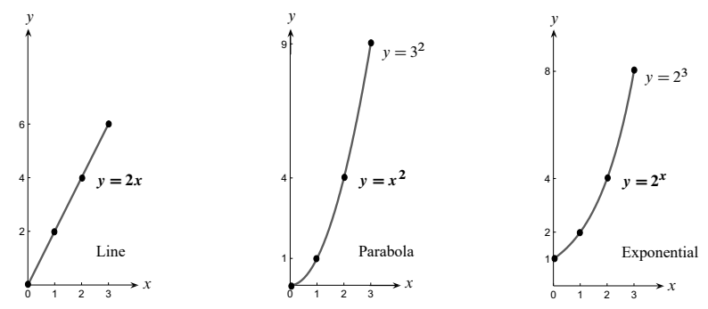
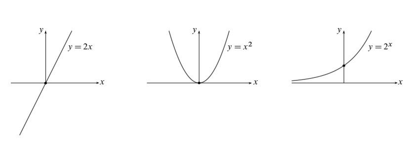
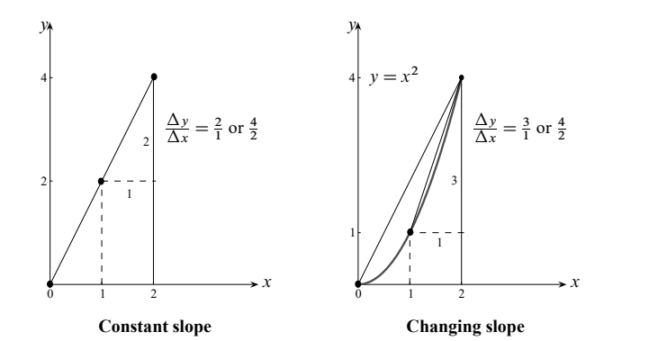
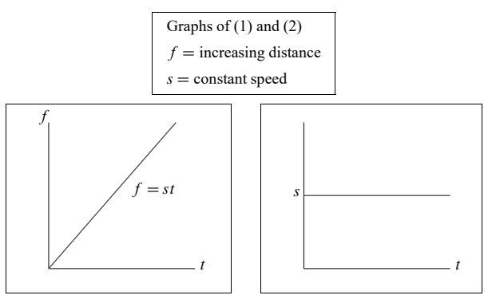
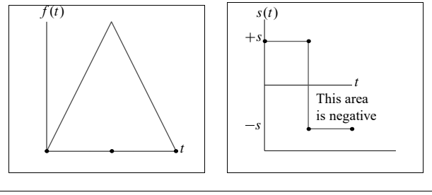
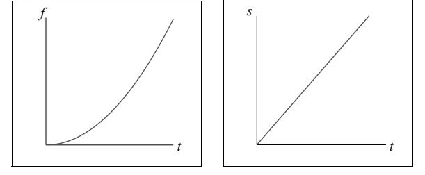
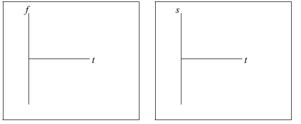

# 第 0 章　微积分要点

## 0.1 路程与速率／高度与斜率

来源：PDF 第 14–21 页，印刷页 1–8。状态：初译，已对照原页图像自校，待复审。原图保留英文标签，下方给出中文对照。

<!-- PDF 14 / 印刷页 1 -->

微积分研究函数。第一句话我就用了“函数”这个词，因为缺了它，我们就没法往前走。别的词也一样，学起来有两条路：给它下定义，再把它用起来。

我相信，先看函数的例子，再用“函数”这个词去解释它们，学起来又快又管用。下面先给三个例子：

| 名称 | 表达式 |
| --- | --- |
| 线性函数 | $y(x)=2x$ |
| 平方函数 | $y(x)=x^2$ |
| 指数函数 | $y(x)=2^x$ |

头一点：它们并不相同！三个公式里，2 与 $x$ 的结合方式差得很远。把图像画出来——这是理解函数的好办法——你就能看到：$x$ 为正时，三个函数都在递增，斜率都为正。

输入 $x$ 增大，也就是向右移动；输出 $y$ 也增大，图像往上走。三个函数的增长速率各不相同。

图内文字：Line，直线；Parabola，抛物线；Exponential，指数曲线。

<!-- PDF 15 / 印刷页 2 -->

起点 $x=0$ 附近，第一个函数增长最快，可另外两个很快就追上来。$x=2$ 时，三条图像等高，都是 $y=4$。过了这一点，第二条图像 $y=x^2$ 开始领先。到 $x=3$，平方函数升到 $y=3^2=9$，第三条图像却还只有 $y=2^3=8$。

别被眼前的情形骗了，最后赢的是指数函数。$x=4$ 时它追平平方函数——$4^2$ 和 $2^4$ 都是 16。再往后，$y=2^x$ 超过 $y=x^2$，一路领先。到 $x=10$，第三条图像已升到 $y=2^{10}=1024$，平方函数才 $y=10^2=100$。

这三条图像，一条直线、一条抛物线、一条指数曲线。直线的增长速率恒定；抛物线的增长速率越变越大；指数曲线的增长速率本身也按指数规律增大。我特意点出这几条，是因为微积分的核心就在研究增长速率。

微分学的全部要义，就是找出函数的增长速率，再用上这条信息。所以这里同时有两个函数：原来的函数，和它的增长速率。在沿着这条要紧的路往下走之前，先给函数 $y(x)$ 一个用得上的定义：

**函数具有输入 $x$ 和输出 $y(x)$；它给每一个 $x$ 指定唯一一个 $y$。**

输入 $x$ 取自函数的“定义域”（domain）。前面的图里，定义域是所有满足 $x\geq0$ 的数。输出 $y$ 组成函数的“值域”（range）。前两个函数 $y=2x$ 和 $y=x^2$，值域都是所有满足 $y\geq0$ 的数。可对 $y=2^x$ 来说，定义域取 $x\geq0$ 时，值域只有 $y\geq1$。

这些例子太重要，所以也让 $x$ 取负值。三个函数的图像如下。严格说，这已经是新的函数了：定义域扩到了全体实数 $x$。注意，三者的值域也各不相同：

- $y=2x$ 的值域是全体实数。
- $y=x^2$ 的值域是全体非负实数，即 $y\geq0$。
- $y=2^x$ 的值域是全体正实数，即 $y>0$。

关于函数，再补一句，微积分就可以开场了。描述函数最常用的办法有三种，我们都见过了：

1. 给出公式，由 $x$ 求 $y$。例如 $y(x)=2x$。
2. 给出图像，显示 $x$（横向距离）和 $y$（竖向距离）。
3. 给出输入与输出的配对：$x$ 在定义域里，$y$ 在值域里。

<!-- PDF 16 / 印刷页 3 -->

往抽象里说，“函数”就是所有这些输入—输出有序对组成的集合。也可以说：函数是一条规则，它给定义域里的每个输入 $x$ 指定值域里的一个输出 $y$。

这件事，学别的词时也常碰到。论逻辑，定义该排在前面；可真学起来，先看用这个词的例子，反而能把定义理解得更透。学别的词大概如此，学微积分大概也如此。例子给出一般想法，定义说得更精确。两头合起来，才算弄对。

本书开头说“微积分研究函数”。现在，得把这句话往前推一步。

### 成对的函数

**微积分研究成对的函数。**不妨把它们叫作函数（1）和函数（2）。前面三条图像——$y=2x$、$y=x^2$、$y=2^x$——就是函数（1）的三个例子。接着我们讨论了它们的增长速率。**函数（1）的增长速率，就是函数（2）。**第一个任务，就是求一个函数的增长速率。微分学从函数（1）的公式出发，目标是得出函数（2）的公式。

先说微积分是怎么干活的。要算 $x$ 一变、$y$ 变多快，有两条路：

**方法 1（极限）：**写出

$$
\frac{y\text{ 的变化量}}{x\text{ 的变化量}}=\frac{\Delta y}{\Delta x},
$$

再求这个比值在 $\Delta x\to0$ 时的极限。

**方法 2（法则）：**运用法则，从已知的增长速率得到新的增长速率。

每遇到一个新函数 $y(x)$，先看看能不能照某条法则，从已知函数把它造出来。学微积分，重要的一课就是认清从已有函数造新函数的各种路子。认清了，再套相应的增长速率法则。

假设新函数没法由已知函数造出来（例如 $2^x$ 没法由这里的 $2x$ 或 $x^2$ 直接得到），那就必须直接求它的增长速率。“直接”的意思是算一个极限，把函数（2）算出来。极限是什么、怎么算，本书都会讲。

还是先从例子入手——这几乎总是最好的办法。眼下这三个函数，增长速率 $\mathrm{d}y/\mathrm{d}x$ 如下：

|  | 线性函数 | 平方函数 | 指数函数 |
| --- | --- | --- | --- |
| 函数（1） | $y=2x$ | $y=x^2$ | $y=2^x$ |
| 函数（2） | $\mathrm{d}y/\mathrm{d}x=2$ | $\mathrm{d}y/\mathrm{d}x=2x$ | $\mathrm{d}y/\mathrm{d}x=2^x\ln2$ |

线性函数 $y=2x$ 的增长速率恒为 $\mathrm{d}y/\mathrm{d}x=2$。本节先迈最容易的第一步，也正好借机把增长速率和图像的斜率接上：竖向距离比横向距离，$2x/x$，得 2。

第 0.2 节再往前一步：平方函数 $y=x^2$ 的增长速率 $\mathrm{d}y/\mathrm{d}x=2x$，是个线性函数。（这一步要用到极限，也就是微积分的地基。）然后就可以请出最初的两条法则：

- **常数倍法则：**$Cy(x)$ 的增长速率等于 $y(x)$ 的增长速率乘以常数 $C$。
- **和的法则：**$y_1+y_2$ 的增长速率等于这两个函数增长速率之和。

<!-- PDF 17 / 印刷页 4 -->

第一条法则说，$y=5x^2$ 的增长速率是 $10x$，也就是把 $2x$ 乘上常数因子 $C=5$。第二条法则说，$y_1+y_2=5x^2+2x$ 的增长速率是 $10x+2$。注意，我们顺手就把 $5x^2$ 看成了一个增长速率已知的函数 $y_1$。两条合起来，$y_1$ 与 $y_2$ 的任意“线性组合”的增长速率就都求得出：

**$C_1y_1+C_2y_2$ 的增长速率，是相同系数下的组合**

$$
C_1\frac{\mathrm{d}y_1}{\mathrm{d}x}+C_2\frac{\mathrm{d}y_2}{\mathrm{d}x}.
$$

换句话说，从函数（1）走到函数（2），这一步是线性的。$y=x^2-x$ 的斜率是 $\mathrm{d}y/\mathrm{d}x=2x-1$。法则简单，却极要紧。

最后，第 0.3 节讲指数函数 $y=2^x$ 和 $y=e^x$。头一件事是弄清它们的含义：“2 的 $\pi$ 次幂”到底指什么？$2^3=8$、$2^4=16$，这我们懂；可怎么让 2 自乘 $\pi$ 次？

碰到 $e^x$，就见到了微积分的一项伟大创造。这函数有个了不起的性质：$\mathrm{d}y/\mathrm{d}x=y$，斜率等于函数值。这要用到奇妙的数 $e$。此前的代数里从没见过它——只有取到适当的极限，它才出现。

所以，开头这几节要算出三种基本函数的增长速率。现在可以来看 $y=2x$ 了。

### 图像的斜率

**斜率等于竖向变化量除以横向变化量。**现在看函数 $y(x)$ 的图像。“横向距离”是输入从 $x_1$ 到 $x_2$ 的变化量 $x_2-x_1$；“竖向距离”是输出从 $y_1$ 到 $y_2$ 的变化量 $y_2-y_1$。$y_2-y_1$ 比 $x_2-x_1$ 大得多时，斜率就大，图像也陡。用 $y$ 的变化量除以 $x$ 的变化量，正合我们平常对斜率的理解：

$$
\text{平均斜率}
=\frac{y\text{ 的变化量}}{x\text{ 的变化量}}
=\frac{y_2-y_1}{x_2-x_1}
=\frac{\Delta y}{\Delta x}. \tag{1}
$$

这里请出很有用的希腊字母 $\Delta$（delta），专门表示变化量。从 $x_1$ 到 $x_2$，我们走一步 $\Delta x$；对应地，图像高度 $y(x)$ 变了 $\Delta y=y_2-y_1$。$\Delta y$ 比 $\Delta x$，就是从 $x_1$ 到 $x_2$ 的平均斜率。斜率说的就是图像有多陡。[译注 1]

关键在于：我必须说“平均”，因为斜率可能沿途变化。$y=x^2$ 的图像，斜率就在不断增大。$x_1=1$ 与 $x_2=2$ 之间，$y=x^2$ 的平均斜率是多少？拿 $\Delta y$ 除以 $\Delta x$：

$$
\begin{aligned}
x_1=1&\text{ 时， }y_1=1,\\
x_2=2&\text{ 时， }y_2=4,\\
\text{平均斜率}&=\frac{4-1}{2-1}=\frac{\Delta y}{\Delta x}=3.
\end{aligned}
$$

换成 $x_1=0$ 与 $x_2=2$，答案就不同了，不是 3。$x^2$ 这张图，正是微积分要对付的问题：斜率会变，速率也会变。

图像 $y=2x$ 的斜率恒定：竖向变化量 $\Delta y$ 与横向变化量 $\Delta x$ 之比，永远是 2：

$$
\text{恒定斜率}\qquad
\frac{\Delta y}{\Delta x}
=\frac{y_2-y_1}{x_2-x_1}
=\frac{2x_2-2x_1}{x_2-x_1}=2.
$$

这里的数学简单，正好腾出空来强调这些词语和思想：

**函数（1）＝图像的高度；函数（2）＝图像的斜率。**

<!-- PDF 18 / 印刷页 5 -->

图内文字：Constant slope，恒定斜率；Changing slope，变化的斜率。左图的比值为 $2/1$ 或 $4/2$；右图的比值为 $3/1$ 或 $4/2$。

函数（1）取 $y=Cx$ 时，比值 $\Delta y/\Delta x$ 恒等于 $C$。线性函数的斜率是常数。汽车以恒定速率行驶，得到的也是同一对函数：

**函数（1）＝行驶路程＝$Ct$；函数（2）＝汽车的速率＝$C$。**

函数（1）画成图像，变化率就是斜率。函数（1）量的是行驶路程，变化率就是速率（或速度）；函数（1）量的是我们的身高，变化率就是身高的增长速率。[译注 2]

第一点：函数到处都是。到了微积分里，函数成对出现——函数（2）就是函数（1）的变化率。

第二点：函数（1）和函数（2）的计量单位不同。这很自然：

$$
\left(\text{速率，单位为英里/小时}\right)
\times\left(\text{时间，单位为小时}\right)
=\left(\text{路程，单位为英里}\right),
$$

$$
\left(\text{增长速率，单位为英寸/年}\right)
\times\left(\text{时间，单位为年}\right)
=\left(\text{高度，单位为英寸}\right).
$$

时间按秒算、路程按米算，速率自然就是米每秒。三个量里选定两个的单位，第三个就跟着定了。函数（2）总少不了一次除法：$\Delta y$ 除以 $\Delta x$，或者路程除以时间。[译注 3]

接下来才是微积分里精细又扎手的地方。我们要某一点的斜率，也要某一时刻的速率。时间间隔为零，变化率又是什么？

在同一个点上，横向变化量 $\Delta x=0$，竖向变化量也 $\Delta y=0$。形式上，比值就成了 $0/0$。微积分的巧思，就在于给这个式子一个有用的意思。[译注 4]

<!-- PDF 19 / 印刷页 6 -->

### 整体图景

微积分把函数（1）和函数（2）连起来：**函数（2）是函数（1）的变化率。**

| 函数（1） | 函数（2） |
| --- | --- |
| 行驶路程 $f(t)$ | 速率 $s(t)=\mathrm{d}f/\mathrm{d}t$ |
| 图像高度 $y(x)$ | 斜率 $s(x)=\mathrm{d}y/\mathrm{d}x$ |

函数（2）告诉你函数（1）变得有多快。

**关键关系：**

$$
\text{恒定速率 }s=\frac{\text{路程 }f}{\text{时间 }t},
\qquad
\text{恒定斜率 }s=\frac{\text{竖向变化量}}{\text{横向变化量}}.
$$

函数（1）和函数（2）的图像摆在一起：$f$ 是不断变长的路程，$s$ 是恒定的速率。

$$
f\text{ 图像的斜率}
=\frac{\text{竖向变化量}}{\text{横向变化量}}
=\frac{st}{t}=s,
$$

$$
s\text{ 图像下的面积}=\text{矩形面积}=st=f.
$$

现在让汽车倒着开回来：

- 速度为负。
- 相对起点的位置降回零。
- $s(t)$ 图像“下方”的总有向面积为零。[译注 2]

图内文字 This area is negative：这部分有向面积为负。

<!-- PDF 20 / 印刷页 7 -->

**速率不断增大的例子：**这时，路程的图像越来越陡。

$$
f=10t^2,\qquad s=20t.
$$

速率变化时，光靠代数就不够了；把 $s=f/t$ 当成瞬时速率的公式，是错的。

不过下面两条关系照样成立：

$$
s\text{ 图像下的面积}
=\text{三角形面积}
=\frac12(t)(20t)=10t^2=f,
$$

$$
s=f\text{ 图像的斜率}
=\frac{\mathrm{d}f}{\mathrm{d}t}
=f\text{ 的“导数”}.
$$

当 $f$ 递增时，斜率 $s$ 为正。

当 $f$ 递减时，斜率 $s$ 为负。

当 $f$ 取得最大值或最小值时，斜率 $s$ 为零。[译注 5]

任意函数 $f(t)$ 与 $f(t)+10$ 的图像，在每个 $t$ 处斜率都相同。

要从 $\mathrm{d}f/\mathrm{d}t$ 还原函数（1），也就是 $f$，知道起点高度 $f(0)$ 会大有帮助。[译注 6]

<!-- PDF 21 / 印刷页 8 -->

### 练习题

1. 画一张函数 $f(t)$ 的图像：先升、再降、又升。再画一张与之相符的斜率图像。

2. 世界人口 $f(t)$ 起先增长缓慢，如今增长迅速，往后又会慢慢放缓——我们希望如此，也预期如此。它也许会同某个极限靠拢，大约 120 亿或 140 亿。画出 $f(t)$ 及其斜率 $s(t)=\mathrm{d}f/\mathrm{d}t$ 的图像。

3. 设 $t\leq1$ 时 $f(t)=2t$，而 $t\geq1$ 时 $f(t)=3t+2$。描述斜率函数 $s(t)$ 的图像。比较图像下方截至 $t=3$ 的面积与 $f(3)$。[译注 7]

4. 画出 $f(t)=\cos t$ 的图像，再随手勾出它的斜率图像。哪些角度 $t$ 上斜率为零？（$f(t)$ 的图像“平坦”时，斜率为零。）

5. 设 $f(t)$ 的图像像大写字母 W。描述它的斜率函数 $s(t)=\mathrm{d}f/\mathrm{d}t$ 的图像。$s$ 图像下方的总有向面积是多少？[译注 8]

6. 火车以恒定速率 $s$ 跑了路程 $f$。车厢里一名乘客以步行速率 $S$ 向前走了路程 $F$。这名乘客一共走了多远？速率是多少？（距离以车站为参照。）

### 译注

1. 变化量可以为负。斜率的正负表示上升或下降，陡峭程度由斜率的绝对值反映；所有差商均要求分母非零。
2. 原文交替使用 distance、speed 和 velocity。倒车示意图中的 $f$ 会减少，$s$ 会为负，因此这里的 $f$ 实际表示相对起点的位置，$s$ 表示带符号的速度，并非累计路程和非负速率。本译稿在该图解处按实际数学含义译出；其他提及 speed (or velocity) 的句子保留原文并列关系。
3. 这里的直接相乘关系针对恒定变化率；“高度”应理解为高度增量，或假定初始高度为零。变速情况下不能用任一时刻的速率直接乘总时间求总路程。
4. $0/0$ 没有定义。导数通过非零增量下的差商取极限得到，并非给 $0/0$ 指定数值。
5. 原书此处是图像直观概括。可导的单调递增函数在某点的导数也可能为零；单调递减同理。极值处导数为零须以该点为定义区间内点且函数在该点可导为前提。端点或尖点极值不能直接套用此结论。
6. 在区间上由导数唯一确定函数，还需要一个初始值；不指定初始值时只能确定到一个加法常数。
7. **原题条件冲突，未擅改：**原页确实同时写 $t\leq1$ 和 $t\geq1$，在 $t=1$ 分别给出 2 和 5，不能定义一个单值函数。即使只将一个不等号改成严格不等号，仍存在跳跃，不能不加说明地把各段导数的积分当作整个函数的净变化量。须核实作者勘误或明确题意后才能定稿。
8. W 形图像若有尖角，则该处导数不存在；“总面积”按本节语境理解为指定整段上的有向面积，其值取决于两个端点的高度。题目未给出精确函数与区间，不应擅自补成唯一的定量题。
