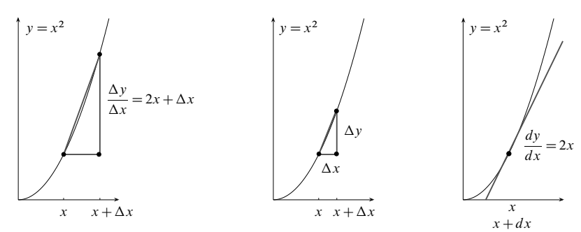
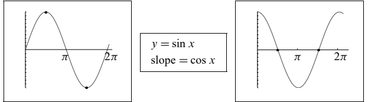

## 0.2 $y=x^2$ 与 $y=x^n$ 的变化斜率

来源：PDF 第 22–27 页，印刷页 9–14。状态：初译，已对照原页图像自校，待复审。

<!-- PDF 22 / 印刷页 9 -->

三个例子里，第二个是 $y=x^2$。沿着曲线往上走，斜率也在变。平均斜率仍然是 $\Delta y/\Delta x$，可那还不是我们最终要的东西。微分学有两个关键问题，非回答不可：

**“某一点处的斜率”究竟是什么意思？又该怎么算？**

我的视频讲座“整体图景：导数”讲的也是这些问题。学微积分的人，很快都会撞上同一个疑问：单看某一个时刻，什么变化都没发生，那“变化率”是什么意思？这个问题问得好。

答案分两步。先由代数给出 $\Delta y/\Delta x$，再由微积分求出 $\mathrm{d}y/\mathrm{d}x$。$\mathrm{d}y$ 和 $\mathrm{d}x$ 是无穷短的步长，形式上就像是在看 $0/0$。想拿它去定义 $\mathrm{d}y$、$\mathrm{d}x$ 和 $0/0$，并不明智，我也不会这么做。管用的办法，是看清一点：$\Delta y$ 与 $\Delta x$ 的比值本身定义得清清楚楚，而这两个数可以变得非常小。**若这个比值 $\Delta y/\Delta x$ 趋于一个极限，我们就有了完整的答案：**

**在 $x$ 处的斜率，是下列比值在 $\Delta x\to0$ 时的极限：**

$$
\frac{\Delta y}{\Delta x}
=\frac{y(x+\Delta x)-y(x)}{\Delta x}.
$$

横向跨过去，从 $x$ 到 $x+\Delta x$，距离就是 $\Delta x$；竖向升上去，是从 $y(x)$ 到 $y(x+\Delta x)$。$y=x^2$ 时，代数能直接给出 $\Delta y/\Delta x$：

$$
\frac{\Delta y}{\Delta x}
=\frac{(x+\Delta x)^2-x^2}{\Delta x}
=\frac{x^2+2x\Delta x+(\Delta x)^2-x^2}{\Delta x}
=2x+\Delta x.
$$

注意这一步计算！$x^2$ 与 $-x^2$ 一开头就相消了。关键项是 $2x\Delta x$：$\Delta y$ 的主要部分，正是靠这个“一阶项”撑起来的。本例中的“二阶项”为 $(\Delta x)^2$。除以 $\Delta x$ 之后，它仍然很小；步长 $\Delta x$ 趋于零时，$(\Delta x)^2/\Delta x$ 也就趋于零。[译注 1]

**取极限 $\Delta x\to0$，就得到一点处的斜率 $\mathrm{d}y/\mathrm{d}x$。**除以 $\Delta x$ 后，一阶项留了下来，更高阶的项趋于零：

$$
\text{一点处的斜率}\qquad
\frac{\mathrm{d}y}{\mathrm{d}x}
=\lim_{\Delta x\to0}\frac{\Delta y}{\Delta x}
=\lim_{\Delta x\to0}(2x+\Delta x)=2x.
$$

代数给出的是 $\Delta y/\Delta x$；到了极限这一步，微积分给出 $\mathrm{d}y/\mathrm{d}x$。看看图，这几步的几何意思就清楚了。竖向变化量比横向变化量，$\Delta y/\Delta x$，就是图上两点之间的斜率。取极限时，两点合到一处；$\Delta y/\Delta x$ 于是趋于单独一点处的斜率 $\mathrm{d}y/\mathrm{d}x$。

<!-- PDF 23 / 印刷页 10 -->

前两幅图里，连接两点的彩色线段叫“弦”。它们一步步逼近第三幅图中的那条彩色直线——那条线只在一处碰到曲线。这就是曲线的“切线”。[译注 2] 微分学的想法，就落在这一句上：

$$
\text{切线的斜率}=\text{曲线的斜率}
=\text{函数（2）}=\frac{\mathrm{d}y}{\mathrm{d}x}=2x.
$$

要找这条切线的方程，还得回到代数。选定一个具体的 $x_0$；在 $x$ 轴上这个位置的正上方，图的高度是 $y_0=x_0^2$。图在该点的切线斜率是 $\mathrm{d}y/\mathrm{d}x=2x_0$。**我们要的，是经过该点、斜率等于这个值的直线方程。**

$$
\text{切线方程}\qquad y-y_0=(2x_0)(x-x_0). \tag{1}
$$

把 $x=x_0$、$y=y_0$ 代进去，方程变成 $0=0$。这说明该点满足方程，确实在直线上。再看，直线的斜率与曲线的斜率 $2x_0$ 相同。两边同除以 $x-x_0$，就看得很直接：

$$
\frac{\text{竖向变化量}}{\text{横向变化量}}
=\frac{y-y_0}{x-x_0}=2x_0,
$$

这正是所需的斜率 $\mathrm{d}y/\mathrm{d}x$。[译注 3]

再说一遍：$y=x^2$ 的图是弯的，切线是直的。在相切点附近，这条直线贴着曲线，贴得尽可能近。切线给出了非线性函数 $y=x^2$ 的线性近似：

$$
\text{线性近似}\qquad
y\approx y_0+(2x_0)(x-x_0)
=y_0+\frac{\mathrm{d}y}{\mathrm{d}x}(x-x_0). \tag{2}
$$

我只是把式（1）里的 $y_0$ 移到了右边，再把等号换成表示“近似相等”的符号 $\approx$：曲线会弯，对曲线上的一般点就不能写等号。这里的导数取在 $x_0$ 处。

后面会用到的一点：这种弯曲，与 $y=x^2$ 的二阶导数有关。

<!-- PDF 24 / 印刷页 11 -->

### 二阶导数

一阶导数就是斜率 $\mathrm{d}y/\mathrm{d}x=2x$。**二阶导数，是斜率函数的斜率。**碰巧，$2x$ 的斜率上一节已经求过了：很容易，就是常数 2。注意，“斜率的斜率”这个符号写作 $\mathrm{d}^2y/\mathrm{d}x^2$：

$$
\frac{\mathrm{d}y}{\mathrm{d}x}=2x
\quad\text{的斜率为}\quad
\frac{\mathrm{d}^2y}{\mathrm{d}x^2}=2. \tag{3}
$$

换成平常的话：一阶导数 $\mathrm{d}y/\mathrm{d}x$ 说明函数 $y(x)$ 变化得有多快；二阶导数说明我们是在加速，还是在减速。[译注 4] $y=x^2$ 这个例子显然在加速：图越来越陡，曲线向上弯，切线也跟着陡起来。

再看 $x=0$ 左边，$x$ 取负值时的 $y=x^2$。图一路降向零，斜率显然是负的，可曲线照样向上弯！代数与这张图一致：在 $x=0$ 左侧，斜率 $\mathrm{d}y/\mathrm{d}x=2x$ 为负，二阶导数 $\mathrm{d}^2y/\mathrm{d}x^2=2$ 仍然是正的。

经济学家或投资者，三个量都要看。$y(x)$ 说明经济处在什么水平；$\mathrm{d}y/\mathrm{d}x$ 说明它朝哪边走——短期看，走势贴着切线；真正透露较长期预测的，是 $\mathrm{d}^2y/\mathrm{d}x^2$。我写下这几句话时，经济衰退已近尾声——但愿如此。$\mathrm{d}y/\mathrm{d}x$ 一直为负，叫我遗憾；$\mathrm{d}^2y/\mathrm{d}x^2$ 近来为正，又叫我高兴。

### 路程、速度与加速度

开车是 $y(x)$、$\mathrm{d}y/\mathrm{d}x$ 和 $\mathrm{d}^2y/\mathrm{d}x^2$ 的好例子。函数 $y$ 是行驶的距离，它的变化率（一阶导数）是速度；速度的变化率（二阶导数）是加速度。踩着油门，这三个量都会为正。踩着刹车，距离和速度大概仍然为正，加速度却是负的：速度在往下掉。那么，倒着车踩刹车，又是怎么回事？[译注 4]

- 速度为负——车正在后退。
- 速度的数值在增大，也就是负值的绝对值在减小。
- 加速度为正，因为速度的数值在增大。

视频讲座里开了个玩笑，说汽车制造商不懂微积分。仪表盘上的里程表不会朝零倒退——若要用它记录这里的位置，倒车时就该倒退。速率表不会显示负数——若要记录这里的带符号速度，它就该能显示。至于加速度，我的车上根本没有表。宇宙飞船有加速度计，飞机大概也有。常听说宇航员或试飞员要承受好几个 $g$。地球引力之下，自由落体的通常加速度就是一个 $g$。俯冲的飞机和起飞的火箭，二阶导数都很大；火箭可能几乎还没动，却已经在拼命加速。[译注 5]

这个运动例子还有一点很管用：自变量的字母，自然该用 $t$，而不是 $x$。距离是时间的函数。图的斜率仍是竖向变化量除以横向变化量，只是此处对应的比值换成了距离的变化量除以时间的变化量：

$$
\text{从 }t\text{ 到 }t+\Delta t\text{ 的平均速度}
\quad\frac{\Delta y}{\Delta t}
=\frac{y(t+\Delta t)-y(t)}{\Delta t},
$$

$$
t\text{ 时刻的速度（瞬时速度）}
\quad\frac{\mathrm{d}y}{\mathrm{d}t}
=\lim_{\Delta t\to0}\frac{\Delta y}{\Delta t}.
$$

<!-- PDF 25 / 印刷页 12 -->

“变化率”和“增长速率”这两个词，容易让我们想到 $t$；“斜率”则容易让我们想到 $x$。但微积分并不在意我们使用什么字母。若把行驶距离画成时间的函数，横向的 $x$ 轴便成为 $t$ 轴；图的斜率就成为速度——这里用 velocity 比 speed 更准确。

下面介绍一个微积分教材中不常见的概念：**二阶差分**。一阶差分 $\Delta y=y(t+\Delta t)-y(t)$，我们已经知道，它是 $y$ 的变化量。二阶差分 $\Delta^2y$，则是相邻两个一阶差分相减：

$$
\begin{aligned}
\Delta^2y
&=\bigl(y(t+\Delta t)-y(t)\bigr)
-\bigl(y(t)-y(t-\Delta t)\bigr),\\
\frac{\Delta^2y}{(\Delta t)^2}
&\longrightarrow\frac{\mathrm{d}^2y}{\mathrm{d}t^2}.
\end{aligned} \tag{4}
$$

$\Delta^2y$ 化简得 $y(t+\Delta t)-2y(t)+y(t-\Delta t)$。除以 $(\Delta t)^2$，就能近似算出加速度。取 $\Delta t\to0$ 的极限，这个比值成为二阶导数 $\mathrm{d}^2y/\mathrm{d}t^2$。[译注 6]

### $y=x^n$ 的斜率

$y=x^2$ 的斜率是 $\mathrm{d}y/\mathrm{d}x=2x$。接下来，我要算 $y=x^3$、$y=x^4$，以及后面各次幂 $y=x^n$ 的斜率。第 2.2 节还会再求一次 $x^n$ 的增长速率，不过有两个理由，让我们提前把这些导数找出来：

1. 规律很简单：每个幂函数 $y=x^n$ 的斜率都是 $\mathrm{d}y/\mathrm{d}x=nx^{n-1}$。
2. 这样，下一节就能介绍 $y=e^x$。这个奇妙的函数满足 $\mathrm{d}y/\mathrm{d}x=y$。

当然，$y=x^2$ 也合这条规律。指数降 1，由 $n=2$ 变成 $n-1=1$；再拿 $n=2$ 去乘这个低一次的幂，就得到 $nx^{n-1}=2x$。

**$y=x^3$ 的斜率是 $\mathrm{d}y/\mathrm{d}x=3x^2$。**看看 $3x^2$ 怎样从 $\Delta y/\Delta x$ 里冒出来：

$$
\frac{\Delta y}{\Delta x}
=\frac{(x+\Delta x)^3-x^3}{\Delta x}
=\frac{x^3+3x^2\Delta x+3x(\Delta x)^2+(\Delta x)^3-x^3}{\Delta x}. \tag{5}
$$

把 $x^3$ 与 $-x^3$ 消掉，再除以 $\Delta x$：

$$
\text{平均斜率}\qquad
\frac{\Delta y}{\Delta x}=3x^2+3x\Delta x+(\Delta x)^2.
$$

步长 $\Delta x$ 趋于零，极限值 $\mathrm{d}y/\mathrm{d}x$ 就是 $3x^2$，也就是 $nx^{n-1}$。

要把这条规律推广到 $n=4,5,6,\ldots$，唯一麻烦的地方是展开 $(x+\Delta x)^n$。$n=3$ 时，我们已经在式（5）里把它乘开过。展开式的第一项总是 $x^n$。我们断言，下一项——也就是 $\Delta y$ 中关于 $\Delta x$ 的“一阶项”——为 $nx^{n-1}\Delta x$。把它除以 $\Delta x$，答案就出来了：$y(x)=x^n$ 的导数 $nx^{n-1}$。

这一项 $nx^{n-1}\Delta x$ 是怎么看出来的？前面的乘法已经表明，$n=2$ 和 3 时，相应的项正是 $2x\Delta x$ 和 $3x^2\Delta x$。从 $n=3$ 可以推到 $n=4$：

$$
\begin{aligned}
(x+\Delta x)^4
&=(x+\Delta x)^3(x+\Delta x)\\
&=(x^3+3x^2\Delta x+\cdots)(x+\Delta x).
\end{aligned}
$$

乘开以后，前两项是 $x^4$ 和 $4x^3\Delta x$，正是我们想要的样子。用同样的办法，可以从每一个 $n$ 推到下一个 $n$，这就叫“归纳法”。各次幂 $x^4,x^5,\ldots,x^n$ 的导数分别是 $4x^3,5x^4,\ldots,nx^{n-1}$。

<!-- PDF 26 / 印刷页 13 -->

第 2.2 节会给出一个略有不同的证明。讲“乘积法则”的那段视频还解释了另一种办法：把 $x^{n+1}$ 看成 $x^n$ 与 $x$ 的乘积，套用 $y_1y_2$ 的斜率法则：

$$
\text{乘积法则}\qquad
(y_1y_2)\text{ 的斜率}
=y_2(y_1\text{ 的斜率})+y_1(y_2\text{ 的斜率}). \tag{6}
$$

取 $y_1=x^n$、$y_2=x$，$y_1y_2=x^{n+1}$ 的正确斜率就出来了：

$$
x(x^n\text{ 的斜率})+x^n(x\text{ 的斜率})
=x(nx^{n-1})+x^n(1)=(n+1)x^n. \tag{7}
$$

同样，也可以让 $n$ 一步一步往上加。不久还会看到一个真正有价值的事实：这个导数公式适用于所有幂函数 $y=x^n$。指数 $n$ 可以是负数、分数，乃至任意实数；其斜率 $\mathrm{d}y/\mathrm{d}x$ 都为 $nx^{n-1}$。[译注 7]

把 $x$ 的不同次幂组合起来，任意“多项式”的斜率都能求。例如，$y=x+x^2/2+x^3/3$。根据和的求导法则，逐项计算：

$$
\frac{\mathrm{d}}{\mathrm{d}x}
\left(x+\frac{x^2}{2}+\frac{x^3}{3}\right)=1+x+x^2.
$$

斜率的斜率为 $\mathrm{d}^2y/\mathrm{d}x^2=1+2x$，四阶导数则为零！

### 要点回顾

函数（1）给出每个 $x$ 处的高度 $y$。要问的是 $x$ 处的“瞬时斜率”；这一斜率 $s(x)$ 记作 $\mathrm{d}y/\mathrm{d}x$，它就是函数（2）。

**关键：**当 $\Delta x\to0$ 时，

$$
\frac{\Delta y}{\Delta x}
=\frac{y(x+\Delta x)-y(x)}{\Delta x}
=\frac{\text{竖向变化量}}{\text{横向变化量}}
\longrightarrow\frac{\mathrm{d}y}{\mathrm{d}x}.
$$

要算函数 $y=x^3$ 的瞬时斜率 $\mathrm{d}y/\mathrm{d}x$，先求 $x$ 与 $x+\Delta x$ 之间的平均斜率：

$$
\text{平均斜率}=\frac{\Delta y}{\Delta x}
=\frac{(x+\Delta x)^3-x^3}{\Delta x}.
$$

写出 $(x+\Delta x)^3=x^3+3x^2\Delta x+3x(\Delta x)^2+(\Delta x)^3$。减去 $x^3$，再除以 $\Delta x$：

$$
\frac{\Delta y}{\Delta x}
=\frac{3x^2\Delta x+3x(\Delta x)^2+(\Delta x)^3}{\Delta x}
=3x^2+3x\Delta x+(\Delta x)^2.
$$

当 $\Delta x\to0$，便得到 $\mathrm{d}y/\mathrm{d}x=3x^2$。一般公式为

$$
\frac{\mathrm{d}}{\mathrm{d}x}(x^n)=nx^{n-1}.
$$

$y=Cx^n$ 的斜率为 $Cnx^{n-1}$；例如，$y=7x^2$ 的斜率就是 $\mathrm{d}y/\mathrm{d}x=14x$。

$$
y\text{ 乘以 }C
\ \Longrightarrow\ \Delta y\text{ 乘以 }C
\ \Longrightarrow\ \frac{\mathrm{d}y}{\mathrm{d}x}\text{ 乘以 }C.
$$

<!-- PDF 27 / 印刷页 14 -->

**一个漂亮的事实：**$y=\sin x$ 的斜率为 $\mathrm{d}y/\mathrm{d}x=\cos x$。看图就知道，这很合理。起点处的斜率为 1，后面再予以证明。

图内文字：$y=\sin x$；slope $=\cos x$，即斜率等于 $\cos x$。

- 正弦曲线上升时，余弦函数的值大于零。
- 正弦曲线到最高点，平了；这时余弦函数在第一个标记点处取零。
- 正弦曲线下降时，余弦函数的值在两个标记点之间小于零。
- 正弦曲线到最低点，又平了；这时余弦函数在第二个标记点处回到零。

### 练习题

1. 对于 $y=2x^3$，从 $x=1$ 到 $x=2$ 的平均斜率 $\Delta y/\Delta x$ 是多少？
2. $y=2x^3$ 在 $x=1$ 处的瞬时斜率是多少？$\mathrm{d}^2y/\mathrm{d}x^2$ 是多少？
3. $y=x^n$ 的导数为 $\mathrm{d}y/\mathrm{d}x=nx^{n-1}$。当 $y(x)=1/x=x^{-1}$ 时，$\mathrm{d}y/\mathrm{d}x$ 是多少？
4. 对于 $y=x^{-1}$，从 $x=1/2$ 到 $x=1$ 的平均斜率 $\Delta y/\Delta x$ 是多少？
5. $y=x^{-1}$ 在 $x=1/2$ 处的瞬时斜率是多少？
6. 假设 $y(x)$ 的图像不断上升，在 $x=1$ 处达到最大值，然后在 $x>1$ 时转为下降。

   **6A.** 在 $x<1$ 和 $x>1$ 时，$\mathrm{d}y/\mathrm{d}x$ 分别是什么符号？

   **6B.** 在 $x=1$ 处的瞬时斜率是多少？[译注 8]

7. 若 $y=\sin x$，写出任意点 $x$ 处差商 $\Delta y/\Delta x$ 的表达式。我们稍后会看到，这个差商趋近于 $\cos x$。

### 译注

1. 差商中始终取 $\Delta x\ne0$。“一阶项构成主要部分”针对固定 $x\ne0$ 且步长足够小的情形；当 $x=0$ 时，一阶项为零，仍可由完整差商求得导数为零。
2. “只在一个点相接”适用于这里的抛物线示意图，不是一般切线的定义。一般曲线的切线可以穿过曲线，也可能在别处再次相交。
3. 除以 $x-x_0$ 时要求 $x\ne x_0$；原来的直线方程在 $x=x_0$ 处仍成立。式（2）的导数在相切点 $x_0$ 处计算，不能理解为随近似点 $x$ 变化的 $2x$。
4. 原书以 speed、distance 说明随后包含倒车的模型。本节运动段落统一将带符号的一阶导数称为“速度”，其中 $y$ 须理解为相对所选原点的位置。加速度为正表示速度数值增大，不一定表示速率增大；是否加速还要结合速度方向。关于踩油门后“三者为正”的说法，隐含了正向行驶及位置为正等示例条件。
5. 仪表段保留作者的幽默意图。实际里程表和速率表本来就分别记录累计路程与非负速率，不能因此判定设计有误。关于若干个 $g$ 的表述是直观类比；加速度计读数与选定参考系中的位置二阶导数也不应无条件等同。
6. 式（4）是等步长的中心二阶差分；在例如 $y$ 于该点邻域二阶连续可导的条件下，上述极限成立，不能仅凭差分形式便断言任意函数都有二阶导数。
7. 本节归纳证明首先适用于正整数指数。推广到任意实数指数时，至少在 $x>0$ 上可使用该公式；$x\leq0$ 是否有定义、是否可导，须依指数类型分别判断。
8. 第 6 题按光滑图像理解；最大值点导数为零须有可导条件。严格单调本身也不排除个别点导数为零。三角函数求导公式默认以弧度为角度单位。
