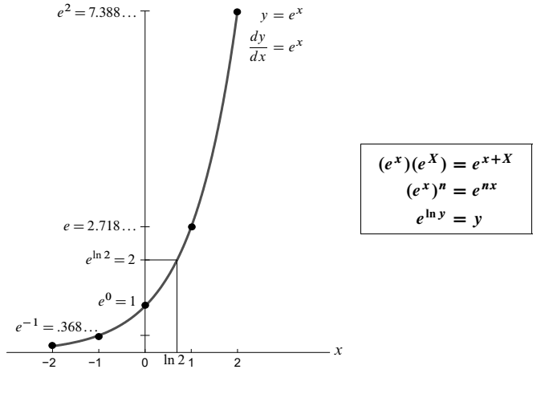

## 0.3 指数函数 $y=e^x$

来源：PDF 第 28–35 页，印刷页 15–22。状态：初译，已对照原页图像自校，待复审。有关利率和银行的叙述按原书示例翻译，不作现状更新。

<!-- PDF 28 / 印刷页 15 -->

微积分造出的伟大函数，是指数函数 $y=e^x$。引入它的方式不止一种，本书第 6.2 节就提到了五种。这里，我讲目前自己最喜欢的一种：利用 $x^n$ 的导数——这是我们最先学到的东西。

每种方法都绕不开一个“取极限的步骤”。所以，奇妙的数 $e=2.7\ldots$ 在代数里始终不出现（$e$ 不是有理数）。问题在于这个极限在哪里取，而我的答案，从下面这个非凡的事实开始：**当 $y=e^x$ 是函数（1）时，它也是函数（2）。**

**指数函数 $y=e^x$ 满足方程**

$$
\frac{\mathrm{d}y}{\mathrm{d}x}=y.
$$

**函数值等于自身图像的斜率。**这是我们头一回遇到微分方程：它把一个未知函数 $y$ 和它的导数连在一起。运气不错，$\mathrm{d}y/\mathrm{d}x=y$ 正是最重要的微分方程——别的方程都想照着它的样子来。

我还要再加一个条件，把 $y=2e^x$、$y=8e^x$ 这样的解排除掉。一旦 $y=e^x$ 满足方程，任意常数倍 $Ce^x$ 也都满足。（$C=2$ 或 $C=8$ 会同时出现在 $\mathrm{d}y/\mathrm{d}x=y$ 的两边，正好约去。）$x=0$ 时，$e^0$ 应当是正数 $e$ 的“零次幂”，而任何非零数的零次幂都是 1。所以，我们要求 $y=e^x$ 在 $x=0$ 时等于 1：

**$y=e^x$ 是满足初始条件 $y(0)=1$ 的方程 $\mathrm{d}y/\mathrm{d}x=y$ 的解。**

解方程之前，先看看它说的是什么。$y$ 在 $x=0$ 时从 1 起步，斜率也是 1，于是 $y$ 往上走。$\mathrm{d}y/\mathrm{d}x$ 也跟着涨，始终等于 $y$——$y$ 就涨得更快。函数值越高，图像越陡。这就是“指数增长”的意思。

### 引入 $e^x$

指数增长其实很平常，也合情合理。银行给你的存款计息，利息和存款金额成正比。利息一进本金，余额就高了；下一次的利息，又按更高的余额算。你的财富就这样一步一步，按“几何级数”往上长。

本节末尾，我会回到连续复利：利息不再一年加一次，而是每一刻都在加。“连续”这个词，其实是在提醒你：该用微积分了。从每年、每月、每天、每秒，走到每一刻，中间都要取一次极限。利息不会因此变成无穷多，但它确实会按指数增长。

我也会讲讲引入 $e^x$ 的其他路子。这么重要的问题，本来就有许多答案！我喜欢下面的式（1），因为每个幂函数 $x^n$ 的导数我们都知道。把式（1）各项分别求导，居然又回到了 $e^x$——真是奇妙。于是，这个和满足 $\mathrm{d}y/\mathrm{d}x=y$，还正好从我们想要的 $y(0)=1$ 出发。

难处在于，这个和把所有的幂 $x^n$ 都收了进来，是个无穷级数。等我一步一步推下去，你就会看到：这些幂次一个都不能少。至于这个无穷级数，我先请你相信这些运算都成立：把级数加起来，得到 $e^x$；把各项的导数加起来，又能看出 $e^x$ 的斜率还是 $e^x$。对我来说，只用 $x^n$ 就能办成这件事，这个好处实在太大。[译注 1]

<!-- PDF 29 / 印刷页 16 -->

### 构造 $y=e^x$

下面我一步一步解 $\mathrm{d}y/\mathrm{d}x=y$。起点是 $y=1$，这就要求 $\mathrm{d}y/\mathrm{d}x=1$。先照原书的逐步修正过程，写成：

$$
\begin{array}{c|c|c}
\text{起始要求}&\text{修改 }y&\text{更新对导数的要求}\\
y=1&y=1+x&y=1+x\\
\mathrm{d}y/\mathrm{d}x=1&\mathrm{d}y/\mathrm{d}x=1&\mathrm{d}y/\mathrm{d}x=1+x
\end{array}
$$

第一次修改后，$y=1+x$ 的导数确实是 $\mathrm{d}y/\mathrm{d}x=1$。可要让导数继续等于 $y$，目标导数就得改成 $1+x$。事情还没完：

$$
\begin{array}{c}
y=1+x,\quad \text{要求 }\mathrm{d}y/\mathrm{d}x=1+x\\
\Downarrow\\
\text{把 }y\text{ 更新为 }1+x+\frac12x^2\\
\Downarrow\\
\text{再把目标导数更新为 }1+x+\frac12x^2.
\end{array}
$$

多出来的 $\tfrac12x^2$，正好在导数里补上了所需的 $x$。可为了让导数等于 $y$，导数里也得有 $\tfrac12x^2$。这样一来，又需要一个新项，它的导数正好是 $\tfrac12x^2$。

这个新项就是 $x^3/6$。$x^n$ 的导数是 $nx^{n-1}$，所以得除以 $n$，把求导带出来的因子约掉。$x^3/6$ 的导数是 $3x^2/6=\tfrac12x^2$，正合需要。再往下是 $x^4/24$：

$$
\frac{x^3}{6}=\frac{x^3}{(3)(2)(1)}
\quad\text{的斜率为}\quad\frac{x^2}{(2)(1)},
$$

$$
\frac{x^4}{24}=\frac{x^4}{(4)(3)(2)(1)}
\quad\text{的斜率为}\quad
\frac{4x^3}{(4)(3)(2)(1)}=\frac{x^3}{6}.
$$

规律越来越清楚了：$x^n$ 这一项，要除以 $n$ 的阶乘，也就是 $n!=n(n-1)\cdots1$。前五个正整数的阶乘依次是 $1,2,6,24,120$。**$x^n/n!$ 求导，正好得到前面那一项 $x^{n-1}/(n-1)!$**——因子 $n$ 约掉了。只要一直不停，这个无穷多项的和就确实满足 $\mathrm{d}y/\mathrm{d}x=y$：

$$
y(x)=e^x
=1+x+\frac12x^2+\frac16x^3+\cdots+\frac1{n!}x^n+\cdots. \tag{1}
$$

往这个级数里代入 $x=10$，无穷多项加起来，会是一个有限的数 $e^{10}$ 吗？会的。$n!$ 比 $10^n$ 增长快得多——比任意固定 $x$ 对应的 $x^n$ 也快得多。所以，当 $n\to\infty$ 时，“指数级数”里的项 $x^n/n!$ 会变得非常小。数学分析可以证明：这个级数的和，也就是 $y=e^x$，确实满足 $\mathrm{d}y/\mathrm{d}x=y$。

**附注 1。**先回顾一个熟悉的级数：

$$
1+\frac12+\frac14+\frac18+\cdots=2.
$$

把公比 $1/2$ 换成 $x$，就成了几何级数 $1+x+x^2+x^3+\cdots$，它的和是 $1/(1-x)$。[译注 2] 这是数学里最重要的级数，可到了 $x=1$ 就出问题：无穷和 $1+1+1+1+\cdots$ 不“收敛”。

我要强调一句：$e^x$ 的级数对每个实数 $x$ 都能放心使用。因为幂 $x^n$ 除以的是增长极快的阶乘 $n!$。在进一步学习收敛与发散之前，先认识这个例子，很值得。

**附注 2。**$e^x$ 的级数还可以这样看：从 $x^n$ 出发，一连求 $n$ 次导。先得 $nx^{n-1}$，再得 $n(n-1)x^{n-2}$。最后，$n$ 阶导数是 $n(n-1)(n-2)\cdots1\,x^0$，也就是 $n!$。再除以这个数，$x^n/n!$ 的 $n$ 阶导数就等于 1。

再看 $e^x$：不管求几阶导，结果还是 $e^x$，在 $x=0$ 时全都等于 1。这个级数在起点 $x=0$ 处，把函数 $e^x$ 的每一阶导数都对上了。

<!-- PDF 30 / 印刷页 17 -->

**在指数级数中令 $x=1$，**就得到奇妙的数 $e^1=e$：

$$
e=1+1+\frac12+\frac16+\frac1{24}+\frac1{120}+\cdots. \tag{2}
$$

前三项加起来是 2.5，前五项已经接近 2.71。可无论加多少项，都到不了 2.72。再多加一些——要加多少项呢？——就能超过 2.71828。可以断定，$e$ 不是有理数。它在代数里从不出现，却是微积分的关键常数。

### 相乘时指数相加

我们写 $e^2$，就像写 $3^2$ 一样自然。可 $e$ 乘 $e$，真的等于 $e^2$ 吗？到目前为止，$e$ 和 $e^2$ 都还是把 $x=1$、$x=2$ 代进无穷级数算出来的。美妙的地方在于：对每个 $x$，这个级数给出的确实就是“数 $e$ 的 $x$ 次幂”。$x=-1$ 时得到 $e^{-1}$，也就是 $1/e$：

$$
e^{-1}=\frac1e
=1-1+\frac12-\frac16+\frac1{24}-\frac1{120}+\cdots.
$$

把 $1/e$ 的这个级数乘以 $e$ 的级数，乘出来就是 1。

最好的办法，是直接看一般的乘积 $e^x e^X$。指数相加法则说，结果应当是 $e^{x+X}$；级数也得给出同样的答案。当 $x=1$、$X=-1$ 时，这条法则把 $e^1e^{-1}$ 变成 $e^0$。

$$
\text{指数相加}\qquad (e^x)(e^X)=e^{x+X}. \tag{3}
$$

到目前为止，我们只从无穷级数认识 $e^x$ 和 $e^X$。要证明这条重要法则，可以把两个级数乘起来，再认出结果正是 $e^{x+X}$ 的级数。先看开头几项：

$$
\begin{aligned}
e^x&=1+x+\tfrac12x^2+\tfrac16x^3+\cdots,\\
e^X&=1+X+\tfrac12X^2+\tfrac16X^3+\cdots,\\
(e^x)(e^X)&=1+x+X+\tfrac12x^2+xX+\tfrac12X^2+\cdots.
\end{aligned} \tag{4}
$$

一眼就能看到 $x+X$。你能在式（4）里找出 $\tfrac12(x+X)^2$ 吗？不难：

$$
\frac12(x+X)^2=\frac12(x^2+2xX+X^2),
$$

恰好对上二次项。三次项要多算几步，不过照样成立：

$$
\frac16(x+X)^3
=\frac16x^3+\frac36x^2X+\frac36xX^2+\frac16X^3,
$$

和式（4）里接下来的各项对得上。

到了 $x+X$ 的更高次幂，就得动用二项式定理——或者，先对数学规律抱一份适当的信任。$e^x$ 与 $e^X$ 相乘时，$x^nX^m$ 的系数为 $(1/n!)(1/m!)$。再到 $e^{x+X}$ 的级数里找同一项：

$$
\frac{(x+X)^{n+m}}{(n+m)!}
\quad\text{包含}\quad
\frac{x^nX^m}{(n+m)!}\frac{(n+m)!}{n!m!}
=\frac{x^nX^m}{n!m!}. \tag{5}
$$

<!-- PDF 31 / 印刷页 18 -->

这个二项式系数 $(n+m)!/(n!m!)$，精明的赌徒也认得。它数的是：从 $n+m$ 张 A 里选出 $n$ 张，有多少种选法。4 张 A 里选 2 张，共有 $4!/(2!2!)=6$ 种。换成数学家的说法，就是从四个位置 $xxxx$ 里挑两个位置放 $x$，共有 6 种挑法。这个 6，就是 $(x+X)^4$ 中 $x^2X^2$ 的系数。

这个系数 6 出现在四次项中，还要除以 $4!$，得到 $1/4$。另一边，$e^x$ 与 $e^X$ 相乘时，$\tfrac12x^2$ 乘以 $\tfrac12X^2$，得到的系数也是 $1/4$。所有项都对得上，不过这里不再逐一展开；我们接受 $(e^x)(e^X)=e^{x+X}$ 已经得到验证。[译注 1]

**附注。**还有一种办法，借 $\mathrm{d}y/\mathrm{d}x=y$ 来说明乘法法则。从 $x=0$、$y=1$ 出发，顺着这个方程走；走到 $x$，函数值就是 $e^x$。再往前走 $X$，就到了 $e^{x+X}$。

注意，后一段从 $e^x$ 而不是从 1 开始，因此后一段里的 $e^X$ 要乘以初始值 $e^x$。所以 $e^x e^X$ 必须等于 $e^{x+X}$。这就是用微分方程证明指数相加法则的办法。就我个人而言，把级数乘开、逐项对上，就已经很让人满意了。[译注 3]

这条法则马上给出 $e^x e^x=e^{x+x}=e^{2x}$。再乘一次 $e^x$，得到 $(e^x)^3=e^{2x+x}=e^{3x}$。于是，重复相乘 $(e^x)^n=(e^x)(e^x)\cdots(e^x)$ 的新法则就出来了：

$$
\text{指数相乘}\qquad (e^x)^n=e^{nx}. \tag{6}
$$

对 $n=1,2,3,\ldots$，这很容易看出来；接着可以推广到 $n=-1,-2,-3,\ldots$。它对任意实数 $x$ 和 $n$ 都成立。

最后一句里的“任意实数”很要紧。微积分要真正发展起来，就得跟所有实数指数打交道，不能只停在整数或分数上。无穷级数（1）为每个 $x$ 定义了 $e^x$，我们已经走上这条路了。图像如下：**函数（1）＝函数（2）＝$e^x=\exp(x)$。**

图内关系：$y=e^x$，$\mathrm{d}y/\mathrm{d}x=e^x$，$e^0=1$，$e^{\ln2}=2$，$(e^x)(e^X)=e^{x+X}$，$(e^x)^n=e^{nx}$，$e^{\ln y}=y$。图中的近似数值与符号问题见译注 4。

<!-- PDF 32 / 印刷页 19 -->

### 指数函数 $2^x$ 与 $b^x$

我们知道 $2^3=8$、$2^4=16$，可 $2^\pi$ 到底是什么意思？一种办法，是拿 $3.14=314/100$ 来代替 $\pi$，先求个近似。只要指数是分数，就暂时用不着微积分：

$$
\text{分数次幂}\qquad
2^{314/100}=\left(2^{1/100}\right)^{314},
$$

也就是先求 2 的正 100 次方根，再取它的 314 次幂。

可它只是“接近”$2^\pi$。再说，到了微积分里，我们还要知道曲线 $y=2^x$ 的斜率。好办法是把 $2^x$ 与 $e^x$ 联系起来，因为后者的斜率已知，仍是 $e^x$。所以，问题就变成把 2 与 $e$ 联系起来。

关键的数是 **2 的自然对数**，记作 $\ln2$。它回答的是：$e$ 的几次幂等于 2？这个次数就是它。$e^x$ 的图像上，专门标出了它：

$$
e^{\ln2}=2.
$$

$\ln2$ 大约是 $7/10$，计算器能给出精确得多的值。在 $y=e^x$ 的图像上，$x$ 轴上的 $\ln2$ 对应 $y$ 轴上的 2。

这个例子里，我们先定下输出 $y=2$，再反过来找输入 $x=\ln2$。方向正好和“已知 $x$ 求 $y$”相反。“对数关系 $x=\ln y$ 是指数关系 $y=e^x$ 的逆关系。”第 4.3 节和两讲视频会解释这个想法；反函数并不总是这么简单。

现在，$2^x$ 对每个实数 $x$ 都有意义了。有了满足 $2=e^{\ln2}$ 的 $\ln2$，就可以把两边同时取 $x$ 次幂：

$$
2=e^{\ln2},\qquad 2^x=e^{x\ln2}. \tag{7}
$$

$e$ 的所有实数次幂，都已经由无穷级数定义好了。新函数 $2^x$ 也按指数规律增长，只是没有 $e^x$ 那么快，因为 2 小于 $e$。把 $e^x$ 的图像沿水平方向拉开，就能得到 $2^x$ 的图像。这一拉，对应点的斜率就乘上常数因子 $\ln2$。算一下：

$$
\frac{\mathrm{d}}{\mathrm{d}x}2^x
=\frac{\mathrm{d}}{\mathrm{d}x}e^{x\ln2}
=(\ln2)e^{x\ln2}=(\ln2)2^x.
$$

对任意正数 $b$，同样的办法给出函数 $y=b^x$。先找自然对数 $\ln b$，让 $b=e^{\ln b}$；这个对数可能为正、为负，或为零。再把两边同时取 $x$ 次幂：

$$
b=e^{\ln b},\qquad b^x=e^{x\ln b},\qquad
\frac{\mathrm{d}}{\mathrm{d}x}b^x=(\ln b)b^x. \tag{8}
$$

当 $b=e$——最理想的选择——时，$\ln b=\ln e=1$。当 $b=e^n$ 时，$\ln b=\ln(e^n)=n$。**“对数就是指数。”**由于级数为每个 $x$ 都定义了 $e^x$，这个指数可以是任意实数。

我还想提一句欧拉的伟大公式 $e^{ix}=\cos x+i\sin x$。指数 $ix$ 成了虚数；你知道 $i^2=-1$。在 $90^\circ$ 和 $180^\circ$，也就是 $x=\pi/2$ 和 $x=\pi$ 时，老老实实代入 $\cos x+i\sin x$，就得到两个惊人的事实：

$$
e^{i\pi/2}=i,\qquad e^{i\pi}=-1. \tag{9}
$$

这些等式可不是凭空“虚构”出来的——它们来自 $e^x$ 的那个伟大级数。

<!-- PDF 33 / 印刷页 20 -->

### 连续复利

还有一条不同而重要的路，也能得到 $e$ 和 $e^x$：它不从无穷级数出发。我们用许多小步来解关键方程 $\mathrm{d}y/\mathrm{d}x=y$。步长趋于零时——极限总是躲不掉！——小步的近似解就变成精确解 $y=e^x$。

这个想法可以用两种语言来讲；每走一步，都乘以 $1+\Delta x$：

1. **复利。**每过一段 $\Delta x$，就把利息加进 $y$。下一步从更大的金额起步，$y$ 便按指数规律增长。
2. **有限差分。**用一小步的差商 $\Delta Y/\Delta x$，代替连续模型里的导数：

$$
\frac{\mathrm{d}y}{\mathrm{d}x}=y
\quad\longrightarrow\quad
\frac{Y(x+\Delta x)-Y(x)}{\Delta x}=Y(x),
\qquad Y(0)=1. \tag{10}
$$

这就是欧拉近似法。$\Delta x\to0$ 时，$Y(x)$ 趋于 $y(x)$。

下面算一算：把一年分成 12 个月，再分成 365 天，复利各是多少。年利率为 100%，初始金额 $Y(0)$ 是 1 美元。只在年末计息一次，便得到 $Y(1)=2$ 美元。

改成每月计息，每次拿年利率 100% 的 $1/12$，一共 12 次。于是 $Y$ 每月乘 $1+1/12$；换句话说，你每有 1 美元，银行就加上 $1/12$ 美元。乘上 12 次，最终金额从 2 美元涨到约 2.61 美元：

$$
\text{12 个月后}\qquad Y(1)=\left(1+\frac1{12}\right)^{12}\approx2.61\quad\text{（美元）}.
$$

再看每日计息。最初的 1 美元，要连续乘 $1+1/365$，一共 365 次：

$$
\text{365 天后}\qquad Y(1)=\left(1+\frac1{365}\right)^{365}\approx2.71\quad\text{（美元，接近 }e\text{）}.
$$

很少有银行按分钟计息，更没人把一年切成 $N=31\,536\,000$ 秒来算。这样得到的金额，比 2.71 美元也多不到 1 美分。不过，不少银行愿意采用连续复利，也就是取 $N\to\infty$ 的极限。一年之后，你会得到 $e$ 美元：

$$
\left(1+\frac1N\right)^N\longrightarrow e=2.718\ldots
\qquad(N\to\infty). \tag{11}
$$

你也可以按 100% 的年利率投资 $x$ 年。把这段时间分成 $N$ 步，每步就是 $x/N$ 年；银行每步都乘 $1+x/N$。其中的 1 保住你已有的余额，$x/N$ 则加上这一步的利息。走完 $N$ 步，结果就接近 $e^x$：

$$
\left(1+\frac{x}{N}\right)^N\longrightarrow e^x
\qquad(N\to\infty). \tag{12}
$$

最后，把年利率换成 $a$，投资时间仍为 $x$ 年。微分方程从 $\mathrm{d}y/\mathrm{d}x=y$ 变成 $\mathrm{d}y/\mathrm{d}x=ay$。指数函数照样能解，只不过解换成了 $y=e^{ax}$：

$$
\frac{\mathrm{d}y}{\mathrm{d}x}=ay
\quad\text{的一个解是}\quad y(x)=e^{ax}. \tag{13}
$$

<!-- PDF 34 / 印刷页 21 -->

把级数 $e^{ax}=1+ax+\tfrac12(ax)^2+\cdots$ 写出来，再求导：

$$
\frac{\mathrm{d}}{\mathrm{d}x}(e^{ax})
=a+a^2x+\cdots
=a(1+ax+\cdots)=ae^{ax}. \tag{14}
$$

$e^{ax}$ 求导，会多带出一个因子 $a$；所以 $y=e^{ax}$ 满足 $\mathrm{d}y/\mathrm{d}x=ay$。

### 要点回顾：指数函数 $y=e^x$

我们要找一个函数：它的导数 $\mathrm{d}y/\mathrm{d}x$ 等于它自己，记作 $y(x)$。这是一个微分方程！初始条件是：$x=0$ 时 $y=1$。

**无穷级数：**

$$
y(x)=1+x+\frac{x^2}{2!}+\frac{x^3}{3!}+\cdots+\frac{x^n}{n!}+\cdots.
$$

**逐项求导：**

$$
\frac{\mathrm{d}y}{\mathrm{d}x}
=0+1+x+\frac{x^2}{2!}+\cdots+\frac{x^{n-1}}{(n-1)!}+\cdots.
$$

一项一项对下来，$\mathrm{d}y/\mathrm{d}x$ 与 $y$ 完全一致。取极限这一步，就是把这个级数加起来。$n!=n(n-1)\cdots1$ 比固定 $x$ 的 $x^n$ 增长快得多，所以各项会变得很小。

当 $x=1$ 时，$y(1)$ 这个数就叫 $e$。把 $x=1$ 代进级数，得到

$$
e=1+1+\frac12+\frac16+\frac1{24}+\cdots=2.71828\ldots.
$$

**目标：**说明对每个 $x$，$y(x)$ 都等于 $e^x$；级数给出的是 $e$ 的幂。

检查级数守不守指数相加法则，例如 $e^2e^3=e^5$。把 $e^x$ 与 $e^X$ 的级数直接相乘，就得到 $e^{x+X}$：

$$
\left(1+x+\tfrac12x^2\right)
\left(1+X+\tfrac12X^2\right)
$$

给出的正是 $e^{x+X}$ 开头那几项

$$
1+(x+X)+\tfrac12(x+X)^2+\cdots.
$$

完整级数里更高的那些项，也照样吻合。这个级数对**每一个实数** $x$ 都给出 $e^x$，不只适用于整数。

**检验：**

$$
\frac{\mathrm{d}e^x}{\mathrm{d}x}
=\lim_{\Delta x\to0}\frac{e^{x+\Delta x}-e^x}{\Delta x}
=e^x\left(\lim_{\Delta x\to0}\frac{e^{\Delta x}-1}{\Delta x}\right)=e^x.
$$

确实如此！**第二条关键法则：**对任意实数 $x,n$，$(e^x)^n=e^{nx}$。

另一种引入 $e^x$ 的办法，用的是连乘，而不是无穷求和。从 1 美元开始，按年利率 $x$ 每日计息；连续乘 $1+x/365$，一共 365 次，年末就有 $(1+x/365)^{365}$ 美元。若一年计息 $n$ 次，年末金额就是

$$
\left(1+\frac{x}{n}\right)^n\longrightarrow e^x
\qquad(n\to\infty).
$$

我们是在 $n$ 个小步长 $\Delta x$ 上解 $\Delta Y/\Delta x=Y$；取极限后，解就满足 $\mathrm{d}y/\mathrm{d}x=y$。[译注 6]

<!-- PDF 35 / 印刷页 22 -->

### 练习题

1. $x^{10}/10!$ 的导数是什么？$x^9/9!$ 的导数又是什么？
2. 怎样看出 $n\to\infty$ 时 $x^n/n!$ 会变小？从 $x/1$ 和 $x^2/2$ 开始，它们可能很大，但接着依次乘以 $x/3,x/4,\ldots$，这些因子的绝对值会变小。
3. 为什么 $1/e^x$ 与 $e^{-x}$ 相同？分别利用式（3）和式（6）说明。
4. 为什么 $e^{-1}=1-1+\tfrac12-\tfrac16+\cdots$ 介于 $1/3$ 与 $1/2$ 之间？由此便有 $2<e<3$。
5. 你能解满足 $y(0)=3$ 的方程 $\mathrm{d}y/\mathrm{d}x=y$ 吗？为什么 $y=3e^x$ 是正确答案？注意，3 是乘在 $e^x$ 前面的。
6. 你能解满足 $y(0)=1$ 的方程 $\mathrm{d}y/\mathrm{d}x=5y$ 吗？为什么 $y=e^{5x}$ 是正确答案？注意，5 在指数中！
7. 当 $\Delta x$ 趋于零时，为什么 $(e^{\Delta x}-1)/\Delta x$ 趋于 1？利用 $e^{\Delta x}$ 的级数说明。
8. 只需将 $y=e^x$ 的图像关于 $45^\circ$ 直线 $y=x$ 对称，画出 $x=\ln y$ 的图像。记住，$y$ 始终为正，而 $x=\ln y$ 可以为负。[译注 7]
9. $1+\ln2+\tfrac12(\ln2)^2+\tfrac1{3!}(\ln2)^3+\cdots$ 的精确和是多少？
10. 若把 $\ln2$ 换成 0.7，前面列出的四项之和是多少？
11. 根据欧拉公式 $e^{ix}=\cos x+i\sin x$，$e^{2\pi i}$ 是什么数？
12. $(1+1/10)^{10}$ 与 $e$ 相差多少？
13. 当 $N\to\infty$ 时，$(1+1/N)^{2N}$ 的极限是多少？

### 译注

1. 构造过程中的“更新导数”是更新目标方程右侧，并不表示每一步写出的多项式已等于自身导数。无穷级数的收敛、逐项求导以及乘积重排都需要论证；指数幂级数对所有实数绝对收敛，并可在每个有界闭区间逐项求导。本节按作者安排先介绍结果，不能仅由通项趋零推断任意级数收敛。
2. 几何级数 $1+x+x^2+\cdots=1/(1-x)$ 的成立条件是 $|x|<1$。此处原文未在公式旁写明；$x=1$ 只是发散情形之一。
3. 微分方程证明还使用了相同初始条件下解的唯一性，以及方程的平移和常数倍性质。将整数指数法则推广到任意实数指数，也不只是有限次连乘，需要实数幂的定义或连续性论证。
4. 原图把 $e^2$ 标为 $7.388\ldots$，该数值有误；实际 $e^2\approx7.389056$。原图 $e^{-1}=.368\ldots$ 应视为约数，实际 $e^{-1}\approx0.367879$。原图保留，错误在此明确记录；另有 $e^{\ln y}=y$ 要求 $y>0$。
5. 原书复利示例把保留两位小数的金额用等号连接。本译稿明确使用近似号：$(1+1/12)^{12}\approx2.613035$，$(1+1/365)^{365}\approx2.714567$。这里的 100% 是示例名义年利率。式（13）的解还沿用 $y(0)=1$；一般解为 $Ce^{ax}$。原文说 $\ln b$ 可正可负，译文补明 $b=1$ 时为零。
6. 正文先以 $x$ 表示投资年数，回顾框又以 $x$ 表示年利率，这是原文的记号切换。二者都给出同一个极限式，但不能在同一次推导中混淆。将极限公式用于负实数 $x$ 时，还需取足够大的 $N$ 使 $1+x/N>0$；此时不再按“负年数投资”作字面解释。
7. **原题的变量表述冲突，未擅改：**在同一组横轴 $x$、纵轴 $y$ 下，$x=\ln y$ 与 $y=e^x$ 描述同一条曲线；把 $y=e^x$ 关于 $y=x$ 对称得到的应是 $y=\ln x$。若沿用 $x=\ln y$，须交换坐标轴角色。原题需要澄清，不应直接照字面作图。
