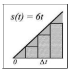
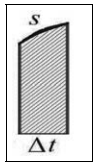
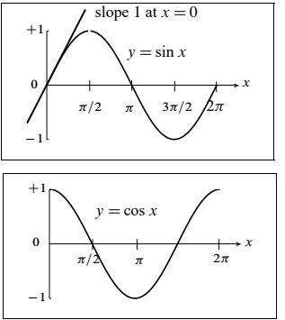
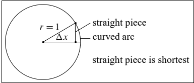
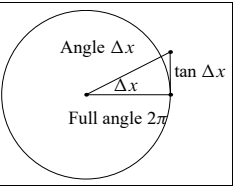
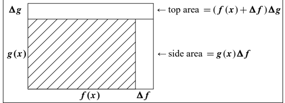
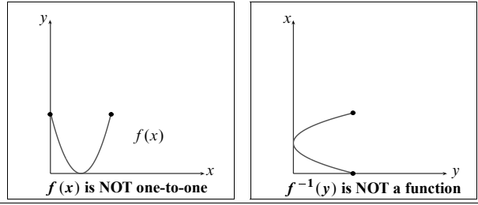

## 0.4 视频讲座概要与练习题（上）

来源：PDF 第 36–46 页，印刷页 23–33；本节后半见下一文件。2026-10-29 已逐段对照原文并核对全部十一页原图；PDF 重建与排版检查待完成。各讲练习题的编号分别从原书起算，保留原有填空。

<!-- PDF 36 / 印刷页 23 -->

这一节，是写给同时看“微积分要点”视频讲座的读者的。我写下这些话时，前五讲刚在 ocw.mit.edu 发布。第 0.1、0.2、0.3 节已经把其中三讲详细讲过；另外两讲，概要和练习题先列在本节开头：

4. 最大值、最小值与二阶导数。
5. 积分的整体图景。

第 5 讲让大家尝一口积分学。第二组视频要往微分学深处走——也就是计算和运用导数的那些法则。这会儿，第二组视频还在剪辑师手里：我写黑板，镜头就拉近；要看整体，镜头再拉远。我只向麻省理工学院开放课程团队借了一台摄像机，架在一间空教室里。反正我也不擅长看着听众；没人看着，反倒轻松！

我希望把计划为视频配套的概要和练习题印在这里，能对大家有帮助。主题如下：

6. 正弦与余弦的导数。
7. 乘积与商的求导法则。
8. 求 $f(g(x))$ 斜率的链式法则。
9. 反函数与对数。
10. 增长速率与对数坐标图。
11. 线性近似与牛顿法。
12. 描述增长的微分方程。
13. 描述运动的微分方程。
14. 幂级数与欧拉公式。
15. 六个函数、六条法则、六个定理。

最后一讲把微分学的理论收个总，其余各讲解释具体步骤。下面先看最大值与最小值那一讲写下的开头几行。

### 4. 最大值、最小值与二阶导数

要找函数 $y(x)$ 的最大值与最小值，先解 $\mathrm{d}y/\mathrm{d}x=0$，找出斜率为零的点 $x^*$，再逐点检验，看它是否可能给出极小值或极大值。

**例：**$y(x)=x^3-12x$，导数是 $\mathrm{d}y/\mathrm{d}x=3x^2-12$。解 $3x^2=12$，得 $x^*=2$ 和 $x^*=-2$。这两点处，

$$
y(2)=8-24=-16\quad\text{（极小值）},
$$

$$
y(-2)=-8+24=16\quad\text{（极大值）}.
$$

<!-- PDF 37 / 印刷页 24 -->

为什么 $x^*=2$ 是极小值点？看二阶导数

$$
\frac{\mathrm{d}}{\mathrm{d}x}\left(\frac{\mathrm{d}y}{\mathrm{d}x}\right)
=\frac{\mathrm{d}^2y}{\mathrm{d}x^2}=6x.
$$

在 $x^*=2$ 处，二阶导数为正，一阶导数递增，斜率由负转正。图像向上弯，所以 $x^*=2$ 是极小值点。

在 $x^*=-2$ 处，二阶导数为负，一阶导数递减，斜率由正转负。图像向下弯，所以 $x^*=-2$ 是极大值点。

要求 $y(x)=\sin x+\cos x$ 的最大值，可以用

$$
\frac{\mathrm{d}y}{\mathrm{d}x}=\cos x-\sin x.
$$

当 $\cos x=\sin x$ 时斜率为零，在 $x^*=45^\circ=\pi/4$ 弧度。这一点上，

$$
y=\sin\frac\pi4+\cos\frac\pi4
=\frac{\sqrt2}{2}+\frac{\sqrt2}{2}=\sqrt2.
$$

二阶导数是 $\mathrm{d}^2y/\mathrm{d}x^2=-\sin x-\cos x$，在 $x^*=\pi/4$ 处为负。图像向下弯，这一点给出极大值。

$\mathrm{d}^2y/\mathrm{d}x^2>0$，图像向上弯；$\mathrm{d}^2y/\mathrm{d}x^2<0$，图像向下弯。弯曲方向在拐点处改变，那里的二阶导数为零。

哪个 $x^*$ 能让 $y=(x-1)^2+(x-2)^2+(x-6)^2$ 最小？展开就得到

$$
y=(x^2-2x+1)+(x^2-4x+4)+(x^2-12x+36).
$$

在最小值点 $x^*$ 处，

$$
\frac{\mathrm{d}y}{\mathrm{d}x}=2x-2+2x-4+2x-12=0.
$$

于是 $6x^*=18$，$x^*=3$。最小值点正是 1、2、6 的平均数。

解最大值、最小值应用题，关键在给变量 $x$ 选一个合适的含义。

<!-- PDF 38 / 印刷页 25 -->

#### 练习题

1. 哪个 $x^*$ 让 $y(x)=x^2+2x$ 最小？解 $\mathrm{d}y/\mathrm{d}x=0$。
2. 求 $y(x)=x^2+2x$ 的二阶导数。它大于零，所以抛物线向上弯曲。
3. 求 $y(x)=2+6x-x^2$ 的最大高度。解 $\mathrm{d}y/\mathrm{d}x=0$。
4. 求二阶导数，说明上一题的抛物线向下弯曲。
5. 对 $y(x)=x^4-2x^2$，证明在 $x=-1,0,1$ 处一阶导数为零。求 $y(-1),y(0),y(1)$，再用二阶导数的符号判别极大与极小。
6. 解释为什么极小值点处有 $\mathrm{d}y/\mathrm{d}x=0$ 且 $\mathrm{d}^2y/\mathrm{d}x^2>0$。
7. 图像在 ______ 处，从向下弯曲（$\mathrm{d}^2y/\mathrm{d}x^2<0$）变为向上弯曲（$\mathrm{d}^2y/\mathrm{d}x^2>0$）。这一点上，二阶导数为零。$y=\sin x$ 有这样的点吗？
8. 设 $x+X=12$，$xX$ 的最大值是多少？这就是求 $y=x(12-x)=12x-x^2$ 的最大值。找出斜率 $\mathrm{d}y/\mathrm{d}x=12-2x$ 为零的位置；此时 $xX$ 是多少？

### 5. 积分的整体图景

**核心问题：**由导数 $\mathrm{d}y/\mathrm{d}x$ 还原原函数 $y(x)$；由速率记录求累计行驶的路程；已知从起点算起的函数（2）——斜率，求函数（1）——高度。

**最省事的办法：认出 $\mathrm{d}y/\mathrm{d}x$ 是哪个已知函数的导数。**

若 $\mathrm{d}y/\mathrm{d}x=x^3$，它的原函数就是 $y(x)=\tfrac14x^4+C$，也就是函数（1）。若 $\mathrm{d}y/\mathrm{d}x=e^{2x}$，则 $y=\tfrac12e^{2x}+C$。

积分学是微分学的逆过程。记号

$$
y(x)=\int\frac{\mathrm{d}y}{\mathrm{d}x}\,\mathrm{d}x
$$

意思是把沿途的斜率信息一点点攒起来，还原 $y(x)$。积分像求和，求导像作差。

<!-- PDF 39 / 印刷页 26 -->

| 累积值 | $y_0$ | $y_1$ | $y_2$ | $y_3$ | $y_4$ |
| --- | --- | --- | --- | --- | --- |
| 相邻差值 |  | $y_1-y_0$ | $y_2-y_1$ | $y_3-y_2$ | $y_4-y_3$ |

注意中间项会相消：$(y_1-y_0)+(y_2-y_1)=y_2-y_0$，这正是高度的变化量。把差值先除以步长 $\Delta x$，再乘回去，结果仍是

$$
\frac{y_1-y_0}{\Delta x}\Delta x+
\frac{y_2-y_1}{\Delta x}\Delta x=y_2-y_0.
$$

让 $\Delta x\to0$，和式就变成积分，给出终点与起点的高度差：

$$
\int\frac{\mathrm{d}y}{\mathrm{d}x}\,\mathrm{d}x
=y_{\rm end}-y_{\rm start}.
$$

**微积分基本定理：**

$$
\int\frac{\mathrm{d}y}{\mathrm{d}x}\,\mathrm{d}x=y(x)+C.
$$

积分把求导倒回去，还原 $y(x)$；两者互为逆运算。

**微积分基本定理的相反顺序：**

$$
\frac{\mathrm{d}}{\mathrm{d}x}\int_0^x s(t)\,\mathrm{d}t=s(x).
$$

关键问题：积分 $\int_0^x s(t)\,\mathrm{d}t$ 到底是什么意思？把一小段一小段的 ______ 加起来。

**例：**$s(t)=6t$ 表示速率和斜率都随时间增加。求 $y(t)$。

**方法 1：**$y=3t^2$ 的导数正好是所需的 $6t$。这是最省事的办法！

**方法 2：**$s(t)=6t$ 图像下方是个三角形，面积是 $3t^2$。从 0 到 $t$，底为 $t$、高为 $6t$，面积就是 $\tfrac12t(6t)$。多数形状没这么好算，面积得靠对 $s(t)$ 或 $s(x)$ 积分。

**方法 3（根本方法）：**把时间切成小段，每段近似按恒定速率算，再把路程加起来。在一步 $\Delta t$ 内，路程接近 $s(t^*)\Delta t$；$t^*$ 是这一步的起点，$s(t^*)$ 是起始速率。这段时间里速率仍略有变化，所以结果不精确。等 $\Delta t\to0$，和式趋于积分，总路程就精确了。

每一小步都对应一个瘦高的矩形：$s(t^*)\Delta t=\text{高}\times\text{底}=\text{矩形面积}$；$t^*$ 是这一步的起点。把所有的 $s(t^*)\Delta t$ 加起来，就是所有矩形的总面积。$\Delta t\to0$ 时，矩形渐渐填满三角形。$s(t)$ 的积分给出图像下方的精确面积 $y(t)$。

<!-- PDF 40 / 印刷页 27 -->

**基本定理：**面积函数 $y(t)$ 的导数，正是要找的 $s(t)$。

理由：$\Delta y$ 是 $t$ 到 $t+\Delta t$ 之间、$s(t)$ 图像下方那条窄带的面积；$\Delta t$ 是这个窄“矩形”的底，$\Delta y/\Delta t$ 是这个窄“矩形”的高度。底 $\Delta t\to0$，这个高度就趋于 $s(t)$。

#### 练习题

1. 哪些函数 $y(t)$ 的导数恒为 $s(t)=7$？
2. 从 0 到 $t$，$s(t)=7$ 图像下方的面积是多少？
3. 从 $t=0$ 到 2，求积分 $\int_0^2 7\,\mathrm{d}t=\underline{\qquad}$。
4. 哪个函数 $y(t)$ 的导数为 $s(t)=7+6t$？
5. 从 $t=0$ 到 2，求面积，即 $\int_0^2(7+6t)\,\mathrm{d}t$。
6. 在 $t=2$ 这一时刻，$\mathrm{d}(\text{面积})/\mathrm{d}t$ 是多少？
7. 从 0 到 $t$，曲线 $s=e^t$ 下方的面积**不是** $y=e^t$。当 $t$ 很小时，面积应很小，但错误答案 $e^t$ 并不小！
8. 正确面积为 $y=e^t-1$。斜率 $\mathrm{d}y/\mathrm{d}t$ 为 ______，现在初始面积 $y(0)$ 为 ______。
9. 求和也一样。注意 $(y_1-y_0)+(y_2-y_1)+(y_3-y_2)=\underline{\qquad}$ 里的 $y_0$。把 $\Delta y=(\Delta y/\Delta t)\Delta t$ 累加，极限就是对 $(\mathrm{d}y/\mathrm{d}t)\mathrm{d}t$ 积分。从 0 到 $t$，$s(t)$ 下方的面积为 $y(t)-y(0)$。

<!-- PDF 41 / 印刷页 28 -->

### 6. 正弦与余弦的导数

本讲要说明的是

$$
\frac{\mathrm{d}}{\mathrm{d}x}\sin x=\cos x,
\qquad\frac{\mathrm{d}}{\mathrm{d}x}\cos x=-\sin x.
$$

角 $x$ 必须用弧度来量：$2\pi$ 弧度就是一圈，也就是 $360^\circ$。半径取 1，绕圆一周（$2\pi$ 弧度），弧长为 $2\pi$；绕 $x$ 弧度，弧长就是 $x$。

正弦曲线在 $x=0$ 处的斜率是 1，整条曲线的斜率则是 $\cos x$：在 $x=0,\pi/2,\pi$ 处分别为 $1,0,-1$。余弦曲线的斜率是 $-\sin x$：在 $x=0,\pi/2,\pi$ 处分别为 $0,-1,0$。

难处在于

$$
\frac{\Delta y}{\Delta x}=\frac{\sin(x+\Delta x)-\sin x}{\Delta x}
$$

它不像 $\bigl((x+\Delta x)^2-x^2\bigr)/\Delta x$ 那样容易化简。有个好办法：先从 $x=0$ 下手，证明 $\sin\Delta x/\Delta x\to1$。

画个含角 $\Delta x$ 的直角三角形，一眼就能看出 $\sin\Delta x\leq\Delta x$。

图内文字：straight piece，直线段；curved arc，圆弧。直线段最短；这一段的长为 $\sin\Delta x$，弧长为 $\Delta x$，半径 $r=1$。

**思路：**用 $\sin\Delta x/\Delta x<1$ 和 $\sin\Delta x/\Delta x>\cos\Delta x$ 两边一夹，把这个比值逼向 1。

要证后一个不等式，也就是 $\tan\Delta x>\Delta x$，换一个更大的三角形来看：

图内文字：Angle，角；Full angle，周角。三角形面积 $\tfrac12(1)(\tan\Delta x)$ 比扇形面积 $\frac{\Delta x}{2\pi}\times\text{整圆面积}=\tfrac12\Delta x$ 大。

<!-- PDF 42 / 印刷页 29 -->

夹逼不等式

$$
\cos\Delta x<\frac{\sin\Delta x}{\Delta x}<1
$$

就说明 $\sin\Delta x/\Delta x$ 趋于 1。又由 $(\sin\Delta x)^2/(\Delta x)^2<1$，可得

$$
\frac{1-\cos\Delta x}{\Delta x}(1+\cos\Delta x)<\Delta x.
$$

于是 $(1-\cos\Delta x)/\Delta x\to0$，余弦曲线在原点的斜率为零。

要别的 $x$ 处的斜率，得用三角恒等式

$$
\sin(x+\Delta x)=\sin x\cos\Delta x+\cos x\sin\Delta x.
$$

我们需要的增量是 $\Delta y=\sin(x+\Delta x)-\sin x$，再除以 $\Delta x$：

$$
\frac{\Delta y}{\Delta x}
=(\sin x)\frac{\cos\Delta x-1}{\Delta x}
+(\cos x)\frac{\sin\Delta x}{\Delta x}.
$$

让 $\Delta x\to0$，取极限，得到

$$
\frac{\mathrm{d}y}{\mathrm{d}x}=(\sin x)(0)+(\cos x)(1)=\cos x.
$$

同理，对 $y=\cos x$ 用 $\cos(x+\Delta x)$ 的公式，一样得到 $\mathrm{d}y/\mathrm{d}x=-\sin x$。

#### 练习题

1. $y=\sin x$ 在 $x=\pi$ 和 $x=2\pi$ 处的斜率是多少？
2. $y=\cos x$ 在 $x=\pi/2$ 和 $x=3\pi/2$ 处的斜率是多少？
3. $(\sin x)^2$ 的斜率为 $2\sin x\cos x$，$(\cos x)^2$ 的斜率为 $-2\cos x\sin x$，所以两者之和的斜率为零。为什么？
4. $y=\sin x$ 的二阶导数，即导数的导数，是什么？
5. 在哪些角 $x$ 处，$y=\sin x+\cos x$ 的斜率为零？
6. 下面是正弦和余弦的无穷级数；此外 $e^{ix}=\cos x+i\sin x$：

$$
\sin x=\frac{x}{1}-\frac{x^3}{3\cdot2\cdot1}
+\frac{x^5}{5\cdot4\cdot3\cdot2\cdot1}-\cdots
\quad\text{（只含奇次幂）},
$$

$$
\cos x=1-\frac{x^2}{2\cdot1}
+\frac{x^4}{4\cdot3\cdot2\cdot1}-\cdots
\quad\text{（只含偶次幂）}.
$$

7. 对正弦级数求导，看出余弦级数。
8. 对余弦级数求导，看出正弦级数的相反数。
9. 这些级数说明，小角度时 $\sin x\approx x$、$\cos x\approx1-\tfrac12x^2$。把这两个近似式代进去，检查 $(\sin x)^2+(\cos x)^2$ 接近 1。

<!-- PDF 43 / 印刷页 30 -->

### 7. 乘积与商的求导法则

**目标：**已知 $\mathrm{d}f/\mathrm{d}x$ 和 $\mathrm{d}g/\mathrm{d}x$，求 $y=f(x)g(x)$ 的导数。

**思路：**把 $\Delta y=f(x+\Delta x)g(x+\Delta x)-f(x)g(x)$ 拆成含 $\Delta f$ 与 $\Delta g$ 的两块：

$$
\Delta y=f(x+\Delta x)[g(x+\Delta x)-g(x)]
+g(x)[f(x+\Delta x)-f(x)].
$$

于是

$$
\frac{\Delta y}{\Delta x}
=f(x+\Delta x)\frac{\Delta g}{\Delta x}
+g(x)\frac{\Delta f}{\Delta x}.
$$

**乘积法则：**

$$
\frac{\mathrm{d}y}{\mathrm{d}x}
=f(x)\frac{\mathrm{d}g}{\mathrm{d}x}
+g(x)\frac{\mathrm{d}f}{\mathrm{d}x}.
$$

**例：**$y=x^2\sin x$，由乘积法则得 $\mathrm{d}y/\mathrm{d}x=x^2\cos x+2x\sin x$。

图里两块无阴影区域合起来就是 $\Delta y=f(x+\Delta x)\Delta g+g(x)\Delta f$：上方那块面积为 $(f(x)+\Delta f)\Delta g$，侧边那块面积为 $g(x)\Delta f$。

**例：**取 $f(x)=x^n$、$g(x)=x$，则 $y=x^{n+1}$，

$$
\frac{\mathrm{d}y}{\mathrm{d}x}
=x^n\frac{\mathrm{d}x}{\mathrm{d}x}
+x\frac{\mathrm{d}x^n}{\mathrm{d}x}
=x^n+xnx^{n-1}=(n+1)x^n.
$$

$x^n$ 的导数对了，$x^{n+1}$ 的导数也就跟着对了。

**商的法则：**若 $y=f(x)/g(x)$，则

$$
\frac{\mathrm{d}y}{\mathrm{d}x}
=\frac{g(x)\,\mathrm{d}f/\mathrm{d}x-f(x)\,\mathrm{d}g/\mathrm{d}x}{g(x)^2}.
$$

**例：**

$$
\frac{\mathrm{d}}{\mathrm{d}x}\left(\frac{\sin x}{\cos x}\right)
=\frac{\cos x(\cos x)-\sin x(-\sin x)}{\cos^2x}
=\frac1{\cos^2x}=\sec^2x.
$$

这就是 $\tan x$ 的导数；计算中用到了 $\cos^2x+\sin^2x=1$。

**例：**

$$
\frac{\mathrm{d}}{\mathrm{d}x}\left(\frac1{x^4}\right)
=\frac{x^4\cdot0-1\cdot4x^3}{x^8}=-\frac4{x^5},
$$

这也对得上 $nx^{n-1}$ 的形式。

**证明商的法则：**

$$
\Delta y=\frac{f(x+\Delta x)}{g(x+\Delta x)}-\frac{f(x)}{g(x)}
=\frac{f+\Delta f}{g+\Delta g}-\frac fg
=\frac{g(f+\Delta f)-f(g+\Delta g)}{g(g+\Delta g)}
=\frac{g\Delta f-f\Delta g}{g(g+\Delta g)}.
$$

再除以 $\Delta x$，让 $\Delta x\to0$，商的求导法则就出来了。

<!-- PDF 44 / 印刷页 31 -->

#### 练习题

1. 用乘积法则求 $y=(x^3)(x^4)$ 的导数，化简并解释。
2. 用乘积法则求 $y=(x^2)(x^{-2})$ 的导数，化简并解释。
3. 用商的法则求 $y=\cos x/\sin x$ 的导数。
4. 用商的法则说明 $y=\sin x/x$ 在 $x=0$ 处取得最大值，斜率为零。
5. 同时用乘积法则与商的法则，求 $y=x\sin x/\cos x$ 的导数。
6. 当 $\mathrm{d}g/\mathrm{d}x=0$、$\mathrm{d}^2g/\mathrm{d}x^2>0$ 时，$g(x)$ 在该点取得极小值，图像向上弯。$y=1/g(x)$ 在同一点取得极大值；证明 $\mathrm{d}y/\mathrm{d}x=0$ 且 $\mathrm{d}^2y/\mathrm{d}x^2<0$。

### 8. 求 $f(g(x))$ 斜率的链式法则

由 $y=g(x)$、$z=f(y)$ 复合出 $z=f(g(x))$。比如 $y=x^5$、$z=y^4$，就得到 $z=(x^5)^4=x^{20}$。

平均斜率满足

$$
\frac{\Delta z}{\Delta x}
=\frac{\Delta z}{\Delta y}\frac{\Delta y}{\Delta x},
$$

把 $\Delta y$ 约掉就行。到了瞬时斜率，对应的就是**链式法则**：

$$
\frac{\mathrm{d}z}{\mathrm{d}x}
=\frac{\mathrm{d}z}{\mathrm{d}y}\frac{\mathrm{d}y}{\mathrm{d}x},
$$

看上去就像把 $\mathrm{d}y$ 约掉了。最后答案里，务必把 $y$ 换回 $g(x)$。

**例：**$z=y^4=(x^5)^4$，$\mathrm{d}z/\mathrm{d}y=4y^3$，$\mathrm{d}y/\mathrm{d}x=5x^4$。于是

$$
\frac{\mathrm{d}z}{\mathrm{d}x}=(4y^3)(5x^4)=20y^3x^4
=20(x^5)^3x^4=20x^{19}.
$$

验算：$z=x^{20}$ 的导数确实是 $20x^{19}$。

1. 求 $z=\cos(4x)$ 的导数。令 $y=4x$、$z=\cos y$，于是 $\mathrm{d}z/\mathrm{d}x=\underline{\qquad}$。
2. 求 $z=(1+4x)^2$ 的导数。令 $y=1+4x$、$z=y^2$，于是 $\mathrm{d}z/\mathrm{d}x=\underline{\qquad}$。检验：$(1+4x)^2=1+8x+16x^2$，故导数为 ______。

<!-- PDF 45 / 印刷页 32 -->

#### 练习题（续）

3. 求 $h(x)=(\sin3x)(\cos3x)$ 的导数。先用乘积法则，再对每个因子用链式法则：

$$
\begin{aligned}
\frac{\mathrm{d}h}{\mathrm{d}x}
&=(\sin3x)\frac{\mathrm{d}}{\mathrm{d}x}(\cos3x)
+(\cos3x)\frac{\mathrm{d}}{\mathrm{d}x}(\sin3x)\\
&=(\sin3x)(\text{链式法则结果})
+(\cos3x)(\text{链式法则结果})=\ ?
\end{aligned}
$$

4. 难题挑战：求 $z(x)=f(g(x))$ 的二阶导数。

一阶导数是 $\mathrm{d}z/\mathrm{d}x=(\mathrm{d}z/\mathrm{d}y)(\mathrm{d}y/\mathrm{d}x)$，即一个关于 $y(x)$ 的函数乘上一个关于 $x$ 的函数。用乘积法则：

$$
\frac{\mathrm{d}^2z}{\mathrm{d}x^2}
=\frac{\mathrm{d}z}{\mathrm{d}y}\frac{\mathrm{d}}{\mathrm{d}x}\left(\frac{\mathrm{d}y}{\mathrm{d}x}\right)
+\frac{\mathrm{d}y}{\mathrm{d}x}\frac{\mathrm{d}}{\mathrm{d}x}\left(\frac{\mathrm{d}z}{\mathrm{d}y}\right)
=\frac{\mathrm{d}z}{\mathrm{d}y}\frac{\mathrm{d}^2y}{\mathrm{d}x^2}
+\frac{\mathrm{d}y}{\mathrm{d}x}\frac{\mathrm{d}^2z}{\mathrm{d}y^2}\frac{\mathrm{d}y}{\mathrm{d}x}.
$$

注意，后一项里 $\mathrm{d}y/\mathrm{d}x$ 出现了两次！拿 $y=x^5$、$z=y^4=x^{20}$ 验算：一阶导数为 $20x^{19}$，二阶导数为 $380x^{18}$。按上式计算：

$$
(4y^3)(20x^3)+(5x^4)(12y^2)(5x^4).
$$

把 $y=x^5$ 代回去，系数 $80+300=380$，没错。

### 9. 反函数与对数

函数给每个输入 $x$ 指定一个输出 $y=f(x)$。一一函数则让不同的输入得到不同的输出。到了反函数，输入换成 $y$，输出就是 $x=f^{-1}(y)$。

**例：**若 $y=f(x)=x^5$，则 $x=f^{-1}(y)=y^{1/5}$。

**关键：**若 $y=ax+b$，解出 $x=(y-b)/a$，反函数就出来了。注意

$$
x=f^{-1}(f(x)),\qquad y=f(f^{-1}(y)).
$$

链式法则会把 $f^{-1}$ 与 $f$ 的导数连起来。

微积分里那个了不起的函数是 $y=e^x$，它的反函数是自然对数 $x=\ln y$。记住，$x$ 就是 $y=e^x$ 里的指数。由 $e^xe^X=e^{x+X}$，得

$$
\ln(yY)=\ln y+\ln Y.
$$

指数相加，对数也相加，例如 $\ln(e^2e^3)=5$。由 $(e^x)^n=e^{nx}$，又得 $\ln(y^n)=n\ln y$。

<!-- PDF 46 / 印刷页 33 -->

底数也可以从 $e$ 换成 10，得到新函数 $y=10^x$。它的反函数是以 10 为底的对数，记作 $\log$：$x=\log y$。于是 $\log100=2$、$\log(1/100)=-2$、$\log1=0$。

不久我们就会求出自然对数那个漂亮的导数：

$$
\frac{\mathrm{d}}{\mathrm{d}y}\ln y=\frac1y.
$$

换个字母，也可以写成 $\mathrm{d}(\ln x)/\mathrm{d}x=1/x$。

#### 练习题

1. 若 $y=50x$，反函数 $x=f^{-1}(y)$ 是什么？
2. 若 $y=x^4$，反函数是什么？为什么限定 $x\geq0$？
3. 画一个递增函数 $y=f(x)$ 的图像，让不同的 $x$ 对应不同的 $y$。把图像翻转、交换坐标轴，就能看到 $x=f^{-1}(y)$。
4. 下图中，两个 $x$ 对应同一个 $y$，没有 $f^{-1}(y)$。

图内文字：$f(x)$ 不是一一函数；$f^{-1}(y)$ 不是函数。

5. $y=1/e$ 的自然对数 $\ln(e^{-1})$ 是多少？$\ln\sqrt e$ 是多少？
6. $\ln1$ 是多少？以 10 为底的 $\log1$ 又是多少？
7. $(e^2)^{50}$ 的自然对数是多少？$(10^2)^{50}$ 的常用对数是多少？
8. 我认为 $\ln y=(\ln10)(\log y)$，因为 $y$ 有两种写法：$y=e^{\ln y}$，又有 $y=10^{\log y}=e^{(\ln10)(\log y)}$。解释最后这几步。
9. 再把底数从 $e$、10 换成 2：$y=2^x$ 就意味着 $x=\log_2y$。$\log_232$ 和 $\log_22$ 分别是多少？为什么 $\log_2e>1$？
