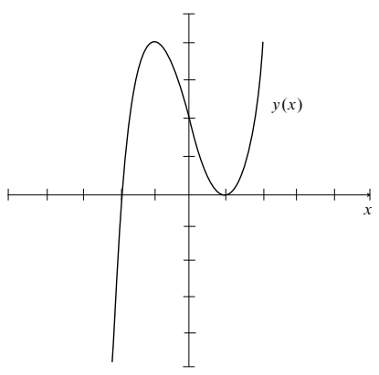
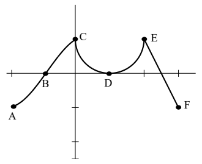

## 0.5 函数图像与图形计算器

来源：PDF 第 58–63 页，印刷页 45–50。状态：初译，已按原页图像自校，待复审。计算器指令按原书保留，不代表已在某种当前设备上执行验证。

<!-- PDF 58 / 印刷页 45 -->

本书开头就说：“微积分研究函数。”函数由 $y=x+x^2$ 这样的公式给出时，我们已经会求斜率，连斜率的斜率也会求。可要是手里只有一张大致的函数图像，能指望的，也只是一张大致的斜率图像。不过，在微积分的应用里，图像的价值可太大了！

本节要从 $y(x)$ 的图像里，提取几样基本信息：增长速率（也就是斜率）、极小值与极大值、弯曲方向，还有面积。这些信息很大一部分，只靠一个正号或负号就能表示。$y(x)$ 在递增吗？它的斜率在递增吗？图像下方的面积在增加吗？每一种情形，都对应某个量大于零。这三个量依次是 $\mathrm{d}y/\mathrm{d}x$、$\mathrm{d}^2y/\mathrm{d}x^2$ 和 $y(x)$ 本身。

其中某个量恰好为零时，情形总是格外值得注意。幸好数学发明了零——我们还真少不了它。

本节围绕两个主题展开：

1. **没有 $y(x)$ 公式的图像。**给你一张图，就照着它画出别的图：斜率 $\mathrm{d}y/\mathrm{d}x$、二阶导数 $\mathrm{d}^2y/\mathrm{d}x^2$、图像下方的面积函数 $A(x)$。还能看出这些函数在哪里为正、在哪里为负，尤其能找出一阶导数、二阶导数或函数值为零的点。
2. **由计算器或计算机画出的图像。**这时 $y(x)$ 的公式已经握在手里。屏幕上的图形能帮我们猜出链式法则、反函数求导法则和洛必达法则。这几条法则要到后面章节才讲，面向所有人的“微积分要点”视频里也有解释。一个具体目标，是看出 $2^x$ 的导数与 $2^x$ 成正比。

本节能有这么大改进，多亏本杰明·戈尔茨坦（Benjamin Goldstein）提出的想法。

### 不给公式的图像

<!-- PDF 59 / 印刷页 46 -->

1. 设上图是某个函数 $y(x)$ 的图像。

   a. 在哪些 $x$ 处，$y(x)$ 取得局部极小值？

   b. 在哪些 $x$ 处，$y(x)$ 取得局部极大值？

   c. 在哪些 $x$ 处，图像有拐点？给出估计。

2. 换个问法：假设上图是 $y(x)$ 的导数 $\mathrm{d}y/\mathrm{d}x$ 的图像，回答关于原函数 $y(x)$ 的问题。

   a. 在哪些 $x$ 处，原函数取得局部极小值？

   b. 在哪些 $x$ 处，原函数取得局部极大值？

   c. 在哪些 $x$ 处，原函数的图像有拐点？

3. 再换一种：假设上图是二阶导数 $\mathrm{d}^2y/\mathrm{d}x^2$ 的图像，也就是斜率的斜率。下面若有问题回答不了，请说明原因。

   a. 在哪些 $x$ 处，原函数取得局部极小值？

   b. 在哪些 $x$ 处，原函数取得局部极大值？

   c. 在哪些 $x$ 处，原函数的图像有拐点？

4. 对下面第二幅图，回答同样的九个问题。

5. 下表给出一辆汽车在若干时刻的速度：

| 时间 | 0 | 5 | 10 | 15 | 20 | 25 | 30 | 35 |
| --- | --- | --- | --- | --- | --- | --- | --- | --- |
| 速度 | 45 | 40 | 30 | 40 | 45 | 40 | 30 | 25 |

   a. 是否存在某个时刻 $t$，汽车的加速度 $\mathrm{d}^2y/\mathrm{d}t^2=0$？说明理由。

   b. 若 $y(t)$ 表示汽车的位置，是否曾有某个时刻满足 $\mathrm{d}^3y/\mathrm{d}t^3=0$？说明理由。位置的三阶导数有时叫“加加速度”（jerk），它反映运动中加速度变化得有多急；这对过山车设计者很重要。

   c. 回答 a、b 时，你对 $y(t)$，尤其是对 $\mathrm{d}y/\mathrm{d}t$ 作了哪些假设？这些假设合理吗？

<!-- PDF 60 / 印刷页 47 -->

### 在计算器上观察链式法则

**a.** 在计算器上画出 $Y_1=\sin(X)$，再画出它的斜率 $Y_2=\operatorname{nDeriv}(Y_1,X,X)$。确认处在弧度模式，并选好适合三角函数的视窗。

1. $Y_2$ 看起来像什么函数？
2. 把 $Y_1$ 改成 $\sin(2X)$。这回 $Y_2$ 看起来像什么函数？把真正的导数画出来，检验你的猜测。
3. 最后，把 $Y_1$ 改成 $\sin(3X)$。这次 $Y_2$ 看起来像什么？
4. 猜一猜：若 $k$ 为常数，$\sin(kx)$ 的导数是 ______。

**b.** 这些函数都是复合函数，可以写成 $Y=f(g(x))$。对 $\sin(kx)$ 来说，外层函数 $f(x)=$______，内层函数 $g(x)=$______。

**c.** 到目前为止，内层函数都是线性的——可它不必是。令 $Y=\sin\sqrt x$。猜一猜：当 $g(x)=\sqrt x$ 时，$\mathrm{d}Y/\mathrm{d}x=$______。画出图像，再和数值导数的图像比一比，检验你的猜想。[译注 1]

**d.** 现在推广一步。设 $g(x)$ 是任意函数，若 $y=\sin(g(x))$，则 $\mathrm{d}y/\mathrm{d}x=$______。

**e.** 正弦函数在这儿并不特殊。只要函数是由外层、内层复合起来的，在满足可导条件时就能用链式法则。先预测下列导数，再用计算器画出数值导数，比比看：

1. $y=(2x+4)^3$，$\mathrm{d}y/\mathrm{d}x=$______。
2. $y=\cos^2x=(\cos x)^2$，$\mathrm{d}y/\mathrm{d}x=$______。
3. $y=\cos(x^2)$，$\mathrm{d}y/\mathrm{d}x=$______。
4. $y=[\sin(x^2+1)]^3$，$\mathrm{d}y/\mathrm{d}x=$______。

### 微积分中的计算

可用于微积分课程的软件很多，而且还在不断变好。用哪一种，或者用不用，取决于费用、便利程度和目的。更难的问题是：怎么用。下面几页列出一些目标，也希望借例子说明，怎样让计算工具帮着学。

对微积分来说，**计算机最大的好处，是能画出图形。**你看到的不只是公式，还有函数的图像。$f(x)$ 什么时候到最大值、最小值或零点，你看得见；它的导数，也能单独画出来。当然，这些说法并非百分之百可靠——随便输几个函数，大家立刻就会发现。可图形的好处在于能调：画面不满意，换一个视窗就是。正因如此，它才成了认识这门学科的强大工具。

这就是计算机绘图：数值计算与图形处理合在一起，图像和数值一起给你。计算机让你真正动手，和函数打交道。定义域和值域不再只是抽象概念——它们由你来选。下面举几个例子。

<!-- PDF 61 / 印刷页 48 -->

**例 1：**当 $x=3$ 时，$x^3=3^x$ 当然成立。这两条图像还会再次相交吗？

到这儿为止，除了 $x$ 取好算的数，我们对 $3^x$ 的含义还不甚了了。（计算机也一样。）代 $x=2$ 和 $x=4$ 试试，两处都是 $x^3$ 更小：$2^3<3^2$，$4^3=64<3^4=81$。要是 $x^3$ 始终小于 $3^x$，这事我们总该知道——毕竟它们都是数学里的基本函数。

计算机能给出数值答案，也能给出图形答案。一条指令解 $x^3=3^x$；另一条指令把两个函数一起画出来，信息更多。屏幕让我们看清一个先前漏掉的逻辑（也是数学）事实：两条图像既然相交过一次，就一定会再相交一次——因为在 2 和 4 两处，$3^x$ 都更高。放大一看，交点大约在 2.5 附近。精确的那个数，我倒不太在意；我在意的是它的位置：在 $x=3$ 之前，不是之后。[译注 2]

这么基本的例子，也能引出几条认识：

1. 不必动用超级计算机。
2. 不必写高深的程序。
3. 不必全弄明白，也能做数学。

第三点听着不太妙，换个说法：**数学可以在做的过程中学。**教微积分最难的一关，是让学生从看客变成下场动手的人，计算机让这件事成为可能。

**例 2（心算）：**比较 $x^2$ 与 $2^x$。$x=2$ 时两者相等；另一个交点在哪？在 2 之前，还是之后？

这题可以心算，因为答案碰巧是个整数：4。现在换条路走：$2^4=4^2$ 这样的巧事还会再发生吗？机器能告诉我们哪些关于整数的事？也许它能画出 $x^b=b^x$ 的解。我向 Mathematica 要一个公式，想把 $x$ 表成 $b$ 的函数，程序却把原方程原样奉还。这一回，倒像是机器冲着用户喊“救命”。

不过，数学不会就此没辙。我为微积分自豪。第 6.4 节末尾新添了一道练习，说明这样的整数解不会再有。[译注 2]

**例 3：**求一个数 $b$，让 $x^b=b^x$ 只有一个解，就是 $x=b$。

$b=3$ 时，第二个解小于 3；$b=2$ 时，第二个解是 4，大于 2。$b$ 从 2 挪到 3，中间必然出现一个特殊的“重合点”：两条图像只是相切，并不穿过。对这个特殊的 $b$——也只对这个值——曲线 $x^b$ 从不高于 $b^x$。

这个特殊值，可以用计算机绘图找出来。从许多方面看，它就是微积分的“中心点”。两条曲线只相碰、不穿过，所以在重合点相切，斜率相同。微积分本来就是为研究斜率而生的。$x^2$ 的斜率我们已经知道，$x^b$ 的斜率很快也会知道；最后还能求出 $b^x$ 的斜率，认出微积分里最重要的那个数。

关键在于：它可以先靠实验发现。

**例 4：**画出 $y(x)=e^x-x^e$，找到最小值点，在 $x=e$ 附近放大。利用两个函数的导数，证明此处 $\mathrm{d}y/\mathrm{d}x=0$。再往下试，还能求出二阶导数；你能看出它在 $x=e$ 处为什么大于零吗？

<!-- PDF 62 / 印刷页 49 -->

下一个例子由唐·斯莫尔（Don Small）提出：解 $x^4-11x^3+5x-2=0$。第一件工具是代数——试着把多项式因式分解。二次式上这招很灵，次数再高就难上加难。就算计算机的代数比我们强，因式分解通常也不是首选。实际上有两条好路子：

1. **数学方法：**用导数，按牛顿法求解。
2. **图形方法：**把函数画出来，再放大细看。

两种方法都交给计算机去做，也都各有隐患。牛顿法快，可快也意味着它可能很快失手——虽然它通常出色得很。绘图也快，但解可能落在视窗之外。在标准横向视窗 $[-10,10]$ 里，这个函数只有一个零点。图像看着像要远离横轴，数学却再一次预言还有第二个交点。所以，得先缩小视图、把范围放开，再放大局部。

**缩放是绘图里最有用的功能。**横纵范围不但是我们选定的，还能随时改动。视窗由四个数控制：可以是 $A\leq x\leq B$、$C\leq y\leq D$；可以是一对对角顶点的坐标 $(A,C)$、$(B,D)$；也可以是中心 $(a,b)$ 和缩放系数 $c,d$。最快的办法，是点一下缩放框的两个对角点——除非中心不动、只需给出缩放系数；用默认系数还要更快。第 3.4 节会讲居中变换和缩放变换：它们改的是屏幕上的画面，对应的却是函数内部的变量变换。

**例 5：**求出 $x^4-11x^3+5x-2=0$ 的全部实数解。

**例 6：**把 $y=\cos40x$ 和 $y=x\sin(1/x)$ 的图像反复缩小、放大，说说你看到了什么。

**例 7：**$x\to0$ 时，$y=(\tan x-\sin x)/x^3$ 趋于什么？$x$ 一小再小，机器终究分不清 $\tan x$ 与 $\sin x$，可能干脆给出 $y=0$。你能不能停在离零足够近、又还没丢掉数值精度的位置，把极限看出来？

### 符号计算

在符号计算里，答案可以是数值、图像，也可以是公式。$y=x^2$ 的导数，屏幕上是“$2x$”；$\sin t$ 的导数是“$\cos t$”；$b^x$ 的斜率，程序也知道。计算机不再只是把数往公式里代，它直接拿公式做运算。它在微积分学习里该占什么位置，值得我们想一想。

某种意义上，符号计算很接近我们自己动手做的事——也许太接近了：我们有可能只会摆弄符号。有高级语言、有足够的计算力，计算机就能印出 $\sin(x^2)$ 的导数。那为什么还要学链式法则？因为数学比“拿公式做代数”更深一层，它讲的是思想。

我要把话说清楚：**数学的核心是思想，不只是公式、计算，甚至不只是证明。**符号和图像是它的语言。教材、教师、计算机，可以一起来教。计算机该让人觉着亲近，就像这本书和你的老师一样；你可以按自己的节奏学。你要做的，是在动手中理解。

<!-- PDF 63 / 印刷页 50 -->

**例 8：**计算机代数系统转眼就能算出 $100!=100\cdot99\cdot98\cdots1$。这个数有 158 位，这里不把它全写出来；最后 24 位全是零。$10!=3628800$ 有七位，末尾两个零。在 10 和 100 之间，甚至更大的范围里，有些问题看着简单，真要做却得有想法：

1. $N!$ 大约有多少位十进制数字？
2. $N!$ 的末尾恰好有多少个零？

问题 1：$N=100$ 时，计算机显示的位数比 $N$ 还多。位数不会超过 $N^2$，因为 $N$ 个因子，每个都不超过 $N$ 位。$2N$ 是个紧得多的候选上界——可它成立吗？$N!$ 的位数总小于 $2N$ 吗？

问题 2：$10!$ 末尾的两个零不难解释：一个来自因子 10，另一个来自 $5\times2$——10 本身也就是 $5\times2$。那 $100!$ 末尾的 24 个零，你能解释吗？纸牌游戏二十一点里的一招，在这里也用得上：数一数因子 5。

难题：$200!$ 的末尾有多少个零？

**微积分中的写作。**请允许我强调一下写作的分量。答案如果只是一个数，最要紧的东西就被我们整个错过了。一页报告，对老师和学生都更费劲，却也更有价值。写完整句子，就非把自己的想法理清不可——写着写着，你自己的理解也揉进去了。

我建议来一个二选一的写作练习。能用计算机绘图的，就把前面的例 1–4 做一遍，写份报告；没有计算机的，就从书里挑一段你觉得该讲得更清楚的话，把它改清楚，再补上例子。开头点出核心思想，中间解释，结尾换个说法再回到它。思想就像曲面，从许多角度看都行。

数学可以靠交谈和写作来学——它是人的活动。我们的目标是教与学，不是考试。

### 译注

1. 数值求导图像是观察工具，不构成求导法则的证明；链式法则要求相应的内外函数可导。$\sin\sqrt x$ 的实定义域为 $x\geq0$，通常导数公式先在 $x>0$ 使用。原书说“画出 $Y$ 并与数值导数比较”较为简略，检验导数猜想应比较猜测的导数函数与数值导数，两者不是原函数 $Y$ 本身。
2. 例 1 的“屏幕证明”按观察启发理解，严格论证还须连续性和交叉方向等信息。例 2 的第二个正交点为 4；若不限制 $x>0$，还存在负交点。关于不同整数幂相等的陈述，应限定为不同正整数，并把 $(2,4)$ 与交换后的 $(4,2)$ 视为同一对。例 3 的唯一性讨论是在 $b\in[2,3]$、$x>0$ 的背景下；不能无条件推广到任意实数底数。
3. 图像的有限显示窗口不改变函数本来的定义域和值域；正文中有关“选择”的说法主要指选取研究范围与显示范围。图形采样还可能掩盖振荡、交点或局部细节。
4. 本节不额外解答练习题。表中汽车时间和速度未注明单位，译文不自行补设。对极值和拐点的判断沿用前节关于可导性、凹凸性和端点的说明。
