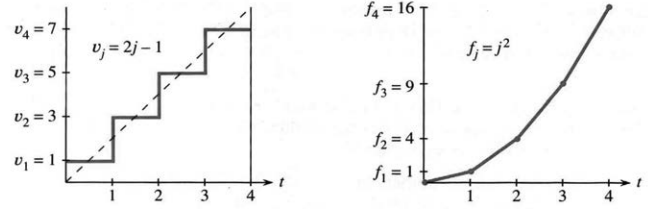
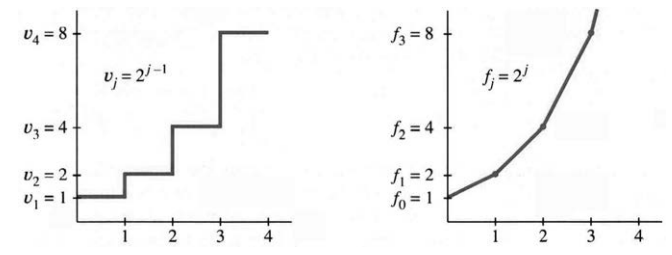
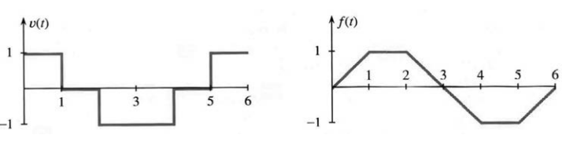
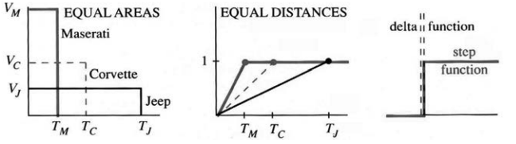
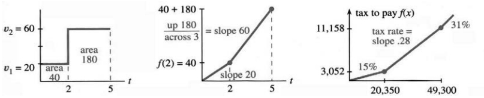
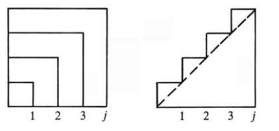

## 1.2 暂不使用极限的微积分

来源：PDF 第 72–79 页，印刷页 59–66。状态：初译，已按原页图像自校，待复审。税务及技术发展叙述按原书历史背景保留。

<!-- PDF 72 / 印刷页 59 -->

接下来将揭示微积分背后的一个关键思想。我们只讨论数，函数和斜率可以稍后再说。这些数甚至没有什么特殊之处，可以任意选取。关键是看相邻两数的差。

$$
\begin{array}{c|rrrrrr}
f&0&2&6&7&4&9\\
\text{相邻差 }v&&2&4&1&-3&5
\end{array}
$$

这些差分别是 $2-0=2$、$6-2=4$、$7-6=1$ 等；注意 $4-7=-3$ 为负。$f$ 中的数可以增加或减少，$v$ 中的差可以为正或为负。把这些差加起来，微积分背后的思想就出现了：

$$2+4+1-3+5=9.$$

差的和为 9，恰好是 $f$ 的最后一个数。这是巧合，还是总成立？若早些停止，只加 $2+4+1$，则得到 $f$ 中的 7。再换一个例子检验猜想：

$$
\begin{array}{c|rrrrrr}
f&1&3&7&8&5&10\\
v&&2&4&1&-3&5
\end{array}
$$

各个 $f$ 都加了 1，差却完全不变。差的和仍为 9，但最后一个 $f$ 已是 10，所以“总得到最后一个 $f$”的猜想不对。现在第一个 $f$ 是 1，答案 9 等于 $10-1$，即末项减去首项。若改变中间项呢？

$$
\begin{array}{c|rrrrr}
f&1&5&12&7&10\\
v&&4&7&-5&3
\end{array}
$$

差的和为 $4+7-5+3=9$，仍是 $10-1$。不论选哪些 $f$，也不论选多少个，差的和都只由首末两项决定。若这总成立，中间项相消必有明确原因：

$$
(5-1)+(12-5)+(7-12)+(10-7)=10-1.
$$

5、12、7 都成对相消，只剩 $10-1$。这就是微积分的关键！

> **1B**　相邻 $f$ 的差之和等于 $f_{\rm last}-f_{\rm first}$，即末项减首项。

**例 1：**数 $f=2,3,4,5,6,7$ 线性增加，差 $v=1,1,1,1,1$ 恒定。差的和为 5，与 $7-2$ 一致。$v$ 让人想到恒定速度，$f$ 让人想到直线 $f=vt+C$。本例 $v=1$、初值为 2，相应直线为 $f=t+2$。

**例 2：**数 $f=0,1,4,9,16$ 是平方数，差 $v=1,3,5,7$ 线性增加。$1+3+5+7=4^2=16$。一个漂亮的事实是：前 $j$ 个正奇数之和总等于 $j^2$。$v$ 是正奇数，$f$ 是完全平方数。

<!-- PDF 73 / 印刷页 60 -->

**附注。**可用字母 $j$ 表示 $f$ 中的项号。本例第零项为 $f_0=0$，第 $j$ 项为 $f_j=j^2$。用公式代替数的列表，是代数的一部分。差也可以编号：$v_1=1$，第 $j$ 个差为第 $j$ 个正奇数 $v_j=2j-1$，例如 $v_4=8-1=7$。差从 $j=1$ 开始编号较合适，不必设置第零个正奇数。

在这个记号下，$v_j=f_j-f_{j-1}$。你迟早会熟悉 $j,j-1$ 这样的下标，现在不必着急。重要的是，所有 $v$ 的和等于末项减首项。下面把 $v$ 与斜率、$f$ 与面积联系起来。

**图 1.7** $v=1,3,5,7$ 线性增加；对应距离值 $f=0,1,4,9,16$ 为平方数。

图 1.7 自然地画出了例 2。$f$ 的图像是**分段线性的**：把各数对应的点用直线段连接起来。$v$ 的图像是**分段常数的**：每一段内的差保持不变。这让人想到前面的距离与速度图像，距离是斜线段，速度是水平线段。

斜率的关系为

$$
f\text{ 图像的斜率}
=\frac{\text{竖向变化量}}{\text{横向变化量}}
=\frac{f\text{ 的变化量}}{t\text{ 的变化量}}=v.
$$

每一段的时间变化量为 1，$f$ 的变化量就是称为 $v$ 的差，所以斜率为 $v/1=v$。在分段点 $t=1,2,3,\ldots$ 处，斜率突然改变，$f$ 的导数没有定义。图中用竖线连接 $v$ 的各段，这种画法需要谨慎理解；核心关系是在分段点之间，$f(t)$ 的斜率等于 $v(t)$。

面积的关系为：**$v$ 图像下方的总有向面积等于 $f_{\rm last}-f_{\rm first}$。**

阶梯下方由矩形组成，每个矩形底为 1、高为相应的 $v$，因此面积的数值也等于 $v$，总面积就是所有 $v$ 的和。

实际上，起止时刻可以任意选，不必是 $0,1,2,3,4$。假设到 $t=3.5$ 为止，只计算最后一个高为 7 的矩形的一半，总面积为

$$1+3+5+\tfrac12\cdot7=12.5.$$

这仍等于 $f_{\rm last}-f_{\rm first}=12.5-0$。因为 $t=3.5$ 位于最后一段的中点，$f$ 正好在 9 与 16 的中间，即 12.5。

<!-- PDF 74 / 印刷页 61 -->

> **1C**　各个 $v$ 是 $f(t)$ 的分段斜率；$v$ 图像下方的有向面积等于 $f(t_{\rm end})-f(t_{\rm start})$。

这正是微积分基本定理的思想，但我们只用了代数，既没有曲线，也没有极限计算。目前限制在分段线性的 $f$ 与分段常数的 $v$；第 5 章将解除这一限制。

图 1.7a 还提示了 $1+3+5+7=4^2$ 的一个证明：虚线下方的三角形与四个矩形总面积相同。三角形面积为 $\tfrac12\cdot4\cdot8=4^2$。若有 $j$ 个矩形，则面积为 $\tfrac12\cdot j\cdot2j=j^2$。

下面的例子展示另外一些规律：$f,v$ 可以指数增长，也可以在零附近振荡。我希望你喜欢它们，但不认为现在必须全部掌握。它们类似于 $2^t,\sin t,\cos t$，只是以分段方式变化。这样，你只用代数就能先认识微积分的重要函数。若速度连续变化、$f$ 的图像成为曲线，就需要微积分。

最后一个例子是所得税，它确实分档变化。随后，第 1.3 节介绍曲线的斜率；处理曲线的关键步骤是取极限，这将带我们从代数进入微积分。

### 指数增长的速度与距离

从 $f=1,2,4,8,16$ 开始，它们是 2 的幂，由零次幂 $2^0=1$ 起步，所以初值是 1 而非 0。经过 $j$ 步，已有 $j$ 个因子 2，即 $f_j=2^j$。请区分 $2j,j^2,2^j$：它们分别线性增长、二次增长、指数增长。在 $j=10$ 时分别为 $20,100,1024$，指数很快超过另外两者。

$f=1,2,4,8,16$ 的差恰好是 $v=1,2,4,8$，还是同样漂亮的数。$f$ 是 2 的幂，$v$ 也是。由于第一个差编号为 $v_1$，其公式为 $v_j=2^{j-1}$，略不同于 $f_j=2^j$；$v_1=2^0=1$。非零数的零次幂为 1，原书在此把 $0^0$ 视为未定义。

**图 1.8** 速度与距离的离散数值按 2 的幂增长。两图使用相同的数，但 $f$ 分段线性，$v$ 分段常数，因此外观不同。

微积分在哪里发挥作用？它研究光滑曲线 $f(t)=2^t$。指数增长对人口、银行存款和国债都十分重要，可通过速度与函数值成正比这一特征识别：$v(t)$ 与 $f(t)$ 成正比。

<!-- PDF 75 / 印刷页 62 -->

**说明。**$2^t$ 比 $t^2$ 更微妙。$f=t^2$ 的斜率为 $v=2t$，它与 $t$ 而非 $t^2$ 成正比；$f=2^t$ 的斜率为 $v=c2^t$，常数 $c=0.693\ldots$ 将在第 6 章求出，它就是 2 的自然对数。第 37 题用计算器估计它，重要的是它为常数。

### 振荡的速度与距离

速度先为 $V$、再为 $-V$ 的往返运动，是最简单的振荡。$f$ 的图像先沿直线增加，再沿直线减少。图 1.9 展示另一种返回零点的振荡，路径更有趣。

现在 $f$ 的值为 $0,1,1,0,-1,-1,0$。由于 $f_6=0$，运动回到起点，并可重复。相邻差 $v$ 为 $1,0,-1,-1,0,1$，和为零，与末项减首项一致。它与 $f$ 具有同样可重复的振荡模式，只是时刻有所平移。

$f$ 的图像粗略地像正弦曲线，$v$ 的图像更粗略地像余弦曲线。自然界中的波形是光滑曲线，这里的形式则经过“数字化”，像数字手表按步跳动。模拟到数字的转变带来了计算机革命；同样的革命也在发生于 CD 播放器。数字信号，关或开、0 或 1，似乎一次次胜出。

分段函数在 $t=6$ 重新开始，普通正弦和余弦则在 $t=2\pi$ 重复。重复的运动称为周期运动，这里的周期分别为 6 与 $2\pi$。若角度以度为单位，周期为一周的 360；换成弧度，周期为 $2\pi$。我们几乎总用弧度，弧度数等于度数乘以 $2\pi/360$。钟表显示的周期为 12 小时；若还显示上午、下午，则周期为 ______。

**图 1.9** 分段常数的“余弦”与分段线性的“正弦”，两者都重复出现。

### 短时间的高速运动

下一辆车只在短时间内高速行驶。速度为 $V$，直到距离达到 $f=1$，随后突然停止。$f$ 先以斜率 $V$ 线性增加，再以零斜率水平延伸：

$$
v(t)=\begin{cases}V,&\text{停止时刻 }T\text{ 之前},\\0,&T\text{ 之后},\end{cases}
\qquad
f(t)=\begin{cases}Vt,&0\leq t\leq T,\\1,&t\geq T.\end{cases}
$$

注意一般时间 $t$ 与特定停止时刻 $T$ 的区别。距离函数的定义域为 $t\geq0$，值域为 $0\leq f\leq1$。图 1.10 比较三辆车：Jeep、Corvette 和 Maserati。速度不同，却都到达 $f=1$，所以三个速度图下的面积都是 1。矩形高为 $V$，底为 $T=1/V$。

<!-- PDF 76 / 印刷页 63 -->

**图 1.10** 短时间高速运动满足 $V_MT_M=V_CT_C=V_JT_J=1$。原图将阶跃称为具有“无穷斜率”。图内 EQUAL AREAS 为面积相等，EQUAL DISTANCES 为距离相等，step function 为阶跃函数，delta function 为狄拉克冲激。[译注 1]

**选读说明。**自然会想到越来越快的速度，也就是越来越陡的斜率。$f$ 在越来越短的时间内达到 1，极端情形成为阶跃函数，图像似乎竖直跃升。这就是单位阶跃 $U(t)$：$t<0$ 时为零，$t>0$ 时立即变为 1。

阶跃的斜率是什么？除跳跃点外处处为零；原书将 $t=0$ 处的斜率称为“无穷大”。这时不再有普通速度函数，而是一个使位置瞬时跳变的冲激。图像是在 $t=0$ 处的尖峰，通常记为 $\delta$，所以阶跃的广义导数称为“delta 函数”。这个尖峰的积分为 1。[译注 1]

你完全不必在这里掌握 delta 函数理论！本书的微积分首先研究曲线，而不是跳跃。

最后一个例子用斜率和变化率说明税收如何计算。特别注意税率、税档和总税额的区别：税率是 $v$，税档划在收入变量 $x$ 上，总税额是 $f$。

**例 3：所得税是分段线性的，斜率为税率 0.15、0.28、0.31。**

假设单身纳税人的应税收入为 $x$ 美元，即原书所引用申报表扣除各项之后的数额。以下是美国税务部门 **1991 年**的示例说明：

- 若 $x$ 不超过 20,350 美元，税额为 $x$ 的 15%。
- 若 $20,350\leq x\leq49,300$，税额为 3,052.50 美元，加上超过 20,350 美元部分的 28%。
- 若 $x$ 超过 49,300，税额为 11,158.50 美元，加上超过 49,300 美元部分的 31%。

第一档是 $0\leq x\leq20,350$，第二档是 $20,350\leq x\leq49,300$。原书笑称税务部门不用 $\leq$，但这里用它很合适。最高档为 $x\geq49,300$，边际税率 31%，**只有落在该档中的收入才按这个税率计税。**

图 1.11 展示税率、税档和应纳税额。这些是边际税率，不是平均税率。总税额除以总收入才是平均税率；0.28 或 0.31 表示每增加一美元收入所增加的税额，也就是 $x$ 处的斜率。税额像面积或距离，逐步累积；税率像斜率或速度，取决于当前位置。新闻媒体常常没有区分清楚。

问：最高档直线的方程是什么？答：该档从 $x=49,300$、$f(x)=11,158.50$ 开始，斜率为 0.31。知道直线上一点与斜率，就知道直线方程。这值得特别强调。

<!-- PDF 77 / 印刷页 64 -->

**图 1.11** 税率为 $v$，总税额为 $f$；税档边界对应折点。图内 tax to pay 为应纳税额，tax rate 为税率，slope 为斜率，area 为面积，up/across 为竖向变化量除以横向变化量。

> **1D**　最高档的税额为 $f(x)=11,158.50+0.31(x-49,300)$ 美元，即前 49,300 美元的税额，加上超出部分的税额。

第 2.3 节将为一般直线介绍“点斜式”；这里先看具体例子。11,158.50 从哪里来？它是中间税档终点的税额，也是最高税档起点的税额。

图中还展示距离与速度的例子。$t=2$ 时，$f(2)=40$ 英里；此后速度为 60 英里/小时。因此，位置图上斜率为 60 的直线是

$$
f(t)=\text{初始距离}+\text{新增距离}=40+60(t-2).
$$

起点为 $(2,40)$；新速度乘以新增时间 $t-2$。点斜式很容易理解。现在带着几点说明回顾本节。

**核心思想：**任意选取一列数 $f$，把相邻差记为 $v$；差的和为末项减首项。

**下标：**数列为 $f_0,f_1,\ldots$，第一差为 $v_1=f_1-f_0$，一般差为 $v_j=f_j-f_{j-1}$。求和后中间项相消：

$$
v_1+v_2+\cdots+v_j
=(f_1-f_0)+(f_2-f_1)+\cdots+(f_j-f_{j-1})=f_j-f_0.
$$

**例子：**$f_j=j,j^2,2^j$ 时，$v_j$ 分别为常数 1、奇数 $2j-1$、指数项 $2^{j-1}$。

**函数：**把 $f$ 的各点连成分段线性函数，斜率 $v$ 就是分段常数函数。从任意起点到终点，$v$ 下方的有向面积为 $f(t_{\rm end})-f(t_{\rm start})$。

**单位：**距离为英里，速度为英里每小时；税额为美元，税率为“缴纳的美元数／赚取的美元数”，因此是 0.28 这样的无量纲比率。

### 1.2 习题

#### 通读填空

从 $f=1,6,2,5$ 开始，差为 $v=$【a】，差的和为【b】，等于末项减【c】。6 和 2 不影响答案，因为在 $(6-1)+(2-6)+(5-2)$ 中它们【d】。连接 $f(0)=1$ 与 $f(1)=6$ 的直线斜率为【e】，方程为 $f(t)=$【f】。

在单位时间点，距离为 $1,5,25$，对应速度为【g】，它们是 $f$ 图像的【h】。税额图斜率是税【i】。若 $f(t)$ 是邮寄 $t$ 盎司或 $t$ 克邮件的费用，则斜率是每【k】的【j】。对距离 $0,1,4,9$，速度为【l】。前 $j$ 个正奇数之和为 $f_j=$【m】，所以 $f_{10}=$【n】，$v_{10}=$【o】。

<!-- PDF 78 / 印刷页 65 -->

分段线性的“正弦”斜率为【p】，构成分段【q】的“余弦”。两者的【r】均为 6，因此对每个 $t$，$f(t+6)=$【s】。速度 $1,2,4,8,\ldots$ 满足 $v_j=$【t】，此时 $f_0=1$、$f_j=$【u】。$1+2+4+8+16=$【v】，$2^j-2^{j-1}=$【w】。以速度 $V$ 短暂运动到 $T$，距离为【x】。若 $f(T)=1$，增大 $V$ 时，持续时间为 $T=$【y】。$V$ 趋于无穷时，$f$ 趋于【z】函数；速度趋于【A】函数，集中在 $t=0$，积分为【B】。阶跃函数的广义导数为【C】。

**第 1–4 题讨论数列 $f$ 与相邻差 $v$。**

1. 由 $f=0,2,7,10$ 求差 $v$ 及其和。再写一列产生相同差的 $f$。对 $f=0,3,12,10$，差的和仍为 ______。
2. 从 $f=1,3,2,4$ 出发，画分段线性的 $f$ 与相应的 $v$。哪些有向面积相加得到 $4-1$？若下一项为 11，下一段 $v$ 下方的面积是多少？
3. 由 $v=1,2,1,0,-1$、$f_0=3$ 求 $f$，并画图。$f$ 在 $v=$______ 时达到最大值；若 $v=1,2,1,-1$，最大值在哪里？
4. 对 $f=1,b,c,7$ 求 $v_1,v_2,v_3$ 及其和，再分别对 $f=a,b,c,7$ 和 $f=a,b,c,d$ 重复。

**第 5–11 题讨论线性函数与恒定斜率。**

5. 写出 a. $f(t)=1.1t$；b. $f(t)=1-2t$；c. $f(t)=4+5(t-6)$ 的斜率。分别算 $f(6),f(7)$，确认差等于斜率。
6. 若 $f(t)=5+3(t-1)$、$g(t)=1.5+2.5(t-1)$，求 $h(t)=f(t)-g(t)$，以及三个函数的斜率。
7. 若 $t<5$ 时 $v=2$、$t>5$ 时 $v=3$：a. 已知 $f(0)=0$，求两段公式；b. 检验 $f(10)$ 等于速度图中截至 10 的两个矩形总面积。
8. 若 $t<1/10$ 时 $v=10$，此后 $v=0$，从 $f(0)=1$ 出发求两段公式。
9. 若 $g(t)=2t+1$、$f(t)=4t$，求 $g(3),f(g(3)),f(g(t))$。复合函数斜率与两函数斜率有什么关系？
10. 对相同函数求 $f(3),g(f(3)),g(f(t))$。把 $t$ 换成 $4t$ 后，距离增长速度变为原来的 ______ 倍，速度乘以 ______。
11. 计算第 5 题各函数的 $f(6),f(8)$，检验 $v=(f(8)-f(6))/(8-6)$，即函数变化量除以时间变化量。

**第 12–18 题使用例 3 的历史所得税模型。**

12. 应税收入为 10,000、30,000、50,000 美元时，税额分别是多少？
13. 第二税档中的 $f(x)$ 是什么？11,158.50 与税表其他数字有什么关系？
14. 假设把收入为 $x$ 的已婚夫妇当作两个各有 $x/2$ 应税收入的单身者，写出税额 $F(x)$。原书说明，实际并非这样处理。
15. 在 15% 税档中，若 5% 的州税可从应税收入扣除，综合税率不是 20%，而是 ______。考虑额外 100 美元的税额。
16. 分段线性函数连续，意味着每段终点值与下一段起点值相等。若 $t\leq1$ 时 $f=5t$，$t>1$ 时速度为 2，分别定义后半段使函数 a. 连续；b. 不连续。c. 构造使用 15%、28% 两种税率的税额函数，使跨过分档点多赚一美元反而受损。
17. 税额抵免与应税收入扣除的区别，是 $f(x)-c$ 与 $f(x-d)$ 的区别。抵免 1000 美元和扣除 1000 美元，哪一个更有利？为什么？当 $f(x)=0.15x$ 时草绘两个图像。
18. 平均税率 $a(x)=f(x)/x$ 是从原点到 $(x,f(x))$ 的斜率。草绘 $a$；平均税率低于边际税率，是因为 ______。[译注 2]

**第 19–30 题练习下标与差分 $v_j=f_j-f_{j-1}$。**

19. 求 $v_1,v_2,v_3$ 和 $v_j,f_j$ 的公式：a. $f=1,3,5,7,\ldots$；b. $f=0,1,0,1,\ldots$；c. $f=0,1/2,3/4,7/8,\ldots$。
20. 已知 $f_0=0$，求 $f_1,f_2,f_3,f_j$：a. $v=1,2,4,8,\ldots$；b. $v=-1,1,-1,1,\ldots$。
21. 下图左侧嵌套正方形的面积为 $1^2,2^2,3^2,\ldots$。L 形带状部分的面积是多少？图形如何说明 $1+3+5+7=4^2$？
22. 分别用矩形与三角形计算下图右侧阶梯下的面积，证明 $1+2+\cdots+j=\tfrac12j^2+\tfrac12j$。求 $1+2+\cdots+100$。

<!-- PDF 79 / 印刷页 66 -->

23. 若 $v=1,3,5,\ldots$，则 $f_j=j^2$；若 $v=1,1,1,\ldots$，则 $f_j=$______。相加求 $2+4+\cdots+2j$，再除以 2 求 $1+2+\cdots+j$。比较第 22 题。
24. 判断正误：正确的说明理由，错误的举反例。a. $f$ 递增则 $v$ 也递增；b. $v$ 递增则 $f$ 也递增；c. $f$ 周期则 $v$ 周期；d. $v$ 周期则 $f$ 周期。
25. 对 $f(t)=t^2$，算 $f(99),f(101)$，再求其间函数增量与时间增量之比。
26. 对 $f(t)=t^2+t$，重复上一题。
27. 若 $f_j=j^2+j+1$，求 $v_j$。
28. 若 $v$ 每步增加 4，先举例、再用代数证明二阶差分 $f_{j+1}-2f_j+f_{j-1}=4$。
29. 若 $f_0=0$，$v=1,\tfrac12,\tfrac12,\tfrac14,\tfrac14,\tfrac14,\tfrac14,\ldots$，哪个 $j$ 满足 $f_j=5$？
30. 证明 $a_j=f_{j+1}-2f_j+f_{j-1}$ 总等于 $v_{j+1}-v_j$。若 $v$ 是速度，$a$ 表示 ______。

**第 31–34 题讨论周期性的 $f,v$，类似正弦与余弦。**

31. 对离散“正弦”$f=0,1,1,0,-1,-1,0$，求 $a_1=f_2-2f_1+f_0$、$a_2=f_3-2f_2+f_1$ 和 $a_3$。比较 $a_j$ 与 $f_j$。
32. 若数列 $v$ 的周期为 6，$w$ 的周期为 10，则逐项和 $v_1+w_1,v_2+w_2,\ldots$ 的周期是什么？[译注 3]
33. 从 $f_0=0$ 出发，对 $v=1,-1,-1,1$ 画 $f$。若 $v$ 周期为 4，求 $f(12),f(13),f(100.1)$。
34. 当 $v=1,2,1,0$ 时，画从 $f_0=0$ 到 $f_4=4$ 的 $f$。若 $v$ 周期为 4，求 $f(12),f(14),f(16)$。为什么 $f$ 没有周期 4？

**第 35–42 题讨论指数型数列。**

35. 求 $f=1,3,9,27$ 的差，预测 $v_4,v_j$。代数给出 $3^j-3^{j-1}=(3-1)3^{j-1}$。
36. 求 $1+2+4+\cdots+32$ 和 $1+\tfrac12+\tfrac14+\cdots+\tfrac1{32}$。
37. 估计 $f(t)=2^t$ 在零点的斜率。用计算器依次求 $(2-1)/1$、$(2^{0.1}-1)/0.1$、$(2^{0.01}-1)/0.01$、$(2^{0.001}-1)/0.001$。
38. 设 $f_0=1$，且原书所写 $v_j=2f_{j-1}=v_j$，求 $f_4$。[译注 4]
39. a. 由 $f=1,1/2,1/4,1/8$ 求 $v_1,v_2,v_3$ 并预测 $v_j$；b. 检验 $f_3-f_0=v_1+v_2+v_3$ 和 $f_j-f_{j-1}=v_j$。
40. 设 $v_j=r^j$。证明 $f_j=(r^{j+1}-1)/(r-1)$ 满足 $f_0=1$ 和 $f_j-f_{j-1}=v_j$，因此它就是几何级数部分和 $1+r+\cdots+r^j$。[译注 4]
41. 由 $f_j=(-1)^j$ 求 $v_j$，再求 $v_1+\cdots+v_j$。
42. 估计 $f(t)=e^t$ 在零点的斜率。使用内置常数 $e$ 的计算器；原书另写“否则取 $e=2.78$”。分别计算 $(e-1)/1$、$(e^{0.1}-1)/0.1$、$(e^{0.01}-1)/0.01$。[译注 4]

**第 43–47 题讨论在零点从 0 跳到 1 的阶跃 $U(t)$。**

43. 画 $U(t-1)$、$U(t)-2$、$U(3t)$、$4U(t)$，再画 $f(t)=4U(3t-1)-2$。
44. 画方波 $U(t)-U(t-1)$。若它是速度，画距离；若它是距离，画相应的广义速度。
45. 两次短暂高速运动都走过距离 10：$v=$______，持续到 $t=0.001$；$v=V$，持续到 $t=$______。$V\to\infty$ 时，$f(t)$ 的极限为 ______。
46. 画阶梯函数 $U(t)+U(t-1)+U(t-2)$；其广义导数是三个 ______ 函数之和。
47. 若允许阶跃，哪些像 L 一样的大写字母可以表示函数图像？原文说 L 的斜率是一个负 delta 函数；画出其他字母的相应广义导数。[译注 1]
48. 写子程序 FINDV，输入 $f_0,f_1,\ldots,f_N$，输出 $v_1,\ldots,v_N$，尽可能附图形输出。以 $f_j=2j,j^2,2^j$ 测试。
49. 写子程序 FINDF，输入 $v_1,\ldots,v_N$ 与 $f_0$，输出 $f_0,f_1,\ldots,f_N$。默认 $f_0=0$，尽可能附图。以 $v_j=j$ 测试。
50. 对 FINDF 的输出再用 FINDV，会返回什么？反过来又会返回什么？注意初值 $f_0$。
51. 将 $2j,j^2,2^j,\sqrt j$ 按从小到大排列：a. $j$ 较大，取 9；b. $j$ 较小，取 $1/9$。
52. 从 1970 年起，你家庭成员的平均年龄 $A(t)$ 是分段线性函数。它连续还是会跳跃？斜率是什么？尽力画出图像。

### 译注

1. 阶跃在跳点没有普通导数，狄拉克冲激须按分布理解，不能将“无穷斜率”当作普通实数函数值。图中的竖直连接线只是跳跃标记，不表示同一输入取多个输出。阶跃在零点取 0 或 1 不影响其分布导数，但普通函数值须另约定。L 等字母的练习同样只能在这种阶跃示意意义下理解。
2. 税收例题仅使用原书给定的 1991 年模型，未核验或用于现行报税。平均税率在第一档内等于而非严格低于边际税率；第 18 题的“低于”须据所在税档解释。邮资若按重量分档跳变，也不能把跳点当作普通导数存在的点。
3. 若已知 6 和 10 分别是周期，则 30 一定是和数列的一个周期；不能不加条件断言它必为最小正周期。问题中的“周期”应区别于“基本周期”。
4. 第 38 题原页确实重复写 $v_j=2f_{j-1}=v_j$，后一个等号是冗余表述，未猜改成别的递推关系。第 40 题公式要求 $r\ne1$，$r=1$ 须另算。第 42 题的 $e=2.78$ 不准确，按该底数计算会趋向 $\ln2.78$ 而不是 1；应优先用内置 $e$，或足够准确的 $2.71828\ldots$，这里保留原题并标出错误。
5. 本节时间步长为 1，所以差值数值与速度数值相同；一般步长下，速度还须除以步长。所有位置与速度的正负解释沿用第 1.1 节。
