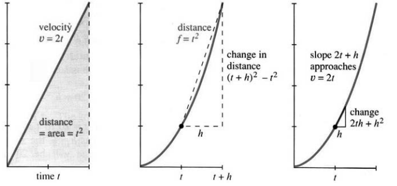
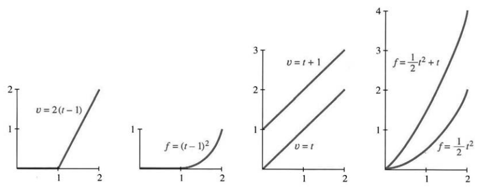
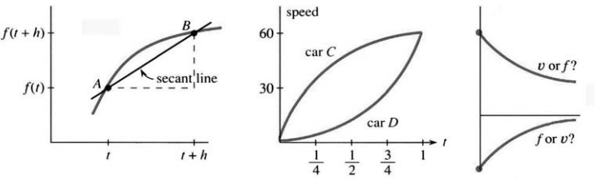

## 1.3 瞬时速度

来源：PDF 第 80–85 页，印刷页 67–72。2026-10-29 已逐段对照原文并核对全部六页原图；PDF 重建与排版检查待完成。

<!-- PDF 80 / 印刷页 67 -->

我们已经走到微积分为之诞生的核心问题面前。两个问题方向相反——希望你早就看出它们要来了：

1. 速度一直在变，怎么算出走了多远？
2. $f(t)$ 的图像不是直线时，斜率又是什么？

从速度求距离，从距离求速度，两个方向都要走通——只是没法在一节里全办到。微积分也许是门好课，可它不是魔术。第一步，让速度以最均匀的方式变化。

**问题 1：**设每个时刻的速度为 $v(t)=2t$，求 $f(t)$。

物理学家会说，加速度恒为 2。司机一踩油门，车就加速，速率表的指针稳稳往上爬；距离也一路增加，而且越来越快。若 $t$ 以秒计、$v$ 以英尺每秒计，则 $f$ 以英尺计。10 秒后速率是 20 英尺/秒；44 秒后是 88 英尺/秒，也就是 60 英里/小时。加速度倒是清楚，可车到底跑了多远？

**问题 2：**已知时刻 $t$ 的行驶距离为 $f(t)=t^2$，求速度 $v(t)$。

图 1.12 右侧，$f(t)=t^2$ 是一条抛物线。曲线从零开始，这时车是新的：$t=5$ 时距离为 25，$t=10$ 时到了 100。

人们常说，速度就是距离除以时间。可速度在变的时候，这招还灵吗？$100/10=10$ 给出前十秒的平均速度；$121/11$ 给出前十一秒的平均速度。那么，**瞬时速度**——恰在 $t=10$ 那一刻速率表上的读数——又该怎么求？

**图 1.12** 速度 $v=2t$ 是线性函数，距离 $f=t^2$ 是二次函数。图内 distance/area 为距离/面积，time 为时间；割线斜率 $2t+h$ 趋于 $v=2t$，距离增量为 $(t+h)^2-t^2=2th+h^2$。

我希望你看出了问题。车越快，每秒走得越远，$t^2$ 的图像也就越陡。10 到 11 秒的平均速度可以当作 $t=10$ 时速度的近似——但也只是近似。平均值本身很好算。

<!-- PDF 81 / 印刷页 68 -->

$$
f(10)=100,\qquad f(11)=121,
$$

$$
\text{平均速度}=\frac{f(11)-f(10)}{11-10}
=\frac{121-100}{1}=21.
$$

这一秒里汽车走了 21 英尺，平均速率就是 21 英尺/秒。车还在加速，所以这一秒刚开始时的速率小于 21。

几何上，平均值是一条直线的斜率，不是曲线在某一点的斜率。这条直线连接图 1.12 曲线上的两个点。求平均值，就像假设车以恒定速度跑完同一段路：问题退回最简单的情形，只需用距离变化量除以时间变化量：

$$
\text{平均速度}=\frac{f\text{ 的变化量}}{t\text{ 的变化量}}. \tag{1}
$$

**微积分与法律。**你 1 点驶上高速公路，3 点从 150 英里外驶出，平均速率 75 英里/小时。警察凭这个能不能开罚单，我不好说。你可以问法官：“我到底是什么时候开到 75 的？”警察只好承认不知道具体时刻，但会明确觉得，你一定曾在某个时刻开到过 75。[原注]

回到核心问题：求 $t=10$ 时的 $v(10)$。接下来一秒的平均速度是 21；也可以只算 10.0 到 10.5 这半秒的平均速度：

$$
\frac{f(10.5)-f(10.0)}{10.5-10.0}
=\frac{10.5^2-10^2}{0.5}
=\frac{110.25-100}{0.5}=20.5.
$$

这更接近 $t=10$ 时的速度，可还是不够精确。

要得到 $v(10)$，就得把时间间隔一再缩短。这是第 2 章的地基，也是微分学的关键：在曲线上取越来越近的两点，求它们连线的斜率；两点无限靠近时，这个斜率的极限就是单点处的斜率。

用代数来算：从 10 到稍后的 $10+h$，平均速度是多少？距离从 $10^2$ 增到 $(10+h)^2$，时间增加 $h$，于是

$$
v_{\rm ave}
=\frac{(10+h)^2-10^2}{h}
=\frac{100+20h+h^2-100}{h}=20+h. \tag{2}
$$

这和前面的算法对得上：$h=1$ 时平均速度是 21；$h=1/2$ 时是 20.5；若间隔只有百万分之一秒，平均速度就是 $20+1/1,000,000$，离 20 只差一丝。

**结论：$t=10$ 时速度为 $v=20$；这也正是曲线在该点的斜率。**它与图 1.12 左侧的速度图吻合。

**原注：**这是我们头一回碰到那个备受嫌弃的“中值定理”。法官要是能证明它，你可就没辙了。几张 $v$ 图和 $f$ 图会把情形搅乱。

<!-- PDF 82 / 印刷页 69 -->

现在说明：两幅图在每一时刻都对得上——若 $f(t)=t^2$，则 $v(t)=2t$。这是微积分的关键一步。先用文字说一遍：取 $t+h$ 时的距离，减去 $t$ 时的距离，再除以 $h$，就是平均速度：

$$
v_{\rm ave}
=\frac{f(t+h)-f(t)}h
=\frac{(t+h)^2-t^2}h
=\frac{t^2+2th+h^2-t^2}h=2t+h. \tag{3}
$$

前面 $t=10$ 时得到 $20+h$，这里一般化为 $2t+h$。速度在变，平均值自然依赖步长 $h$。可一旦 $h$ 趋于零，平均值就越来越贴近 $t$ 时的速度 $2t$。

> **1E**　当 $h$ 趋于零时，平均速度 $2t+h$ 趋于 $v(t)=2t$。

**附注。**计算（3）说明：微积分离不开代数。要得到整幅速度图，时间就得当变量，用字母 $t$ 表示。具体时刻 10、具体步长 1，确实只用数字也能算；但代数让我们跳出个别例子。任意 $t$ 与 $t+h$ 之间的平均值都是 $2t+h$，随时可以代回数字，验算代数有没有出错。

还有一步，是代数给不了的：微积分要求平均值的极限。$h$ 缩到零，曲线上的两点靠拢，“区间平均速度”就变成“某时刻的速度”。一般的极限理论并不简单，这里暂时用不上，其实也没那么难。本例的极限一眼可见：$h\to0$ 时，$2t+h\to2t$。

本节还剩下什么？问题 2——由距离求速度——已经答完；问题 1 还欠着：若 $v=2t$，距离是什么？这是反方向的积分问题。微积分基本定理说，不必从头再来：若 $f$ 的斜率给出 $v$，$v$ 下方的面积就能还原 $f$。里程表读数 $f=t^2$ 给出了速率表读数 $v=2t$。根据基本定理，$2t$ 图像下方的面积应当是 $t^2$。不过我们确实还没有证明任何基本定理，所以最好稳妥一些——亲手把面积算出来。

幸运的是，这块面积就是个三角形，底为 $t$、高为 $2t$，于是

$$
\text{面积}=\tfrac12(\text{底})(\text{高})
=\tfrac12(t)(2t)=t^2. \tag{4}
$$

**例 1：**把图像沿时间轴平移：汽车直到 $t=1$ 才出发。此前 $v=f=0$；出发后 $v=2(t-1)$、$f=(t-1)^2$。公式里多出一个延迟量 1，图 1.13 显示它的影响。

**例 2：**把加速度从 2 换成另一个常数 $a$，速度便由 $2t$ 变成 $at$。**加速度就是速度图像的斜率！**距离也与 $a$ 成正比，只是别漏了因子 $1/2$：

$$
\text{加速度 }a\quad\longleftrightarrow\quad
\text{速度 }v=at\quad\longleftrightarrow\quad
\text{距离 }f=\tfrac12at^2.
$$

若 $a=1$，则 $v=t$、$f=\tfrac12t^2$——这是微积分里最著名的函数对之一。若 $a$ 取重力加速度 $g$，$v=gt$ 便是自由落体的速度。

<!-- PDF 83 / 印刷页 70 -->

**图 1.13** 延迟后的速度与距离，以及 $v=at+b$ 与 $f=\tfrac12at^2+bt$ 的函数对。

速度与质量无关（伽利略在比萨斜塔做过试验）。比起速度 $v=gt$，他也许更容易看到距离 $f=\tfrac12gt^2$。不管怎样，这都是物理学里最著名的一对函数。

**例 3：**设 $f(t)=3t+t^2$。从 $t$ 到 $t+h$ 的平均速度为

$$
v_{\rm ave}=\frac{3(t+h)+(t+h)^2-3t-t^2}{h}.
$$

距离变化量里多出 $3h$，来自 $3(t+h)-3t$；再除以 $h$，速度就多出 3。距离添了一项 $3t$，速度便添了常数 3。如果伽利略是把一个重物抛出去，而不是让它落下，初速度 $v_0$ 就会给距离添上一项 $v_0t$。

### 随时间变化的函数

一条直线的斜率不难懂：把 $f$ 的变化量除以 $t$ 的变化量就是了；第 2 章改用 $y$ 与 $x$。经验表明，真正难的是看出直线移动时，斜率怎样变化。

图 1.14a 中，连接曲线上 A、B 两点的直线是一条割线，它的斜率就是平均速度。微积分要做的事，是让 B 沿曲线向 A 靠拢。

**图 1.14** 直线的斜率与曲线的斜率；两辆车的速度图；右侧哪条是 $v$、哪条是 $f$？图内 secant line 为割线，speed 为速率，car C/D 为车 C/D。

**问题 1：**$f$ 的变化量，也就是 B 比 A 高出的那一点，会怎样？答：趋于零；$t$ 的变化量同样趋于零。

<!-- PDF 84 / 印刷页 71 -->

**问题 2：**B 靠近 A 时，直线的斜率是增是减？答：这回我不直接回答——这个问题太重要了。另画一条割线，让 B 再靠近 A 一些，自己比较斜率。

这个问题由华盛顿大学的史蒂夫·蒙克（Steve Monk）提出，班上 57% 的学生答对了。要是直接给公式让他们求斜率，答对的恐怕会有 97%。图 1.14b 问的是反方向：已知速度，而不是距离。微积分要同时回答关于两个函数的问题。

**问题 3：**$t=3/4$ 时哪辆车更快？答：C 的速率更大，D 的加速度更大。

**问题 4：**若两车同时同地出发，D 在最后一段是否正在追上 C？从 $t=1/2$ 到 1，两车是更近还是更远？答：这次超过一半的学生答错了。你不会答错，但你能看出他们为什么会错。你得盯着速度图，在心里画出距离图。C 比 D 快时，两车的距离 ______。

再强调一次：两车一起出发，却没有停在同一处。$t=1$ 时它们速度相同，距离并不相同；在那之前，C 一直更快。真该把两车的距离图画出来，看清楚曲线是怎么弯的。

这些问题还点明了一件事：求速度或斜率，与求距离或面积，是两桩不同的任务。

1. 想求某一时刻 $f$ 图像的斜率，不必知道全部过去。
2. 想求截至某一时刻 $v$ 图像下方的面积，却得掌握整段时间的记录。

只要一小段局部的距离记录，就足以确定 $v(t)$：B 向 A 靠拢，斜率问题是局部的，只由 A 附近的函数行为决定。反过来，一小段速度记录却不足以还原总距离，还得知道此前的里程；否则只能算出这一段的增量。

### 1.3 习题

#### 通读填空

从 $f(2)=100$ 到 $f(6)=200$，平均速度为【a】。若 $f(t)=\tfrac14t^2$，则 $f(6)=$【b】，$f(8)=$【c】，其间平均速度为【d】，两个端点的瞬时速度为【e】和【f】。

由 $f(t)$ 与 $f(t+h)$ 求平均速度，公式为【g】。若 $f=t^2$，则平均速度为【h】；从 1 到 1.1 的平均速度为【i】。瞬时速度是平均速度的【j】。若 $f=\tfrac12at^2$，则 $v=$【k】，加速度为【l】。

在 $f(t)$ 的图像上，A、B 间的平均速度是【m】的斜率。A 处速度通过【n】得到，B 处速度通过【o】得到。速度为正时，距离【p】；速度增加时，汽车【q】。

1. 求 $t=5$ 到 $t=8$ 的平均速度：a. $f=6t$；b. $f=6t+2$；c. $f=\tfrac12at^2$；d. $f=t-t^2$；e. $f=6$；f. $v=2t$。
2. 对以上函数算 $[f(t+h)-f(t)]/h$，再求 $h\to0$ 的极限。
3. 若里程记录为 $f(t)=t^2+t$，时间以小时计、距离以英里或千米计，求以下区间平均速率：a. 1 到 2；b. 1 到 1.1；

<!-- PDF 85 / 印刷页 72 -->

   c. 1 到 $1+h$；d. 1 到 0.9，注意此时 $h=-0.1$。

4. 对同一函数，求 a. 0 到 1；b. 0 到 $1/2$；c. 0 到 $h$ 的平均速率。
5. 求第 3(c) 题答案在 $h\to0$ 时的极限。该极限说明什么？
6. 在第 4(c) 题的答案中令 $h=0$，画出 $f=t^2+t$ 并标明原点处斜率。
7. 画 $v(t)=1+2t$，由几何求 0 到 $t$ 的面积，再求这个面积函数 $f(t)$ 的斜率。
8. 画 $v(t)=3-2t$ 及其面积函数 $f(t)$。
9. 判断正误：a. $f>0$ 则 $v>0$；b. $f$ 递增则 $v$ 递增；c. $f>0$ 则 $v$ 递增；d. $v>0$ 则 $f$ 递增。
10. 若 $f=6t^2$，求 $f$ 图与 $v$ 图的斜率。$v$ 图的斜率是 ______。
11. 若 $f=t^2$，求 0.9 到 1.1 的平均速度，再求 $t-h$ 到 $t+h$ 的平均速度。
12. a. 对 $f=\tfrac12at^2$，证明 $t-h$ 到 $t+h$ 的平均速度恰等于 $t$ 处速度；b. $v=at$ 在这一区间的面积恰为底 $2h$ 乘以 ______。
13. 已知 $v=20t$，分别在 $f(0)=12$ 和 $f(1)=12$ 的条件下求 $f(t)$。
14. 对任意距离曲线判断正误：a. AB 连线斜率是两时刻之间的平均速度；b. 割线斜率总比曲线斜率小；c. $f(t)$ 与 $F(t)$ 一起出发又一起结束时，平均速度相等；d. $v(t)$ 与 $V(t)$ 一起开始又一起结束时，距离增量相等。
15. 在合适单位下，跳起再落下的高度为 $y=2t-t^2$。a. 画抛物线与其斜率；b. 求滞空时间和最大高度；c. 证明有一半时间高度超过 $3/4$。篮球运动员看似“悬停”，部分原因就在 c。
16. 在 0 到 1 上画 $f=t^2$、$g=f(t)-2$、$h=f(2t)$，并求各自速度。
17. **推荐：**速度先升后降：$t\leq3$ 时 $v=2t$，$t\geq3$ 时 $v=12-2t$。画分段抛物线 $f(t)$，检验 $f(6)$ 等于速度图下方的面积。
18. 设 $t\leq2$ 时 $v=t$，$t\geq2$ 时 $v=2$，画截至 $t=3$ 的距离图。
19. 从 $t=0$ 到 4，速度线性变化。分别画 a. 从 0 到 2；b. 从 $-1$ 到 1；c. 从 $-2$ 到 0 所对应的 $f(t)$。
20. **推荐：**设速度为第 1.2 节的分段线性“正弦”。（在图 1.8 中，它表示距离。）求 0 到 $t=1,2,3,4,5,6$ 的面积，标出对应 $f$，再画完整分段抛物线。
21. 在 $0\leq t\leq2$ 上画 $f(t)=|1-t^2|$，求 $v(t)$ 的三段公式。
22. 对下列速度，画截至 $t=2$ 的距离图：a. $v=1-t$；b. $v=|1-t|$；c. $v=(1-t)+|1-t|$。
23. $f=t^2-3t$ 何时达到 10？求从 0 到该时刻的平均速度及该时刻瞬时速度。
24. 若 $f=\tfrac12at^2+bt+c$，求 $v$ 与 $v$ 的斜率。当 $a=b=c=1$ 时，何时 $f=41$？
25. 若 $f=t^2$、$v=2t$，则 $f(4t)$ 的速度是 $v(4t)$、$4v(t)$ 还是 $4v(4t)$？
26. 若 $f=t-t^2$，求 $v(t)$ 与 $f(3t)$。后者斜率是 $v(3t)$、$3v(t)$ 还是 $3v(3t)$？
27. 对 $f=t^2$，求从 0 到 $t$ 的平均速度 $v_{\rm ave}(t)$，并画出它与 $v(t)$。
28. 已知从零到 $t$ 的平均速度，如何求距离 $f(t)$？设 $f(0)=0$。
