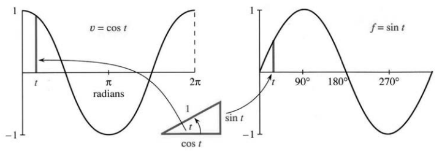
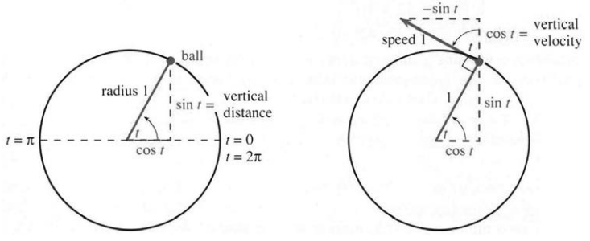
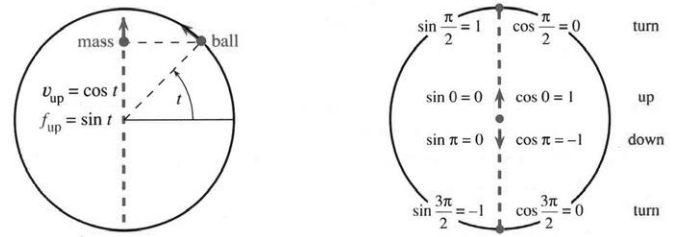
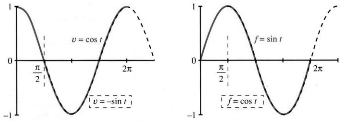

## 1.4 圆周运动

来源：PDF 第 86–92 页，印刷页 73–79。状态：初译，已按原页图像自校，待复审。

<!-- PDF 86 / 印刷页 73 -->

本节介绍全新的位置与速度函数：三角学中的正弦和余弦。写下“三角学”时，我问自己究竟需要知道多少。我们会用到一个基本直角三角形，两直角边为 $\cos t$、$\sin t$，斜边为 1；还会用到关键恒等式

$$\cos^2t+\sin^2t=1,$$

它就是勾股定理 $a^2+b^2=c^2$：两直角边的平方和等于斜边平方，右边的 1 实际上是 $1^2$。眼下不需要其他知识。即使没学过三角学，也不必停下，其中重要的一部分可以现在学。

你会认出正弦、余弦起伏的图像。我们要找出它们的斜率，这可以先不借助 $\sin(x+y)$ 与 $\cos(x+y)$ 的公式；后面再用那些公式作代数推导。此处只需要基础知识。[原注 1] 况且，一个三角形能有多复杂呢？

**说明。**你也许以为三角学只供测量员和导航员使用，因为他们总与三角形打交道。完全不是！更广泛的应用是旋转、振动和振荡。正弦、余弦如此适合描述沿圆周或上下往复的周期运动，实在奇妙。

**图 1.15** 随角 $t$ 改变，函数图像表示直角三角形各边的变化。radians 为弧度。

我们的目标是再提供一个通过直观推理就能求速度的例子。微积分大体上是常识的延伸，但这里暂时连那一步延伸也不需要。直线 $f=vt$ 容易，抛物线 $f=\tfrac12at^2$ 较难；新例子同样来自每天可见的运动。先研究圆周运动，已知位置，求速度。

**一个小球沿半径为 1 的圆运动。**圆心是原点，坐标满足 $x^2+y^2=1$。图 1.16a 用半径与水平正方向的夹角描述位置。令这个角的弧度数等于时间 $t$，便使球以恒定速率逆时针运动。时刻 1 到达角为 1 弧度的位置；一整圈在 $t=2\pi$ 完成，而不是 360。

球从 $x$ 轴正半轴、角为零的位置出发。时刻 $t$，它位于

$$x=\cos t,\qquad y=\sin t.$$

**原注 1：**正弦和余弦太重要，因此我在第 1.5 节增加了三角学复习。不过，本节的概念可能比公式更有价值。

<!-- PDF 87 / 印刷页 74 -->

这正是三角学有用之处。小球从最右到最左再返回，余弦在 1 与 $-1$ 之间振荡；正弦也一样，从 $\sin0=0$ 开始。到 $t=\pi/2$，高度升至 1，余弦为零，球到达顶点 $(0,1)$；到 $t=\pi$，位置为 $(-1,0)$；到 $t=2\pi$，回到 $(1,0)$，完成一周。

**图 1.16** 速率为 1 的圆周运动：角为 $t$，高度为 $\sin t$，竖直速度为 $\cos t$。图内 ball 为小球，radius 为半径，vertical distance 为竖直位置，vertical velocity 为竖直速度。

重要的是，半径为 1，圆周长为 $2\pi r=2\pi$。球在时间 $2\pi$ 内走过距离 $2\pi$，所以速率为 1。我们还要求速度，因为速度不仅包括大小，还包括方向。

**度与弧度。**一周为 $360^\circ$ 或 $2\pi$ 弧度，因此

$$
1\text{ 弧度}=\frac{360}{2\pi}\text{ 度}\approx57.3^\circ,
$$

$$
1^\circ=\frac{2\pi}{360}\text{ 弧度}\approx0.01745\text{ 弧度}.
$$

使用弧度正是为了避免这些换算因子：在时刻 $t$ 到达 $t$ 弧度，速率恰为 1。若同一时刻只到达 $t$ 度，则速率约为 0.01745，要到 360 才转一周。作者不愿让把圆分成 360 份的人为约定引入这些数字。

检查计算器角度模式，可验证 $\sin1^\circ\approx0.017$，而 $\sin1\approx0.84$。

### 小球的速度

时刻 $t$，球朝哪里运动？微积分观察 $t$ 到 $t+h$ 的变化；若球拴在线上，直观上只需考虑松手：运动方向沿圆的切线。若没有使它留在圆周上的力，球便沿切线飞出。月球受到引力；链球受到指向圆心的拉力，松手后飞出，选择释放时机是一门技巧。我曾在麻省理工学院见到朋友被链球击中，他活了下来，但投掷者不再参加田径。微积分让 $t$ 与 $t+h$ 对应的两点靠近，也会得到同一切线方向。[译注 1]

图 1.16b 的“速度三角形”与位置三角形相同，只旋转了 $90^\circ$。其斜边沿切线，指向球的运动方向，长度为速率 1。角 $t$ 仍在，但改为与竖直方向的夹角。**位置的竖直分量为 $\sin t$，速度的竖直分量为 $\cos t$。**这是基于图形而非公式的直观计算。本节其余内容依赖它，下面在特殊点检查。

<!-- PDF 88 / 印刷页 75 -->

起始时刻 $t=0$，运动完全向上，高度为零，向上速度为 1。到 $t=\pi/2$，球在顶端，高度为 1，竖直速度为零；那一瞬间它不向上也不向下，而沿水平方向运动。

水平速度带有负号：球起初向左。位置横坐标为 $\cos t$，水平速度为 $-\sin t$。半部三角学精华都在这幅图里，也可看到 $\sin^2t+\cos^2t=1$ 对位置和速度都适用。

**平面几何的应用：**两个直角三角形全等。球处的角 $t$ 与圆心角 $t$ 相等，可由球处三个相邻角合为 $180^\circ$ 看出。

### 振荡：上下运动

现在用圆周运动研究沿 $y$ 轴的直线运动。一个物体不再绕圆，而在 $y=1$ 与 $y=-1$ 之间上下振荡。它是“小球的影子”，稍后解释。

我们不希望速度在 $+1$ 与 $-1$ 之间骤然切换，那像台球不减速地在两墙间弹回。若墙距为 2，球到 $t=4$ 回到起点，位置图是第 1.2 节的折线或锯齿形。

我们更希望运动平滑：先减速到零，再逐渐反向加速。物体连在弹簧上，弹簧把它拉回；伸长最大时速度降至零，然后速度为负，沿反方向经过同样距离。**简谐运动**是最重要的往复运动，正如 $f=vt$ 和 $f=\tfrac12at^2$ 是重要的单向运动模型。

**图 1.17** 小球的圆周运动与物体，即小球投影的简谐运动。mass 为物体，ball 为小球；turn 为转向，up/down 为向上/向下。

怎样描述它？让物体始终与圆上的小球处于同一高度。小球通过顶部时，物体在最高处停下并开始下落；小球通过底部时，物体在最低处停下并向上返回。在中间高度，速率为 1。

任意时刻的高度为 $y=f(t)=\sin t$，在 1 与 $-1$ 间振荡。

<!-- PDF 89 / 印刷页 76 -->

但物体并非匀速运动。球的速率始终为 1，物体的速率却在变化。周期仍是 $2\pi$，但一周内不断加速、减速。要求的变化速度，就是正弦位置曲线的斜率。

### 正弦曲线的斜率

在最高和最低处，即 $t=\pi/2,3\pi/2$，投影物体转向，竖直速度为零，正弦曲线的斜率也为零。[原注 2] 在零点，球竖直向上，斜率为 1；在 $t=\pi$，球与投影物体都向下，速度为 $-1$。物体在中央最快，在最高或最低处最慢，实际瞬时停止。

要求物体的竖直速度，只需看球的竖直速度。它们始终同高，所以这两个速度相同。从圆周运动已知，竖直速度为 $v=\cos t$。

图 1.18 右侧 $f=\sin t$ 给出高度，左侧 $v=\cos t$ 给出速度，即高度曲线的斜率。两者都振荡，却存在相位差，如同位置三角形与速度三角形相差一个直角。三角学中最著名的两个函数，竟在微积分中构成一对：**正弦曲线的斜率由余弦曲线给出。**

$$f(t)=\sin t\quad\Longrightarrow\quad v(t)=\cos t.$$

**坦白一下：**我们没有按标准方法算斜率。此前比较 $(t+h)^2$ 与 $t^2$，除以 $h$，让 $h$ 变小；对正弦也可以同样做：

$$
\text{平均速度}
=\frac{\sin t\text{ 的变化量}}{t\text{ 的变化量}}
=\frac{\sin(t+h)-\sin t}{h}. \tag{1}
$$

这会用到即将介绍的 $\sin(t+h)$ 公式。$h\to0$ 时，该比值应趋于 $\cos t$，事实确实如此。正弦与余弦遵循和 $t^2,2t$ 相同的模式；我们的捷径是观察圆周运动的投影。

**图 1.18** $f=\sin t$ 对应 $v=\cos t$；$f=\cos t$ 对应 $v=-\sin t$。原图注以红、黑区分两对，本 PDF 为灰度显示。

**原注 2：**这看似简单，后来你会看到它非常重要：极大或极小处斜率为零，曲线变平。[译注 2]

<!-- PDF 90 / 印刷页 77 -->

**问题 1：**如果球快一倍，在时刻 $t$ 到达角 $2t$，会怎样？答：速率为 2，周期仅为 $\pi$。位置为 $(\cos2t,\sin2t)$。速度仍沿切线，但位于角 $2t$ 处，因此包含 $\cos2t$ 与 $-\sin2t$；而且速度三角形大一倍，所以竖直速度是 $2\cos2t$，水平速度是 $-2\sin2t$。注意这两个因子 2！

**问题 2：**$t=0$ 到 $\pi/2$ 的余弦曲线下方面积是多少？若接受微积分基本定理，便可以回答：求面积与求斜率互为逆过程。正弦的斜率是余弦，所以余弦下的面积是正弦的增量。虽然还未正式证明，我们先用它：从 $\sin0=0$ 到 $\sin(\pi/2)=1$，增量为 1。微积分的力量正在这里，没有别的方法能如此迅速求出这个面积。

### 余弦曲线的斜率

我忍不住再揭示一对位置与速度，而且无需额外工作。这次位置取余弦，把计时起点移到圆顶：原来的 $t=\pi/2$ 现在成为零。图 1.18 的虚线表示新的起点，运动本身完全相同，只是两个函数都作了 $\pi/2$ 的时间平移。

新位置函数是余弦，新速度函数是负正弦。又一对著名函数出现：

$$f(t)=\cos t\quad\Longrightarrow\quad v(t)=-\sin t.$$

观察球左右运动也能预见这一点：水平位置为 $\cos t$，水平速度为 $-\sin t$。这对函数完成了本章的微积分内容，后面还有三角学复习。回顾这些思想：

| $v$ | $f$ |
| --- | --- |
| 速度 | 位置或距离 |
| 位置图像的斜率 | 速度图像下方的有向面积，加初始值 |
| 短时间平均速度的极限 | 许多短时间位置增量之和的极限，加初始值 |
| $f$ 的导数 | $v$ 的原函数 |

**微分学由 $f$ 求 $v$；积分学由 $v$ 求 $f$。**恒定速度时 $f=vt$；恒定加速度且从静止出发时 $v=at$、$f=\tfrac12at^2$；简谐运动中有 $v=\cos t$、$f=\sin t$。目标之一是扩展这张清单，为此需要微积分工具；更重要的目标，是运用这些思想。

本章结束前，还想谈谈本书与课程。本书比通常教材更有个人色彩，希望读者喜欢。我的文字很接近当面讲给你听的话。

<!-- PDF 91 / 印刷页 78 -->

句子先在口头形成，再写下来。[原注 3] 微积分是活的，而且不断发展，也应该以这样的方式教授。

计算机带来了新的内容。数值计算使用有限步长 $h$，而不是实际执行无穷小的极限过程。即使不能给出精确斜率或面积，它也能迅速完成近似计算，可解决问题的范围由此大幅扩展。我们能登月，是因为位置和速度算得足够准确。原书以正弦、余弦描述月球轨道，以 $v=at$、$f=\tfrac12at^2$ 说明航天器起步，并指出大气、太阳引力、飞行器质量变化等因素需要计算机处理。[译注 3]

**现代数学把精确公式与近似计算结合起来。**两方面都不能忽视；我希望你能用数值看见代数推导的结果，习题将帮助掌握这两方面。

课程起步很快，没有先抽象地讲集合、函数或极限，而是从促使这些概念诞生的具体问题入手。你已经见过位置函数，以及平均速度的极限。后面还会遇到更多函数、更多极限和它们的定义，但尽早研究重要例子至关重要。事情还很多，不过课程已经真正开始。

**原注 3：**电视节目中，你马上能感到话语是否鲜活；写作也一样。

### 1.4 习题

#### 通读填空

单位圆上角为 $t$ 的球，坐标为 $x=$【a】、$y=$【b】；到 $t=$【c】完成一周。速率为【d】，速度沿【e】方向，它与从圆心引出的半径【f】。竖直速度为【g】，水平速度为【h】。

与球同高的上下运动物体，高度为【i】，称为简【j】运动；速度为【k】。$t=\pi/2$ 时，高度为【l】，速度为【m】。若加快到 $f=\sin2t$，速度为【n】。位于球正下方或正上方的水平投影有 $f=\cos t$，$v=$【o】。当 $f$ 对应距离、面积、积分时，$v$ 对应【p】、【q】、【r】。

1. 球以速率 1 沿单位圆运动：a. 五周用时多久？b. $t=3\pi/2$ 时在哪里？c. $t=22$ 时大致在哪里？
2. 对同一运动，求 $t=2\pi/3$ 时的精确坐标；若此时沿切线飞出，何时会碰到 $x$ 轴？
3. 球沿半径 4 的圆运动，时刻 $t$ 到达角 $t$。求 a. 坐标；b. 速率与已走路程；c. 竖直、水平速度。
4. 对半径 $R$ 的圆，求时刻 $t$、角 $t$ 对应的坐标；画速度三角形，求两个速度分量。
5. 球从零角度出发，以速率 3 绕单位圆运动。求时刻 $t$ 的 a. 角度；b. 坐标；c. 两个速度分量，最后一问较难。
6. 若另一球始终在第 5 题小球前方 $\pi/2$ 弧度处，求其角度、坐标与竖直速度。
7. 物体沿 $x$ 轴运动，始终位于原来小球正下方或正上方。位置 $x=f(t)$ 是什么？求 $t=\pi/4$ 时的 $x,v$，画出截至 $\pi$ 的图像。

<!-- PDF 92 / 印刷页 79 -->

8. 新的水平投影物体与原来竖直投影物体会相遇吗？时刻 $t$ 两者相距多远？
9. 画 $f(t)=\cos3t$、$\cos2\pi t$、$2\pi\cos t$，标清时间轴。每个函数多久重复一次？
10. 画 $f=\sin(t+\pi)$、$v=\cos(t+\pi)$；这一振荡与哪种圆周运动的小球同高？
11. 画 $f=\sin(\pi/2-t)$、$v=-\cos(\pi/2-t)$；对应小球从哪里出发、朝哪个方向转动？
12. 画 $f=\sin t+\cos t$，估计最大高度及达到它的时刻；计算 $f^2$ 检验。
13. 若小球沿圆周以速率 1 前进，你沿圆的直径跑到对面，需要多大速率才能再相遇？[译注 4]
14. 小球经过单位圆顶部时，另一物体从顶部由静止落下。要在底部相遇，恒定加速度 $a$ 应为多少？

**第 15–18 题由 $f=\sin t$ 的变化求 $v=\cos t$ 下的有向面积。**

15. 从 0 到 $\pi$。
16. 从 0 到 $\pi/6$。
17. 从 0 到 $2\pi$。
18. 从 $\pi/2$ 到 $3\pi/2$。
19. $f=\sin4t$ 给出 $v=4\cos4t$，解释两个 4。
20. $f=2\cos3t$ 给出 $v=-6\sin3t$，解释 $-6$。
21. $v=\cos4t$ 对应一个位置函数 $f=\tfrac14\sin4t$，解释 $1/4$。
22. $v=5\sin5t$ 对应什么位置函数？
23. 由 $v=\cos t$ 求正弦曲线在 $t=\pi/3$ 的斜率，再用 $[\sin(\pi/2)-\sin(\pi/3)]/[\pi/2-\pi/3]$ 求平均斜率。
24. 正弦曲线在零点的斜率为 1。计算 $t=1,0.1,0.01,0.001$ 时的平均斜率 $\sin t/t$。

**标准运动 $x=\cos t,y=\sin t$：①逆时针，②半径 1，③从 $(1,0)$ 出发，④速率 1。对第 25–30 题分别确定这四项。**

25. $x=\cos3t,\ y=-\sin3t$。
26. $x=3\cos4t,\ y=3\sin4t$。
27. $x=5\sin2t,\ y=5\cos2t$。
28. $x=1+\cos t,\ y=\sin t$。
29. $x=\cos(t+1),\ y=\sin(t+1)$。
30. $x=\cos(-t),\ y=\sin(-t)$。

**标准振荡 $x=0,y=\sin t$：①上下运动，②在 $-1$ 与 1 之间，③从 $(0,0)$ 出发，④竖直速度为 $\cos t$。对第 31–36 题确定对应四项。**

31. $x=\cos t,\ y=0$。
32. $x=0,\ y=\sin5t$。
33. $x=0,\ y=2\sin(t+\theta)$。
34. $x=\cos t,\ y=\cos t$。
35. $x=0,\ y=-2\cos(t/2)$。
36. $x=\cos^2t,\ y=\sin^2t$。
37. 若单位圆上的球在时刻 $t$ 到达 $t$ 度，求其位置、速率和竖直速度。
38. 选 $k$ 使 $x=\cos kt,y=\sin kt$ 到 $t=1$ 完成一周，求速率和竖直速度。
39. 原书举棒球规则的例子：投手开始投球前若不停顿，会被判投手犯规；美国联盟曾从数学角度认为，向后与向前运动之间必然有一个停止瞬间，即使短得看不见，因此不判犯规。这种数学说法成立吗？[译注 5]

### 译注

1. 这里取单位角速度 1 弧度/单位时间，角度与时间只是数值相等。松手后沿切线的说法描述释放瞬间的方向；若仍有重力等外力，之后轨迹不必为直线。分量可以有正负，速率为速度向量的长度。
2. 原文在最高、最低点写 ball changes direction and $v=0$，按上下文这里为竖直投影的转向与竖直速度为零；圆周上的球并未停下，速度向量长度仍为 1。极值处导数为零还要求内点可导，不适用于所有尖点或端点。
3. 航天器起步公式是恒定加速度简化模型，不能理解为真实登月全程满足它；原书借此说明数值计算的必要性。回顾表已显式补明初始值，避免把原函数与从固定下限起算的面积函数混同。
4. 第 13 题原文只说 across the circle，未明说路径与终点；译文按通常的穿过圆心到直径另一端理解。正式校订时可补示意图或核实原意，不能据此延伸为任意弦上的唯一速率问题。
5. 最后一题按原书历史情境翻译，未核验现行棒球规则；瞬时速度为零也不等同于有正持续时间的停顿。第 22 题若未给初值，位置函数还含任意加法常数。
