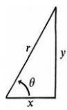
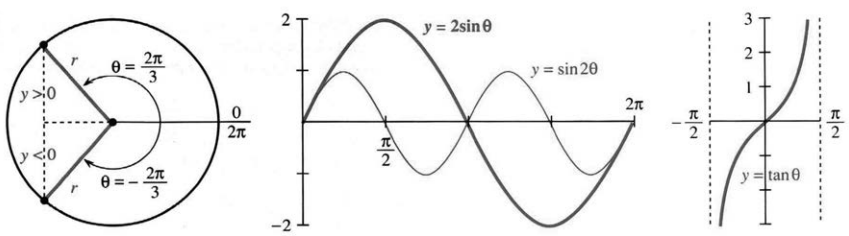
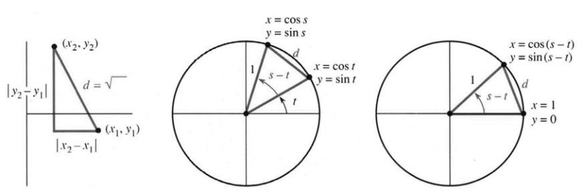
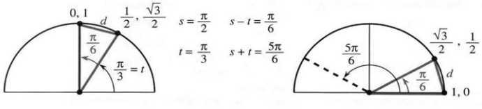

## 1.5 三角学复习

来源：PDF 第 93–97 页，印刷页 80–84。状态：初译，已按原页图像自校，待复审。

<!-- PDF 93 / 印刷页 80 -->

三角学从直角三角形开始。与大小相比，角度更重要。选定一个角 $\theta$，关注三条边 $x,y,r$ 之间的比值；将三角形按比例放大或缩小，这些比值不变。三条边给出六个比值，即三角学的六个基本函数。

**图 1.19** 对角 $\theta$，邻边为 $x$、对边为 $y$、斜边为 $r$。

| 函数 | 定义 | 倒数函数 | 定义 |
| --- | --- | --- | --- |
| 余弦 | $\cos\theta=x/r=\text{邻边}/\text{斜边}$ | 正割 | $\sec\theta=r/x=1/\cos\theta$ |
| 正弦 | $\sin\theta=y/r=\text{对边}/\text{斜边}$ | 余割 | $\csc\theta=r/y=1/\sin\theta$ |
| 正切 | $\tan\theta=y/x=\text{对边}/\text{邻边}$ | 余切 | $\cot\theta=x/y=1/\tan\theta$ |

这六个比值并不独立，右侧三个直接来自左侧三个；正切又是正弦除以余弦：

$$\tan\theta=\frac{\sin\theta}{\cos\theta}=\frac{y/r}{x/r}=\frac yx.$$

注意，英文 tangent 可表示角的正切、圆的切线或函数图像的切线，同一个词在这里有不同用法。当锐角 $\theta$ 趋近 $90^\circ$，余弦趋于零，正切趋于正无穷；$x$ 趋于零，三角形越来越陡。$90^\circ$ 的正弦为 $y/r=1$。

三角形有明显局限：描述锐角很方便，推广到 $180^\circ$ 内也能处理，但不能把 $240^\circ$ 当作三角形的内角。因此转向圆。

**图 1.20** 圆上的三角函数。比较 $2\sin\theta$、$\sin2\theta$、$\tan\theta$，其基本周期分别为 $2\pi,\pi,\pi$。

角从 $x$ 轴正半轴沿逆时针方向计量。$90^\circ$ 向上，$180^\circ$ 向左，$360^\circ$ 与零度同向，$450^\circ$ 与 $90^\circ$ 同向。每个角在半径 $r$ 的圆上指定一点；其坐标可以为负，但半径为正。点绕圆运动时，六个比值画出六类图像。余弦与正弦波形相同，只平移了 $90^\circ$。

转向圆时，还要作另一个变化：用弧度代替度。整圆弧长为 $2\pi r$；角 $\theta$ 对应弧长为 $r\theta$。用这一倍数 $\theta$ 计量角，半圆弧长为 $\pi r$。

<!-- PDF 94 / 印刷页 81 -->

所以半周角是 $\pi$ 弧度，即 $180^\circ$；四分之一周是 $\pi/2$ 弧度，即 $90^\circ$。**到角 $\theta$ 所对应的弧长为 $r\theta$。**

当 $r=1$，最为简单，弧长就是 $\theta$。$45^\circ$ 占一周的八分之一，即 $2\pi/8$ 弧度，弧长也为 $2\pi/8$。类似地，

$$360^\circ=2\pi\text{ 弧度},\quad1^\circ=\frac{2\pi}{360}\text{ 弧度},\quad1\text{ 弧度}=\frac{360}{2\pi}\text{ 度}.$$

顺时针角为负。$-\pi/3=-60^\circ$ 表示顺时针转六分之一周。角改为 $-\theta$ 时，半径不变、横坐标不变，纵坐标变号。因此

$$
\cos(-\theta)=\cos\theta,\qquad
\sin(-\theta)=-\sin\theta,\qquad
\tan(-\theta)=-\tan\theta.
$$

余弦是偶函数，正弦和正切是奇函数。

同一点也可沿逆时针转六分之五周到达，即 $300^\circ$；它与 $-60^\circ$ 同向。角度相差 $2\pi$ 时，$x,y,r$ 不变，所以六个函数都有周期 $2\pi$。绕五周或一百周，加上 $10\pi$ 或 $200\pi$，函数值仍重复。[译注 1]

**例：**求 $\theta=2\pi/3$，或同终边角 $-4\pi/3$ 的六个三角函数值。图 1.20a 中 $r=1$，故

$$
\cos\theta=-\frac12,\quad\sin\theta=\frac{\sqrt3}{2},\quad\tan\theta=-\sqrt3,
$$

$$
\sec\theta=-2,\quad\csc\theta=\frac2{\sqrt3},\quad\cot\theta=-\frac1{\sqrt3}.
$$

这体现了四个函数的大小范围：

$$|\cos\theta|\leq1,\quad|\sin\theta|\leq1,\quad|\sec\theta|\geq1,\quad|\csc\theta|\geq1.$$

正切、余切可以取任意实数；在有关表达式均有定义时，它们互为倒数。

正切 $-\sqrt3$ 是正弦除以余弦，正割 $-2$ 是余弦的倒数；其平方分别为 3、4，相差 1。这并非偶然。六个函数之间有三条关键平方恒等式：

$$
\cos^2\theta+\sin^2\theta=1,\qquad
1+\tan^2\theta=\sec^2\theta,\qquad
\cot^2\theta+1=\csc^2\theta.
$$

它们都来自 $x^2+y^2=r^2$，分别除以 $r^2,x^2,y^2$ 即得。全书都会用到它们，尤其第一条必须牢记。

### 距离与和角公式

求两点距离，仍用勾股定理。图 1.21a 的两点由坐标给出，再添一点补成直角三角形。

<!-- PDF 95 / 印刷页 82 -->

水平距离为 $|x_2-x_1|$，竖直距离为 $|y_2-y_1|$，所以

$$d=\sqrt{(x_2-x_1)^2+(y_2-y_1)^2}. \tag{1}$$

**图 1.21** 两点间距离，以及两个单位圆中相等的弦长。

在两个相同的圆中应用距离公式，可以求得 $\cos(s-t)$。图 1.21b 给出

$$d^2=(\cos s-\cos t)^2+(\sin s-\sin t)^2. \tag{2}$$

图 1.21c 是整体旋转后的同一个圆与三角形，因此同一距离满足

$$d^2=(\cos(s-t)-1)^2+\sin^2(s-t). \tag{3}$$

展开两式，将正弦平方与余弦平方之和换成 1，得到

$$1+1-2\cos s\cos t-2\sin s\sin t=1+1-2\cos(s-t).$$

消去共同项并约去 $-2$，得差角与和角公式：

$$\cos(s-t)=\cos s\cos t+\sin s\sin t, \tag{4}$$

$$\cos(s+t)=\cos s\cos t-\sin s\sin t. \tag{5}$$

最简单的检查是 $t=0$，两式均还原为 $\cos s=\cos s$。一般地，把式（4）中的 $t$ 改为 $-t$，余弦不变、正弦变号，就得到式（5）。特别取 $s=t$，得常用倍角公式：

$$\cos2t=\cos^2t-\sin^2t=2\cos^2t-1=1-2\sin^2t. \tag{6}$$

这里不断使用 $\cos^2t+\sin^2t=1$，在正弦与余弦之间转换。

还需要正弦的差角、和角与倍角公式。为此，要直接联系正弦和余弦，而不只是它们的平方。

<!-- PDF 96 / 印刷页 83 -->

回到原来的直角三角形，比值 $y/r$ 既是角 $\theta$ 的正弦，也是余角 $\pi/2-\theta$ 的余弦：

$$\sin\theta=\cos(\pi/2-\theta),\qquad\cos\theta=\sin(\pi/2-\theta). \tag{7}$$

两角之和为一个直角，所以互余。第 19 题利用这个联系，将余弦公式转为正弦公式：

$$\sin(s-t)=\sin s\cos t-\cos s\sin t, \tag{8}$$

$$\sin(s+t)=\sin s\cos t+\cos s\sin t, \tag{9}$$

$$\sin2t=2\sin t\cos t. \tag{10}$$

虽然还有更多公式，这里先停在十条。三角学有大量恒等式，根本原因是六个函数都来自同一个直角三角形；比值与勾股定理可以用许多方式重写。现在你已见到微积分需要的公式。[原注] 第 2 章用它们求导，第 5 章用它们积分；微积分还会加入自身的关键内容：角趋于零时的极限。精髓就在这个极限中。

**十条公式的回顾。**图 1.22 给出 $d^2=(0-1/2)^2+(1-\sqrt3/2)^2$。取 $s=\pi/2,t=\pi/3$：

$$
\begin{aligned}
\cos\frac\pi6&=\cos\frac\pi2\cos\frac\pi3+\sin\frac\pi2\sin\frac\pi3,\\
\sin\frac\pi6&=\sin\frac\pi2\cos\frac\pi3-\cos\frac\pi2\sin\frac\pi3,\\
\cos\frac{5\pi}6&=\cos\frac\pi2\cos\frac\pi3-\sin\frac\pi2\sin\frac\pi3,\\
\sin\frac{5\pi}6&=\sin\frac\pi2\cos\frac\pi3+\cos\frac\pi2\sin\frac\pi3,\\
\cos\frac{2\pi}3&=\cos^2\frac\pi3-\sin^2\frac\pi3,\\
\sin\frac{2\pi}3&=2\sin\frac\pi3\cos\frac\pi3,\\
\cos\frac\pi6&=\sin\frac\pi3=\frac{\sqrt3}2,\\
\sin\frac\pi6&=\cos\frac\pi3=\frac12.
\end{aligned}
$$

**问题 1：**画 $y=\sin2x$、$y=2\sin\pi x$、$y=\tfrac12\cos2\pi x$、$y=\sin x+\cos x$，各标三个点。

**问题 2：**六个函数中，哪些在哪些角附近趋于无穷？[译注 1]

**问题 3：**在 $0\leq t\leq2\pi$ 上草绘或用计算机画 $t\sin t$ 与 $\sin4t\sin t$。

**原注：**微积分常把式（6）改写为 $\cos^2t=\tfrac12(1+\cos2t)$ 和 $\sin^2t=\tfrac12(1-\cos2t)$。

<!-- PDF 97 / 印刷页 84 -->

### 1.5 习题

#### 通读填空

从一个【a】三角形开始，六个基本函数是各边的【b】。余弦 $x/r$ 和【c】小于 1；正割 $r/x$ 和【d】大于 1；【e】和【f】可取任意值。由三角形转为【g】，便能推广到一般角。[译注 1]

$\theta$ 用【h】计量，整圆为【i】，对应弧长 $2\pi r$；角 $\theta$ 对应弧长【j】。六个函数都有周期【k】。把方向改为顺时针，使角以及【l】、【m】变号。由于余弦不变，它是【n】函数。

由勾股定理得到 $\sin^2\theta+\cos^2\theta=1$、【o】、【p】，分别除以 $r^2$、【q】、【r】即可。$(2,5)$ 与 $(3,4)$ 的距离为【s】。从 $(1,0)$ 到 $(\cos(s-t),\sin(s-t))$ 的距离给出 $\cos(s-t)=$【t】；改变 $t$ 的符号，得 $\cos(s+t)=$【u】；令 $s=t$，得 $\cos2t=$【v】或【w】。所以 $\tfrac12(1+\cos2t)=$【x】。

1. 在三个角均为 $60^\circ$ 的三角形中，说明为什么 $\sin30^\circ=1/2$。
2. 将 $\pi,3\pi,-\pi/4$ 换算为度，将 $60^\circ,90^\circ,270^\circ$ 换算为弧度。在 0 与 $2\pi$ 之间，哪些角与 $480^\circ$、$-1^\circ$ 同终边？
3. 画 0 到 $2\pi$ 的 $\tan\theta,\cot\theta$，求最小正周期。
4. 说明 $\cos2\theta$、$\cos^2\theta$ 都有周期 $\pi$，画在同一图上。
5. 在 $\theta=3\pi/2$ 计算六个函数，并检查 $\cos^2\theta+\sin^2\theta$、$\sec^2\theta-\tan^2\theta$、$\csc^2\theta-\cot^2\theta$。[译注 2]
6. 制表列出六个函数在 $0,\pi/4,\pi/3,\pi/2,\pi$ 处的值。
7. 圆面积为 $\pi r^2$，角 $\theta$ 的扇形面积是多少？它占整圆面积的一部分。
8. 求 $(1,0)$ 到 $(0,1)$ 沿 a. 直线；b. 四分之一单位圆；c. 圆心为 $(1/2,1/2)$ 的半圆的长度。
9. 求 $(1,0)$ 到 $(1/2,\sqrt3/2)$ 的直线距离 $d$，用圆说明 $6d<2\pi$。
10. 求图 1.22 的 $d^2$，用计算器求 $12d$；为什么它接近而小于 $2\pi$？
11. 判断下列等式在双方均有定义时是否成立：

   a. $\dfrac{\sin\theta}{1-\cos\theta}=\dfrac{1+\cos\theta}{\sin\theta}$。

   b. $\dfrac{\sec\theta+\csc\theta}{\tan\theta+\cot\theta}=\sin\theta+\cos\theta$。

   c. $\cos\theta-\sec\theta=\sin\theta\tan\theta$。

   d. $\sin(2\pi-\theta)=\sin\theta$。

12. 化简 $\sin(\pi-\theta)$、$\cos(\pi-\theta)$、$\sin(\pi/2+\theta)$、$\cos(\pi/2+\theta)$。
13. 从 $\cos(2t+t)$ 的公式，用 $\cos t$ 表示 $\cos3t$。
14. 从 $\sin(2t+t)$ 的公式，用 $\sin t$ 表示 $\sin3t$。
15. 将式（4）、（5）相加并除以 2，求 $\cos s\cos t$ 的公式；再求类似的 $\sin s\sin t$ 公式。
16. 若 $i^2=-1$，证明 $(\cos t+i\sin t)^2=\cos2t+i\sin2t$。
17. 同图画 $\cos\theta,\sec\theta$，求两者相等的所有点。
18. 求 0 到 $2\pi$ 之间所有满足 $\sin(s+t)=\sin s+\sin t$ 的 $s,t$。
19. 把 $\sin(s+t)$ 写成 $\cos(\pi/2-s-t)$，在式（4）中用 $\pi/2-s$ 代替 $s$，推导式（9）。
20. 若式（9）成立，如何证明式（8）？
21. 对 $s=t=\pi/4$，检查式（4）、（5）、（8）、（9）。
22. 用式（5）、（9）求 $\tan(s+t)$ 的公式。

**第 23–28 题求全部实角解。**

23. $\sin\theta=-1$。
24. $\sec\theta=-2$。
25. $\sin\theta=\cos\theta$。
26. $\sin\theta=\theta$。
27. $\sec^2\theta+\csc^2\theta=1$。
28. $\tan\theta=0$。
29. 选择正确相位角 $\phi$，将 $\cos\theta+\sin\theta$ 写为 $\sqrt2\sin(\theta+\phi)$。先使 $\theta=0$ 时相等，再将两边平方检查。
30. 将 $a\sin x+b\cos x$ 写为 $A\sin(x+\phi)$。由式（9）说明 $a=A\cos\phi$、$b=A\sin\phi$；平方相加求 $A=$______，相除得 $\tan\phi=b/a$。[译注 3]
31. 三角形底边从 $O=(0,0)$ 到 $P=(a,0)$，第三点为 $Q=(b\cos\theta,b\sin\theta)$。$OP,OQ$ 的长度是什么？用距离公式证明 $PQ$ 的长度 $d$ 满足余弦定理 $d^2=a^2+b^2-2ab\cos\theta$。
32. 补上第四点 $R=(a+b\cos\theta,b\sin\theta)$ 成平行四边形，求另一条对角线 $OR$ 的长度平方。

### 译注

1. “推广到所有角”不表示六个函数在每个角都有限且有定义：$\cos\theta=0$ 时正切、正割未定义；$\sin\theta=0$ 时余切、余割未定义。所谓“无穷”描述单侧极限，不是函数值。$2\pi$ 是六者的共同周期，正切、余切的最小正周期为 $\pi$。填空中的大小比较首先针对锐角直角三角形；一般角应使用正文的绝对值不等式。
2. 第 5 题在 $3\pi/2$ 处，正切和正割未定义，因此不能把 $\sec^2-\tan^2$ 当作两个实数相减，或用“无穷减无穷”得 1。恒等式只在共同定义域成立；第 6 题表中也须标注未定义。
3. 用 $b/a$ 求相位要求 $a\ne0$，且正切不能单独确定象限；应结合 $a,b$ 的符号及所选 $A\geq0$。$a=b=0$ 要单独处理。第 31 题把 $a,b$ 作为边长时默认为正；距离的平方公式本身可更一般地使用。
