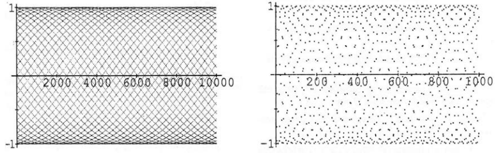
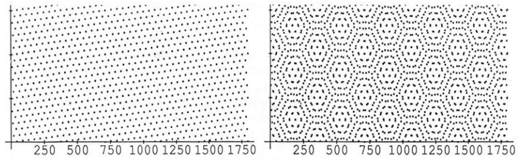

## 1.6 千点光芒

来源：PDF 第 98–99 页，印刷页 85–86。状态：初译，已按原页图像自校，待复审。

<!-- PDF 98 / 印刷页 85 -->

下面的图表示 $y=\sin n$，它与 $y=\sin x$ 很不一样。$\sin x$ 的图像是一条连续曲线，到 $x=10,000$ 时已经上下振荡了 $10,000/(2\pi)$ 次。这约 1591 次振荡会挤得几乎看不清。$\sin n$ 的图像从曲线上选取 10,000 个离散点，不知为何，这些点看起来像落在四十多条不同的正弦曲线上。

第二幅图显示前 1000 个点。它们看起来不像正弦曲线，大多数人会看到六边形。**但它们正是同一批点中的前一千个！**很难相信两图一致，不过我知道该怎样看：将第二幅图倾斜，以很小的角度从侧面观察。第一幅图的结构便会显现，我相信你能看到“菱形”。斜视压缩了横轴，接近第一幅图的比例。[译注 1]

我们不常考虑比例的作用，但看地图时很熟悉。计算机放大、缩小也是比例变化。眼睛看到的形状取决于哪些点显得“接近”。一万个点的图中似乎出现了正弦曲线，由此产生几个问题：

1. 哪些点靠近 $(0,0)$？
2. 一共有多少条正弦曲线？
3. 从 $(0,0)$ 向上走的中间那条曲线，在哪里再次回到零？

这里“靠近 $(0,0)$”主要指 $\sin n$ 接近零。$\sin1$ 显然不是如此，1 是一弧度；它约为 0.84，位于第七条曲线的起始高度附近。$\sin2\approx0.91$、$\sin3\approx0.14$。3 和 0.14 让人想到 $\pi$：$\sin3=\sin(\pi-3)$，而 $\sin0.14$ 接近 0.14。类似地，$\sin4$ 到 $\sin21$ 都没有特别接近零。

第一个很接近零的是 $\sin22$，因为 $22/7$ 接近 $\pi$，所以 22 接近 $7\pi$：

$$\sin22=\sin(7\pi-22)\approx\sin(-0.01)\approx-0.01.$$

这是原点右侧略低的第一个近零点，在图 2 中更清楚，它开始一条向下的曲线。接下来是 $\sin44$，因为 44 略大于 $14\pi$：

$$44\approx14\pi+0.02,\qquad\sin44\approx\sin0.02\approx0.02.$$

点 $(44,\sin44)$ 开始中间那条上升曲线，下一个点是 $(88,\sin88)$。

<!-- PDF 99 / 印刷页 86 -->

现在可以知道，一共有 44 组曲线，起始高度分别接近 $\sin0,\sin1,\ldots,\sin43$。其中 22 条起初向上，22 条起初向下。我起初只找出 42 条，颇感困惑；原因是 $\sin11\approx-0.99999$、$\sin33\approx0.9999$，太接近最底和最顶，难以辨认。$\sin11$ 接近 $-1$，与 $\sin22$ 接近零相呼应。几乎无法用眼睛跟踪同一条曲线越过顶部，向下看时，常会跟错另一条。

中间曲线上的横坐标为 $0,44,88,\ldots,44N$。它在哪里回到零？也就是，何时 $44N$ 非常接近 $\pi$ 的整数倍？44 约为 $14\pi+0.02$，更准确些是 $14\pi+0.0177$。把 0.0177 乘到接近 $\pi$：

$$
N\approx\frac\pi{0.0177},\qquad
44N\approx(14\pi+0.0177)N\approx14\pi N+\pi.
$$

原书由此估计 $N\approx177.5$、$44N\approx7810$，把它称为这条缓慢变化正弦曲线的半周期。$\sin7810$ 本身也很接近零。[译注 2]

沿中间曲线看，它在 7810 附近回到零。该组实际采样点的横坐标为 $44\cdot177$ 与 $44\cdot178$，函数值分居零的两侧；两横坐标中点为 7810。原书写出的中间曲线近似方程为

$$y\approx\sin\left(\frac{\pi x}{7810}\right),$$

周期约为 15,620，超出了图的范围。[译注 2]

**问：**中间曲线上的第四个正向采样点，看起来与从 $\sin3$ 向下的曲线上的第四个点相同。这个“双点”是什么？

**答：**$4\cdot44=176$。上升曲线的点为 $(176,\sin176)$，下降曲线的点为 $(179,\sin179)$；两个正弦值只相差约 0.00003。

第二幅图将这对点分开。看横坐标 176 与 179 上方、一个六边形中心附近，就能找到它们，也可以沿着图 2 跟踪正弦曲线。

只剩一个小问题：为什么图 2 会出现六边形？我不知道，问题出在眼睛的组织方式。为理解这些形状，道格·哈丁（Doug Hardin）不仅在正弦曲线上，也在直线上画点。图 3 表示 $y$ 为 $n/(2\pi)$ 的小数部分；然后复制一份，将它翻转并叠到原图上，产生图 4 中的六边形。原文说“图 3、4 在下一页”，本 PDF 实际把它们排在本页下方。

这叫作**莫尔条纹**（Moiré pattern）。若把图 3 复制到透明片上，在原图上方缓慢转动，就会看到奇妙的六边形。它们来自周期图案的叠加干涉；这里 $44/7,25/4,19/3$ 都接近 $2\pi$。套色网屏未对齐时，这种现象令印刷者头疼，也可能在电视图像中产生竖纹。织物生产中，移动的莫尔图案还会让操作人员眼花。它在工程与光学中也有用，不过我们该回到微积分了。

### 译注

1. 本节比较离散采样图，而非把原函数改成许多不同函数。横轴压缩和视觉分组改变所见图案，不改变已取样的数据。原图分辨率有限，本稿保留原图，没有用未经核对的重绘替换。
2. 此处原书把若干近似值写成等式；译文明确用了近似号。令 $\varepsilon=44-14\pi$，则对整数 $N$，精确有 $\sin(44N)=\sin(N\varepsilon)$。通过这组采样点的缓变正弦曲线可写为 $y=\sin(\varepsilon x/44)$，其半周期为 $44\pi/\varepsilon\approx7808.35$，不是精确的 7810。不能把非整数 $N=177.5$ 代入时仍把 $14\pi N$ 当作 $2\pi$ 的整数倍；原文在这里将采样点、近似包络曲线及原来的 $\sin x$ 混合叙述，须加以区分。
3. “44 条曲线”可通过按 $n$ 除以 44 的余数分组理解；它是对这幅采样图的结构描述，不表示连续函数 $\sin x$ 自身有 44 个分支。近似小数与肉眼辨认不是精确恒等式的证明。
