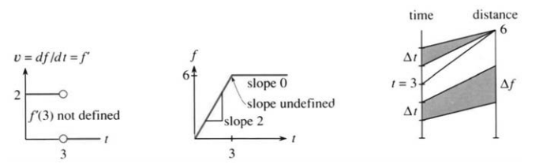
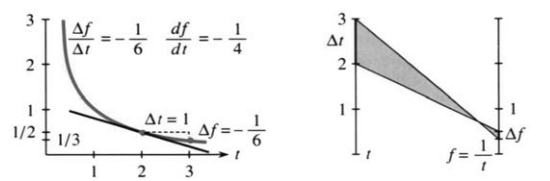
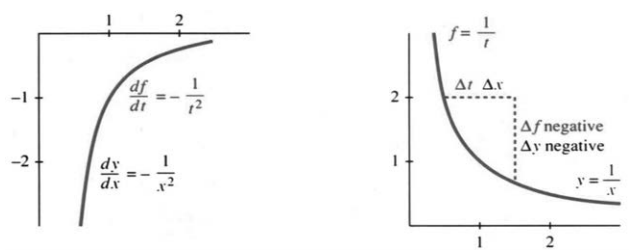
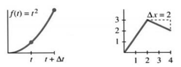
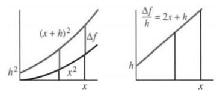

# 第2章 导数

## 2.1 函数的导数

来源：PDF 第 100–106 页，印刷页 87–93。2026-10-29 已逐段对照正文、全部41题及PDF100–106原图；PDF 重建与排版检查待完成。

<!-- PDF 100 / 印刷页 87 -->

本章从导数的定义讲起。第1章已经有两个例子：距离为 $t^2$ 时，速度是 $2t$；$f(t)=\sin t$ 时，我们得到 $v(t)=\cos t$。现在，这个速度就叫 $f(t)$ 的**导数**。接下来要给出更正式的定义、看更多例子，先认识新符号：$f'$ 与 $df/dt$。

> **2A** 在时刻 $t$，导数 $f'(t)$（也记作 $df/dt$ 或 $v(t)$）定义为
> $$f'(t)=\lim_{\Delta t\to0}\frac{f(t+\Delta t)-f(t)}{\Delta t},\tag{1}$$

右端的比值，是短时间间隔 $\Delta t$ 上的平均速度；左端的导数，是步长 $\Delta t$（读作“德尔塔 $t$”）趋于零时，这个比值的极限。

别急，一块一块看清。时刻 $t+\Delta t$ 的距离是 $f(t+\Delta t)$，时刻 $t$ 的距离是 $f(t)$。两者一减，得到的就是这段时间里的**距离变化量**，常记作 $\Delta f$：
$$\Delta f=f(t+\Delta t)-f(t).$$
**平均速度就是比值 $\Delta f/\Delta t$——距离变化量除以时间变化量。**

平均速度的极限若存在，它就是导数：
$$\frac{df}{dt}=\lim_{\Delta t\to0}\frac{\Delta f}{\Delta t}.\tag{2}$$
这个简洁的记号是莱布尼茨发明的：$\Delta f/\Delta t$ 趋于 $df/dt$。别看“极限”这两个字平平常常，它背后藏着一整个过程——本课程会帮你把它弄明白。

注意，$\Delta f$ 不是 $\Delta$ 乘 $f$！它是 $f$ 的变化量。同样，$\Delta t$ 也不是 $\Delta$ 乘 $t$：它是时间步长，可正可负，最终变得很小。想用一个字母表示步长，就把 $\Delta t$ 换成 $h$。

式 (1)、(2) 右端的比值，是平均速度。在 $f(t)$ 的图像上，纵向变化量除以横向变化量，就是平均斜率 $\Delta f/\Delta t$。左端的 $df/dt$ 是瞬时速度，也就是时刻 $t$ 处的斜率——这就是导数（此时 $\Delta t$ 和 $\Delta f$ 缩到零）。回头再看 $f(t)=t^2$ 的那次计算。

<!-- PDF 101 / 印刷页 88 -->

$$\frac{\Delta f}{\Delta t}=\frac{f(t+\Delta t)-f(t)}{\Delta t}
=\frac{t^2+2t\Delta t+(\Delta t)^2-t^2}{\Delta t}=2t+\Delta t.\tag{3}$$

关键在这里：这些变形必须在 $\Delta t$ 趋于零之前做完。**过早令 $\Delta t=0$，什么也得不到。**比值会变成没有意义的 $0/0$。$\Delta f$ 与 $\Delta t$ 得一起趋于零，不能各走各的。此时比值是平均速度 $2t+\Delta t$。

再说一遍：先把 $(t+\Delta t)^2$ 展开，减去 $t^2$，再除以 $\Delta t$。这几步做完，才能令 $\Delta t\to0$；极限就是导数 $2t$。

式 (1)、(2) 里有几样新东西：有的容易，却很重要；有的相当深刻。函数的概念、极限的定义，后面还要细说。这里先把常用的记号连同读法讲清楚。

| 记号 | 读法或含义 |
|---|---|
| $f(t)$ | “$f$ 在 $t$ 处的值”，即函数 $f$ 在时刻 $t$ 的函数值 |
| $\Delta t$ | “德尔塔 $t$”，从时刻 $t$ 向前或向后的时间步长 |
| $f(t+\Delta t)$ | “$f$ 在 $t+\Delta t$ 处的值” |
| $\Delta f$ | “德尔塔 $f$”，即变化量 $f(t+\Delta t)-f(t)$ |
| $\Delta f/\Delta t$ | “德尔塔 $f$ 除以德尔塔 $t$”，即平均速度 |
| $f'(t)$ | “$f$ 撇在 $t$ 处的值”，即该时刻的导数值 |
| $df/dt$ | “$d$ $f$ $d$ $t$”，与 $f'$ 相同，表示瞬时速度 |
| $\lim_{\Delta\to0}$ | “当德尔塔 $t$ 趋于零时的极限”，从数值 $\Delta f/\Delta t$ 出发，得到数值 $df/dt$ 的过程 |

这些说法能帮你读懂 $df/dt$。$\Delta t$ 表示一个非零的、通常很短的时间间隔；$dt$ 表示无穷小（更短）的时间间隔。有些数学家把 $df$ 和 $dt$ 分开处理，$df/dt$ 就是两者的比值。**对我们来说，$df/dt$ 是一个整体记号**，不要约去 $d$，也不要约去 $\Delta$。导数 $df/dt$ 是 $\Delta f/\Delta t$ 的极限。要是这个记号用着别扭，就改用 $f'$ 或 $v$。

**说明。**记号可能遮住两件事。第一，时间步长可正可负：区间可以取在时刻 $t$ 之后，也可以取在它之前。这个比值也趋于 $df/dt$。

第二，**导数可能不存在**。平均变化率 $\Delta f/\Delta t$ 可能不趋于一个共同的极限——从时刻 $t$ 的前后两侧逼近时，必须得到同一个极限。否则，$f'(t)$ 无定义。在那一刻，速度表没有明确的读数。例 2 就是这种情形。

**例 1：恒定速度 $V=2$。**距离是 $f=Vt$。时刻 $t+\Delta t$ 的距离为 $V(t+\Delta t)$，因此 $\Delta f=V\Delta t$，所以
$$\frac{\Delta f}{\Delta t}=\frac{V\Delta t}{\Delta t}=V,
\qquad \frac{df}{dt}=V.$$
$Vt$ 的导数是 $V$，$2t$ 的导数是 $2$。匀速运动是特殊情形：所有平均速度 $\Delta f/\Delta t$ 都等于 $V=2$。

<!-- PDF 102 / 印刷页 89 -->

**例 2：以恒定速度 $2$ 运动，到 $t=3$ 时停下。**

停下之前，$f(t)=2t$；停下之后，距离就固定在 $f(t)=6$。图像在 $t=3$ 以后是一条水平直线。此时 $f(t+\Delta t)=f(t)$，因而 $\Delta f=0$。**常函数的导数为零：**
$$t>3:\qquad f'(t)=\lim_{\Delta t\to0}\frac{f(t+\Delta t)-f(t)}{\Delta t}
=\lim_{\Delta t\to0}\frac0{\Delta t}=0.\tag{4}$$

在 $t=3$ 这一瞬间，导数不存在。速度从 $2$ 骤降到 $0$；就在这一刻，比值 $\Delta f/\Delta t$ 取什么值，要看 $\Delta t$ 是正是负。$t=3$ 之后的平均速度是 $0$，之前的平均速度是 $2$。$f$ 的图像上一出现折角，速度图像上就出现跳跃——那是一个阶梯函数。

这个例子还换了记号：用 $df/dt$ 或 $f'$ 代替 $v$。请顺便看看图 2.1 的第三幅：它画出函数怎样把左边的 $t$ 送到右边的 $f(t)$，尤其标出了 $\Delta t$ 与 $\Delta f$。一开始 $\Delta f/\Delta t=2$；在 $t=3$ 停下以后，所有的 $t$ 都对应同一个 $f(t)=6$，所以 $\Delta f=0$，$df/dt=0$。

### $1/t$ 的导数

再看一个完全不同的斜率：“需求函数”$f(t)=1/t$ 的斜率。价格是 $t$ 时，需求量是 $1/t$；价格越高，需求越低。涨价会压低需求。微积分要问的是：**$t$ 变化时，$1/t$ 变化得有多快？**“边际需求”就是需求曲线的斜率。

要紧的是一劳永逸地求出 $1/t$ 的导数——答案是 $-1/t^2$。

**例 3。**若 $f(t)=1/t$，则
$$\Delta f=\frac1{t+\Delta t}-\frac1t
=\frac{t-(t+\Delta t)}{t(t+\Delta t)}
=\frac{-\Delta t}{t(t+\Delta t)}.$$
除以 $\Delta t$，再令 $\Delta t\to0$：
$$\frac{\Delta f}{\Delta t}=\frac{-1}{t(t+\Delta t)}
\longrightarrow \frac{df}{dt}=-\frac1{t^2}.$$

第一行是代数，第二行才是微积分。先用 $f(t+\Delta t)$ 减去 $f(t)$，把分母通成 $t(t+\Delta t)$，化简才做得下去。除以 $\Delta t$ 这一步没做完，就不能直接令 $\Delta t=0$。

化简后的平均变化率是 $-1/[t(t+\Delta t)]$。现在直接代入，就得到极限 $-1/t^2$。第 2.4 节会讨论不能直接代入的情形，那时就得把极限的概念说得更清楚。

<!-- PDF 103 / 印刷页 90 -->

用 $t=2$、$t+\Delta t=3$ 核对一下代数。需求量 $1/t$ 从 $1/2$ 掉到 $1/3$，差是 $\Delta f=-1/6$，与第一行算出的 $-1/(2\cdot3)$ 对得上。$\Delta t$ 和相应的 $\Delta f$ 越缩越小，比值便趋于 $-1/(2\cdot2)=-1/4$。

**这个导数是负的。**函数 $1/t$ 递减，$\Delta f$ 小于零。图 2.2 里，曲线一路向右下走，斜率是负的。

递增函数 $f(t)$ 的斜率为正，递减函数 $f(t)$ 的斜率为负。

$t$ 很小时，斜率 $-1/t^2$ 是负的，绝对值还很大——价格稍微一涨，需求就会明显下跌。

下一幅图要说的是件小事，却很重要：字母 $t$ 没什么神圣的。换别的字母也行，尤其常用 $x$。一个量可以随位置变，而不随时间变：比如一路向西走，地势高低在变；正方形的边长变了，面积也跟着变。这些关系与时间无关，没理由非得用 $t$。你以后会常看到 $y=f(x)$：$x$ 在横轴，$y$ 在纵轴，由函数 $f$ 串起来。

同样，函数也不一定非得叫 $f$！这个字母便于记，因为它正是英文 function 的首字母；可我们完全有权写 $y(x)$ 或 $y(t)$，来代替 $f(x)$ 或 $f(t)$。纵坐标是横坐标的函数——这种“$y$ 依赖于 $x$”的关系，在数学里极其重要。

斜率本身也是个函数。微积分盯着的就是两个相互联系的函数：$y(x)$ 和 $dy/dx$。

**问：**给 $y(x)$ 加上 $1$，斜率怎样变化？**答：**不变。

**问：**给斜率加上 $1$，高度怎样变化？**答：**______。

符号 $t$ 和 $x$ 表示**自变量**，在定义域内想取什么值就取什么值。它们一定下来，$f(t)$ 和 $y(x)$ 就跟着定了。所以 $f$ 和 $y$ 表示**因变量**：它们依赖 $t$ 和 $x$。$\Delta t$ 一变，就带出相应的变化量 $\Delta f$。

<!-- PDF 104 / 印刷页 91 -->

$\Delta x$ 一变，就带出相应的 $\Delta y$。在 $f(t)$、$y(x)$ 里，自变量写在括号内。重要的不是用哪个字母，而是概念：

- 自变量：$t$ 或 $x$；
- 因变量：$f$、$g$、$y$、$z$ 或 $u$；
- 导数：$df/dt$、$df/dx$、$dy/dx$ 等。

导数 $dy/dx$ 来自“$y$ 的变化量”除以“$x$ 的变化量”。时间步长换成了空间步长，可向前也可向后。斜率表示 $y$ 随 $x$ 变化的快慢。**函数的导数就是它的变化率。**我提一下，物理书用 $x(t)$ 表示距离。真是的。

为了把定义说清楚，下面用 $y$ 和 $x$ 再写一遍：
$$\frac{\Delta y}{\Delta x}=\frac{y(x+\Delta x)-y(x)}{\Delta x}
=\frac{\text{纵向变化量}}{\text{横向变化量}},
\qquad \frac{dy}{dx}=\lim_{\Delta x\to0}\frac{\Delta y}{\Delta x}=y'(x).$$

记号 $y'(x)$ 明确点出求斜率的位置 $x$；$dy/dx$ 则省掉了这层说明。本书想在逻辑严密和日常简洁之间找一个合理的折中。$\frac{dy}{dx}(x)$ 这种写法不好，$y'(x)$ 更清楚；$x$ 若已明确，括号里的自变量也可以不写。

你可以说“函数是 $y=x^2$，导数是 $y'=2x$”，尽管严格写来该是 $y(x)=x^2$ 和 $y'(x)=2x$。只要彼此心里明白，甚至可以说“函数是 $x^2$，导数是 $2x$，二阶导数是 $2$”。

下面这个例子稍稍超前，可以跳过不读，但实在精彩。它既让你把字母和记号练熟，又能变出新的求导公式。

**例 4。**若 $u(x)$ 的斜率是 $du/dx$，则 $f(x)=(u(x))^2$ 的斜率是多少？

靠这个结果，从 $x^2$ 的导数就能求出 $x^4$ 的导数：这时 $u=x^2$，$f=x^4$。先看清一点：**$u^2$ 的导数不是 $(du/dx)^2$**，别把导数 $2x$ 拿去平方。要找出“平方求导法则”，还是得从 $\Delta f=f(x+\Delta x)-f(x)$ 出发：
$$\Delta f=(u(x+\Delta x))^2-(u(x))^2
=[u(x+\Delta x)+u(x)][u(x+\Delta x)-u(x)].$$

利用平方差公式 $a^2-b^2=(a+b)(a-b)$，$\Delta f$ 就写成了便于处理的形式。注意，这里不是 $(\Delta u)^2$，而是 $u^2$ 的变化量 $\Delta f$。除以 $\Delta x$，再取极限：
$$\frac{\Delta f}{\Delta x}
=[u(x+\Delta x)+u(x)]\frac{u(x+\Delta x)-u(x)}{\Delta x}
\longrightarrow 2u(x)\frac{du}{dx}.\tag{5}$$

这就是**平方求导法则**：$(u(x))^2$ 的导数，是 $2u(x)$ 乘以 $du/dx$。把已知的 $x^2$、$1/x$ 和 $\sin x$ 的导数用上去，就有下面几个结果。

**例 5：$u=x^2$。**$x^4$ 的导数是
$$2u\frac{du}{dx}=2x^2\cdot2x=4x^3.$$

**例 6：$u=1/x$。**$1/x^2$ 的导数是
$$2u\frac{du}{dx}=\frac2x\left(-\frac1{x^2}\right)=-\frac2{x^3}.$$

**例 7：$u=\sin x$，$du/dx=\cos x$。**$u^2=\sin^2x$ 的导数就是 $2\sin x\cos x$。

数学的核心是思想，记号是为表达思想而造出来的。牛顿和莱布尼茨各自独立发明了微积分；牛顿的支持者花了大量时间，论证他才是首创者。

<!-- PDF 105 / 印刷页 92 -->

牛顿确实早一步发现，可真正流传下来的 $dy/dx$ 记号出自莱布尼茨。它最适宜提示 $\Delta y/\Delta x$ 的极限。牛顿是历史上最伟大的科学家之一，微积分也是最伟大的创造之一；但好的记号同样缺不得。现在，导数的文字和符号你都会用了，接下来该认识更多函数，以及它们的导数。

### 2.1 习题

**阅读填空**

导数，就是 $\Delta t$ 趋于 **(b)______** 时，比值 $\Delta f/\Delta t$ 的 **(a)______**。这里 $\Delta f=$ **(c)______**。步长 $\Delta t$ 可以是正的，也可以是 **(d)______**。导数记作 $v$、**(e)______** 或 **(f)______**。若 $f(x)=2x+3$，且 $\Delta x=4$，则 $\Delta f=$ **(g)______**；若 $\Delta x=-1$，则 $\Delta f=$ **(h)______**；若 $\Delta x=0$，则 $\Delta f=$ **(i)______**。斜率不是 $0/0$，而是 $df/dx=$ **(j)______**。

$f(t)$ 的图像出现 **(k)______**、$v(t)$ 的图像出现 **(l)______** 的位置，导数不存在。$f(t)=1/t$ 的导数是 **(m)______**。$y=4/x$ 的斜率是 $dy/dx=$ **(n)______**。递减函数具有 **(o)______** 的导数。 $t$ 或 $x$ 是 **(p)______** 变量，$f$ 或 $y$ 是 **(q)______** 变量。$y^2$ 的斜率（是／不是）$(dy/dx)^2$。由平方求导法则，$(u(x))^2$ 的斜率是 **(r)______**；$(2x+3)^2$ 的斜率是 **(s)______**。

1. 下列式子按原样书写时，哪些给出时刻 $t$ 的 $df/dt$？如有疑问，可用 $f(t)=t^2$ 检验。
   $$\text{(a) }\frac{f(t+\Delta t)-f(t)}{\Delta t},\qquad
   \text{(b) }\lim_{h\to0}\frac{f(t+2h)-f(t)}{2h},$$
   $$\text{(c) }\lim_{\Delta t\to0}\frac{f(t-\Delta t)-f(t)}{-\Delta t},\qquad
   \text{(d) }\lim_{t\to0}\frac{f(t+\Delta t)-f(t)}{\Delta t}.$$
2. 设 $f(x)=x^2$。计算各比值，并令 $h=0$：
   $$\text{(a) }\frac{f(x+h)-f(x)}h,\quad
   \text{(b) }\frac{f(x+5h)-f(x)}{5h},\quad
   \text{(c) }\frac{f(x+h)-f(x-h)}{2h},\quad
   \text{(d) }\frac{f(x+1)-f(x)}h.$$
3. 对 $f(x)=3x$ 和 $g(x)=1+3x$，求 $f(4+h)$、$g(4+h)$、$f'(4)$、$g'(4)$。画出 $f$ 和 $g$ 的图像，再说说：它们的斜率为什么相同？
4. 写出三个与 $f(x)=x^2$ 具有相同导数的函数。
5. 设 $f(x)=1/x$。画出 $f(x)+1$ 和 $f(x+1)$ 的图像。哪一个的导数是 $-1/x^2$？
6. 选择 $c$，使直线 $y=x$ 与抛物线 $y=x^2+c$ 相切。它们在切点处的斜率相同。
7. 画出曲线 $y(x)=1-x^2$，并计算它在 $x=3$ 处的斜率。
8. 若 $f(t)=1/t$，从 $t=1/2$ 到 $t=2$ 的平均速度是多少？从 $t=1/2$ 到 $t=1$ 呢？从 $t=1/2$ 到 $t=101/200$ 呢？最后一问保留一位小数。
9. 对 $y(x)=x+x^2$，先求 $\Delta y/\Delta x$，再求 $dy/dx$。
10. 对 $y(x)=1+2x+3x^2$，求 $\Delta y/\Delta x$ 和 $dy/dx$。
11. 对 $f(t)=4/t$，化简 $f(t+\Delta t)-f(t)$，除以 $\Delta t$，再令 $\Delta t=0$，结果就是 $f'(t)$。
12. 从 $\Delta f=1/(t+\Delta t)^2-1/t^2$ 出发，求 $1/t^2$ 的导数：把 $\Delta f$ 通分，分母取 $t^2(t+\Delta t)^2$；分子再除以 $\Delta t$，就得到 $\Delta f/\Delta t$。令 $\Delta t=0$。
13. 设 $t\le1$ 时 $f(t)=7t$，之后 $f(t)=7+9(t-1)$。（a）求 $t=1/2$ 和 $t=3/2$ 时的 $df/dt$。（b）为什么 $f$ 在 $t=1$ 处不可导？
14. 求 $y=3x^2$ 的导数的导数，即二阶导数。三阶导数是多少？
15. 求 $A$、$B$，使直线 $y=x$ 与曲线 $Y=A+Bx+x^2$ 在 $x=1$ 处光滑衔接。“光滑衔接”是指该处 $y=Y$，且 $dy/dx=dY/dx$。
16. 求 $A$、$B$，使水平直线 $y=4$ 与曲线 $y=A+Bx+x^2$ 在 $x=2$ 处光滑衔接。
17. 判断正误：正确的说明理由，错误的举出反例。（a）若 $f(t)<0$，则 $df/dt<0$。（b）$(f(t))^2$ 的导数为 $2\,df/dt$。（c）$2f(t)$ 的导数为 $2\,df/dt$。（d）导数等于 $\Delta f$ 的极限除以 $\Delta t$ 的极限。
18. 对 $f(x)=1/x$，中心差分 $f(x+h)-f(x-h)=1/(x+h)-1/(x-h)$。通分到分母 $(x+h)(x-h)$ 后相减，再除以 $2h$ 并令 $h=0$。为什么要除以 $2h$ 才能得到正确的导数？
19. 设 $x<0$ 时 $y=mx+b$，$x\ge0$ 时 $y=Mx+B$。两段图像相接的条件是 ______；两段的斜率分别为 ______；$x=0$ 处的斜率为 ______（有哪些可能情形？）。
20. $y=1/x$ 在 $x=1/4$ 处的斜率为 $y'=-1/x^2=-16$。当 $h=1/12$ 时，下列哪个比值最接近 $-16$？
   $$\frac{y(x+h)-y(x)}h,\qquad\frac{y(x)-y(x-h)}h,\qquad\frac{y(x+h)-y(x-h)}{2h}.$$
21. 求 $y=x^2$ 在 $x=x_1$ 与 $x=x_2$ 之间的平均斜率。当 $x_2\to x_1$ 时，它趋于什么？

<!-- PDF 106 / 印刷页 93 -->

22. 设 $t\le2$ 时 $f(t)=3-2t$，$t\ge2$ 时 $f(t)=-1$。针对这个函数重画图 2.1，并画出 $df/dt$。
23. 针对 $y(x)=1-1/x$ 重画图 2.3，并画出 $dy/dx$。
24. $\Delta t\to0$ 时，$0/\Delta t$ 的极限不是 $0/0$。请解释。
25. 用非正式的方法猜测下列极限：先取 $\Delta t=0.1$ 和 $-0.1$，再想象 $\Delta t$ 不断变小。
   $$\text{(a) }\frac{1+\Delta t}{2+\Delta t},\quad
   \text{(b) }\frac{|\Delta t|}{\Delta t},\quad
   \text{(c) }\frac{\Delta t+(\Delta t)^2}{\Delta t-(\Delta t)^2},\quad
   \text{(d) }\frac{t+\Delta t}{t-\Delta t}.$$
26. ★ 设 $x\to0$ 时 $f(x)/x\to7$。推出 $f(0)=0$ 和 $f'(0)=7$，并给出一个不同于 $f(x)=7x$ 的例子。
27. 若极限存在，$\displaystyle\lim_{x\to0}\frac{f(3+x)-f(3)}x$ 是什么？若改为 $x\to1$ 呢？

**第 28–31 题使用平方求导法则：$d(u^2)/dx=2u\,du/dx$。**

28. 取 $u=x$，用这种新方法求 $x^2$ 的导数。
29. 取 $u=x^4$，利用 $du/dx=4x^3$ 求 $x^8$ 的导数。
30. 若 $u=1$，则 $u^2=1$，因此 $d1/dx$ 等于自身的两倍。这怎么可能？
31. 取 $u=\sqrt{x}$。$u^2=x$ 的导数满足 $1=2u\,du/dx$。由此求 $du/dx$，也就是 $\sqrt{x}$ 的导数。
32. 下方左图表示 $f(t)=t^2$。标出 $f(t+\Delta t)$、$\Delta t$ 和 $\Delta f$ 所对应的长度，并画出斜率分别为 $\Delta f/\Delta t$ 和 $f'(t)$ 的直线。
33. 下方右图给出了 $f(x)$ 和 $\Delta x$。求 $\Delta f/\Delta x$ 和 $f'(2)$。

34. 画出函数图像并选取 $\Delta x$，使 $\Delta f/\Delta x=0$，但 $f'(x)\ne0$。
35. 若 $f=u^2$，则 $df/dx=2u\,du/dx$；若 $g=f^2$，则 $dg/dx=2f\,df/dx$。合并可得 $g=u^4$，且 $dg/dx=$ ______。
36. 设 $f(0)=0$，判断正误。（a）若对所有 $x$ 都有 $f(x)\le x$，则 $df/dx\le1$。（b）若对所有 $x$ 都有 $df/dx\le1$，则 $f(x)\le x$。
37. 下图表示 $f(x)=x^2$ 的 $\Delta f$ 和 $\Delta f/h$。为什么 $\Delta f/h=2x+h$？把 $h$ 减半，再在图上补画新的图像。

38. 对 $f(x)=\tfrac12x$ 画出相应的图像。
39. 画出 $1/x$、$1/(x+h)$ 和 $\Delta f/h$ 的图像。可以取 $h=1/2$ 手绘，也可以用计算机展示 $h\to0$ 的过程。
40. 对 $y=e^x$，用计算机绘图展示 $dy/dx=y$。
41. 用自己的话解释导数。
