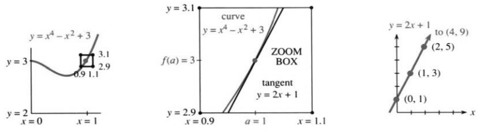
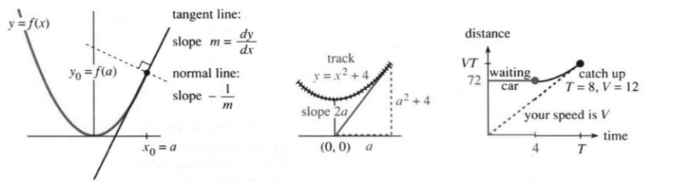
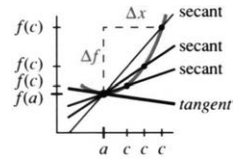
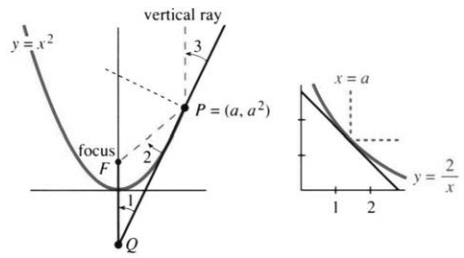

## 2.3 斜率与切线

来源：PDF 第 115–121 页，印刷页 102–108。2026-10-29 已逐段对照正文、全部46题及PDF115–121原图；PDF 重建与排版检查待完成。

<!-- PDF 115 / 印刷页 102 -->

第 1 章从直线图像讲起：速度是常数，至少分段是常数；距离函数是一次函数。现在摆在面前的是 $x^3-2$、$x^4-x^2+3$ 这样的多项式，往后还会碰到别的函数。它们的图像确实是弯的。大多数函数在大范围里都不接近一次函数——可一旦把注意力收拢到一个点附近，情形就变了。这一节要做的，正是这件事。

**范围很小时，曲线看着像直线。**拿显微镜去看，或者在计算机上不断放大，这一点不会有疑问。距离—时间图像近似为一条直线，它的斜率，就是那一刻的速度。我们要找的，是图像最贴近的那条直线，也就是“切线”。再往外，它才弯开。

切线其实好描述。在 $y=f(x)$ 的图像上，点取在 $x=a$、$y=f(a)$，那里的斜率就是 $f'(a)$。**切线经过点 $(a,f(a))$，斜率为 $m=f'(a)$。**图 2.5 把这条线画得比任何方程都清楚，可我们终究得把几何翻成代数：写出直线的方程。

**例 1。**设 $y=x^4-x^2+3$。在 $x=a=1$ 处，高度是 $y=f(a)=3$。导数为 $dy/dx=4x^3-2x$，于是在该点，斜率是 $4-2=2$，也就是 $f'(a)=2$。

三个数 $x=1$、$y=3$、$dy/dx=2$ 就把这条切线定下来了，方程是
$$y-3=2(x-1).$$
本节要讲清楚的，就是为什么。

### 直线方程

一条直线由两个条件确定。知道两个点，就知道了这条直线（我们仍须写出方程）。知道一个点和斜率，一条直线也就定了。切线正属于后一种：切点在哪儿、那一点的斜率是多少，都是现成的。

1. 直线的方程，总可以写成 $y=mx+b$。
2. $m$ 是斜率，因为 $dy/dx=m$。
3. 常数 $b$ 负责把直线挪到指定的点上。

下面我一个一个来说：先看方程 $y=mx+b$，再看斜率 $m$，最后看截距 $b$。

<!-- PDF 116 / 印刷页 103 -->

**1. 为什么 $y=mx+b$ 的图像不弯？**拿 $y=2x+1$ 试：点 $(0,1)$ 和 $(4,9)$ 都满足方程，两者的中点 $(2,5)$ 也满足。再取中点，$(0,1)$ 与 $(2,5)$ 的中点 $(1,3)$ 仍在图像上。图像包含所有中点，因此必定是直的。

**2. 切线的斜率 $m$ 该取多少？**本例里 $m=f'(a)=2$。**在切点处，曲线与切线的斜率相同。**

直线 $y=mx+b$ 的斜率，还可以这样看：$x=0$ 时高度是 $b$，$x=1$ 时高度是 $m+b$；横向增加一个单位，纵向增加 $m$ 个单位，所以
$$\text{斜率}=\frac{\text{纵向变化量}}{\text{横向变化量}}=\frac m1.\tag{1}$$
横坐标每增加一个单位，纵坐标就增加 $m$，依次到达 $2m+b$、$3m+b$ 等。直线的斜率始终不变；曲线 $y=x^4-x^2+3$ 却不然，斜率随 $x$ 改变，只在 $x=1$ 处等于 $2$。

**3. 最后定 $b$。**切线 $y=2x+b$ 要经过 $(1,3)$，所以 $b=1$。换成字母：$y=mx+b$ 在切点处给出 $f(a)=ma+b$，$b$ 就解出来了。

> **2E** 切线方程中的 $b=f(a)-ma$，其中 $m=f'(a)$。因此
> $$y=mx+f(a)-ma,
> \qquad\text{或}\qquad y-f(a)=m(x-a).\tag{2}$$

后一种写法最省事。取 $x=a$，右端为零，立刻得到 $y=f(a)$，说明直线确实经过那个点。这就是直线方程的**点斜式**，往后要常用：
$$y-3=2(x-1),\qquad
\frac{y-3}{x-1}=\frac{\text{纵向变化量}}{\text{横向变化量}}=2.$$

**例 2。**曲线 $y=x^3-2$ 过点 $(2,6)$。在该点，$dy/dx=3x^2=12$，于是切线的点斜式，由 $2,6,12$ 这三个数拼出来：
$$y-6=12(x-2),\qquad\text{即}\quad y=12x-18.$$

还有一条重要的线：与切线垂直、也与曲线垂直的**法线**，见图 2.6。切线斜率为 $m$ 时，法线斜率就是 $-1/m$。（法则：两条垂直直线的斜率乘积为 $-1$。）本例 $m=12$，于是
$$\text{切线： }y-6=12(x-2),\qquad
\text{法线： }y-6=-\frac1{12}(x-2).$$

光线沿法线方向传播。灌木火灾也是如此——火势垂直于火线推进。写法线方程时，点斜式必须老老实实用上：切线是 $y=12x-18$，法线可不是把斜率换成 $-1/12$、截距照抄 $-18$ 就完事。

<!-- PDF 117 / 印刷页 104 -->

**例 3。**你坐在过山车上，轨道是 $y=x^2+4$。朋友站在原点 $(0,0)$，你想尽快赶到他那儿——该在哪儿跳？

**解。**你的路径就是切线（在高速时）。要选的，是让这条切线正好穿过原点的 $x=a$。离开点的高度是 $a^2+4$，斜率是 $2a$，于是
$$y-(a^2+4)=2a(x-a).$$
把 $(0,0)$ 代进去，得 $-(a^2+4)=-2a^2$，所以 $a=\pm2$。

航天器控制人员和棒球投手解的是同一个问题。在恰当的时刻放球，击中60英尺外的目标，是微积分一次惊人的展示。面对移动目标的四分卫，应当阅读第4章的相关变化率。

再看一个比过山车更好的例子。红灯前停车会浪费汽油。早点减速、然后加速才更聪明。要是路口已经有车在等，时机的拿捏就得靠微积分了。

**例 4。**红灯在前方 $72$ 米处，$4$ 秒后转绿。等在路口的那辆车随后以 $3\,\mathrm{m/s^2}$ 的加速度起步。你不能超它。那么，该立刻减速到多大的恒定速度？

**策略。**立刻把速度降到 $V$，刚好够得着前车。要是先往前开一段再刹车，速度就得压得更低。到追上的时刻 $T$，两车位置相同、速度也相同；两个条件，正对应图 2.6 中两条位置曲线相切。

**解。**前车在时刻 $T$ 的速度是 $3(T-4)$，式中的 $4$ 表示启动延迟。要速度相等，就得
$$3(T-4)=V,\qquad T=\frac V3+4.$$
你的位置是 $VT$，前车的位置是 $72+\tfrac32(T-4)^2$。位置相等，给出
$$72+\frac32(T-4)^2=VT,
\qquad72+\frac{V^2}{6}=V\left(\frac V3+4\right).$$
解为 $V=12\,\mathrm{m/s}$，合 $43\,\mathrm{km/h}$，也就是 $27$ 英里每小时。

要是前面没车，只需取 $V=72/4=18\,\mathrm{m/s}$，绿灯亮时正好通过路口，以 $65\,\mathrm{km/h}$ 或 $40$ 英里每小时。试试看。

### 连接曲线上两点的割线

<!-- PDF 118 / 印刷页 105 -->

这回不看只过一个切点的切线，改看穿过曲线上两个不同点的**割线**。切线的两个点，是靠拢得来的；现在把它们分开。点斜式也就换成了两点式。

曲线仍是 $y=f(x)$。第一点 $(a,f(a))$，第二点 $(c,f(c))$，。割线从这两点之间穿过，我们要写出它的方程。这一回斜率没有现成的，但很好求。

**例 5。**曲线 $y=x^3-2$ 过 $(2,6)$，也过 $(3,25)$。两点之间的斜率是
$$m=\frac{y\text{ 的变化量}}{x\text{ 的变化量}}=\frac{25-6}{3-2}=19.$$
拿第一点写点斜式，得 $y-6=19(x-2)$。这条线自动穿过第二点，因为 $25-6=19(3-2)$。斜率 $19$，正是两点之间的平均斜率 $\Delta y/\Delta x$。

**向前看一步。**让第二点向第一点靠拢，割线斜率便趋向切线斜率 $dy/dx$，取极限，导数就露出来了。这是眼下的重点——但不会是永远的重点。

用不了多久，你求导就会很顺手：算精确的 $dy/dx$，反倒比算差商 $\Delta y/\Delta x$ 容易。一旦知道 $x^9$ 的导数是 $9x^8$，思路就能倒过来用：在 $x=1$ 附近，纵向增量大约是横向增量的九倍。要估算
$$\Delta y=1.001^9-1^9,$$
只需把 $\Delta x=0.001$ 乘以 $9$，得 $0.009$；计算器给出的约为 $0.009036$。沿着切线算，比沿着曲线算容易。

回到割线，把数字换成字母：连接 $(a,f(a))$ 和 $(c,f(c))$ 的，是哪条直线？数学家把公式排在数字前面，把推理排在公式前面，更把推理背后的思想排在推理前面。

1. 斜率是 $\displaystyle m=\frac{f(c)-f(a)}{c-a}$。
2. 在 $x=a$ 处，高度是 $y=f(a)$。
3. 在 $x=c$ 处，高度是 $y=f(c)$；只要斜率对，这一条自然成立。

> **2F 两点式：**用两点间的斜率写出割线方程：
> $$y-f(a)=\frac{f(c)-f(a)}{c-a}(x-a).\tag{3}$$

令 $x=a$，右端为零，所以 $y=f(a)$；令 $x=c$，右端两个因子 $c-a$ 约掉，剩下 $y=f(c)$。切线方程 (2) 与割线方程 (3) 都到手了，接下来就能把两者接上。

<!-- PDF 119 / 印刷页 106 -->

### 割线趋近切线

这一步其实很基本，跟前面处理速度是同一个路数：
$$\text{平均速度}=\frac{\Delta\text{距离}}{\Delta\text{时间}}
=\frac{f(t+\Delta t)-f(t)}{\Delta t},$$
取极限，就是 $df/dt$。现在把同样的动作用到斜率上。**$c\to a$ 时，割线趋于切线：**
$$\text{割线斜率： }\frac{\Delta f}{\Delta x}=\frac{f(c)-f(a)}{c-a},
\qquad
\text{切线斜率： }f'(a)=\lim_{c\to a}\frac{\Delta f}{\Delta x}.$$

这就是微分学的基本思想！$c$ 一步步贴近 $a$ 时，图 2.7 画不下的那些割线，得靠你自己在脑子里补出来。$c-a$ 就是 $\Delta x$；$f(c)-f(a)$ 呢，就是取 $x=a$ 作起点时的 $f(x+\Delta x)-f(x)$，也就是高度的变化量 $\Delta f$。所有这些割线都过点 $(a,f(a))$，它们的极限位置，就是切线。

$$\text{割线： }y-f(a)=\frac{f(c)-f(a)}{c-a}(x-a),
\qquad\text{切线： }y-f(a)=f'(a)(x-a).$$

直觉上，这个极限挺清楚：两点一靠拢，就得到在该点与曲线相切的那条直线；当然，切线也可能在远处再次与曲线相遇。数学上却要小心，因为这个极限把我们从代数带进了微积分。代数不允许除以零；微积分偏要研究分子、分母都趋于零时，比值怎么变。

下面这个形式看着新鲜，其实与原来的导数定义完全一样：
$$f'(a)=\lim_{c\to a}\frac{f(c)-f(a)}{c-a}.\tag{4}$$

**例 6。**求 $y=f(x)=\sin x$ 在 $x=0$ 处的所有割线与切线。

基点是 $(0,\sin0)=(0,0)$。连到另一点 $(c,\sin c)$ 的割线，斜率是 $(\sin c)/c$，因此
$$\text{割线： }y=\frac{\sin c}{c}x,
\qquad\text{切线： }y=x.$$
$c\to0$ 时，割线就变成切线；$(\sin c)/c$ 的极限不是毫无意义的 $0/0$，而是 $1$，即该点的导数。

**例 7。**你手上的黄金，$t$ 年后值 $\sqrt t$ 百万美元。什么时候它的增长率会降到当时价值的 $10\%$，使你应该卖掉黄金、改买债券？到 $t=25$ 时，这样能比黄金的价值 $\sqrt{25}=5$ 多出多少？

<!-- PDF 120 / 印刷页 107 -->

**解。**价值的增长率，就是 $\sqrt t$ 的导数 $1/(2\sqrt t)$。它等于当前价值的 $10\%$ 时，
$$\frac1{2\sqrt t}=\frac{\sqrt t}{10},\qquad2t=10,\qquad t=5.$$
这时卖出黄金，价值轨迹便从曲线转到切线：
$$y-\sqrt5=\frac{\sqrt5}{10}(t-5).$$
到 $t=25$ 时，$y-\sqrt5=2\sqrt5$，所以 $y=3\sqrt5=6.7$ 百万美元。这里用的是单利，不是复利。黄金只值区区 $5$ 百万美元。

### 2.3 习题

**阅读填空**

一条直线可由 **(a)______** 个点确定，或由一个点和 **(b)______** 确定。切线的斜率等于 **(c)______** 在切点的斜率。切线的点斜式为 $y-f(a)=$ **(d)______**。

$y=x^3+x$ 在 $x=1$ 处的切线斜率为 **(e)______**，方程为 **(f)______**，与 $y$ 轴相交于 **(g)______**，与 $x$ 轴相交于 **(h)______**。该点 $(1,2)$ 处法线的斜率为 **(i)______**，方程为 $y-2=$ **(j)______**。连接 $(1,2)$ 与 $(2,$ **(k)______** $)$ 的割线斜率为 **(l)______**，方程为 $y-2=$ **(m)______**。

当 $m=$ **(n)______** 时，点 $(c,f(c))$ 位于直线 $y-f(a)=m(x-a)$ 上。$c\to a$ 时，斜率 $m$ 趋于 **(o)______**，割线趋于 **(p)______** 线。

1. （a）求 $y=12/x$ 的斜率。求 $y=12/x$ 的斜率。（b）求 $(2,6)$ 处的切线方程。（c）求该处的法线方程。（d）求连接 $(2,6)$ 与 $(4,3)$ 的割线方程。
2. 对 $y=x^2+x$，求：（a）$(1,2)$ 处的切线和法线方程；（b）连接该点与 $(1+h,(1+h)^2+(1+h))$ 的割线方程。
3. 一条直线经过 $(1,-1)$ 和 $(4,8)$。先写出点斜式，再化为 $y=mx+b$。
4. $y=x^3+6x$ 在原点的切线为 $y=$ ______。它是否还在别处与曲线相交？
5. $y=x^3-3x^2+x$ 在原点的切线为 $y=$ ______。它也是连接原点与点 ______ 的割线。
6. 求曲线 $x=y^2$ 在 $(4,2)$ 处的切线。
7. 对 $y=x^2$，连接 $(a,a^2)$ 和 $(c,c^2)$ 的割线方程为 ______。约去斜率表达式中的 $c-a$，再令 $c\to a$ 求切线。
8. 构造一个在 $x=1$ 与 $x=2$ 处导数相同的函数；然后画出 $y=x^4-2x^2$，找出它具有同一条切线的两个不同点。
9. 找一条在 $x=5$ 处与 $y=2x-3$ 相切的曲线，并求该曲线在 $(5,7)$ 处的法线。
10. 对 $y=1/x$，连接 $(a,1/a)$ 和 $(c,1/c)$ 的割线方程为 ______。化简斜率，再求 $c\to a$ 时的极限。
11. 求 $y=\sin x$ 在 $x=\pi/2$ 处的切线和法线方程。
12. 若 $a$ 和 $c$ 分别从两侧趋近位于二者之间的 $b$，则割线斜率 $[f(c)-f(a)]/(c-a)$ 趋于 ______。
13. 对 $y=1/x$ 上的点 $x=a$，求：（a）切线方程；（b）切线与两坐标轴的交点。切线与坐标轴围成的三角形面积恒为 ______。
14. 设 $g(x)=f(x)+7$，则 $f$、$g$ 在 $x=4$ 处的切线互相 ______。判断正误：两条直线之间的距离为 $7$。
15. 选取 $c$，使 $y=4x$ 与 $y=x^2+c$ 相切。必须同时匹配高度与斜率。
16. 选取 $c$，使 $y=5x-7$ 与 $y=x^2+cx$ 相切。
17. 对 $y=x^3+4x^2-3x+1$，求切线水平的所有点。
18. 说明 $y=4x$ 不可能与 $y=cx^2$ 相切。可尝试同时匹配高度和斜率，或画图说明。
19. 确定 $c$，使经过 $(0,3)$ 和 $(5,-2)$ 的直线与 $y=c/(x+1)$ 相切。
20. 选取 $b,c,d$，使两条抛物线 $y=x^2+bx+c$ 与 $y=dx-x^2$ 在 $(1,0)$ 处相切。
21. $f(x)=x^3$ 经过 $(1,1)$。（a）另一点为 $x=c=1+h$，$y=f(c)=$ ______。（b）$\Delta f=$ ______。（c）割线斜率 $m=$ ______。（d）$h\to0$ 时，$m$ 趋于 ______。
22. 构造一个函数 $y=f(x)$，使它在 $x=1$ 处的切线同时也是一条在 $x=3$ 处再次与曲线相交的割线。

<!-- PDF 121 / 印刷页 108 -->

23. 画出两条向相反方向弯曲、彼此分离的曲线，标出距离最近的点 $P$、$Q$。在这些点处，两条切线互相 ______，两条法线 ______。
24. ★ 若抛物线 $y=x^2+1$ 与 $y=x-x^2$ 的最近点分别为 $(a,a^2+1)$ 和 $(c,c-c^2)$，列出确定 $a,c$ 的两个方程。
25. 一束光沿直线 $x=a$ 竖直向下，射到抛物面反射器截线 $y=x^2$ 上的 $P=(a,a^2)$。（a）求 $P$ 处切线，并求它与 $y$ 轴的交点 $Q$。（b）验证 $P$、$Q$ 到焦点 $F=(0,1/4)$ 的距离相等。（c）由（b）说明图中相应角相等。（d）哪条物理定律保证每条入射光线都反射到焦点 $F$？

26. 对反射器截线 $y=2/x$，沿某条特殊直线 $x=a$ 向下的入射光线，经反射后沿水平方向传播。求 $a$。
27. 对抛物线 $4py=x^2$，斜率在哪一点等于 $1$？该点的竖直入射光线会水平反射，因此焦点为 $(0,$ ______ $)$。
28. 下面的说法为什么错误？请改正。（a）若 $(1,2)$ 处的切线为 $y=2x$，则法线为 $y=-\tfrac12x$。（b）当 $c\to a$ 时，割线斜率 $[f(c)-f(a)]/(c-a)$ 趋于 $[f(a)-f(a)]/(a-a)$。（c）经过 $(2,3)$、斜率为 $4$ 的直线是 $y-2=4(x-3)$。
29. 一个小球沿圆周运动，$x=\cos t$、$y=\sin t$。在 $t=3\pi/4$ 时，它沿切线飞出。求这条切线方程及其与地面 $y=0$ 的交点。
30. 若 $y=f(x)$ 在 $x=a$ 处的切线与 $y=g(x)$ 在 $x=b$ 处的切线重合，列出 $a,b$ 必须满足的两个方程。
31. 画一个半径为 $1$、放在抛物线 $y=x^2$ 内部并与之相切的圆。接触点 $(a,a^2)$ 处的法线方程为 ______；它与 $y$ 轴交于 $y=$ ______。该交点到 $(a,a^2)$ 的距离等于半径 $1$ 时，$a=$ ______，由此确定接触点。
32. 仿照第 31 题，讨论更平缓的抛物线 $y=\tfrac12x^2$，说明圆会落在什么位置。
33. 你正在申请一笔 1,000 美元的奖学金，时间价值为每小时 10 美元。若花 $x$ 小时撰写申请，成功概率为 $1-1/x$，应何时停止投入时间？
34. 设任意两点 $a,c$ 都满足 $|f(c)-f(a)|\le|c-a|$。证明 $|df/dx|\le1$。
35. $y=1/x^2$ 在哪一个 $x=a$ 处的切线与 $x$ 轴相交于 $x=3$？
36. 若 $u(x)/v(x)=7$，求 $u'(x)/v'(x)$，并求 $(u(x)/v(x))'$。
37. 用两种方法求 $f(c)=1.001^{10}$：一是计算器，二是近似式 $f(c)-f(a)\approx f'(a)(c-a)$，其中 $a=1$，$f(x)=x^{10}$。
38. 距 $x=1$ 的横向增量为 $\Delta x$ 时，曲线 $y=1/x$ 比其在 $x=1$ 处的切线高多少？
39. 距 $x=2$ 的横向增量为 $\Delta x$ 时，曲线 $y=x^3$ 比其在 $x=2$ 处的切线高多少？
40. 根据第 38 或 39 题，曲线与切线之间的距离像 $\Delta x$ 的什么幂 $(\Delta x)^p$ 那样增长？
41. $f(x)=x^2-1$ 在 $x_0=2$ 处的切线与 $x$ 轴交于 $x_1=$ ______；在 $x_1$ 处的切线又与 $x$ 轴交于 $x_2=$ ______。画出曲线与两条切线。这是用牛顿法求解 $f(x)=0$ 的最初两步。
42. **思考题。**方程 $y=mx+b$ 需要两个数；点斜式 $y-f(a)=f'(a)(x-a)$ 需要三个数；两点式需要四个数 $a,f(a),c,f(c)$。这怎么解释？
43. 求例 4 中你恰好追上前车时的相切时刻 $T$。
44. 若等待车辆的加速度仅为 $2\,\mathrm{m/s^2}$，则你应降到多大的恒定速度 $V$？
45. 一个小偷在40米外，以每秒8米的速度向你跑来。使 $v=at$ 能让你保持在前面的最小加速度是多少？
46. 接力赛中，你距交接位置还有 $8$ 米，且正在明显减速，位置为 $f=-8+6t-\tfrac12t^2$。下一棒选手若从该位置以恒定速度前进，位置为 $f=vt$，应选择多大的 $v$，才能恰好完成交棒？
