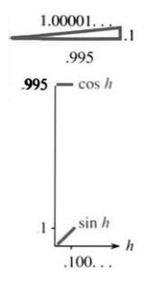
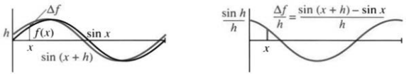
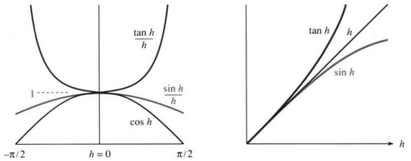
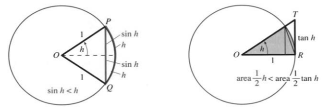
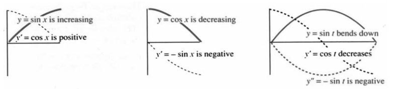

## 2.4 正弦函数与余弦函数的导数

来源：PDF 第 122–128 页，印刷页 109–115。状态：初译，已按原页图像自校，待复审。

<!-- PDF 122 / 印刷页 109 -->

本节有两项任务：一是计算 $\sin x$ 和 $\cos x$ 的导数，二是说明这些函数为什么如此重要。它们可以描述**振荡**，我们将用语言和方程表达这种运动。你会看到一个含未知函数 $y(x)$ 的导数的“微分方程”：二阶导数，即导数的导数，等于原函数的相反数，写作 $y''=-y$。在运动模型中，位移朝向一侧，加速度就朝向另一侧，使 $y$、$y'$、$y''$ 随之振荡。这个方程的解包括 $\sin x$、$\cos x$ 及其所有线性组合。

先看斜率。$y=\sin x$ 的导数为 $y'=\cos x$。这不必成为一个谜，但仍是一个优美的结果。第1章追踪了沿圆周运动的小球：投影上下移动，高度为 $\sin t$，速度为 $\cos t$。现在用标准的极限方法求导。对 $y(x)=\sin x$，
$$\frac{dy}{dx}=\lim_{h\to0}\frac{\Delta y}{\Delta x}
=\lim_{h\to0}\frac{\sin(x+h)-\sin x}{h}.\tag{1}$$

正弦比 $x^2$、$x^3$ 更难处理。此前要展开 $(x+h)^2$、$(x+h)^3$，现在要处理 $\sin(x+h)$，这需要第 1.5 节回顾过的三角加法公式：
$$\sin(x+h)=\sin x\cos h+\cos x\sin h,\tag{2}$$
$$\cos(x+h)=\cos x\cos h-\sin x\sin h.\tag{3}$$
由式 (2)，
$$\frac{\Delta y}{\Delta x}
=\frac{\sin x\cos h+\cos x\sin h-\sin x}{h}
=\sin x\frac{\cos h-1}{h}+\cos x\frac{\sin h}{h}.\tag{4}$$

右端分成两个较简单的部分。代数与三角学把我们带到这里，接下来是微积分的问题：**$h\to0$ 时会怎样？**现在不能像多项式那样直接约去 $h$，更不能把 $(\sin h)/h$ 错写成“$\sin$”。这里需要两个关键极限：
$$\lim_{h\to0}\frac{\cos h-1}{h}=0,
\qquad\lim_{h\to0}\frac{\sin h}{h}=1.\tag{5}$$

细心的读者可能提出异议：我们还未严格定义极限，也未证明可以先分别取极限、再在式 (4) 中相加。不过，按照先理解思想、随后补充严密论证的安排，这里先继续推进。式 (4) 的极限确实可以由式 (5) 得到：
$$\frac{dy}{dx}=(\sin x)\cdot0+(\cos x)\cdot1=\cos x.\tag{6}$$
割线斜率 $\Delta y/\Delta x$ 趋于切线斜率 $dy/dx$。

> **2G** 当角度以弧度计时，$y=\sin x$ 的导数为 $dy/dx=\cos x$。

<!-- PDF 123 / 印刷页 110 -->

不能跳过式 (5) 中的两个关键极限，真正的思想就在这里。直接代入 $h=0$，两个比值都会变成 $0/0$。零角的余弦为 $1$，正弦为 $0$。图 2.8 画出一个小角 $h$：边长 $\sin h$ 接近零，$\cos h$ 接近 $1$；$(\sin h)/h$ 则给出正弦曲线起点附近的割线斜率。

两个函数都趋于零时，它们的比值可能有很不相同的表现。例如，$h\to0^+$ 时，
$$\frac{h^2}{h}\to0,\qquad\frac hh\to1,\qquad\frac{\sqrt h}{h}\to+\infty.$$
单凭 $0/0$ 无法判断；关键是分子与分母趋于零的相对快慢。粗略地说，我们要说明 $(\cos h-1)/h$ 类似于 $h^2/h$，而 $(\sin h)/h$ 类似于 $h/h$。

**暂作图像观察。**图 2.9 中，一条曲线为 $\sin x$，另一条为 $\sin(x+\Delta x)$，两者相差水平位移 $\Delta x$，在同一横坐标处的高度差为 $\Delta f$。原文按黑、红两色区分；本 PDF 图像为灰度，按曲线标签辨认。

再用高度差除以小量 $\Delta x$（即 $h$），便得到右图的差商曲线。它接近 $\cos x$，但并不完全相同，从起点即可看出。数学论证将证明，当 $\Delta x\to0$ 时，极限恰为 $\cos x$。有趣的是，关键推理集中在一个点 $x=0$ 上：该点斜率为 $\cos0=1$。

现在要证明 $\sin\Delta x/\Delta x\to1$，也就是正弦曲线在原点处的斜率为 $1$。再借助加法公式，就能从一个点的结论得到所有点的导数 $\cos x$。

**问：**$\Delta x>0$ 时，为什么 $f(x+\Delta x)$ 的图像相对于 $f(x)$ 向左平移？

**答：**在 $x=0$ 处，平移后的图像已经取到原函数在 $\Delta x$ 处的值 $f(\Delta x)$。因此，图 2.9 中标作 $\sin(x+h)$ 的曲线向左移动：另一条曲线在此为 $\sin0$，它却已经为 $\sin h$。

### $(\sin h)/h$ 的极限为 $1$

有几种方法可以理解这一极限。最直观的方法是让计算机绘图。图 2.10 显示，$(\sin h)/h$ 在 $h\to0$ 时趋于 $1$，$(\tan h)/h$ 也如此。实际绘图时，程序可能因为 $h=0$ 处除以零而提示函数无定义；可以避开该点，或单独用极限值补点。图像提供直觉，下面给出数学证明。

图 2.10 还显示，小正数 $h$ 满足 $\sin h<h$，而 $\tan h>h$。由于 $\tan h=\sin h/\cos h$，除以接近但小于 $1$ 的余弦，就把数值增大到 $h$ 以上。需要证明的关键不等式是
$$\sin h<h,\qquad\tan h>h\qquad(0<h<\pi/2).\tag{7}$$

<!-- PDF 124 / 印刷页 111 -->

由 $\tan h=\sin h/\cos h$，式 (7) 等价于
$$\frac{\sin h}{h}<1,
\qquad\frac{\sin h}{h}>\cos h.\tag{8}$$
当 $h\to0$ 时，**$(\sin h)/h$ 被夹在 $\cos h$ 与 $1$ 之间，而 $\cos h\to1$。**因此，中间的比值只能趋于 $1$。

这就是夹逼原理：若两函数趋于同一个极限，夹在它们之间的函数也趋于该极限。第 2.6 节末将证明这一原理。

$h$ 也可以为负，结论仍然相同。因为正弦是奇函数，$\sin(-h)=-\sin h$；分子、分母同时变号，比值不变。所以 $(\sin h)/h$ 为偶函数，图像关于纵轴对称，从左右两侧都趋于 $1$。

证明还依赖 $\sin h<h<\tan h$。图像虽显示了它，却没有说明原因。现在回到直角三角形。

图 2.11 左图说明 $\sin h<h$。弦 $PQ$ 长为 $2\sin h$，相应圆弧更长，因为两点之间线段最短。[^shortest] 单位圆上的弧 $PQ$ 长为 $2h$。这里必须用弧度：**半径为 $1$ 时，弧长等于对应的圆心角弧度数。**整个圆周长与周角弧度数都为 $2\pi$。所以 $2\sin h<2h$。

右图说明 $h<\tan h$，这次比较面积。大三角形的底为 $1$，高为 $\tan h$，面积为 $\tfrac12\tan h$。它包含的阴影扇形占整个圆的 $h/(2\pi)$。

[^shortest]: 原书在此将“两点之间线段最短”作为已知几何事实，不进一步证明。

<!-- PDF 125 / 印刷页 112 -->

单位圆面积为 $\pi$，所以扇形面积为 $\pi\cdot h/(2\pi)=h/2$。它小于外接三角形面积，因此 $h/2<\tan h/2$。

至此，$\sin h<h<\tan h$ 得证，由式 (8) 夹逼可知 $(\sin h)/h\to1$。第 13 题还将用面积比较证明 $\sin h<h$。

**注意：**所有角 $x,h$ 都以弧度计。如果自变量是角度数，$\sin x$ 的导数就不是 $\cos x$，还要乘以换算因子 $2\pi/360=\pi/180$。

### $(\cos h-1)/h$ 的极限为 $0$

第二个极限有所不同。我们要说明 $1-\cos h$ 比 $h$ 更快地趋于零。由 $\sin^2h+\cos^2h=1$，并利用 $0<\sin h<h$，得到
$$ (1-\cos h)(1+\cos h)=1-\cos^2h=\sin^2h<h^2.\tag{9}$$
对小正数 $h$，各相关量为正；除以 $h(1+\cos h)$，得
$$0<\frac{1-\cos h}{h}<\frac{h}{1+\cos h}.\tag{10}$$
右端趋于零，夹逼原理说明中间的比值也趋于零。若换成 $\cos h-1$，或考虑负的 $h$，只会改变符号，极限仍为零。于是式 (6) 得到确认：$\sin x$ 的导数为 $\cos x$。

**说明。**结合已经证明的 $(\sin h)/h\to1$，还可由式 (9) 的恒等部分得到
$$\frac{1-\cos h}{h^2}=\frac{(\sin h/h)^2}{1+\cos h}\longrightarrow\frac12.$$
因此，$1-\cos h\approx\tfrac12h^2$，即 $\cos h\approx1-\tfrac12h^2$。获得这类简单近似，是微积分的基本用途之一；抛物线 $1-\tfrac12h^2$ 在余弦曲线顶端附近提供二阶近似。[译注 1]

### 余弦函数的导数

这次很容易。把正弦曲线向左平移 $\pi/2$，就得到余弦曲线；导函数也同样平移，因此 $\cos x$ 的导数为 $-\sin x$。图 2.12 中的实线表示函数，虚线表示导函数。

注意，实线向下走时，虚线即导数位于零以下；实线具有水平切线时，导数为零。对于这里的三角函数，导数为正的区间上函数递增，导数为负的区间上函数递减。以后还会深入讨论这些关系。

导数不仅告诉我们函数是上升还是下降，也告诉我们变化的快慢。仍可从差商直接计算：
$$\frac{\Delta y}{\Delta x}=\frac{\cos(x+h)-\cos x}{h}
=\cos x\frac{\cos h-1}{h}-\sin x\frac{\sin h}{h},$$
$$\frac{dy}{dx}=(\cos x)\cdot0-(\sin x)\cdot1=-\sin x.\tag{11}$$
第一行来自余弦加法公式 (3)，第二行分别取两个已知极限，确认了图像给出的结论。

<!-- PDF 126 / 印刷页 113 -->

### 正弦与余弦的二阶导数

现在引入**导数的导数**，也就是原函数的**二阶导数**。它表示斜率变化的快慢，而不是原函数本身变化的快慢。在运动问题中，它就是速度的变化率。直线具有恒定斜率，对应恒定速度，所以二阶导数为零：
$$f(t)=5t,\qquad\frac{df}{dt}=5,\qquad\frac{d^2f}{dt^2}=0.$$

抛物线 $y=x^2$ 的导数为一次函数 $2x$，再求导得到常数 $2$。类似地，
$$f(t)=\frac12at^2,\qquad\frac{df}{dt}=at,\qquad\frac{d^2f}{dt^2}=a.$$
二阶导数的记号为 $d^2f/dt^2$ 或 $d^2y/dx^2$，也简写为 $f''$、$y''$，读作“$f$ 两撇”“$y$ 两撇”。例如，$y=x^3$ 的二阶导数为 $y''=6x$。

在位置—速度问题中，$f''$ 是**加速度**：$v$ 表示位置变化率，$f''$ 表示速度变化率。$df/dt$ 的量纲为长度除以时间，二阶导数的量纲为长度除以时间的平方。重力加速度大小约为 $32\,\mathrm{ft/s^2}$ 或 $9.8\,\mathrm{m/s^2}$；以竖直向下为正方向时，这意味着自由落体速度每秒增加约 $32\,\mathrm{ft/s}$，并不是说每秒位移都增加 $32$ 英尺。

$y=\sin t$ 在起点右侧先递增，因为导数 $\cos t$ 为正；但二阶导数为 $-\sin t$，在这一段为负，所以曲线虽然上升，却向下弯曲。其上方拱形部分称为“向下凹”。

到 $t=\pi$ 时，曲线穿过零点并进入负值区间，二阶导数变为正，曲线向上弯曲；下方拱形部分称为“向上凹”。

- $y''>0$ 表示 $y'$ 递增，曲线向上弯曲，即向上凹；
- $y''<0$ 表示 $y'$ 递减，曲线向下弯曲，即向下凹。

第3章将正式研究这些性质，这里先通过 $\sin t$ 作初步观察。

正弦与余弦有一个特殊性质：$y''=-y$。在归一化运动模型中，加速度等于位移的相反数：偏离平衡位置越远，指向平衡位置的回复作用越强。
$$y=\sin t:\quad y'=\cos t,\quad y''=-\sin t=-y;$$
$$y=\cos t:\quad y'=-\sin t,\quad y''=-\cos t=-y.$$

**问：**$d^2y/dt^2<0$ 是否意味着 $y(t)$ 正在减小？

**答：**不是！它表示 $dy/dt$ 正在减小，而不一定是 $y$ 在减小。正弦曲线起点右侧的一段中，$y$ 仍在增加，二阶导数却为负。

<!-- PDF 127 / 印刷页 114 -->

正弦与余弦描述**简谐运动**：上下、往复、伸缩、拉伸与压缩。拉长弹簧，回复力会将它拉回；推高秋千，重力会使它落下。在相应的理想化和归一化条件下，这类运动可由微分方程描述：
$$\frac{d^2y}{dt^2}=-y.\tag{12}$$
它的所有解都是正弦与余弦的线性组合：
$$y=A\sin t+B\cos t.$$

这不是一门微分方程专门课程，但你需要看到微积分的用途：用方程描述现象，用式 (12) 描述一种基本振荡。心脏充盈与排空，球的反复弹跳，交流电的变化，经济的起伏，都让我们看到周期或振荡现象。例如，原书用
$$\text{高价格}\longrightarrow\text{高产量}\longrightarrow\text{低价格}\longrightarrow\cdots$$
作直观说明。振荡与描述变化的微分方程，和我们的生活密切相关。[译注 2]

### 2.4 习题

**阅读填空**

$y=\sin x$ 的导数为 $y'=$ **(a)______**；二阶导数，即导数的 **(b)______**，为 $y''=$ **(c)______**；四阶导数为 $y^{(4)}=$ **(d)______**。因此，$y=\sin x$ 满足微分方程 $y''=$ **(e)______** 和 $y^{(4)}=$ **(f)______**。$y=\cos x$ 也满足这两个方程，它的二阶导数为 **(g)______**。

这些结果来自基本极限：$(\sin h)/h$ 趋于 **(h)______**。$0.01$ 弧度的正弦非常接近 **(i)______**，$0.01$ 弧度的 **(j)______** 也如此。$0.01$ 弧度的余弦不是 $0.99$，因为 $1-\cos h$ 比 $h$ **(k)______** 得多。比值 $(1-\cos h)/h^2$ 趋于 **(l)______**，因此 $\cos h$ 接近 $1-\tfrac12h^2$，$\cos0.01\approx$ **(m)______**。这里也可以把 $h$ 换成 $x$。

微分方程 $y''=-y$ 描述 **(n)______**。$y$ 为正时，$y''$ 为 **(o)______**，所以 $y'$ 在 **(p)______**。当 $y$ 变为负时，$y''$ 变为 **(q)______**，$y'$ 开始 **(r)______**。生活中的振荡例子有 **(s)______** 和 **(t)______**。

1. $h\to0$ 时，下列哪些比值趋于 $1$？
   $$\text{(a) }\frac h{\sin h},\qquad\text{(b) }\frac{\sin^2h}{h^2},\qquad
   \text{(c) }\frac{\sin h}{\sin2h},\qquad\text{(d) }\frac{\sin(-h)}h.$$
2. **计算器。**计算 $h=0.5,0.1,0.01$ 时的 $(\sin h)/h$。它在哪些靠近零的 $h$ 值上大于 $0.99$？
3. 求 $h\to0$ 时下列极限：
   $$\text{(a) }\frac{\sin^2h}{h},\quad\text{(b) }\frac{\sin5h}{5h},\quad
   \text{(c) }\frac{\sin5h}{h},\quad\text{(d) }\frac{\sin h}{5h}.$$
4. $\tan h=1.01h$ 在何处成立？$\tan h=h$ 呢？[译注 3]
5. $y=\sin x$ 的周期为 $2\pi$，即 $\sin x=$ ______。$[\sin(2\pi+h)-\sin2\pi]/h$ 的极限为 $1$，因为 ______。这给出 $x=$ ______ 处的 $dy/dx$。
6. 在 $\cos x$ 的图像旁画出 $\cos(x+\Delta x)$，标出高度差 $\Delta y$，再像图 2.9 那样画出 $\Delta y/\Delta x$。
7. 由 $\cos^2\theta=1-\sin^2\theta$ 及 $\sin\theta\approx\theta$，得到 $\cos^2\theta\approx1-\theta^2$。零点附近可取近似 $\cos\theta\approx1-\tfrac12\theta^2$，因为后者平方为 ______，其中修正项 ______ 在 $\theta=0$ 附近很小。
8. **计算器。**比较 $\cos\theta$ 与 $1-\tfrac12\theta^2$：（a）$\theta=0.1$；（b）$\theta=0.5$；（c）$\theta=30^\circ$；（d）$\theta=30^\circ$。[译注 4]
9. 由三角恒等式 $\cos\theta=1-2\sin^2(\theta/2)$，使用 $\sin(\theta/2)\approx$ ______，可直接得到 $\cos\theta\approx1-\tfrac12\theta^2$。
10. 求 $h\to0$ 时的极限：
    $$\text{(a) }\frac{1-\cos h}{h^2},\qquad\text{(b) }\frac{1-\cos^2h}{h^2},$$
    $$\text{(c) }\frac{1-\cos2h}{\sin^2h},\qquad\text{(d) }\frac{1-\cos2h}{h}.$$
11. 用计算器或微积分求：（a）$\displaystyle\lim_{h\to0}\frac{\sin3h}{\sin2h}$；（b）$\displaystyle\lim_{h\to0}\frac{1-\cos2h}{1-\cos h}$。
12. 直接用极限求下列函数在 $x=0$ 处的斜率：（a）$y=\tan x$；（b）$y=\sin(-x)$。
13. 图 2.11 右图的两个未标名点记为 $P$、$S$，求高度 $PS$ 和三角形 $OPR$ 的面积，用面积比较证明 $\sin h<h$。[译注 5]
14. $\cos x$ 和 $1-\tfrac12x^2$ 的导数分别是 $-\sin x$ 和 ______。$\sin x$ 与 ______ 的导数分别是 $\cos x$ 与 $1-\tfrac12x^2$。
15. 第10章将给出无穷级数
    $$\sin x=x-\frac{x^3}{3\cdot2\cdot1}+\frac{x^5}{5\cdot4\cdot3\cdot2\cdot1}-\cdots.$$
    逐项求导得到 $\cos x$ 的级数，再求一次导数，验证得到 $-\sin x$。

<!-- PDF 128 / 印刷页 115 -->

16. 对 $f(x)=\sin x$，中心差商为
    $$\frac{f(x+h)-f(x-h)}{2h}=\frac{\sin(x+h)-\sin(x-h)}{2h}.$$
    用加法公式 (2) 化简，再令 $h\to0$。
17. 仿照第 16 题，利用公式 (3) 化简 $\cos(x+h)-\cos(x-h)$，求 $\cos x$ 的导数。
18. 求 $y=\sin x$ 在下列位置的切线：（a）$x=0$；（b）$x=\pi$；（c）$x=\pi/4$。
19. $y=\sin x+\cos x$ 在何处的斜率为零？
20. 用两种方法求 $\sin(x+1)$ 的导数。（a）展开为 $\sin x\cos1+\cos x\sin1$ 后求导。（b）将 $\Delta y=\sin(x+1+\Delta x)-\sin(x+1)$ 除以 $\Delta x$，记 $X=x+1$，再令 $\Delta x\to0$。
21. 证明在零点附近 $(\tan h)/h$ 夹在 $1$ 和 $1/\cos h$ 之间。$h\to0$ 时的极限为 ______。
22. 对 $y=\sin2x$，
    $$\frac{\Delta y}{h}=\frac{\sin2(x+h)-\sin2x}{h}
    =\frac{\sin2x(\cos2h-1)+\cos2x\sin2h}{h}.$$
    说明为什么极限 $dy/dx=2\cos2x$。
23. 画出 $y=\sin(x/2)$，求 $x=0,\pi/2,\pi,2/\pi$ 处的斜率。$\tfrac12\sin x$ 在这些点有相同斜率吗？[译注 4]
24. 画出 $y=\sin x+\sqrt3\cos x$。它的最大值为 $y=$ ______，在 $x=$ ______ 处取得；该点斜率为 ______。
25. 求 $\sin x$ 和 $\cos x$ 的一个线性组合，使它在 $x=0$ 时函数值为 $2$、斜率为 $1$。它也满足微分方程 $y''=$ ______。
26. 判断正误并说明理由。（a）$\sin^2x$ 的导数为 $\cos^2x$。（b）$\cos(-x)$ 的导数为 $\sin x$。（c）正值函数的二阶导数为负。（d）若 $y'$ 递增，则 $y''$ 为正。[译注 6]
27. 分别求 $dy/dx=\sin3x$ 和 $dy/dx=\cos3x$ 的解。
28. 若 $y=\sin5x$，则 $y'=5\cos5x$，$y''=-25\sin5x$。因此它满足 $y''=$ ______。
29. 若 $h$ 表示角度数，求 $\displaystyle\lim_{h\to0}(\sin h)/h$。可把计算器设为角度模式检验。
30. 写一个趋于函数在 $x=\pi$ 处导数的差商。对 $y=\sin x$，取 $\Delta x=0.01$，计算这个差商。
31. 利用平方求导法则 $d(u^2)/dx=2u\,du/dx$，对恒等式 $\sin^2x+\cos^2x=1$ 的各项求导。
32. 举一个物理学之外的振荡例子。它是否为简谐振荡，即只有一种频率？
33. 用自己的话解释二阶导数。

### 译注

1. 原文说式 (10) “也说明”$1-\cos h\approx h^2/2$，但单凭该上界不足以得到等价关系。译文补出由恒等式与已知极限导出的比值极限，保留原结论并使依据完整。图 2.10 原图题误写 $\cos x$，应为 $\cos h$，图题已校正。
2. 理想弹簧振子的通常形式为 $y''=-\omega^2y$，选取适当时间尺度后才成为式 (12)；摆仅在小角度、忽略阻尼等条件下近似简谐。心跳、弹跳和经济波动等例子说明广义振荡，不能据此断言都严格满足 $y''=-y$。
3. 第 4 题未限定求解范围。若只讨论零点附近，应明确范围；若讨论全实数，还须考虑正切函数的其他分支，不能只把 $h=0$ 当作全局唯一解。
4. 第 8 题（c）、（d）在原页均印为 $30^\circ$，译文保留并标出重复。代入 $1-\theta^2/2$ 时，必须先换算为弧度。第 23 题原页末项确为 $2/\pi$，虽不常见，未擅改为 $2\pi$。
5. 第 13 题配图的点名不够完整。按几何关系，$P$ 应理解为射线 $OT$ 与单位圆的交点，$S$ 为 $P$ 到 $OR$ 的垂足。原图保留，读者可据此补记。
6. 第 26 题（d）的严格正号值得辨析：在二阶导数存在的条件下，$y'$ 递增通常只能推出 $y''\ge0$，个别点可以为零。题干是供判断的命题，未擅自改成正确命题。对凹凸术语，本译稿统一用“向上凹／向下凹”并配合“向上／向下弯曲”，避免不同中文教材中单用“凹、凸”可能产生的约定差异。
