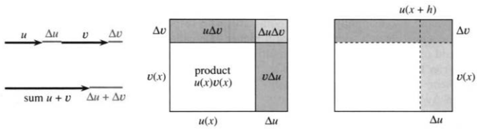
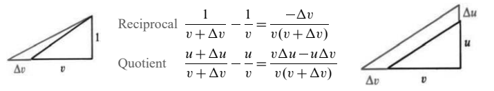
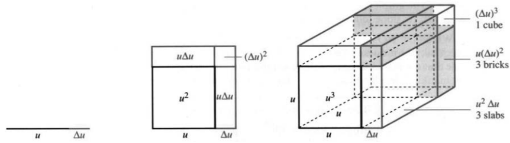
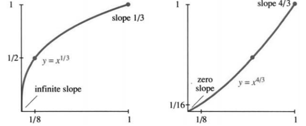

## 2.5 乘积、商与幂的求导法则

来源：PDF 第 129–135 页，印刷页 116–122。状态：初译，已按原页图像自校，待复审。

<!-- PDF 129 / 印刷页 116 -->

$x+\sin x$、$x\sin x$、$1/\sin x$、$x/\sin x$ 和 $\sin^n x$，这些函数的导数各是什么？它们都由熟悉的 $x$ 与 $\sin x$ 拼成，可求导还得另立新法则。好在这些法则对满足相应条件的一般函数都成立：立一次，往后反复用。只要知道 $u,v$ 的导数，$u+v$、$uv$、$1/v$、$u/v$ 和 $u^n$ 的导数就到手了。

本节直截了当，分量却不轻：微分计算要用的工具，大半都在这儿。五条法则、十三个例子，单子拉出来可能有点长，可例子省不得——光摆公式，眼睛会发直。先拣最容易的一条说：**函数相加，导数也相加。**

> **和的求导法则**
> $$\frac d{dx}(u+v)=\frac{du}{dx}+\frac{dv}{dx}.\tag{1}$$

**例 1。**$x+\sin x$ 的导数是 $1+\cos x$。简单得不能再简单，却也十分基本。拿运动来讲，可能反而更绕，也更有意思：设火车以速度 $1$ 行驶，时刻 $t$ 的位置就是 $t$；车上一位教授在座位前来回走动，离座位的位移是 $\sin t$。他离出发点的总位移为 $t+\sin t$，速度为火车速度与步行速度之和，即 $1+\cos t$。

位移相加，速度也相加。可若按通常的火车速度看，这个例子其实很离谱：教授相对车厢的最大速率竟等于火车速率，他是在拼命跑，不是踱步。偶尔，他相对地面还会瞬时停住。

求和法则只是一个更大的法则——**线性性质**——的特例。函数相加减、再乘常数，都归它管。比如 $3x-4\sin x$，由线性性质，导数就是 $3-4\cos x$。对可导函数 $u(x),v(x)$ 和实常数 $a,b$，设
$$y(x)=au(x)+bv(x).$$
其差商为
$$\begin{aligned}
\frac{\Delta y}{\Delta x}
&=\frac{au(x+\Delta x)+bv(x+\Delta x)-au(x)-bv(x)}{\Delta x}\\
&=a\frac{u(x+\Delta x)-u(x)}{\Delta x}
+b\frac{v(x+\Delta x)-v(x)}{\Delta x}.
\end{aligned}$$
两边分别取极限，再相加——这正是我们盼着的结果：

> **求导的线性性质**
> $$\frac d{dx}(au+bv)=a\frac{du}{dx}+b\frac{dv}{dx}.\tag{2}$$

接着是乘积法则。乘积不是线性运算，求导也不能照搬乘法那一套。**$uv$ 的导数并不等于 $u'v'$。**看 $x^5$，导数是 $5x^4$；你若把 $x^3$ 的导数 $3x^2$ 与 $x^2$ 的导数 $2x$ 相乘，得到 $6x^3$，可它不是 $5x^4$。两个函数相乘，导数有两项。

> **乘积求导法则——本节的关键**
> $$\frac d{dx}(uv)=u\frac{dv}{dx}+v\frac{du}{dx}.\tag{3}$$

<!-- PDF 130 / 印刷页 117 -->

**例 2。**取 $u=x^3$、$v=x^2$，则 $uv=x^5$。乘积法则给出
$$x^3(2x)+x^2(3x^2)=2x^4+3x^4=5x^4.$$

**例 3。**求 $x\sin x$ 的斜率时，$dx/dx=1$ 我并没有写出来，可它就在那儿：
$$\frac d{dx}(x\sin x)=x\cos x+\sin x.$$

**例 4。**若 $u=v=\sin x$，则 $uv=\sin^2x$，两项一模一样：
$$\sin x\frac d{dx}(\sin x)+\sin x\frac d{dx}(\sin x)=2\sin x\cos x.$$
这正好印证了平方求导法则 $2u\,du/dx$。同样，$\cos^2x$ 的导数为 $-2\cos x\sin x$，负号来自余弦的导数。

**问：**这两个导数符号相反，所以 $\sin^2x+\cos^2x$ 的导数为零。怎样更快地看出这一点？

**例 5。**三个函数连乘，导数是
$$ (uvw)'=uvw'+uv'w+u'vw,$$
每次只对一个因子求导。例如，$xxx$ 的导数为 $xx+xx+xx$。

例子摆完，该证乘积法则了。图 2.13 说得最清楚：大长方形的面积是 $uv$，真正要紧的新增面积，是两条窄带 $u\Delta v$ 和 $v\Delta u$，角上那块 $\Delta u\Delta v$ 则小得多。除以 $\Delta x$ 后，窄带给出 $u\Delta v/\Delta x$ 和 $v\Delta u/\Delta x$，角块给出 $\Delta u\Delta v/\Delta x$，它趋于零。[译注 1]

留意一下：求和法则管长度，是一维的图；乘积法则管面积，是二维的图；$uvw$ 的法则，就该拿三维体积来画。

把上方窄带与侧边窄带合起来，代数上有精确的恒等式
$$\begin{aligned}
u(x+h)v(x+h)-u(x)v(x)
={}&u(x+h)[v(x+h)-v(x)]\\
&+v(x)[u(x+h)-u(x)].
\end{aligned}\tag{4}$$
这个增量，就是上方窄带加侧边窄带：$u(x+h)\Delta v+v(x)\Delta u$。两端同除以 $h$，再令 $h\to0$。左端变成乘积的导数；右端第一项趋于 $u(x)v'(x)$，第二项趋于 $v(x)u'(x)$——因为可导函数连续，两个极限可以分开取，再相乘。乘积法则于是得证。

下面本可以直接讲商 $u/v$，不过先让 $u=1$。$1/x$ 的导数是 $-1/x^2$，这是已知的；那么 $1/v(x)$ 的导数是什么？

> **倒数求导法则**（$v(x)\ne0$）
> $$\frac d{dx}\frac1{v(x)}=-\frac{v'(x)}{v(x)^2}.\tag{5}$$

<!-- PDF 131 / 印刷页 118 -->

证明从 $v\cdot(1/v)=1$ 出发。两边求导，右端为零；再用乘积法则，得
$$v\frac d{dx}\left(\frac1v\right)+\frac1v\frac{dv}{dx}=0,
\qquad\frac d{dx}\left(\frac1v\right)=-\frac{dv/dx}{v^2}.\tag{6}$$
倒数的可导性，也能由图 2.14 的差商直接看出来，见译注 1。

倒数法则也好，别的公式也好，都值得查一查单位。科学与工程里，量纲检查是家常便饭；数学里也该这么做。它不管常数因子，也不管正负号，却能挡掉一些离谱的错误。若 $v$ 的单位是美元、$x$ 的单位是小时，则 $dv/dx$ 的单位是美元每小时；两端分别是
$$\left[\frac d{dx}\frac1v\right]=\frac{1/\text{美元}}{\text{小时}},
\qquad\left[-\frac{dv/dx}{v^2}\right]=\frac{\text{美元}/\text{小时}}{\text{美元}^2},$$
两端一致。可见 $1/v$ 的导数，不可能一般地等于 $1/(dv/dx)$。同样的检查也说明，爱因斯坦的 $E=mc^2$ 在量纲上是可能的：两端都是质量乘长度平方、再除以时间平方。当然，量纲对得上，并不等于物理定律就此得证；原书脚注也提醒，它定不下那个常数恰为 $1$。

**例 6。**$x^{-1}$、$x^{-2}$、$x^{-n}$ 的导数，分别是 $-x^{-2}$、$-2x^{-3}$、$-nx^{-n-1}$。把倒数法则用在 $v=x,x^2,x^n$ 上，就得到它们：
$$\frac d{dx}x^{-n}=\frac d{dx}\frac1{x^n}
=-\frac{nx^{n-1}}{(x^n)^2}=-nx^{-n-1}.$$
妙的是，这个答案仍落在同一条规律里：**乘以指数，再把指数减一。**
$$\text{对正、负整数指数，在定义域内均有}\qquad
\frac d{dx}x^n=nx^{n-1}.\tag{7}$$

图中的精确增量公式为
$$\frac1{v+\Delta v}-\frac1v=\frac{-\Delta v}{v(v+\Delta v)},$$
$$\frac{u+\Delta u}{v+\Delta v}-\frac uv
=\frac{v\Delta u-u\Delta v}{v(v+\Delta v)}.$$
除以自变量的增量，再取极限，分母里的 $v(v+\Delta v)$ 就趋于 $v^2$。

**例 7。**$1/\cos x$ 与 $1/\sin x$ 的导数，分别是 $\sin x/\cos^2x$ 和 $-\cos x/\sin^2x$，都由倒数法则直接给出。三角学里，$1/\cos x$ 叫正割 $\sec x$，$1/\sin x$ 叫余割 $\csc x$。于是它们的导数也有了：
$$\frac d{dx}\sec x=\frac{\sin x}{\cos^2x}
=\frac1{\cos x}\frac{\sin x}{\cos x}=\sec x\tan x,\tag{8}$$
$$\frac d{dx}\csc x=-\frac{\cos x}{\sin^2x}
=-\frac1{\sin x}\frac{\cos x}{\sin x}=-\csc x\cot x.\tag{9}$$

<!-- PDF 132 / 印刷页 119 -->

这些公式在微积分里常露面。记性好，不妨背下来；不过大多数数学家每次用之前都要重查一遍，我也不例外（大约一年一次）。真正基本的，是求导法则，不是一条条孤立的公式。

商 $u/v=u\cdot(1/v)$，把乘积法则和倒数法则一合，就得到一条又新又重要的法则：

> **商的求导法则**（$v\ne0$）
> $$\frac d{dx}\frac uv=\frac1v\frac{du}{dx}-u\frac{dv/dx}{v^2}
> =\frac{v\,du/dx-u\,dv/dx}{v^2}.\tag{10}$$

最后这条公式，非背下来不可。分母 $v^2$ 是熟面孔；分子虽新，却也没新到哪儿去。$v=1$ 时，退化成 $u'$（理所当然）；$u=1$ 时，退回倒数法则。图 2.14 里，增量的分母是 $v(v+\Delta v)$，极限中那个 $v^2$，就是从这儿来的。

**例 8：练习。**$u/v=x^5/x^3=x^2$（$x\ne0$），商法则给出
$$\frac d{dx}\frac{x^5}{x^3}
=\frac{x^3(5x^4)-x^5(3x^2)}{x^6}
=\frac{5x^7-3x^7}{x^6}=2x.$$

**例 9：重要。**取 $u=\sin x$、$v=\cos x$，商就是 $\tan x$。用商法则，再用 $\cos^2x+\sin^2x=1$：
$$\frac d{dx}\tan x
=\frac{\cos x\cos x-\sin x(-\sin x)}{\cos^2x}
=\frac1{\cos^2x}=\sec^2x.\tag{11}$$
这一条也请记住：$(\tan x)'=\sec^2x$。在 $x=0$ 处，斜率是 $1$；$\sin x$、$x$、$\tan x$ 三条图像都从这个斜率出发（随后才各走各的）。到了 $x=\pi/2$，正弦曲线变平；正切函数在那里没有定义，越靠近，曲线和它的斜率都越发散。[译注 2]

这些例子里，导数通常比原函数发散得更快。正切只除以一次 $\cos x$，它的导数却要除以 $\cos^2x$；$1/x$ 的导数是 $-1/x^2$。分母上多了个平方，导数就对靠近奇点的变化格外敏感。

**例 10。**对 $x\ne0$，
$$\frac d{dx}\frac{\sin x}{x}=\frac{x\cos x-\sin x}{x^2}.$$
在 $x=0$ 处不能直接代入此式——形式上会撞上零比零。若把原函数连续延拓，规定 $f(0)=1$，那么该点的导数确实为零。图 2.10 显示中心处切线水平；函数又是偶函数，若该点可导，导数必为零。只是可导性还得另作说明。[译注 3]

这一节的法则已经够多，请允许我再添一条：从 $x^n$ 走到 $(u(x))^n$，比如 $(\sin x)^6$、$(\tan x)^7$、$(x^2+1)^8$。导数里除了照抄 $nx^{n-1}$ 的 $nu^{n-1}$，**还得多乘一个因子 $du/dx$**——看下面三个式子，它就在那儿：
$$6(\sin x)^5\cos x,\qquad
7(\tan x)^6\sec^2x,\qquad
8(x^2+1)^7(2x).$$

> **幂的求导法则**
> $$\frac d{dx}[u(x)]^n=n[u(x)]^{n-1}\frac{du}{dx}.\tag{12}$$

$n=1$ 时，它退化成 $u'=u'$；$n=2$ 时，就是平方法则 $2uu'$。再往下是三次幂。指数为正整数时，最好的证法是数学归纳法。

<!-- PDF 133 / 印刷页 120 -->

假设结论对 $n$ 成立，用乘积法则往前推一步，就轮到 $n+1$：
$$\frac d{dx}u^{n+1}=\frac d{dx}(u^nu)
=u^nu'+u(nu^{n-1}u')=(n+1)u^nu'.$$
这正是指数为 $n+1$ 的那条公式。从 $n=1$ 起步，一路往上，所有正整数指数都拿下了；负整数指数，则交给倒数法则。

图 2.15 画出 $n=1,2,3$ 的几何意义，其中立方体最说明问题。三个薄层的边长是 $u,u,\Delta u$，体积变化的主要部分为 $3u^2\Delta u$。把它完整乘开，精确的增量是
$$ (u+\Delta u)^3-u^3=3u^2\Delta u+3u(\Delta u)^2+(\Delta u)^3.$$
多出来的三条窄长方体，加上角落里那块小立方体，正好对应后两项。二项式公式，就这么画出来了。

**例 11。**
$$\frac d{dx}(\sin x)^n=n(\sin x)^{n-1}\cos x.$$
多出来的因子 $\cos x$，正是 $du/dx$。

最后一步，要甩掉一个很不讨喜的限制：指数只能是整数。我们想放行有理指数 $n=p/q$，同时保住同一条公式：$x^n$ 的导数仍是 $nx^{n-1}$。

碰到平方根，我可以写成 $(\sqrt{x})^2=x$。设 $x>0$ 且导数存在，两边求导，得 $2\sqrt{x}(\sqrt{x})'=1$，于是 $(\sqrt{x})'=1/(2\sqrt{x})$，正好对上 $n=1/2$ 的公式。

**有理指数。**把 $u=x^{p/q}$ 写成 $u^q=x^p$。先假定相关导数存在，在 $x>0$ 上两边求导（两边都用幂法则）：
$$qu^{q-1}\frac{du}{dx}=px^{p-1}.$$
用 $u^q=x^p$ 把相同因子约掉，得
$$\frac{du}{dx}=\frac{p x^{-1}}{q u^{-1}}=\frac pq\frac ux=nx^{n-1}.$$
这里以 $n=p/q$、$u=x^n$ 代入。至于导数为什么存在，完整的依据留到后面的理论里补。

**例 12。**$x^{1/3}$ 的导数，在 $x\ne0$ 处是 $\tfrac13x^{-2/3}$。$x\to0$ 时，斜率直奔正无穷；$x\to+\infty$ 时，斜率趋于零。可图 2.16 里，函数还在一个劲儿往上爬，并不往哪条水平渐近线上靠。

<!-- PDF 134 / 印刷页 121 -->

**例 13。**$x^{4/3}$ 的导数是 $\tfrac43x^{1/3}$。在 $x=0$ 处，导数为零；$x\to+\infty$ 时，导数奔向正无穷。因为 $1<4/3<2$，往正无穷走时，它增长得比一次函数快、比二次函数慢；导函数则跟着立方根曲线走，只是乘了 $4/3$。[译注 4]

法则就停在这儿吧。抱歉，一下子列了这么多。计算机能把它们全背下来，却不知道它们是什么意思——你知道。等第 4 章的重头戏——链式法则一加进来，人类算过的导数差不多就全能拿下了。为方便查阅，汇总如下。

| 法则 | 公式 |
|---|---|
| 线性性质 | $(au+bv)'=au'+bv'$，$a,b$ 为常数 |
| 乘积法则 | $(uv)'=uv'+vu'$ |
| 倒数法则 | $(1/v)'=-v'/v^2$ |
| 商法则 | $(u/v)'=(vu'-uv')/v^2$ |
| 幂法则 | $(u^n)'=nu^{n-1}u'$ |

这些法则，都要求相应函数可导，分母也不许为零。幂法则还能往负数、分数以至任意实数指数上推，但只在幂函数有定义、相应求导也成立的范围内才作数。第 6 章会说明，$x^\pi$ 的导数是 $\pi x^{\pi-1}$。至于 $(\sin x)^\pi$，导数是 ______（先在 $\sin x>0$ 的区间里讨论）。六个三角函数的导数，到这里就齐了：

| 函数 | 导数 | 函数 | 导数 |
|---|---|---|---|
| $\sin x$ | $\cos x$ | $\cos x$ | $-\sin x$ |
| $\tan x$ | $\sec^2x$ | $\cot x$ | $-\csc^2x$ |
| $\sec x$ | $\sec x\tan x$ | $\csc x$ | $-\csc x\cot x$ |

### 2.5 习题

**阅读填空**

$\sin x\cos x$、$1/\cos x$、$\sin x/\cos x$、$\tan^3x$ 的导数分别来自 **(a)______** 法则、**(b)______** 法则、**(c)______** 法则和 **(d)______** 法则。对正弦与余弦的乘积，$(uv)'=uv'+$ **(e)______** $=$ **(f)______**。$1/v$ 的导数为 **(g)______**，所以 $\sec x$ 的导数为 **(h)______**。$u/v$ 的导数为 **(i)______**，所以 $\tan x$ 的导数为 **(j)______**。$\tan^3x$ 的导数为 **(k)______**。$x^n$ 的导数为 **(l)______**，$(u(x))^n$ 的导数为 **(m)______**。取 $n=-1$，$(\cos x)^{-1}$ 的导数为 **(n)______**，与正割求导公式一致。

更简单的是 **(o)______** 性质：$au(x)+bv(x)$ 的导数为 **(p)______**。$3\sin x+4\cos x$ 的导数为 **(q)______**，它的平方的导数为 **(r)______**。函数 **(s)______** 的导数为 $4\sin^3x\cos x$。

**求第 1–26 题中函数的导数，并注意定义域。**

1. $(x+1)(x-1)$。
2. $(x^2+1)(x^2-1)$。
3. $\displaystyle\frac1{1+x}+\frac1{1+\sin x}$。
4. $\displaystyle\frac1{1+x^2}+\frac1{1-\sin x}$。

<!-- PDF 135 / 印刷页 122 -->

5. $(x-1)(x-2)(x-3)$。
6. $(x-1)^2(x-2)^2$。
7. $x^2\cos x+2x\sin x$。
8. $x^{1/2}(x+\sin x)$。
9. $\displaystyle\frac{x^3+1}{x+1}+\frac{\cos x}{\sin x}$。
10. $\displaystyle\frac{x^2+1}{x^2-1}+\frac{\sin x}{\cos x}$。
11. $x^{1/2}\sin^2x+(\sin x)^{1/2}$。
12. $x^{3/2}\sin^3x+(\sin x)^{3/2}$。
13. $x^4\cos x+x\cos^4x$。
14. $\sqrt{x}(\sqrt{x}+1)(\sqrt{x}+2)$。
15. $\tfrac12x^2\sin x-x\cos x+\sin x$。
16. $(x-6)^{10}+\sin^{10}x$。
17. $\sec^2x-\tan^2x$。
18. $\csc^2x-\cot^2x$。
19. $\displaystyle\frac4{(x-5)^{2/3}}+\frac4{(5-x)^{2/3}}$。
20. $\displaystyle\frac{\sin x-\cos x}{\sin x+\cos x}$。
21. $(\sin x\cos x)^3+\sin2x$。
22. $x\cos x\csc x$。
23. $u(x)v(x)w(x)z(x)$。
24. $[u(x)]^2[v(x)]^2$。
25. $\displaystyle\frac1{\tan x}-\frac1{\cot x}$。
26. $x\sin x+\cos x$。
27. 一个随时间变化的长方体，长为 $t$、宽为 $1/(1+t)$、高为 $\cos t$。（a）求体积变化率。（b）求表面积变化率。作为几何模型，应限制在边长为正的时间区间。
28. 两次使用乘积法则，证明 $(uvw)'=uvw'+uv'w+u'vw$。边长 $u,v,w$ 分别增加 $\Delta u,\Delta v,\Delta w$ 时，新增的三个主要薄层体积分别为 $uv\Delta w$、______、______。
29. 已知位置函数
    $$f(t)=\begin{cases}5t^2,&t\le10,\\500+100\sqrt{t-10},&t\ge10,\end{cases}$$
    求速度，并单独讨论 $t=10$。
30. 圆柱的半径 $\displaystyle r=\frac{t^{3/2}}{1+t^{3/2}}$，高 $h=1/(1+t)$。（a）求体积变化率。（b）求包括上下底面的总表面积变化率。
31. 模型火箭的高度为 $f(t)=t^3/(1+t)$。（a）求速度 $v(t)$。（b）求加速度 $dv/dt$。
32. 对 $u(x)u^2(x)$ 使用乘积法则，得到 $u^3(x)$ 的求导公式。
33. 求乘积 $u(x)v(x)$ 的二阶、三阶导数，并用 $u=v=x$ 检验。
34. 分别找出导数为下列函数的函数 $y(x)$：（a）$x^3$；（b）$1/x^3$；（c）$(1-x)^{3/2}$；（d）$\cos^2x\sin x$。
35. 已知 $f(0)=0$，分别求对应于下列速度的位置函数：（a）$v(t)=\cos t\sin t$；（b）$v(t)=\tan t\sec^2t$；（c）$v(t)=\sqrt{1+t}$。
36. 对 $(u(x))^3/(u(x))^2$ 和 $-v'/v^2$ 使用商法则。后一项给出 ______ 的二阶导数。
37. 画一幅类似图 2.13 的图来解释平方求导法则。
38. 举一个 $u(x)/v(x)$ 递增、但 $u'=v'=1$ 的例子。
39. 判断正误并充分说明理由。（a）$x^{2n}$ 的导数为 $2nx^{2n-1}$。（b）由线性性质，$a(x)u(x)+b(x)v(x)$ 的导数为 $a(x)u'(x)+b(x)v'(x)$。（c）$|x|^3$ 的导数为 $3|x|^2$。（d）$\tan^2x$ 与 $\sec^2x$ 的导数相同。（e）当 $u(x)=1$ 时，$(uv)'=u'v'$ 成立。
40. 持有 $u$ 股、每股价格 $v$ 美元时，总价值为 $uv$ 美元。检查 $d(uv)/dt$、$u\,dv/dt$ 和 $v\,du/dt$ 的单位。
41. 若 $u(x)$、$v(x)$ 都是 $n$ 次多项式，则 $u/v$ 的导数可写成怎样次数的多项式之比？注意最高次项可能抵消，以及约分可能进一步降低次数。
42. 对 $y=5x+3$，$(dy/dx)^2$ 与 $d^2y/dx^2$ 相同吗？
43. 运动轨迹先为 $f(t)=t\cos t$，在 $t=\pi/2$ 后改沿该点的切线。写出分段的速度函数 $df/dt$。
44. 用自己的话说明，为什么 $u(x)v(x)$ 的导数有两项。
45. 一架飞机从 $(-L,h)$ 开始下降，在 $(0,0)$ 着陆。选择 $a,b,c,d$，使三次曲线 $y=ax^3+bx^2+cx+d$ 与两端的水平轨迹光滑衔接。若 $dx/dt=V$ 为常数，求 $x=0$ 和 $x=-L$ 处的 $dy/dt$ 与 $d^2y/dt^2$。原书以长距离下降来说明降低竖直加速度的作用，并举出跨大陆航班可能在距机场超过 $100$ 英里处开始下降的背景例子。

### 译注

1. 乘积法则的面积图用于直观说明；一般正负增量由代数恒等式处理。若 $u,v$ 可导，则 $\Delta u\to0$、$\Delta v/\Delta x\to v'$，故 $\Delta u\Delta v/\Delta x\to0$。倒数法则若仅从 $v(1/v)=1$ 求导，会预先假设倒数可导；可用精确差商 $-[(v(x+h)-v(x))/h]/[v(x+h)v(x)]$ 补足存在性证明。
2. 原文说 $\tan x$ 在 $x=\pi/2$ 处“竖直”、$\sec^2x=\infty$，容易与该点存在竖直切线混淆。实际上这是竖直渐近线处的发散，函数在该点无定义，译文已区分。
3. 偶函数在零点未必可导，例如 $|x|$。对连续延拓的 $f(x)=\sin x/x$，可由 $\cos h\le\sin h/h\le1$ 得 $|(f(h)-1)/h|\le(1-\cos h)/|h|\to0$，所以 $f'(0)=0$。原文的“类似 $0^3/0^2$”只是启发性描述，不能代替证明。
4. 原文的“在 $x=\infty$ 处斜率为零／无穷”均改为 $x\to+\infty$ 的极限表述；无穷大不是定义域中的普通点。$x^{1/3}$ 在零点无有限导数，可用竖直切线描述，而不将“无穷斜率”当作实数导数。
5. 商法则在原页未印公式编号，但下一式直接编号为 (11)；为保持编号连续，译文标为 (10)。角度仍统一以弧度计。
