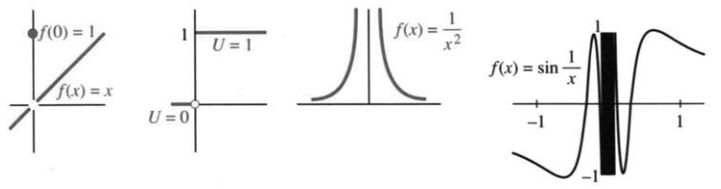

## 2.7 连续函数

来源：PDF 第 144–149 页，印刷页 131–136。2026-10-29 已逐段对照正文、全部45题及PDF144–149原图；PDF 重建与排版检查待完成。

<!-- PDF 144 / 印刷页 131 -->

这一节很短。它本来并进讲极限的那一节，可两节合起来太长，只好单列一节。我们仍然盯着 $x\to a$ 时 $f(x)$ 的极限，只是多出一个数：函数在该点的值 $f(a)$。求极限时，$x$ 只是逼近 $a$，从不真正到达，所以 $f(a)$ 可以不管；讲连续就不同了，最后这个 $f(a)$ 必须对得上。

我先概括一下通常（也最理想）的情形，三件事要同时成立：

1. $f(a)$ 有定义；
2. $x\to a$ 时 $f(x)$ 的极限 $L$ 存在；
3. $L=f(a)$。

三件事都满足，就说 $f$ 在 $x=a$ 处连续；也常写成一行：$x\to a$ 时 $f(x)\to f(a)$。作为对照，先看四个在零点处不连续的函数。

第一幅图里，第一个函数只要取 $f(0)=0$ 就连续了，可它偏偏取 $f(0)=1$。把这一点的函数值改对，问题就没了——这叫**可去间断**。例2、3、4更重要，也更严重。无论怎么挑 $f(0)$，都补不出一个“正确”的值：

2. 阶梯函数在 $x=0$ 处从 $0$ 跳到 $1$；
3. $f(x)=1/x^2$ 在 $x\to0$ 时趋于正无穷；
4. $f(x)=\sin(1/x)$ 在 $x\to0$ 时不断振荡。

阶梯函数在跳跃处左右极限都有，却没有双侧极限：左极限是 $0$，右极限是 $1$。$x/|x|$ 也一样，从 $-1$ 跳到 $1$。

在 $1/x^2$ 的图像中，唯一合理的极限是 $L=+\infty$。我不能正式说这个极限存在。按正式说法，它不存在——但我们还是常常写：$x\to0$ 时 $1/x^2\to\infty$。这表示 $x\to0$ 时，$1/x^2$ 会超过每个 $L$，并一直在它上方。我们也以同样非正式的方式写出 $f(x)=1/x$ 的单侧极限。
$$\lim_{x\to0^-}\frac1x=-\infty,
\qquad\lim_{x\to0^+}\frac1x=+\infty.\tag{1}$$

**说明。**$1/x$ 在零点有一个**极点**，$1/x^2$ 则是二阶极点。$1/(x^2-x)$ 在 $x=0,1$ 处有极点；$1/\sin x$ 则在 $x=k\pi$（$k$ 为整数）处各有一个极点。

<!-- PDF 145 / 印刷页 132 -->

除了 $1/x^2$，这些极点都是“一阶”的——把这些函数乘以 $x$ 后，在 $x=0$ 处就完全光滑了：
$$x\cdot\frac1x=1,\qquad x\cdot\frac1{x^2-x}=\frac1{x-1},\qquad x\cdot\frac1{\sin x}$$
在 $x=0$ 处连续。
$1/x^2$ 得乘 $x^2$ 才消得去奇性，所以是二阶极点。多项式之比 $P(x)/Q(x)$ 在 $Q=0$ 处有极点，前提是先约掉像 $(x+1)/(x+1)$ 这样的公因子。

跳跃和极点是最基本的不连续，但还不是全部。$\sin(1/x)$ 在 $x\to0$ 时没有极限，这个函数不会无限增大；正弦从不超过1。取 $x=1/3,1/4,1/1000$，函数值依次是 $\sin3,\sin4,\sin1000$。这些数有正、有负，还有（？）。$x$ 越小，$1/x$ 越大，摆动越来越快，图像终究待不住——无论盒子多窄，它的图像都不会待在高度为 $\varepsilon$ 的小盒子里。

### 连续函数

> **定义。**如果 $f(a)$ 有定义，并且当 $x\to a$ 时 $f(x)\to f(a)$，就称 $f$ 在 $x=a$ 处“连续”。如果 $f$ 在每一个有定义的点都连续，它就是一个连续函数。

**异议。**这个定义竟让 $f(x)=1/x$ 成了连续函数！它在 $x=0$ 处没有定义，所以它的连续性不可能在这里失效。逻辑要求我们接受这一点，但我们不一定非得喜欢它。的确，无论给 $f(0)$ 取什么值，都不能使 $1/x$ 在 $x=0$ 处连续。

说来也怪，但事实确实如此：“连续函数”的定义至今仍有争论（*Mathematics Teacher*，1989 年 5 月）。原因你也看到了——我们一方面谈论 $1/x$ 的间断性，另一方面又称它为连续函数。这个定义没有体现出 $1/x$ 与 $(\sin x)/x$ 之间的区别。函数 $f(x)=(\sin x)/x$ 可以在所有 $x$ 处变得连续：只要令 $f(0)=1$。

如果一个函数的定义能够扩充到所有 $x$，并且扩充后处处连续，我们就称这个函数“可连续延拓”（**continuable**）。因此，$(\sin x)/x$ 和 $\sqrt{x}$ 都是可连续延拓的函数，而 $1/x$ 与 $\tan x$ 不是。这个建议也许不能结束争论，但我希望它有所帮助。

**例 1。**$\sin x$、$\cos x$ 和所有多项式 $P(x)$ 都是连续函数。

**例 2。**绝对值 $|x|$ 连续。它的斜率有跳跃（不可连续延拓）。

**例 3。**有理函数 $P(x)/Q(x)$ 在 $Q(x)\ne0$ 的地方都连续。

**例 4。**有理数处取 $1$、无理数处取 $0$ 的函数，处处不连续。随便取一个区间，里面既有有理数，也有无理数——每两个无理数之间都有有理数，反过来也一样。（不知怎么，无理数要多得多。）

**例 5。**$0^{x^2}$ 对每个 $x$ 都是零；可 $0^0$ 没有定义，零点就空着。把它补成 $0$，函数便连续了。下一段却会碰上另一个函数，那里非把零点的值补成 $1$ 不可。

<!-- PDF 146 / 印刷页 133 -->

连续性的证明能写满一本书，可情形往往一眼就清楚：连续函数的图像，不用抬笔就能一笔画完。遇到跳跃、无穷极限或无限振荡，除了在另一侧重新开始，无法越过间断。

$n>0$ 时，函数 $x^n$ 连续；$n<0$ 时，它不可连续延拓。函数 $x^0$ 对每个 $x$ 都等于1，只是 $0^0$ 没有定义。这一次，连续性要求 $0^0=1$。

有趣的例子是那些差一点的情形——我们已经见过两个：

**例 6。**
$$\frac{\sin x}{x},\qquad\frac{1-\cos x}{x}$$
这两个函数都能在零点连续延拓，该补的值分别是 $1$ 和 $0$。这两个极限，正是求正弦函数导数的关键。

分母要是换成 $x^2$，又会怎样？

**例 7。**$\sin x/x^2$ 在零点附近无界；$(1-\cos x)/x^2$ 却不同，它的极限是 $1/2$。

因为 $(\sin x)/x\to1$，再除一个 $x$，得到的就像 $1/x$：零点处是一阶极点。这里分母、分子都趋于零，可 $x^2$ 那个零来得比 $\sin x$ 的零快。趋零速度的比较，正是许多重要极限问题的核心。

而 $1-\cos x$ 与 $x^2$ 呢，趋零的快慢几乎不分上下，比值趋于 $1:2$：
$$\frac{1-\cos x}{x^2}
=\frac{1-\cos^2x}{x^2(1+\cos x)}
=\frac{\sin^2x}{x^2}\frac1{1+\cos x}
\longrightarrow\frac1{1+1}=\frac12.$$
这个结果，以后用洛必达法则能更省事地再求一遍。这里我要强调的不是结果，而是问题本身：**微分学的核心问题之一，是极限以怎样的速度被逼近；而逼近的快慢，恰好写在导数里。**

这三个例子在 $x=0$ 处都连续。趋零的快慢由斜率控制——因为 $f(x)-f(0)$ 近似为 $f'(0)$ 乘以 $x$：

- $\sin x$ 的导数是 $1$ $\longleftrightarrow$ $\sin x$ 像 $x$ 一样递减；
- $\sin^2x$ 的导数是 $0$ $\longleftrightarrow$ $\sin^2x$ 比 $x$ 递减得更快；
- $x^{1/3}$ 的导数是 $\infty$ $\longleftrightarrow$ $x^{1/3}$ 比 $x$ 递减得更慢。

### 可导函数

$|x|$ 在零点连续，却没有导数；$x^{1/3}$ 也一样。**可导比连续要求更强。**回到定义，差别一目了然：
$$\text{在 }x\text{ 处连续：}\quad f(x+\Delta x)-f(x)\to0;$$
$$\text{在 }x\text{ 处可导：}\quad
\frac{f(x+\Delta x)-f(x)}{\Delta x}\to f'(x),$$
其中都令 $\Delta x\to0$。

<!-- PDF 147 / 印刷页 134 -->

第一种情形只要求增量趋于零，可能还很慢；第二种情形中， $\Delta f/\Delta x$ 有极限，$\Delta f$ 与 $\Delta x$ 一样快地趋于零。

> **2I 可导蕴含连续。**函数在某点有导数，则在该点连续；反过来，连续函数在该点可能不可导。

**证明。**由
$$\Delta f=\Delta x\frac{\Delta f}{\Delta x}\to0\cdot f'(x)=0,$$
可知 $f(x+\Delta x)-f(x)\to0$。

连续函数 $x^{1/3}$ 在 $x=0$ 处没有导数，因为 $\tfrac13x^{-2/3}$ 无限增大。绝对值 $|x|$ 没有导数，因为它的斜率跳跃。更出人意料的是，下面这个函数：
$$\frac12\cos3x+\frac14\cos9x+\cdots
$$
它处处连续，却处处没有导数。你可以不抬笔地画出它的图像（但不容易——它在每一点都转弯）。对多数人来说，它与填充空间的曲线和不可测面积一起，被放在奇观盒子里。分形过去也被放在同一个盒子里！它们是美丽的形状，边界上没有切线。分形理论十分活跃，有很好的数学理由，我们会在第3.7节稍作介绍。

我希望你已经清楚理解微积分的这些基本定义：

1. 极限（$n\to\infty$ 或 $x\to a$）；
2. 连续性（在 $x=a$ 处）；
3. 导数（在 $x=a$ 处）。

它们可追溯到 $\varepsilon$ 和 $\delta$，但很少有必要追得那么远。就像经济学描述许多交易、历史描述许多事件一样，一个函数来自许多值 $f(x)$。少数点可能特殊，就像市场崩盘、战争或间断。在其他点，$df/dx$ 是理解函数的最好向导。

本章最后讲闭区间上连续函数的两个基本事实。区间是 $a\le x\le b$，简记为 $[a,b]$。[^interval] 在端点 $a,b$，我们要求 $f(x)$ 趋于 $f(a)$、$f(b)$。

> **最值性质。**有限区间 $[a,b]$ 上的连续函数具有最大值 $M$ 和最小值 $m$。区间 $[a,b]$ 中有点 $x_{\max}$ 和 $x_{\min}$，函数在那里取到这些值：
> $$f(x_{\max})=M\ge f(x)\ge f(x_{\min})=m\qquad(\text{对 }[a,b]\text{ 中所有 }x).$$

> **介值性质。**如果数 $F$ 介于 $f(a)$ 和 $f(b)$ 之间，那么在 $a,b$ 之间有点 $c$，使 $f(c)=F$。因此，如果 $F$ 介于最小值 $m$ 和最大值 $M$ 之间，那么在 $x_{\min}$ 和 $x_{\max}$ 之间有点 $c$，使 $f(c)=F$。

例子说明了为什么要求闭区间和连续函数。对 $0<x\le1$，函数 $f(x)=x$ 从不取到最小值（零）。如果定义 $f(0)=3$（不连续），使区间闭合，最小值仍取不到。由于跳跃，中间值 $F=2$ 也取不到。柯西定义极限的概念之后，连续性的概念就不可回避了。

[^interval]: 区间 $[a,b]$ 是闭的（包括端点）。区间 $(a,b)$ 是开的（不包括 $a,b$）。无穷区间 $[0,\infty)$ 包括所有 $x\ge0$。

<!-- PDF 148 / 印刷页 135 -->

### 2.7 习题

**阅读填空**

在 $a$ 处连续，要求 $x\to a$ 时 $f(x)$ 的 **(a)______** 存在，且等于 **(b)______**。$x/|x|$ 不能在零点连续延拓，是因为 **(c)______**；它有 **(d)______** 极限。$1/\cos x$ 在 **(e)______** 处不能连续补值，原因是 **(f)______**。$\cos(1/x)$ 在零点不能连续补值，原因是 **(g)______**。函数 $f(x)=$ **(h)______** 在 $x=3$ 有一阶极点，其平方 $f^2$ 在此有 **(i)______** 阶极点。

$n$ 为 **(j)______** 时，$x^n$ 在所有 $x$ 处连续；$n$ 为 **(k)______** 时，它在零点无导数。$\sin(-x)/x$ 在 $x\to0$ 时趋于 **(l)______**；若定义 $f(0)=$ **(n)______**，就成为 **(m)______** 函数。连续函数必须在所有 **(o)______** 上连续；可连续延拓到全实轴的函数，可以为缺少的点补值，使 **(p)______**。

若 $f$ 在 $a$ 处可导，则在该点必 **(q)______**。导数控制 $f(x)$ 接近 **(r)______** 的速度。闭区间上的连续函数具有 **(s)______** 值性质与 **(t)______** 值性质，能取得 **(u)______** $M$ 与 **(v)______** $m$，并取得 **(w)______** 的所有值。

**第1–20题，求使 $f(x)$ 成为（A）连续函数、（B）可导函数的数 $c$。一种情形要求每点都有 $f(x)\to f(a)$，另一种情形要求每点的 $\Delta f/\Delta x$ 都有极限。**

1. $\displaystyle f(x)=\begin{cases}\sin x,&x<1,\\c,&x\ge1.\end{cases}$
2. $\displaystyle f(x)=\begin{cases}\cos^3x,&x\ne\pi,\\c,&x=\pi.\end{cases}$
3. $\displaystyle f(x)=\begin{cases}cx,&x<0,\\2cx,&x\ge0.\end{cases}$
4. $\displaystyle f(x)=\begin{cases}cx,&x<1,\\2cx,&x\ge1.\end{cases}$
5. $\displaystyle f(x)=\begin{cases}c+x,&x<0,\\c^2+x^2,&x\ge0.\end{cases}$
6. $\displaystyle f(x)=\begin{cases}x^3,&x\ne c,\\-8,&x=c.\end{cases}$
7. $\displaystyle f(x)=\begin{cases}2x,&x<c,\\x+1,&x\ge c.\end{cases}$
8. $\displaystyle f(x)=\begin{cases}x^c,&x\ne0,\\0,&x=0.\end{cases}$
9. $\displaystyle f(x)=\begin{cases}\sin x/x^2,&x\ne0,\\c,&x=0.\end{cases}$
10. $\displaystyle f(x)=\begin{cases}x+c,&x\le c,\\1,&x>c.\end{cases}$
11. $\displaystyle f(x)=\begin{cases}c,&x\ne4,\\1/x^3,&x=4.\end{cases}$
12. $\displaystyle f(x)=\begin{cases}c,&x\le0,\\\sec x,&x\ge0.\end{cases}$
13. $\displaystyle f(x)=\begin{cases}(x^2+c)/(x-1),&x\ne1,\\2,&x=1.\end{cases}$
14. $\displaystyle f(x)=\begin{cases}(x^2-1)/(x-c),&x\ne c,\\2c,&x=c.\end{cases}$
15. $\displaystyle f(x)=\begin{cases}\tan x/x,&x\ne0,\\c,&x=0.\end{cases}$
16. $\displaystyle f(x)=\begin{cases}x^2,&x\le c,\\2x,&x>c.\end{cases}$
17. $\displaystyle f(x)=\begin{cases}(c+\cos x)/x,&x\ne0,\\0,&x=0.\end{cases}$
18. $f(x)=|x+c|$。
19. $\displaystyle f(x)=\begin{cases}(\sin x-x)/x^c,&x\ne0,\\0,&x=0.\end{cases}$
20. $f(x)=|x^2+c^2|$。

**自行构造函数，使它在 $x=1$ 附近具有第 21–27 题指定的行为。**

21. 可去间断。
22. 无限振荡。
23. 右极限存在，左极限不存在。
24. 二阶极点。
25. $\displaystyle\lim_{x\to1^-}f(x)=4+\lim_{x\to1^+}f(x)$。
26. $\displaystyle\lim_{x\to1}f(x)=+\infty$，但 $\displaystyle\lim_{x\to1}(x-1)f(x)=0$。
27. $\displaystyle\lim_{x\to1}(x-1)f(x)=5$。
28. 命题“$x\to1$ 时 $3x\to7$”是假的。选一个 $\varepsilon>0$，使任何 $\delta>0$ 都不能满足定义。命题“$x\to1$ 时 $3x\to3$”是真的；对 $\varepsilon=1/2$，选一个适当的 $\delta$。
29. 下列函数的连续阶次如何，即 $f',f'',\ldots$ 中连续可延拓的导函数有多少阶？（a）$f=x^{3/2}$；（b）$f=x^{3/2}\sin x$；（c）$f=(\sin x)^{5/2}$。
30. 在无双侧极限的点求单侧极限，并为（c）写出分三段的公式：（a）$|x|/(7x)$；（b）$\sin|x|$；（c）$\dfrac d{dx}|x^2-1|$。
31. 定义 $f(1)=f(-1)=1$，其余点 $f(x)=(x^2-x)/(x^2-1)$。判断在（a）$x=1$；（b）$x=0$；（c）$x=-1$ 处是否连续。
32. ★ 设 $x\ne0$ 时 $f(x)=x^2\sin(1/x)$，且 $f(0)=0$。分别求（若存在）：（a）$\lim_{x\to0}f(x)$；（b）$f'(0)$；（c）$\lim_{x\to0}f'(x)$。
33. 若 $f(0)=0,f'(0)=3$，当 $x\to0^+$ 时，将下列各量从小到大排列：$f(x)$、$x$、$xf(x)$、$f(x)+2x$、$2(f(x)-x)$、$(f(x))^2$。
34. 构造不连续的 $f(x)$，使其平方 $f(x)^2$ 连续。
35. 判断正误，并用例子说明：（a）在所有实数处连续的函数必有最大值。（b）若所有 $x$ 都有 $f(x)\le7$，则函数必能取得最大值。（c）若 $f(1)=1,f(2)=-2$，则某处必有 $f(x)=0$。（d）若再加上 $f$ 在 $[1,2]$ 上连续，则该区间内必有零点。

<!-- PDF 149 / 印刷页 136 -->

36. $\cos x$ 与 $2x$ 都连续。用 ______ 值性质说明，存在 $0<x<1$ 使 $\cos x=2x$。
37. 举反例说明下列命题错误：（a）函数能取得最大值和最小值，就必连续。（b）函数取得最大值、最小值以及 $f(0)$ 与 $f(1)$ 之间的所有值，就必在零点连续。（c）（主要供教师思考）若函数在任意两点之间都具有介值性质，就必连续。
38. 定义 $f(0)=0$，其余点 $f(x)=x\sin(1/x)$。用语言和图像说明，它在零点连续却不可导。
39. 下列函数哪些能连续延拓到全实轴？说明理由。
    $$f_1(x)=\begin{cases}\sin x,&x<0,\\\cos x,&x>1,\end{cases}
    \qquad f_2(x)=\begin{cases}\sin(1/x),&x<0,\\\cos(1/x),&x>1;\end{cases}$$
    $$f_3(x)=\frac{x}{\sin x}\quad(\sin x\ne0),
    \qquad f_4(x)=x^0+0^{x^2}.$$
40. 解释定义域上连续与可连续延拓到全实轴的区别。连续函数是否总能这样延拓？
41. ★ $f$ 是任意满足 $f(0)=f(1)$ 的连续函数。（a）画一个典型图像，标出满足 $f(x)=f(x+1/2)$ 的位置。（b）设 $g(x)=f(x+1/2)-f(x)$，说明 $g(1/2)=-g(0)$。（c）由此证明（a）中的位置必存在。
42. 构造一个仅在 $x=0$ 连续的函数。
43. 若 $f$ 连续，且所有 $x$ 都满足 $0\le f(x)\le1$，证明存在不动点 $x^*$，即 $f(x^*)=x^*$。先用图像解释，再用介值定理证明。
44. 将极限定义中的 $0<|x-a|<\delta$ 改为 $|x-a|<\delta$，为什么该条件会使 $f$ 在 $a$ 处连续？
45. 函数在零点有 ______，当且仅当差商 $[f(x)-f(0)]/x$ 在零点可 ______。
