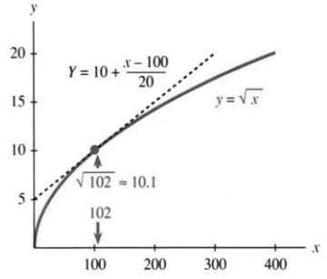
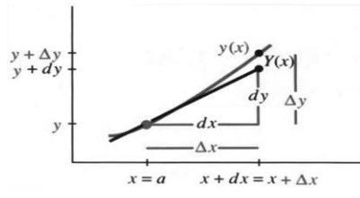

# 第3章 导数的应用

来源：PDF 第 150–155 页，印刷页 137–142。状态：初译，已按原页图像自校，待复审。

<!-- PDF 150 / 印刷页 137 -->

第2章侧重计算导数，本章侧重应用导数。我们已能求由 $x^n$、$\sin x$、$\cos x$ 构成的许多函数的导数。已知斜率，必要时再利用二阶导数，就能回答微积分诞生时所关心的那些问题：

1. $x$ 改变时，$y$ 怎样改变？
2. $y$ 的最大值或最小值是多少？
3. 怎样借助导数区分极大值与极小值？

一个点的导数提供的是**局部信息**，描述该点附近的变化，而不是所有其他位置。第2章让 $\Delta x$、$\Delta y$ 趋于零；现在则希望利用导数重新估计有限的增量，因为在局部，$\Delta y$ 近似等于导数乘以 $\Delta x$。

问题在于把有限变化与无穷小变化联系起来，也就是把平均斜率与瞬时斜率联系起来。在适当条件下，中值定理保证某处瞬时斜率恰等于平均斜率，这正是微分学中局部与整体之间的重要桥梁。不过，定理通常不直接指出这个点在哪里。因此，我们还要学习从导数研究函数，或从速度、加速度估计位置变化的其他方法。

从 $dy/dx$ 反过来理解 $y$，也许显得出人意料：我们此前一直从 $y$ 出发，费力求出 $dy/dx$；现在又用导数研究原函数。知识往往就是这样来回推进的。

## 3.1 线性近似

<!-- PDF 151 / 印刷页 138 -->

本书从直线 $f=vt$ 开始。速度恒定且初始位置为零时，位置与时间成正比；速度一旦变化，就不能一般地把瞬时速度代入 $f=vt$。应当取足够短的时间间隔，使速度近似恒定：
$$f=vt\quad\text{一般不再成立},$$
$$\Delta f\approx v\Delta t\quad\text{是局部近似},$$
$$df=v\,dt\quad\text{是微分的精确关系}.$$
在短时间内，光滑位置函数接近其切线。

第 2.3 节已求得 $y=f(x)$ 在 $x=a$ 处的切线。切线从高度 $f(a)$ 出发，按斜率 $f'(a)$ 乘以横向增量 $x-a$ 改变：
$$Y=f(a)+f'(a)(x-a).\tag{1}$$
用大写 $Y$ 表示切线、小写 $y$ 表示曲线。只要不离开 $a$ 太远，两者接近：
$$y\approx Y,\qquad f(x)\approx f(a)+f'(a)(x-a).\tag{2}$$
这就是一般的**线性近似**。

图 3.1 考察 $y=\sqrt{x}$ 在 $a=100$ 处的切线。函数值为 $10$，导数 $1/(2\sqrt{x})$ 在此为 $1/20$，所以 $Y=10+(x-100)/20$。

| $x$ | $Y$ | $y=\sqrt{x}$（原表近似值） |
|---|---:|---:|
| 100 | 10 | 10 |
| 102 | 10.1 | 10.0995 |
| 110 | 10.5 | 10.49 |
| 200 | 15 | 14.1 |
| 400 | 25 | 20 |

离 $100$ 越远，切线与曲线偏离越明显。在 $102$ 处近似很好，$101$ 处还会更好。本例切线位于曲线上方：切线斜率不变，而曲线斜率递减。这种曲线向下凹，其切线在图像上方。

再看 $x=102$。第2章以差商估计导数：
$$\text{斜率}\approx\frac{\sqrt{102}-\sqrt{100}}{102-100}.\tag{3}$$

<!-- PDF 152 / 印刷页 139 -->

现在把方向倒过来。斜率已知为 $1/20$，未知的是 $\sqrt{102}$，所以
$$\sqrt{102}\approx\sqrt{100}+\frac1{20}(102-100).\tag{4}$$
先前不知道导数，使用式 (3)；现在会求导，便使用式 (4)。只需在基点求一次导数，就能近似附近许多点的函数值。

把附近点写成 $100+\Delta x$，将近似值平方，得到
$$\left(\sqrt{100}+\frac1{20}\Delta x\right)^2
=100+\Delta x+\frac1{400}(\Delta x)^2.$$
希望得到的是 $100+\Delta x$，多出的项含有 $(\Delta x)^2$。线性近似的思想就是保留一次增量，忽略更高阶影响。

$100$ 的特殊之处仅在于平方根好算。其他基点、其他函数也可这样处理。换一种记号：不从 $a$ 到 $x$，而从 $x$ 到 $x+\Delta x$，数学内容相同。

> **3A** 在函数 $f$ 可导的点 $x$ 附近，对足够小的非零 $\Delta x$，
> $$f'(x)\approx\frac{f(x+\Delta x)-f(x)}{\Delta x},\tag{5}$$
> 从而
> $$f(x+\Delta x)\approx f(x)+f'(x)\Delta x.\tag{6}$$

**例 1。**当 $x$ 接近零时，重要近似为 $(1+x)^n\approx1+nx$。

**例 2。**同样有 $1/(1+x)^n\approx1-nx$。

这其实是一条公式：把 $n$ 换成 $-n$ 即可。基点为零，函数值为 $1$，斜率分别为 $n$ 和 $-n$。改用 $f(x)=x^n$ 的记号，则
$$ (1+\Delta x)^n\approx1+n\Delta x,
\qquad(x+\Delta x)^n\approx x^n+nx^{n-1}\Delta x.$$

取 $\Delta x=0.01$，例如
$$1.01^3\approx1.03,\qquad\frac1{1.01}\approx0.99.$$
但若取 $n=100$，同一方法给出 $1.01^{100}\approx2$，这个近似就很差。实际值约为 $2.7048$，接近第6章将研究的重要常数 $e$。二项式展开说明了原因：
$$ (1+\Delta x)^{100}
=1+100\Delta x+\frac{100\cdot99}{2}(\Delta x)^2+\cdots.$$
当 $\Delta x=0.01$ 时，仅二次项就有 $0.495$，已经不能忽略。

在适当的二阶可导条件下，精确误差可写为 $\tfrac12f''(c)(\Delta x)^2$，其中 $c$ 位于 $x$ 与 $x+\Delta x$ 之间，第 3.8 节将说明。若二阶导数局部有界，线性近似误差为 $O((\Delta x)^2)$：线性近似，二次阶误差。[译注 1]

<!-- PDF 153 / 印刷页 140 -->

### 微分

线性近似还有一种常用记号，必须介绍。它沿用了导数中的 $dx,dy$，既有启发性，也容易混淆。此前 $dy/dx$ 作为导数的整体记号，$dx,dy$ 尚未独立定义；现在赋予它们各自的意义，称为**微分**。

它们衡量沿切线的变化。取 $dx=\Delta x$，表示相同的横向增量；但曲线上的纵向增量 $\Delta y$ 与切线上的纵向增量通常不同。定义
$$dy=f'(x)\,dx.$$
它等于切线的增量 $\Delta Y$，是函数真实增量 $\Delta y$ 的线性近似。

**例 3。**$y=x^2$ 的导数为 $2x$，故 $dy=2x\,dx$。取基点 $x=2$，则 $dy=4dx$，而
$$\Delta y=(2+\Delta x)^2-4=4\Delta x+(\Delta x)^2.$$

| $dx=\Delta x$ | $dy$ | $\Delta y$ |
|---:|---:|---:|
| 0.1 | 0.4 | 0.41 |
| 0.2 | 0.8 | 0.84 |
| 0.3 | 1.2 | 1.29 |

误差恰为 $(\Delta x)^2$，即 $0.01,0.04,0.09$。

微分定义与导数记号相容，写作 $dy=(dy/dx)dx$。它看起来像约分，其实是新定义；不能因此把符号 $d$ 作为普通因子约掉。沿用 $dx,dy$ 的好处是提示小增量，并自然表达 $dy=f'(x)dx$。

几个例子和运算法则为
$$d(x^n)=nx^{n-1}dx,\qquad d(\sin x)=\cos x\,dx,\qquad d(\tan x)=\sec^2x\,dx,$$
$$d(f+g)=df+dg,\qquad d(cf)=c\,df,\qquad d(fg)=f\,dg+g\,df,$$
其中 $c$ 为常数。

科学、工程以及大量数学应用都依赖线性近似，即利用局部斜率将函数**线性化**。

<!-- PDF 154 / 印刷页 141 -->

- 时间改变 $\Delta t$，位置约改变 $v\Delta t$；
- 作用力改变 $\Delta F$，挠度约改变 $v\Delta F$；
- 产量改变 $\Delta p$，产值约改变 $v\Delta p$。

这里 $v$ 泛指对应关系的局部导数，不一定是速度。动力学、静力学或经济学中的一个目标，就是求出这个比例因子，从而作局部预测。原书以欧姆定律、胡克定律以及某些牛顿力学中的线性关系说明建模中的线性化思想；各定律的具体适用条件仍需分别考虑。[译注 2]

### 绝对变化、相对变化与百分比变化

函数增量和自变量增量，都可从三个角度描述：

| 类型 | 函数变化 | 自变量变化 |
|---|---|---|
| 绝对变化量 | $\Delta f$ | $\Delta x$ |
| 相对变化量 | $\Delta f/f(x)$ | $\Delta x/x$ |
| 百分比变化 | $[\Delta f/f(x)]\times100\%$ | $[\Delta x/x]\times100\%$ |

相对变化要求分母非零。它常比绝对变化更能体现精度。例如，用原书的示意数字比较：若约 $300,000$ 英里的距离误差为 $3$ 英里，而约 $70$ 英寸的身高误差为 $1$ 英寸，则
$$\frac3{300,000}=0.001\%<\frac1{70}\approx1.4\%.$$
绝对误差一英寸更小，相对误差却是前者更小。这些数字用于说明比例，不是精确天文数据。

**例 4。**假设地球半径以 $r=4,000$ 英里为近似值，误差不超过 $80$ 英里。

（a）用线性近似求球体体积 $V=\tfrac43\pi r^3$ 的变化 $dV$。（b）计算 $dr/r$、$dV/V$ 与真实相对变化 $\Delta V/V$。

**解。**由 $dV/dr=4\pi r^2$，取正增量 $dr=80$，得
$$dV=4\pi(4000)^2\cdot80\quad\text{立方英里}.$$
半径的相对变化为 $2\%$，对应体积的一阶相对变化为 $6\%$：
$$\frac{dr}{r}=\frac{80}{4000}=2\%,\qquad
\frac{dV}{V}=\frac{4\pi(4000)^2(80)}{(4\pi/3)(4000)^3}=6\%.$$
直接计算半径增为 $4080$ 时的真实变化，得到
$$\frac{\Delta V}{V}=\left(\frac{4080}{4000}\right)^3-1
=0.061208=6.1208\%\approx6.1\%.$$
半径减至 $3920$ 时则应另算负向变化。

$dV=4\pi r^2dr$ 还有几何含义：球面面积乘以薄层厚度，是球壳体积的一阶近似。半径增加时，新增薄壳的真实体积还含更高阶项。原书将正向变化的精确百分数写为 $(3917312/640000)\%$，与 $6.1208\%$ 相同；线性近似只保留约 $6\%$。

<!-- PDF 155 / 印刷页 142 -->

### 3.1 习题

**阅读填空**

图像上的线性近似由 **(a)______** 线给出。基点 $x=a$ 处，该直线为 $Y=f(a)+$ **(b)______**。在 $a=10$ 附近，$y=x^3$ 的线性近似为 $Y=1000+$ **(c)______**。$x=11$ 时真实值为 $11^3=$ **(d)______**，近似值为 $Y=$ **(e)______**，此时 $\Delta y=$ **(f)______**，$dy=$ **(g)______**。已知 $\sin x$，要估计 $\sin(x+\Delta x)$，应加上 **(h)______**。

线性近似可写作 $f(x+\Delta x)\approx f(x)+$ **(i)______**。在本节的二阶光滑条件下，误差为 $(\Delta x)^p$ 或 $(x-a)^p$ 的量级，其中 $p=$ **(j)______**。微分 $dy$ 等于 **(k)______** 乘以微分 **(l)______**，它描述沿 **(m)______** 线的变化，而 $\Delta y$ 描述沿 **(n)______** 的变化。

**第 1–6 题求 $y=f(x)$ 在 $x=a$ 附近的线性近似 $Y$。**

1. $f(x)=x+x^4$，$a=0$。
2. $f(x)=1/x$，$a=2$。
3. $f(x)=\tan x$，$a=\pi/4$。
4. $f(x)=\sin x$，$a=\pi/2$。
5. $f(x)=x\sin x$，$a=2\pi$。
6. $f(x)=\sin^2x$，$a=0$。

**第 7–12 题选择合适的函数和基点，用 $f(a)+f'(a)(x-a)$ 计算，使误差不超过 $0.01$，并用计算器检查。**

7. $2.001^6$。
8. $\sin0.02$。
9. $\cos0.03$。
10. $15.99^{1/4}$。
11. $1/0.98$。
12. $\sin3.14$。

**第 13–18 题计算线性近似的数值误差，并与基点处的 $\tfrac12f''(x)(\Delta x)^2$ 比较。**

13. $1.01^3\approx1+3(0.01)$。
14. $\cos0.01\approx1+0(0.01)$。
15. $(\sin0.01)^2\approx0+0(0.01)$。
16. $1.01^{-3}\approx1-3(0.01)$。
17. $(1+1/10)^{10}\approx2$。
18. $\sqrt{8.99}\approx3+\tfrac16(-0.01)$。

**第 19–21 题通过适当函数在零点的导数验证近似式。**

19. $\sqrt{1-x}\approx1-x/2$。
20. $1/\sqrt{1-x^2}\approx1+x^2/2$。先对 $f(u)=1/\sqrt{1-u}$ 作线性近似，再令 $u=x^2$。
21. $\sqrt{c^2+x^2}\approx c+x^2/(2c)$，其中 $c>0$。先取 $f(u)=\sqrt{c^2+u}$，再令 $u=x^2$。
22. 分别写出 $f(x)=\cos x$、$(x+1)/(x-1)$、$(x^2+1)^2$ 的微分 $df$。

**第 23–27 题求体积的一阶变化 $dV$ 或表面积的一阶变化 $dA$。**

23. 正方体边长由 $10$ 增为 $10.1$ 时的 $dV$。
24. 正方体边长由 $x$ 变为 $x+dx$ 时的 $dA$。
25. 球半径改变 $dr$ 时的 $dA$。
26. 圆柱半径固定为 $2$，高由 $3$ 增为 $3.05$ 时的 $dV$，其中 $V=\pi r^2h$。
27. 圆柱高固定为 $3$，半径由 $2$ 变为 $1.9$ 时的 $dV$。附加题：若半径和高同时改变 $dr,dh$，一阶体积变化是什么？
28. 原书采用相对论质量记号 $m=m_0/\sqrt{1-(v/c)^2}$。当 $v/c$ 很小时，由第 20 题得 $m\approx m_0+$ ______。说明低速动能近似 $\tfrac12m_0v^2$ 与质量增量满足 $E\approx(\Delta m)c^2$。[译注 3]
29. 计算器输入 $1.1$，连续按五次平方根键。每次“小数部分”大致怎样变化？这是因为 $\sqrt{1+x}\approx$ ______。
30. 第 29 题所得数值分别小于 $1.05,1.025,\ldots$。$\sqrt{1+x}$ 的二阶导数为 ______，所以线性近似位于曲线上方。
31. 输入 $0.9$，连续按四次平方根键，预测第五次结果后再计算。此时得到 $0.9$ 的 ______ 次方根。它与 $1-\tfrac1{32}(0.1)$ 有多少位小数一致？

### 译注

1. 仅在基点可导，只能保证误差为 $o(\Delta x)$，不能普遍保证 $O((\Delta x)^2)$。二次阶误差及拉格朗日型余项需要相应二阶光滑条件，译文明确了这一点。例 1 的幂指数固定后再令增量趋零，不能只凭增量的数值小就忽略大指数的影响。
2. 原文笼统说“欧姆定律、胡克定律和牛顿定律都是线性近似”，未说明具体的牛顿定律及变量关系，不能作为一般物理结论。译文保留线性化的教学意图，同时避免扩大其适用范围。
3. 第 28 题原文写 $\tfrac12mv^2$ 并使用等式，实际讨论的是 $v/c\ll1$ 的低速近似。此处用静质量 $m_0$ 和近似号明确阶次；相对论动能的精确表达不是 $\tfrac12mv^2$。本题保留原书的相对论质量术语，仅作数学近似例题。
