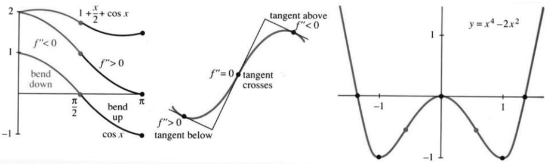
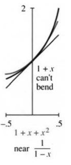

## 3.3 二阶导数：弯曲与加速度

来源：PDF 第 166–172 页，印刷页 153–159。状态：初译，已按原页图像自校，待复审。

<!-- PDF 166 / 印刷页 153 -->

导数为正的区间上，函数递增；导数为负的区间上，函数递减。那么二阶导数呢？能否从图像看出 $f''(x)$ 的符号？可以，关键在于曲线的弯曲方向。

直线 $y=mx+b$ 的斜率恒为 $m$，二阶导数为零。曲线的斜率会变化，而这种变化由二阶导数描述：
$$f=x^2:\quad f'=2x,\quad f''=2\qquad\text{向上弯曲};$$
$$y=\sin x:\quad y'=\cos x,\quad y''=-\sin x\qquad\text{在 }0<x<\pi\text{ 向下弯曲}.$$
即使抛物线正在下降，斜率 $2x$ 仍随 $x$ 增大。二阶导数的符号并不直接决定函数值或一阶导数的符号，它描述的是**斜率如何变化**。

若某区间内 $f''>0$，函数向上凹，也称为凸函数；斜率递增，图像向上弯曲。若 $f''<0$，则向下凹，斜率递减。$\cos x$、$1+\cos x$、$1+x/2+\cos x$ 都在 $x=\pi/2$ 附近由向下凹变为向上凹，因为共同的二阶导数 $-\cos x$ 在此由负变正。加上一次函数会平移或倾斜图像，却不改变二阶导数。

还可观察切线：在向上凹的区间内，切线位于曲线下方，线性近似偏低；向下凹时相反。本节将加入二阶导数构成二次近似，让近似曲线也能弯曲。

运动中，$f''(t)$ 是加速度，单位为长度除以时间平方。对 $f(t)=\sin2t$，速度为 $2\cos2t$，最大速率为 $2$；加速度为 $-4\sin2t$，最大绝对值为 $4$。

人口增加对应 $f'>0$，每单位时间新增人数还在增加则对应 $f''>0$。两者不同：增长可以继续，而增长的速度已经放缓。

### 区分极大与极小

$f'=0$ 找到驻点，但还不能判定极值性质。二阶导数在非零时可以作出判断。

<!-- PDF 167 / 印刷页 154 -->

> **3D 二阶导数判别法。**在所考察的内点 $a$，若 $f'(a)=0$ 且 $f''(a)>0$，则 $a$ 是严格局部极小值点；若 $f'(a)=0$ 且 $f''(a)<0$，则为严格局部极大值点。

在二阶导数为正的驻点附近，导数由负变正，函数先降后升；二阶导数为负时，导数由正变负。若 $f'(a)=f''(a)=0$，这一判别法失效，各种情形都可能出现：$x^3$ 在零点仍继续递增，$x^4$ 在零点取得很平坦的极小值，$-x^4$ 则取得极大值。[译注 1]

这些判断仅是局部的。确定全局最大或最小值，还要研究整个定义域。

**例 1。**$f=x^3-x^2$，$f'=3x^2-2x$，$f''=6x-2$。驻点为 $0$ 和 $2/3$。由于 $f''(0)=-2$，零点是局部极大值点；$f''(2/3)=2$，所以 $2/3$ 是局部极小值点。两者之间，$f''$ 在 $x=1/3$ 由负变正，这里是**拐点**。

### 拐点

函数穿过零值时，常对应一种显著变化：$f$ 变号，图像穿过横轴；$f'$ 为零，切线水平；$f''$ 变号，则曲线凹向改变，出现拐点。

**拐点是曲线弯曲方向改变的点。**在本节讨论的光滑情形中，二阶导数在拐点处为零，并在两侧变号。仅有 $f''=0$ 不够，例如 $x^4$ 的二阶导数 $12x^2$ 在零点两侧同为正，零点不是拐点，横轴始终位于图像下方。[译注 2]

在典型的光滑拐点处，切线穿过曲线：一侧切线在上方，另一侧在下方。抛物线没有拐点，因为二阶导数为常数；真正的三次多项式有一个拐点，因为二阶导数为一次函数；四次多项式是否有拐点，要看其二次导函数是否变号。

**例 2。**$f=x^4-2x^2$ 呈 W 形，$f'=4x^3-4x$ 有两个转弯，$f''=12x^2-4$ 呈 U 形。关键位置的符号如下，其中零点 $x=0$ 对 $f$ 为二重零点。

| $x$ | $-\sqrt2$ | $-1$ | $-1/\sqrt3$ | $0$ | $1/\sqrt3$ | $1$ | $\sqrt2$ |
|---|---|---|---|---|---|---|---|
| $f$ | $0$ | $-$ | $-$ | $0$ | $-$ | $-$ | $0$ |
| $f'$ | $-$ | $0$ | $+$ | $0$ | $-$ | $0$ | $+$ |
| $f''$ | $+$ | $+$ | $0$ | $-$ | $0$ | $+$ | $+$ |

<!-- PDF 168 / 印刷页 155 -->

在不同的函数零点之间，罗尔定理保证有导数零点；不同的导数零点之间，又有二阶导数零点。本例中这些二阶导数零点恰为拐点。原点是 $f$ 的二重零点，也是 $f'$ 的单零点，且因 $f''(0)<0$ 而为局部极大值点。

拐点不仅用于数学。人口仍在增长时，我们还关心新增人数是否开始放缓；若总人口曲线从加速增长转为减速增长，增长速度在拐点附近达到峰值。原书引用以下 **1990 年联合国人口基金报告**，作为当时的历史背景：

> 今后十年将决定世界人口在最终停止增长前，是增为三倍，还是仅增为两倍；这可能关系到地球作为人类居所的未来。当时人口约为 53 亿，每天增加约 25 万。预计 20 世纪 90 年代每年新增 9,000 万至 1 亿，十年增加约 10 亿，相当于当时一个中国的人口。增长最快的地区将是最贫困国家。
>
> 几年前，除非洲和南亚部分地区外，各地人口增长速度似乎都在放缓，世界人口看起来可能在下一个世纪末稳定于约 102 亿。现在，情况显得不那么乐观：人口已超过 1984 年“最可能”的中位预测所设的阶段性指标，最终规模似乎更接近 110 亿，而不是 100 亿。
>
> 如果生育率下降继续慢于预测，目标还可能再次落空；在这种情况下，世界人口可能走向高达 140 亿的规模。

联合国从普查数据出发，跟踪各国各年龄组，估计死亡率与生育率，并公布中位情景。上述报告是在说，当时的数据没有沿先前估计的轨迹发展。第 6.5 节还会用一个预测人口趋近 100 亿的方程讨论此事；原书把是否已到拐点与 1990 年的人口普查联系起来。[译注 3]

现在你已理解二阶导数的符号：它表示斜率怎样变化。接下来不仅看符号，还利用二阶导数的大小构造二次近似。这部分在有些课程中可选读。

### 中心差分与二阶差分

在 $x$ 两侧分别计算平均变化率：
$$\frac{f(x+\Delta x)-f(x)}{\Delta x},\qquad
\frac{f(x)-f(x-\Delta x)}{\Delta x},\tag{1}$$
两者都接近 $f'(x)$。将它们取平均，可得到通常更精确的中心差商：
$$\begin{aligned}
f'(x)&\approx\frac12\left[\frac{f(x+\Delta x)-f(x)}{\Delta x}
+\frac{f(x)-f(x-\Delta x)}{\Delta x}\right]\\
&=\frac{f(x+\Delta x)-f(x-\Delta x)}{2\Delta x}.
\end{aligned}\tag{2}$$
它使用两侧点，横向间距为 $2\Delta x$。为什么更精确？先用幂函数检验。

<!-- PDF 169 / 印刷页 156 -->

对 $f(x)=x$，各差商都精确给出 $1$。对 $f(x)=x^2$，单侧差商分别为 $2x+\Delta x$、$2x-\Delta x$，各有一次阶误差；取平均后恰得 $2x$。对足够光滑的一般函数，中心差商具有二阶精度。[译注 4]

什么差商趋于二阶导数？可以对 $f'$ 再作差商，但我们希望只使用 $f$ 的值。自然的办法是“对差分再作差分”：
$$\frac{\dfrac{f(x+\Delta x)-f(x)}{\Delta x}
-\dfrac{f(x)-f(x-\Delta x)}{\Delta x}}{\Delta x}
=\frac{f(x+\Delta x)-2f(x)+f(x-\Delta x)}{(\Delta x)^2}
\longrightarrow f''(x).\tag{3}$$
分子是二阶差分，与 $d^2f$ 对应；分母为步长平方，与 $dx^2$ 对应。这有助于记住 $d^2f/dx^2$ 的写法：并不是把 $df$ 平方。

分母 $(\Delta x)^2$ 很小，二阶差分中的抵消至关重要。一般的一阶增量含有 $f'(x)\Delta x$，直接除以 $(\Delta x)^2$ 通常会发散；二阶差分消掉一次项，才得到有限的二阶导数极限。

**应用。**许多微分方程无法用简单公式精确求解。例如摆方程 $f''(x)=-\sin f(x)$，可用式 (3) 的二阶差商近似二阶导数，在间距为 $\Delta x$ 的网格上计算解。离散近似是科学计算的重要组成部分。

对 $f(x)=\sin x+\cos x$，在 $x=0$ 处的原书误差表如下，误差取“真实值减近似值”：

| 步长 $\Delta x$ | 前向差商误差 | 中心差商误差 | 二阶差商误差 |
|---|---:|---:|---:|
| $1/4$ | 0.1347 | 0.0104 | -0.0052 |
| $1/8$ | 0.0650 | 0.0026 | -0.0013 |
| $1/16$ | 0.0319 | 0.0007 | -0.0003 |
| $1/32$ | 0.0158 | 0.0002 | -0.0001 |

步长减半，前向差商误差大致减半，后两类误差大致变为四分之一。分别记为 $O(\Delta x)$ 和 $O((\Delta x)^2)$。

**大 $O$ 记号。**$E(h)=O(h)$ 意味着存在常数 $C>0$ 和足够小的邻域，使 $|E(h)|\le C|h|$；$E(h)=O(h^2)$ 则表示 $|E(h)|\le Ch^2$。我们有时不关心常数的具体值，而着重误差随步长缩小的阶数。[译注 4]

### 线性近似与二次近似

切线不能弯曲，离开基点后便可能高估或低估函数。加入二阶导数，就能明显改善。例如 $f(x)=x^2$ 在零点的切线为横轴，但函数向上弯曲，需要二次项。

<!-- PDF 170 / 印刷页 157 -->

这个项应含 $f''$ 和 $(x-a)^2$。又因为 $x^2$ 的二阶导数为 $2$，必须乘以 $1/2$ 才能恢复原来的系数。

> **3E 二次近似。**对足够光滑的函数，在 $x=a$ 附近，
> $$f(x)\approx f(a)+f'(a)(x-a)+\frac12f''(a)(x-a)^2.\tag{4}$$

基点处，两侧的函数值、一阶导数和二阶导数都一致。二次近似能随原函数一起弯曲。还可以继续加入 $\tfrac16f'''(a)(x-a)^3$、$\tfrac1{24}f^{(4)}(a)(x-a)^4$ 等项，形成泰勒展开；无穷级数是否收敛并等于原函数，另需条件，不能只凭光滑性断言。

式 (4) 也解释了正二阶导数为何使曲线在局部位于切线上方：一次项给出切线，正二次项向上修正。利用式 (2)、(3)，还可形式上写出
$$f(x+h)\approx f(x-h)+2f'(x)h,$$
$$f(x+h)\approx2f(x)-f(x-h)+f''(x)h^2.$$
相加除以二，得到 $f(x+h)\approx f(x)+f'(x)h+\tfrac12f''(x)h^2$。在三阶导数局部有界等条件下，误差为 $O(h^3)$。

**例 3。**
$$ (x+h)^3=x^3+3x^2h+\frac12(6x)h^2+h^3.$$
二次近似遗漏的精确误差就是 $h^3$。

**例 4。**
$$ (1+x)^n\approx1+nx+\frac12n(n-1)x^2.$$
零点处的一阶导数为 $n$，二阶导数为 $n(n-1)$。下一项为 $n(n-1)(n-2)x^3/6$；这正是二项式展开的开头。

**例 5。**
$$\frac1{1-x}\approx1+x+x^2.$$
函数、一阶导数、二阶导数在零点的值分别为 $1,1,2$，乘上相应系数后得到 $1,1,1$。后面还有 $x^3,x^4,\ldots$；在 $|x|<1$ 时，完整几何级数为 $1/(1-x)=1+x+x^2+\cdots$。

**数值实验。**用
$$\frac1{\sqrt{1+x}}\approx1-\frac12x+\frac38x^2$$
检验精度。步长减半，二次近似误差大致变为八分之一；只保留一次项时，大致变为四分之一。

| 近似与误差主项 | $x=1/4$ | $x=1/8$ | $x=1/16$ |
|---|---:|---:|---:|
| 线性，误差约 $3x^2/8$ | 0.0194 | 0.0053 | 0.0014 |
| 二次，误差约 $-5x^3/16$ | -0.00401 | -0.00055 | -0.00007 |

<!-- PDF 171 / 印刷页 158 -->

### 3.3 习题

**阅读填空**

弯曲方向由 **(a)______** 的符号决定。若某区间二阶导数为 **(b)______**，函数向上凹，图像向 **(c)______** 弯曲，切线在图像 **(d)______**。若 $f''<0$，则向 **(e)______** 凹，斜率 **(f)______**。

若 $f'=0,f''>0$，则有 **(g)______**；若 **(h)______**，则有局部极大值。若 $f''=0$ 且在两侧变号，则为 **(i)______** 点，此时切线 **(j)______** 曲线。

$f'(x)$ 的中心近似为 [**(k)______**]$/2\Delta x$；$f''(x)$ 的三点近似为 [**(l)______**]$/ (\Delta x)^2$。二次近似为 $f(x)+f'(x)\Delta x+$ **(m)______**；没有最后一项就是 **(n)______** 近似，在适当三阶光滑条件下，加入后误差为 $O($ **(o)______** $)$。

1. “向上凹的图像能盛水”并不准确。画一个 $f''>0$、却不能直观地“盛水”的图像。
2. 找一个函数，在 $x<0$ 向下凹，$0<x<1$ 向上凹，$x>1$ 向下凹。
3. 函数能否在全实轴始终严格向下凹且从不等于零？能否始终严格向下凹且恒为正？解释，并注意定义域。
4. 找一个函数，使 $f''(2)=0$，且除 $x=2$ 外没有其他拐点。

**第 5–10 题假设 $f$ 为九次多项式，$f'(1)=f'(3)=0$。判断正误并给出理由或图像。**

5. 在 $1$ 与 $3$ 之间某处 $f=0$。
6. 在 $1$ 与 $3$ 之间某处 $f''=0$。
7. $x=3$ 不是全实轴上的绝对最大值点。
8. 函数有七个拐点。
9. 若函数有九个互异实零点，则有七个拐点。
10. 若函数有七个拐点，则有九个实零点。

**第 11–16 题判断各驻点是否为极大或极小值点。**

11. $f=x^2-6x$。
12. $f=x^3-6x^2$。
13. $f=x^4-6x^3$。
14. $f=x^{11}-6x^{10}$。
15. $f=\sin x-\cos x$。
16. $f=x+\sin2x$。

**第 17–20 题找拐点及向上凹、向下凹的区间。**

17. $f=x+x^2-x^3$。
18. $f=\sin x+\tan x$。
19. $f=(x-2)^2(x-4)^2$。
20. $f=\sin x+(\sin x)^3$。
21. 若 $f$ 是偶函数且在零点可导，为什么中心差商 $[f(h)-f(-h)]/(2h)$ 恰等于 $f'(0)=0$？
22. 若 $f$ 是奇函数且在零点二阶可导，为什么二阶差商 $[f(h)-2f(0)+f(-h)]/h^2$ 恰等于 $f''(0)=0$？

**第 23–26 题写出零点处的二次近似。**

23. $f=\cos x+\sin x$。
24. $f=\tan x$。
25. $f=(\sin x)/x$，并规定 $f(0)=1$。
26. $f=1+x+x^2$。再写出基点 $a=1$ 处的二次近似。
27. 求 $\sqrt{1-x}\approx1+Ax+Bx^2$ 中的 $A,B$。
28. 求 $1/(1-x)^2\approx1+Ax+Bx^2$ 中的 $A,B$。
29. 将二次近似代入前向差商 $[f(x+h)-f(x)]/h$，估计它近似 $f'(x)$ 的误差。
30. 在基点零处，$f(-h)$ 的二次近似是什么？
31. 将 $f(x+h)$、$f(x-h)$ 的展开代入中心差商，得到 $f'(x)+$ 误差。求误差中的 $h$ 与 $h^2$ 项，并用 $f=x^3,x=0$ 检验。确定二次误差项需把展开保留到三次项。
32. 猜测三次近似 $f(h)\approx f(0)+f'(0)h+\tfrac12f''(0)h^2+$ ______，用 $f=x^3$ 检验。

**第 33–35 题仿照正文列表，计算基点零处的单侧差商、中心差商、二阶差商和二次近似的真实误差。手算取两个步长，计算器取三个，计算机取四个。**

33. $f=x^3+x^4$。
34. $f=1/(1-x)$。
35. $f=x^2+\sin x$。
36. 对近似 $1/(1-x)\approx1+x+x^2$，求 $x=0.1$ 与 $x=2$ 时的误差。
37. 在几何级数中分别取 $x=0.01$、$x=-0.1$，求 $1/0.99$ 和 $1/1.1$：先保留四位小数，再写出完整循环小数形式。
38. 用式 (4) 在 $a=0$ 处估算 $\cos1^\circ$，并用计算器核对；再估算 $\cos1$。后者为什么误差大得多？
39. 为什么 $\sin x\approx x$ 不仅是线性近似，也是二次近似？零点是 ______ 点。
40. 若偶函数 $f$ 在零点足够光滑，写出其二次近似与切线方程。

<!-- PDF 172 / 印刷页 159 -->

41. 对 $f(x)=x+x^2+x^3$，计算中心差商 $[f(3)-f(1)]/2$ 与真实导数 $f'(2)$。
42. 对同一函数，计算二阶差商 $[f(3)-2f(2)+f(1)]/1^2$ 与真实二阶导数 $f''(2)$。
43. 线性近似的误差约为 $\tfrac12f''(a)(x-a)^2$。函数向 ______ 凹时，该误差为正，切线位于曲线 ______。
44. 画一个向上凹的分段线性函数。给出不依赖 $y''\ge0$ 的向上凹定义，因为折点处导数可能不存在。
45. 下列话分别涉及 $f,f',f'',f'''$ 的什么性质？请先说明所选函数代表什么量：（1）人口仍在增长，但增长更慢了。（2）飞机平稳着陆。（3）经济增长正在加速。（4）税率恒定。（5）自行车加速度更大，但汽车速度更快。（6）股价已经见顶。（7）加速度的变化正在减缓。（8）这门课正在走下坡路。
46. **推荐。**画一条先升、后降、再升的曲线，在下方画其一阶导函数，再画二阶导函数。把原曲线的极大点、极小点和拐点对应的横坐标，在三幅图中都标出。
47. 对 $y=x^3-4x^2+x+2$ 重做第 46 题，并把函数、一阶导函数和二阶导函数打印在同一坐标图中。

### 译注

1. 原文写“$x^4$ 停顿后向下”，与函数本身不符。$x^4$ 应在零点取得极小值后向上；若要表示向下的极大情形，应为 $-x^4$。译文列出两者，明确区别。
2. 拐点的本质是凹向改变，不能简单定义为 $f''=0$；也可能有二阶导数不存在的拐点。原文“图像瞬间成为直线”只是直觉表达，不意味着邻域内真的为直线。罗尔定理保证的是二阶导数零点，不自动保证每个这样的零点都是拐点。
3. 人口报告及预测全部属于原书 1990 年前后的历史材料，不更新为当前事实。原文把 1990 年 7 月 1 日的中国人口普查称为“第二次”，序次存在问题，译文不沿用该序号。人口的绝对增长速度 $f'$ 与相对增长率 $f'/f$ 不同，本节“增长速度”按前者理解。
4. 差分精度依赖光滑性：前向差商通常在二阶导数受控时为一阶误差，中心一阶差商在三阶导数受控时为二阶误差，中心二阶差商在四阶导数受控时为二阶误差。步长过小时实际浮点计算还会受舍入与抵消影响。本节表格主要展示截断误差。原文大 $O$ 的界未写绝对值，译文已规范。
5. 原图表在部分位置留空，译文表格补齐由所给多项式直接计算的符号，未改变零点或结论。第 9 题将“九个零点”明确为九个互异实零点，避免把重数或复根混入实图像的罗尔定理讨论。
