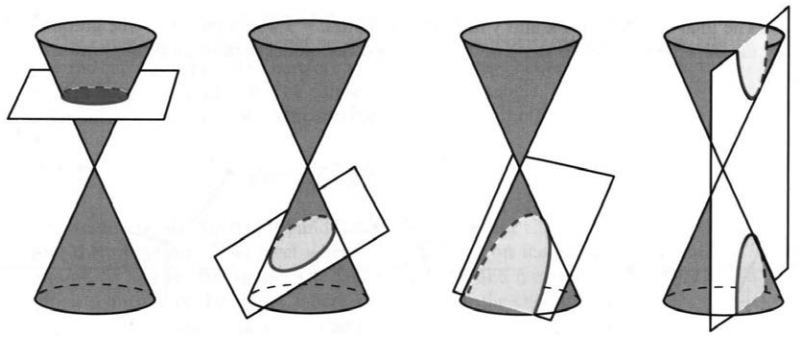
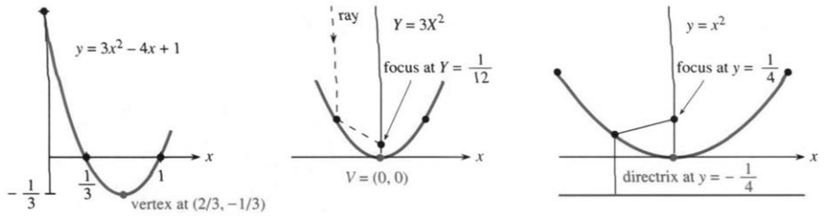
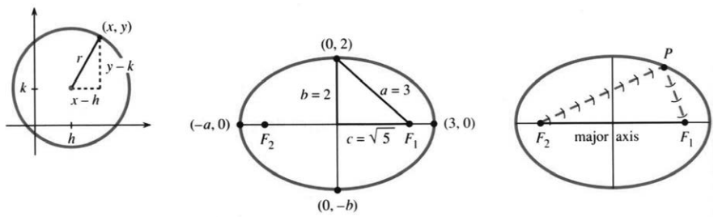
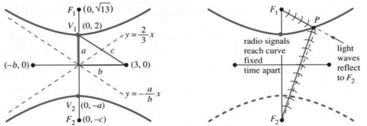
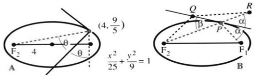

# 3.5 抛物线、椭圆和双曲线

来源：PDF第183–191页，印刷页170–178。状态：初译，已逐页对照原图，待复审。公式勘误和必要条件见末尾译注。

<!-- PDF 183 / 印刷页 170 -->

下面是数学里最重要的几类曲线，先列个单子，好让你知道接下来要讲什么。前四名谁先谁后，实在不好排：

1. 直线。
2. 正弦与余弦曲线——振荡。
3. 指数曲线——增长与衰减。
4. 抛物线、椭圆和双曲线——方程涉及$1,x,y,x^2,xy,y^2$。

最后这一类，我排在末尾；换成古希腊人，准会把它摆在第一位。从一次方程走向二次方程，本来就顺理成章。直线用$1,x,y$就够了，二次曲线还多出$x^2,xy,y^2$。再往上添$x^3,y^3$，事情就复杂了。现在要研究的，就是二次方程和它们画出的曲线。

**方程和曲线**，得同时看，这一点很重要。本节把数学的两大块接在一起：一边是方程的分析，一边是曲线的几何；合起来，就是**解析几何**。函数和图像你早就熟悉，比这更基本的，是数与点的对应。我们说“点$(5,2)$”，欧几里得听了，可能也听不懂这种说法。

同样是过原点、倾角$45^\circ$的直线，欧几里得动手去画，笛卡尔只写下$y=x$。解析几何如今已是数学的中心，下面只看其中的一小部分。

图3.15 截平面逐渐变陡：圆、椭圆、抛物线、双曲线。

## 圆锥曲线

抛物线、椭圆、双曲线，性质都非同寻常。古希腊人发现，这三种曲线都能用一个平面去截圆锥面得到，于是叫它们**圆锥曲线**。平着截，截出圆；斜得适度，截出椭圆；截平面再陡些，就截出双曲线的两支，见图3.15d。到了临界情形，截平面与圆锥母线平行，截下来的正是抛物线。它和椭圆一样只有一支，却又像双曲线那样，一直延伸到无穷远。

在数学的许多地方，抛物线都正处在椭圆与双曲线之间的临界位置。

截圆锥是一路，研究方程是另一路。一束锥形的光照到墙上，会映出一个椭圆——墙面把光锥截了。至于一般方程

$$Ax^2+Bxy+Cy^2+Dx+Ey+F=0,$$

我们的任务，是把它化得简单些。

<!-- PDF 184 / 印刷页 171 -->

办法是平移、缩放，必要时再旋转坐标，最终化成类似$y=x^2$的简单方程。离心率和极坐标，留到第9章再讲。

## 抛物线 $y=ax^2+bx+c$

这个函数，你在学微积分之前就熟。图像在$y=0$处穿过横轴。方程$3x^2-4x+1=0$，用求根公式能解，分解成$(x-1)(3x-1)=0$也能解；两个交点横坐标$x=1$、$x=1/3$，就这样由代数定下来。

另一个要紧的点，得靠微积分才找得到：在最低点处$dy/dx=6x-4=0$，于是$x=4/6=2/3$，恰好落在两个交点的正中间；高度是$y_{\min}=-1/3$。这就是图3.16a中抛物线底部的**顶点$V$**。

抛物线没有渐近线。它的斜率$6x-4$不会停在一个常数上。

**把顶点移到原点。** 先向左挪$2/3$，再向上挪$1/3$，引入新变量

$$X=x-\frac23,\qquad Y=y+\frac13.$$

原来的$(2/3,-1/3)$正好对应新坐标$(0,0)$，于是

$$y=3x^2-4x+1\quad\longrightarrow\quad Y=3X^2.\tag{1}$$

代数上验一下：$Y=3X^2$就是$y+1/3=3(x-2/3)^2$，乘开便回到原方程。第二幅图画的是顶点已移到原点的抛物线$Y=3X^2$。

**再把顶点附近放大。** 用同一个比例$a$去缩放$X,Y$：

$$Y=3X^2\quad\longrightarrow\quad
\frac{\boldsymbol y}{a}=3\left(\frac{\boldsymbol x}{a}\right)^2.$$

方程里的新变量用粗体标出。取$a=3$，得到$\boldsymbol y=\boldsymbol x^2$，图像放大了3倍。两步走完，开口向上的标准抛物线就到手了。

图3.16 抛物线在$V$处取最小值；平行光线反射后汇聚于焦点。(b)已平移，(c)已缩放。vertex、focus、directrix、ray分别为顶点、焦点、准线、光线。

抛物线还有另一个要紧的点——**焦点**。它到顶点的距离记作$p$。$y=x^2$时$p=1/4$；开口向上的$Y=aX^2$则$p=1/(4a)$。放大$a$倍，就变成$y=x^2$。抛物线最漂亮的性质是：**凡沿对称轴方向射来的平行光线，反射后全都汇聚到焦点。**

第2.3节第25题已经定出焦点$F$的位置，这里说两个应用。太阳能集热器和电视天线都做成抛物面，把阳光或电视信号聚到一点，再由放在焦点上的集热元件或接收器收走。原书提到，1982年的《UMAP Journal》讲过雷达和声呐怎样用同一招。汽车前灯则把思路反过来：光源放在焦点，让反射光成为向外射出的平行光束。

还有一条经典性质：**曲线上每一点到焦点的距离，都等于它到准线的距离。**

<!-- PDF 185 / 印刷页 172 -->

对顶点在原点、向上开口的抛物线，准线是顶点下方那条$y=-p$，所以顶点正好夹在焦点与准线中间。取$p=1/4$，曲线上任一点$(x,y)$到准线的距离就是$y+1/4$。让它等于到焦点$(0,1/4)$的距离，便得到

$$y+\frac14=\sqrt{x^2+\left(y-\frac14\right)^2}
\quad\xrightarrow{\text{两边平方}}\quad y=x^2.\tag{2}$$

习题会让你把这些步骤都练一遍：平移到$Y=aX^2$，缩放到$\boldsymbol y=\boldsymbol x^2$，再定出顶点、焦点和准线。

**一般抛物线，照此归纳。** 当$a\ne0$时，$y=ax^2+bx+c$的顶点处$dy/dx=0$，也就是$2ax+b=0$，所以$x=-b/(2a)$。把横坐标平移到这一点，就是配方：

$$ax^2+bx+c=a\left(x+\frac b{2a}\right)^2+C,\qquad
C=c-\frac{b^2}{4a}.\tag{3}$$

$C$正是顶点的纵坐标。作变换$X=x+b/(2a)$、$Y=y-C$，方程变成$Y=aX^2$，顶点也就搬回了原点。

对椭圆和双曲线，打法差不多：

1. 平移到中心，把一次项$Dx,Ey$消掉。
2. 找到各个焦点，弄清反射性质。
3. 方程里若有$Bxy$项，就旋转坐标把它消掉；实际计算时，先旋转再平移也行。

## 椭圆 $\dfrac{x^2}{a^2}+\dfrac{y^2}{b^2}=1$（$a=b$时为圆）

设$a,b>0$。方程关于原点对称：把$x$换成$-x$，或者把$y$换成$-y$，方程纹丝不动。中心已经在原点，不必再平移，也不必旋转。

因为$x^2/a^2$和$y^2/b^2$都不为负，加起来又等于1，所以谁也不会超过1。于是$-a\le x\le a$，$-b\le y\le b$，整个椭圆被关在一个矩形里。

把$y$解出来，得到$x$的两个函数：

$$\frac{y^2}{b^2}=1-\frac{x^2}{a^2}
\quad\Longrightarrow\quad
\frac yb=\pm\sqrt{1-\frac{x^2}{a^2}}
\quad\Longrightarrow\quad y=\pm\frac ba\sqrt{a^2-x^2}.$$

正号画上半椭圆，负号画下半椭圆；两半合起来，才是完整的椭圆。它们在$y=0$处碰头，正是图3.17最右端的$x=a$和最左端的$x=-a$。最高点$y=b$、最低点$y=-b$在椭圆的顶部和底部，刚好顶到外接矩形。

圆不过是$a=b$时的一个特例。圆方程$x^2+y^2=r^2$，就是椭圆方程里取$a=b=r$。这个圆以$(0,0)$为圆心；一般的圆，圆心可以搬到$(h,k)$。半径$r$和圆心$(h,k)$一定，圆就定了：

$$\boxed{(x-h)^2+(y-k)^2=r^2.}\tag{4}$$

换句话说，圆上任一点$(x,y)$到圆心$(h,k)$的距离，恒等于$r$。把方程展开，会多出一次项$-2hx$、$-2ky$；圆心一回到原点，这两项就没了。

<!-- PDF 186 / 印刷页 173 -->

**例1** 一条直径的两个端点是$(1,7)$和$(5,7)$，求这个圆。

**解** 圆心落在中点$(3,7)$，半径$r=2$，于是$(x-3)^2+(y-7)^2=2^2$。

**例2** 求圆$x^2-6x+y^2-14y=-54$的圆心和半径。

**解** 给$x^2-6x$添上9，配成$(x-3)^2$；给$y^2-14y$添上49，配成$(y-7)^2$。两边同时加上$9+49$，方程变成$(x-3)^2+(y-7)^2=4$——和例1是同一个圆。

**更快的解法**：拿已知方程和式(4)展开后的样子逐项对照系数：

$$x^2-2hx+h^2+y^2-2ky+k^2=r^2,$$

立刻读出$h=3,k=7,r=2$。

取$X=x-h,Y=y-k$，圆心便从$(h,k)$挪到$(0,0)$。椭圆也一样：

$$\frac{(x-h)^2}{a^2}+\frac{(y-k)^2}{b^2}=1
\quad\longrightarrow\quad
\frac{X^2}{a^2}+\frac{Y^2}{b^2}=1.$$

再令$\boldsymbol x=X/a$、$\boldsymbol y=Y/b$，就得到单位圆$\boldsymbol x^2+\boldsymbol y^2=1$。单位圆的面积是$\pi$，所以**椭圆面积是$\pi ab$**——这个证明后面再给。单位圆的周长是$2\pi$；椭圆的周长却没法按同一个比例缩放出来，也没有同样简洁的公式。

图3.17 圆心不在原点的圆；以原点为中心的椭圆$x^2/3^2+y^2/2^2=1$；从$F_2$发出的光线反射后经过$F_1$。中心到最右端的距离为$a=3$；major axis为长轴。

现在把圆放下，专门看椭圆。它有两个焦点，英文复数叫foci。抛物线可以形象地说成第二个焦点落在无穷远；圆的两个焦点则干脆重合在圆心。椭圆的焦点待在较长的轴上，也就是**长轴**，一边一个，分居中心两侧。下面设$a>b$，长轴沿$x$轴：

$$F_1=(c,0),\qquad F_2=(-c,0),\qquad c=\sqrt{a^2-b^2}.$$

图3.17里的直角三角形，三条边是$a,b,c$。从椭圆顶端到两个焦点，距离都是$a$。最右端$(a,0)$到两焦点的距离分别是$a-c$和$a+c$，加起来正好$2a$。事实上，**点沿椭圆走一圈，到两个焦点的距离之和始终是$2a$**。

> **3H** 椭圆上每一点到两焦点的距离之和等于$2a$，因此椭圆还可以表示为
> $$\sqrt{(x-c)^2+y^2}+\sqrt{(x+c)^2+y^2}=2a.\tag{5}$$

<!-- PDF 187 / 印刷页 174 -->

要画椭圆，可以拿一根长为$2a$的细绳，两端钉在两个焦点上，用铅笔把绳绷紧，然后带着笔移动——画出的轨迹就是椭圆。这种说法用的是$a,c$，标准方程用的是$a,b$；别忘了$b^2+c^2=a^2$。第24题就要求把式(5)一路化简到$x^2/a^2+y^2/b^2=1$。

原书举的例子是美国参议院那间椭圆形的“耳语廊”：站在一个焦点上轻声说话，另一个焦点上的人就能听见。声音打到墙上再反射，走的路和那根细绳一模一样，最后聚到另一个焦点。至于抛物线，可以把射来的平行光想象成来自无穷远的那个“第二个焦点”。

原书还提到医院用这个反射性质击碎肾结石：把结石放在一个焦点上，另一个焦点处由碎石机发出几百次小冲击波，把结石打碎。原文还写到病人要接受脊椎麻醉；这里只把它当作一个历史上的应用例子，不把这套治疗流程当成今天的通用方案。

最重要的焦点，当然是太阳；而地球的轨道，正是一个椭圆。原书请读者去看第12.4节：那里讲到英国最后一版一英镑纸币上的一个离谱的印刷错误——太阳被画在了椭圆的正中心。

**问题1** 耳语声也好，冲击波也好，为什么反射之后会同时到达第二个焦点？

**答** 只要传播速度相同，不管走哪条反射路径，总长度都是$2a$。唯一的例外是从一个焦点直奔另一个焦点，那条路长$2c$。

**问题2** 定出椭圆$4x^2+9y^2=36$的位置和参数。

**答** 两边同除以36，把右边化成1：

$$\frac{x^2}{9}+\frac{y^2}{4}=1.$$

于是$a=3,b=2$，焦点在$(\pm\sqrt5,0)$。

**问题3** 把这个椭圆的中心搬到$(1,-5)$。

**答** 把$x$换成$x-1$，把$y$换成$y+5$，方程就成了$(x-1)^2/9+(y+5)^2/4=1$。实际做题时常常倒过来：先拿到一个中心不在原点的椭圆，再想办法把它移回原点。

## 双曲线 $\dfrac{y^2}{a^2}-\dfrac{x^2}{b^2}=1$

请注意那个减号——双曲线与椭圆的根本差别，就在这个符号上。和椭圆不同，这里$x,y$可以同时很大，曲线一直伸向无穷远。它仍关于两条坐标轴对称：$x,y$分别变号，方程都不变。

中心在$(0,0)$。设$a,b>0$，把$y$解出来，仍然得到两个函数：

$$\frac{y^2}{a^2}-\frac{x^2}{b^2}=1
\quad\Longrightarrow\quad\frac ya=\pm\sqrt{1+\frac{x^2}{b^2}}
\quad\Longrightarrow\quad y=\pm\frac ab\sqrt{b^2+x^2}.\tag{6}$$

双曲线分两支，永远碰不到一起。取正号的上支满足$y\ge a$，顶点$V_1=(0,a)$就是这一支的最低点。离中心远了，曲线便贴着两条斜渐近线往上爬。比如$x^2/b^2=1000$时，$y^2/a^2=1001$，于是$y/a$就接近$x/b$或$-x/b$。

<!-- PDF 188 / 印刷页 175 -->

图3.18 双曲线$y^2/4-x^2/9=1$有$a=2,b=3,c=\sqrt{13}$。到$F_1,F_2$的距离之差的绝对值为$2a=4$。右图表示无线电信号到达曲线的时间差恒定，以及光线的反射性质。

两条渐近线是$y/a=x/b$和$y/a=-x/b$，斜率分别为$a/b$和$-a/b$，在图3.18里一眼就能看见。

双曲线的两个焦点，分别位于两支张开的区域内。它们到中心的距离仍记作$c$，不过这回

$$c=\sqrt{a^2+b^2},$$

比$a$和$b$都大。顶点到一个焦点的距离是$c-a$，到另一个是$c+a$，两者相减，得$2a$。

双曲线上每一点都有这个性质：**到两焦点的距离之差的绝对值，恒等于$2a$**。朝一个焦点射来的光线，经双曲线反射后，会沿着另一个焦点所在的方向出去。反射发生在双曲线的外侧；椭圆则相反，发生在内侧。

导航里就有这样的应用。两个固定的发射站同时发出无线电信号，一艘船收到它们的时间差了1毫秒——船在哪儿？

**答** 船就落在以两个发射站为焦点的一条双曲线上。无线电信号1毫秒大约走186英里，所以$2a=186$英里，这条双曲线就定下来了。远程无线电导航LORAN再加第三个发射站，给出另一条双曲线；两条曲线一交会，船在哪儿也就定准了。

**问题4** 离中心很远的时候，双曲线和抛物线有什么不同？

**答** 双曲线有直线渐近线，抛物线没有。

双曲线有一种很自然的缩放：令$X=x/b,Y=y/a$。上顶点处$Y=1$，方程便成了标准双曲线：

$$\frac{y^2}{a^2}-\frac{x^2}{b^2}=1
\quad\longrightarrow\quad Y^2-X^2=1.$$

把它转过$90^\circ$，得到$X^2-Y^2=1$，开口转向左右；再适当转过$45^\circ$，可以化成$2XY=1$。下面会说明：为什么$x^2+xy+y^2=1$是椭圆，而$x^2+3xy+y^2=1$是双曲线。它们都带$xy$项，所以不是圆。一旦$xy$的系数涨过2，方程里哪怕还有$x^2+y^2$，曲线也不再是椭圆。

**问题5** 定出双曲线$9y^2-4x^2=36$的位置和参数。

**答** 两边同除以36，得到$y^2/4-x^2/9=1$，于是$a=2,b=3$。

**问题6** 定出这条中心不在原点的双曲线$9y^2-18y-4x^2-4x=28$。

**答** 配方：

$$9(y-1)^2-4\left(x+\frac12\right)^2=28+9-1=36.$$

形状和问题5的双曲线一模一样，只是中心换成了$(-1/2,1)$。

<!-- PDF 189 / 印刷页 176 -->

总而言之：先配方找出中心，再读出$a,b$。

## 一般方程 $Ax^2+Bxy+Cy^2+Dx+Ey+F=0$

这个二次方程里，$1,x,y,x^2,xy,y^2$怎么组合都行，只要二次项不全为零。想象一个平面切过圆锥：截出来的到底是抛物线、椭圆，还是双曲线？先看最重要的情形$Ax^2+Bxy+Cy^2=1$。

> **3I 二次部分的判别式。** 对非退化、具有实点的圆锥曲线，$B^2-4AC>0$对应双曲线，$B^2-4AC<0$对应椭圆，$B^2-4AC=0$对应抛物线。最后一种判定必须针对包含一次项的一般方程；仅有$Ax^2+Bxy+Cy^2=1$时，判别式为零并不产生非退化抛物线。原书在此省略的条件见译注。

要辨认曲线，先旋转坐标，把$Bxy$项消掉。旋转会连带改变$A,C$，可组合$B^2-4AC$不变——证明从略。看个例子：$2xy=1$里$B^2=4$；适当旋转后变成$y^2-x^2=1$，这时$-4AC=4$。正数4说明它是双曲线，因为$A=-1,C=1$正好异号。

再看$x^2+y^2=1$，它是圆，也是特殊的椭圆。随便怎么旋转，方程都不变，$B^2-4AC=-4<0$，跟椭圆的判定对得上。

把坐标轴转过角$\alpha$，引入$x',y'$：

$$\begin{aligned}
x&=x'\cos\alpha-y'\sin\alpha, &x'&=x\cos\alpha+y\sin\alpha,\\
y&=x'\sin\alpha+y'\cos\alpha, &y'&=-x\sin\alpha+y\cos\alpha.
\end{aligned}\tag{7}$$

代进去，方程变成$A'x'^2+B'x'y'+C'y'^2=1$。系数公式太繁琐，直接说要点：

$$B'=0\quad\text{可通过选择}\quad \tan2\alpha=\frac B{A-C}\quad\text{实现。}$$

当$A=C$时，得按正弦、余弦那一套处理：$B\ne0$可取$\alpha=\pi/4$；$B=0$则根本不用转。

交叉项一消，$A'x'^2+C'y'^2=1$就一眼认得出。$A',C'$异号，便是双曲线，此时$B'^2-4A'C'>0$。原来的$B^2-4AC$也是正数，因为这个组合在旋转中始终不变。

消掉$xy$项，再平移处理一次项；有中心的曲线，就用配方，像问题3和6那样。最后一步是缩放，把它化成标准模型：$y=x^2$、$x^2+y^2=1$或$y^2-x^2=1$。

还剩一种情形：没有一次项，且$F=0$，方程就是$Ax^2+Bxy+Cy^2=0$。通常的椭圆、双曲线、抛物线全不见了，可它照样能看成平面截圆锥——只不过截平面恰好穿过锥顶，截出的是退化情形。

水平截过去，只落下一个点$(0,0)$，方程缩成$x^2+y^2=0$，不妨看作半径为零的圆。截得陡些，留下两条直线：双曲线$y^2-x^2=0$只剩下渐近线$y=\pm x$。要是截平面与圆锥母线平行，又穿过锥顶，就只剩一条直线，比如$x^2=0$。一个点、两条相交直线、一条重合直线——这些都是圆锥曲线退化到极点时的模样。

所有这些“圆锥曲线”，说到底都来自平面与圆锥。阿基米德看到的几何之美，和这些方程的分量，正好彼此映照。伽利略发现抛体在理想模型中走抛物线，开普勒发现地球的轨道是椭圆——这些留到第12章再讲。原书最后还添了一句：“爱因斯坦发现光沿双曲线传播”，说那涉及四维，不在第12章的范围之内。这句话不能当成一般的物理规律，详见译注。

<!-- PDF 190 / 印刷页 177 -->

| 曲线 | 方程 | 顶点 | 焦点 |
|---|---|---|---|
| 抛物线 | $y=ax^2+bx+c$，$a\ne0$ | $(-b/(2a),c-b^2/(4a))$ | 从顶点沿$y$方向移动有向距离$1/(4a)$；原书还以“无穷远焦点”作类比 |
| 椭圆 | $x^2/a^2+y^2/b^2=1$，$a>b>0$ | $(\pm a,0)$ | $(\pm c,0)$，$c=\sqrt{a^2-b^2}$ |
| 双曲线 | $y^2/a^2-x^2/b^2=1$，$a,b>0$ | $(0,\pm a)$ | $(0,\pm c)$，$c=\sqrt{a^2+b^2}$ |

## 3.5 习题

### 通读填空

$y=x^2+2x+5$的图像是 **a____**，其最低点即顶点为$(x,y)=$ **b____**。取$X=x+1$、$Y=$ **c____**，把顶点移至原点，方程成为$Y=$ **d____**。平移后的抛物线焦点为 **e____**。竖直向下射入的光线都被 **f____** 到焦点。

$x^2+4y^2=16$的图像是 **g____**。两边除以 **h____**，得到$x^2/a^2+y^2/b^2=1$，其中$a=$ **i____**，$b=$ **j____**。图像位于以 **k____** 为边界的矩形内。面积$\pi ab=$ **l____**。焦点横坐标为$x=\pm c=$ **m____**。椭圆上一点到两焦点的距离之和恒为 **n____**。若取$X=x/4,Y=y/2$，方程变为 **o____**，图像变为 **p____**。

$y^2-x^2=9$的图像是 **q____**。两边除以9，得到$y^2/a^2-x^2/b^2=1$，其中$a=$ **r____**，$b=$ **s____**。上支满足$y\ge$ **t____**。渐近线是 **u____**。焦点纵坐标为$y=\pm c=$ **v____**。双曲线上一点到两焦点距离的 **w____** 为 **x____**。

这些都是圆锥曲线，即一个 **y____** 与一个 **z____** 相交所得的曲线。截平面较陡时得到 **A____**；临界倾角时得到 **B____**。一般方程为$Ax^2+$ **C____** $+F=0$。若$D=E=0$，有中心的图像中心在 **D____**。在实椭圆存在的条件下，$Ax^2+Bxy+Cy^2=1$为椭圆的判别条件是 **E____**。$4x^2+5xy+6y^2=1$的图像是 **F____**。

1. $y=ax^2+bx+c$的顶点横坐标为$x=-b/(2a)$。这个$x$有什么特殊之处？证明相应$y=c-b^2/(4a)$。
2. 抛物线$y=3x^2-12x$在$x_{\min}=$____处取得最小值。此时$3x^2$是$12x$的____倍。令$X=x-2,Y=y+12$，方程化为____。

**第3–14题：手绘或用计算器、计算机作图，确定顶点与焦点；退化曲线应说明其情形。**

3. $y=x^2-2x-3$。
4. $y=(x-1)^2$。
5. $4y=-x^2$。
6. $4x=y^2$。
7. $(x-1)^2+(y-1)^2=1$。
8. $x^2+9y^2=9$。
9. $9x^2+y^2=9$。
10. $x^2/4-(y-1)^2=1$。
11. $y^2-4x^2=1$。
12. $(y-1)^2-4x^2=1$。
13. $y^2-x^2=0$。
14. $xy=0$。

**第15–20题讨论抛物线，第21–34题讨论椭圆，第35–41题讨论双曲线。**

15. 求经过$(0,0)$、$(1,1)$、$(2,12)$的抛物线$y=ax^2+bx+c$。
16. $y=x^2-x$的顶点是____。要将顶点移至原点，应取$X=$____、$Y=$____，于是$Y=X^2$。
17. (a) 把式(2)中的$1/4$改为$p>0$，平方并化简。(b) 确定$Y=3X^2$的焦点和准线。哪些点到焦点和准线的距离都为1？
18. $y=9-x^2$向____开口，顶点为____。令$Y=y-9$，得到$Y=-x^2$。
19. 求满足下列条件的所有抛物线方程：(a) 向右开口，顶点在原点；(b) 向上开口，焦点在原点；(c) 向下开口，经过$(0,0)$与$(1,0)$。
20. 一个抛体在时刻$t$的位置为$x=t,y=t-t^2$。求初始时刻的$dx/dt,dy/dt$、最大高度，以及消去$t$后的轨迹方程。
21. 求最左、最右、最高、最低点分别为$(\pm2,0)$与$(0,\pm1)$的椭圆。再将中心移至$(1,1)$，写出新方程。
22. 对$x^2/a^2+y^2/b^2=1$，当$x=c=\sqrt{a^2-b^2}$时求$y$。焦点正上方的这一高度，将用于证明开普勒第三定律。
23. 求满足下列条件的椭圆方程：(a) 经过$(5,0)$，焦点为$(\pm4,0)$；(b) 到$(1,1)$与$(5,1)$的距离之和为12；(c) 两焦点均在原点，距离之和$2a=10$。

<!-- PDF 191 / 印刷页 178 -->

24. 将式(5)中的一个根式移到右边，两边平方；再分离剩下的根式，再平方。化简，得到椭圆的标准方程。
25. 令$X=x-1,Y=y+3$，根据新方程判断下列曲线是圆、椭圆、抛物线还是双曲线：(a) $x^2-2x+y^2+6y=6$；(b) $x^2-2x-y^2-6y=6$；(c) $x^2-2x+2y^2+12y=6$；(d) $x^2-2x-y=6$。
26. 一个倾斜柱面的方程为$(x-2y-2z)^2+(y-2x-2z)^2=1$。证明$z=0$的水面截得椭圆，写出方程并求$B^2-4AC$。
27. 点$(4,9/5)$位于椭圆$x^2/25+y^2/9=1$的一个焦点正上方。求该点的$dy/dx$和切线方程。
28. (a) 证明$xx_0+yy_0=r^2$是圆$x^2+y^2=r^2$在$(x_0,y_0)$处的切线。(b) 证明椭圆$x^2/a^2+y^2/b^2=1$在$(x_0,y_0)$处的切线为$xx_0/a^2+yy_0/b^2=1$，可通过核对斜率验证。

29. 图A中法线的斜率$s=-1/(\text{切线斜率})=$____。从$F_2$引出的直线斜率$S=$____。由反射性质，
    $$S=\cot2\theta=\frac12(\cot\theta-\tan\theta)=\frac12\left(s-\frac1s\right).$$
    用求出的$s,S$验证这一等式。
30. 图B证明椭圆的反射性质。$R$是$F_1$关于切线的对称点，$Q$是切线上异于$P$的点。从前一步依次推出后一步：① $PF_1+PF_2<QF_1+QF_2$，因为左边为$2a$，而$Q$在椭圆外；② $PR+PF_2<QR+QF_2$；③ $P$在连接$F_2,R$的直线上；④ $\alpha=\beta$，反射性质得证。
31. $(x-3)^2/4+(y-1)^2/4=1$实际上是一个____，中心为____，半径为____。选择$X,Y$，使方程成为$X^2+Y^2=1$。
32. 计算恰好内接于$x^2/a^2+y^2/b^2=1$、边平行于坐标轴的正方形面积。（方向限定为译者补充，见译注。）
33. 在式(7)中取$\sin\alpha=\cos\alpha=1/\sqrt2$，旋转$x^2+xy+y^2=1$的坐标轴。所得$x',y'$方程应表明它是椭圆。
34. 地球绕太阳运行的椭圆轨道，其$a,b,c$分别是多少？
35. 求满足下列条件的双曲线方程：(a) 顶点$(0,\pm1)$，焦点$(0,\pm2)$；(b) 顶点$(0,\pm3)$，渐近线$y=\pm2x$；(c) 经过$(2,3)$，渐近线$y=\pm x$。
36. 求$y^2-x^2=1$在$(x_0,y_0)$处的斜率。证明$yy_0-xx_0=1$经过该点且具有相同斜率，因此为切线。
37. 若$(x,y)$到$(8,0)$与$(-8,0)$的距离相差10，求其所在的双曲线。
38. 拿破仑先听到一声炮响，威灵顿公爵晚1秒听到；在传播速度相同的平面模型中，火炮位于一条____上，其焦点为____。
39. $y^2-4y$可补成$(y-2)^2=$____，$2x^2+12x$可补成$2(x+3)^2=$____。因此$y^2-4y-2x^2-12x=0$可写成$(y-2)^2-2(x+3)^2=$____，中心为____，向____开口。
40. 仿照第39题，把$y^2+2y=x^2+10x$化为$Y^2=X^2+C$，求$X,Y,C$。
41. 画出双曲线$x^2-4y^2=1$，求焦点和渐近线。

**第42–46题讨论一般二次曲线。**

42. $A,C,F$满足什么条件时，$Ax^2+Cy^2+F=0$没有实数解，即图像为空集？
43. 证明$x^2+2xy+y^2+2x+2y+1=0$是一个直线方程的平方，图像只有一条直线。
44. 平面内任给____个点，总存在一个二次曲线方程$Ax^2+\cdots+F=0$经过这些点。（允许退化二次曲线。）
45. (a) 平面$z=ax+by+c$与圆锥面$z^2=x^2+y^2$相交，将平面方程平方以消去$z$，写成$Ax^2+Bxy+Cy^2+Dx+Ey+F=0$。(b) 用$a,b$表示$B^2-4AC$。(c) 在截平面不经过锥顶的条件下，证明$a^2+b^2<1$时截得椭圆，$a^2+b^2>1$时截得双曲线。
46. 二次方程$ax^2+bx+c=0$，$a\ne0$，同样涉及$b^2-4ac$。当____时有两个不同实根；当____时没有实根。$b^2=4ac$时两根重合，这也是一种临界情形。

## 译注与原书疑点

1. 本节的抛物线焦距公式$p=1/(4a)$原本默认$a>0$。若$a<0$，该数是沿纵轴的有向位移，实际距离为$1/(4|a|)$。表格已明确“有向距离”。抛物线在欧氏平面内只有一个有限焦点，“另一个焦点在无穷远”是极限或射影式类比。
2. 椭圆焦点公式$c=\sqrt{a^2-b^2}$要求$a\ge b$；若$b>a$，长轴及焦点在纵轴上。非等比例缩放能把椭圆变为圆，但不保持角度和焦点反射性质，不能将所有几何性质直接随之移用。
3. 双曲线定义应使用距离差的绝对值$2a$，不同分支的有向距离差符号相反。反射叙述需依入射方向区分实际光线与其延长线；正文按图3.18“朝向一个焦点、反射沿另一焦点方向”的关系表达。导航例子使用理想平面、同速传播模型，交会定位仍可能需额外区域信息排除多解。
4. PDF第189页3I框的表述不完整。对一般二次方程，判别式给出二次部分的类型，仍须检查实点和退化性。例如$-x^2-y^2=1$没有实点，$x^2=1$是两条平行直线而非抛物线。非退化抛物线须包含沿零特征值方向的一次项，且没有椭圆、双曲线那样的有限对称中心；不能通过平移把其所有一次项消掉。
5. 同页式(7)的逆变换误印为$y'=-y\sin\alpha+x\cos\alpha$，应为$y'=-x\sin\alpha+y\cos\alpha$，正文已改正。消交叉项的无除法条件为$B\cos2\alpha+(C-A)\sin2\alpha=0$，可涵盖$A=C$。
6. 同页把退化情形概括为“$F=0$”，仅在已经没有一次项的齐次二次式情形适用；一般方程常数项为零并不意味着退化。所谓“光沿双曲线传播”也不是普遍成立的物理结论：平直时空中光的轨迹为零间隔直线，不能把相对论中出现的双曲几何或双曲线直接当成光的普遍轨迹。此处保留原书措辞并指出问题。
7. 耳语廊、碎石治疗与纸币的叙述按原书作为应用或历史背景保留，未作独立史实及现行医疗流程核验。原书“其他地方都听不见”的绝对说法在实际声学环境下过强，正文仅保留焦点汇聚的核心现象。
8. 第32题原文未说明正方形方向。这里按常见的坐标轴平行内接方形解释；若允许任意方向及不同“恰好放入”含义，问题须另作限定。第44题允许退化且要求方程系数不全为零，不能据此保证唯一或非退化曲线。第45(c)须排除$c=0$的过锥顶平面，否则可得到一点或两条相交直线，正文已补条件。
