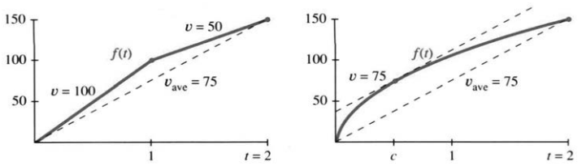
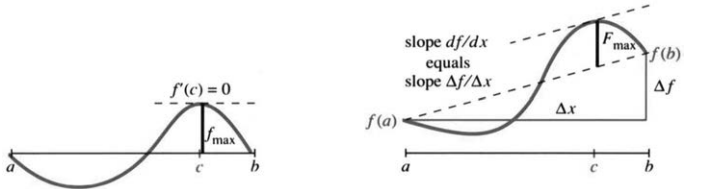
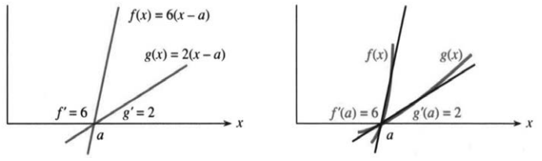
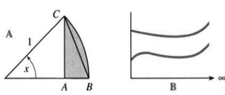

# 3.8 中值定理与洛必达法则

来源：PDF第210–216页，印刷页197–203。状态：初译，已逐页对照原图，待复审。正文明确补足定理适用条件；原题错误与歧义列于译注。

<!-- PDF 210 / 印刷页 197 -->

现在介绍微积分的基石之一：**中值定理**。它把局部图景——一点处的斜率——与整体图景——跨越一段区间的平均斜率——联系起来，也就是联系$df/dx$与$\Delta f/\Delta x$。微积分依赖这种联系，我们最初是在速度问题中见到它的：平均速度若为75，是否必有某一时刻瞬时速度也为75？

图3.26 (a)速度跳过平均值；(b)某时刻速度等于平均值。

没有更多条件，答案是否定的。速度可以先为100，再为50，平均75，却从未等于75。若允许速度跳变，就能直接跳过平均值；跳变时刻，位置函数的导数不存在。图3.26a中，在$t=1$处便没有导数。为排除这种情况，要求区间内每一点都有导数。

图3.26b中，时间增加2，位置增加150。各内点都有$df/dt$，尽管$t=0$处切线斜率无穷。平均速度为

$$\frac{\Delta f}{\Delta t}=\frac{f(2)-f(0)}{2-0}=75.$$

定理保证：区间内部至少存在一点$c$，使$f'(c)=75$。这不是构造性定理，不会告诉我们$c$具体在哪里，只证明这样的点存在。

> **3M 拉格朗日中值定理。** 设$a<b$，$f$在闭区间$[a,b]$连续，在开区间$(a,b)$可导，则存在$c\in(a,b)$，使
> $$\frac{f(b)-f(a)}{b-a}=f'(c).\tag{1}$$

左边是平均斜率，它等于某个内点的瞬时斜率。闭区间$[a,b]$包含端点，开区间$(a,b)$不包含端点。定理要求端点连续，但不要求端点可导。

证明先看特殊情形$f(a)=f(b)=0$。函数从零出发又回到零，平均斜率为零，我们要证明中间某点$f'(c)=0$。保持上述连续、可导条件，这就是**罗尔定理**。几何上，曲线离开零又返回，总须在某处转向，那里切线水平。

<!-- PDF 211 / 印刷页 198 -->

> **3N 罗尔定理。** 在3M相同的连续性和可导性假设下，若$f(a)=f(b)=0$，则存在$c\in(a,b)$，使$f'(c)=0$。

**证明。** 连续函数在闭区间上取得最大值和最小值。若$f\equiv0$，任意内点都可作为$c$。否则至少一个最大值或最小值在内部取得；可导函数在内部极值点的导数为零。

可能有一个小问题：若内部$f<0$，最大值0只在端点取得，端点导数未必为零。但这时最小值在内部取得，同样得到所需$c$。证明关键正是**闭区间上连续函数取得最大、最小值**的最值定理。

原书脚注说明：若$M$是有限上确界却未取得，则$1/(M-f(x))$在闭区间上连续而无界，矛盾。这里用到的基础事实是闭区间上连续函数必有界。

有趣的是，罗尔本人曾不信任当时微积分的论证。作者打趣说，也许他甚至未接受以其名字命名的结论。当年的“消逝量”和“无穷小”语言令人兴奋又令人困惑：极限似乎永远接近却不达到，曲线似乎由无穷多个平直小段组成。罗尔反对这些推理及其结论，法国科学院曾介入平息争论；后来他回到数论研究。不过，$f(a)=f(b)=0$这一特殊情形确实直接导出一般中值定理。

图3.27 罗尔定理是两端函数值同为零的特殊情形；右图中切线斜率等于割线斜率。

**中值定理的证明。** 要找$f'=\Delta f/\Delta x$的一点，可从曲线减去割线，使新函数两端都为零。令

$$F(x)=f(x)-\left[f(a)+\frac{f(b)-f(a)}{b-a}(x-a)\right].\tag{2}$$

它表示曲线与割线的有向竖直差。$F(a)=F(b)=0$，且满足罗尔定理条件，所以某内点$F'(c)=0$。求导即得

$$0=f'(c)-\frac{f(b)-f(a)}{b-a},$$

定理得证。

**例1** $f(x)=\sqrt x$从$(0,0)$到$(100,10)$，平均斜率为$10/100$。虽然$x=0$处导数无界，但在$(0,100)$内处处可导。中值定理保证某点满足

$$\frac{10}{100}=\frac1{2\sqrt c},$$

解得$c=25$。

<!-- PDF 212 / 印刷页 199 -->

其实，许多应用并不在意$c$的精确数值，关键是它存在。把本章的线性近似$f(x)\approx f(a)+f'(a)(x-a)$中的导数改在适当中间点$c$计算，近似就成为精确等式。

> **3O** 在相应区间满足中值定理条件时，存在位于$a,x$之间的$c$，使
> $$f(x)=f(a)+f'(c)(x-a).\tag{3}$$

这就是$\Delta f=f'(c)\Delta x$；若$x>a$，则$a<c<x$。

**例2** $f(x)=\sin x$从$f(0)=0$出发。线性近似使用$\cos0=1$，精确公式使用0与$x$之间某点的$\cos c$：

$$\sin x\approx x,\qquad\sin x=(\cos c)x.\tag{4}$$

近似式很实用，因为所有量在已知点0计算。精确式则能证明不等式：当$x\ge0$时，由$\cos c\le1$得$\sin x\le x$。更对称的表述为$|\sin x|\le|x|$。

**例3** 若$f'$在一个区间内处处为零，则$f$在该区间为常数。

**证明。** 对任意两点应用中值定理，得到$\Delta f=0$，所以函数值相等，图像为水平直线。这一看似简单的事实，是微积分基本定理的关键。

中值定理的许多应用最终得到的是另一个定理，而不是一个数。它的目的，是把导数的局部信息联系到函数差的整体信息。下面的洛必达法则则帮助我们从形式上的$0/0$中求出极限。

## 洛必达法则

当$f(x),g(x)$都趋于零，比值$f(x)/g(x)$会怎样？例如

$$\frac{x^2}{x},\qquad\frac{\sin x}{x},\qquad\frac{x-\sin x}{1-\cos x}$$

在$x\to0$时都呈$0/0$型。$0/0$不是一个有意义的数，不能直接将分子、分母的极限相除。两函数都变小，比值却可能有各种行为，须比较趋零的快慢。

我们早已研究过一种这样的极限，就是导数：

$$f(x)-f(a)\to0,\quad x-a\to0,\qquad
\lim_{x\to a}\frac{f(x)-f(a)}{x-a}=f'(a).\tag{5}$$

洛必达法则的想法，是通过$f'/g'$研究$f/g$。导数定义相当于分母$g(x)=x-a$、$g'=1$的特殊情况。

> **3P 洛必达法则，$0/0$型。** 在$a$的某个去心邻域内，设$f,g$可导，且$g'(x)\ne0$；当$x\to a$时，$f(x),g(x)$都趋于0。若
> $$\lim_{x\to a}\frac{f'(x)}{g'(x)}=L$$
> 存在，允许$L=\pm\infty$，则
> $$\lim_{x\to a}\frac{f(x)}{g(x)}=L.\tag{6}$$
> 同样可分别应用于单侧极限。若两导数在$a$连续且$g'(a)\ne0$，则$L=f'(a)/g'(a)$。

<!-- PDF 213 / 印刷页 200 -->

图3.28 (a)两个线性函数的比恒为$6/2=3$；(b)两曲线分别与这些直线相切，其比趋于3。

**这不是商的求导法则。** 这里分别求分子和分母的导数，不是求整个商的导数。几何上，当两个函数都趋于零时，其局部斜率有助于比较大小。最简单的是$f=6(x-a)$、$g=2(x-a)$，比值恒为斜率之比3；若改为与这两条线相切的曲线，极限仍为3。

比值的极限可以是有限数，也可以是正负无穷。趋近点也可在适当版本中为无穷远，这里先讨论有限$a$。本段的$0/0$版本要求分子、分母都趋于零，不能任意使用。例如$f=x,g=x-1$，当$a\ne1$时，

$$\frac{f(x)}{g(x)}\to\frac a{a-1},\qquad
\frac{f'(x)}{g'(x)}=1,$$

两者一般不相等。普通极限可直接相除时，不需要洛必达法则。

**例4**

$$\lim_{x\to0}\frac{1-\cos x}{x}
=\lim_{x\to0}\frac{\sin x}{1}=0.$$

**例5**

$$\lim_{x\to0}\frac{\tan x}{\sin x}
=\lim_{x\to0}\frac{\sec^2x}{\cos x}=1.$$

**例6** 对$(x-\sin x)/(1-\cos x)$求极限。第一次分别求导，得$(1-\cos x)/\sin x$，仍为$0/0$型。再次核对条件后求导：

$$\lim_{x\to0}\frac{x-\sin x}{1-\cos x}
=\lim_{x\to0}\frac{1-\cos x}{\sin x}
=\lim_{x\to0}\frac{\sin x}{\cos x}=0.$$

先看最简单情形背后的理由。若把函数在$a$连续补为$f(a)=g(a)=0$，则对$x\ne a$：

$$\frac{f(x)}{g(x)}
=\frac{\dfrac{f(x)-f(a)}{x-a}}
{\dfrac{g(x)-g(a)}{x-a}}.\tag{7}$$

这只是代数恒等式。约去$x-a$，并使用$f(a)=g(a)=0$即可。随后让$x\to a$。

<!-- PDF 214 / 印刷页 201 -->

若两差商分别趋于$f'(a),g'(a)$，且$g'(a)\ne0$，便可相除：

$$\lim_{x\to a}\frac{f(x)}{g(x)}=\frac{f'(a)}{g'(a)}.\tag{8}$$

若两导数本身还分别趋于端点导数，这也与式(6)一致。原书介绍，洛必达在1696年的微分学教材中发表这一法则，发现者实际上是他的老师伯努利。一般版本还允许$f'/g'$有极限而分子、分母各自没有极限。

要证明更一般的形式，需要更一般的中值定理。作者将以下内容视为课程中的选读、书中却应有的证明；核心直觉已在式(8)体现。

**不定式。** 最基本的例子是$\infty-\infty$。即使两个函数都趋于无穷，它们的差也可能趋于各种值，例如$x^2-x$、$x-x^2$、$(x+2)-x$分别趋于$+\infty,-\infty,2$。

还有$0/0$、$\infty/\infty$、$0\cdot\infty$。适当变形并满足条件后，可使用洛必达法则。对$f\to0,g\to\infty$的乘积$fg$，可写成$f/(1/g)$，成为$0/0$型。

幂型不定式包括$0^0,1^\infty,\infty^0$，来自$f(x)^{g(x)}$的极限。例如$x^{1/\ln x}$在$x>0,x\ne1$时恒等于$e$，而在不同趋近过程中可分别呈现这些形式。处理正底数幂，可先取对数，研究$g(x)\ln f(x)$，再化为商。对数和$e$将在第6章系统学习。

## 广义中值定理

中值定理可以推广到两个函数，这一形式称为**柯西中值定理**。取$g(x)=x$就得到普通中值定理。

> **3Q 柯西中值定理。** 若$f,g$在$[a,b]$连续，在$(a,b)$可导，则存在$c\in(a,b)$，使
> $$[f(b)-f(a)]g'(c)=[g(b)-g(a)]f'(c).\tag{9}$$

**证明。** 构造

$$F(x)=[f(b)-f(a)]g(x)-[g(b)-g(a)]f(x).$$

它满足$F(a)=F(b)$。罗尔定理给出$F'(c)=0$，恰为式(9)。用交叉相乘的形式写出定理，不必额外假定各分母非零。

**应用1：证明洛必达法则。** 对有限端点的$0/0$型，可连续补定义$f(a)=g(a)=0$。在$a$与邻近$b$之间使用式(9)，得$f(b)g'(c)=g(b)f'(c)$。由于去心邻域内$g'\ne0$，罗尔定理也保证$g(b)\ne0$，故

$$\frac{f(b)}{g(b)}=\frac{f'(c)}{g'(c)}.\tag{10}$$

当$b\to a$时，夹在两者之间的$c$也趋于$a$。如果右边的导数比有极限，就得到法则。单侧分别证明后，若两侧极限相同，即得双侧结论。

<!-- PDF 215 / 印刷页 202 -->

**应用2：线性近似的误差。** 曲线与切线之间的有向竖直差记为$e(x)$：

$$f(x)=f(a)+f'(a)(x-a)+e(x).\tag{11}$$

在足够的二阶可微条件下，误差涉及$f''$和$(x-a)^2$。例如$f=x^2$，因$f''=2$，需要系数$1/2$。精确公式为

$$e(x)=\frac12f''(c)(x-a)^2,\qquad c\text{ 位于 }a\text{ 与 }x\text{ 之间}.\tag{12}$$

一个方便的充分条件是$f$在包含两点的区间上二阶连续可微。下面比较$e(x)$与$g(x)=(x-a)^2$，两者在$a$均为零：

$$\begin{aligned}
e(x)&=f(x)-f(a)-f'(a)(x-a), & e'(x)&=f'(x)-f'(a), & e''(x)&=f''(x),\\
g(x)&=(x-a)^2, &g'(x)&=2(x-a), &g''(x)&=2.
\end{aligned}$$

先由柯西中值定理，得到$a,x$之间的$C$，使$e(x)/g(x)=e'(C)/g'(C)$。再注意$e'(a)=g'(a)=0$，对导函数应用同一定理，得到$a,C$之间的$c$，使

$$\frac{e'(C)}{g'(C)}=\frac{e''(c)}{g''(c)}.$$

因此$e(x)/g(x)=f''(c)/2$，式(12)得证。若$f''$在$a$连续，靠近$a$时还可用$\tfrac12f''(a)(x-a)^2$近似误差。

**例7** $f(x)=\sqrt x$，在$a=100$附近：

$$\sqrt{102}\approx10+\frac1{20}\cdot2
+\frac12\left(-\frac1{4000}\right)2^2.$$

最后一项估计线性近似的误差为$-0.0005$；实际$\sqrt{102}-10.1\approx-0.00049506$，十分接近。

## 3.8 习题

### 通读填空

中值定理把 **a____** $[a,b]$上的平均斜率$\Delta f/\Delta x$，与未知 **b____** 处的导数联系起来，其表达式为 **c____**。要求$f$在 **e____** 区间$[a,b]$上 **d____**，在$(a,b)$内具有 **f____**。罗尔定理是$f(a)=f(b)=0$的特例，相应$c$满足 **g____**。证明选取内部取得 **h____** 的点；常函数情形可任取内点。

中值定理的推论包括：若$f'$在区间处处为零，则$f(x)=$ **i____**。对$a,x$之间某个$c$，$f(x)=f(a)+$ **j____** $(x-a)$精确成立。对另一个$c$，$f(x)=f(a)+f'(a)(x-a)+$ **k____** $(x-a)^2$精确成立。若$M$是 **l____** 的最大值，线性近似的绝对误差不超过$\tfrac12M(x-a)^2$。

洛必达法则的$0/0$版本要求$f,g$都趋于 **m____**，并满足可导等条件。若 **n____** 的极限存在，则$f/g$与它有相同极限。常见情况下为$f'(a)/g'(a)$；若导数比仍呈$0/0$型且再次满足条件，可继续研究 **o____** 的极限。

**第1–6题：求所有$0<c<2$，使$f(2)-f(0)=2f'(c)$。应先检查函数定义域和定理条件。**

1. $f(x)=x^3$。
2. $f(x)=\sin\pi x$。
3. $f(x)=\tan2\pi x$。
4. $f(x)=1+x+x^2$。
5. $f(x)=(x-1)^{10}$。
6. $f(x)=(x-1)^9$。

**第7–10题：说明不存在内点$c$使$f(1)-f(-1)=2f'(c)$，并解释为何不能使用中值定理。**

7. $f(x)=|x-1/2|$。
8. $f(x)$为单位阶跃函数。
9. $f(x)=|x|^{1/2}$。
10. $f(x)=1/x^2$。

<!-- PDF 216 / 印刷页 203 -->

11. 证明$\sec^2x$与$\tan^2x$导数相同，并对$f(x)=\sec^2x-\tan^2x$作出结论。
12. 证明$\csc^2x$与$\cot^2x$导数相同，并求$f(x)=\csc^2x-\cot^2x$。

**第13–22题：求极限；仅在条件成立时使用洛必达法则，必要时分左右极限讨论。**

13. $\displaystyle\lim_{x\to3}\frac{x^2-9}{x-3}$。
14. $\displaystyle\lim_{x\to3}\frac{x^2-9}{x+3}$。
15. $\displaystyle\lim_{x\to0}\frac{(1+x)^{-2}-1}{x}$。
16. $\displaystyle\lim_{x\to0}\frac{\sqrt{1-\cos x}}x$。
17. $\displaystyle\lim_{x\to\pi}\frac{x-\pi}{\sin x}$。
18. $\displaystyle\lim_{x\to1}\frac{x-1}{\sin x}$。
19. $\displaystyle\lim_{x\to0}\frac{(1+x)^n-1}{x}$。
20. $\displaystyle\lim_{x\to0}\frac{(1+x)^n-1-nx}{x^2}$。
21. $\displaystyle\lim_{x\to0}\frac{\sin x-\tan x}{x^3}$。
22. $\displaystyle\lim_{x\to0}\frac{\sqrt{1+x}-\sqrt{1-x}}x$。

23. 对$f=x^2-4,g=x+2$，$x\to2$时$f'/g'\to4$。$f/g$的极限是多少？为什么这里不能套用洛必达法则？
24. 原书给出以下尝试，用$0/0$型解释$\infty/\infty$型。设$L=\lim f/g$，写出
    $$L=\lim\frac{1/g}{1/f}
    =\lim\frac{g'/g^2}{f'/f^2}
    =L^2\lim\frac{g'}{f'}.$$
    它据此说$L=\lim f'/g'$。指出哪里使用了$0/0$法则，哪里使用了其他极限运算法则，并留意该推导预先假定了哪些极限存在且非零。（此段不是一般情形的完整证明，见译注。）
25. 求$\displaystyle\lim_{x\to0}\frac{1+1/x}{1-1/x}$。
26. 求$\displaystyle\lim_{x\to\infty}\frac{x^2+x}{2x^2}$。
27. 直接分析$\displaystyle\lim_{x\to\infty}\frac{x+\cos x}{x+\sin x}$，再说明分别求导后的比值为什么不能给出极限。
28. 求$\displaystyle\lim_{x\to\infty}\frac{\csc x}{\cot x}$，应判断极限是否存在，并注意定义域。
29. 对$f(x)=x^3$在$[1,4]$应用中值定理，说明所保证的$c$具有什么性质，并求出$c$。
30. 若一个区间内处处$|f'|\le1$，证明对该区间任意$x,y$，
    $$|f(x)-f(y)|\le|x-y|.$$
    原书右端误印为1，已更正。
31. 牛顿法局部误差满足$|x_{n+1}-x^*|\le M|x_n-x^*|^2$。从
    $$0=f(x^*)=f(x_n)+f'(x_n)(x^*-x_n)
    +\frac12f''(c)(x^*-x_n)^2$$
    出发，除以$f'(x_n)$，辨认$x_{n+1}$并估计$M$。应说明二阶导数上界和一阶导数远离零的条件。
32. **罗尔定理的逆问题：** 若$f'(c)=0$，是否一定存在$c$两侧的$a,b$，使$f(a)=f(b)$？
33. 设$f(0)=0$。若$x\to0$时$f(x)/x$有有限极限，该极限就是____。洛必达法则则考察____的极限。由此可知，在相应可导条件下，若$\lim_{x\to0}f'(x)$存在，则等于$f'(0)$；因此导函数不能出现可去____。
34. 可能$f'/g'$没有极限，而$f/g\to L$，这正是洛必达法则中“若该极限存在”的意义。(a) 取$f=x^2\cos(1/x),g=x$，求$x\to0$时的$L$；可用$|\cos(1/x)|\le1$。(b) 由$f'(x)=\sin(1/x)+2x\cos(1/x)$说明$f'/g'$无极限。
35. Stein的微积分教材比较图A中三角形面积$f(x)$与弧边区域面积$g(x)$。(a) 猜测角$x\to0^+$时$f/g$的极限。(b) 解释$f(x)=\tfrac12(\sin x-\sin x\cos x)$、$g(x)=\tfrac12(x-\sin x\cos x)$。(c) 求真正的极限。

36. 100小时内从纽约到洛杉矶行驶3000英里，期间可睡觉、吃饭、折返。在累计路程函数满足中值定理条件的模型下，某一时刻的速率为____。
37. 在相应$0/0$或$\infty/\infty$型及可导条件下，洛必达法则也可用于$x\to\infty$。图B中两曲线渐趋平行，能据此确定比值极限吗？说明所需的附加条件。
38. 用中值定理证明：若区间内处处$f'>0$，则任取$b>a$，都有$f(b)>f(a)$，因而函数严格递增。

## 译注与原书疑点

1. 罗尔定理需保留闭区间连续、开区间可导的条件；常零函数须单独说明。原书框内只写端点条件，译文将前提带入，避免断章后成为错误命题。中值定理不要求导数连续。
2. 例2原书直接由$\cos c\le1$推得$\sin x\le x$，须限定$x\ge0$；负$x$乘不等式会反向。正文补充$|\sin x|\le|x|$的全实数版本。
3. 洛必达法则框3P漏写去心邻域可导、分母导数不为零等条件，正文补足。$0/0$和$\infty/\infty$是描述趋势的符号，不是可按普通数运算的商。不能把“可连续补为0”误当作原函数在该点已定义。重复求导每次都须重新核查条件。
4. 原书说“只用于$0/0$”是针对当时介绍的版本，后文另讨论$\infty/\infty$。第24题通过先设$L=\lim f/g$再整理$L=L^2\lim g'/f'$，预先假定了待证明的极限存在，还需非零有限等限制，因此不能证明一般的无穷比版本。正文保留为需辨析的推导，不冒充完整证明。
5. PDF第215页在已得精确余项$\tfrac12f''(c)(x-a)^2$后，又把同一式称为近似，疑应把$c$改为$a$。正文区分精确中间点式与以$f''(a)$计算的近似。例7原书实际误差写为$-0.000496$，精确值约为$-0.0004950616$，已更正。
6. 第13–22题总指令原为“用洛必达法则”，但第14、18题不是$0/0$型，直接代入即可；第16题左右极限分别为$\pm1/\sqrt2$，双侧极限不存在。因此总指令改为先检查条件，未把不存在的极限强行求成数值。第28题化为$1/\cos x$，在定义域上$x\to\infty$也没有极限。
7. 第30题原书断言$|f(x)-f(y)|\le1$，漏掉$|x-y|$。反例$f(x)=x$即可否定原式，正文按中值定理更正。第31题取$M=\sup|f''|/(2\inf|f'|)$时，须在所考虑的共同邻域内分母下界为正。
8. 第36题应明确3000英里为累计路程，并要求相应函数连续、内部可导；若指净位移而允许折返，则需另行区分速度与速率。第37题原书从“渐趋平行”期待比值结论，但仅两导数之差趋零不足，例如$\sqrt x$与$2\sqrt x$的导数之差趋零，而函数比为$1/2$；须明确导数比的极限及函数发散等条件。原图只能作直观示意。
9. 第11、12题导数相同首先只能推出各连通定义区间上差为常数；再由三角恒等式或取值确定全域一致的常数。历史人物争论和法则归属按原书叙述翻译，未作独立史学核验。
