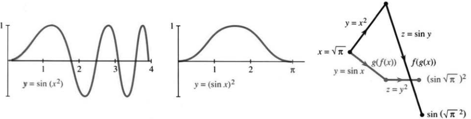
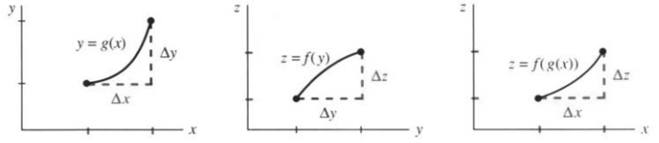

# 第4章 用链式法则求导

# 4.1 链式法则

来源：PDF第217–223页，印刷页204–210。状态：初译，已逐页对照原图，待复审。

<!-- PDF 217 / 印刷页 204 -->

你还记得：$f(x)g(x)$的导数并不是$f'(x)g'(x)$。$\sin x$乘$x^2$，导数也不是$\cos x$乘$2x$——乘积法则给出的是两项，不是一项。可要把正弦函数$f$和平方函数$g$合成一个新函数，还有另一条路。这个新函数的导数里，确实有余弦乘$2x$，只是取值的位置有点不一样。我们先把这个新函数说清楚，再来找它的**链式求导法则**。

这里我得说一句：链式法则很重要，容易学，而且你会经常用。在我看来，它是从已有函数的导数求新函数导数的第三种基本办法。到目前为止，手头的函数是$x^n,\sin x,\cos x$，往后还有$e^x,\log x$。函数相加、相乘，导数分别由和法则、乘积法则给出；这一节要用第三种方式把两个函数组合起来。

新函数是$\sin(x^2)$，也就是先平方、再取正弦。它由原来两个函数搭成：若$x=3$，先有$x^2=9$，再取$\sin9$。两个函数这样串成一条“链”，合成一个**复合函数**。从$x$出发，先求$g(x)$，再求$f(g(x))$：

$$x\ \xrightarrow{g}\ y=x^2\ \xrightarrow{f}\ z=\sin y=\sin(x^2).$$

内层函数$g$给出$y$，再把$y$送进外层函数$f$。这就叫**函数复合**。它有时记作$f\circ g$——中间的小圆圈，就是用来跟普通乘积$fg$区分开的；更常见的写法是$f(g(x))$：

$$z(x)=(f\circ g)(x)=f(g(x)).\tag{1}$$

其他例子还有$\cos2x$与$(2x)^3$，内层都是$g(x)=2x$。在计算器上，就是先输入$x$，按$g$键，再按$f$键。当然，不是每个函数都配一个专用键；不过平方和正弦大多有，而且就得按这个顺序。图4.1a画的是：平方这一步怎样把正弦波在横轴上拉长、压扁。

<!-- PDF 218 / 印刷页 205 -->

$\sin(x^2)$可看成一种“疯”了的调频信号：照样像$\sin x$那样上下起伏，只是波峰不在原来的位置。把自变量换成$g(x)$，波峰的左右位置和间距都会变；相比之下，乘积$g(x)\sin x$倒像调幅信号，变的是振幅。

**提醒：$f(g(x))$通常不同于$g(f(x))$，顺序往往很要紧。** 对$f(x)=\sin x,g(x)=x^2$，把次序倒过来，先取正弦、再平方，得到

$$y=\sin x,\qquad z=y^2=(\sin x)^2.$$

常把它写成$\sin^2x$，为的是省掉括号；但绝不能写作$\sin x^2$——后者表示$\sin(x^2)$，是完全不同的东西。图4.1把两者摆在一起比较。

图4.1 $f\circ g$与$g\circ f$通常不同：先作用$g$再作用$f$，或者先$f$后$g$。

**例1** 设$g(x)=x^3,f(y)=y^4$。普通乘积$f(x)g(x)=x^7$；复合则要一层层来：先得$y=x^3$，再得$z=y^4=x^{12}$，所以$f(g(x))=x^{12}$。

**例2** 迭代就是把$F$与自身复合，每次的输出都当作下一次的输入。若$F(x)=x/2+4$，则

$$F(F(x))=\frac12\left(\frac12x+4\right)+4=\frac14x+6.$$

$F$的导数是$1/2$；复合两次，导数成了$1/4=(1/2)(1/2)$。看，导数乘起来了——这正是链式法则的一个特殊情形。

再举一个极端的例子：$f(x)=g(x)=x$。普通乘积是$x^2$，复合却还是$x$。恒等函数把输入原样吐出，再来一次也还是它。导数是$1\times1$。原书脚注还打趣：计算器上没有恒等函数键——按了也什么都不会变。

| $y=g(x)$ | $z=f(y)$ | $z=f(g(x))$ |
|---|---|---|
| $x^2-1$ | $\sqrt y$ | $\sqrt{x^2-1}$ |
| $\cos x$ | $y^3$ | $(\cos x)^3$ |
| $2^x$ | $2^y$ | $2^{2^x}$ |
| $x+5$ | $y-5$ | $x$ |

<!-- PDF 219 / 印刷页 206 -->

最后一行先加5再减5，输出回到输入，一模一样。这种互相抵消的**反函数**，留到第4.3节再谈。其余各行都造出了新的函数，我们想求它们的导数。

## $f(g(x))$的导数

要求$z=\sin(x^2)$的导数，就得看$\Delta z/\Delta x$的极限，于是把目光挪到邻近的一点$x+\Delta x$。$x$这一变，$y=x^2$跟着变到$y+\Delta y=(x+\Delta x)^2$；$y$再一变，$z=f(y)$也随之一变。这像多米诺骨牌：$\Delta x$推倒$\Delta y$，再一路推倒$\Delta z$。我们要做的，是把最后这点变化和最初那点变化接上。

当$\Delta y\ne0$时，关键就在下面这个恒等式：

$$\frac{\Delta z}{\Delta x}
=\frac{\Delta z}{\Delta y}\frac{\Delta y}{\Delta x}
\quad\longrightarrow\quad
\frac{dz}{dx}=\frac{dz}{dy}\frac{dy}{dx}.\tag{2}$$

$\Delta x\to0$时，$\Delta y/\Delta x\to g'(x)$；可导保证了$\Delta y\to0$，于是外层差商趋于$f'(y)$。乘积的极限，等于各自极限的乘积。至于$\Delta y=0$的情形，稍后再补。

> **4A 链式法则。** 若$g$在$x$处可导，$f$在$y=g(x)$处可导，则$z=f(g(x))$在$x$处可导，且
> $$\frac{dz}{dx}=\frac{dz}{dy}\frac{dy}{dx}=f'(g(x))g'(x).\tag{3}$$
> 外层导数在内层函数值$g(x)$处计算，内层导数在$x$处计算。

**注意。** 链式法则可没说$\sin(x^2)$的导数就是$(\cos x)(2x)$。$\sin y$的导数确实是$\cos y$，但必须代入$y=x^2$再算，因此

$$\frac d{dx}\sin(x^2)=\cos(x^2)\cdot2x.\tag{4}$$

**例3** 若$z=(\sin x)^2$，内层是$y=\sin x$，外层是$z=y^2$，于是

$$\frac{dz}{dx}=2y\cos x=2\sin x\cos x.$$

外层导数是$2y$，不是$2x$。至于导数为$2x\cos x$的函数，我们至今还没遇上。

**例4** $z=\sin3x$的导数，是$3\cos3x$。

图4.2 $\Delta x\to\Delta y\to\Delta z$：差商连乘，取极限就得到导数连乘。

<!-- PDF 220 / 印刷页 207 -->

例4的外层是$z=\sin y$，内层是$y=3x$。$dz/dy=\cos y=\cos3x$；别忘了再乘上$dy/dx=3$。

把$x$换成时间$t$，因子3就好懂了。位置$z=\sin3t$与$\sin t$一样振荡，只是快3倍：一个周期从$2\pi$缩到$2\pi/3$。速度里自然就多出这个3。

**例5** 设外层$f(y)=y^n$，则在相应幂函数可导的定义域内，

$$\frac d{dx}[g(x)]^n=n[g(x)]^{n-1}g'(x).\tag{5}$$

这正是第2.5节见过的幂函数求导法则。平方根对应$n=1/2$，既常见又重要。比如在$|x|>1$时，

$$\frac d{dx}\sqrt{x^2-1}
=\frac12(x^2-1)^{-1/2}\cdot2x
=\frac{x}{\sqrt{x^2-1}}.\tag{6}$$

**问题** 一辆汽车每行驶1英里耗油$1/20$加仑，现在以60英里/小时行驶，每小时耗油多少？

**答** $(\text{加仑/小时})=(\text{加仑/英里})(\text{英里/小时})$，写成链式法则就是$dy/dt=(dy/dx)(dx/dt)$。算出来是$(1/20)\cdot60=3$加仑/小时。

**链式法则的证明。** 莱布尼茨的记号几乎直接告诉你该怎么做：对

$$\frac{\Delta z}{\Delta x}=\frac{\Delta z}{\Delta y}\frac{\Delta y}{\Delta x}\tag{7}$$

的各因子分别取极限。不过，$\Delta x\ne0$时也可能恰有$\Delta y=0$，这时$\Delta z/\Delta y$就不能当普通商了。可以做连续延拓：当$h\ne0$时令$Q(h)=[f(y+h)-f(y)]/h$，再令$Q(0)=f'(y)$。由于$f$可导，$Q(h)\to f'(y)$。这样无论$\Delta y$是否为零，都有$\Delta z=Q(\Delta y)\Delta y$，从而

$$\frac{\Delta z}{\Delta x}=Q(\Delta y)\frac{\Delta y}{\Delta x}
\longrightarrow f'(y)g'(x).$$

这一手，既说清了直观的“相消”为什么管用，也补足了零增量这一情形。

下面几个例子，千万别漏掉内层导数：

| 函数 | 导数 |
|---|---|
| $(x^3+1)^5$ | $5(x^3+1)^4\cdot3x^2$ |
| $(\sin x)^3$ | $3\sin^2x\cdot\cos x$ |
| $(1-x)^2$ | $2(1-x)\cdot(-1)$ |

**重要。** 字母可以随便换。输出常记作$y$，内层常记作$u$。例如$y=\sin u(x)$时，

$$\frac{dy}{dx}=\cos u\frac{du}{dx}.$$

字母怎么换都行，核心不变：外层导数要在正确的内层值处算，再乘上内层导数。

<!-- PDF 221 / 印刷页 208 -->

**例6** 对$\sin(x-1)$，链式法则几乎不用费什么劲：内层$u=x-1$的导数是1，不是$-1$，所以导数为$\cos(x-1)$。图像平移了，斜率函数也跟着平移；余弦仍要在$x-1$处取值。

## 识别内层和外层函数

用链式法则，很大一部分功夫花在认出“链”上。看到$(x^3+1)^5$，先盯一秒，再把它看成$u^5$，内层就是$u=x^3+1$。练得多了，这种拆解会越来越顺手：$\cos(2x+1)$是$\cos u$，$\sqrt{1+\sin t}$是$\sqrt u$，可$x\sin x$是乘积——该用乘积法则！

稳妥的做法，是把各层都写出来：

$$z=\cos u,\quad u=2x+1,\qquad
\frac{dz}{dx}=(-\sin u)\cdot2=-2\sin(2x+1).$$

熟练之后，中间变量可以不写，只在心里记着：还要乘上“里面的导数”。

**例7** $\sin\sqrt{1-x}$是一条三层链：$z=\sin y,y=\sqrt u,u=1-x$。当$x<1$时，

$$\frac d{dx}\sin\sqrt{1-x}
=\cos\sqrt{1-x}\cdot\frac1{2\sqrt{1-x}}\cdot(-1).$$

这正是$(dz/dy)(dy/du)(du/dx)$：每个因子，都要在各自该用的$y,u,x$处取值。

最后说说二阶导数。第一次求导得到的是乘积，再求一次，就得动用乘积法则：

$$\frac{d^2z}{dx^2}
=\frac{dz}{dy}\frac{d^2y}{dx^2}
+\frac d{dx}\left(\frac{dz}{dy}\right)\frac{dy}{dx}.\tag{8}$$

最后一项还要再用一次链式法则，于是完整形式是

$$\frac{d^2z}{dx^2}
=\frac{dz}{dy}\frac{d^2y}{dx^2}
+\frac{d^2z}{dy^2}\left(\frac{dy}{dx}\right)^2.$$

**例8** $z=\sin(x^2)$的一阶导数是$2x\cos(x^2)$，再求一次导：

$$z''=2\cos(x^2)-4x^2\sin(x^2).$$

这里$y=x^2$，于是$y''=2$，$(y')^2=4x^2$。

## 4.1 习题

### 通读填空

$z=f(g(x))$来自$z=f(y)$与$y=$ **a____**。当$x=2$时，$(x^2-1)^3=$ **b____**。其内层$y=$ **c____**，外层$z=$ **d____**，导数为 **e____**。第一个因子须在$y=$ **f____** 处计算，不是在$y=x$处。$z=\sin(x^4-1)$的导数为 **g____**。$z=\cos((x+1)^2)$包含平移、**h____** 和余弦三层，导数为 **i____**。

证明从$\Delta z/\Delta x=($ **j____** $)($ **k____** $)$出发，最后得到 **l____**。换字母后，$y=\cos u(x)$的导数为 **m____**。幂函数法则$y=[u(x)]^n$给出$dy/dx=$ **n____**。$5g(x)$的导数为 **o____**，$g(5x)$的导数为 **p____**。若$f=\cos,g=\sin,x=0$，则$f(g(x)),g(f(x)),f(x)g(x)$依次为 **q____**。

**第1–10题：识别各复合项的外层$f$和内层$g$，再求$dz/dx$。**

1. $z=(x^2-3)^3$。
2. $z=(x^3-3)^2$。
3. $z=\cos(x^3)$。
4. $z=\tan2x$。

<!-- PDF 222 / 印刷页 209 -->

5. $z=\sqrt{\sin x}$。
6. $z=\sin\sqrt x$。
7. $z=\tan(1/x)+1/\tan x$。
8. $z=\sin(\cos x)$。
9. $z=\cos(x^2+x+1)$。
10. $z=\sqrt{x^2}$。

**第11–16题：直接写导数，不必另列$f,g$。**

11. $z=\sin17x$。
12. $z=\tan(x+1)$。
13. $z=\cos(\cos x)$。
14. $z=(x^2)^{3/2}$。
15. $z=x^2\sin x$。
16. $z=(9x+4)^{3/2}$。

**第17–22题：分解为三层，用$(dz/dy)(dy/du)(du/dx)$求导。**

17. $z=\sin\sqrt{x+1}$。
18. $z=\sqrt{\sin(x+1)}$。
19. $z=\sqrt{1+\sin x}$。
20. $z=\sin(\sqrt x+1)$。
21. $z=\sin(1/\sin x)$。
22. $z=(\sin(x^2))^2$。

**第23–26题：分别使用链式法则与先化简再求导两种方法。**

23. $z=((x^2)^2)^2$。
24. $z=(3x)^3$。
25. $z=(x+1)^2+\sin(x+\pi)$。
26. $z=\sqrt{1-\cos^2x}$。

27. 若$f(x)=x^2+1$，求$f(f(x))$。若$U$是在0处从0跳到1的单位阶跃函数，画$\sin U(x)$与$U(\sin x)$。若$R(x)=(x+|x|)/2$为斜坡函数，画$R(x)$与$R(\sin x)$。
28. **推荐。** 设$g(x)=x^3$，依次找$f,h,k$，使$f(g(x))=x^3+1$、$h(g(x))=x$、$k(g(x))=1$。
29. 设$f(y)=y-2$，依次找$g,h,k$，使$f(g(x))=x$、$f(h(x))=x^2$、$f(k(x))=1$。
30. 找两组不同的$f,g$，使$f(g(x))=\sqrt{1-x^2}$。
31. $f(f(x))$的导数为____。它等于$[f'(x)]^2$吗？用$f(x)=1/x$检验。
32. 已知$f(3)=3,g(3)=5,f'(3)=2,g'(3)=4$，尽可能求下列函数在$x=3$处的导数；无法确定时说明缺少什么：(a) $fg$；(b) $f\circ g$；(c) $g\circ f$；(d) $f\circ f$。
33. 设$F(x)=x/2+8$，证明$F(F(x))=x/4+12$，求$F(F(F(x)))$，并求复合四次后的导数。原书以$F^{(n)}$表示$n$次复合，本译稿为避免与高阶导数混淆，记作$F^{\circ n}$。
34. 第33题中$F^{\circ n}(x)$的极限是常数$C=$____。从任意实初值出发，如$x_0=0$，迭代都趋于$C$。
35. 设$g(x)=3x+1,f(y)=(y-1)/3$，求$f(g(x))$与$g(f(y))$。它们互为反函数。
36. 设$g$在4处连续且$g(4)=7$，$f$在7处连续且$f(7)=9$。证明$f\circ g$在4处连续：给定$\varepsilon>0$，因为____连续，存在$\delta>0$，当$|g(x)-7|<\delta$时，$|f(g(x))-9|<\varepsilon$；又因为____连续，存在$\theta>0$，当$|x-4|<\theta$时，$|g(x)-7|<\delta$。因此$|x-4|<\theta$时有____。
37. 用$g(x)=1-x$与$f(x)=1/x$按任意有限次序复合，只会得到六种不同的有理式。从这两个开始，找其余四种，并注意定义域。
38. $g(x)=1-x$与$g(x)=1/x$都满足$g(g(x))=x$，在各自适用域上画图解释。再找两个具有这一性质的函数。
39. 构造$f,g$，使$f(g(x))$恒为零，但$f$本身不恒为零。
40. 判断正误，默认相关导数存在：(a) $f(x)=f(-x)$蕴含$f'(x)=f'(-x)$；(b) 恒等函数导数为零；(c) $f(1/x)$的导数为$-1/[f(x)]^2$；(d) $f(1+x)$的导数为$f'(1+x)$；(e) $f(g(x))$的二阶导数为$f''(g(x))g''(x)$。
41. 在同一坐标图中画$y=x^2$与$z=\sin y$，都以$y$竖直、$x$或$z$水平。从$x=3$出发，沿图找到$z=\sin9$。
42. 同样画$y=\sin x$与$z=y^2$，从$x=\pi/4$沿图找到$z=(\sin x)^2$。
43. 求二阶导数：(a) $\sin(x^2+1)$；(b) $\sqrt{x^2-1}$；(c) $\cos\sqrt x$。
44. 解释式(8)中为什么$\dfrac d{dx}(dz/dy)=(d^2z/dy^2)(dy/dx)$，并对$z=y^2,y=x^3$验证。

**第45–54题：综合练习，按给定依赖关系对$x$或$t$求导。**

45. $z=f(u(t))$。
46. $z=u^3,u=x^3$。
47. $y=\sin u(x)\cos u(x)$。
48. $y=\sqrt{u(t)}$。
49. $y=x^2u(x)$。
50. $y=f(x^2)=[f(x)]^2$。原书以等号连接两种形式；若作为已给函数关系，分别求导后令两表达式相等，不能将其视为一般恒等式。
51. $z=\sqrt{1-u},u=\sqrt{1-x}$。
52. $z=1/[u(t)]^n$。
53. $z=f(u),u=v^2,v=\sqrt t$。
54. $y=u,u=x,x=1/t$。
55. 若$f=x^4,g=x^3$，则$f'=4x^3,g'=3x^2$。有人直接相乘得到$12x^5$，但$f(g(x))=x^{12}$的导数不是它。错误在哪里？
56. $y=\sin(\sin x)$的导数是哪一个：$\cos(\cos x)$；$\sin(\cos x)\cos x$；$\cos(\sin x)\cos x$；$\cos(\cos x)\cos x$？
57. (a) 一本书每页400词，每节9页，每节共有____词。

<!-- PDF 223 / 印刷页 210 -->

57. (b) 阅读速度为每分钟200词，即每分钟____页。读完一节需要多少分钟？
58. (a) 你在火车内以3英里/小时沿列车前进方向行走，列车对地速度为50英里/小时，你对地速度为____英里/小时；若反向行走，应如何改变？(b) 电视画面以列车为参照，比例为实际1英里对应屏幕20英寸。你在屏幕上的移动速率为____英寸/小时。
59. 可乐每瓶$1/3$美元，买者每美元可买____瓶。若$dy/dx=1/3$，则$dx/dy=$____。
60. **计算机题。** 画$F(x)=\sin x$和$G(x)=\sin(\sin x)$，图像差异不大；再比较$F',G'$及$F'',G''$，观察差异在哪里变明显。

## 译注与原书疑点

1. 链式法则中的“导数相乘”必须是$f'(g(x))g'(x)$，两个导数的自变量不同。差商相消的证明遇到$\Delta y=0$时须延拓外层差商，正文给出完整处理，不能直接把$0/0$赋成普通商。
2. 所有根式按实数范围理解。$\sqrt{x^2}=|x|$，在0不可导；$(x^2)^{3/2}=|x|^3$，不能在全实数域写成$x^3$。第26题为$|\sin x|$，在正弦零点通常有尖点。链式公式在外层不可导点失效，不代表复合函数必不可导，应另行检查。
3. 第33、34题的$F^{(n)}$在原书表示$n$次复合，容易与$n$阶导数混淆，正文统一记为$F^{\circ n}$。第37题六种有理式的比较须在共同适用域或有理函数意义下进行，约分不能自动填补原复合中的未定义点。
4. 第50题原文确为$f(x^2)=(f(x))^2$，这对任意$f$不成立。按“给定函数满足此关系”可推出两种求导式相等；也可能原意是并列比较两式，待复审，未静默删改等号。
5. 第58题原文未说明步行方向及摄像机参照系。为体现(a)速度相加、(b)比例换算的教学目的，正文明确采用同向行走和以列车为参照的画面；其他选择会改变答案。第27题单位阶跃在零点的取值也需依本书约定或另行声明，不影响非零点图形。
