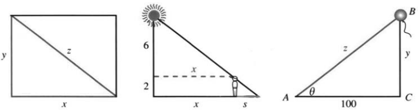
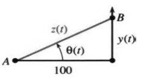
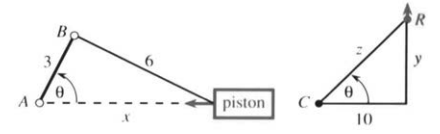

# 4.2 隐函数求导与相关变化率

来源：PDF第224–228页，印刷页211–215。状态：初译，已逐页对照原图，待复审。有关光斑速度及梯子模型的原书说法保留并单独辨析。

<!-- PDF 224 / 印刷页 211 -->

先从两个方程说起：$xy=2$与$y^5+xy=3$。$x$一变，$y$也得跟着变，点才能留在曲线上。我们要的是曲线上某一点的$dy/dx$。对$xy=2$，这不算难；第二个方程却要换个新办法。

第一个方程能直接解出$y=2/x$，求导就得到$dy/dx=-2/x^2$。曲线是条双曲线；在$x=2$处，斜率是$-1/2$。

第二个方程就没这么顺当：用熟悉的初等公式，显式解不出$y$。原书援引的结论是——五次方程没有一般的根式求解公式，所以本就不该总指望$y(x)$的显式表达式。我们手上只有一个隐含关系$y^5+xy=3$。$(2,1)$确实满足方程，可斜率从哪儿求？

这类情形并不少见。像$\sin y+\sin x=1$、$y\sin y=x$，甚至$\sin y=x$，都未必好直接解出$y$。不过在曲线能局部写成可导函数$y(x)$的点上，导数照样求得出。

出路是**隐函数求导**：不去解$y$，直接拿原方程开刀，每一项都对$x$求导——连导数为零的常数3也不放过。

**例1** $y^5$用链式法则，$xy$用乘积法则，于是

$$5y^4\frac{dy}{dx}+x\frac{dy}{dx}+y=0.\tag{1}$$

把$(x,y)=(2,1)$代进去：

$$5\frac{dy}{dx}+2\frac{dy}{dx}+1=0
\quad\Longrightarrow\quad\frac{dy}{dx}=-\frac17.\tag{2}$$

诀窍就在这里：$y$的显式公式可以不知道，链式法则带出来的$dy/dx$却一个都不能漏。

**例2**

$$\sin y+\sin x=1\quad\Longrightarrow\quad
\cos y\frac{dy}{dx}+\cos x=0.$$

**例3**

$$y\sin y=x\quad\Longrightarrow\quad
y\cos y\frac{dy}{dx}+\sin y\frac{dy}{dx}=1.$$

知道斜率，曲线就好画些；可还得找出满足方程的点。有时不妨改解$x$：在$y^5+xy=3$里，只要$y\ne0$，就有$x=3/y-y^4$。照样对$x$求导：

$$1=\left(-\frac3{y^2}-4y^3\right)\frac{dy}{dx}.
\quad y=1\text{ 时 }1=-7\frac{dy}{dx}.\tag{3}$$

又回到$-1/7$。

> **4B 隐函数求导。** 若方程$F(x,y)=0$在所考虑处确定可导分支$y(x)$，可以直接对$F(x,y(x))=0$使用链式法则，不必先显式求出$y$。

比如$xy=2$，直接求导得$xy'+y=0$，于是$y'=-y/x=-2/x^2$，与显式求导的结果对得上。例子比理论更能讲清方法——也许什么事都是这样。要领就一句：保留依赖关系，直接求导。

原书脚注还讲到伽罗瓦，以及他那场著名的决斗和结局：四次方程倒是有求根公式，只是几乎没人用。五次方程那条结论的精确含义，见译注。

<!-- PDF 225 / 印刷页 212 -->

**例4** 圆$x^2+y^2=25$的切线方向怎么找？

可以先解出$y=\pm\sqrt{25-x^2}$，也可以直接对圆方程求导：

$$2x+2y\frac{dy}{dx}=0,\qquad
\frac{dy}{dx}=-\frac xy\quad(y\ne0).\tag{4}$$

半径的方向是$(x,y)$，切线方向可取$(-y,x)$，两者正好垂直。两条斜率都有限时，乘积为$(-x/y)(y/x)=-1$；水平、竖直这些特殊位置，用方向向量也说得清。

接着求二阶导数。圆的上半部分向下弯，二阶导数应当为负。对$-x/y$用商法则：

$$\frac{d^2y}{dx^2}
=-\frac{y-x(dy/dx)}{y^2}
=-\frac{y+x^2/y}{y^2}
=-\frac{x^2+y^2}{y^3}=-\frac{25}{y^3}.\tag{5}$$

## 相关变化率

有一类问题，搁在微积分里似乎哪儿都不太合适。这里就把它当作链式法则的应用：题目要算的是$df/dt$，可给出的偏偏是另一个量的导数$dg/dt$。要把两种变化率挂上钩，先得找到$f,g$之间的关系。

把$f$看作$g$的函数，链式法则就给出$df/dt=(df/dg)(dg/dt)$。应用里那个变量一般就是时间$t$：由一个量的变化率，求出另一个量的变化率——这就是**相关变化率问题**。

**例5** 圆的半径以$dr/dt=7$增长，周长跟着长多快？记住$C=2\pi r$：

$$\frac{dC}{dt}=\frac{dC}{dr}\frac{dr}{dt}=2\pi\cdot7=14\pi.$$

关系虽简单，含义却惊人。设想沿理想圆形的地球围一根绳，再把半径均匀加长7英尺，让7英尺高的人能从绳下走过去。原来那圈是不是24000英里都不要紧，绳子只须加长$14\pi$英尺。

再看个更实际的：圆形跑道上两道相距5英尺，外道跑者跑一整圈要多跑$10\pi$英尺，起点就该相应往前挪。车以速度55绕弯，相邻外道的车以56绕弯，谁转得更快？这得比角速度。类似的问题见第13题。

例6–8都出自1988年的AP考试；原书注明，版权属于College Entrance Examination Board（1989）。

图4.3 左：例6的矩形；中：例7的影子；右：例8的气球。

**例6** 矩形的两条边一起增长，增长时满足对角线$dz/dt=1$和$dx/dt=3,dy/dt$。当$x=4,y=3$时，$dx/dt$等于多少？

<!-- PDF 226 / 印刷页 213 -->

**解** 关键关系是$x^2+y^2=z^2$。先对时间求导，再把$x=4,y=3,z=5,z'=1$代进去：

$$2xx'+2yy'=2zz'\quad\Longrightarrow\quad8x'+6y'=10.$$

由$x'=3y'$得$6y'=2x'$，于是$10x'=10$，即$dx/dt=1$。

**例7** 一个身高2米的人，沿直线走离一盏高8米的路灯。他的影子正以$4/9$米/秒变长。人的步行速率是多少？

**解** 先画图！把人与灯底的距离记作$x$，影长记作$s$。已知$s'=4/9$，要求的是$x'$。由相似三角形得$x/6=s/2$，所以

$$\frac{dx}{dt}=3\frac{ds}{dt}=\frac43\text{ 米/秒}.$$

作者坦言，这题不好做：他画了三张图，才把$x,s$理清。有意思的是，整个计算既用不着它们的具体长度，也用不着角度。

**例8** 观察者站在$A$，看气球$B$从$C$处笔直升起。$AC=100$米，气球以$dy/dt=3$米/秒匀速上升。

(a) 当$y=50$米时，斜距$z$变化得多快？

$$z^2=y^2+100^2\quad\Longrightarrow\quad2zz'=2yy'.$$

这时$z=50\sqrt5$，于是

$$z'=\frac{50\cdot3}{50\sqrt5}=\frac{3\sqrt5}{5}\text{ 米/秒}.$$

(b) 这时直角三角形$BCA$的面积变化率是多少？面积是$A=\tfrac12(100)y=50y$，于是$A'=50y'=150$平方米/秒。

(c) 这时仰角$\theta$变化多快？由$\tan\theta=y/100$：

$$\sec^2\theta\,\theta'=\frac{y'}{100}.$$

而$\cos\theta=100/(50\sqrt5)=2/\sqrt5$，所以

$$\theta'=\left(\frac2{\sqrt5}\right)^2\frac3{100}
=\frac3{125}\text{ 弧度/秒}.$$

**每一题都是这个次序：先从图上写出关系，再求导，最后才代入瞬时数据。** 若先把$y=50$代进$\tan\theta=y/100$，再对常数$50/100$求导，变化的信息就丢了。

原书转引了考试方的提示：考生要把过程写出来，免得过程没写、白白丢分。原书还记下当时的统计：例6约50%的考生答对，例7约21%；例8是9分问答题，约12000名考生的平均分是6.1。这些都是原书所记的历史数据。

<!-- PDF 227 / 印刷页 214 -->

**例9** 这回把图4.3右图的$A$当作灯塔，$BC$当作笔直的海岸线。灯每秒转一圈，光束的角速度是$2\pi$弧度/秒。被照亮的位置$B$沿海岸移动得多快？

**解** 先不管光传播要花的时间，只看几何：$y=100\tan\theta$，于是

$$\frac{dy}{dt}=100\sec^2\theta\frac{d\theta}{dt}=200\pi\sec^2\theta.$$

$\theta$越接近直角，结果越大，没有上界。原书把它称作“超过光速、似乎与相对论矛盾”的悖论，并在第18题里补上光的传播时间。人绕着灯走，远处影子的移动也会引出同样的疑问。这里得分清两件事：光斑位置在几何上怎么移动，与物体、信号沿海岸怎么传播，见译注；不能一看公式算出大数，就说相对论出了问题。

还有个更小的“悖论”。图上明明写着$y=z\sin\theta$，那能不能直接写$y'=z'\sin\theta$？不能。$\theta$自己也随时间变，乘积求导的那一项被漏掉了。岂止不对，事实正好相反：水平距离固定，能推出的是$z'=y'\sin\theta$。把这一条讲清楚，隐函数求导和相关变化率就都不可怕了。

## 4.2 习题

### 通读填空

由$x^3+y^3=2$求$dy/dx$，使用 **a____** 求导，不必先解出 **b____**。逐项求导得$3x^2+$ **c____** $=0$，故$dy/dx=$ **d____**。在$x=y=1$处斜率为 **e____**，切线方程$y-1=$ **f____**。

对$y^2=x$关于$x$求导，得到 **g____**，故$dy/dx=$ **h____**。取正分支$y=\sqrt x$后，导数为 **i____**。

相关变化率中已知$dg/dt$，要求$df/dt$，需要$f$与 **j____** 的关系。若$f=g^2$，则$df/dt=$ **k____** $\cdot dg/dt$；若$f^2+g^2=1$且$f\ne0$，则$df/dt=$ **l____**。立方体边长以$ds/dt=2$增长，体积变化率$dV/dt=$ **m____**。要得到具体数值，还须知道 **n____**，答案并不是8。

**第1–10题：用隐函数求导求$dy/dx$，说明所用分支及非零分母条件。**

1. $y^n+x^n=1$。
2. $x^2y+y^2x=1$。
3. $(x-y)^2=4$。
4. $\sqrt x+\sqrt y=3$，在$x=4$处。
5. $x=F(y)$。
6. $f(x)+F(y)=xy$。
7. $x^2y=y^2x$。
8. $x=\sin y$。
9. $x=\tan y$。
10. $y^n=x$，在$x=1$处；若有多个实分支，分别讨论。
11. 证明曲线族$xy=C$与$x^2-y^2=D$在正则交点处垂直。斜率均有限时，可验证乘积为$-1$；特殊方向可用切向量。
12. 证明圆$(x-2)^2+y^2=2$与$x^2+(y-2)^2=2$在$(1,1)$相切。
13. 你的车以25米/秒绕弯，另一辆车在外侧5米处以26米/秒行驶。谁的角速度更大？你的转弯半径分别为(a)50米；(b)100米。
14. 从$2x+2yy'=0$再次直接隐式求导，得到式(5)。

**第15–18题研究例9中的光斑速度模型。**

15. 对$z^2=y^2+100^2$关于$t$求导，证明$z'=y'\sin\theta$。
16. $B$沿海岸向上移动时，为什么$y'>z'$，尽管$z>y$？当$\theta$增大时，两长度越来越____。
17. 忽略传播延迟时，$y'=200\pi\sec^2\theta$。若$c$表示光速，$\sec^2\theta$超过____时，这一几何光斑速度超过$c$。下一题加入光从$A$到$B$的传播时间。

图中$t$是光到达海岸的时刻，因此$\theta$不再等于$2\pi t$。

18. 光传播用时$z/c$。取发射时刻为$\theta/(2\pi)$，则到达时刻$t=\theta/(2\pi)+z/c$。以下撇号均对到达时刻$t$求导：$\theta'/(2\pi)=1-z'/c$、$z'=y'\sin\theta$、$y'=100\sec^2\theta\,\theta'$。由此推出
    $$y'=\frac{200\pi c}{c\cos^2\theta+200\pi\sin\theta}.$$

<!-- PDF 228 / 印刷页 215 -->

18. （续）当$\theta\to\pi/2$时，此速度趋于____。原书还指出，某些负角度下结果仍可超过$c$，并引用1985年《College Mathematics Journal》第186页及1960年《Scientific American》的“Things that go faster than light”供进一步阅读。
19. 飞机沿$y=f(x)$飞行，水平速度$dx/dt=500$英里/小时。其上升速度是多少？沿轨迹的速率是多少？
20. 为什么不能对$x=7$关于$x$求导，得到$1=0$？

**第21–29题为相关变化率应用。**

21. 一把10英尺长的梯子靠墙放置，底端以2英尺/秒远离墙面。画直角三角形，求顶端高度$y$分别为(a)6英尺；(b)5英尺；(c)0时的$dy/dt$，并说明最后一种情形的模型限制。
22. 在上述理想刚性梯子模型中，形式上何种高度使$dy/dt=-c$，其中$c$为以同一长度单位表示的光速？这不应理解为实际梯子能超光速。
23. 以每秒1立方英寸的速率喝饮料，杯子为半径2英寸的圆柱。液面下降多快？先写体积与高度的关系。
24. 喷气飞机在8英里高度水平飞行，速率560英里/小时。向你飞近时，你与飞机的距离缩短多快：(a)直线距离为16英里；(b)阳光竖直时，飞机影子距你8英里；(c)飞机正好位于你上方，距离8英里？
25. 初始为3–4–5直角三角形，两条较短边各以2米/秒增长，而它们的夹角以1弧度/秒减小。此刻面积增长或减小多快？
26. 接球队员的位置为$x=4,y=8t$。球在$t=3$抛出，此后位置为$x=c(t-3),y=10c(t-3)$。(a) 选择$c$使球与队员相遇。(b) 相遇瞬间，两者距离$D$的变化率是多少？请检查双侧导数是否存在。
27. 小偷距你10米：前方8米，同时隔着6米宽的街道。他沿对面街边以7米/秒跑，你以9米/秒跑。求双方距离缩短的速率：(a)你沿自己一侧同向追赶；(b)你此刻直接朝向他跑；(c)你沿自己一侧反向跑。
28. 球形雨滴的体积损失率等于表面积的两倍，比例常数按一致单位理解。求$dr/dt$。
29. 某时刻$P=V=5$，且始终满足$PV=T$。若$dP/dt=2,dT/dt=3$，求$dV/dt$。
30. (a) 曲柄$AB$每秒转两圈，$d\theta/dt=$____。(b) 对余弦定理$6^2=3^2+x^2-2(3x\cos\theta)$求导，求$\theta=\pi/2$与$\pi$时活塞速度$dx/dt$。
31. 摄像机在$C$转动以跟踪火箭$R$。(a) 当$y=10$时，建立$dz/dt$与$dy/dt$的关系。(b) 由$y=10\tan\theta$建立$d\theta/dt$与$dy/dt$的关系。(c) 建立$d^2\theta/dt^2$与$d^2y/dt^2,dy/dt$的关系。

图中piston为活塞。

## 译注与原书疑点

1. “五次方程无求解公式”应限定为一般五次方程不存在仅用有限次四则运算及根式表示全部根的通用公式；这不表示每个五次方程都不可解，也不排除特殊函数、数值或局部隐函数表达。正文不将$y^5+xy=3$宣称为完全“无法显式表示”。在$(2,1)$处$\partial F/\partial y=5y^4+x=7\ne0$，可保证局部可导分支。
2. PDF第224页例3误排为两个等号相连，正确求导是$(y\cos y+\sin y)y'=1$，正文已订正。隐函数求导不能无条件保证任意点都有有限$dy/dx$，如圆在$(\pm5,0)$处切线竖直；分支相交点还需另行分析。
3. 原书圆跑道比较的交叉引用写为第14题，实际相似问题在第13题，正文改正。绳绕地球例子假设理想圆且径向间隔处处相同。
4. 光斑不是沿海岸移动的同一个物体；不同海岸位置接收的是不同方向发出的光。几何光斑速度超过$c$，本身不能推出有物质或可控制信息沿海岸超光速传播。因此原书“此速度不可能，必与相对论矛盾”的表述过强。加入传播延迟可改变到达时刻的导数，但也不能用它建立所有光斑速度都不超过$c$的普遍结论。
5. 梯子模型同时假定理想刚性、两端始终分别贴墙和贴地、底端速度恒定。$y\to0^+$时导数发散，只显示该约束模型在极限位置的奇异性，不代表真实物体达到任意速度。第21(c)通常不存在有限的端点导数。
6. 第26(b)中若把轨迹穿过相遇时刻继续延长，两点间距离一般呈常数倍$|t-t_*|$，在相遇处无双侧导数；若问相遇前的接近速率，应取左导数。第28题“蒸发率”明确按体积损失率理解，其比例常数2应具有长度/时间量纲。
7. 第20题的$x=7$只描述一个固定点，不是开区间上关于自由变量$x$成立的恒等式，不能按函数恒等式逐项求导。若$x$是常数时间函数$x(t)\equiv7$，对$t$求导则两边均为零。
