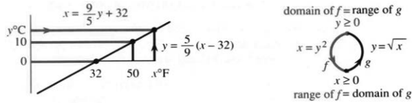
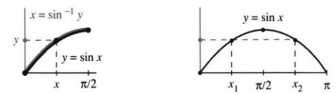
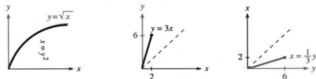
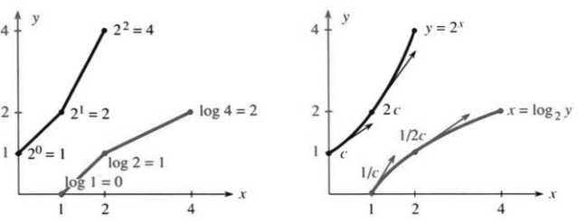
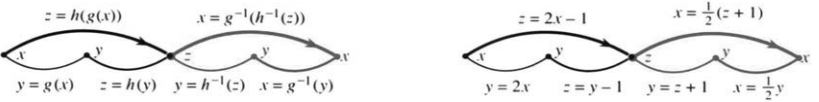

# 4.3 反函数及其导数

来源：PDF第229–235页，印刷页216–222。状态：初译，已逐页对照原图，待复审。

<!-- PDF 229 / 印刷页 216 -->

链式法则有个重要的特例：$f$和$g$互为**反函数**。这条关系短小，却极有力：$f(g(x))=x$。

从任意一个输入算起，比如$x=5$：先算$y=g(x)=3$，再算$f(y)$，答案必须回到5。一个函数做过的事，反函数原样撤销。若$g(5)=3$，则$f(3)=5$。反函数接住输出$y$，把它送回输入$x$。

**例1** $g(x)=x-2$与$f(y)=y+2$互为反函数。从5出发，先减2，得到3；再加2，回到5。直说就是：$y=x-2$的反向关系为$x=y+2$。

**例2** 温度换算

$$y=g(x)=\frac59(x-32),\qquad x=f(y)=\frac95y+32$$

这是一对反函数。$x$是华氏温度，$y$是摄氏温度：32华氏度对应0摄氏度，反过来又能回到32。图4.4还标出，50华氏度正好对应10摄氏度。

留意次序：$g$先减32，最后才乘$5/9$；反函数$f$正相反，先乘$9/5$，最后加32。

图4.4 华氏度换成摄氏度，再换回华氏度。$g^{-1}(g(x))=x$，$g(g^{-1}(y))=y$。domain为定义域，range为值域。

反函数写作$f=g^{-1}$，读作“$g$的反函数”，**可不是$1/g$**。

若需求量$y$是价格$x$的函数，价格反过来也能表示成需求量的函数。两者互为反函数。$dy/dx$与$dx/dy$相乘等于1。温度例子里，这两个数是$5/9$和$9/5$。

换个顺序，先$f$后$g$，照样回到起点。比如先加2、再减2，$g(f(y))=(y+2)-2=y$。所以，$f$是$g$的反函数，$g$也就是$f$的反函数。这种关系完全对称，连定义也对称：

$$y=g(x)\quad\Longleftrightarrow\quad x=g^{-1}(y),$$

复合$g^{-1}\circ g$就是恒等函数，不会造出一个新值，而是原路返回。正因如此，对这个恒等式用一次链式法则，导数的倒数关系就出来了。

**例3** $y=g(x)=\sqrt x$与$x=f(y)=y^2$互为反函数。9开方得3，再平方，回到9。两种次序各给一个恒等式：$(\sqrt x)^2=x$与$\sqrt{y^2}=y$。

<!-- PDF 230 / 印刷页 217 -->

**当心定义域。** 例3里$x\ge0$：平方根只对非负数有定义，这既是平方根函数的定义域，也正好是反函数“平方”的值域。$y$也必须非负。你也许觉得，什么数不能平方？可回来时要开主平方根，负数只剩下$|y|$，再也回不到负的$y$。

总结成一句：**函数的定义域对应反函数的值域，函数的值域对应反函数的定义域**。

真要动手求反函数，就是从$g(x)=y$里解出$x$：

$$y=3x-6\quad\Longrightarrow\quad x=\frac{y+6}{3},$$
$$y=x^3+1\quad\Longrightarrow\quad x=\sqrt[3]{y-1}.$$

每解一次方程，其实都在算一个反函数值。

并非所有函数都有反函数。值域里每个$y$，$g(x)=y$只许给出一个$x$。若同一个$y$撞上两个不同的$x$，反向关系就成不了单值函数。

**例4** $\sin x=1/2$有多少个解？多得是。在$[0,\pi]$上，正弦不是一一对应，整个区间上就没有反函数。图4.5画的是：两个角，同一个正弦值。不让$x$超过$\pi/2$，正弦就有反函数，写成$x=\sin^{-1}y$。

若$x_1\ne x_2$，偏偏$g(x_1)=g(x_2)$，反函数就得把同一个$y$同时送回两个地方——没有函数办得到。要在一个区间上可逆，$g$必须一直递增或者一直递减。

图4.5 左：每个$y$只有一个原像；右：同一个$y$却有两个原像。

## $g^{-1}$的导数

该讲微积分了。请原谅我用这么简陋的例子。

**例5** $y=3x$的反函数是$x=y/3$。两个导数$dy/dx=3$与$dx/dy=1/3$相乘等于1。这条规律并非线性函数独有，它是链式法则用在$f(g(x))=x$上的结果。

<!-- PDF 231 / 印刷页 218 -->

> **4C 反函数求导。** 从$f(g(x))=x$，链式法则给出
> $$f'(g(x))g'(x)=1.$$
> 写成$y=g(x),x=f(y)$，便是
> $$\frac{dx}{dy}\frac{dy}{dx}=1,\qquad
> \frac{dx}{dy}=\frac1{dy/dx}.\tag{1}$$
> $x=g^{-1}(y)$的斜率乘上$y=g(x)$的斜率等于1。

既然$f(g(x))=x$，两边求导都得1，所以知道$g'$，也就知道了$f'$。下一节会借它推出全新的导数公式。

**例6** $y=x^3$的反函数是$x=y^{1/3}$。可以直接用幂法则：$dx/dy=\tfrac13y^{-2/3}$；也可以走另一条路：

$$\frac{dx}{dy}=\frac1{3x^2}=\frac1{3y^{2/3}}.$$

这个倒数关系，可不是把两个普通分数随手约分；它是差商$(\Delta x/\Delta y)(\Delta y/\Delta x)=1$取极限的产物，让$\Delta x\to0$。

图4.6 反函数的图像：$x=y/3$是$y=3x$的镜像。

在讲新函数之前，我想画几张图。图4.6有$y=\sqrt x$和$y=3x$。特别的是，同样的图也显示反函数。$y=\sqrt x$的反函数是$x=y^2$，同一对$x=4,y=2$满足两者。这正是反函数的全部要点——若$2=g(4)$，则$4=g^{-1}(2)$。注意图像一直上升。

唯一的问题是，$x=g^{-1}(y)$的图像躺倒了。要把斜率从3变成$1/3$，你得转动图。转过以后又有问题——坐标轴不再指向右和上。你还得照镜子！（排字员拒绝把字母反着印。他觉得这很疯狂，其实不然。）为了让书和排字员各安其位，我们得想个更好的办法。

把图跨过$45^\circ$线翻转，就得到$x=y/3$的图像。$y$轴变成水平，$x$轴向上。$y=3x$上的点$(2,6)$变成$x=y/3$上的点$(6,2)$。眼睛看到的是跨过$45^\circ$线的反射（图4.6c），数学看到的是相同的一对$x,y$。$g$与$g^{-1}$的特殊性质让我们同时了解两个函数、画两张图。[^author4_3] $x=g^{-1}(y)$的图像是$y=g(x)$图像的镜像。

[^author4_3]: 我见过图上既有$y=g(x)$，又有$y=g^{-1}(x)$。对我来说那不对：必须是$x=g^{-1}(y)$。若$y=\sin x$，则$x=\sin^{-1}y$。

<!-- PDF 232 / 印刷页 219 -->

## 指数与对数

我想再补两个反函数的例子，因为它们十分重要。一个是第1章见过、用分段直线模仿$2^x$的函数；另一个是货真价实的指数函数$2^x$，本节暂不定义它。指数$b^x$与对数$\log_b y$太重要了，值得单独讲一整章，不过先看看图像。

线性模型每段的斜率是$1,2,4,\ldots$，每段起点的高度也正好是$1,2,4,\ldots$。它的反函数就是分段线性的以2为底对数模型：$2^0=1$，所以$\log_2 1=0$；$2^1=2$，所以$\log_2 2=1$；一般地$\log_2(2^j)=j$。于是模型在节点$1,2,4,8,\ldots$上取值分毫不差，各段斜率成了$1,1/2,1/4,\ldots$，恰好与原斜率互为倒数。

模型已经不错，真正的曲线还要更好。$y=2^x$在整数点与模型分毫不差，可到了$x=1/2$，高度是$\sqrt2$；到了$x=0.1$，高度是$2^{1/10}=1.07\ldots$。零点处的斜率不再是1，而更接近差商$0.07/0.1$。精确的斜率是某个接近0.7的数$c$，我们还没准备揭晓。

指数函数特别在哪儿？每一点的斜率都等于$cy$：**导数与函数本身成正比**，满足$dy/dx=cy$。

反函数就是对数：若$y=2^x$，则$x=\log_2y$。比如$2^{1/10}\approx1.07$，所以$\log_2 1.07\approx0.1$。指数做过的事，对数原样撤销，反过来也一样。指数从斜率$c$起步，对数则在对应的输入$y=1$处从斜率$1/c$起步；拿差商粗估，就是$0.1/0.07$。一般地，$dx/dy=1/(cy)$。

图4.7 分段线性模型与真正的指数、对数曲线，底数为2。$y=2^x$和$x=\log_2y$。

微积分通常更偏爱自然对数，因为这里的$c=\ln2=0.693147\ldots$会让公式拖上额外常数。选特殊底数$e$，就能把系数简化：

$$y=e^x\quad\Longleftrightarrow\quad x=\ln y.\tag{2}$$

<!-- PDF 233 / 印刷页 220 -->

它们的导数漂亮得很，留到第6章再说。指数、对数，连同幂函数、正弦、余弦，一起构成微积分的骨干函数。

其实几乎可以直接跳到第6章：反正弦、反正切都花不了多少工夫。可我们还是先在第5章讲积分，因为积分能系统地解微分方程，不用猜。例如：

$$\frac{dy}{dx}=y\quad\Longrightarrow\quad
\frac{dx}{dy}=\frac1y\quad\Longrightarrow\quad
\int dx=\int\frac{dy}{y}\quad\Longrightarrow\quad x=\ln y+C.$$

积分的应用贯穿余下全书。同时别忘了$2^x,e^x$：$dy/dx=cy$这条方程靠它们求解，而这是应用微积分的核心模型之一。

## 复合函数$h(g(x))$的反函数

$g(x)=x-2$的逆运算是加2，$h(y)=3y$的逆运算是除以3。那么，复合出来的$z=h(g(x))=3(x-2)$，反函数是什么？

常见的函数大多由简单函数一层层复合而成。要给整条链求逆，就得反过来，从最外层开始逐层撤销：

> **4D** $z=h(g(x))$的反函数，是按相反次序复合的一串反函数：
> $$z=h(g(x))\quad\Longleftrightarrow\quad
> x=g^{-1}(h^{-1}(z)),\qquad
> (h\circ g)^{-1}=g^{-1}\circ h^{-1}.\tag{3}$$

$h$最后作用，所以$h^{-1}$最先作用。这个嵌套式子：

$$g^{-1}(h^{-1}(h(g(x))))=x$$

乍看很乱，其实中间$h^{-1}\circ h$先抵消，剩下$g^{-1}\circ g$再抵消，最后回到$x$。

**例7** $z=3(x-2)$的逆是$x=z/3+2$：先除以3，再加2；直接解原方程也能得到。复合的逆有点像写文章，我们在用，却未必意识到。

**例8** 反转$z=\sqrt{x-2}$：先把两边平方，得$z^2=x-2$，再加2，得$x=z^2+2$。别反过来先加2再平方，那样得到的是$(z+2)^2$，错的。

定义域同样要一层层对上：从$x\ge2$出发，减2得$y\ge0$，开平方得$z\ge0$；反方向先平方，再加2，又回到$x\ge2$。

图4.8 每一步都是一一对应，按逆序复合就返回原输入。

<!-- PDF 234 / 印刷页 221 -->

**例9：逆矩阵，选读。** $(AB)^{-1}=B^{-1}A^{-1}$。

向量$x$先乘矩阵$B$，得$y=Bx$；逆函数就是$x=B^{-1}y$，和乘3、除3一个道理。再乘$A$，得$z=ABx$。要从$z$找回$x$，得先撤销最后作用的$A$：$Bx=A^{-1}z$，再乘$B^{-1}$：$x=B^{-1}A^{-1}z$。所以乘积的逆要倒着乘，这正是函数复合反演规则的一个特例。

我最好别离微积分太远。下一节讲正弦、余弦、正切的反函数，再求它们的导数；底子仍然是链式法则。

## 4.3 习题

### 通读填空

$g(x)=x-4$与$f(y)=y+4$互为 **a____**，因为$f(g(x))=$ **b____**，$g(f(y))=$ **c____**。记作$f=g^{-1}$、$g=$ **d____**。复合 **e____** 是恒等函数。按定义，$x=g^{-1}(y)$当且仅当$y=$ **f____**。$g$值域中的$y$位于$g^{-1}$的 **g____**；$g$的 **h____** 中的$x$位于$g^{-1}$的 **i____**。不同$x_1,x_2$须满足$g(x_1)$ **j____** $g(x_2)$。函数$g$必须一直 **k____** 或严格 **l____**。

链式法则给出$(df/dy)($ **m____** $)=$ **n____**，反函数与原函数在对应点的斜率之积为 **o____**。也可写$dx/dy=1/$ **p____**。对$y=2x+1$与$x=(y-1)/2$，两斜率为 **q____**、**r____**。对$y=x^2$与$x=$ **s____**，两导数为 **t____**、**u____**。代入$y=x^2$，后者为 **v____**，两者之积为 **w____**。

保持坐标角色时，$y=g(x)$也是$x=$ **x____** 的图像。把反函数输入放到横轴，其图像是原图关于直线 **y____** 的反射。原图上的$(3,8)$对应镜像点 **z____**；这里$8=2^3$、$3=$ **A____**。

$z=h(g(x))$的反函数为$x=$ **B____**。若$g(x)=3x,h(y)=y^3$，则$z=$ **C____**，逆为$x=$ **D____**，是 **E____** 与 **F____** 按适当顺序的复合。

**第1–10题：解出$x=g^{-1}(y)$。若自然定义域内同一$y$有多个$x$，写明没有反函数。**

1. $y=3x-6$。
2. $y=Ax+B$。
3. $y=x^2-1$。
4. $y=x/(x-1)$，可先写$xy-y=x$。
5. $y=1+x^{-1}$。
6. $y=|x|$。
7. $y=x^3-1$。
8. $y=2x+|x|$。
9. $y=\sin x$。
10. $y=x^{1/5}$，并画图。
11. 从$y=1/(x-a)$解得$x=(1+ay)/y$，再从这个式子解回$y$。
12. 从$y=(x+1)/(x-1)$解得$x=(y+1)/(y-1)$。画图解释它为何与自身互逆，并求$dy/dx,dx/dy$。
13. 设$f$递增，$f(2)=3,f(3)=5$。对$f^{-1}(4)$能说什么？
14. 若$f(2)=3,f(3)=5,f(5)=5$，对反函数可说什么？
15. 若$f(2)=3,f(3)=5,f(5)=0$，你怎么知道没有反函数$f^{-1}$？
16. **竖线检验：** 每条竖线至多与图像相交一次，表示每个$x$至多有一个$y$。**横线检验：** 每条横线至多相交一次，则可逆，因为____。
17. 设$f,g$递增，以下哪两个可能不递增：$f+g$、$fg$、$f\circ g$、$f^{-1}$、$1/f$？
18. $y=1/x$与$y=1-x$均与自身互逆，图像关于$y=x$对称。再构造两个满足$f(f(x))=x$的例子。
19. 哪些$m$使以下函数可逆：(a) $mx+b$；(b) $mx+x^3$；(c) $mx+\sin x$？
20. 从图像说明，当$c>1$或$c<-1$时，$y=|x|+cx$可逆。分段线性可逆函数的反函数是分段____函数。

<!-- PDF 235 / 印刷页 222 -->

**第21–26题：分别用$x$表示$dy/dx$，用$y$表示$dx/dy$。**

21. $y=x^5$。
22. $y=1/(x-1)$。
23. $y=x^3-1$。
24. $y=1/x^3$。
25. $y=x/(x-1)$。
26. $y=(ax+b)/(cx+d)$。

27. 若$dy/dx=1/y$，则$dx/dy=$____，$x=$____。
28. 若$dx/dy=1/y$，则$dy/dx=$____。$y=e^x,x=\ln y$是这种关系的基本例子。
29. $f(x)=x^3/3$与$g(x)=-1/x$的导数分别为$x^2$和$1/x^2$。为何这并不说明它们互逆？求$g^{-1}$，并在对应点核对$g'(x)(g^{-1})'(g(x))=1$。
30. 一个分段常函数从$y(0)=0$开始，在$x_1,x_2,x_3$处分别跳到$y_1,y_2,y_3$。画图并画关于$y=x$的镜像。镜像是分段常数，在____处跳到____。为什么它不是反函数？

**第31–38题：画原函数，再以横轴为输入、纵轴为输出画其反函数镜像。**

31. $y=5x-10$。
32. $y=\cos x$，$0\le x\le\pi$。
33. $y=1/(x+1)$。
34. $y=|x|-2x$。
35. $y=10^x$。
36. $y=\sqrt{1-x^2}$，$0\le x\le1$。
37. $y=2^{-x}$。
38. $y=1/\sqrt{1-x^2}$，$0\le x<1$。

**第39–42题：求给定点处的$dx/dy$。**

39. $y=\sin x$，$x=\pi/6$。
40. $y=\tan x$，$x=\pi/4$。
41. $y=\sin(x^2)$，$x=3$。
42. $y=x-\sin x$，$x=0$。
43. 若$y$是$x$的递减函数，则反函数$x$是$y$的____函数。用图像证明，并用链式法则证明。
44. 若对所有$x$都有$f(x)>x$，证明$f^{-1}(y)<y$。
45. 判断正误并举例：(a) $f$可逆则$[f(x)]^2$可逆；(b) $f$可逆则$f(f(x))$可逆；(c) $f^{-1}(y)$在每个$y$处都有导数。

**第46–51题：写出内层$g$、外层$f$及各自反函数，再求$x=g^{-1}(f^{-1}(z))$。**

46. $z=5(x-4)$。
47. $z=(x^m)^n$。
48. $z=(6+x)^3$。
49. $z=6+x^3$。
50. $z=\tfrac12(\tfrac12x+4)+4$。
51. $z=\log(10^x)$。

52. 求$f(x)=0$是应用数学的重要部分。用$f^{-1}$表示解$x^*=$____。
53. (a) 举例说明$d^2x/dy^2$通常不等于$1/(d^2y/dx^2)$。(b) 若$y$以米计、$x$以秒计，这两个二阶导数的单位分别是什么？
54. 牛顿法可视为对$f^{-1}$作线性近似：$f^{-1}(0)\approx f^{-1}(y)+(df^{-1}/dy)(0-y)$。令$y=f(x)$，得到$x^*\approx x+$____。
55. 价格为$p\ge0$时，需求量为$1/(p+1)^2$。需求为$y$时，价格为____。需求量的范围是什么？
56. 设$F'=f$。证明$G(y)=yf^{-1}(y)-F(f^{-1}(y))$满足$G'(y)=f^{-1}(y)$。
57. 对每个实数$y$，求$yx-2x^4$关于$x$的最大值，记为$G(y)$。验证$G'$与$(2x^4)'$互为反函数。
58. **仅供教授。** 若$G(y)$是$yx-F(x)$的最大值，证明$F(x)$是$xy-G(y)$的最大值。假设$f(x)=dF/dx$递增，如第57题中的$8x^3$。
59. 假设最富有的$x\%$人口拥有$10\sqrt x\%$财富。则$y\%$财富由最富有的____$\%$人口拥有。
