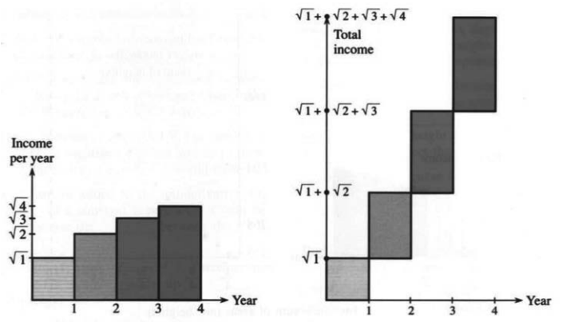
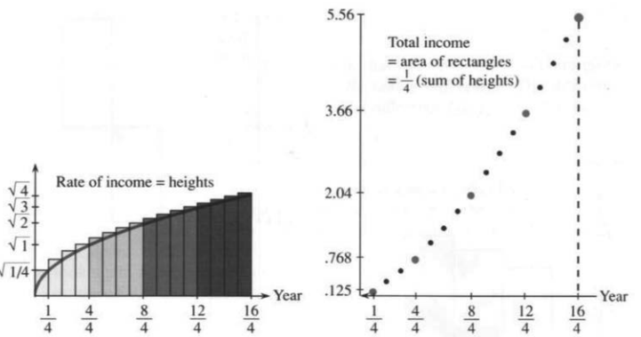

# 第5章 积分

## 5.1 积分的思想

来源：原书 PDF 第242—246页，印刷页229—233。状态：初译，尚未终审。

<!-- PDF 242 / 印刷页 229 -->

本章讨论积分的思想，也讨论积分的计算方法。我们先说明积分在原理上如何进行，再说明实际怎样计算。直观地说，积分是把无穷多个无穷小的量加起来。不过，我们并不建议逐项做这种加法：微积分的意义就在于提供更好的方法。

积分问题要求求出一个和式的极限。关键在于逆向运用差商的极限，也就是导数。如果 $v(x)$ 恰好是另一个函数 $f(x)$ 的导数，我们就可以利用 $f$ 来积分。例如，$v=\cos x$ 的一个原函数是 $f=\sin x$；$v=x$ 的一个原函数是 $f=\tfrac12x^2$。这里的 $f(x)$ 就是所谓的“原函数”。我们将逐渐积累更多这样的函数，第5.4节尤其关键。本书封面内页列出了一部分公式。即使找不到合适的 $f(x)$，数值积分仍可给出很好的近似结果。

我本可以直接给出积分公式，让你计算各种奇妙曲线下的面积。（面积最能直观地说明如何累加无穷多个无限薄的矩形，所以总是最先出现。但它当然不是积分学所能解决的唯一问题。）然而，我实在不愿只列公式而跳过背后的思想。牛顿与莱布尼茨具有极其出色的直觉，我们也完全有理由领会它。

他们从简单的情形入手。我们也一样。

### 和与差

只需简短地讨论和与差，就能说明积分和导数的大部分基本思想。暂时不考虑函数，只考虑 $n$ 个普通的数。关键思想无非是一个基本的代数事实。当 $n\to\infty$、并适当地取极限时，它就成为微积分的基本事实。**“取极限”这一步，是代数与微积分的根本区别。**要把无穷多个无穷小量相加，就必须迈出这一步；不过，我们先留在取极限之前。

为此，需要两组各含 $n$ 个数的数列。第一组记为 $v_1,v_2,\ldots,v_n$，字母 $v$ 使我们想到速度；第二组记为 $f_1,f_2,\ldots,f_n$，字母 $f$ 沿用前面表示位置或累计路程的记号。你也许觉得用 $d$ 表示距离更自然，但微积分中的 $dx$、$dy$ 已经需要使用这个字母了。

<!-- PDF 243 / 印刷页 230 -->

先看 $n=4$ 的例子：

$$
(v_1,v_2,v_3,v_4)=(1,2,3,4),\qquad
(f_1,f_2,f_3,f_4)=(1,3,6,10).
$$

两组数之间的关系已经显现出来。给定 $1,3,6,10$，怎样得到 $1,2,3,4$？**作差。**$10$ 与 $6$ 的差是 $4$，$6-3=3$，$f_2-f_1=3-1=v_2=2$。每个 $v$ 都是相邻两个 $f$ 的差：

$$v_j=f_j-f_{j-1}.$$

这是导数的离散对应形式。不过，$j=1$ 时有一个小问题：尚未定义 $f_0$。第一个 $v$ 应当是 $f_1-f_0$，自然的做法是约定 $f_0=0$。这种指定起点的需要，在微积分中还会再次出现，既可能带来麻烦，也可能提供帮助。

现在仍看这两组数，却从 $v$ 出发。由 $v=1,2,3,4$ 怎样得到 $f=1,3,6,10$？**求和。**前两个 $v$ 的和是 $3=f_2$；前三个的和是 $6=f_3$；四个全加起来是 $1+2+3+4=10$。**求和与作差互为逆运算。**

这个代数思想正是微积分的关键。和 $f_j$ 涉及全部的 $v_1+v_2+\cdots+v_j$，而差 $v_j$ 只涉及 $f_j-f_{j-1}$ 两项。二者互相抵消的关系，就是“基本定理”的核心。微积分把和变为积分，把差变为导数；我们不妨现在就把关键思想说清楚。

> **5A 微积分基本定理的离散原型（取极限之前）**
>
> 若对每个 $j$ 都有 $v_j=f_j-f_{j-1}$，则
> $$v_1+v_2+\cdots+v_n=f_n-f_0.$$

$f$ 的这些差加起来，只留下 $f_n-f_0$。中间的项全部消去，只剩末项 $f_n$ 和起始项的相反数 $-f_0$。这种和称为“伸缩和”：

$$
v_1+v_2+v_3+\cdots+v_n
=(f_1-f_0)+(f_2-f_1)+(f_3-f_2)+\cdots+(f_n-f_{n-1}).
$$

$f_1$ 与 $-f_1$ 抵消，$-f_2$ 与 $f_2$ 抵消，$-f_3$ 与 $f_3$ 抵消，依此类推，最终只剩 $f_n$ 与 $-f_0$。如果 $f_0=0$，总和就是末项 $f_n$。

代数部分到此完成。**通过寻找 $f$，我们求出了 $v$ 的和。**

**问题** 怎样计算奇数之和 $1+3+5+\cdots+99$，也就是这些 $v$ 的和？

**回答** 这些奇数依次是 $0,1,4,9,\ldots$ 的相邻差。这些 $f$ 都是平方数。根据上述基本关系，前50个奇数的和是 $50^2$。

难点在于找到合适的 $f$，使它们的差恰好产生所给的 $v$。在微积分中，难点则是找到合适的 $f(x)$，使其导数恰好等于 $v(x)$。令人惊喜的是，这样的 $f$ 常常能够找到；求积分时甚至比求有限和时更容易找到。

下一步是理解：**积分怎样成为和式的极限。**

### 和式趋于积分

假设你创办了一家经营成功的公司，其收入率不断增加。经过 $x$ 年时，收入率为每年 $\sqrt{x}$ 百万美元。在第1、2、3、4年末，收入率依次达到每年 $1,\sqrt2,\sqrt3,\sqrt4$ 百万美元。图5.1a把这些数画成柱状图，供投资者查看。我知道大多数初创公司会亏损，但你的公司是个例外。即使这个例子显得好得不太真实，也请继续读下去。

<!-- PDF 244 / 印刷页 231 -->

图5.1：按年度矩形估算的总收入等于各矩形面积之和，约为6.15百万美元。图中字样：Income per year＝年收入率，Total income＝累计收入，Year＝年。

图中四个矩形的高分别为 $\sqrt1,\sqrt2,\sqrt3,\sqrt4$。每个矩形的底为1年，因此其面积的数值与高度的数值相同。一位也许不太擅长算术的投资者提出一个简单问题：**这四年的总收入是多少？**有两种回答方法，下面分别说明。

第一种回答是 $\sqrt1+\sqrt2+\sqrt3+\sqrt4$。相加得到约6.15百万美元。图5.1b表示这一累计总量，到第4年末达到上述数值。这与速度和路程的关系完全相似，只是现在 $v$ 是年收入率，$f$ 是累计收入。从代数上看，仍有 $f_j=v_1+\cdots+v_j$。

第二种回答来自几何：总收入是各矩形面积之和。这里强调的是**求和与面积之间的对应关系**。这一点看似显然，但当第二位、也更精明的投资者提出一个更难的问题时，它就很重要了。

问题在于：**上述收入估算并不准确。**公司第一年实际并未赚到100万美元。三个月后，$x=1/4$，收入率才达到 $\sqrt{x}=1/2$。柱状图却把整个第一年的收入率都画成 $\sqrt1=1$，这就高估了。前三个月的收入不超过 $\tfrac12\times\tfrac14$ 百万美元，即收入率乘以时间。

其余各季度、各年的收入也都被高估了。图5.2a将4年分为16个季度，更接近实际情况，并给出总收入的新估计。

仍然有两种方法求总量。可以把 $\sqrt{1/4}+\sqrt{2/4}+\cdots+\sqrt{16/4}$ 相加，但必须再乘以 $1/4$，因为每个收入率只用于估算 $1/4$ 年的收入。也可以求16个矩形的面积之和。面积方法的优点是会自动计入 $1/4$：每个矩形的底都是 $1/4$，所以每项面积中都有这个因子。总面积现在约为5.56百万美元，比原来的估计更接近真实值。

接下来会怎样，你已经可以预见。再把时间分成一周一周。第一周末，收入率 $\sqrt{x}$ 仅为 $\sqrt{1/52}$。这是第一个矩形的高，底为 $\Delta x=1/52$；每周对应一个矩形。然后，一位勤奋的投资者又把时间分成一天一天，每个矩形的底为 $\Delta x=1/365$。此时共有 $4\times365=1460$ 个矩形；若计入闰日，则是1461天。按日计算所得的总面积已经低于550万美元。

<!-- PDF 245 / 印刷页 232 -->

图5.2：收入等于面积之和，而不是高度之和：

$$\frac14\left(\sqrt{\frac14}+\sqrt{\frac24}+\cdots+\sqrt{\frac{16}4}\right).$$

图中字样：Rate of income＝收入率；Total income＝累计收入；sum of heights＝高度之和；Year＝年。

这种计算虽然初等，却相当乏味：要把上千个平方根逐项乘以矩形的底 $\Delta x$，再全部相加。一定有更好的方法。

这个更好的方法，事实上也是这里最理想的方法，就是微积分。其思想是允许量**连续变化**：几何问题是求平方根曲线下的面积。单靠有限次的算术求和无法直接回答这个问题，因为其中涉及极限。各矩形的底为 $\Delta x$，高依次为 $\sqrt{\Delta x},\sqrt{2\Delta x},\ldots,\sqrt4$。矩形共有 $4/\Delta x$ 个：矩形越来越窄，和式的项数越来越多。**面积就是当 $\Delta x\to0$ 时，这些和式的极限。**

这个极限面积就是“积分”。我们要找的数小于 $5\tfrac12$。

**代数（$n$ 个矩形的面积）**：通过寻找 $f$，计算 $v_1+\cdots+v_n$。

关键思想：若 $v_j=f_j-f_{j-1}$，则总和为 $f_n-f_0$。

**微积分（曲线下的面积）**：计算 $\Delta x\,[v(\Delta x)+v(2\Delta x)+\cdots]$ 的极限。

关键思想：若 $v(x)=df/dx$，就可用 $f$ 计算面积，即积分；下一节继续说明。

### 5.1 习题

#### 阅读填空

求和问题要求计算 $v_1+\cdots+v_n$。若能找到一些 $f$，使 $v_j=\underline{\text{a}}$，问题便得到解决。这时 $v_1+\cdots+v_n=\underline{\text{b}}$。在 $(f_1-f_0)+(f_2-f_1)+\cdots+(f_n-f_{n-1})$ 中消去相反项，最后只剩 $\underline{\text{c}}$。求和是作差的 $\underline{\text{d}}$ 运算。

$0,1,4,9$ 的相邻差为 $v_1,v_2,v_3=\underline{\text{e}}$。若 $f_j=j^2$，则 $f_{10}$ 与 $f_9$ 的差是 $v_{10}=\underline{\text{f}}$。按照这个规律，$1+3+5+\cdots+19=\underline{\text{g}}$。

对函数而言，求原函数是 $\underline{\text{h}}$ 的逆运算。如果 $f(x)$ 的导数是 $v(x)$，那么 $v(x)$ 的一个 $\underline{\text{i}}$ 就是 $f(x)$。若 $v(x)=10x$，则可取 $f(x)=\underline{\text{j}}$。这也是一个底为 $x$、高为 $10x$ 的三角形的 $\underline{\text{k}}$。

积分从求和开始。在 $0\le x\le4$ 上，直线 $v=10x$ 下方的三角形面积为 $\underline{\text{l}}$。用高分别为 $10,20,30,40$ 的四个矩形近似，其总面积为 $\underline{\text{m}}$。若改用八个矩形，其高为 $\underline{\text{n}}$，总面积为 $\underline{\text{o}}$，近似效果更好。用 $n$ 个等宽矩形覆盖这一三角形时，总面积为 $\underline{\text{p}}$ 的和。

<!-- PDF 246 / 印刷页 233 -->

当 $n\to\infty$ 时，这个和应趋于数 $\underline{\text{q}}$。这就是 $v=10x$ 从0到4的积分。

#### 练习

第1—6题讨论和 $f_j$ 与差 $v_j$。

1. 若 $v=1,2,4,8,\ldots$，则 $v_j$ 的公式是 ______（不是 $2^j$）。从 $f_0=0$ 出发，求 $f_1,f_2,f_3,f_4$，再求 $f_7$。
2. 同样的数列 $v=1,2,4,8,\ldots$ 也是 $f=1,2,4,8,16,\ldots$ 的相邻差。此时 $f_0=1$，$f_j=2^j$。（a）检验 $2^5-2^4=v_5$。（b）$1+2+4+8+16$ 等于多少？
3. 数列 $f=1,1/2,1/4,1/8,\ldots$ 的相邻差为 $v=-1/2,-1/4,-1/8,\ldots$。这些负的 $v$ 相加，不会得到那些正的 $f$。验证关系 $v_1+v_2+v_3+v_4=f_4-f_0$ 仍然成立。
4. 可以给原函数 $f(x)$ 加上任意常数 $C$，因为常数的 ______ 为零。也可以给 $f_0,f_1,\ldots$ 同时加上任意常数 $C$，因为相邻 $f$ 之间的 ______ 不变。
5. 证明 $f_j=r^j/(r-1)$ 满足 $f_j-f_{j-1}=r^{j-1}$。因此，等比和 $1+r+\cdots+r^{j-1}$ 等于 ______；别忘记减去 $f_0$。这里 $r\ne1$。
6. 和 $f_j=(r^j-1)/(r-1)$ 也满足 $f_j-f_{j-1}=r^{j-1}$。此时 $f_0=$ ______，所以 $1+r+\cdots+r^{j-1}=f_j$。和 $1+r+\cdots+r^n$ 等于 ______。这里 $r\ne1$。
7. 设 $x<1$ 时 $v(x)=3$，$x>1$ 时 $v(x)=7$。求从0到 $x$、位于 $v(x)$ 图像下方的面积 $f(x)$，分两段讨论。
8. 若 $v=1,-2,3,-4,\ldots$，从 $f_0=0$ 开始写出相应的 $f$。分别在 $j$ 为奇数和偶数时，给出 $v_j$ 与 $f_j$ 的公式。

第9—16题讨论收入率为每年 $\sqrt{x}$ 的公司。

9. 按周划分时间时，共有 $4\times52=208$ 个矩形。写出第1个、第208个和第 $j$ 个矩形的面积。
10. 怎样知道208周的面积和小于16个季度的面积和？
11. 一位悲观的投资者会用每段时间**起点**处的 $\sqrt{x}$ 作为该段的收入率。用高 $\sqrt0,\sqrt1,\sqrt2,\sqrt3$ 重画图5.1的两部分。总收入的估计比原来减少多少？
12. 同一位悲观的投资者会用高 $0,\sqrt{1/4},\ldots$ 重画图5.2。最后一个矩形有多高？总矩形面积由约5.56减少了多少？
13. 从按年划分到按周、按日、按小时划分，悲观估计的面积逐渐 ______，乐观估计的面积逐渐 ______。二者之差等于最后一个 ______ 的面积。
14. 随着时间分割细化为周、日、小时、秒，乐观估计和悲观估计趋于同一个极限。在矩形之间画出 $\sqrt{x}$ 曲线，说明悲观估计总是偏低，乐观估计总是偏高。
15. **重要。**设 $f(x)$ 是区间 $[0,x]$ 上平方根曲线下的面积。到 $x+\Delta x$ 为止的面积为 $f(x+\Delta x)$，新增面积 $\Delta f=$ ______。它近似于底为 ______、高为 $\sqrt{x}$ 的矩形，所以 $\Delta f/\Delta x$ 接近 ______。当 $\Delta x\to0$ 时，我们猜想 $df/dx=$ ______。
16. 画出 $x=0$ 到4之间的 $\sqrt{x}$ 曲线，在曲线下画三角形，证明其下方面积大于5。提示：从 $\sqrt1=1$ 对应的点分别向左、向右看。

第17—22题讨论支出率 $v(x)=6-x$ 不断下降的公司。

17. 在 $x=$ ______ 时，支出率降到零。在此之前的累计支出等于 ______，这是 ______ 的面积。
18. 高分别为 $6,5,4,3,2,1$ 的矩形给出的总支出估计为 ______。画出这些覆盖三角形的矩形，说明为什么结果偏高。
19. 要使覆盖三角形的等宽矩形面积和与三角形的准确面积相差不超过1，至少需要多少个矩形？
20. 会计师采用每段2年的划分，并用各段中点，也就是奇数年份处的 $v=5,3,1$ 计算。她得到的估计是多少？准确程度如何？为什么？
21. 在区间 $[2,x]$ 上，直线 $v(x)=6-x$ 下方的面积 $f(x)$ 是多少？这个 $f(x)$ 的导数是多少？
22. 在区间 $[x,6]$ 上，直线 $v(x)=6-x$ 下方的面积 $f(x)$ 是多少？这个 $f(x)$ 的导数是多少？
23. 取 $\Delta x=1/3$，求覆盖 $v(x)=x^2$ 在 $[0,1]$ 上图像下方区域的三个矩形的总面积。
24. 在 $0\le x\le1$ 上画出 $v=\sqrt{x}$ 与 $v=x^2$ 的图像。哪两个面积相加等于1？同样的关系也适用于 $v=x^3$ 和 $v=$ ______。
25. 在 $x$ 到 $x+\Delta x$ 之间，$v=x^2$ 曲线下的面积增量为 $\Delta f$。它近似于底为 $\Delta x$、高为 ______ 的矩形，因此 $\Delta f/\Delta x$ 接近 ______。取极限得到 $df/dx=x^2$，进而可取 $f(x)=$ ______。
26. 计算从 $x=0$ 到 $x=4$ 时，用208个矩形估算 $v(x)=\sqrt{x}$ 曲线下面积所得的面积和。

### 译注与数学核对

1. 原文在引入阶段将“积分”和“原函数”交替使用。译文在指函数 $f$ 时使用“一个原函数”，在指和式极限或面积数值时使用“积分”，避免把不定积分与定积分混为一谈。无穷薄矩形只是直观描述，严格定义须通过有限和的极限给出。
2. 收入率的单位是“百万美元/年”，累计收入的单位是“百万美元”。年度矩形和6.15与季度矩形和5.56都是四舍五入的近似值，且都高估真实累计收入。原书的闰年说法是日历层面的附带说明；在其数学模型中，等分4年的划分仍须统一时间单位，不能同时固定 $\Delta x=1/365$、矩形数1461且总长恰为4。
3. 第3题原文只列出四个 $f$ 和三个 $v$，却要求验证含四个差的恒等式。译文补上省略号，按既定规律延续数列。第5、6题补明 $r\ne1$。
4. 第7题未给定 $x=1$ 处的函数值；任取有限值均不影响积分。将“面积”理解为通常的非负几何面积时，默认 $x\ge0$。第21题相应取 $2\le x\le6$，第22题取 $0\le x\le6$；超出这些范围时应改用有向的定积分解释。
5. 第13题的“逐渐”针对这里的单调函数与所用均匀划分；一般函数的任意两组分割，并不自动给出这种单调比较。第19题原文 within 1 译为“不超过1”；若要求严格小于1，临界所需矩形数会不同。
6. 第23题按三个宽度为 $1/3$ 的矩形补明区间 $[0,1]$。第26题原文 under 可指“曲线下区域的近似”或“完全位于曲线下的内接矩形”，未明说端点取法；按本节主要构造及第9题，应使用右端点，但题目本身有这一歧义。
