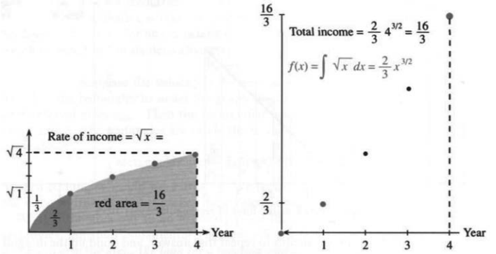
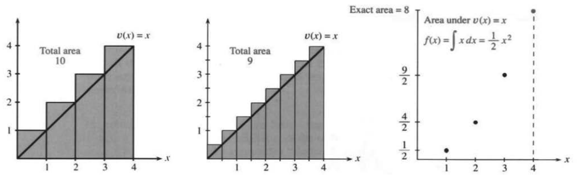
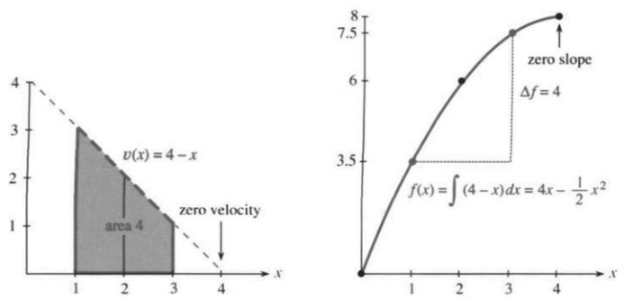
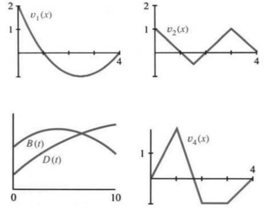

## 5.2 原函数

来源：原书 PDF 第247—252页，印刷页234—239。状态：初译，尚未终审。

<!-- PDF 247 / 印刷页 234 -->

符号 $\int$ 是莱布尼茨为表示积分而创造的。它是一个拉长的字母 S，取自拉丁语中表示“和”的词。这个符号有力地提示了整个构造过程：**和式趋于积分，S变成 $\int$，矩形面积和趋于曲边区域的面积**：

$$\text{曲边区域的面积}=\int v(x)\,dx=\int\sqrt{x}\,dx.\tag{1}$$

底为 $\Delta x$ 的矩形把我们引向这个极限，也就是 $\sqrt{x}$ 的积分。这里的“$dx$”提示 $\Delta x$ 趋于零。矩形的高 $v_j$ 取自曲线的高度 $v(x)$。各项 $v_j\Delta x$ 的和趋于“$v(x)$ 对 $x$ 的积分”。直观上，可以想象每一点上方都有一个无限薄的矩形，代替只在若干指定点上方取普通矩形的做法。式(1)暂略积分限，具体的面积由下文的定积分表示。

现在求平方根曲线下的面积。“积分限”为0和4。下限是面积开始处 $x=0$；一般也可以从任意点 $x=a$ 开始。上限是 $x=4$，因为我们只计算前4年；一般也可以在任意点 $x=b$ 结束。矩形面积之和由底 $\Delta x$ 乘以各个高 $\sqrt{x}$ 后相加而得。曲边区域的面积就是此和式的极限，即 **$\sqrt{x}$ 从0到4的积分**：

$$
\lim_{\Delta x\to0}
\left[\sqrt{\Delta x}\,\Delta x+\sqrt{2\Delta x}\,\Delta x+\cdots+\sqrt4\,\Delta x\right]
=\int_0^4\sqrt{x}\,dx.\tag{2}
$$

积分学中的核心问题仍待解决：这个极限面积究竟是多少？我们已有一个含 $\int$、$\sqrt{x}$ 和 $dx$ 的答案符号，却还没有数值。

### 原函数

我很想知道，最早是谁求出了 $\sqrt{x}$ 图像下的面积。也许是牛顿。面积的结果在更早的时候已经为人所知，而牛顿与莱布尼茨都领会了关键思想：和与积分相互对应，差与导数相互对应。沿着这个类比，我可以给出答案。不过证明还要稍后再说，那就是微积分基本定理。

在代数中，差 $f_j-f_{j-1}$ 等于 $v_j$，所以这些 $v$ 的和是 $f_n-f_0$。在微积分中，$f(x)$ 的导数等于 $v(x)$；积分时，$v(x)$ 曲线从0到 $x$ 下方的面积就是 $f(x)-f(0)$。我们的问题要求算到 $x=4$ 为止：

> **5B 离散与连续、矩形与曲边区域、求和与积分的对应**
>
> $v(x)$ 的定积分等于 $f(x)$ 的增量：
> $$\text{若 }\frac{df}{dx}=\sqrt{x},\qquad
> \text{则面积}=\int_0^4\sqrt{x}\,dx=f(4)-f(0).\tag{3}$$

那么 $f(x)$ 是什么？我们需要的不是 $\sqrt{x}$ 的导数，而是它的“原函数”：要找一个函数 $f(x)$，使其导数等于 $\sqrt{x}$。这与第2—4章的方向相反，需要**逆向推求**。$x^n$ 的导数是 $nx^{n-1}$；现在要找原函数。简便公式是 $f(x)=x^{n+1}/(n+1)$，其中 $n\ne-1$，但我们要理解它是怎样得到的。

**求解** 求导使指数降低，求原函数则使指数升高。于是从 $x^{1/2}$ 转向 $x^{3/2}$。但后者的导数是 $(3/2)x^{1/2}$，多了一个因子 $3/2$。为了消去它，在原函数前乘以 $2/3$：

<!-- PDF 248 / 印刷页 235 -->

$$f(x)=\frac23x^{3/2},\qquad f'(x)=x^{1/2}=\sqrt{x}.$$

图5.3：$v(x)=\sqrt{x}$ 从0到4的积分为曲线下的准确面积 $16/3$。Rate of income＝收入率；Total income＝累计收入；red area＝着色面积；Year＝年。

这就是积分的关键：从导数逆向寻找原函数，并调整系数。现在可以给出准确面积的数值了。在 $x=4$ 处，$x^{3/2}=8$；乘以 $2/3$ 得 $16/3$，再减去 $f(0)=0$：

$$\int_0^4\sqrt{x}\,dx
=\frac23\,4^{3/2}-\frac23\,0^{3/2}
=\frac23\cdot8=\frac{16}3.\tag{4}$$

**4年的总收入是 $16/3=5\tfrac13$ 百万美元。**这就是 $f(4)-f(0)$。前面上千个矩形的面积和，正缓慢地趋近这个准确值 $5\tfrac13$。

**其他面积** 第一年，即到 $x=1$ 为止的收入为 $\tfrac23\,1^{3/2}=\tfrac23$ 百万美元；原先100万美元的估计偏高。经过 $x$ 年的累计收入为 $\tfrac23x^{3/2}$，也就是这里选定的原函数 $f(x)$。平方根曲线下方占据其外接矩形面积的 $2/3$。这个矩形的宽为 $x$、高为 $\sqrt{x}$，面积为 $x^{3/2}$；其中 $2/3$ 在曲线下方，$1/3$ 在曲线上方。

**其他原函数** $x^5$ 的导数为 $5x^4$，因此 $x^4$ 的一个原函数为 $x^5/5$。除以5，或者一般地除以 $n+1$，是为了抵消求导产生的因子5或 $n+1$。注意不允许 $n+1=0$：

$$v(x)=x^n\quad\text{的一个原函数为}\quad f(x)=\frac{x^{n+1}}{n+1}\qquad(n\ne-1).$$

**例1** $x^2$ 的一个原函数为 $\tfrac13x^3$。对 $x\ge0$，它表示抛物线 $v(x)=x^2$ 从0到 $x$ 下方的面积。到 $x=1$ 为止，面积是 $\tfrac13\,1^3-\tfrac13\,0^3=1/3$。

**关于 $\sqrt{x}$ 与 $x^2$** 平方根对应的 $2/3$ 与平方函数对应的 $1/3$ 相加等于1。这也分别是图5.3左下方单位正方形中平方根曲线下方和上方的面积。交换两坐标轴的角色，$y=\sqrt{x}$ 可写成 $x=y^2$；函数 $y=\sqrt{x}$ 与 $y=x^2$（$x\ge0$）互为反函数。这两个反函数在单位区间上的曲线下面积相加，恰为面积为1的正方形。

<!-- PDF 249 / 印刷页 236 -->

### 直线下的面积

三角形的面积你已经会算。图5.4的区域位于直线 $v=x$ 下方，底为4，高为4，面积是 $\tfrac12\cdot4\cdot4=8$，根本不需要积分！但如果允许微积分再次得到这个结果，把面积函数 $f(x)=\tfrac12x^2$ 构造成许多矩形面积和的极限，就迈出了重要的一步。

图5.4：三角形面积8是矩形面积和 $10,9,8\tfrac12,\ldots$ 的极限。Total area＝总面积；Exact area＝准确面积；Area under＝曲线下的面积。

四个矩形的总面积是 $1+2+3+4=10$，因为它们包含整个三角形，所以大于8。10是三角形面积8的第一次近似，要改进它，就需增加矩形数。

下一组矩形更窄，宽由原来的 $\Delta x=1$ 改为 $\Delta x=1/2$，矩形数由4个增为8个。它们仍伸到直线上方，所以结果仍然偏大。新的高依次为 $1/2,1,3/2,2,5/2,3,7/2,4$。图5.4b的总面积等于底 $1/2$ 乘以这些高的和：

$$\text{面积}=\frac12\left(\frac12+1+\frac32+2+\cdots+4\right)=9,$$

比10更接近8。

**问题** 16个矩形的总面积是多少？它们的高为 $1/4,1/2,\ldots,4$。

**回答** 底为 $\Delta x=1/4$，所以面积为 $\tfrac14(\tfrac14+\tfrac12+\cdots+4)=8\tfrac12$。

逐项相加的工作量不断增长。我们需要一个求和公式，稍后就会推导出来；下一次的结果将是 $8\tfrac14$。但比公式更重要的是思想：**我们正在一步一步地进行取极限的过程。**当 $\Delta x$ 减小时，矩形面积和趋于三角形面积。同样的极限过程也适用于形状复杂得多的区域。因此，有必要停下来说明其中的要点。

**曲线下的面积**

对这些越来越窄的矩形，需要什么条件？它们不必等宽，也不必完全覆盖三角形；矩形可以全部位于曲线下方。即使各个宽度不同，矩形内接于三角形或者横跨曲线，极限结果仍是8。我们只要求两点：

1. 最大宽度 $\Delta x_{\max}$ 趋于零。
2. 每个矩形的上边在其对应的小区间内与曲线相接或相交。

<!-- PDF 250 / 印刷页 237 -->

如果这些矩形面积和存在一个共同极限，就把它定义为图像下方的面积。对这条直线，极限确实存在且等于8。极限不依赖于宽度和高度的具体选法；这正是我们必须坚持的要求。

第5.5节将讨论任意连续函数 $v(x)$。问题仍是：极限是否存在？回答仍是：存在。这个极限就是 $v(x)$ 的积分；在非负函数的情形，它是曲线下的面积。固定左端点、让右端点变化，就得到面积函数 $f(x)$。

**例2** 从0到 $x$ 的三角形面积为 $\tfrac12\times\text{底}\times\text{高}=\tfrac12x\cdot x$，即 $f(x)=\tfrac12x^2$，其导数为 $v(x)=x$。但注意，$\tfrac12x^2+1$ 的导数也一样；对任意常数 $C$，$f=\tfrac12x^2+C$ 也如此。$f(x)$ 中含有一个“积分常数”，求导得到 $v(x)$ 时，这个常数被消去了。

**例3** 假设速度随 $x$ 增加而减小：$v(x)=4-x$。如果在 $x=1,2,3,4$ 处取值构造矩形，它们就位于图像下方。由于 $v$ 递减，每个区间右端点处的值就是该区间内的最小值。因此矩形总面积 $3+2+1+0=6$ 小于准确面积8。矩形内接于三角形。改用8个底为 $1/2$ 的矩形，结果更接近准确值：

$$\text{矩形面积和}=\frac12\left(3\frac12+3+\cdots+\frac12+0\right)=7.$$

16个矩形的面积和为 $7\tfrac12$。再次强调，矩形不必等宽，只是等宽会让这些计算更方便。

到任意一点，例如 $x=3$ 或 $x=1$ 为止的面积是多少？可以继续放入矩形，但基本定理提供了更快的办法。利用 $4-x$ 的任意一个原函数都能求面积。我们要寻找导数为 $4-x$ 的函数。$4x$ 的导数是4，$\tfrac12x^2$ 的导数是 $x$，所以逆向求得：

$$\text{要使 }\frac{df}{dx}=4-x,\quad\text{可取 }f(x)=4x-\frac12x^2.$$

微积分跳过逐个矩形的计算，直接得到 $f(3)=7\tfrac12$。$x=1$ 与 $x=3$ 之间的面积为差 $7\tfrac12-3\tfrac12=4$，即图5.5中梯形的面积。

当 $v$ 的图像降到零时，$f$ 的图像具有水平切线：此刻面积的瞬时增加率为零。

图5.5：面积为 $\Delta f=7\tfrac12-3\tfrac12=4$。因为 $v(x)$ 递减，$f(x)$ 的图像向下弯曲。zero velocity＝速度为零；zero slope＝斜率为零。

<!-- PDF 251 / 印刷页 238 -->

### 不定积分与定积分

必须区分两种积分。它们都与原函数 $f(x)$ 有关，但定积分有积分限，例如0和4，不定积分没有积分限：

- 一个原函数为 $f(x)=4x-\tfrac12x^2$，不定积分则表示包括积分常数在内的全部原函数。
- 从 $x=0$ 到 $x=4$ 的定积分是数 $f(4)-f(0)$。

定积分的值确定为8，但原函数不一定只能取 $4x-\tfrac12x^2$。给 $f(x)$ 加上常数不会改变其导数，因为常数的导数为零。下列函数也都是原函数：

$$f(x)=4x-\frac12x^2+1,\qquad
f(x)=4x-\frac12x^2-9,\qquad
f(x)=4x-\frac12x^2+C.$$

前两个是特例，最后一个是一般形式。$C$ 可取任意常数，包括零；这样就得到在同一区间上具有指定导数的所有函数。微积分理论将说明，没有其他形式。不定积分就是全部原函数的一般表达式，不带积分限：

$$f(x)=\int v(x)\,dx=4x-\frac12x^2+C.\tag{5}$$

相比之下，积分限固定时，定积分是一个数。它没有任意常数 $C$，也不以积分变量 $x$ 为自变量。定积分由函数 $v(x)$ 和积分限，也就是两个端点，唯一确定；对于这里的非负函数，它表示这两个端点之间图像下方的面积。

要看清二者的关系，请考虑：从 $x=1$ 到 $x=3$ 的定积分是多少？由不定积分得到 $f(3)=7\tfrac12+C$、$f(1)=3\tfrac12+C$。求两个积分限之间的面积，就用原函数在上限处的值减去它在下限处的值：

$$\int_1^3v(x)\,dx=f(3)-f(1)
=\left(7\frac12+C\right)-\left(3\frac12+C\right)=4.\tag{6}$$

常数自行抵消了！定积分等于同一个原函数在两个端点的值之差，$C$ 在相减时消失。

差 $f(3)-f(1)$ 对应于 $f_n-f_0$。从1到 $n$ 的 $v_j$ 之和，在连续情形中对应于“$v(x)$ 从1到3的积分”。第5.3节从求和出发计算更多面积，第5.4节则从原函数出发计算更多积分。之后，我们再回到定积分与基本定理：

$$\int_a^b v(x)\,dx=\int_a^b\frac{df}{dx}\,dx=f(b)-f(a).\tag{7}$$

### 5.2 习题

#### 阅读填空

积分给出曲线 $y=v(x)$ 下方的 $\underline{\text{a}}$。它从底为 $\underline{\text{b}}$、高为 $v(x)$、面积为 $\underline{\text{c}}$ 的矩形开始。当 $\Delta x\to0$ 时，面积和 $v_1\Delta x+\cdots+v_n\Delta x$ 趋于 $v(x)$ 的 $\underline{\text{d}}$。$v(x)$ 的不定积分记为 $\underline{\text{e}}$。

如果找到 $f(x)$ 使 $\underline{\text{f}}$，积分问题便可解决。这时 $f$ 是 $v$ 的一个 $\underline{\text{g}}$，$\int_2^6v(x)\,dx$ 等于 $\underline{\text{h}}$ 减去 $\underline{\text{i}}$。积分限为 $\underline{\text{j}}$。这是一个 $\underline{\text{k}}$ 积分，它是一个 $\underline{\text{l}}$，而不是函数 $f(x)$。

对于 $v(x)=x$，可取 $f(x)=\underline{\text{m}}$，也可以取 $f(x)=\underline{\text{n}}$。$v(x)$ 从2到6下方的面积为 $\underline{\text{o}}$。计算 $\underline{\text{p}}$ 减去 $\underline{\text{q}}$ 时，常数抵消。如果 $v(x)=x^8$，则 $f(x)=\underline{\text{r}}$。

<!-- PDF 252 / 印刷页 239 -->

和式 $v_1+\cdots+v_n=f_n-f_0$ 引出基本定理 $\int_a^bv(x)\,dx=\underline{\text{s}}$。$\underline{\text{t}}$ 积分用 $f(x)$ 表示，$\underline{\text{u}}$ 积分为 $f(b)-f(a)$。求 $v$ 图像下的 $\underline{\text{v}}$，与求 $f$ 图像的 $\underline{\text{w}}$ 互为逆过程。

#### 练习

第1—14题：求 $v(x)$ 的一个原函数 $f(x)$，再计算定积分 $\int_0^1v(x)\,dx=f(1)-f(0)$。端点处无界的情形按反常积分理解。

1. $5x^4+4x^5$。
2. $x+12x^2$。
3. $1/\sqrt{x}$，即 $x^{-1/2}$。
4. $(\sqrt{x})^3$，即 $x^{3/2}$。
5. $x^{1/3}+(2x)^{1/3}$。
6. $x^{1/3}/x^{2/3}$。
7. $2\sin x+\sin2x$。
8. $\sec^2x+1$。
9. $x\cos x$，试探求解。
10. $x\sin x$，试探求解。
11. $\sin x\cos x$。
12. $\sin^2x\cos x$。
13. $0$，求所有原函数 $f$。
14. $-1$，求所有原函数 $f$。
15. 若 $df/dx=v(x)$，则 $v(x)$ 从 $a$ 到 $b$ 的定积分为 ______。若 $f_j-f_{j-1}=v_j$，则有限和 $v_3+\cdots+v_7$ 为 ______。
16. 面积中含有每个矩形的底 $\Delta x$ 这个因子。因此，$v$ 的和要乘以 ______，才趋于积分；$f$ 的差要除以 ______，才趋于导数。
17. 覆盖从0到4的三角形时，4、8、16个矩形的总面积依次为10、9、$8\tfrac12$。求 $N$ 个等宽矩形面积和 $A_N$ 的公式，并在 $N=3$、$N=6$ 时检验。
18. 在 $0\le x\le4$ 上，画出直线 $y=x$ 下方四个底为1的矩形，求其总面积。用 $N$ 个等宽矩形时，面积和是多少？
19. 画出从0到 $\pi$ 的 $y=\sin x$ 图像。用三个底为 $\pi/3$ 的矩形，以及六个底为 $\pi/6$ 的矩形，分别覆盖正弦曲线的一拱。求面积和，并猜测极限。
20. 画一个例子，使曲线下方三个内接矩形的面积和小于两个内接矩形的面积和；三个矩形的高分别为 $m_1,m_2,m_3$。
21. 在 $0<x\le1$ 上画出 $y=1/x^2$，并画出两个底为 $1/2$ 的内接矩形。面积和是多少？四个等宽矩形呢？猜测其极限。
22. 对 $y=1/x$ 重做第21题。
23. 使用计算器。对 $v(x)=1/\sqrt{x}$，在0到1之间取足够多的矩形，使任何合理的教师都愿意相信面积是2。求 $f(x)$，并验证 $f(1)-f(0)=2$。
24. 求抛物线 $v=x^2$ 从 $x=0$ 到 $x=4$ 下方的面积。它与 $\sqrt{x}$ 从0到4下方的面积 $16/3$ 有什么关系？
25. 对下图中的 $v_1$、$v_2$，估计累计带符号面积 $f(2)$ 和 $f(4)$，取 $f(0)=0$。

26. 画出 $y=v(x)$ 的图像，使面积函数 $f(x)$ 先增加到 $x=1$，然后保持不变直到 $x=2$，再减小到 $f(3)=1$。
27. 描述 $v_1$、$v_2$ 的不定积分图像。累计带符号面积是增加，还是先增加后减少，或有其他变化？
28. 对 $v_4(x)$，求带符号面积 $f(4)-f(1)$，并画出 $f_4(x)$。
29. 图中 $B(t)$ 表示出生率，即时刻 $t$ 单位时间内的出生人数；$D(t)$ 表示死亡率。下列量在图中如何体现？（a）从 $t=0$ 到 $t=10$ 的人口变化量。（b）人口最多的时刻 $T$。（c）人口增长最快的时刻 $t^*$。
30. 画出一个函数 $y_4(x)$ 的图像，使它的面积函数为 $v_4(x)$。
31. 若 $v_2(x)$ 是 $y_2(x)$ 的一个原函数，画出 $y_2(x)$。
32. 设 $v(x)$ 从 $v(0)=0$ 增加到 $v(3)=4$。曲线 $y=v(x)$ 下方的面积与曲线 $x=v^{-1}(y)$ 左方的面积相加，等于 ______。
33. 已知 $f(x)$ 是 $v(x)$ 的一个原函数，判断正误。（a）$2f(x)$ 是 $2v(x)$ 的一个原函数，可试举例。（b）$f(2x)$ 是 $v(2x)$ 的一个原函数。（c）$f(x)+1$ 是 $v(x)+1$ 的一个原函数。（d）$f(x+1)$ 是 $v(x+1)$ 的一个原函数。（e）$[f(x)]^2$ 是 $[v(x)]^2$ 的一个原函数。

### 译注与数学核对

1. 式(1)原文以不带上下限的积分号直接表示面积。这是引入符号时的非正式写法，不能据此把不定积分等同于一个固定面积；明确的定义使用式(2)的定积分。式(2)的等分过程取 $\Delta x=4/n$，$n\to\infty$。
2. 原文关于平方根曲线面积的发现者先猜测牛顿，紧接着又说此前已有结果，表述本身不够明确，译文保留其不确定口吻，不将猜测改为史实。原文将反函数图像的关系说成“旋转90°”，不准确；应交换坐标，即关于 $y=x$ 作反射，译文据此规范。
3. 幂函数原函数公式要求 $n\ne-1$，并须在实数幂有定义且可导的区间内使用。对一般实指数，取 $x>0$ 即可。不能仅由 $f'=v$ 就在所有情形无条件使用式(7)；本节连续函数情形满足条件，更一般时需另作可积性检查。
4. 关于矩形极限的两项规则，默认各底边构成固定区间的分割，并在每个小区间选一点，以对应函数值作高。连续函数在闭区间上保证所有这样的和趋于同一极限。函数可取负值时，矩形贡献应带符号。这里“所有原函数只差常数”的结论针对同一个区间；在不连通定义域的不同分支上，常数可独立选择。
5. 第3、6、21—23题在0处有奇点，不能直接套用闭区间连续函数的定积分定义。第3、6、23题用反常积分处理，并把原函数连续延拓到0；第21、22题的面积和无有限极限。矩形数值试验只能提供猜测，不能代替收敛证明。
6. 第25—31题的图像含负值，因此“面积”采用累计带符号面积。第30、31题图像在转角处不可导，对应的导函数仅在各开线段上定义；不能声称存在一个在整个区间处处可导的原函数具有这些折角。第29题默认不计迁入迁出。
7. 第32题原文只说 increases。为使普通反函数 $v^{-1}$ 在整个 $[0,4]$ 上存在，需补充 $v$ 连续且严格递增。文中的 $x=v^{-1}(y)$ 与 $y=v(x)$ 表示同一条曲线，两个面积分据矩形内该曲线的下方与左方。
