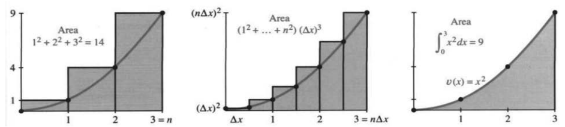
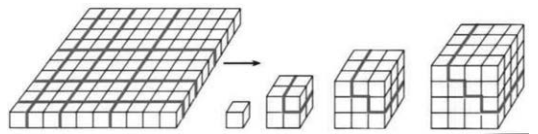
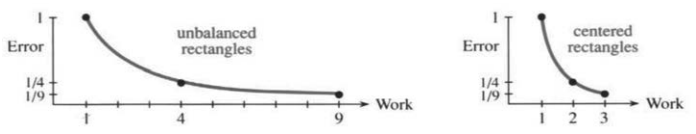

## 5.3 求和与积分

来源：原书 PDF 第253—261页，印刷页240—248。状态：初译，尚未终审。

<!-- PDF 253 / 印刷页 240 -->

本节用较费力的方法计算积分：先求 $f_n=v_1+\cdots+v_n$ 的显式公式，再把矩形面积和取极限，得到曲线下的面积 $f(x)$。根据基本定理，$df/dx$ 应当把我们带回 $v(x)$；我们将在每个例子中验证这一点。

还记得有时存在更简便的方法吗？如果能找到导数为 $v(x)$ 的函数 $f(x)$，就找到了 $v$ 的一个原函数。直接认出 $f$ 时，无须再逐次计算和式与极限。下一节说明怎样寻找 $f(x)$，届时会用这种方法替代本节的计算；找不到原函数时，再回到求和。找到一个合适的 $f$ 后，加上任意常数仍得到合适的原函数，因为常数的导数是零。选取恰当的常数，就可使 $f(0)=0$，并不增加多少工作。本节从和式构造 $f(x)$，下一节则直接寻找原函数。

### 求和符号 $\Sigma$

讨论求和，需要一种合适的记法。考虑 $1^2+2^2+3^2+4^2$，其各项为 $v_j=j^2$。利用大写希腊字母 $\Sigma$，读作 sigma，可以把这个和写成

$$1^2+2^2+3^2+4^2=\sum_{j=1}^4j^2.$$

读作“$j^2$ 从 $j=1$ 到4的和”，数值等于30。写在 $\Sigma$ 下方和上方的界限，表明从哪里开始，到哪里结束：

$$v_1+\cdots+v_n=\sum_{j=1}^n v_j,\qquad
v_3+\cdots+v_9=\sum_{k=3}^9v_k.\tag{1}$$

式(1)末尾的 $k$ 还说明：字母 $j$ 没有什么特殊之处。它是一个“哑变量”，用 $k$ 或 $i$ 也一样。作为求和指标的哑变量只出现在带求和符号的一侧，其名称不影响和的数值；上限 $n$ 却出现在等式两侧。下面列出六个和：

$$\sum_{k=1}^n k=1+2+3+\cdots+n;$$
$$\sum_{j=1}^4(-1)^j=-1+1-1+1=0;$$
$$\sum_{j=1}^5(2j-1)=1+3+5+7+9=5^2;$$
$$\sum_{i=0}^0v_i=v_0\qquad\text{（只有一项）};$$
$$\sum_{i=1}^4j^2\qquad\text{（没有意义吗？）};$$
$$\sum_{k=0}^{\infty}\frac1{2^k}=1+\frac12+\frac14+\cdots=2\qquad\text{（无穷级数）}.$$

数1和 $n$、1和4，或者0和 $\infty$，分别是求和下限和上限。哑变量 $i$、$j$ 或 $k$ 称为**求和指标**。希望无穷级数 $1+\tfrac12+\tfrac14+\cdots$ 的和为2这一点看来合理。第10章将再次讨论它。

像 $\sum_{j=1}^n6$ 这样的和看似奇怪，实际上就是 $6+6+\cdots+6=6n$，完全符合规则。$\sum_{i=1}^4j^2$ 也不是没有意义：对求和指标 $i$ 而言，每一项都是相同的 $j^2$，所以结果为 $4j^2$。

*原书脚注：古希腊的芝诺认为，人无法真正到达目的地，因为必须先走一半，再走剩余的一半，然后不断重复。无穷级数会改变他的一生。*

<!-- PDF 254 / 印刷页 241 -->

不过，写这个式子的人也许原本想把求和指标 $i$ 写成 $j$；若如此，结果才是 $1+4+9+16=30$。

**问题** 如果把这些和的上限都改成 $n$，会怎样？

**回答** 和将取决于停止位置 $n$。如果可能，就需要一个公式。变上限积分到 $x$ 为止，和式到 $n$ 为止。现在来寻找能够求出 $f(x)$ 或 $f_n$ 的特殊情形。

### 一个特殊的求和公式

怎样求前100个正整数的和？问题是计算

$$\sum_{j=1}^{100}j=1+2+3+\cdots+98+99+100=?$$

如果你是高斯，就会立刻看到答案。据说他在很小的时候就解决了这个问题，让周围的人想到应当把他送进更高年级。他把 $1+100$、$2+99$、$3+98$ 依次配对，每对都等于101。共有50对，所以总和为 $50\times101=5050$。

从1加到 $n$ 也用同样的思想。首项与末项的和为 $n+1$，接着的 $2$ 与 $n-1$ 之和也为 $n+1$。如果 $n$ 为偶数，如100，就有 $n/2$ 对。因此总和是 $n/2$ 乘以 $n+1$：

$$\sum_{j=1}^n j=1+2+\cdots+(n-1)+n=\frac12n(n+1).\tag{2}$$

重要的是首项 $\tfrac12n^2$，但准确的和还包括 $\tfrac12n$。

如果 $n$ 为奇数，例如99，会怎样？式(2)仍然成立。$1+99$、$2+98$ 仍等于 $n+1=100$。有49对完整的配对，再加上中间没有配对的50，相当于 $49\tfrac12$ 个100。因此 $1+2+\cdots+99=4950$。

**说明** 这个和也必须等于 $5050-100=4950$。到99为止的和，等于到100为止的和减去最后一项。关键公式 $f_n-f_{n-1}=v_n$ 又出现了！

**例** 求第二组100个正整数的和 $101+102+\cdots+200$。

**解法一** 从1加到200，再减去从1加到100的和：

$$\sum_{101}^{200}j=\sum_1^{200}j-\sum_1^{100}j.\tag{3}$$

右边两项分别为 $\tfrac12\cdot200\cdot201$ 和 $\tfrac12\cdot100\cdot101$，差为15050。

注意，这里在求和限中省略了“$j=$”，但其含义仍在。

**解法二** 答案15050恰好是前100个正整数的和5050再加10000。10000这样的数出现，总该有原因。改变求和指标及其上下限，就能看出原因：

<!-- PDF 255 / 印刷页 242 -->

$$\sum_{j=101}^{200}j=\sum_{k=1}^{100}(k+100).\tag{4}$$

能够这样移动求和限很重要。为方便起见，我们常把下限移到0或1。两个和式的项数都还是100，不会改变。哑变量 $j$ 换成另一个哑变量 $k$，二者满足 $j=k+100$，或等价地 $k=j-100$。

**变量必须在所有地方同时更换**：不仅和式内部要换，下限、上限也要换。$j$ 从101开始，$k=j-100$ 就从1开始；$j$ 到200结束，$k$ 就到100结束。和式中的 $j$ 换成 $k+100$；如果出现 $j^2$，就须换成 $(k+100)^2$。

式(4)说明答案为什么是15050：$1+2+\cdots+100$ 仍为5050，而100项中的每一项又都增加了100，合计增加10000。

**更换变量和求和限的例子**

$$\sum_{i=0}^3 2^i=\sum_{j=1}^4 2^{j-1}\qquad(i=j-1).$$

两边都是 $1+2+4+8$。

$$\sum_{i=3}^n v_i=\sum_{j=0}^{n-3}v_{j+3}\qquad(i=j+3,\ j=i-3).$$

两边都是 $v_3+\cdots+v_n$。上限为什么由 $n$ 改为 $n-3$？因为 $i=n$ 时，$j+3=n$，所以 $j=n-3$。

还可以再做一步，而且以后经常会见到：把新变量 $j$ 的名字重新改为 $i$。哑变量的名称本身没有独立含义，只是第一次见到下面的结果时可能会觉得意外：

$$\sum_{i=0}^5 2^i=\sum_{j=1}^6 2^{j-1}=\sum_{i=1}^6 2^{i-1}.$$

熟练后，可以跳过临时字母 $j$，一步完成。左边被加项中的旧 $i$ 换成右边的 $i-1$，而旧指标的范围 $0,\ldots,5$ 对应于新指标的范围 $1,\ldots,6$。初学时分两步更稳妥。这看似一个小技巧，但不久我们将改变积分限，而不只是求和限。积分与求和相互对应，因此先在这里认识“变量代换”很有帮助。

**再谈 $1+2+\cdots+n$** 高斯找到了和 $\tfrac12n(n+1)$，这是好事；但他的方法太像一个巧妙的技巧。下面把它放回和与差的基本关系中：

$$\text{若 }v_1+v_2+\cdots+v_n=f_n,\quad\text{则 }v_n=f_n-f_{n-1}.\tag{5}$$

高斯的公式说 $f_n=\tfrac12n(n+1)$，将 $n$ 减1就得到 $f_{n-1}=\tfrac12(n-1)n$。二者的差应当等于和式的末项 $n$：

$$f_n-f_{n-1}=\frac12n(n+1)-\frac12(n-1)n
=\frac12(n^2+n-n^2+n)=n.\tag{6}$$

这就是包含在 $f_n$ 中、却不包含在 $f_{n-1}$ 中的那一项 $v_n=n$。

还有更深的一层意思。对任何求和公式 $f_n$，需要检查两点：起始值正确，逐次变化也正确。背后的思想就是**数学归纳法**：假设前一步成立，再证明下一步成立。

<!-- PDF 256 / 印刷页 243 -->

**目标** 证明 $1+2+\cdots+n=\tfrac12n(n+1)$，右边是猜测的 $f_n$。

**归纳证明** 检查 $f_1=1$，并检查对每个 $n\ge2$ 都有 $f_n-f_{n-1}=n$。

当 $n=1$ 时，公式给出 $\tfrac12\cdot1\cdot2=1$，正确。$n=2$ 时，$\tfrac12\cdot2\cdot3$ 也等于 $1+2$，但其实不必单独再验这一步。只要 $f_1$ 正确，并且每一步的差 $f_n-f_{n-1}$ 都正确，所有 $f_n$ 就必定正确。式(6)是关键检验，说明 $f$ 的变化与对应的 $v$ 一致。

这就是数学归纳法的逻辑。不过，大多数使用它的练习让我不太满意，因为缺少发现的乐趣。某位高人，例如高斯，先把答案给出，再由我们这样的人证明其正确。如果我们能自己找到答案，那就好得多。因此，第二个问题——平方和——将尝试这样做。

*原书脚注：真正的教学目标，是让学生自己找到答案，甚至自己提出问题。*

### $j^2$ 的和与 $x^2$ 的积分

接下来是一个重要计算：求图5.6中的面积。一个区域由矩形组成，其面积为 $n$ 块面积之和；另一个区域位于抛物线 $v=x^2$ 下方，不能精确分成有限个矩形，因此需要微积分。

第一个问题是求 $f_n=1^2+2^2+3^2+\cdots+n^2$。这是平方和，且 $f_1=1$、$f_2=5$、$f_3=14$。目标是找出这个数列的规律。试着猜测 $f_n$，实际上是在模拟即将用于积分的方法：微积分寻找导数为 $v(x)$ 的函数 $f(x)$，称它为原函数；代数则寻找相邻差为 $v_n$ 的 $f_n$，可称为“反差分”，不过称为“和”更自然。

图5.6：覆盖 $v=x^2$ 下方区域的矩形面积和为
$$\left(\frac13n^3+\frac12n^2+\frac16n\right)(\Delta x)^3
\approx\frac13(n\Delta x)^3=\frac13x^3.$$
图中 Area＝面积；最右图的准确面积为 $\int_0^3x^2\,dx=9$。

好的猜测是最好的开端。直接借鉴积分，先试 $f_n=\tfrac13n^3$。检验它是否正确，就看相邻差是否给出 $v_n=n^2$：

$$\frac13n^3-\frac13(n-1)^3
=\frac13n^3-\frac13(n^3-3n^2+3n-1)
=n^2-n+\frac13.$$

出现了所需的 $n^2$，却还多了 $-n+1/3$。猜测 $\tfrac13n^3$ 需要修正。为了消去差中的 $1/3$，从和的公式中减去 $n/3$；为了把差中的 $n$ 补回来，在和中加上 $1+2+\cdots+n=\tfrac12n(n+1)$。新的猜测应当正确：

$$f_n=\frac13n^3+\frac12n(n+1)-\frac13n
=\frac13n^3+\frac12n^2+\frac16n.\tag{7}$$

先验得 $f_1=1$，也可验得 $f_2=5$、$f_3=14$。要完全确定，需验证 $f_n-f_{n-1}=n^2$。对于微积分，重要的是首项 $\tfrac13n^3$。

<!-- PDF 257 / 印刷页 244 -->

**前 $n$ 个平方数之和 $\sum_{j=1}^n j^2$，等于 $\tfrac13n^3$ 加上修正项 $\tfrac12n^2$ 与 $\tfrac16n$。**

实际中，$\tfrac13n^3$ 是一个很好的估计。前100个平方数的和约为 $\tfrac13\cdot100^3$，即一百万的三分之一。需要准确结果时，使用式(7)，得到338350。许多应用，例如估计求解100个线性方程所需的运算量，使用主项 $\tfrac13n^3$ 就足够了。

与微积分的对比很有意思：**在积分结果中没有这些修正项！**当矩形不断变窄并取极限时，它们消失了。用积分，即面积，代替有限和，就得到一个十分简洁的结果：

$$\text{$v=x^2$ 从 $x=0$ 到 $x=n$ 的积分恰为 }\frac13n^3.$$

抛物线下方到 $x=100$ 为止的面积，准确地等于一百万的三分之一。下面用很多矩形来解释原因。

思想是让矩形数趋于无穷，同时让各矩形无限变窄。100个矩形给出的面积为338350。现在取1000个矩形，由于曲线为 $v=x^2$，其高依次为 $(1/10)^2,(2/10)^2,\ldots$，每个底为 $\Delta x=1/10$。把高乘以底，再求和：

$$\text{矩形面积和}=\left(\frac1{10}\right)^2\frac1{10}
+\left(\frac2{10}\right)^2\frac1{10}
+\cdots+\left(\frac{1000}{10}\right)^2\frac1{10}.$$

提出 $(1/10)^3$，剩下 $1^2+2^2+\cdots+1000^2$，可以套用平方和公式。1000个矩形的准确面积和为333833.5。我本来还可以继续猜10000个矩形的结果，但不再这样算了。

**要点** 面积和趋近 $333333.333\ldots$，但计算越来越繁琐。该用代数了，也就是保留 $\Delta x$，不急着代入数值。把长为100的区间等分成 $n$ 段，每段长 $\Delta x$，于是 $n=100/\Delta x$。第 $j$ 个矩形的右上角在曲线 $v=x^2$ 上，高为 $(j\Delta x)^2$，底为 $\Delta x$。面积和为

$$
(\Delta x)^2\Delta x+(2\Delta x)^2\Delta x+\cdots+(n\Delta x)^2\Delta x
=\sum_{j=1}^n(j\Delta x)^2\Delta x.\tag{8}
$$

提出 $(\Delta x)^3$，剩下前 $n$ 个平方数的和。面积为 $(\Delta x)^3f_n$，代入 $n=100/\Delta x$：

$$
\begin{aligned}
&(\Delta x)^3\left[\frac13\left(\frac{100}{\Delta x}\right)^3
+\frac12\left(\frac{100}{\Delta x}\right)^2
+\frac16\left(\frac{100}{\Delta x}\right)\right]\\
&\qquad=\frac13\,100^3+\frac12\,100^2\Delta x+\frac16\,100(\Delta x)^2.
\end{aligned}\tag{9}
$$

这个等式清楚地展示了发生的事情。首项如预期，是一百万的三分之一；其他项都趋于零！因为它们含有 $\Delta x$，所以矩形越来越窄时就消失了。它们恰好补偿矩形伸出曲线的小角落。以后将对任意连续函数证明相应的多余面积趋于零；而在式(9)中，这一点已经直接可见。

曲线下的面积来自积分的中心思想：$100/\Delta x$ 个宽为 $\Delta x$ 的矩形，其面积和趋于极限 $\tfrac13\,100^3$。矩形面积和是 $\sum v_j\Delta x$，准确面积是 $\int v(x)\,dx$。从记号上看，取极限时 $\sum$ 对应于 $\int$，$v_j$ 对应于 $v(x)$，$\Delta x$ 对应于 $dx$。

<!-- PDF 258 / 印刷页 245 -->

抛物线的计算完成了。这里用到了特殊的平方和公式，但背后的思想普遍得多。和式的极限与原函数相吻合：$v(x)=x^2$ 的一个原函数是 $f(x)=\tfrac13x^3$。根据基本定理，曲线下的面积为

$$\int_0^{100}v(x)\,dx=f(100)-f(0)=\frac13\,100^3.$$

这个基本定理还没有证明！我是说，我们还没有证明它。至于牛顿或莱布尼茨是否给出了这样的证明，我不十分确定；但它是可以严格证明的。从差的和出发，困难在于同时遇到太多极限：$v_j\Delta x$ 的和趋于积分，而差商 $\Delta f/\Delta x$ 趋于导数。真正的证明必须把这些步骤分开，第5.7节将完成这件事。

无论是否已经证明，主要思想你已经看到了。数列 $f_j$ 与 $v_j$ 之间成立的关系，在取极限后仍体现于 $f(x)$ 与 $v(x)$ 之间。现在 $v(x)$ 可以连续变化，但仍是 $f(x)$ 的斜率函数。**求斜率的逆过程，是累积面积。**

$$(1+2+3+4)^2=1^3+2^3+3^3+4^3.$$

Roger Nelsen 的无字证明，原书注明刊于《Mathematics Magazine》，1990年。

最后回顾 $v=x$ 下方的面积。$1+2+\cdots+n=\tfrac12n^2+\tfrac12n$。到 $x=4$ 为止有 $n=4/\Delta x$ 个矩形，高为 $j\Delta x$，底为 $\Delta x$。相加得到

$$\sum_{j=1}^{4/\Delta x}(j\Delta x)\Delta x
=(\Delta x)^2\left[\frac12\left(\frac4{\Delta x}\right)^2+\frac12\left(\frac4{\Delta x}\right)\right]
=8+2\Delta x.\tag{10}$$

$\Delta x=1$ 时，面积和为 $1+2+3+4=10$。取8个矩形、$\Delta x=1/2$ 时，面积和为 $8+2\Delta x=9$。取16个宽为 $1/4$ 的矩形，修正项降为 $1/2$。准确面积是8，**误差与 $\Delta x$ 成正比**。

**重要说明** 这提出了一个应用数学问题：若有误差，误差有多大？当 $\Delta x\to0$ 时，它如何变化？$\Delta x$ 项趋于零，$(\Delta x)^2$ 项则更快地趋于零。然而，要把这里的误差降到 $10^{-6}$，需要800万个矩形：

$$2\Delta x=\frac{2\cdot4}{8000000}=10^{-6}.$$

这实在惊人！$10,9,8\tfrac12,8\tfrac14,\ldots$ 看起来在稳步趋于8，但收敛得太慢。答案每多一个二进制有效位，工作量就要加倍，这是很难接受的。必须设法消去 $\Delta x$ 项。如果主误差项是 $(\Delta x)^2$ 而不是 $\Delta x$，在适当的尺度下，约1000个矩形就能达到 $10^{-6}$ 量级的精度。

问题出在矩形放置不平衡：右边接触 $v$ 的图像，左边却高出太多。更好的办法是让矩形在区间**中点**处与曲线相交，这就是中点公式。对直线 $v=x$，矩形相对于直线上下平衡，误差恰好为零。第5.8节将重回中点公式，并讨论用抛物线拟合、消去二阶误差项的辛普森公式；原书指出，当时已有许多计算器内置这种方法。

<!-- PDF 259 / 印刷页 246 -->

最后试试快速方法。$v=x$ 下方的面积函数为 $f=\tfrac12x^2$，因为 $df/dx=v$。到 $x=4$ 为止的面积就是 $\tfrac12\cdot4^2=8$。完成。

图5.7：端点公式通常有“误差量级 $\sim1/\text{工作量}\sim1/n$”；中点公式更好，通常为“误差量级 $\sim1/(\text{工作量})^2$”。Error＝误差；Work＝工作量；unbalanced rectangles＝取端点高度的矩形；centered rectangles＝取中点高度的矩形。

### 选读：$p$ 次幂

这些和呈现出一个规律。$1+\cdots+n$ 的主项是 $\tfrac12n^2$，修正项是 $\tfrac12n$；平方和的主项是 $\tfrac13n^3$，再加修正项。$p$ 次幂之和则有

$$1^p+2^p+\cdots+n^p=\frac1{p+1}n^{p+1}+\text{修正项}.\tag{11}$$

对正整数 $p$，修正项由 $n$ 的较低次幂组成。你已经知道接下来会发生什么：在相应的积分极限中，这些修正项消失。$v=x^p$ 从0到 $n$ 下方的面积为

$$\int_0^n x^p\,dx
=\lim_{\Delta x\to0}\sum_{j=1}^{n/\Delta x}(j\Delta x)^p\Delta x
=\frac1{p+1}n^{p+1}.\tag{12}$$

对积分来说，上限 $n$ 不必是整数，指数 $p$ 也不必是整数。只需 $p+1>0$，从0开始的这个积分就收敛；当 $-1<p<0$ 时，它是反常积分。$v=x^p$ 的一个原函数为 $f=x^{p+1}/(p+1)$。

现在可以做一些有趣的实验。修正项对主要结果的相对影响越来越小，和与积分越来越接近。先取容易计算的 $p=1$：$S_n=1+\cdots+n$，$I_n=\int_0^n x\,dx=\tfrac12n^2$，差为 $D_n=\tfrac12n$。应观察的是**相对误差** $E_n=D_n/I_n$：

| $n$ | $S_n$ | $I_n$ | $D_n=S_n-I_n$ | $E_n=D_n/I_n$ |
|---:|---:|---:|---:|---:|
| 100 | 5050 | 5000 | 50 | 0.010 |
| 200 | 20100 | 20000 | 100 | 0.005 |

20100等于 $\tfrac12\cdot200\cdot201$。请补写 $n=400$ 这一行，并求 $E_n$ 的公式。可以根据表格猜测，也可以利用 $S_n$ 和 $I_n$ 的公式推导。所得公式不仅应说明 $E_n\to0$，还应说明收敛有多快或多慢。

前面还有一个数：一百万的三分之一。它来自 $x^2$ 从0到100的积分，可以与前100个平方数的和 $S_{100}$ 比较：

| $n$ | $p$ | $S_n$ | $I_n=\tfrac13n^3$ | $D=S-I$ | $E=D/I$ |
|---:|---:|---:|---:|---:|---:|
| 100 | 2 | 338350 | $333333\tfrac13$ | $5016\tfrac23$ | 0.01505 |
| 200 | 2 | 2686700 | $2666666\tfrac23$ | $20033\tfrac13$ | 0.0075125 |

这些数值启发了新办法：固定 $n$，改变 $p$。即使没有显式公式，计算机也能直接求和。借助它，考察四次幂与平方根：

| $n$ | $p$ | $S=1^p+\cdots+n^p$ | $I=n^{p+1}/(p+1)$ | $D=S-I$ | $E_{n,p}=D/I$ |
|---:|---:|---:|---:|---:|---:|
| 100 | 4 | 2050333330 | $\tfrac15\,100^5$ | 50333330 | 0.0252 |
| 100 | $\tfrac12$ | 671.4629 | $\tfrac23\,100^{3/2}$ | 4.7963 | 0.0072 |

<!-- PDF 260 / 印刷页 247 -->

本表及后面的表格不要求每项都是准确值；末列作了舍入，目的是发现规律。误差 $E_{n,p}$ 应遵循一种系统规律：对这里实验的正指数，其主项与 $1/n$ 成正比，比例系数是依赖于 $p$ 的未知数 $C(p)$。希望你把实验推进到足以发现 $C(p)$ 的程度。这不是一道可以到书后查答案的练习，而是在做数学。

### 5.3 习题

#### 阅读填空

希腊字母 $\underline{\text{a}}$ 表示求和。在 $\sum_1^n v_j$ 中，哑变量为 $\underline{\text{b}}$，上下限为 $\underline{\text{c}}$，所以首项为 $\underline{\text{d}}$，末项为 $\underline{\text{e}}$。当 $v_j=j$ 时，和为 $\underline{\text{f}}$。$n=100$ 时，主项是 $\underline{\text{g}}$，修正项是 $\underline{\text{h}}$。主项等于 $v=x$ 从0到100的积分，记为 $\underline{\text{i}}$。这个和是100个矩形的总 $\underline{\text{j}}$。修正项是 $\underline{\text{k}}$ 与 $\underline{\text{l}}$ 之间的面积。

$\sum_{i=3}^6i^2$ 与 $\sum_{j=1}^4\underline{\text{m}}$ 相同，等于 $\underline{\text{n}}$。$\sum_{i=4}^5v_i$ 与 $\underline{\text{o}}\,v_{i+4}$ 相同，等于 $\underline{\text{p}}$。若 $f_n=\sum_{j=1}^n v_j$，则 $f_n-f_{n-1}=\underline{\text{q}}$。

$1^2+2^2+\cdots+n^2$ 的公式是 $f_n=\underline{\text{r}}$。用数学归纳法证明时，需要检查 $f_1=\underline{\text{s}}$，并检查 $f_n-f_{n-1}=\underline{\text{t}}$。抛物线 $v=x^2$ 从 $x=0$ 到 $x=9$ 下方的面积为 $\underline{\text{u}}$。它接近 $\underline{\text{v}}$ 个底为 $\Delta x$ 的矩形面积和。修正项趋于零的速度很 $\underline{\text{w}}$。

#### 练习

1. 计算 $\sum_{n=1}^4 1/n$ 与 $\sum_{i=2}^5(2i-3)$。
2. 计算 $\sum_{j=0}^3(j^2-j)$ 与 $\sum_{j=1}^n1/2^j$。
3. 求 $\sum_{i=0}^6 2^i$ 与 $\sum_{i=0}^n2^i$。
4. 求 $\sum_{i=1}^6(-1)^ii$ 与 $\sum_{j=1}^n(-1)^jj$。
5. 用求和符号表示并计算：（a）$2+4+6+\cdots+100$；（b）$1+3+5+\cdots+199$；（c）$1-\tfrac12+\tfrac13-\tfrac14$。
6. 用求和符号表示：（a）$v_1-v_2+v_3-v_4$；（b）$v_1w_1+v_2w_2+\cdots+v_nw_n$；（c）$v_1+v_3+v_5$。
7. 用求和符号表示：（a）$a_0+a_1x+\cdots+a_nx^n$；（b）$\sin(2\pi/n)+\sin(4\pi/n)+\cdots+\sin2\pi$。
8. 二项式公式使用系数 $\binom nj=n!/[j!(n-j)!]$。填空：
   $$(a+b)^n=\binom n0a^n+\binom n1a^{n-1}b+\cdots+\binom nnb^n
   =\sum_{j=0}^n\underline{\hspace{1cm}}\,b^j.$$
9. 借助电子计算工具计算 $\sum_{j=1}^{100}1/j$ 与 $\sum_{j=1}^{1000}1/j$。
10. 用计算机求 $\left(\sum_{j=0}^{10}(-1)^j/j!\right)\left(\sum_{j=0}^{10}1/j!\right)$。
11. 把 $\sum_{i=1}^n(a_i+b_i)^2+\sum_{i=1}^n(a_i-b_i)^2$ 化为 $\sum_{i=1}^n\underline{\hspace{1cm}}$。
12. 说明下列等式一般不成立：$\left(\sum_{i=1}^n a_i\right)^2=\sum_{i=1}^n a_i^2$；$\sum_{i=1}^n a_ib_i=\left(\sum_{j=1}^n a_j\right)\left(\sum_{k=1}^n b_k\right)$。
13. 用相邻项抵消的方法求 $\sum_{k=1}^n(2^k-2^{k-1})$ 与 $\sum_{j=1}^{10}\left(\frac1{j+1}-\frac1j\right)$。除两项外，其他项均抵消。
14. 化简 $\sum_{j=1}^n(f_j-f_{j-1})$ 与 $\sum_{j=3}^{12}(f_{j+1}-f_j)$。
15. 判断正误：（a）$\sum_{j=4}^8v_j=\sum_{i=2}^6v_{i-2}$；（b）$\sum_{i=1}^9v_i=\sum_{i=3}^{11}v_{i-2}$。
16. 填空：$\sum_{i=1}^n v_i=\sum_{j=0}^{n-1}\underline{\hspace{1cm}}$；$\sum_{i=0}^6i^2=\sum_{i=2}^8\underline{\hspace{1cm}}$。
17. $d^2f/dx^2$ 的一个原函数是 $df/dx$。求和
   $$(f_2-2f_1+f_0)+(f_3-2f_2+f_1)+\cdots+(f_9-2f_8+f_7).$$
18. 用归纳法验证 $1^2+2^2+\cdots+n^2=f_n=n(n+1)(2n+1)/6$：先检查 $f_1$，再检查 $f_n-f_{n-1}=n^2$。
19. 用归纳法证明 $1+3+\cdots+(2n-1)=n^2$。
20. 通过检查 $f_1$ 与 $f_n-f_{n-1}$，验证 $1^3+2^3+\cdots+n^3=f_n=\tfrac14n^2(n+1)^2$。正文中给出了一个无字证明的示意图。
21. 设 $f_n$ 具有 $an+bn^2+cn^3$ 的形式。已知 $f_1=1$、$f_2=5$、$f_3=14$，把它们写成关于 $a,b,c$ 的三个方程。解 $a=1/6$、$b=1/2$、$c=1/3$ 给出了哪个公式？
22. 求公式 $1^8+\cdots+n^8=qn^9+\text{修正项}$ 中的 $q$。
23. 在 $S_n=1+\cdots+n$ 的表格中加入 $n=400$，求相对误差 $E_n$，猜测并证明 $E_n$ 的公式。
24. 在 $S_n=1^2+\cdots+n^2$ 的表格中加入 $n=50$，计算 $E_{50}$，并求 $E_n$ 的近似公式。
25. 在 $S_{100,p}=1^p+\cdots+100^p$ 的表格中加入 $p=1/3$ 和 $p=3$，猜测 $E_{100,p}$ 的近似公式。

<!-- PDF 261 / 印刷页 248 -->

26. 猜测公式 $E_{n,p}\approx C(p)/n$ 中的 $C(p)$。
27. 证明 $|1-5|<|1|+|-5|$。一般有 $|v_1+v_2|<|v_1|+|v_2|$，除非 ______。
28. 设 $S$ 是无穷等比级数 $1+x+x^2+\cdots$ 的和。则 $xS=x+x^2+x^3+\cdots$ 等于 $S$ 减去 ______，所以 $S=$ ______。当 $x=2$ 时，这些运算都不成立，因为 ______。
29. 二重和 $\sum_{i=1}^2\left[\sum_{j=1}^3(i+j)\right]$ 等于 $v_1=\sum_{j=1}^3(1+j)$ 加上 $v_2=\sum_{j=1}^3(2+j)$。计算 $v_1$、$v_2$ 及二重和。
30. 二重和 $\sum_{i=1}^2\left(\sum_{j=1}^3w_{i,j}\right)$ 等于 $(w_{1,1}+w_{1,2}+w_{1,3})+$ ______。二重和 $\sum_{j=1}^3\left(\sum_{i=1}^2w_{i,j}\right)$ 等于 $(w_{1,1}+w_{2,1})+(w_{1,2}+w_{2,2})+$ ______。比较二者。
31. 找出下面这个“证明”的错误，它声称对每个 $n=0,1,2,\ldots$ 都有 $2^n=1$：当 $n=0$ 时，$2^0=1$；若对每个 $n<N$ 都有 $2^n=1$，则 $2^N=2^{N-1}\cdot2^{N-1}/2^{N-2}=1\cdot1/1=1$。
32. 展开所有项，说明下式为什么成立：
   $$\sum_{j=1}^3 4v_j=4\sum_{j=1}^3v_j,\qquad
   \sum_{i=1}^2\left(\sum_{j=1}^3u_iv_j\right)
   =\left(\sum_{i=1}^2u_i\right)\left(\sum_{j=1}^3v_j\right).$$
33. $6,11,4$ 的平均值为 $\bar v=\tfrac13(6+11+4)$。于是 $(6-\bar v)+(11-\bar v)+(4-\bar v)=$ ______。$v_1,\ldots,v_n$ 的平均值为 $\bar v=$ ______。证明 $\sum_{i=1}^n(v_i-\bar v)=0$。
34. 柯西—施瓦茨不等式为
   $$\left(\sum_{i=1}^n a_ib_i\right)^2
   \le\left(\sum_{i=1}^n a_i^2\right)\left(\sum_{i=1}^n b_i^2\right).$$
   当 $a_1=2,a_2=3,b_1=1,b_2=4$ 时，计算两边。再对任意 $a_1,a_2,b_1,b_2$ 展开两边。第11.1节将用向量给出证明。
35. 设 $n$ 个底为 $\Delta x$ 的矩形分别在 $x=\Delta x,2\Delta x,\ldots,n\Delta x$ 处接触 $v(x)$ 图像。用求和符号表示矩形面积和。
36. 设 $1/\Delta x$ 个底为 $\Delta x$ 的矩形在每段区间的左端点，即 $x=0,\Delta x,2\Delta x,\ldots$ 处接触 $v(x)$ 图像。用求和符号表示矩形面积和。
37. 和式
   $$\Delta x\sum_{j=1}^{1/\Delta x}
   \frac{f(j\Delta x)-f((j-1)\Delta x)}{\Delta x}$$
   等于 ______。取极限后，它成为 $\int_0^1\underline{\hspace{1cm}}\,dx=$ ______。

### 译注与数学核对

1. 求和指标可以改名，但改名时应避免与已有自由变量冲突。$\sum_{i=1}^4j^2=4j^2$ 中的 $j$ 是自由变量，不能仅把 $i$ 改成 $j$ 而仍声称是同一个表达式。原文是在解释一个可能的笔误，并非允许这种变量捕获。
2. 求和公式的数学归纳法必须有起始步骤及对全部后继指标有效的递推步骤，不能只检验有限个数值。正文高斯、芝诺的故事保留原书教学叙述，不作为经过独立考据的历史结论。
3. 原文“1000个矩形达到 $10^{-6}$”是二阶收敛的量级示意，实际取决于区间长度及误差常数。例如区间长4时，1000等分有 $(\Delta x)^2=1.6\times10^{-5}$，不能不计系数就保证误差为 $10^{-6}$。图5.7的收敛阶还需要相应光滑性条件；对本节的直线，中点公式已经准确。
4. 正整数幂的有限和是一个多项式，式(11)的低次幂修正对此成立。一般实指数需用渐近估计，而非断言存在同样的有限多项式。式(12)对 $p>-1$、正上限成立，其中负指数须按反常积分解释。将矩形数与固定上限都记为 $n$ 容易混淆：式(12)中 $n$ 是固定上限，$n/\Delta x$ 才是趋于无穷的矩形数。
5. 固定步长1而让 $n$ 增大时，$S_n-I_n$ 在表格中并不趋于零，趋于零的是相对误差。对固定 $p>0$，有 $E_{n,p}\sim(p+1)/(2n)$；这一规律不能直接扩展到 $p=0$ 或 $-1<p<0$。正文末段据此明确了实验范围。原页246行首孤立的“192”没有数学含义，未收入译文。
6. 第12题原文用 $\ne$，若理解为对任意数列都严格不等则错误，例如只有一项时即相等。译文改为“这些等式一般不成立”，保留其意在反对错误展开的教学目的。
7. 第28题的实数等比级数要求 $|x|<1$ 才能使用所述有限和运算及极限。第29题原文把 $v_1$ 一项的求和指标误写为 $i$，而被加项写 $j$，已更正为 $j$。
8. 第37题对差分和的化简是精确恒等式。将其写成导函数的积分仍需要条件，例如 $f\in C^1[0,1]$，不能把差商的逐点极限与变项数求和无条件交换。
