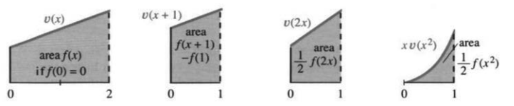

## 5.4 不定积分与换元法

来源：原书 PDF 第262—266页，印刷页249—253。状态：初译，尚未终审。

<!-- PDF 262 / 印刷页 249 -->

本节换一条省事的路子来积分：直接去找原函数。矩形面积和，以及它在 $\Delta x\to0$ 时的极限，先搁在一边；我们要找的是函数 $f(x)$，它的导数就是给定的 $v(x)$。实际计算时，这条路与求和法大体各走各的，答案却一样。不过，找原函数未必总能成功——万一找不到合适的 $f$，就退回矩形求和，或者改用第5.8节更好的数值方法。

计算机也能算出 $v$ 的积分，只是它通常靠的不是发现 $f$：它在指定的上下限之间算出一个数，也就是定积分。这里要的是一个函数，即不定积分所讲的那个原函数。这得有 MACSYMA、Mathematica、MAPLE 这类符号积分程序，或者有一个形式足够漂亮的 $v(x)$，再不然就两样都备着。比起一串数字，$f(x)$ 的表达式可能强出一大截。

所以，目标就是找到原函数，再把它用起来。第7章还会接着发展这些方法；本节不长，却很好用。先把已经知道的写下来：下面每一行里，$f(x)$ 都是 $v(x)$ 的一个原函数，因为 $df/dx=v(x)$。

| 类型 | 函数 $v(x)$ | 原函数的一般形式 $f(x)$ |
|---|---|---|
| 幂函数 | $x^n$ | $x^{n+1}/(n+1)+C$，$n\ne-1$ |
| 三角函数 | $\cos x$ | $\sin x+C$ |
| 三角函数 | $\sin x$ | $-\cos x+C$ |
| 三角函数 | $\sec^2x$ | $\tan x+C$ |
| 三角函数 | $\csc^2x$ | $-\cot x+C$ |
| 三角函数 | $\sec x\tan x$ | $\sec x+C$ |
| 三角函数 | $\csc x\cot x$ | $-\csc x+C$ |
| 反三角函数 | $1/\sqrt{1-x^2}$ | $\arcsin x+C$ |
| 反三角函数 | $1/(1+x^2)$ | $\arctan x+C$ |
| 反三角函数 | $1/(|x|\sqrt{x^2-1})$ | $\operatorname{arcsec}x+C$ |

幂函数那一行把 $n=-1$ 排除在外，否则分母就成了 $n+1=0$。至于 $v=x^{-1}$，它会一路把我们领到 $f=\ln x$，这里先取 $x>0$。

看得出来，每个积分公式都直接从求导公式搬来。余弦的原函数是正弦，因为正弦的导数是余弦。为强调这一点，下面把三个导数和对应的积分并排摆出来：

$$\frac{d}{dx}(\text{常数})=0,\qquad \int0\,dx=C;$$
$$\frac{d}{dx}x=1,\qquad \int1\,dx=x+C;$$
$$\frac{d}{dx}\left(\frac{x^{n+1}}{n+1}\right)=x^n,\qquad
\int x^n\,dx=\frac{x^{n+1}}{n+1}+C.$$

要往这份表里添内容，有两条路。一条是拿一个新的 $f(x)$ 求导：$f$ 填一列，$v=df/dx$ 填另一列。另一条是用求导法则推出积分法则——这条路能把积分表扩得又多又省力。

*原书脚注：我们很快会遇到 $e^x$，它可以同时放入两列，因为它既是 $f(x)$，也是 $v(x)$。*

<!-- PDF 263 / 印刷页 250 -->

### 积分法则

求导法则里有三条分量最重：线性、乘积、链式。其余方法都是从这三条长出来的。反过来，从 $v$ 求 $f$，道理仍然一样：

| 求导法则 | 相应的积分方法 |
|---|---|
| 导数的线性性质 | 积分的线性性质 |
| 乘积求导法则 | 分部积分法 |
| 链式求导法则 | 换元积分法 |

最容易的是线性，先说它。分部积分留到第7.1节。本节从换元法讲起：把链式法则倒过来用，积分就化简了。

### 积分的线性性质

$v(x)+w(x)$ 的积分怎么求？分开积，再相加。看非负函数的图形：$v+w$ 下方的区域能切成两块，一块在 $v$ 下方，一块夹在 $v$ 与 $v+w$ 之间。两块面积一加，和法则就出来了。设 $f$、$g$ 分别是 $v$、$w$ 的原函数：

- 和法则：$f+g$ 是 $v+w$ 的一个原函数。
- 常数倍法则：$cf$ 是 $cv$ 的一个原函数。
- 线性性质：$af+bg$ 是 $av+bw$ 的一个原函数。

这有点小题大做：前两条都是第三条的特例，逻辑上留最后一条就够了。可常数得处理得快，这实在太要紧——手法就是把常数“提到积分号外”——所以 $cv\leftrightarrow cf$ 还是单列出来。证明用的仍是导数的线性性质：$(af+bg)'=af'+bg'=av+bw$。

换成积分号，就是这样三行：

$$\int[v(x)+w(x)]\,dx=\int v(x)\,dx+\int w(x)\,dx;$$
$$\int cv(x)\,dx=c\int v(x)\,dx;$$
$$\int[av(x)+bw(x)]\,dx=a\int v(x)\,dx+b\int w(x)\,dx.$$

**关于 $f(x)+C$ 中的常数** 每个原函数都可以再加一个常数。像 $av(x)+bw(x)$ 这样的组合，原函数的一般形式是 $af(x)+bg(x)+C$：各部分的常数并成一个就够了。要写出某函数的全部原函数，找到其中一个以后，别忘了添上“$+C$”。真正费劲的，是找到那一个原函数。

**例1** $v=x^2+x^{-2}$ 的原函数是
$$f=\frac{x^3}3+\frac{x^{-1}}{-1}+C=\frac{x^3}3-\frac1x+C.$$

**例2** $6\cos t+7\sin t$ 的原函数是 $6\sin t-7\cos t+C$。

**例3** 把 $1/(1+\sin x)$ 改写成
$$\frac{1-\sin x}{1-\sin^2x}=\frac{1-\sin x}{\cos^2x}
=\sec^2x-\sec x\tan x.$$
于是一个原函数就是 $\tan x-\sec x+C$。这种代数变形，符号计算程序会做，你自己也能做。求导往往比较简单，所以多数人会回头验一下 $df/dx=v(x)$。本例的原式符号存在原书笔误，详见译注。

**问题** $\tan^2x$ 怎么积分？

**方法** 写成 $\sec^2x-1$ 就行。答案是 $\tan x-x+C$。

<!-- PDF 264 / 印刷页 251 -->

### 换元积分法

现在讲本节最值钱的方法——换元法。要看清它的想法，先回想链式法则：

$$\frac{d}{dx}f(g(x))=f'(g(x))g'(x);$$
$$\frac{d}{dx}\sin(x^2)=\cos(x^2)\cdot2x;$$
$$\frac{d}{dx}(x^3+1)^5=5(x^3+1)^4\cdot3x^2.$$

右边那个函数要是已经给了，左边被求导的函数就是它的一个原函数！有两点得马上强调。

**1. 常数因子可以调整。** 除以2，或者除以15，就有了

$$\int x\cos(x^2)\,dx=\frac12\sin(x^2)+C;$$
$$\int x^2(x^3+1)^4\,dx=\frac1{15}(x^3+1)^5+C.$$

看清这几个数：2来自 $x^2$ 求导，5来自那个五次幂，3来自 $x^3$ 求导。

**2. 选定内层函数 $g$，也就是 $u$ 后，就必须顾及它的导数。**

| 积分 | 直接作 $g=x^2$ 代换的情况 |
|---|---|
| $\int2x\cos(x^2)\,dx$ | 得 $\sin(x^2)+C$，因为 $g'=2x$ 恰好存在 |
| $\int\cos(x^2)\,dx$ | 不能这样直接套用，缺少 $g'$ |
| $\int x^2\cos(x^2)\,dx$ | 不能这样直接套用，所带因子不是 $g'$ |

要从 $x^2$ 换到 $g$，得先有它的导数。诀窍是认出一个内层函数，让它的导数也出现在被积式里。2、15 这样的常数可以补，别的就不行：$dg/dx$ 必须在场。内层函数通常写作 $u$。若 $f'=v$，换元法则就是

$$\int v(u(x))\frac{du}{dx}\,dx=f(u(x))+C.\tag{1}$$

**例4** 取 $u=\sin x$：
$$\int\sin x\cos x\,dx=\frac12\sin^2x+C.$$
与例6比较。

**例5** 取 $u=\sin x$：
$$\int\sin^2x\cos x\,dx=\frac13\sin^3x+C.$$

**例6** 取 $u=\cos x$：
$$\int\cos x\sin x\,dx=-\frac12\cos^2x+C.$$
与例4比较。

**例7** 取 $u=\tan x$：
$$\int\tan^4x\sec^2x\,dx=\frac15\tan^5x+C.$$

下例取 $u=x^2-1$，$du/dx=2x$。关键的一步是选定 $u$。

**例8**
$$\int\frac{x}{\sqrt{x^2-1}}\,dx=\sqrt{x^2-1}+C;$$
$$\int x\sqrt{x^2-1}\,dx=\frac13(x^2-1)^{3/2}+C.$$

把 $x$ 平移成 $x+2$，或者按比例伸缩成 $2x$，这类情形格外省事。

**例9—10**
$$\int(x+2)^3\,dx=\frac14(x+2)^4+C;$$
$$\int\cos2x\,dx=\frac12\sin2x+C.$$

这些计算，你很快就会熟到闭眼也能做。严格说，$(x+2)^4$ 求导仍要用到链式法则，可内层函数 $u=x+2$ 的导数为1，这个因子自己就在那儿，图像只是平移了一下；图5.8b画的正是这一类平移。

例10的内层函数是 $u=2x$，它的导数是 $du/dx=2$。

<!-- PDF 265 / 印刷页 252 -->

图5.8：分别代入 $u=x+1$、$u=2x$、$u=x^2$。最后一图只含 $du/dx=2x$ 的一半，也就是因子 $x$。图内 area＝面积；各图取了相应的起始常数，第一图注明 $f(0)=0$。

积分 $\int\cos2x\,dx$ 里少了那个必需的因子2，不过乘一个2再除一个2就补上了。验算 $\tfrac12\sin2x$ 的导数时，链式法则给出的2恰好抵消 $1/2$。对任意非零常数，道理一样，都有

$$\int v(x+c)\,dx=f(x+c)+C,\qquad
\int v(cx)\,dx=\frac1c f(cx)+C.\tag{2}$$

对于正的 $c$，图像在水平方向被压紧 $c$ 倍，相应面积也跟着除以 $c$。$3x+7$ 呢，缩放和平移一起来。

**例11**
$$\int\cos(3x+7)\,dx=\frac13\sin(3x+7)+C;$$
$$\int(3x+7)^2\,dx=\frac13\cdot\frac13(3x+7)^3+C.$$

**关于书写步骤** 换元一复杂，最好把需要的 $du/dx$ 明明白白写出来。这里 $3x^2+1$ 要配一个因子 $6x$：

$$\int7x(3x^2+1)^4\,dx
=\frac76\int(3x^2+1)^4\,6x\,dx
=\frac76\int u^4\frac{du}{dx}\,dx.$$

然后积分：

$$\frac76\cdot\frac{u^5}5+C
=\frac76\cdot\frac{(3x^2+1)^5}5+C.\tag{3}$$

最后别忘了验导数。指数5抵消分母5，链式法则带来的 $6x$ 抵消分母6，剩下的正是开头那个 $7x$。

**关于微分** 很多人干脆把 $(du/dx)\,dx$ 写成 $du$：

$$\int(3x^2+1)^4\,6x\,dx=\int u^4\,du=\frac15u^5+C.\tag{4}$$

这样写，换元怎么走就一目了然。**从 $x$ 换到 $u$ 的同时，也必须从 $dx$ 换到 $du$。**最常见的错误，是把 $dx$ 和 $du$ 搅在一起。链式法则给出 $du/dx$ 这个因子，绝对少不得——有它才有 $du$。换过之后，积分变得好算；算完再把 $u$ 换回 $3x^2+1$。四步是这样：

1. 挑好 $u(x)$，算出 $du/dx$。
2. 把被积式认出来，或整理成 $v(u)(du/dx)\,dx$，也就是 $v(u)\,du$。
3. 积分 $\int v(u)\,du$，得到 $f(u)+C$。
4. 把 $u=u(x)$ 代回这个原函数。

**例12** 取 $u=\sqrt{x}$，则

$$\int\frac{\cos\sqrt{x}}{2\sqrt{x}}\,dx
=\int\cos u\,du=\sin u+C=\sin\sqrt{x}+C.$$

三步走：换成 $u$，积分，再换回 $x$。

$u$ 必须选得合适，被积式才能整个换成 $u$。代换用得巧，能算出一些让人拍案的积分；但并不是每个原函数都能写成初等表达式。$\cos(x^2)$ 和 $1/\sqrt{4-\sin^2x}$ 就没有初等原函数。这些积分照样有明确意义，应用中也会碰到。原书把后一个跟椭圆周长扯在一起；两者的准确区别见译注。

<!-- PDF 266 / 印刷页 253 -->

这类量能算到极高的精度，可精度再高也只是近似，并不等于准确的符号表达式。

习题专练换元法——这方法需要练，也值得练。先看一个套错的例子：$\int(x^2+1)^2\,dx$ **不等于** $\tfrac13(x^2+1)^3$，因为缺了因子 $du/dx=2x$，$u=x^2+1$ 这条幂公式不能硬套。反过来，常数 $\pi$ 是可以补上的：

$$\int\sin\pi x\,dx=\int\sin u\,\frac{du}{\pi}
=-\frac1\pi\cos u+C=-\frac1\pi\cos\pi x+C.$$

### 5.4 习题

#### 阅读填空

换元积分法，就是 $\underline{\text{a}}$ 法则的逆用。$(\sin x)^3$ 的导数为 $\underline{\text{b}}$，因此 $\underline{\text{c}}$ 的一个原函数为 $\underline{\text{d}}$。计算 $\int(1+\sin x)^2\cos x\,dx$ 时，令 $u=\underline{\text{e}}$，则 $du/dx=\underline{\text{f}}$，所以代入 $du=\underline{\text{g}}$。用 $u$ 表示后，积分为 $\int\underline{\text{h}}=\underline{\text{i}}$，再换回 $x$ 得最终答案。

对 $\int\tan(x+3)\sec^2(x+3)\,dx$ 和 $\int(x^2+1)^{10}x\,dx$，合适的代换分别是 $u=\underline{\text{j}}$、$u=\underline{\text{k}}$，对应的微分为 $du=\underline{\text{l}}$ 和 $du=\underline{\text{m}}$，答案为 $\underline{\text{n}}$ 和 $\underline{\text{o}}$。$v\,dv/dx$ 的一个原函数是 $\underline{\text{p}}$。$\int2x\,dx/(1+x^2)$ 化为 $\int\underline{\text{q}}$，这个我们还没学会怎么算；$\int dx/(1+x^2)$ 却能一眼写出 $\underline{\text{r}}$。

#### 练习

第1—20题：求不定积分，每题都要写出积分常数。

1. $\int\sqrt{2+x}\,dx$。
2. $\int\sqrt{3-x}\,dx$。
3. $\int(x+1)^n\,dx$。
4. $\int(x+1)^{-n}\,dx$。
5. $\int(x^2+1)^5x\,dx$。
6. $\int\sqrt{1-3x}\,dx$。
7. $\int\cos^3x\sin x\,dx$。
8. $\int\cos x\,dx/\sin^3x$。
9. $\int\cos^3(2x)\sin2x\,dx$。
10. $\int\cos^3x\sin2x\,dx$。
11. $\int dt/\sqrt{1-t^2}$。
12. $\int t\sqrt{1-t^2}\,dt$。
13. $\int t^3\,dt/\sqrt{1+t^2}$。
14. $\int t^3\sqrt{1-t^2}\,dt$。
15. $\int(1+\sqrt{x})\,dx/\sqrt{x}$。
16. $\int(1+x^{3/2})\sqrt{x}\,dx$。
17. $\int\sec x\tan x\,dx$。
18. $\int\sec^2x\tan^2x\,dx$。
19. $\int\cos x\tan x\,dx$。
20. $\int\sin^3x\,dx$。

第21—32题：求一个函数 $y(x)$ 满足所给微分方程，所得解要在方程有定义的区间上理解。

21. $dy/dx=x^2+\sqrt{x}$。
22. $dy/dx=y^2$。可试 $y=cx^n$。
23. $dy/dx=\sqrt{1-2x}$。
24. $dy/dx=1/\sqrt{1-2x}$。
25. $dy/dx=1/y$。
26. $dy/dx=x/y$。
27. $d^2y/dx^2=1$。
28. $d^5y/dx^5=1$。
29. $d^2y/dx^2=-y$。
30. $dy/dx=\sqrt{xy}$。
31. $d^2y/dx^2=\sqrt{x}$。
32. $(dy/dx)^2=\sqrt{x}$。
33. 已知 $f$ 是 $v$ 的一个原函数，判断正误：
   （a）$\int v(u(x))\,dx=f(u(x))+C$；
   （b）$\int v^2(x)\,dx=\tfrac13f^3(x)+C$；
   （c）$\int v(x)(du/dx)\,dx=f(u(x))+C$；
   （d）$\int v(x)(dv/dx)\,dx=\tfrac12f^2(x)+C$。
34. 已知 $f$ 是 $v$ 的一个原函数，判断正误：
   （a）$\int f(x)(dv/dx)\,dx=\tfrac12f^2(x)+C$；
   （b）$\int v(v(x))(dv/dx)\,dx=f(v(x))+C$；
   （c）积分与求导互逆，所以 $f(v(x))=x$；
   （d）积分与求导互逆，所以 $\int(df/dx)\,dx=f(x)$。
35. 若 $df/dx=v(x)$，则 $\int v(x-1)\,dx=$ ______，$\int v(x/2)\,dx=$ ______。
36. 若 $df/dx=v(x)$，则 $\int v(2x-1)\,dx=$ ______，$\int v(x^2)x\,dx=$ ______。
37. 由 $x^2/(1+x^2)=1-1/(1+x^2)$，得 $\int x^2\,dx/(1+x^2)=$ ______。
38. $\int(x^2+1)^2\,dx$ 不是 $\tfrac13(x^2+1)^3$，而是 ______。
39. $\int2x\,dx/(x^2+1)=\int\underline{\hspace{1cm}}\,du$，不久将知道其原函数为 $\ln u+C$。
40. 证明 $\int2x^3\,dx/(1+x^2)^3=\int(u-1)\,du/u^3=$ ______。
41. 由加速度 $d^2f/dt^2=9.8$，得 $f(t)=$ ______，含两个积分常数。
42. $d^4y/dx^4=0$ 的通解为 ______，含四个常数。
43. 若 $f(t)$ 是 $v(t)$ 的一个原函数，求下列函数的原函数：（a）$v(t+3)$；（b）$v(t)+3$；（c）$3v(t)$；（d）$v(3t)$。

### 译注与数学核对

1. 积分表在相关函数有定义且可导的区间上使用。反正弦行要求 $|x|<1$，反正割行要求 $|x|>1$，并沿用前节选定的反正割分支。对 $1/x$，一般的实原函数写作 $\ln|x|+C$，且不同连通分支上的常数可不同。
2. 不定积分的线性公式按“选取一个原函数后再加任意常数”理解。若系数为零，例如 $c=0$，右侧形式 $0\int v\,dx$ 本身不能表示所有常数，仍须统一补 $+C$；不能机械地把原函数集合当作普通数相乘。
3. 例3原书初始分式写成 $1/(1-\sin x)$，但随后改写及答案全都对应 $1/(1+\sin x)$。为使例题连贯，译文将初始分母改成加号。若保留原初始式，则应以 $1+\sin x$ 有理化，答案为 $\tan x+\sec x+C$。这些三角表示须避开 $\cos x=0$；有些点是表示形式的可去奇点，可以用等价表达式延拓。
4. 印刷页251第一组换元积分把 $\cos(x^2)$ 排成 $\cos(x)^2$，与前后推导及答案不符，译文明确改为 $\cos(x^2)$。式(2)补出积分常数；缩放的几何面积解释限 $c>0$，$c<0$ 时还涉及方向反转。
5. 原书把 $1/\sqrt{4-\sin^2x}$ 的积分直接说成椭圆周长，并不准确。它属于第一类椭圆积分；椭圆弧长通常涉及 $\sqrt{1-k^2\sin^2x}$ 的积分，即第二类椭圆积分。两者都通常无初等原函数，但不能相互替代。不存在初等表达式也不等于无法给出准确的特殊函数定义。
6. 第3题的幂公式须排除 $n=-1$，第4题须排除 $n=1$；这些例外会产生对数。原书未单独标出。第30题平方根覆盖整个 $xy$，不是 $\sqrt{x}\,y$。第34(d)题保留未写 $+C$ 的原命题，作为判断题，不替它预先纠正。
