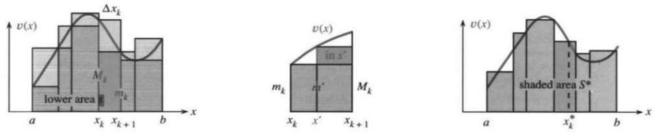
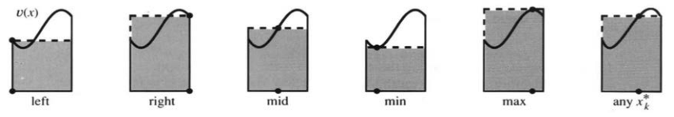

## 5.5 定积分

来源：原书 PDF 第267—272页，印刷页254—259。状态：初译，尚未终审。

<!-- PDF 267 / 印刷页 254 -->

$v(x)$ 的不定积分是一个原函数 $f(x)$ 加上任意常数 $C$。本节分两步进行：先选择 $C$，再构造 $f(x)$。目的是给出积分的定义，尤其适用于不能直接写出合适的 $f(x)$ 的常见情形。

不定积分中含有“$+C$”。这个常数尚未确定，因为无论 $C$ 取何值，$f(x)+C$ 的斜率都相同。只关心导数时，$C$ 无关紧要；要用累计面积来表示定积分时，可以规定起点处的值，从而选定一个原函数。

计算已行驶的里程时，要减去起点处的里程表读数。本节对面积也这样做。路程函数可记为 $f(t)$，面积函数可记为 $f(x)$，而定积分由差 $f(b)-f(a)$ 给出。不要过分在意字母是 $t$ 还是 $x$，应注意积分学的这个重要公式：

$$\int_a^bv(t)\,dt=\int_a^bv(x)\,dx=f(b)-f(a).\tag{1}$$

**观点一** 已知 $f$ 时，等式给出从 $a$ 到 $b$ 的面积。

**观点二** 不知道 $f$ 时，从面积出发构造 $f$，并固定它的起始值。

对一般函数 $v(x)$，我们未必能靠猜测或换元找到 $f(x)$；但在可积的情形，它的图像仍对应一个“面积”，由此可以构造所需的积分函数。

本节大部分内容属于理论，将引向积分的定义。你也许觉得应当先定义积分，再计算积分；从逻辑上说确实如此。不过，最初的例子已经把面积思想及矩形方法说得相当清楚。现在进一步推进：**闭区间上的每个连续函数都可积**，某些不连续函数也可积。基本定理随后将把这条链条闭合：在连续函数情形，积分所构造的函数满足 $df/dx=v(x)$。到 $x$ 为止的累计面积，就是我们无法用其他方法直接发现的那个原函数。

### 积分常数

目标是从 $f(x)+C$ 中选出累计面积函数，进而计算 $a$ 到 $b$ 的定积分。首先要求起点处累计面积为零：

$$f(a)+C=0,\qquad C=-f(a).\tag{2}$$

求到移动端点 $x$ 为止的面积时，用 $t$ 作积分变量：

$$\text{从 $a$ 到 $x$ 的累计面积}=\int_a^xv(t)\,dt=f(x)-f(a)
\quad\text{（变上限积分）};$$
$$\text{从 $a$ 到 $b$ 的面积}=\int_a^bv(x)\,dx=f(b)-f(a)
\quad\text{（端点固定的定积分）}.$$

这里及下文的“面积”，对可取负值的函数须理解为带符号面积。

**例1** 对 $5(x+1)^4$，可取 $f(x)=(x+1)^5$，于是从 $a$ 到 $b$ 的面积为

$$\int_a^b5(x+1)^4\,dx
=\left[(x+1)^5\right]_a^b=(b+1)^5-(a+1)^5.$$

计算分为两步：先求 $f(x)$，再代入 $b$ 与 $a$。第一步后应检验 $df/dx=v$；第二步取上限处的正项 $f(b)$，减去下限处的 $f(a)$。

<!-- PDF 268 / 印刷页 255 -->

注意方括号或竖线的记法：

$$\left.f(x)\right|_a^b=f(b)-f(a),\qquad
\left.x^3\right|_1^2=8-1,\qquad
[\cos x]_0^{2t}=\cos2t-1.$$

把原函数改成 $f(x)=(x+1)^5-1$ 也完全可以，此时还有 $f(0)=0$。但 $f(b)-f(a)$ 不变，因为常数 $-1$ 抵消：

$$\left[(x+1)^5-1\right]_a^b
=((b+1)^5-1)-((a+1)^5-1)=(b+1)^5-(a+1)^5.$$

**例2** 若 $v=2x\sin(x^2)$，可以认出一个原函数为 $f=-\cos(x^2)$。从0到3的带符号面积是

$$\int_0^3 2x\sin(x^2)\,dx
=[-\cos(x^2)]_0^3=-\cos9+\cos0.$$

代入上限时保留原有负号，代入下限并相减时得到 $-(-\cos0)=+\cos0$。这个例子展示了定积分习题中规范的计算形式。

例2直接认出了 $f(x)=-\cos(x^2)$。但大多数涉及链式法则的问题，需要用换元逐步处理。令 $u=x^2$，$du/dx=2x$：

$$\int_0^3 2x\sin(x^2)\,dx
=\int_0^3\sin(u(x))\frac{du}{dx}\,dx
=\int_{?}^{?}\sin u\,du.\tag{3}$$

当 $x^2$ 换成 $u$ 时，必须更换积分限。$u$ 的新积分限为 $a^2$ 与 $b^2$，本例为 $0^2=0$ 与 $3^2=9$。**当 $x$ 的起止值为 $a,b$ 时，$u$ 的起止值相应为 $u(a),u(b)$。**

$$\int_a^bv(u(x))\frac{du}{dx}\,dx
=\int_{u(a)}^{u(b)}v(u)\,du
=f(u(b))-f(u(a)).\tag{4}$$

**例3**
$$\int_0^1(x^2+5)^3x\,dx
=\int_5^6u^3\frac{du}2
=\left[\frac{u^4}8\right]_5^6
=\frac{6^4}8-\frac{5^4}8.$$

这里 $u=x^2+5$，所以 $du/dx=2x$，或者写为 $du=2x\,dx$。必须计入缺少的因子2。换元后的一个原函数为 $u^4/8$，积分限为 $u(0)=0^2+5=5$、$u(1)=1^2+5=6$，所以 $u$ 积分从5到6。另一种办法是直接认出 $f(x)=(x^2+5)^4/8$，并通过求导检验。

**例4** $\int_0^1\sin(x^2)\,dx=?$ 被积函数没有初等原函数。

若试用 $\cos(x^2)$，链式法则会产生多余的 $2x$，无法仅靠常数调整消去。那么 $\sin(x^2)$ 是否仍有原函数？有！连续函数 $v(x)$ 总有原函数 $f(x)$。无论它能否写成初等表达式，我们都可以用积分表示。为了定义这个积分，接下来对矩形面积和取极限。

### 积分是黎曼和的极限

现在正式定义积分。本章最初利用 $1+\cdots+n$ 与 $1^2+\cdots+n^2$ 的公式，计算 $x$ 和 $x^2$ 的积分。这里不再重复这些公式。对于其他无法精确求出相应有限和的连续函数，矩形面积和同样趋于极限。

这个极限就是积分。该定义是微积分理论的重要一步，可以详细研究，也可以先掌握原理。其实它并不难理解，你几乎已经知道了。

<!-- PDF 269 / 印刷页 256 -->

**问题** 对连续函数 $v(x)$ 在区间 $[a,b]$ 上积分，设 $a<b$。

**步骤1** 把 $[a,b]$ 分成 $n$ 个小区间 $[a,x_1],[x_1,x_2],\ldots,[x_{n-1},b]$。

分点 $x_1,x_2,\ldots$ 将区间分开，端点为 $x_0=a$、$x_n=b$。第 $k$ 个小区间的长度为 $\Delta x_k=x_k-x_{k-1}$。记 $v$ 在该小区间上的最小值为 $m_k$，最大值为 $M_k$。

现在构造矩形。第 $k$ 个小区间上的下矩形高为 $m_k$，上矩形高为 $M_k$。由于 $v$ 连续，由最值定理可知，存在达到这些值的点 $x_{\min}$ 与 $x_{\max}$。函数图像位于两种高度之间。

重要的是，曲线下的面积不小于下矩形面积和 $s$：

$$\int_a^bv(x)\,dx\ge m_1\Delta x_1+m_2\Delta x_2+\cdots+m_n\Delta x_n=s.\tag{5}$$

也不大于上矩形面积和 $S$：

$$\int_a^bv(x)\,dx\le M_1\Delta x_1+M_2\Delta x_2+\cdots+M_n\Delta x_n=S.\tag{6}$$

这些 $s$、$S$ 分别称为**下和**与**上和**。此前已在 $v=x$ 或 $v=x^2$、且各小区间等宽的特殊情形中计算过。图5.9a说明 $s\le\text{面积}\le S$。

图5.9：下矩形面积和为 $s$；上和 $S$ 还包含顶部多出的部分；黎曼和 $S^*$ 介于两者之间。lower area＝下矩形面积；shaded area＝着色面积。

注意一个重要事实：增加一个分点 $x'$ 后，下和不会减小。分割后的某一小段中，最小值可能大于原来的 $m_k$，如中图所示。类似地，上和不会增大，因为某一小段的最大值可能低于原区间的最大值。不断增加分点，下和向上、上和向下，彼此靠拢：

$$s\le s'\le\quad\le S'\le S.\tag{7}$$

中间留出的空位，就是曲边区域的面积，即 $v(x)$ 的积分。

现在继续增加分点，使最大子区间长度 $\Delta x_{\max}\to0$。下和单调不减，上和单调不增，且下和从不超过上和。**如果 $v(x)$ 连续，它们将趋于同一个数 $A$。**这个数就是定积分，也就是图像对应的带符号面积。

> **定义** 积分值 $A$ 是下和与上和的共同极限：
> $$s\to A,\qquad S\to A\qquad(\Delta x_{\max}\to0).\tag{8}$$

对所有连续函数 $v(x)$，这一极限都存在；某些不连续函数也存在。当它存在时，$A$ 就是 $v(x)$ 从 $a$ 到 $b$ 的**黎曼积分**。

<!-- PDF 270 / 印刷页 257 -->

### 关于积分的几点说明

积分与导数一样，定义都涉及极限。微积分建立在极限之上，所以总要加上“如果极限存在”。这正是需要细致处理的地方。下面五点说明逐渐深入，希望能帮助区分黎曼可积与不可积的函数。

**说明1** 下和与上和未必趋于同一极限。标准例子是：在一切有理点 $x=p/q$ 处，$V(x)=1$；在其他点，$V(x)=0$。每个非退化区间都同时含有有理数与无理数。因此每段上 $m_k=0$、$M_k=1$，下和始终为 $s=0$，上和始终为 $S=b-a$，即各个 $1\cdot\Delta x_k$ 的和。式(7)中的间隙始终不能闭合。这个函数不是黎曼可积的，它的图像下的面积不能用黎曼积分定义；参见说明5。

**说明2** 阶跃函数 $U(x)$ 虽不连续，却仍然可积。除包含跳跃点的小区间外，其他各段的最小值与最大值相同。对从0跳到1的阶跃，含跳跃的小区间上有 $m_k=0$、$M_k=1$。但乘以区间宽度，并令 $\Delta x_{\max}\to0$，上和与下和之差便趋于零。阶跃函数下的面积很清楚，矩形可与相应区域吻合。

**说明3** 还可以进一步证明：如果对某一系列分割，上和与下和都趋于 $A$，那么对任意网格宽度趋于零的分割，二者都趋于同一个 $A$。积分是全部上和的下确界，也是全部下和的上确界，前提是这两个确界相等。间隙必须闭合，才能定义积分。

介于上、下矩形之间的矩形也得到同一极限。可以在第 $k$ 个小区间任取一点 $x_k^*$，用 $v(x_k^*)$ 作高，见图5.9c及图5.10。总的矩形带符号面积称为**黎曼和**，介于 $s$ 与 $S$ 之间：

$$S^*=v(x_1^*)\Delta x_1+v(x_2^*)\Delta x_2+\cdots+v(x_n^*)\Delta x_n.\tag{9}$$

一般不能断定真实面积在 $S^*$ 上方还是下方。$S^*$ 常常比 $s$ 或 $S$ 更接近 $A$。中点公式把 $x_k^*$ 选在相应区间的中点；第5.8节将说明其精度优势。上下和主要用于定义与理论，$S^*$ 则用于计算。

图5.10：$x_k^*$ 可以取在底边上的不同位置，矩形高为 $v(x_k^*)$。从左到右依次为左端点、右端点、中点、最小值点、最大值点、任意取样点。

**说明4 每个闭区间上的连续函数都是黎曼可积的。** 在我的课堂上，这个证明可以选读，但把它放在这里供查阅很有必要。证明从 $x^*$ 处的连续性开始：“对任意 $\varepsilon>0$，存在 $\delta>0$，……”当一个小区间位于 $x^*-\delta$ 与 $x^*+\delta$ 之间时，其中最大值与最小值之差小于 $2\varepsilon$。乘以底 $\Delta x_k$，上下矩形的面积差小于 $2\varepsilon\Delta x_k$。对所有矩形相加，上下和之差小于

$$2\varepsilon(\Delta x_1+\cdots+\Delta x_n)=2\varepsilon(b-a).$$

<!-- PDF 271 / 印刷页 258 -->

让 $\varepsilon\to0$，$S$ 与 $s$ 可以任意接近，最终夹住同一个数 $A$。因此，若 $v$ 连续，黎曼和趋于黎曼积分。

这段推理隐藏了两个问题。其一出现在最后一步：$S$ 与 $s$ 靠拢时，必须知道实数轴没有“空洞”，才能保证存在共同极限 $A$。实数确实具有这一完备性：

> 任意单调不减且有上界的实数数列，都收敛于一个有限极限。

单调不增且有下界的上和数列也收敛；因 $S-s\to0$，两个极限相等，故 $A$ 存在。

第二个问题涉及连续性。我们未经说明就把每个 $x^*$ 附近的宽度 $2\delta$ 当成相同的，没有排除在函数急剧变化处所需 $\delta$ 越来越小、以致无法用有限个小区间完成构造的可能。推理实际上需要

> **一致连续性**：$\delta$ 只依赖于 $\varepsilon$，不依赖于点 $x^*$ 的位置。

对每个 $\varepsilon$，都有一个对区间内所有点适用的 $\delta$。闭且有界区间上的连续函数必一致连续；这里不证明这一事实。有了它，上述论证才完整，$v(x)$ 的可积性得以成立。

在无界区间上，即使 $v=x^2$ 也不一致连续。跨过 $x^*-\delta$ 到 $x^*+\delta$ 的变化为

$$ (x^*+\delta)^2-(x^*-\delta)^2=4x^*\delta.$$

当 $x^*$ 越来越大时，为使这个变化小于给定的 $\varepsilon$，$\delta$ 就必须更小，不存在统一适用的正 $\delta$。但在有限区间 $[0,b]$ 上，取 $\delta=\varepsilon/(4b)$ 即可控制相应变化，所以 $x^2$ 在这个区间上一致连续。

**说明5** 如果前四点是选读，那么这一点更可完全自行决定是否阅读。现代数学还需要对说明1中的0—1函数 $V(x)$ 积分。直观上，它取0的点“更多”：取1的有理数可以排成一个序列，而取0的无理数不可数。我们期待其积分为零，但黎曼上和在每个区间都使用 $M_k=1$，无法达到这一点。

勒贝格提出了重要的改进。下面用覆盖思想说明为什么有理数集合不应贡献面积：允许使用可数多个越来越小的区间，就能把所有有理点覆盖起来，而总长度任意小。在 $[0,1]$ 上，用总长度不超过 $\varepsilon/2^q$ 的小区间覆盖 $1/q,2/q,\ldots,q/q$。对 $q=1,2,3,\ldots$ 合并这些覆盖，总长度至多为

$$\varepsilon\left(\frac12+\frac14+\frac18+\cdots\right)=\varepsilon.$$

端点0也可单独用任意短的区间覆盖。这些区间之外，$V(x)=0$，因此它的勒贝格积分可用任意小的正数控制，最终为零。这正是期望的结果；这里是勒贝格积分的直观说明，而不是其完整定义。

至此已经讨论了相当多的理论，也许超出了你当前需要的程度，但把问题讲清楚总令人满意。积分的定义及其推广仍是研究主题，导数也会推广以适用更多函数。相比之下，积分的基本性质则人人都会使用。所以下一节转向性质，整理应用中所需的法则；这些法则十分直观。

<!-- PDF 272 / 印刷页 259 -->

### 5.5 习题

#### 阅读填空

在 $\int_a^xv(t)\,dt=f(x)+C$ 中，$C=\underline{\text{a}}$，所以 $x=a$ 时积分为 $\underline{\text{b}}$，$x=b$ 时为 $\underline{\text{c}}$。记号 $[f(x)]_a^b$ 表示 $\underline{\text{d}}$，于是 $[\cos x]_0^\pi=\underline{\text{e}}$，$[\cos x+3]_0^\pi=\underline{\text{f}}$，这说明原函数中为何可以含任意 $\underline{\text{g}}$。代换 $u=2x-1$ 把 $\int_1^3\sqrt{2x-1}\,dx$ 化为 $\underline{\text{h}}$，须写出 $u$ 的积分限。

对任意 $\underline{\text{i}}$ 函数 $v(x)$，都能定义 $\int_a^bv(x)\,dx$，即使找不到一个简单的 $\underline{\text{j}}$。先用分点 $x_1,x_2,\ldots$ 把 $[a,b]$ 分成长度为 $\Delta x_k=\underline{\text{k}}$ 的小区间。底为 $\Delta x_k$ 的上矩形高为 $M_k=\underline{\text{l}}$，上和 $S=\underline{\text{m}}$，下和 $s=\underline{\text{n}}$。$\underline{\text{o}}$ 介于 $s$ 与 $S$ 之间。增加分点时，$S$ 单调 $\underline{\text{p}}$，$s$ 单调 $\underline{\text{q}}$。若二者趋于同一个 $\underline{\text{r}}$，就定义了积分。中间和 $S^*$ 以 $\underline{\text{s}}$ 命名，矩形高取 $v(x_k^*)$；其中 $x_k^*$ 是 $\underline{\text{t}}$ 之间的任意点，$S^*=\underline{\text{u}}$ 趋于面积。

#### 练习

第1—10题：已知 $v(x)=df/dx$，什么常数 $C$ 能使等式成立？若命题本身有问题，请指出。

1. $\int_2^bv(x)\,dx=f(b)+C$。
2. $\int_1^4v(x)\,dx=f(4)+C$。
3. $\int_x^3v(t)\,dt=-f(x)+C$。
4. $\int_{\pi/2}^bv(\sin x)\cos x\,dx=f(\sin b)+C$。
5. $\int_1^xv(t)\,dt=f(t)+C$。注意变量。
6. $df/dx=v(x)+C$。
7. $\int_0^1(x^2-1)^3,2x\,dx=\int_{-1}^C u^3\,du$。
8. $\int_0^{x^2}v(t)\,dt=f(x^2)+C$。
9. $\int_a^bv(-x)\,dx=C$。令 $t=-x$，同时更换微分与积分限。
10. $\int_0^2v(x)\,dx=C\int_0^1v(2t)\,dt$。

第11—18题：选择 $u(x)$，同时变换积分限；第11—16题还须算出积分。

11. $\int_0^1(x^2+1)^{10}x\,dx$。
12. $\int_0^{\pi/2}\sin^8x\cos x\,dx$。
13. $\int_0^{\pi/4}\tan x\sec^2x\,dx$。
14. $\int_0^2x^{2n+1}\,dx$，令 $u=x^2$。
15. $\int_0^{\pi/4}\sec^2x\tan x\,dx$。
16. $\int_0^1x\,dx/\sqrt{1-x^2}$。
17. $\int_1^2dx/x$，令 $u=1/x$。
18. $\int_0^1x^3(1-x)^3\,dx$，令 $u=1-x$。

第19—22题：取 $\Delta x=1/2$，求每段的最大值 $M_k$、最小值 $m_k$，以及上和 $S$、下和 $s$。

19. $\int_0^1(x^2+1)^4\,dx$。
20. $\int_0^1\sin2\pi x\,dx$。
21. $\int_0^2x^3\,dx$。
22. $\int_{-1}^1x\,dx$。
23. 改取 $\Delta x=1/4$，重做第19、20题，并与准确积分值比较。
24. 第21题中 $S-s$ 等于最右端矩形的面积 $2^3\Delta x$。选择 $\Delta x$，使 $S<4.001$。
25. 若 $v(x)$ 在 $[a,b]$ 上递增，采用等宽分割时，$S-s$ 等于 ______ 矩形的带符号面积减去 ______ 矩形的带符号面积。这些量趋于零，因此 $[a,b]$ 上每个单调递增函数都黎曼可积。
26. 对说明1中的 $V(x)$，在 $[0,1]$ 上取 $\Delta x=1/n$，每个 $x_k^*$ 取中点，求黎曼和 $S^*$。这个 $S^*$ 的表现很规整，但 $V(x)$ 仍不是黎曼可积的。
27. 若 $x=1/2,1/4,1/8,\ldots$，则 $W(x)=1$；其他点 $W(x)=0$。在 $[0,1]$ 上取 $\Delta x=0.01$，求上和 $S$。$W(x)$ 是否可积？
28. 多阶跃函数 $M(x)$ 在 $x=1/2,1/4,1/8,\ldots$ 处分别向上跳跃 $1/2,1/4,1/8,\ldots$。取 $M(0)=0$、$M(1)=1$，画出示意图。取 $\Delta x=1/3$，求 $S$ 与 $s$。
29. 对第28题的 $M(x)$，求 $S-s$，说明它在 $\Delta x\to0$ 时趋于零。图像下的面积是多少？
30. 若 $df/dx=-v(x)$ 且 $f(1)=0$，解释为什么 $f(x)=\int_x^1v(t)\,dt$。
31. （a）若 $df/dx=+v(x)$ 且 $f(0)=3$，求 $f(x)$。（b）若 $df/dx=+v(x)$ 且 $f(3)=0$，求 $f(x)$。
32. 用自己的话定义 $v(x)$ 从 $a$ 到 $b$ 的积分。
33. 判断正误，并说明理由或举例：（a）每个连续函数 $v(x)$ 都有原函数 $f(x)$。（b）若 $v(x)$ 不连续，则 $S$ 与 $s$ 趋于不同极限。（c）若当最大网格宽度趋于零时，$S,s$ 都趋于 $A$，则式(9)中的所有黎曼和 $S^*$ 也趋于 $A$。（d）若 $v_1+v_2=v_3$，则相同分割上的上和满足 $S_1+S_2=S_3$。（e）若 $v_1+v_2=v_3$，则在相同分割上使用相同中点的黎曼和满足 $S_1^*+S_2^*=S_3^*$。（f）中点和等于 $S$ 与 $s$ 的平均值。（g）图5.10中存在某个 $x_k^*$，使相应矩形面积等于该小区间上的准确面积。

### 译注与数学核对

1. 原书把 $\int_a^xv(t)\,dt$ 称为 indefinite integral。按中文数学教材通常用语，它是“变上限积分”，是确定的函数；连续情形下它给出满足起点值为零的那个原函数，不等于含任意常数的全部原函数族。译文据此统一术语。固定端点的定积分不依赖原函数常数，计算时本不必特意确定 $C$。
2. 定义积分之前的式(5)、(6)是以直观面积作先导，不能作为积分存在性的预设。严格构造只需先定义上下和，证明其共同极限存在，再把该极限叫作积分。对一般有界、不连续函数，$m_k,M_k$ 应取下确界、上确界，最值未必能取到。
3. 增加分点是“保留旧分点再细分”，此时上下和才有所述单调性；仅仅更换为点数更多的任意分割，不保证这一点。说明2若跳跃点恰是分点，最多相邻两段受影响，估计可用 $2\Delta x_{\max}$，仍趋于零。
4. 连续函数可积性用到闭且有界区间上的一致连续性。选取统一 $\delta$ 后，应令所有小区间长度小于 $\delta$，确保振幅统一可控。无界区间的反例不否定它在每个有限闭区间上的可积性。
5. 可数与不可数的大小区别本身不是积分大小的证明；关键是有理点集合可被总长度任意小的区间覆盖，即测度为零。说明5的可数覆盖不是普通有限分割的黎曼上和，译文未把它写成“黎曼上和仅为 $\varepsilon$”。原书遗漏覆盖端点0，已补明，可给它分配额外的任意小长度。
6. 第5题的 $f(t)$ 原样保留为辨错题。第14题若 $n$ 为一般实数，须有 $n>-1$ 才从0收敛；第16题在1处无界，是反常积分。第13、15题在原书中重复，译文保留题号和题面。
7. 第25、29题关于首末矩形之差的简便公式适用于等宽分割。第26、27题按上下文补明区间 $[0,1]$。第28题未规定跳跃点本身的函数值，取左右极限之间任意值都不改变积分；必要时用上下确界定义上下和。
