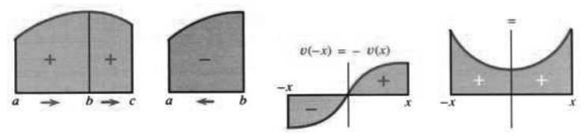
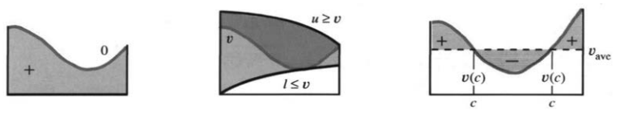
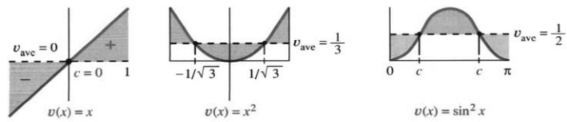
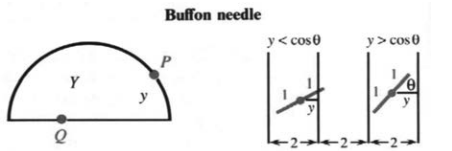

## 5.6 积分的性质与平均值

来源：原书 PDF 第273—279页，印刷页260—266。状态：初译，尚未终审。

<!-- PDF 273 / 印刷页 260 -->

上一节给出了 $\int_a^bv(x)\,dx$ 的定义，但不能止步于定义。定义积分是为了使用它；它的性质很重要，应用更加重要。正是恰当的定义，使积分具有支持各种应用的性质。

一个直接应用是求 $v(x)$ 的平均值。$n$ 个数的平均值很清楚，积分把这个概念推广到连续分布的一整族函数值。这将由下面的性质7引出。现在整理定积分的七条基本性质。

不再重复 $\int[v(x)+w(x)]\,dx$ 的加法法则，尽管这种线性性质最为基本。这里先从另一种加法开始：只有同一个函数 $v(x)$，却有两个相邻区间。**从 $a$ 到 $b$ 的积分，加上从 $b$ 到 $c$ 的积分，等于从 $a$ 到 $c$ 的积分。**

**性质1 区间可加性。** 相邻区间上的带符号面积，相加得到合并区间上的带符号面积：

$$\int_a^bv(x)\,dx+\int_b^cv(x)\,dx=\int_a^cv(x)\,dx.\tag{1}$$

图5.11a使这一点十分直观，它也可以由积分定义推出。只要分割中含有分点 $b$，矩形面积和就满足式(1)；最大网格宽度趋于零时，极限仍满足式(1)。矩形面积的这些基本运算法则，经取极限后仍为积分所保持。

继续考察性质1，可以知道当上下限相等时怎样定义积分。从 $b$ 到 $b$ 的积分对应一个点上方的面积，应该等于零。

**性质2**
$$\int_b^bv(x)\,dx=0.$$

令性质1中的 $c=b$，便得到与这个定义一致的关系：两边已有相同的积分，所以从 $b$ 到 $b$ 的部分必须为零。再令 $c=a$，第二个积分就从 $b$ 积到 $a$。

反向积分会怎样？“下限”现在是较大的数 $b$，“上限”却是较小的 $a$。反向会改变符号。

**性质3**
$$\int_b^av(x)\,dx=-\int_a^bv(x)\,dx=f(a)-f(b).$$

**说明** 当 $c=a$ 时，式(1)右边为零，左边两个积分必须互为相反数。由 $b$ 走向 $a$ 时，步长 $\Delta x$ 为负，因此矩形带符号面积及积分都相应变号，见图5.11b。这样，性质1对 $a,b,c$ 的任意排列次序都成立，只要所涉区间上可积。

**例**
$$\int_x^0t^2\,dt=-\frac{x^3}3,\qquad
\int_1^0dt=-1,\qquad\int_2^2\frac{dt}t=0.$$

**性质4 对称区间上的奇偶性。**

若 $v$ 是奇函数，即 $v(-x)=-v(x)$，则
$$\int_{-a}^av(x)\,dx=0.$$

若 $v$ 是偶函数，即 $v(-x)=v(x)$，则
$$\int_{-a}^av(x)\,dx=2\int_0^av(x)\,dx.$$

这里均假定 $a>0$ 且相应积分存在。$x,x^3,x^5,\ldots$ 是奇函数，改变 $x$ 的符号会改变函数值的符号。$\sin x$、$\tan x$ 及相应主值反函数也是奇函数。

<!-- PDF 274 / 印刷页 261 -->

这是重要的一类函数。奇函数在对称区间上的积分为零，因为正负面积相消：

$$\int_{-a}^a6x^5\,dx=[x^6]_{-a}^a=a^6-(-a)^6=0.$$

若 $v(x)$ 为奇函数，在包含0的对称区间上的原函数 $f(x)$ 为偶函数。$1,x^2,x^4,\ldots$ 都是偶函数。还有一个有趣的区别：奇函数乘偶函数得到奇函数，但奇数乘偶数得到偶数。

偶函数的对称面积则相加：
$$\int_{-a}^a\cos x\,dx=\sin a-\sin(-a)=2\sin a.$$

图5.11：相邻面积相加；反向积分变号；奇函数正负相消；偶函数两侧相加。

下面的性质涉及不等式。若 $v(x)$ 为正，其图像下的面积为正。可以利用下和及极限给出证明。

**性质5 正性。** 对本节的连续函数，若 $a<x<b$ 时 $v(x)>0$，则
$$\int_a^bv(x)\,dx>0.$$

正速度产生正位移；正的函数图像对应正面积。更一般地，设 $v(x)$ 位于下方函数 $l(x)$ 和上方函数 $u(x)$ 之间。使用同一分割及取样点时，对应矩形的带符号面积也按此排序。取极限后，$v$ 的积分便夹在二者之间。

**性质6 比较性质。** 若 $a\le x\le b$ 时 $l(x)\le v(x)\le u(x)$，且三者可积，则

$$\int_a^bl(x)\,dx\le\int_a^bv(x)\,dx\le\int_a^bu(x)\,dx.\tag{2}$$

**例1** 对 $x>0$，
$$\cos t\le1\ \Longrightarrow\ \int_0^x\cos t\,dt\le\int_0^x1\,dt
\ \Longrightarrow\ \sin x\le x.$$

**例2** 对 $0<x<\pi/2$，
$$1\le\sec^2t\ \Longrightarrow\ \int_0^x1\,dt\le\int_0^x\sec^2t\,dt
\ \Longrightarrow\ x\le\tan x.$$

**例3** 将 $1/(1+x^2)\le1$ 从0积分到正数 $x$，得到 $\arctan x\le x$。

这些例子取 $x>0$，例2还必须避开正切的奇点。你可能记得第2.4节曾用几何方法证明 $\sin h<h<\tan h$。例1、2似乎给出了更短的新证明，但这里的逻辑需要小心：当初正是利用这些不等式才建立了三角函数的导数，从而才有相应积分公式。不能把这个推论当成独立于原先论证的证明。

图5.12：$v$ 位于零上方；$v$ 夹在 $l,u$ 之间；平均高度使其上、下方的偏差面积相互抵消。

<!-- PDF 275 / 印刷页 262 -->

**性质7 积分中值定理。** 若 $v$ 在 $[a,b]$ 上连续且 $a<b$，则存在 $c\in(a,b)$，使

$$v(c)=\frac1{b-a}\int_a^bv(x)\,dx
=\text{$v(x)$ 在 $[a,b]$ 上的平均值}.\tag{3}$$

它与通常的微分中值定理对应：

$$f'(c)=\frac{f(b)-f(a)}{b-a}=\text{$f$ 的平均变化率}.\tag{4}$$

若 $f'=v$，利用基本定理，式(3)与式(4)便是同一个等式。但必须承认，此时若直接这样证明，逻辑还有缺口：需要先用微积分基本定理保证 $f(x)=\int_a^xv(t)\,dt$ 的确满足 $f'=v$。

可以直接证明式(3)。在整个 $[a,b]$ 上放一个矩形，让它的高度从函数最小值 $v_{\min}$ 逐渐升到最大值 $v_{\max}$。根据比较性质，在某个中间高度，矩形的带符号面积恰好等于积分。连续函数又会取遍最小值与最大值之间的所有值，因此此高度可写成某个 $v(c)$。于是矩形面积 $(b-a)v(c)$ 等于 $\int_a^bv(x)\,dx$，即式(3)。

图5.13：面积除以区间长度 $b-a$，得到平均高度，并在某点 $c$ 处等于 $v(c)$。

这个直接证明使用了介值定理：连续函数 $v$ 取遍 $v_{\min}$ 与 $v_{\max}$ 之间的全部高度。在某些点，例如图5.12c的两个点，函数等于自身的平均值。图5.13显示，平均高度上方与下方的偏差面积相等。

**例4** 奇函数在 $[-1,1]$ 上的平均值为零。例如
$$\frac12\int_{-1}^1x\,dx=\left[\frac{x^2}4\right]_{-1}^1
=\frac14-\frac14=0.$$
注意归一化因子 $1/(b-a)=1/2$。这次可以明确给出 $c=0$，此处 $v(c)=v_{\mathrm{ave}}=0$。

**例5** $x^2$ 在 $[-1,1]$ 上的平均值为 $1/3$：
$$\frac12\int_{-1}^1x^2\,dx=\left[\frac{x^3}6\right]_{-1}^1
=\frac16-\left(-\frac16\right)=\frac13.$$
函数何处等于平均值 $1/3$？解 $c^2=1/3$，得 $c=\pm1/\sqrt3$。这就是图5.13b中的两个点，也是高斯求积点；第5.8节将说明它们在数值积分中的用途。

<!-- PDF 276 / 印刷页 263 -->

**例6** $\sin^2x$ 在一个周期，即0到 $\pi$ 上的平均值为 $1/2$：

$$\frac1\pi\int_0^\pi\sin^2x\,dx
=\left[\frac{x-\sin x\cos x}{2\pi}\right]_0^\pi=\frac12.$$

归一化因子是 $1/(b-a)=1/\pi$。可取 $c=\pi/4$ 或 $3\pi/4$，此时 $\sin^2c=1/2$。$\sin^2x$ 的图像围绕平均值 $1/2$ 振荡，这既可由图看出，也可由恒等式看出：

$$\sin^2x=\frac12-\frac12\cos2x.\tag{5}$$

恒定项为 $1/2$，振荡项为 $-\tfrac12\cos2x$。一个原函数是 $f(x)=\tfrac12x-\tfrac14\sin2x$，也就是 $\tfrac12x-\tfrac12\sin x\cos x$。以后还会遇到这个积分，请验证 $df/dx=\sin^2x$。

### 平均值与期望

函数在 $[a,b]$ 上的平均值，是积分除以长度 $b-a$。我们已经为 $x,x^2,\sin^2x$ 计算过，却还没有解释它为什么叫平均值。它是积分的重要应用，来自 $n$ 个数的普通平均数：

$$v_{\mathrm{ave}}=\frac1{b-a}\int_a^bv(x)\,dx
\quad\longleftrightarrow\quad
v_{\mathrm{ave}}=\frac1n(v_1+v_2+\cdots+v_n).$$

积分与求和相对应：和式趋于积分，离散平均趋于连续平均。$1/3,2/3,3/3$ 的平均值为 $2/3$，$1/5,2/5,3/5,4/5,5/5$ 的平均值为 $3/5$。从 $1/n$ 到 $n/n$ 的 $n$ 个数，其平均值为

$$v_{\mathrm{ave}}=\frac1n\left(\frac1n+\frac2n+\cdots+\frac nn\right)
=\frac{n+1}{2n}.\tag{7}$$

$n$ 为奇数时，中间那一项就是平均值；也可以直接求和。当 $n\to\infty$ 时，右端点和趋于积分，你能看到其中的矩形吗？普通的数值平均就变为 $v(x)=x$ 的连续平均：

$$\frac{n+1}{2n}\longrightarrow\frac12,\qquad
\int_0^1x\,dx=\frac12,$$

此处 $1/(b-a)=1$。日常语言说“0与1之间所有数的平均值是 $1/2$”。但这里含有连续无穷多个数，必须通过积分等严格构造，才能赋予这句话确定含义。

这些数的平方的平均值则是 $\int_0^1x^2\,dx=1/3$。**若在0与1之间均匀随机取一个数，其期望是 $1/2$，其平方的期望是 $1/3$。**

这句话可能使人困惑。首先，我们并不指望每次恰好取到 $1/2$，所以必须定义“期望”；其次，既然期望是 $1/2$，为什么平方的期望是 $1/3$，而不是 $1/4$？这些概念来自概率论，微积分正引导我们进入连续型概率。这里先作简短介绍，第8章再继续。

<!-- PDF 277 / 印刷页 264 -->

### 随机事件中可预测的平均值

假设掷两枚骰子。单次结果无法预知，否则何必掷呢？但重复很多次时，平均结果会越来越稳定。我们不知道单次发生什么，却知道各结果的概率。这里假设骰子公平、彼此独立，各次投掷也独立。

两枚骰子的点数均在1到6之间，所以点数和在2到12之间。点数和为2，要求两枚都为1，概率为 $(1/6)(1/6)=1/36$。各结果的概率如下：

| 点数和 | 2 | 3 | 4 | 5 | 6 | 7 | 8 | 9 | 10 | 11 | 12 |
|---|---|---|---|---|---|---|---|---|---|---|---|
| 概率 | $1/36$ | $2/36$ | $3/36$ | $4/36$ | $5/36$ | $6/36$ | $5/36$ | $4/36$ | $3/36$ | $2/36$ | $1/36$ |

单次结果不可预测，已知的只是概率；这些概率之和为1，因为所有可能性都已列出。100万次投掷的总点数仍有随机性，可能落在200万到1200万之间。不过，这100万次结果的平均值通常会非常接近期望。期望按下述方法求得：

> **期望：把每个结果乘以其发生概率，再全部相加。**

$$\frac2{36}+\frac6{36}+\frac{12}{36}+\frac{20}{36}+\frac{30}{36}
+\frac{42}{36}+\frac{40}{36}+\frac{36}{36}+\frac{30}{36}+\frac{22}{36}+\frac{12}{36}=7.$$

原书给出一个课堂挑战：掷1000次，若平均值不在6.9到7.1之间，就给你一个A。可以用计算机的随机数生成器模拟，但应正确生成1到6的等概率整数。

现在转向连续型概率。假设2到12之间均匀取值，这里包括所有实数，而不仅是整数。恰好取到某个指定数，例如 $x=\pi$ 的概率是多少？是零！在这个连续分布中，每个单点的概率都是零，但一个非零长度区间的概率可为正：

- 结果在2到3之间的概率为 $1/10$。
- 若 $[x,x+\Delta x]\subseteq[2,12]$，结果落入其中的概率为 $\Delta x/10$。

为求平均值，先作离散近似：把2到12分成10段，各长1、概率为 $1/10$。用左端点代表每段，得到平均值近似 $6\tfrac12$：

$$2\cdot\frac1{10}+3\cdot\frac1{10}+\cdots+11\cdot\frac1{10}=6.5.$$

这里代表值都是整数。改用20段，各长 $1/2$、概率为 $1/20$，近似值为 $6\tfrac34$。你已经看出趋势：这些是矩形面积和，即黎曼和，$\Delta x\to0$ 时趋于积分。通常把小区间概率表示为密度 $p(x)$ 乘以微小长度 $dx$；本例在 $[2,12]$ 上 $p(x)=1/10$。连续情形的期望由积分给出：

$$E(X)=\int_2^{12}xp(x)\,dx
=\int_2^{12}\frac{x}{10}\,dx
=\left[\frac{x^2}{20}\right]_2^{12}=7.$$

这是重要的一步。从积分角度看，它是和式的极限；从概率角度看，单点概率为零，但概率密度并不为零。

<!-- PDF 278 / 印刷页 265 -->

本例的密度为 $p(x)=1/10$。密度在全部可能范围上的积分为1，因为总会得到某个结果；$xp(x)$ 的积分为 $E(X)=7$。每次取值是随机的，但大量重复取值的平均数具有稳定规律。

这完成了概率论的第一步。学过更多微积分后再继续；例如，衰减的概率密度可涉及 $e^{-x}$ 或 $e^{-x^2}$，使很大数值出现的概率很小。最后列出从0到1均匀随机选取 $X$，即密度为1时，$X^n$、$1/\sqrt X$ 和 $1/X$ 的期望：

$$E(X^n)=\int_0^1x^n\,dx=\frac1{n+1}\qquad(n>-1);$$
$$E\left(\frac1{\sqrt X}\right)=\int_0^1\frac{dx}{\sqrt x}=2;$$
$$E\left(\frac1X\right)=\int_0^1\frac{dx}{x}=+\infty.$$

最后一个发散，意味着不存在有限期望。

### “平均班级规模”的混淆

一所大学可以宣传平均每班29人，而学生感受到的班级规模却大得多。下面说明原因。

假设有95个班各20人，另有5个班各200人。100个班的选课人次合计 $1900+1000=2900$。均匀随机选一个班，人数的期望是29。若按学生选课人次随机抽取，情况便不同：来自小班的概率为 $1900/2900$，来自大班的概率为 $1000/2900$。因此，从学生选课人次的角度，所在班级人数的期望为

$$20\cdot\frac{1900}{2900}+200\cdot\frac{1000}{2900}
=\frac{2380}{29}\approx82.07\text{人}.$$

类似地，餐厅顾客所经历的平均等候时间可能为40分钟，而接待员把全天各时段等权平均，得到的却是10分钟。在前一种模型中，按顾客抽样；后一种则按时间抽样。抽样方式不同，平均值就可能不同。

原书还以交通为例，提出提高每车平均人数可能缓解拥堵，并强调两个百分比不同：（a）只有一人的汽车占全部汽车的比例；（b）独自乘车的人占全部乘车人数的比例。后者较小。按人抽样时，人数多的车辆得到更大权重。第37、38题将讨论这种差别。

### 5.6 习题

#### 阅读填空

$\int_0^bv(x)\,dx$ 与 $\int_b^5v(x)\,dx$ 相加得 $\underline{\text{a}}$。$\int_1^3v(x)\,dx$ 等于 $\underline{\text{b}}$，理由是 $\underline{\text{c}}$。若 $v(x)\le x$，则 $\int_0^1v(x)\,dx\le\underline{\text{d}}$。$v$ 在 $[1,9]$ 上的平均值定义为 $\underline{\text{e}}$。若 $v$ 连续，它等于某点 $c$ 处的 $v(c)$，其中 $c$ 位于 $\underline{\text{f}}$。以整个区间为底、高为 $v(c)$ 的矩形，与 $\underline{\text{g}}$ 有相同的带符号面积。$v(x)=x+1$ 在 $[1,9]$ 上的平均值为 $\underline{\text{h}}$。

若从 $1,3,5,7$ 中以相同概率 $1/4$ 取 $X$，其期望为 $\underline{\text{i}}$，$X^2$ 的期望为 $\underline{\text{j}}$。若从 $1,2,\ldots,8$ 中以相同概率 $1/8$ 取值，期望为 $\underline{\text{k}}$。若在 $[1,9]$ 上均匀取值，恰好取到整数的概率为 $\underline{\text{l}}$；落在 $x$ 到 $x+dx$ 的微小区间中的概率写为 $p(x)\,dx=\underline{\text{m}}$；期望 $E(X)$ 由积分 $\underline{\text{n}}$ 给出，等于 $\underline{\text{o}}$。

#### 练习

第1—6题：求 $v$ 在 $[a,b]$ 上的平均值，并找出所有满足 $v(c)=v_{\mathrm{ave}}$ 的点 $c$。

1. $v=x^4$，$a=-1,b=1$。
2. $v=x^5$，$a=-1,b=1$。
3. $v=\cos^2x$，$a=0,b=\pi$。
4. $v=\sqrt x$，$a=0,b=4$。
5. $v=1/x^2$，$a=1,b=2$。
6. $v=(\sin x)^9$，$a=-\pi,b=\pi$。
7. 当 $x=8$ 时，$F(x)=\int_3^xv(t)\,dt+\int_x^5v(t)\,dt=$ ______。
8. $\int_1^3x\,dx+\int_3^5x\,dx-\int_5^1x\,dx=$ ______。

<!-- PDF 279 / 印刷页 266 -->

第9—16题：判断正误，说明理由或举例。

9. $\int_4^xv(t)\,dt$ 的最小值在 $x=4$ 处取得。
10. $\int_x^{x+3}v(t)\,dt$ 的值与 $x$ 无关。
11. 从0到3的平均值，等于从0到1的平均值乘 $1/3$，加上从1到3的平均值乘 $2/3$。
12. $(f(b)-f(a))/(b-a)$ 是 $f(x)$ 在 $[a,b]$ 上的平均值。
13. 在对称区间 $[-1,1]$ 上，$v(x)-v_{\mathrm{ave}}$ 是奇函数。
14. 若 $l(x)\le v(x)\le u(x)$，则 $dl/dx\le dv/dx\le du/dx$。
15. $v$ 从0到2的平均值加上从2到4的平均值，等于从0到4的平均值。
16. （a）偶函数的原函数都是奇函数。（b）奇函数的平方都是奇函数。
17. 什么数 $\bar v$ 满足 $\int_a^b(v(x)-\bar v)\,dx=0$？
18. 若 $f(2)=6,f(6)=2$，则 $df/dx$ 从2到6的平均值为 ______。
19. （a）$\cos x$ 与 $|\cos x|$ 从0到 $\pi$ 的平均值分别为 ______。（b）$v_1,\ldots,v_n$ 的平均值 ______ $|v_1|,\ldots,|v_n|$ 的平均值。
20. （a）积分的哪条性质给出 $\int_0^1v(x)\,dx\le\int_0^1|v(x)|\,dx$？（b）哪条性质给出 $-\int_0^1v(x)\,dx\le\int_0^1|v(x)|\,dx$？合起来便得到性质8：
   $$\left|\int_0^1v(x)\,dx\right|\le\int_0^1|v(x)|\,dx.$$
21. 什么函数在每个正的 $x$ 处，都满足从0到 $x$ 的平均值等于 $v(x)/3$？什么函数满足该平均值始终等于 $v(x)$？
22. （a）若 $v$ 递增，利用性质6解释为什么对 $x>0$ 有 $\int_0^xv(t)\,dt\le xv(x)$。（b）在 $v$ 可导的条件下，利用两边导数给出第二种证明。
23. 当 $b\to\infty$ 时，$v(x)=1/(1+x^2)$ 在 $[0,b]$ 上的平均值趋于 ______，$V(x)=x^2/(1+x^2)$ 的平均值趋于 ______。
24. 若正数数列 $v_n\to0$，证明其平均值 $(v_1+\cdots+v_n)/n$ 也趋于零。
25. 求点 $x=a$ 到区间 $0\le x\le2$ 上各点的平均距离。当 $a<2$ 时，公式是否变化？
26. 计算机实验：在0到1之间独立均匀取随机数 $x$，直到 $x^2$ 的样本平均落在0.333与0.334之间。所得 $x^2$ 有多少个高于、多少个低于平均值？如可行，重复10次。
27. 沿半径为1的半圆均匀随机取点 $P$，即等长弧被选中的概率相等。到 $x$ 轴的距离 $y$ 的平均值是多少？见下图。
28. 在 $[-1,1]$ 上均匀随机取点 $Q$。（a）从 $Q$ 竖直到半圆的距离 $Y$ 的平均值是多少？（b）为什么与第27题不同？

29. **计算 $\pi$ 的经典方法。** 将一根长2英寸的针随机投到地板上，平行地板缝间距为2英寸。求针跨越某条缝的概率。当 $\cos\theta>y$ 时会跨缝，其中 $y$ 是针中点到最近缝的距离。假设位置和方向独立且均匀，在矩形 $0\le\theta\le\pi/2,0\le y\le1$ 中画出 $y<\cos\theta$ 的区域，求其面积占比。
30. 若布丰针的长度由2改成 $2x$，仍使用相同间距的地板缝，求跨缝概率 $P(x)$。
31. 同时掷三枚独立公平骰子，点数和3到18各自的概率是多少？期望是多少？
32. 在单位正方形 $0\le x\le1,0\le y\le1$ 中均匀随机取点，坐标满足 $y^2\le x$ 的概率是多少？
33. 电压 $V(t)=220\cos(2\pi t/60)$，振幅220伏。按此给定公式求从0到 $t$ 的平均电压。原书同时称频率为60赫兹，与公式不一致，见译注。
34. （a）证明 $v_{\mathrm{even}}(x)=\tfrac12(v(x)+v(-x))$ 总是偶函数。（b）证明 $v_{\mathrm{odd}}(x)=\tfrac12(v(x)-v(-x))$ 总是奇函数。
35. 利用第34题或其他方法，把 $(x+1)^3$ 与 $1/(x+1)$ 分别写成偶函数与奇函数之和。
36. 从导数定义出发，证明偶函数 $f(x)$ 的导函数为奇函数。
37. 四个班分别有6、8、10、40人，按班级平均人数为 ______。均匀随机选一名学生，他属于第一个班的概率为 ______。从学生角度的班级人数期望为
   $$E(X)=6\cdot\frac6{64}+8\cdot\frac8{64}+10\cdot\frac{10}{64}+40\cdot\frac{40}{64}=\underline{\hspace{1cm}}.$$
38. 各组人数为 $x_1,\ldots,x_n$，合计 $G$ 人。按组平均人数为 ______；均匀随机选一人，他属于第1组的概率为 ______。所在组人数的期望为 $E(X)=x_1(x_1/G)+\cdots+x_n(x_n/G)$。证明 $\sum_{i=1}^n x_i^2/G\ge G/n$。
39. 快速判断正误，每项约15秒：（a）若 $f(x)\le g(x)$，则 $f'(x)\le g'(x)$。（b）若 $f'(x)\le g'(x)$，则 $f(x)\le g(x)$。（c）若 $v$ 为偶函数，则 $xv(x)$ 为奇函数。（d）若在每个区间上都有 $v_{\mathrm{ave}}\le w_{\mathrm{ave}}$，则每一点都有 $v(x)\le w(x)$。
40. 某人认为，若
   $$v(x)=\begin{cases}2x,&x<3,\\-2x,&x>3,\end{cases}
   \quad\text{则可取}\quad
   f(x)=\begin{cases}x^2,&x<3,\\-x^2,&x>3,\end{cases}$$
   因而 $\int_0^4v(x)\,dx=f(4)-f(0)=-16$。请纠正这一错误。
41. 若 $v(x)=|x-2|$，求一个原函数 $f(x)$，并计算 $\int_0^5v(x)\,dx$。
42. 为什么平均高度 $v_{\mathrm{ave}}$ 上方与下方的偏差面积相等？

### 译注与数学核对

1. 性质2、3严格说是把原先 $a<b$ 时的定义推广到相等及反向积分限；性质1验证这些约定相容。奇偶积分公式均要求可积，不能用于跨越正切极点的普通定积分，也不能把对称抵消当作发散反常积分的收敛。
2. 原书正性证明说“下和为正”，若函数只在开区间为正、端点为零，粗分割下和可能为零。连续情形可在一个内点附近找到正下界，先得到正的局部积分，再用其他部分非负，完成证明。
3. 式(4)原书分子误作 $f(b)-f(c)$，已更正为 $f(b)-f(a)$。例6积分中的 $\sin x^2$ 与上下文不符，已更正为 $\sin^2x$。原书公式编号由(5)跳到(7)，译文保留这一编号顺序。
4. 随机取值必须规定分布，不能把“随机”自动等同于“均匀”。大数定律描述样本平均随独立重复次数增加的收敛，不保证任意有限样本一定落在某个范围。原书“1000次不在6.9—7.1就给A”保留为课堂挑战，不是数学保证。均匀骰子可由 $\lfloor6U\rfloor+1$（$U$ 在 $[0,1)$ 上均匀）生成，直接四舍五入可能使端点概率不等。
5. 连续分布中“单点概率为零”不表示该点在逻辑上不可能成为取值。一般小区间概率为 $\int_x^{x+h}p(t)\,dt$，连续密度下近似为 $p(x)h$；本节常密度例中则精确相等。平方的期望一般不等于期望的平方，二者之差是方差。
6. 班级例的准确学生加权均值为 $2380/29$，原书写等号82，译文改为近似值82.07。该例只有约34.5%的选课人次在大班，不能证明原文开头的“多数学生大多数时间在大班”；译文改为“感受到的班级规模更大”。若每人修多门课，必须区分学生人数与选课人次。餐厅的10、40分钟及交通的“每车2人或2.5人即可消除问题”均为原书情境性说法，未提供通用推导；正文保留其抽样思想，未将交通断言写成定理。
7. 第22(b)题应比较两边之差的导数，并使用0处相等的初值，不能从函数不等式直接对两边求导。第25题还须区分 $a<0$、$0\le a\le2$、$a>2$，不只是原文提示的 $a<2$。
8. 第30题短针 $0\le x\le1$ 与长针 $x>1$ 的概率公式不同。第33题若 $t$ 的单位是秒，给定公式频率是 $1/60$ 赫兹；60赫兹应写为 $220\cos(120\pi t)$。译文保留公式并明确指出矛盾，没有默默替换题目。
9. 第35题的偶奇分解须在对称定义域上进行；$1/(x+1)$ 的标准分解共同定义域须排除 $x=\pm1$。第39(d)题对连续函数成立，但若只假定可积，则改变单点值就可给出反例。第40题错误在于分段原函数的常数未匹配，所写 $f$ 在3处跳跃，不能直接用一个端点差越过该点。
