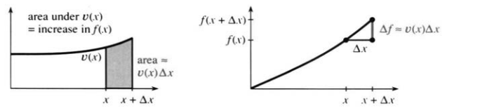
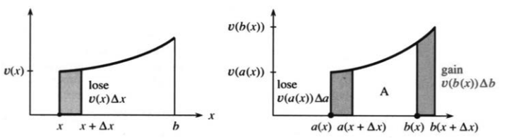
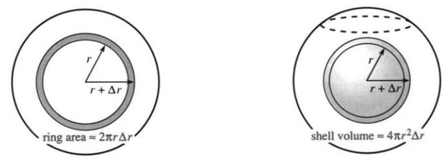
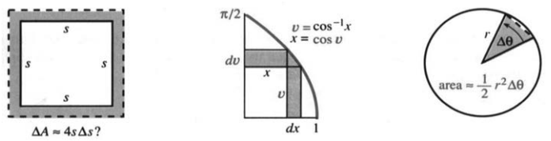
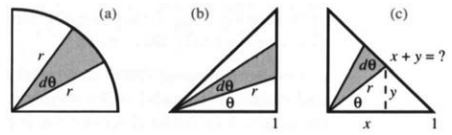
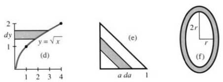

## 5.7 微积分基本定理及其应用

来源：原书 PDF 第280—287页，印刷页267—274。状态：初译，尚未终审。

<!-- PDF 280 / 印刷页 267 -->

端点固定在 $a,b$ 时，定积分给出一个数；上限换成变量 $x$，它就成了不定积分。再往一般走：只要端点以任何方式依赖 $x$，积分便是 $x$ 的函数，导数也就可以求了。走到这一步，得请出微积分基本定理。

定理的精髓就一句：**$v$ 的积分的导数等于 $v$。**我们还会算上下限都动的情形——积分从 $a(x)$ 走到 $b(x)$，它的导数是什么。

第二部分把次序颠倒过来：**$f$ 的导数的积分等于 $f+C$。**有微分中值定理帮忙，它很快就能从第一部分推出来。积分通常比求导难，所以第二部分反倒用得最多。

证完定理，我们去看新的应用——不只是曲线下面积那类老问题。积分能把圆环、三角形、薄壳一块块加起来，不只限于矩形；答案可以是体积、是概率，也不只是面积。

### 基本定理第一部分

拿一个连续函数 $v$，从固定点 $a$ 积到动点 $x$。每给定一个 $x$，积分 $f(x)$ 就是一个数。我们既不要求、也不指望它有现成的显式公式——它就是积到 $x$ 为止的面积，当然是 $x$ 的函数。基本定理说：这个面积函数有导数（又一个取极限的过程），而导数正好是原来的 $v(x)$。

> **5C 微积分基本定理第一部分**
>
> 设 $v(x)$ 是连续函数。若
> $$f(x)=\int_a^xv(t)\,dt,$$
> 则
> $$f'(x)=v(x).$$

把积分变量写成 $t$，眼睛就可以只盯着上下限。积分值只由 $a$ 和 $x$ 决定，跟哑变量的名字 $t$ 无关。

要求 $df/dx$，先算 $\Delta f=f(x+\Delta x)-f(x)$——这就是两块面积之差：

$$\Delta f=\int_a^{x+\Delta x}v(t)\,dt-\int_a^xv(t)\,dt
=\int_x^{x+\Delta x}v(t)\,dt.\tag{1}$$

严格说来，这是性质1：到 $x+\Delta x$ 的面积减去到 $x$ 的面积，剩下的正是两点之间那一小条。再除以 $\Delta x$：

$$\frac{\Delta f}{\Delta x}
=\frac1{\Delta x}\int_x^{x+\Delta x}v(t)\,dt
=\text{该短区间上的平均值}=v(c).\tag{2}$$

这一步用的是性质7，积分中值定理。点 $c$ 落在 $x$ 与 $x+\Delta x$ 之间，具体位置不必知道。让 $\Delta x\to0$，就有 $c\to x$；又因 $v$ 连续，$v(c)$ 趋于 $u(x)$。对式(2)取极限，便得

$$\frac{\Delta f}{\Delta x}\longrightarrow\frac{df}{dx},\qquad
v(c)\longrightarrow v(x),\qquad
\frac{df}{dx}=v(x).\tag{3}$$

$\Delta x<0$ 时，推理照样成立。那为什么非得要求 $v$ 连续？若 $v$ 为阶跃函数，$f(x)$ 会出现一个折角，那里的 $df/dx$ 不等于 $v(x)$。

<!-- PDF 281 / 印刷页 268 -->

也可以绕开积分中值定理，只用上下界把它夹住：

$$\begin{aligned}
v_{\min}&\le v(t)\le v_{\max},\qquad t\text{ 在 }x\text{ 与 }x+\Delta x\text{ 之间},\\
v_{\min}\Delta x&\le\Delta f\le v_{\max}\Delta x,\\
v_{\min}&\le\frac{\Delta f}{\Delta x}\le v_{\max}.
\end{aligned}\tag{4}$$

$\Delta x\to0$ 时，$v_{\min}$ 与 $v_{\max}$ 一起挤向 $v(x)$，结果还是 $df/dx=v(x)$。

图5.14：基本定理第一部分：窄条面积 $\Delta f$ 除以底长 $\Delta x$，便趋于高度 $v(x)$。area under＝曲线下面积；increase in＝相应函数的增量。

**几何意义** $f$ 的图像画出的是 $v$ 图像下方的累计面积。图里那条窄条的面积就是 $\Delta f$，近似等于 $v(x)\Delta x$。再除以底长，差商便贴近高度 $v(x)$。窄条无限变薄时，“近似相等”通过极限变成准确的等式：$df/dx=v(x)$。

### 变积分限积分的导数

上限是 $x$，导数就是 $v(x)$。那下限是 $x$ 又如何？积分改成从 $x$ 走到固定点 $b$。$x$ 一动，下限跟着动；图5.15的左侧，$x$ 往右挪会削掉左边一块面积，所以导数前面带负号：

$$g(x)=\int_x^bv(t)\,dt\quad\Longrightarrow\quad g'(x)=-v(x).\tag{5}$$

最快的证法是把积分限翻过来，这会改变符号（性质3）：

$$g(x)=-\int_b^xv(t)\,dt,$$

再用第一部分，立刻得 $g'(x)=-v(x)$。

图5.15：从 $x$ 到 $b$ 的面积，导数是 $-v(x)$。两端都在动时，上端添进 $v(b)\,db$，下端失去 $v(a)\,da$。lose＝减少；gain＝增加。

一般情形记号多些，难度却没涨多少，用处倒很大：两个积分限都随 $x$ 变。上限 $b(x)$ 不一定就是 $x$，下限 $a(x)$ 也可以依赖 $x$。

<!-- PDF 282 / 印刷页 269 -->

两端之间的面积 $A$ 随 $x$ 而变，我们要求 $dA/dx$：

$$A(x)=\int_{a(x)}^{b(x)}v(t)\,dt
\quad\Longrightarrow\quad
A'(x)=v(b(x))b'(x)-v(a(x))a'(x).\tag{6}$$

图里画出两条窄条：一条添进去，一条减出来。先拿已知的情形验一验。$a=0,b=x$ 时，$a'=0,b'=1$，式(6)给出 $v(x)$，正是基本定理。$a=x,b$ 为常数时，给出 $-v(x)$。若积分从 $a=2x$ 走到 $b=x^3$，那就是新例子了。

**例1**
$$A(x)=\int_{2x}^{x^3}\cos t\,dt=\sin(x^3)-\sin2x,$$
$$A'(x)=3x^2\cos(x^3)-2\cos2x.$$

这跟式(6)对得上：$b'=3x^2$，$a'=2$，下限那一项还带着负号。它看着像链式法则——它本来就是链式法则。要证式(6)，先取 $f$ 为 $v$ 的一个原函数：

$$A(x)=f(b(x))-f(a(x)),$$

这里用到了下文的基本定理第二部分。再用链式法则，

$$A'(x)=f'(b(x))b'(x)-f'(a(x))a'(x).$$

因为 $f'=v$，式(6)到此证完。下一个例子里，面积看着依赖 $x$，实际上是个常数。注意 $v(t)=1/t$，所以 $v(3x)=1/(3x)$。

**例2**
$$A(x)=\int_{2x}^{3x}\frac{dt}t,\qquad
A'(x)=\frac1{3x}\cdot3-\frac1{2x}\cdot2=0.$$

**问题** 设 $A(x)=\int_{-x}^xv(t)\,dt$，则 $A'(x)=v(x)+v(-x)$。$v(-x)$ 前头为什么是加号？

### 基本定理第二部分

这条定理我们早已反复使用，现在才正式证明，它是积分计算的关键：“$df/dx$ 的不定积分是 $f(x)+C$。”用法是从 $v(x)$ 出发，去找一个导数等于它的 $f(x)$。若 $f'=v$，则

$$\int v(x)\,dx=\int\frac{df}{dx}\,dx=f(x)+C.$$

证明不能靠背下来的公式，只能靠积分与导数的定义。先看一个极特殊、却极要紧的情形：$f'$ 恒为零。常数函数随手就能找到；难的是证明除此之外别无可能。斜率处处为零，图像理应是一条平直的线。这道理谁都觉得对，可直觉终究不等于证明。

设 $f'=0$ 在某个区间上成立。若 $f$ 不是常数，总能找到 $a,b$ 使 $f(a)\ne f(b)$。由微分中值定理，中间某点 $c$ 满足

$$f'(c)=\frac{f(b)-f(a)}{b-a}\ne0,$$

这与 $f'=0$ 直接冲突。所以 $f$ 只能是常数。

<!-- PDF 283 / 印刷页 270 -->

注意中值定理在这里的关键作用：条件只是局部的——每一点导数为零；结论却是整体的——整个区间上函数为常数。导数把视野收窄到局部，积分再把它铺回整体；中值定理正好把瞬时与平均、局部与整体、点与区间连起来。这个结论还能用在两个函数导数相同的时候：

$$\text{若在一个区间上 }A'(x)=f'(x),\quad\text{则 }A(x)=f(x)+C.\tag{7}$$

道理很简单：$A-f$ 的导数为零，它就只能是常数。

下面登场的是那条大定理。它假设 $v$ 连续，并借原函数 $f$ 来算积分。

> **5D 微积分基本定理第二部分**
>
> 若 $v(x)=df/dx$，则
> $$\int_a^bv(x)\,dx=f(b)-f(a).$$

**证明** 手里已有一个原函数 $f(x)$。第一部分却又为同一个 $v$ 造出了另一个原函数——由矩形和的极限得来的积分函数：

$$A(x)=\int_a^xv(t)\,dt,\qquad A'(x)=v(x).$$

既然 $A'=v=f'$，式(7)便给出 $A(x)=f(x)+C$。关键就在这儿：矩形搭出来的积分函数，跟我们找到的原函数只差一个常数。

看下限：$A(a)=0$，故 $f(a)+C=0$；再看上限：$A(b)=f(b)+C$。两式一减，得

$$A(b)=\int_a^bv(x)\,dx=f(b)-f(a).$$

微积分很美，而它的基本定理，正是它最有用的定理。

**第二种证明** 仍从 $f'=v$ 出发，把区间切成若干小段，每段各用一次微分中值定理：

$$\begin{aligned}
f(x_1)-f(a)&=v(x_1^*)(x_1-a),\\
f(x_2)-f(x_1)&=v(x_2^*)(x_2-x_1),\\
&\ \vdots\\
f(b)-f(x_{n-1})&=v(x_n^*)(b-x_{n-1}).
\end{aligned}$$

左边逐项相加，中间项互相抵消，只剩 $f(b)-f(a)$；右边的和在 $\Delta x\to0$ 时就是 $\int_a^bv(x)\,dx$。

### 积分的应用

到目前为止，积分主要用来表示曲线下的面积，其实它的用场多得很。**求和一旦变成“连续”的，我们就有了积分，而不再是和。**第8章会把这些应用铺开讲，这里先看四个几何例子，说明矩形并不是唯一的选择。

物理、工程、生物、经济里的问题，先不深究，往后都会碰到。这里的目标只有一个：迈出离开矩形的第一步。

<!-- PDF 284 / 印刷页 271 -->

**例3 圆的面积 $A$ 与周长 $C$ 之间，有 $dA/dr=C$ 这层关系。**

为什么？面积是 $\pi r^2$，求导得 $2\pi r$，正好是周长。按基本定理，把周长积起来自然得到面积。可这里还缺一层几何上的解释：面积凭什么等于周长对半径的积分？

我要说的是：用来拼面积的小块不是矩形。硬要在圆弧底下塞矩形也行，可那些矩形的高跟周长扯不上关系。直觉要换个方向：去累加图5.16里的薄圆环。

图5.16：圆面积由一圈圈薄圆环累积而成，球体积由一层层薄球壳累积而成。ring area＝圆环面积；shell volume＝球壳体积。

设圆环厚度为 $\Delta r$，它的面积近似为 $C(r)\Delta r$，误差是 $(\Delta r)^2$ 这一阶——正是我们要的精度。积分把这些圆环面积累加起来，跟先前累加矩形面积是一个路数：

$$A=\int_0^rC\,dr=\int_0^r2\pi r\,dr=\pi r^2.$$

从矩形跨到圆环，这是第一步。圆环面积还能精确验算：它就是两个圆面积之差：

$$\Delta A=\pi(r+\Delta r)^2-\pi r^2
=2\pi r\Delta r+\pi(\Delta r)^2.$$

也就是 $C(r)\Delta r$ 再加一个修正项。两边同除以 $\Delta r$，让它趋于零，便得 $dA/dr=C$。

几何上，不妨把薄圆环展开，看成一条窄条：宽是 $\Delta r$，长近似为周长。内外两个圆的周长并不相等，所以它算不上严格的矩形，面积却接近 $C\Delta r$。

**例4 球的表面积与体积之间，有 $A=dV/dr$ 这层关系。**

圆的那套办法，对球同样管用，只消把薄圆环换成薄球壳。球壳从半径 $r$ 铺到 $r+\Delta r$，厚度为 $\Delta r$。我们不必求出每个球壳的精确体积，够准的近似就行。球面面积是 $4\pi r^2$，于是薄壳体积近似为 $4\pi r^2\Delta r$。

误差照样从二阶起步。写成微分就是 $dV=A\,dr$，于是

$$V=\int_0^rA\,dr
=\int_0^r4\pi r^2\,dr=\frac43\pi r^3.$$

球的体积，就这样到手了。$V$ 的导数是 $A$，薄球壳把缘由说清楚了。要点一句话：**积分不限于累加矩形。**

<!-- PDF 285 / 印刷页 272 -->

**例5 正方形周长是 $4s$，面积的导数怎么偏偏是 $dA/ds=2s$？**

边长是 $s$，面积是 $s^2$，导数 $2s$ 只等于半个周长。我试着画个图看明白——通常这招很灵——可图5.17a看上去倒像 $dA/ds=4s$。准是哪里出了岔子。下课铃响了，这题留作练习。

**例6 求 $v(x)=\cos^{-1}x$ 在0到1下方的面积。**

这是道常规题，可惜我们还没学反余弦的原函数。真要找，当然也找得着；不过还有一条不那么常规、却照样正确的路：把竖直薄条换成水平薄条。图5.17b中一条典型的水平薄条，长为 $x=\cos v$，因为曲线是 $v=\cos^{-1}x$。厚度 $\Delta v\to0$ 时，面积和便趋于 $\int x\,dv$。这时是沿竖直方向积分，积分限得用 $v$ 的取值：

$$\text{面积}=\int_0^{\pi/2}\cos v\,dv=[\sin v]_0^{\pi/2}=1.$$

习题会让你列出别的积分式，用的并不总是矩形。阿基米德算圆面积，用的就是三角形，不是圆环。

图5.17：正方形出了问题；水平薄条和三角形取得成功。

### 5.7 习题

#### 阅读填空

面积函数 $f(x)=\int_a^xv(t)\,dt$，是 $\underline{\text{a}}$ 的函数。由基本定理第一部分，它的导数是 $\underline{\text{b}}$。证明中，小增量 $\Delta x$ 产生一个窄 $\underline{\text{c}}$ 的面积，这个 $\Delta f$ 近似为 $\underline{\text{d}}$ 乘 $\underline{\text{e}}$。因此 $\int_a^xt^2\,dt$ 的导数是 $\underline{\text{f}}$。

$\int_x^bt^2\,dt$ 的导数是 $\underline{\text{g}}$，负号来自 $\underline{\text{h}}$。两个积分限都依赖 $x$ 时，导数公式是 $\underline{\text{i}}$ 减去 $\underline{\text{j}}$。比如 $\int_2^{3x}t\,dt$ 的导数就是 $\underline{\text{k}}$。

按基本定理第二部分，$df/dx$ 的不定积分是 $\underline{\text{l}}$。若 $df/dx=0$，则 $\underline{\text{m}}$。由此还能推出：若 $A'=B'$，则 $A(x)=\underline{\text{n}}$。若 $1/x$ 的一个原函数是 $\ln x$（不论它是什么），那么自然有 $\int_a^bdx/x=\underline{\text{o}}$。

正方形 $0\le x\le s,0\le y\le s$ 的面积为 $A=\underline{\text{p}}$。若边长增加 $\Delta s$，多出来那块区域形状是 $\underline{\text{q}}$，面积近似为 $\underline{\text{r}}$，所以 $dA/ds=\underline{\text{s}}$。

#### 练习

求下列函数 $F(x)$ 的导数：

1. $\int_1^x\cos^2t\,dt$。
2. $\int_x^1\cos3t\,dt$。
3. $\int_0^2t^n\,dt$。
4. $\int_0^2x^n\,dt$。
5. $\int_1^{x^2}u^3\,du$。
6. $\int_{-x}^{x/2}v(u)\,du$。
7. $\int_x^{x+1}v(t)\,dt$，这是 $v$ 的移动平均。
8. $\dfrac1x\int_0^xv(t)\,dt$，这是平均值，使用乘积法则。
9. $\dfrac1x\int_0^x\sin^2t\,dt$。
10. $\dfrac12\int_x^{x+2}t^3\,dt$。

<!-- PDF 286 / 印刷页 273 -->

11. $\int_0^x\left[\int_0^tv(u)\,du\right]dt$。
12. $\int_0^x(df/dt)^2\,dt$。
13. $\int_0^xv(t)\,dt+\int_x^1v(t)\,dt$。
14. $\int_0^xv(-t)\,dt$。
15. $\int_{-x}^x\sin(t^2)\,dt$。
16. $\int_{-x}^x\sin t\,dt$。
17. $\int_0^xu(t)v(t)\,dt$。
18. $\int_{a(x)}^{b(x)}5\,dt$。
19. $\int_0^{\sin x}\sin^{-1}t\,dt$。
20. $\int_0^{f(x)}(df/dt)\,dt$。
21. 判断正误：（a）若 $f'=g'$，则 $f=g$。（b）若 $f''=g''$，则 $f=g+C$。（c）若 $x<3$，则 $\int_3^xv(t)\,dt$ 的导数为 $-v(x)$。（d）$\int_1^3v(x)\,dx$ 关于 $x$ 的导数为零。
22. 设 $F(x)=\int_x^{2x}\sin t\,dt$，在正弦图像上标出 $F(\pi+\Delta x)-F(\pi)$ 对应的面积变化。$F(\Delta x)-F(0)$ 又落在哪里？
23. 求一个函数 $v(x)$，使它在0到 $x$ 之间的平均值等于 $\cos x$。可从 $\int_0^xv(t)\,dt=x\cos x$ 出发。
24. 已知 $f'=2x$，又知道 $(x^2)'=2x$。怎样证明 $f(x)=x^2+C$？
25. 若 $\int_{-x}^0v(t)\,dt=\int_0^xv(t)\,dt$，即零点左右的面积相等，则 $v(x)$ 是 ______ 函数。用求导来证明。
26. 例2说 $\int_{2x}^{3x}dt/t$ 其实不依赖 $x$，自然也不依赖哑变量的名字 $t$。令 $t=xu$，把积分限仔细跟着换。
27. 判断正误，并说明理由：（a）所有连续函数都可导。（b）所有连续函数都有原函数。（c）所有原函数都可导。（d）$A(x)=\int_{2x}^{3x}dt/t^2$ 满足 $A'(x)=0$。
28. 已知 $d(x^n)/dx=v(x)$，求 $\int_1^xv(t)\,dt$。
29. 已知 $\int_0^xv(t)\,dt=x/(x+2)$，求 $\int_1^xv(t)\,dt$。
30. 图5.17a的问题出在哪？它似乎给出 $dA=4s\,ds$，于是推出 $A=\int4s\,ds=2s^2$。
31. 立方体 $0\le x,y,z\le s$ 的体积 $V=$ ______。位于 $x=s$、$y=s$、$z=s$ 的三个面，总面积是 ______。$s$ 增加 $\Delta s$ 时，多出来的那块区域形状是 ______，体积近似为 ______，所以 $dV/ds=$ ______。
32. 四维立方体 $0\le x,y,z,t\le s$ 的超体积 $H=$ ______。$x=s$ 的“面”实际上是一个 ______，其三维体积为 ______。位于 $x=s,y=s,z=s,t=s$ 的四个面的三维体积之和为 ______。当 $s$ 增加 $\Delta s$ 时，新增超体积近似为 ______，所以 $dH/ds=$ ______。
33. 四维球的超体积为 $H=\tfrac12\pi^2r^4$。因此，其三维表面 $x^2+y^2+z^2+t^2=r^2$ 的面积（体积？）为 ______。
34. 从 $x=0$ 到 $x=1$，抛物线 $y=x^2$ 上方的面积是 $2/3$。画几根水平薄条，再积分。

35. 图(a)中窄扇形的面积微元是 $\tfrac12r^2\,d\theta$。理由之一：它占整个圆面积 $\pi r^2$ 的 $d\theta/(2\pi)$。理由之二：它近似于一个窄三角形，底为 $r\,d\theta$，高为 ______。把 $\tfrac12r^2\,d\theta$ 从0积到 $\theta=$ ______，就得到四分之一圆的面积。
36. $A=\int_0^r\sqrt{r^2-x^2}\,dx$ 同样等于四分之一圆的面积。画个图，用薄矩形说明理由，再代 $x=r\sin\theta$、$dx=r\cos\theta\,d\theta$ 把它算出来。
37. 图(b)中的距离 $r$ 与角度满足 $r=$ ______，于是窄三角形的面积微元 $\tfrac12r^2\,d\theta=$ ______。积到 $\theta=$ ______，总面积便是 $1/2$。
38. 图(c)的坐标满足 $x+y=r\cos\theta+r\sin\theta=$ ______。不直接算积分，解释为什么
   $$\int_0^{\pi/2}\frac{d\theta}{(\cos\theta+\sin\theta)^2}=1.$$

39. 图(d)中高度 $y$ 处的水平条，厚为 $dy$，长 $x=$ ______，所以积到 $y=2$ 的面积是 ______。若改用竖直薄条求同一块面积，每条各有多长？
40. 用薄圆环求半径2与3的两个圆之间的面积。画图说明：为什么换成薄矩形会麻烦得多。
41. 图(e)中斜条的长度近似为 ______，垂直于斜条方向的宽度是 ______，所以三角形面积可写成 $\int_0^1\underline{\hspace{1cm}}\,da$。算出来是 $1/2$ 吗？
42. 图(f)中椭圆的面积是 $2\pi r^2$，导数是 $4\pi r$，可这并不是它的周长。通常对圆用的那套推理，到这里哪一步失灵了？
43. 对 $v(x)$ 先积分再求导，回到 $v(x)$。换成数列 $v_j$，求和与作差之间有什么相应结论？请证明。

<!-- PDF 287 / 印刷页 274 -->

44. $f'(x)$ 的不定积分是 $f(x)+C$。换成数列 $f_j$，把相邻差再求和，相应结论是什么？请证明。
45. 若 $f''(x)=a(x)$，是否就能推出 $\int_0^1\left(\int_0^xa(t)\,dt\right)dx=f(1)-f(0)$？
46. 曲线 $y=-x^2+t$ 像一座山，在 $x$ 轴上方围出一块面积 $A(t)$。$t$ 增大，面积也跟着增大。画出 $t=1$ 时的图像。哪条线段的长度给出 $dA/dt$？用文字或导数证明 $d^2A/dt^2>0$。
