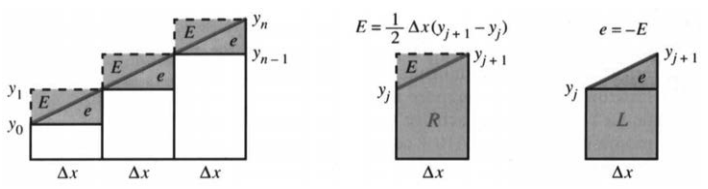
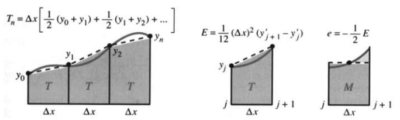
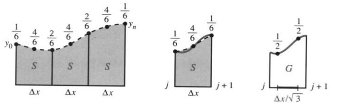

## 5.8 数值积分

来源：原书 PDF 第288—295页，印刷页275—282。状态：初译，尚未终审。

<!-- PDF 288 / 印刷页 275 -->

本节专门算定积分。给它一个函数 $y(x)$ 和两个端点 $a,b$，它要交出的答案是积分值 $I$。目标很明确：又快又准地算出 $I=\int_a^by(x)\,dx$。只要方法对路，这个目标通常就能实现。

此前的两条路都有短板。找原函数，在一些重要情形下确实能成，第7章还会把范围再扩大；但一般不能指望找到所需的显式表达式。矩形方法方向是对的，只是太粗：每个小区间的高度，直接取左端点或右端点。**右端点矩形公式**与**左端点矩形公式**分别为

$$R_n=\Delta x(y_1+y_2+\cdots+y_n),\qquad
L_n=\Delta x(y_0+y_1+\cdots+y_{n-1}).$$

把 $[a,b]$ 等分成 $n$ 段，$\Delta x=(b-a)/n$，再记 $y_j=y(a+j\Delta x)$。最左端的 $y_0=y(a)$ 进 $L_n$，最右端的 $y_n=y(b)$ 进 $R_n$，其余各项完全一样。式子算起来简单，看起来也直观，精度却往往不高。

本节的路子是这样：从收敛慢的矩形公式，走到好一些的梯形公式和中点公式，再走到辛普森公式和高斯公式。每改进一步，误差都会小一些。这些公式你不看书也能自己发现——去算 $x,x^2,x^4$ 的积分就行。在非负递增函数的例子里，$R_n$ 与 $L_n$ 会分别落在真实值的两侧；两边一比较，下一步怎么逼近，心里就有数了。这里先强调一条关键原则：

> 一个求积公式准不准，要看它能准确算出多少个幂函数 $1,x,x^2,\ldots$ 的积分。本节这些复合求积公式里，如果第一个算错的是 $x^p$，那么在相应的光滑性条件下，误差通常就是 $p$ 阶。

图5.18的左右矩形公式，碰上 $y=x$ 就已经不准，所以只是一阶方法，$p=1$。误差里带着 $\Delta x$ 的一次幂，而我们想要的是更高次幂。步长足够小时，$(\Delta x)^p$ 里的 $p$ 越大，误差通常越小。

图5.18：面对一条直线，$R_n$ 与 $L_n$ 的误差 $E,e$ 就是那两个三角形的带符号面积。

直线图像的积分是已知的。误差三角形的底为 $\Delta x$，高是相邻两个函数值之差；面积等于底乘高的一半，两种误差只差一个符号。直线递增时 $L_n$ 偏低，所以 $L_n-I<0$。把所有这些三角形加起来，右端点公式的总误差是

$$R_n-I=\frac12\Delta x(y_1-y_0)+\cdots+\frac12\Delta x(y_n-y_{n-1})
=\frac12\Delta x(y_n-y_0).\tag{1}$$

中间的项全部抵消。类似地，

$$L_n-I=-\frac12\Delta x(y_n-y_0)
=-\frac12\Delta x[y(b)-y(a)].\tag{2}$$

<!-- PDF 289 / 印刷页 276 -->

直线越陡，误差绝对值越大——矩形的上边是平的，斜率为零。式(1)、(2)很简洁，误差却仍然很大。把 $y=x$ 从0积到1，误差绝对值是 $\Delta x/2$；要降到百万分之一，得用50万个矩形。精度要求不算过分，计算量却大到难以接受。

这些误差公式还有一个好处：函数足够光滑时，它给出的就是渐近的首项。图像弯了，误差区域不再恰好是三角形；但只要这个首项不为零，预测误差与实际误差之比就趋于1。$\Delta x\to0$ 时，每一小段图像都近似是直线——这正是线性近似。

拿 $y(x)=\sqrt x$ 来验一验这个预测 $\tfrac12\Delta x[y(b)-y(a)]$。准确积分是 $I=\int_0^1\sqrt x\,dx=2/3$。原书给出的舍入数值如下：

| $n$ | 1 | 10 | 100 | 1000 |
|---:|---:|---:|---:|---:|
| $R_n-I$ | 0.33 | 0.044 | 0.0048 | 0.00049 |
| $L_n-I$ | -0.67 | -0.056 | -0.0052 | -0.00051 |

每行往右，误差都在减小；对应的步长是 $1,0.1,0.01,0.001$。$n$ 乘10，步长除以10，误差也近似除以10。一阶方法就是这样：误差近似与步长成正比。

这里 $y(1)=1,y(0)=0$，所以预测值的绝对值就是 $\Delta x/2$，即 $0.5,0.05,0.005,0.0005$。表中的实际误差，正一步步向这个主项靠拢。

表里还藏着一个有趣的事实：把未舍入的上下两行误差相减，得到的正好是 $1,0.1,0.01,0.001$。道理在 $(R_n-I)-(L_n-I)=R_n-L_n$：右端点公式比左端点公式多算了一个右端矩形，又少算了一个左端的零高矩形；多出的高度为1，面积正是 $\Delta x$。

既然 $R_n$ 与 $L_n$ 的误差几乎抵消，取平均 $T_n=\tfrac12(R_n+L_n)$ 就更准——这就是梯形公式。下面再给矩形误差两个检验，积分区间都是 $[0,1]$：

| 被积函数 | $n=1$ | $n=10$ | $n=100$ | $n=1000$ |
|---|---:|---:|---:|---:|
| $x^2-x$ 的误差 | $1.7\times10^{-1}$ | $1.7\times10^{-3}$ | $1.7\times10^{-5}$ | $1.7\times10^{-7}$ |
| $1/(10+\cos2\pi x)$ 的误差（原表） | $-1\times10^{-3}$ | $2\times10^{-14}$ | “0” | “0” |

第二行第一个数有数值错误，见译注。第一行的误差比步长掉得更快，因为 $y(0)=y(1)$，首项是零。准确的误差是 $(\Delta x)^2/6$。这些例子里两端函数值相等，所以 $L_n=R_n=T_n$。这个二阶误差，在梯形公式里还会再见到。

最后一行几乎没有误差。矩形公式怎么突然表现这么好？因为这个函数解析，周期又是1，积分正好跨过一整个周期。不仅 $y(0)=y(1)$，两端各阶导数也都相同，误差展开中相应的各阶项全都消掉；在这个例子里，误差随点数增加而指数衰减。

**作者说明** 我曾想手算 $1/(10+\cos2\pi x)$ 的积分，没算出来；后来竟在自己那本应用数学书里翻到了答案，实在惭愧。书里用的是一套复数技巧，适用于一个完整周期。最后我又在一本积分手册里找到那个相当复杂的原函数，核验出的面积是 $1/\sqrt{99}$。

<!-- PDF 290 / 印刷页 277 -->

### 梯形公式与中点公式

接下来换一批公式，它们能把 $y=x$ 积得准确，具有二阶精度。一次误差项消失了，直线下方的面积分毫不差。这时的预测误差是 $(\Delta x)^2$ 乘一个系数；系数是多少，拿积不准的 $y=x^2$ 一试便知。

第一个公式把左右矩形取平均，让误差尽可能抵消，这就是**复合梯形公式**：

$$T_n=\frac12R_n+\frac12L_n
=\Delta x\left(\frac12y_0+y_1+\cdots+y_{n-1}+\frac12y_n\right).\tag{3}$$

也可以直接把图5.19a中一个个梯形的面积加起来。

图5.19：两种公式都是二阶，误差主项可以用 $y=x^2$ 来检验。

每个小梯形宽 $\Delta x$，两侧的高分别是 $y_{j-1},y_j$。相邻两个梯形共用一个端点，各分得 $1/2$ 的权重，合起来正好是1；只有头尾两个端点没有邻居分担，权重才留作 $1/2$。梯形能严丝合缝地贴住斜直线，所以 $T_n$ 对 $y=x$ 准确。

跟右矩形公式比，梯形公式把右端点的权重从 $\Delta x$ 改成 $\Delta x/2$，再给左端点同样一份。于是

$$R_n-T_n=\frac{\Delta x}2(y_n-y_0),$$

前面那个一阶误差主项，恰好被它消掉。

另一个对直线也准确的公式，是从“中点”来的。矩形的高若等于两个端点高度的平均值，面积就与梯形相同；在直线图像上，这个平均高度正好在区间中点取到。于是改在 $a+\Delta x/2,a+3\Delta x/2,\ldots$ 处取值，就得到**复合中点公式**：

$$M_n=\Delta x(y_{1/2}+y_{3/2}+\cdots+y_{n-1/2}),\qquad
y_{j+1/2}=y\left(a+(j+\tfrac12)\Delta x\right).\tag{4}$$

拿 $\int_0^4x\,dx$ 试，步长取1：梯形公式给出 $\tfrac12\cdot0+1+2+3+\tfrac12\cdot4=8$，中点公式给出 $\tfrac12+\tfrac32+\tfrac52+\tfrac72=8$，都准确。换成 $y=x^2$，中点值不再等于两端值的平均，两种公式就分道扬镳了：

| $I=\int_0^1x^2\,dx$ | $n=1$ | $n=10$ | $n=100$ |
|---|---:|---:|---:|
| $T_n-I$ | $1/6$ | $1/600$ | $1/60000$ |
| $M_n-I$ | $-1/12$ | $-1/1200$ | $-1/120000$ |

$n$ 乘10，误差除以100。这个例子里，中点误差的绝对值只有梯形的一半。光滑函数在每个小区间上都能用二次式近似，所以误差主项可以借抛物线来分析。

<!-- PDF 291 / 印刷页 278 -->

对 $y=x^2$，梯形误差在单位区间上正好等于 $(\Delta x)^2/6$。换成一般光滑函数，主项为

$$\begin{aligned}
T_n-I&\approx\frac1{12}(\Delta x)^2
[(y_1'-y_0')+\cdots+(y_n'-y_{n-1}')]\\
&=\frac1{12}(\Delta x)^2[y'(b)-y'(a)],
\end{aligned}\tag{5}$$

$$M_n-I\approx-\frac1{24}(\Delta x)^2[y'(b)-y'(a)].\tag{6}$$

在 $y''$ 连续这类条件下，把端点导数差换成 $(b-a)y''(c)$，就得到准确的余项，只是那个 $c\in(a,b)$ 的位置并不知道。两种公式的 $c$ 一般也不相同。实际计算时，常用导数的上界或加密网格来估计误差，不会真的去找这个点。关键仍是步长的幂次 $(\Delta x)^p$。

做这些试验时，有件事很容易被忽略：每一次计算 $y(x)$ 都可能很贵。公式每要一个函数值，计算机都可能调用一次复杂的子程序。数值积分要做的，是在达到误差容限的同时，把函数求值的次数压到最少。尺度和导数大小合适时，二阶方法要把误差压到 $10^{-6}$ 量级，可能要算约1000个函数值；下面的方法更划算。

### 四阶方法：辛普森公式

梯形误差的主项，大约是中点误差的负两倍。那就用两份 $M_n$ 配一份 $T_n$，把二阶项抵掉。这就是辛普森公式：

$$\begin{aligned}
S_n&=\frac13T_n+\frac23M_n\\
&=\frac{\Delta x}6
\left(y_0+4y_{1/2}+2y_1+4y_{3/2}+2y_2+\cdots+4y_{n-1/2}+y_n\right).
\end{aligned}\tag{7}$$

中点的权重是 $4/6$，内部整点的权重是 $2/6$，最外侧两个端点是 $1/6$，最后再统一乘上 $\Delta x$。那个有名的权重串就是 $1,4,2,4,2,\ldots,4,1$。

辛普森公式不只是两个公式的组合，它还有更深的来历：每一段都用抛物线去插值。有一条抛物线穿过 $y_0,y_{1/2},y_1$ 三点，它在第一段下方围出的面积恰为 $\Delta x(y_0+4y_{1/2}+y_1)/6$。这些求积公式的造法其实一样：能准确积出多少个幂函数，就尽可能积多少个。抛物线比直线贴得更紧，直线又比水平段强；在相应光滑条件下，$S$ 胜过 $M$，$M$ 胜过端点矩形。在 $[0,1]$ 上取 $\Delta x=1/n$，来检验辛普森公式：

| 被积函数 | $n=1$ 的误差 | $n=10$ 的误差 | $n=100$ 的误差 |
|---|---:|---:|---:|
| $x^2$ | 0 | 0 | 0 |
| $x^3$ | 0 | 0 | 0 |
| $x^4$ | $8.33\times10^{-3}$ | $8.33\times10^{-7}$ | $8.33\times10^{-11}$ |

二次函数算得准，并不意外——公式本就是冲着它设计的；三次也准，则是额外收获。精度因此跳到四阶，误差与 $(\Delta x)^4$ 同阶；辛普森公式之所以用得广，原因就在这里。

三次为什么也准？先看对称区间 $[-1,1]$：奇函数 $x^3$ 的积分是零，辛普森公式靠对称性也给出零：

$$\int_{-1}^1x^3\,dx=\left[\frac{x^4}4\right]_{-1}^1=0,
\qquad\frac26[(-1)^3+4\cdot0^3+1^3]=0.\tag{8}$$

平移到别的区间、再一缩放，三次多项式仍由三次奇项和更低次的项组成，照样准确。

<!-- PDF 292 / 印刷页 279 -->

图5.20：误差主项形如 $E\approx c(\Delta x)^4(y'''_{j+1}-y'''_j)$，其中 $c_S=1/2880$、$c_G=-1/4320$。这里的 $\Delta x$ 是整段的宽度，辛普森公式还要多算该段的中点。

### 高斯公式（选读）

辛普森公式得有个对手，而高斯跟谁都能争一争。他在天文学里算积分，发现只要两个取样点，就足以构成四阶方法。在单个区间 $[-1,1]$ 上，公式为

$$\int_{-1}^1y(x)\,dx\approx y(-1/\sqrt3)+y(1/\sqrt3).\tag{9}$$

这两个高斯点可以直接算出来。把两个点对称地摆成 $-x_G,x_G$，所有奇次幂都因对称性积成准确的零。关键在 $y=x^2$，它的准确积分是 $2/3$。于是要求

$$\frac23=(-x_G)^2+x_G^2,$$

由此 $x_G^2=1/3$，取正的 $x_G=1/\sqrt3$，两个对称点就定下来了。

图5.20c把区间挪到 $[0,\Delta x]$，高斯点变成 $(1\pm1/\sqrt3)\Delta x/2$，每点的权重是 $\Delta x/2$。这些点不像辛普森的端点和中点那样方便手算。高斯公式适合在同一段上反复做大量积分；辛普森公式适合区间一段接一段地拼，因为公共端点能接着用，每添一段只要两个新函数值。

对 $I=\int_0^1x^4\,dx$，从 $n=1$ 到 $n=10$，两种误差都缩到原来的 $10^{-4}$：

| 方法 | $n=1$ 的误差 | $n=10$ 的误差 |
|---|---:|---:|
| 辛普森 | $8.33\times10^{-3}$ | $8.33\times10^{-7}$ |
| 两点高斯 | $-5.56\times10^{-3}$ | $-5.56\times10^{-7}$ |

### 计算器中的定积分

数值积分在实际机器上怎么跑，很值得一看。取样点未必等距。原书拿当时的惠普计算器举例：算0到1的积分时，机器内部可能作代换 $x=3u^2-2u^3$，$u$ 的积分限仍是0和1，$dx$ 也要跟着换。例如

$$\int_0^1\frac{dx}{\sqrt x}
=\int_0^1\frac{6(u-u^2)}{\sqrt{3u^2-2u^3}}\,du
=\int_0^1\frac{6(1-u)}{\sqrt{3-2u}}\,du.$$

从代数上看，式子像是更复杂了，可原来在 $x=0$ 处的无界性不见了。$dx=6(u-u^2)\,du$ 在两端都趋于零；这样化简、连续延拓之后，就不必直接计算原函数在奇异端点处的值。在 $u$ 里均匀取点，换到 $x$ 里自然就不等距了。

难点若落在区间内部，就在那一点把积分切成两段。积分跑到无穷远，则要挑个截断位置，再管住尾巴上的误差。比如 $e^{-x^2}$ 在 $x=10$ 之后的尾巴极细，普通精度下通常可以忽略；可区间拉得太长，有限的取样点反倒浪费在几乎为零的区域。

<!-- PDF 293 / 印刷页 280 -->

快速振荡尤其难缠：结果取决于正负两部分怎么抵消，取样点少了不行。

从 $x$ 换到 $u$，周期函数也会受影响。前面 $1/(10+\cos2\pi x)$ 用等距取样算得极准，可这里还藏着一种风险，叫**混叠**。比如 $\sin8\pi x$，以步长 $1/8$ 在网格点上取样，得到的全是零——振荡函数便可能与零函数无法区分。非均匀取样能躲开这种特定的共振网格，却没法普遍消除所有误判。

只看有限次取样的方法，都可能被骗。先让它算 $y=0$ 的积分并指定精度，记下程序访问过的点 $x_1,\ldots,x_k$；再让同一个确定性程序去积分

$$Y(x)=(x-x_1)^2\cdots(x-x_k)^2.$$

算法若只依赖这些取样值，过程中又没有别的信息，它就会照原样再走一遍，仍旧返回零。可这个非负多项式在非退化区间上的积分，实际上为正。

原书接着介绍当时的计算器：输入函数、端点和精度；变量 $x$ 可以命名，也可以省略，看设备要求。示例输出4.67077和 $4.7\times10^{-5}$，前者是 $\int_1^2e^x\,dx$ 的近似值，后者是估计的误差界。输入精度0.00001，表达的是函数求值的相对精度要求，原书写为

$$\left|\frac{y_{\mathrm{true}}-y_{\mathrm{computed}}}{y_{\mathrm{computed}}}\right|\le0.00001.$$

这并不等于对任意被积函数都无条件成立的积分误差保证。设备是根据取样结果来估计积分误差的；若指定 $e^x$ 的求值精度约为 $10^{-11}$，它就会按更高的精度要求多做一些工作。

William Kahan 为惠普提供咨询时，选用了含 $1,3,7,15,\ldots$ 个取样点的公式。每一级都复用上一级取样点，当相邻两次结果足够接近时就停下。这里描述的是原书年代的实现实例。

<!-- PDF 294 / 印刷页 281 -->

### 5.8 习题

#### 阅读填空

积分 $y(x)$ 时，把 $[a,b]$ 分成 $n$ 段，每段长 $\Delta x=\underline{\text{a}}$。$R_n,L_n$ 在每段上放一个 $\underline{\text{b}}$，高度取右端点或 $\underline{\text{c}}$ 端点的值：$R_n=\Delta x(y_1+\cdots+y_n)$，$L_n=\underline{\text{d}}$。它们是 $\underline{\text{e}}$ 阶方法，因为对 $y=\underline{\text{f}}$ 就不准确。在 $[0,1]$ 上，端点公式的总误差主项为 $\underline{\text{g}}$。对 $y=\cos\pi x$，此主项为 $\underline{\text{h}}$；对 $y=\cos2\pi x$，误差很小，因为 $[0,1]$ 是一个完整 $\underline{\text{i}}$。

更好的方法是 $T_n=\tfrac12R_n+\underline{\text{j}}=\Delta x[\tfrac12y_0+\underline{\text{k}}y_1+\cdots+\underline{\text{l}}y_n]$。这个 $\underline{\text{m}}$ 公式为 $\underline{\text{n}}$ 阶，因为对 $y=x$ 的误差为 $\underline{\text{o}}$。$y=x^2$ 从 $a$ 到 $b$ 的误差为 $\underline{\text{p}}$。$\underline{\text{q}}$ 公式的相应误差绝对值减半，使用 $M_n=\Delta x[\underline{\text{r}}]$。

辛普森公式为 $S_n=\tfrac23M_n+\underline{\text{s}}$，是 $\underline{\text{t}}$ 阶，因为幂函数 $\underline{\text{u}}$ 都被准确积分。$y_0,y_{1/2},y_1$ 的系数为 $\underline{\text{v}}$ 乘 $\Delta x$。在三段上，权重为 $\Delta x/6$ 乘 $1,4,\underline{\text{w}}$。高斯公式每段使用 $\underline{\text{x}}$ 个点，两点间距为 $\Delta x/\sqrt3$。$p$ 阶方法的误差通常近似正比于 $\underline{\text{y}}$。

#### 练习

1. $L_n-T_n$ 等于多少？与式(2)的误差主项比较。
2. 步长减半时，梯形误差近似缩小到原来的几分之一？辛普森误差呢？
3. 对 $\int_0^1x^3\,dx$，计算 $n=1,2,10$ 时的 $R_n,L_n$。可用计算机验证，或直接使用 $1^3+\cdots+n^3=\tfrac14n^2(n+1)^2$。
4. 算 $T_n$ 有两条路：分别求 $L_n,R_n$ 再平均，或者直接算加权和 $\tfrac12y_0+y_1+\cdots+\tfrac12y_n$ 后乘 $\Delta x$。哪条更省事？比一比运算次数。
5. 用三种不同公式计算 $I=\int_0^1x^4\,dx$，分别取 $n=2,4,8$。
6. 用 $\pi=4\int_0^1dx/(1+x^2)$，随便挑一种公式，把 $\pi$ 算到小数点后6位。
7. 把每段辛普森公式改成 $\Delta x(\tfrac14y_0+\tfrac12y_{1/2}+\tfrac14y_1)$，求精度阶 $p$。
8. 用等距求积展示 $1/(3+\sin x)$ 从0到 $2\pi$ 的积分误差快速衰减。
9. 对 $y=1,x,x^2$，检验首个梯形的误差确为 $(\Delta x)^2(y'_{j+1}-y'_j)/12$，取 $j=0$。于是该式对任意抛物线及任意区间成立。
10. 对中点误差 $-(\Delta x)^2(y'_{j+1}-y'_j)/24$ 重做第9题。画图说明：通过矩形上边中点的任意直线所形成的梯形，都与中点矩形等面积，其中包括曲线的中点切线所形成的梯形。
11. 已知 $\int_{-\infty}^{\infty}(\sin x)^2/x^2\,dx=\pi$。使用符号计算系统或原书所举的 HP-28S，能得到多少位小数？把积分截为 $[-A,A]$，试验较大和较小的 $A$。
12. 以下四个积分都等于 $\pi$：
   $$\int_0^1\frac{dx}{\sqrt{x(1-x)}},\qquad
   \int_{-\infty}^{\infty}\frac{\sin x}{x}\,dx,\qquad
   \frac83\int_0^\pi\sin^4x\,dx,\qquad
   \int_0^\infty\frac{x^{-1/2}}{1+x}\,dx.$$
   （a）选择两个，用中点公式算到 $\pi\approx3.1416$。（b）选做：选择另两个，至少得到 $\pi\approx3$。
13. 要算 $\ln2=\int_1^2dx/x\approx0.69315$ 且误差小于0.001，按主误差项 $(\Delta x)^2[y'(b)-y'(a)]/12$ 估计，梯形公式得取多少段？再用 $y=1/x$ 验一验实际误差。
14. 对 $\int_0^1\sqrt x\,dx$，取 $n=1,10,100$，比较 $T_n,M_n$。由于 $y'(0)$ 无界，常规二阶误差预测不能直接使用。
15. 在误差公式3R中取 $f(x)=\int_0^xy(t)\,dt$，证明对某个中间点 $c$，
   $$\int_0^{\Delta x}y(x)\,dx-y(0)\Delta x
   =\frac12(\Delta x)^2y'(c).$$
16. 对周期函数 $y(x)=1/(2+\cos6\pi x)$ 在 $[-1,1]$ 上积分，取 $n=2$，比较 $T,S,G$。
17. 对 $I=\int_0^1\sqrt{1-x^2}\,dx$，机械套用梯形主误差式会得到 ______。试验 $n=2,4,8$，说明这种预测为何不适用。
18. 作代换 $x=\sin\theta$、$\sqrt{1-x^2}=\cos\theta$、$dx=\cos\theta\,d\theta$，对 $\int_0^{\pi/2}\cos^2\theta\,d\theta$ 计算 $T_4$。换元后的预测误差是多少？
19. 要求 $Ay(0)+By(1/2)+Cy(1)=I$ 对 $I=\int_0^11\,dx,\int_0^1x\,dx,\int_0^1x^2\,dx$ 都准确，写出三个方程，解 $A,B,C$，并指出所得公式名称。
20. 能否用 $Ay_0+By_{1/4}+Cy_{1/2}+Dy_{3/4}+Ey_1$ 构造精度比辛普森更高的公式？
21. 证明：在系数为常数的 $\alpha L_n+(1-\alpha)R_n$ 中，只有 $T_n$ 能对一般光滑函数达到二阶精度。
22. 用10个等宽小区间分别计算 $e^{-x^2}$ 从0到5、20、400的积分。已知从0到无穷的积分为 $\sqrt\pi/2$。在这些试验中，哪里截断最好？说明你采用的求积公式。
23. $y(x)=1/(x^2+10^{-10})$ 有尖峰和长尾。用 $T_{10},T_{100}$ 估计 $\int_0^1y(x)\,dx$，不要期待很好的效果。再令 $x=10^{-5}\tan\theta$、$dx=10^{-5}\sec^2\theta\,d\theta$，把被积式化为常数 $10^5$，在正确的新积分限上积分。
24. 用 $T_4$ 计算 $\int_0^4|x-\pi|\,dx$，再与在 $x=\pi$ 处分为两个积分的做法比较。

<!-- PDF 295 / 印刷页 282 -->

25. 求 $a,b,c$，使 $y=ax^2+bx+c$ 在 $x=0,1/2,1$ 处分别为1、3、7。写出三个方程，并检验 $\tfrac16\cdot1+\tfrac46\cdot3+\tfrac16\cdot7=\int_0^1y(x)\,dx$。
26. 取 $y=x^4$、$\Delta x=1$，求 $S-I=c(\Delta x)^4[y'''(1)-y'''(0)]$ 中的 $c$。
27. 取 $y=x^4$、$\Delta x=2$、$G=(-1/\sqrt3)^4+(1/\sqrt3)^4$，求 $G-I=c(\Delta x)^4[y'''(1)-y'''(-1)]$ 中的 $c$。
28. $y(x)$ 满足什么端点条件时，$\int_a^by(x)\,dx$ 的 $L_n,R_n,T_n$ 相等？
29. 设 $y$ 的图像向上弯曲。由图说明梯形结果偏高，中点结果偏低。若 $y''>0$，它如何使式(5)为正、式(6)为负？

### 译注与数学核对

1. 多项式准确性、复合公式的收敛阶及实际误差大小是不同概念。本节的阶数需要足够光滑性、固定区间及稳定的缩放规则；导数无界、函数振荡或误差主项抵消时，不能机械套用。“能准确积分到 $p-1$ 次”通常称代数精度为 $p-1$。
2. 原书说端点误差渐近式对“所有函数”都成立，范围过宽；译文限定光滑条件，并要求主项非零时才谈误差比趋于1。平方根虽在0处导数无界，端点矩形的一阶主项仍可成立，但梯形、中点的常规二阶公式失效。
3. 原页276将对应 $n=1,10,100,1000$ 的步长列成 $0.1,0.01,0.001,0.0001$，整体错移一位，已更正。周期例 $n=1$ 的误差实际为 $1/11-1/\sqrt{99}\approx-0.00959469$，不是原表的 $-0.001$；原表保留并在此指出。“0”仅表示显示精度下接近零，并非数学上准确为零。
4. 仅周期性或无穷光滑性并不自动保证指数收敛；本例解析周期函数可以获得这种结论。一般无穷光滑周期函数通常只能据此得到超代数收敛。原页277的 $R_n-T_n$ 漏乘 $\Delta x$，正文已补回。
5. 本节辛普森的 $n$ 是包含中点的整段数，实际最小相邻节点间距为 $\Delta x/2$，总节点数为 $2n+1$。这与常见以最小间距 $h$ 表示的 $h/3$ 公式完全相同，误差系数不能混用。高斯图示的导数差误差式对四次多项式准确，对一般光滑函数是主项；原图以等号书写，译文图注用近似号。
6. $\sin8\pi x$ 的普通频率为4，而不是原文称的8；其网格值为零这个混叠例子本身正确。非均匀取样只能减少或避免特定混叠，不能普遍保证识别任意未采样行为。计算器精度、误差估计与真实误差保证须区分，尤其是在给出的多项式反例下。
7. 原文提到“见页边”以及 PAUSE 显示取样点，但所供版本该页没有相应按键图。译文保留算法思想，并将设备描述限定为原书年代的实例。没有把这些做法视为全部现行计算器的实现。
8. 第11、12题含反常积分，截断误差应与网格误差分开控制；$\sin x/x$ 在0处可连续延拓为1，$\sin^2x/x^2$ 也可延拓为1。第22题原文未指定求积公式，结果与“最佳截断点”依赖所选公式和精度，译文要求说明。
9. 第23题原书给新上限 $\pi/4$，错误。$x=1$ 对应 $\theta=\arctan(10^5)$；$\pi/4$ 只对应 $x=10^{-5}$。正文改为要求使用正确新限，避免错算整个积分。
