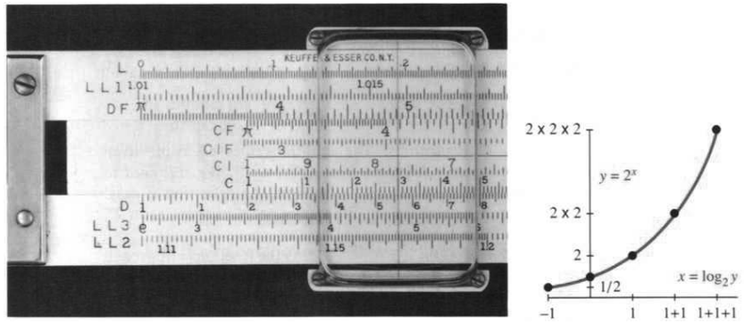
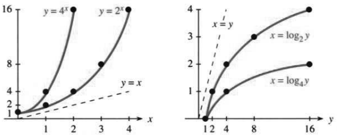
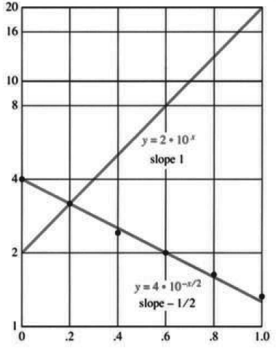
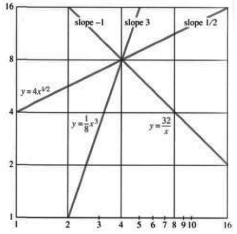
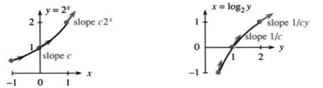

# 第6章 指数函数与对数函数

> 来源：PDF第296—304页，印刷页283—291。状态：初译；公式与原页逐页核对，尚未完成全书复审。

<!-- PDF 296 / 印刷页 283 -->

本章讨论 $2^x$、$10^x$，尤其是 $e^x$ 这样的指数函数。我们的目标是理解它们，求其导数和积分，解含有这些函数的方程，并求其反函数，从而得到对数函数。$e^x$ 的重要性使本章在纯粹数学和应用数学中都占有关键地位。

按照微积分教材的传统编排，通常要讲完积分的其他应用，才介绍 $e^x$。这里把它提前，是因为我认为，方程 $dy/dx=y$ 应当比积分技巧受到更多重视。自然规律由微分方程表达，而 $e^x$ 正处于其中的核心。它的应用遍及生命科学、物理科学、经济学和工程学；凡是变化受到当前状态影响的地方，都可能遇到它。模型导出微分方程，而我希望展示微积分能够做些什么。

关键始终是 $b^{m+n}=b^mb^n$。第6.1节从三个方面应用这条规律：

1. 将对数理解为指数。
2. 在普通坐标纸、半对数坐标纸和双对数坐标纸上作图。
3. 求导数。计算 $b^x$ 的斜率时，要用到 $b^{x+\Delta x}=b^xb^{\Delta x}$。

<!-- PDF 297 / 印刷页 284 -->

## 6.1 总览

你很可能已经接触过对数。对数把乘法化为简单得多的加法。它是计算尺的基础，也是对数坐标图的基础；前者如今已不那么重要，后者却十分重要。对数函数的图像是指数函数图像的镜像，而指数函数你一定见过。

先从指数说起。$10$、$10^2$、$10^3$ 是十进制的基本组成部分。为完整起见，还要加上 $10^0$，即“10的零次幂”，它等于1。**这些数的对数就是相应的指数。** $1$、$10$、$100$、$1000$ 的对数分别是 $0$、$1$、$2$、$3$。它们都是“以10为底”的对数，因为这里取的是10的幂。

问：如果底数由10换成 $b$，1的对数是多少？

答：因为 $b^0=1$，所以 $\log_b1$ 始终为0。以 $b$ 为底时，$b^n$ 的对数就是 $n$。

我们也需要负指数。$10^x$ 是正数，但指数 $x$ 可以为负。最初的例子是 $1/10$ 和 $1/100$，也就是 $10^{-1}$ 和 $10^{-2}$。它们的对数分别为 $-1$ 和 $-2$。

$$
1000=10^3,\qquad \log1000=3;
$$
$$
\frac1{1000}=10^{-3},\qquad \log\frac1{1000}=-3.
$$

$1000$ 乘以 $1/1000$ 得到 $1=10^0$；相应的对数相加得到 $3+(-3)=0$。一般地，$10^m10^n=10^{m+n}$。例如，$10^3$ 与 $10^2$ 相乘，得到五个10的连乘积：

$$
(10)(10)(10)\cdot(10)(10)=(10)(10)(10)(10)(10)=10^5.
$$

$b^mb^n$ 的运算法则可以推广到任意实数指数，例如 $10^{4.6}10^\pi$。它也适用于各种底数；讨论对数时，规定 $b>0$ 且 $b\ne1$。在所有这些情形中，数的相乘对应于指数的相加。

> **6A** $b^mb^n=b^{m+n}$，因此对数（指数）相加；$b^m/b^n=b^{m-n}$，因此对数（指数）相减。
>
> $$\log_b(yz)=\log_by+\log_bz,\qquad
> \log_b(y/z)=\log_by-\log_bz.\tag{1}$$
>
> 这里 $y,z>0$。

**历史札记。** 在使用计算尺的年代，计算 $1.2\times1.3$ 时，要把一条尺的边缘滑到1.2的位置，再在1.3下方读出答案。一把德国制造的计算尺甚至能读出1.56的第三位数字。照片中的数字按对数刻度排列：从1到2、从2到4以及从4到8的距离相等。滑动尺条就是把距离相加，从而实现数的相乘。

除法反向进行。注意，$1000/10=100$ 对应于 $3-1=2$。要计算 $1.56/1.3$，沿D刻度反向查找，就得到1.2。

图6.1右侧的小图更为重要。**当 $x$ 增加1时，$2^x$ 乘以2；给 $x$ 加上一个数，就相当于给 $y$ 乘上一个数。** 这样很容易得到 $y=1,2,4,8$。不过，微积分不会停留在整数上。

在微积分中，我们令 $x$ 增加 $\Delta x$，这时 $y$ 乘以 $2^{\Delta x}$。当 $\Delta x$ 很小时，这个乘数接近1。例如 $\Delta x=1/10$ 时，$2^{\Delta x}\approx1.07$，即2的十次方根。为了求斜率，需要考察 $(2^{\Delta x}-1)/\Delta x$。其极限接近 $(1.07-1)/(1/10)=0.7$，确切值还要稍后才能得到。

<!-- PDF 298 / 印刷页 285 -->

图6.1 一件旧时代的遗物——计算尺。指数 $x$ 相加时，幂 $2^x$ 相乘。

**换底。** 应用中需要10以外的底数，以及 $1,2,3,\ldots$ 以外的指数。原书以世界人口增长为例，假设 $x$ 年后人口约为当前的 $1.02^x$ 倍。$x$ 显然不必是整数年；底数1.02也显然不能换成10而保持指数不变，否则增长就太惊人了。以后讨论增长的微分方程时，还会改进这个预测模型。若希望以10为底，可以改写为

$$
1.02^x=10^{(\log1.02)x}.
$$

底数从1.02换成10时，指数也随之乘上一个因子。

练习一下：把底数 $b$ 换成底数 $a$。暂将以 $a$ 为底的对数简记为 $\log$。一切都来自“对数就是指数”：

$$
\text{数的换底表示：}\qquad b=a^{\log b}.
$$

两边取 $x$ 次幂，就看到指数如何变化：

$$
\text{指数函数换底：}\qquad b^x=a^{(\log b)x}.
$$

最后令 $y=b^x$。它以 $b$ 为底的对数是 $x$，以 $a$ 为底的对数是右边的指数，所以 $\log_ay=(\log_ab)x$。再以 $\log_by$ 代替 $x$：

$$
\text{对数换底：}\qquad \log_ay=(\log_ab)(\log_by).
$$

换底是必不可少的工具。例如取 $a=2$：

$$
b=8=2^3,\qquad 8^2=(2^3)^2=2^6,
$$
$$
\log_264=3\cdot2=(\log_28)(\log_864).
$$

换底背后的规则是 $(a^m)^x=a^{mx}$。幂再取幂，指数相乘。三次幂的平方就是六次幂：

$$
(a)(a)(a)\cdot(a)(a)(a)=(a)(a)(a)(a)(a)(a),\qquad (a^3)^2=a^6.
$$

很快还会出现一个比10更重要的底数。先把换底规则列在下面。

<!-- PDF 299 / 印刷页 286 -->

> **6B** 把数、幂和对数从底数 $b$ 换为底数 $a$，使用
>
> $$b=a^{\log_ab},\qquad b^x=a^{(\log_ab)x},\qquad
> \log_ay=(\log_ab)(\log_by).\tag{2}$$
>
> 对数底数满足 $a,b>0$ 且 $a,b\ne1$，真数满足 $y>0$。

第一式是定义，第二式是第一式两边的 $x$ 次幂，第三式是第二式取对数的结果，其中 $y=b^x$。一个重要的特例是 $y=a$：

$$
\log_aa=(\log_ab)(\log_ba)=1,
\qquad \log_ab=\frac1{\log_ba}.\tag{3}
$$

**例。** $8=2^3$ 意味着 $8^{1/3}=2$，于是 $(\log_28)(\log_82)=3(1/3)=1$。

对数的代数运算到这里就介绍完了。规则6A来自 $b^mb^n=b^{m+n}$，规则6B来自 $(a^m)^x=a^{mx}$。我们还需要对每个实数 $x$ 定义 $b^x$ 和 $a^x$。$x$ 为有理数时很容易，例如 $a^8$ 的平方根为 $a^4$，对应 $m=8$、$x=1/2$。$x$ 不是有理数时，例如 $2^\pi$，图像提示了一种补全定义的方式。

可以把 $2^\pi$ 定义为数列 $2^3,2^{31/10},2^{314/100},\ldots$ 的极限。当有理数 $r$ 趋于 $\pi$ 时，$2^r$ 趋于 $2^\pi$。经严格论证，这样可以得到连续函数 $y=2^x$，并保留 $2^m2^n=2^{m+n}$ 与 $(2^m)^x=2^{mx}$，不论 $m,n,x$ 是否为整数。不过，连续性证明中的 $\varepsilon$ 和 $\delta$ 不那么直观，所以第6.4节将采用一种基于积分的更顺畅的方法。

### $b^x$ 与 $\log_by$ 的图像

现在来画图。原则上，一幅图就能表示两个函数，因为 $y=b^x$ 与 $x=\log_by$ 是同一个关系。这两个函数互为反函数：一个函数完成的运算，另一个函数把它还原。设 $g(x)=b^x$，则

$$
g^{-1}(g(x))=\log_b(b^x)=x.\tag{4}
$$

反过来，先取对数，再作指数运算，得到原数：

$$
g(g^{-1}(y))=b^{\log_by}=y.\tag{5}
$$

对每个允许的底数 $b$ 都成立。把 $b=2$ 与 $b=4$ 放在同一幅图中比较很有帮助。图6.2左图画出 $y=2^x$ 与 $y=4^x$；交换横纵坐标，得到右图的以2和4为底的对数函数。在横纵轴单位长度相同的坐标系中，这种交换对应于关于45°直线的反射。

$x$ 为负时，$b^x$ 仍为正。如果把左图向左延伸，曲线仍在 $x$ 轴上方。请用铅笔补画出来，再把右图中的曲线向下延伸，形成相应的镜像，但不要越过纵轴。

图6.2 指数函数及其镜像——对数函数。原图的横纵坐标采用不同刻度。

<!-- PDF 300 / 印刷页 287 -->

左图还有一些有趣的关系。所有指数函数都经过纵坐标为1的起点，因为 $b^0=1$。在高度 $y=16$ 处，一条曲线对应 $x=2$，因为 $4^2=16$；另一条对应 $x=4$，因为 $2^4=16$。为什么 $4^x=2^{2x}$？这就是利用 $4=2^2$ 进行换底。

右图展示了对应的对数函数。所有对数函数在真数 $y=1$ 时取值0；图中的两条曲线在 $y\to0^+$ 时趋向 $-\infty$。粗略地说，这是因为 $2^x$ 在 $x\to-\infty$ 时趋于0。这里，一幅图中的 $x$ 对应另一幅图中的 $2x$，仍然体现对数换底。指数函数增长很快，因此它们的反函数增长得很慢。

$\log_210$ 介于3和4之间，因为10介于 $2^3$ 和 $2^4$ 之间。$2^x$ 的斜率与 $2^x$ 本身成正比；非恒定的幂函数 $x^n$ 没有这种性质。不过，上述图像在应用中有两个困难：

1. $2^x$ 和 $4^x$ 增长过快，曲线几乎竖直向上。
2. 对 $Ab^x$ 而言，最重要的是底数 $b$，但普通图像不能直观地显示它。

还有一点：在许多问题中，我们并不知道函数 $y=f(x)$，而是正在寻找它。手中只有混有测量误差的 $y$ 值，希望通过作图找出 $f(x)$。

解决办法是改变 $y$ 轴的刻度。在普通坐标中，每向上走一个单位，$y$ 增加一个固定数；在对数坐标中，每向上走一个单位，$y$ 乘以一个固定数。于是，从1到2、从3到6以及从10到20的距离相等。

在对数刻度上，11并不处于10与12的正中间；0则根本不在刻度上。每向下走一步，都除以一个固定的正数，因此永远到不了0。对于 $A>0$ 的 $Ab^x$ 来说，这很合适，因为函数也永远不会取到0。

图6.3采用半对数坐标纸，也称对数—线性坐标纸，其中 $x$ 轴仍为普通线性刻度。$y=Ab^x$ 的图像成为直线，因为取对数可得

$$
\log y=\log A+x\log b.\tag{6}
$$

**$x$ 与 $\log y$ 之间是线性关系。** 真正绘制的是 $\log y$，所以图像是直线。纵轴已经按真数 $y$ 标好刻度，不必先查出对数就能描点；所得图实质上是 $\log y$ 对 $x$ 的普通坐标图。

图6.3有两个例子。第一个是 $y=2\cdot10^x$ 的精确图像。若横向增加1的长度等于纵向乘以10的长度，直线斜率就是1。此处的斜率指半对数坐标中的斜率：$10^x$ 对应1，$10^{(\log b)x}=b^x$ 对应 $\log b$。因此可以直接从直线斜率读出关键量 $\log b$。

第二个例子更接近实际：从测量值出发寻找 $f(x)$。数据为

| $x$ | 0.0 | 0.2 | 0.4 | 0.6 | 0.8 | 1.0 |
|---|---:|---:|---:|---:|---:|---:|
| $y$ | 4.0 | 3.2 | 2.4 | 2.0 | 1.6 | 1.3 |

我们事先不知道这些值是否适合模型 $y=Ab^x$。图像提供了很好的支持：点大致落在一条负斜率直线附近，说明 $\log b<0$，即 $0<b<1$。其下降斜率的绝对值约为前一条上升直线斜率的一半，因而数据与下列模型相符：

$$
y=A\cdot10^{-x/2},\qquad \log y=\log A-\frac12x.\tag{7}
$$

当 $x$ 从0增加到2时，$y$ 变为原来的十分之一。从 $x=0$ 的数据看，$A\approx4$。

<!-- PDF 301 / 印刷页 288 -->

图6.3 半对数坐标纸上的 $2\cdot10^x$ 与 $4\cdot10^{-x/2}$。slope：斜率。

图6.4 双对数坐标纸上的 $Ax^k$。

另一类模型是幂函数 $y=Ax^k$。使用对数刻度也能使它的特征显现出来，不过这次两个坐标轴都用对数刻度，称为**双对数坐标纸**。对 $y=Ax^k$ 取对数，得到 $\log y$ 与 $\log x$ 之间的线性关系：

$$
\log y=\log A+k\log x.\tag{8}
$$

指数 $k$ 就成为双对数图中的斜率。只要两个轴采用同一对数底数，换底不改变这个斜率。测量一条直线的斜率，比处理一条幂函数曲线方便得多。

图6.4中三条直线的斜率分别为3、$1/2$ 和 $-1$，对应 $Ax^3$、$A\sqrt{x}$ 和 $A/x$。要确定各自的 $A$，只需观察直线上的一个点：当 $x=4$ 时，$y=8$。据此得到三个函数 $x^3/8$、$4\sqrt{x}$ 和 $32/x$。它们在半对数坐标纸上可不是直线。

对数坐标纸可以购买，也可以用计算机绘制。

### $y=b^x$ 与 $x=\log_by$ 的导数

这是一本微积分教材，必须讨论斜率。指数的代数运算已经完成，规则已经建立，对数坐标中的图像也变成了直线。现在轮到极限了。

核心问题是导数：当 $y=b^x$ 时，$dy/dx$ 是多少？当 $x=\log_by$ 时，$dx/dy$ 又是多少？二者紧密相关，因为指数函数与对数函数互为反函数。只要求出一个导数，就能在相应条件下利用 $dx/dy=1/(dy/dx)$ 得到另一个。先求指数函数的导数。

这些问题的答案简洁而漂亮，只是其中还有一个神秘的常数因子 $c$，需要多花一些时间才能确定。

<!-- PDF 302 / 印刷页 289 -->

我认为，值得把现在就能完成的部分先提取出来，暂时在 $dy/dx$ 中保留 $c$，在 $dx/dy$ 中保留 $1/c$。第6.2节将通过一个名为 $e$ 的特殊数来确定 $c$；不要把常数 $c$ 与底数 $e$ 混淆。

> **6C** $b^x$ 的导数是它的常数倍 $cb^x$，其中 $c$ 取决于底数 $b$。

仅靠已经学过的乘积法则、幂函数求导法则和链式法则，还不能求出这个导数。我们必须回到定义，即 $\Delta y/\Delta x$ 的极限：

$$
\frac{dy}{dx}=\lim_{h\to0}\frac{y(x+h)-y(x)}h
=\lim_{h\to0}\frac{b^{x+h}-b^x}h.\tag{9}
$$

**关键想法：把 $b^{x+h}$ 拆成 $b^xb^h$。** 这样就能提出 $b^x$。它与 $h$ 无关，还能移到极限外面。方括号内剩下的极限，就是尚待确定的 $c$：

$$
\frac{dy}{dx}=\lim_{h\to0}\frac{b^xb^h-b^x}h
=b^x\left[\lim_{h\to0}\frac{b^h-1}h\right]=cb^x.\tag{10}
$$

这个方程贯穿本章：$dy/dx=cb^x=cy$。**$y$ 的变化率与 $y$ 本身成正比。** 斜率与函数值始终相差固定因子 $c$。一个典型例子是银行存款，利息与本金成正比：本金多的人增加得多，本金少的人也增加，只是增加得少。以后将回到复利问题，明确其中的 $b$ 和 $c$。

反函数为 $x=\log_by$。现在未知的因子变成了 $1/c$。

> **6D** $\log_by$ 的导数为 $1/(cy)$，其中 $c$ 与上面相同，仍取决于 $b$。

证明：由 $dy/dx=cb^x$ 得

$$
\frac{dx}{dy}=\frac1{cb^x}=\frac1{cy}.\tag{11}
$$

这个证明像俄罗斯人的祝酒词，简短有力，却快了些。不妨写得详细一点。令 $f(y)=\log_by$，则

$$
\begin{aligned}
f(b^x)&=x &&\text{（指数运算后再取对数）},\\
f'(b^x)\,cb^x&=1 &&\text{（对 }x\text{ 求导，用链式法则）},\\
f'(b^x)&=\frac1{cb^x} &&\text{（除以 }cb^x\text{）},\\
f'(y)&=\frac1{cy} &&\text{（令 }y=b^x\text{）}.
\end{aligned}
$$

对数函数提供了确定 $c$ 的另一条途径：由它的斜率可以求出 $1/c$。下一节将沿这条路继续。

图6.5 $2^x$ 的斜率约为 $0.7\cdot2^x$；$\log_2y$ 的斜率约为 $1/(0.7y)$。slope：斜率。

最后说明：终于遇到了导数为 $1/(cy)$ 的函数 $f(y)$，实在令人满意。“$-1$ 次幂”终于有了原函数。还记得 $\int x^n\,dx=x^{n+1}/(n+1)+C$ 在 $n=-1$ 时失效吗？

<!-- PDF 303 / 印刷页 290 -->

$x^0$ 是常数，其导数不可能产生 $x^{-1}$。此前缺少的 $x^{-1}$ 的原函数，现在由对数填补了空白。把变量名 $y$ 换成 $x$ 或 $t$，结论不变：

$$
\frac d{dx}\log_bx=\frac1{cx},\qquad
\frac d{dt}\log_bt=\frac1{ct}.\tag{12}
$$

可以选择一个底数，使 $c=1$，这时导数恰为 $1/x$。这个关键选择就是 $b=e$，它也是第6.2节的主角。

### 6.1 习题

**通读填空。**

在 $10^4=10000$ 中，指数4是10000的 **a**。底数 $b=$ **b**。$10^m10^n$ 的对数为 **c**，$10^m/10^n$ 的对数为 **d**，$10000^x$ 的对数为 **e**。若 $y=b^x$，则 $x=$ **f**。这里 $x$ 可以是任意实数，而 $y$ 总是 **g**。

换底得到 $b=a^{\text{h}}$ 和 $b^x=a^{\text{i}}$。例如 $8^5=2^{15}$。换言之，$\log_2y$ 是 $\log_8y$ 的 **j** 倍。令 $y=2$ 可得 $(\log_28)(\log_82)=$ **k**。

在普通坐标纸上，$y=$ **l** 的图像是直线，斜率为 **m**。在半对数坐标纸上，$y=$ **n** 的图像是直线，斜率为 **o**。在双对数坐标纸上，$y=$ **p** 的图像是直线，斜率为 **q**。

$y=b^x$ 的斜率为 $dy/dx=$ **r**，其中 $c$ 取决于 $b$。$c$ 是当 $h\to0$ 时 **s** 的极限。由于 $x=\log_by$ 是反函数关系，$(dx/dy)(dy/dx)=$ **t**。由 $dy/dx=cb^x$ 得 $dx/dy=$ **u**。用 $y=b^x$ 表示后，$\log_by$ 的斜率为 **v**。换一个变量名，$\log_bx$ 的斜率为 **w**。

第1—10题使用对数运算法则。

1. 求下列对数（也就是指数）：(a) $\log_232$；(b) $\log_2(1/32)$；(c) $\log_{32}(1/32)$；(d) $\log_{32}2$；(e) $\log_{10}(10\sqrt{10})$；(f) $\log_2(\log_216)$。
2. 不使用计算器，求：(a) $3^{\log_35}$；(b) $3^{2\log_35}$；(c) $\log_{10}5+\log_{10}2$；(d) $(\log_3b)(\log_b9)$；(e) $10^5\cdot10-4\cdot10^3$；(f) $\log_256-\log_27$。
3. 在同一坐标系中，画出 $-1\le x\le1$ 上的 $y=2^{-x}$ 与 $y=\tfrac12(4^x)$。在另一坐标系中画出相应的镜像 $x=-\log_2y$ 与 $x=\log_4(2y)$。
4. 仿照图6.2，画出 $y=(1/2)^x$ 与 $x=\log_{1/2}y$。$\log_{1/2}2$ 和 $\log_{1/2}4$ 分别是多少？
5. 不借助计算机计算：(a) $\log_23+\log_2(2/3)$；(b) $\log_2((1/2)^{10})$；(c) $\log_{10}(100^{40})$；(d) $(\log_{10}e)(\log_e10)$；(e) $2^{2^3}/(2^2)^3$；(f) $\log_e(1/e)$。
6. 解方程求 $x$：(a) $\log_{10}(10^x)=7$；(b) $\log(4x)-\log4=\log3$；(c) $\log_x10=2$；(d) $\log_2(1/x)=2$；(e) $\log x+\log x=\log8$；(f) $\log_x(x^x)=5$。
7. 若 $y=x^n$，则其对数 $\log_by=$ ______。
8. ★ 证明 $(\log_ba)(\log_dc)=(\log_da)(\log_bc)$。
9. $2^{10}$ 与 $10^3$ 很接近，分别为1024和1000。如果二者相等，那么 $\log_210=$ ______，$\log_{10}2=$ ______，而不是0.301。
10. $2^{1000}$ 大约有多少位十进制数字？

第11—19题讨论 $y=b^x$ 与 $x=\log_by$ 的图像。

11. 手工画出半对数坐标轴，以及 $y=1.1^x$ 和 $y=10(1.1)^x$ 的图像。
12. 设计一组坐标轴，使 $y=\log_{10}x$ 的图像成为直线。在这种坐标系中，还有哪些方程的图像也是直线？
13. 声级以分贝计量时，若声强放大为原来的 $A$ 倍，声级增加 $10\log A$ 分贝。若耳语为20分贝、喊声为70分贝，则 $10\log A=50$，从而 $A=$ ______。
14. 在半对数坐标纸上画出 $y=10^{1-x}$ 与 $y=\tfrac12(\sqrt{10})^x$。
15. 本题用简化的对数模型 $\log_{10}(I/I_0)=R$ 表示地震震级。当 $I=I_0$ 时，$R$ 为多少？若按原书数据，1989年旧金山地震的震级为 $R=7$，则其 $I$ 是 $I_0$ 的多少倍？原书给出的1906年旧金山地震震级为8.3；若另一场地震的 $I$ 是它的4倍，则其 $R=$ ______。
16. 中央C上方A音的频率为每秒440次。高一个八度的A音频率为 ______。由于 $2^{7/12}\approx1.5$，频率约为每秒660次的音是 ______。
17. 自制半对数坐标纸，标出 $x=0,1/2,1,3/2,2$ 时的数据 $y=7,11,16,28,44$，估计模型 $y=Ab^x$ 中的 $A$ 和 $b$。
18. 在双对数坐标纸上画出 $y=x^2$ 与 $y=\sqrt{x}$。

<!-- PDF 304 / 印刷页 291 -->

19. 在购买或自制的双对数坐标纸上，标出 $x=1,2,3,4,5$ 时的数据 $y=4,11,21,32,45$，估计 $y=Ax^k$ 中的 $A$ 和 $k$。

第20—29题讨论导数 $dy/dx=cb^x$。

20. $g(x)=b^x$ 的导数为 $g'=cg$。对 $g(f(y))=y$ 使用链式法则，证明 $df/dy=1/(cy)$。
21. 若 $\log x$ 的导数为 $1/(cx)$，求 $\log(2x)$、$\log(x^2)$ 与 $\log(2^x)$ 的导数。
22. 求 $y=10^x$ 在 $x=0$ 处的切线方程，方程中保留 $c$。再求 $x=1$ 处的切线方程。
23. 求 $x=\log_{10}y$ 在 $y=1$ 处的切线方程，再求 $y=10$ 处的切线方程。
24. 当 $b=10$ 时，$10^x$ 的导数为 $c10^x$。利用计算器和较小的 $h$，估计 $c=\lim_{h\to0}(10^h-1)/h$。
25. $y=(0.1)^x$ 的导数中，未知常数为 $L=\lim_{h\to0}((0.1)^h-1)/h$。(a) 选择较小的 $h$，估计 $L$。(b) 将 $h$ 换成 $-h$，证明 $L=-c$，其中 $c$ 为第24题中的常数。
26. 找一个底数 $b$，使 $(b^h-1)/h\approx1$。手算时取 $h=1/4$；用计算器时取 $h=1/10$ 和 $1/100$。
27. 求 $y=b^x$ 的二阶导数，以及 $x=\log_by$ 关于 $y$ 的二阶导数。
28. 证明 $C=\lim_{h\to0}(100^h-1)/h$ 是 $c=\lim_{h\to0}(10^h-1)/h$ 的2倍。提示：将后一个极限中的变量改写为 $2h$。
29. 第28题中，$b=100$ 对应的极限是 $b=10$ 对应极限的2倍。因此，$c$ 很可能与 $b$ 的 ______ 有关。

### 译注与数学核对

1. 本节是概览：式(10)暂以极限存在为前提，反函数求导还需 $c\ne0$。这些性质随后建立，不能把本节的代数变形单独当作存在性证明。对数的底数和真数限制已补明；仅谈指数函数时，$b=1$ 也是允许的，但其反函数不存在。
2. 原书以 $2^{-\infty}=0$ 作直观说法，译文改为极限表述。对数趋于 $-\infty$ 的段落专指图中的底数2和4；若 $0<b<1$，方向相反。
3. 原书括注“$c\ne e$”不宜当作对所有底数都成立的断言：以后会有 $c=\ln b$，当 $b=e^e$ 时确实 $c=e$。此处译为两者不可混淆。
4. 半对数图中斜率为 $\log b$，指 $\log y$ 对 $x$ 的坐标斜率，不是原函数的导数；在纸面上量角度还取决于坐标轴的单位长度。双对数图同理。模型 $Ab^x$ 与 $Ax^k$ 用上述对数表示时需 $A>0$，后者还需 $x>0$。
5. 原书人口年增长2%的说法属于其写作年代的模型示例，并非当前人口预测。第15题保留原书数值作为计算条件，删去其“纪录地震”的时效性断言；原文把 $I$ 称作 intensity，但不能据此把简化模型直接理解为现代各类震级的统一物理定义，更不能把震级、烈度、振幅和能量混用。
6. 第13题的因子 $A$ 明确为声强比；若讨论振幅比，不能直接套用同一因子10。第16题的660 Hz是近似值，十二平均律中的相应音频率为 $440\cdot2^{7/12}$。
7. 第2题(e)原页确为普通算式 $10^5\cdot10-4\cdot10^3$，虽置于对数习题中，仍按原式保留。第14题原页为 $(\sqrt{10})^x$，并非 $\sqrt{10^{-x}}$。
