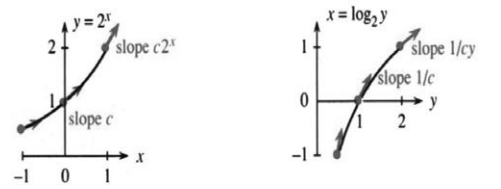

# 6.2 指数函数 $e^x$

> 来源：PDF第305—311页，印刷页292—298。状态：初译；已逐页对照原图，尚未完成全书复审。

<!-- PDF 305 / 印刷页 292 -->

上一节讨论了 $b^x$ 与 $\log_by$。底数 $b$ 可以是2、6、9.3，或任何不等于1的正数。但实际常用的底数只有少数几个；我就从未遇到过以6或9.3为底的对数。真正的主要候选者有两个，10是其中之一。本节介绍另一个极不寻常的数。它在初等算术、代数和几何中不那么显眼，看起来甚至有些突兀，却在微积分中大显身手。

这个数就是 $e$。原书以一句关于欧拉姓名首字母的玩笑介绍这个符号，并赞叹欧拉是一位杰出的数学家。$e$ 是**自然对数**的底数，也是指数函数 $e^x$ 的底数；本书将尤其强调后者的重要性。原书还把 $\pi$ 与表示周长的英文 perimeter 联系起来。无论如何，我们的第一个目标是找出 $e$。

记住，$b^x$ 与 $\log_by$ 的导数中都包含取决于 $b$ 的常数 $c$。上一节的式(10)、(11)为

$$
\frac d{dx}b^x=cb^x,\qquad \frac d{dy}\log_by=\frac1{cy}.\tag{1}
$$

当 $x=0$ 时，$b^x$ 的图像经过 $b^0=1$，斜率为 $c$；当 $y=1$ 时，$\log_by$ 的图像经过 $\log_b1=0$，斜率为 $1/c$。**只要底数选得合适，就能使两个斜率都等于1，即 $c=1$。**

$y=2^x$ 在 $x=0$ 处的斜率接近0.7。此前取 $\Delta x=0.1$ 时，得到 $\Delta y\approx0.07$。若要起始斜率为1，底数必须大于2。

先直接计算 $\log_by$ 在 $y=1$ 处的斜率：

$$
\frac1c=\lim_{h\to0}\frac{\log_b(1+h)-\log_b1}{h}
=\lim_{h\to0}\log_b\bigl((1+h)^{1/h}\bigr).\tag{2}
$$

由于 $\log_b1=0$，中间的式子是 $\log_b(1+h)$ 乘以 $1/h$，而这个乘数可以移到真数的指数位置。

$(1+h)^{1/h}$ 是个不同寻常的量。当 $h\to0^+$ 时，底数 $1+h\to1$，指数 $1/h\to+\infty$，形式上出现“$1^\infty$”。但它是未定式，不能直接求值，正如 $0/0$ 一样。结果取决于底数接近1与指数增大的相互关系，这种关系产生了特殊的数 $e$。

> **定义**
>
> $$e=\lim_{h\to0}(1+h)^{1/h}.
> \qquad\text{等价地，}\quad e=\lim_{n\to\infty}\left(1+\frac1n\right)^n.$$

先不计算 $e$ 的数值，回看式(2)末尾。利用对数函数的连续性，得到

$$
\frac1c=\log_be.\tag{3}
$$

若取 $b=e$，则右边为 $\log_ee=1$，从而 $c=1$，正如所愿：

$$
\frac d{dx}e^x=e^x,\qquad \frac d{dy}\log_ey=\frac1y.\tag{4}
$$

这就是底数 $e$ 在微积分中如此重要的原因：它使 $c=1$。

为了从 $(1+h)^{1/h}$ 计算 $e$，取 $h=1,1/10,1/100,\ldots$，相应指数 $n=1/h=1,10,100,\ldots$。有关极限与导数的严格基础将在第6.4节建立。下表显示，当 $h\to0$、$n\to\infty$ 时，该表达式趋于 $e$。

<!-- PDF 306 / 印刷页 293 -->

| $n$ | $h=1/n$ | $1+h$ | $(1+h)^{1/h}=(1+1/n)^n$ |
|---:|---:|---:|---:|
| 1 | 1.0 | 2.0 | 2.0 |
| 2 | 0.5 | 1.5 | 2.25 |
| 10 | 0.1 | 1.1 | 2.593742 |
| 100 | 0.01 | 1.01 | 2.704814 |
| 1000 | 0.001 | 1.001 | 2.716924 |
| 10000 | 0.0001 | 1.0001 | 2.718146 |

最后一列收敛于 $e$，只是速度不快。后面有一个收敛快得多的无穷级数。原书写作时提到，已计算出 $e$ 的125000位数字和 $\pi$ 的十亿位数字。这些数位并不因开头看起来重复就具有周期规律：

$$
e=2.7\,1828\,1828\,45\,90\,45\cdots,\qquad 1/e\approx0.37.
$$

$e$ 的幂给出 $y=e^x$。当 $x=2.3$ 与5时，$y$ 分别接近10与150。

对数函数是其反函数。因此，150和10以 $e$ 为底的对数分别接近5与2.3。这种对数有专门的名字——**自然对数**，并用符号 $\ln$ 表明底数为 $e$：

$$
\ln y=\log_ey.\qquad\text{自然对数就是 }e^x=y\text{ 中的指数 }x.
$$

$\ln y$ 或 $\ln x$ 是微积分课程中的标准记号；关键在于函数，而不在于变量名。在不少科学与工程语境中，自然对数是默认选择。$\exp(x)$ 表示 $e^x$，而 $\log x$ 也常用来表示 $\ln x$，即默认底数为 $e$。但约定因领域和工具而异；若有疑问，例如面对计算器按键，$\ln x$ 能明确表示以 $e$ 为底。

### $e^x$ 与 $\ln x$ 的导数

回到导数。$b^x$ 的导数为 $cb^x$，$\log_by$ 的导数为 $1/(cy)$。若 $b=e$，则 $c=1$。对任意允许的底数，由式(3)的 $1/c=\log_be$ 可以求出 $c$，也就是 $b^x$ 在 $x=0$ 处的斜率：

> **6E**
>
> $$c=\frac1{\log_be}=\log_eb=\ln b.\tag{5}$$

$c=\ln b$ 就是先前尚不能确定的常数。$2^x$ 的斜率是 $(\ln2)2^x$；$e^x$ 的斜率是 $(\ln e)e^x=e^x$，因为 $\ln e=1$。本章所需的基本导数已经齐备。

> **6F** $e^x$ 与 $\ln y$ 的导数分别为 $e^x$ 与 $1/y$。对其他底数，
>
> $$\frac d{dx}b^x=(\ln b)b^x,\qquad
> \frac d{dy}\log_by=\frac1{(\ln b)y}.\tag{6}$$

这些导数由函数本身决定，与选用哪个变量字母无关。例如

$$
\frac d{dt}e^t=e^t,\qquad \frac d{dx}\ln x=\frac1x.\tag{7}
$$

<!-- PDF 307 / 印刷页 294 -->

**关于 $x=0$ 处斜率的说明。** 若能直接看出 $2^x$ 的斜率小于1、$4^x$ 的斜率大于1，会很令人满意。快捷的理由是 $2<e<4$，但这里想从图像来理解。这是个有趣的小问题，也可以略过。

$2^x$ 从 $x=0$ 时的1增长到 $x=1$ 时的2，区间平均斜率为1。由于它的斜率递增，起点斜率小于平均斜率，因此小于1。另一方面，$4^x$ 从 $x=-1/2$ 时的 $1/2$ 增长到 $x=0$ 时的1，平均斜率仍为 $(1/2)/(1/2)=1$。此时0是区间的右端点，所以该处斜率大于1。底数介于2和4之间的 $e^x$，起始斜率恰为1。

这是从图像理解 $e$ 的方法。还有无穷级数，以及利用积分的定义。把五种刻画列在一起：

1. $e$ 是使 $e^x$ 在 $x=0$ 处斜率为1的底数。
2. $e$ 是使 $\ln y=\log_ey$ 在 $y=1$ 处斜率为1的底数。
3. $e=\lim_{n\to\infty}(1+1/n)^n$。
4. $e=1/0!+1/1!+1/2!+1/3!+\cdots=1+1+1/2+1/6+\cdots$。
5. 面积 $\int_1^e x^{-1}\,dx=1$。

前三种刻画的联系已经说明：以 $(1+1/n)^n$ 的极限为底数时，相应斜率为1。展开这个幂，将导出第6.6节的无穷级数。$\ln x$ 的正式定义则来自 $\int dx/x$；第五条就是 $\ln e=1$。第6.4节将采用这条路线，尽管它不如前几种方式直观。

$e^{-x}$ 的图像是 $e^x$ 关于纵轴的镜像，二者乘积为 $e^xe^{-x}=1$。当 $x$ 增大时，$e^x$ 指数增长，$e^{-x}$ 指数衰减；当 $x\to-\infty$ 时，$e^{-x}$ 则增长。指数增长快于任意固定次幂的增长，指数衰减也快于任意固定负次幂的衰减。例如，对固定 $n>0$，$e^x/x^n\to\infty$（第59题）。正是导数仍等于自身这一性质，使 $e^x$ 持续快速增长。

图6.6 原图注：$e^x$ 的增长介于 $2^x$ 与 $4^x$ 之间；$e^{-x}$ 衰减，而 $e^{-x^2/2}$ 衰减得更快。**本PDF此处实际重复了图6.5的指数与对数斜率图，和图注、正文不符；图件暂按原页保留。**

正文提到的另一条曲线是 $y=e^{-x^2/2}$，即概率论中著名的钟形曲线。除以 $\sqrt{2\pi}$ 后，得到标准正态分布的概率密度。它出现在许多平均量和实验结果的模型中，第8.4节将以盖洛普民意调查为例。曲线关于均值所在的 $x=0$ 对称，因为把 $x$ 换为 $-x$ 不改变 $x^2$。

曲线下约三分之二的面积位于 $-1<x<1$。若按曲线下区域的归一化面积均匀抽点，则点的横坐标落在该区间的概率约为三分之二。$x=-2$ 和2距离中心各为两个标准差，夹住约95%的面积，落在区间外的概率约为5%。随着 $x\to+\infty$，它比普通指数函数衰减得更快，因为指数中的 $x$ 被 $x^2/2$ 取代。

<!-- PDF 308 / 印刷页 295 -->

### $e^{cx}$ 与 $e^{u(x)}$ 的导数

$e^x$ 的导数还是 $e^x$，这使微积分可以处理一大类新函数。链式法则给出 $e^{3x}$、$e^{\sin x}$ 乃至任意 $e^{u(x)}$ 的导数。

> **6G** 当 $u$ 可导时，
>
> $$\frac d{dx}e^{u(x)}=e^{u(x)}\frac{du}{dx}.\tag{8}$$
>
> 特别地，若 $u=cx$，则
>
> $$\frac d{dx}e^{cx}=ce^{cx}.\tag{9}$$

**例1。** $e^{3x}$ 的导数为 $3e^{3x}$，这里 $c=3$。$e^{\sin x}$ 的导数为 $e^{\sin x}\cos x$，这里 $u=\sin x$。复合函数 $f(u(x))$ 的导数是 $(df/du)(du/dx)$；取 $f(u)=e^u$，便有 $df/du=e^u$。链式法则要求保留第二个因子 $du/dx$。

**例2。** $e^{(\ln2)x}=2^x$，其导数为 $(\ln2)2^x$。链式法则重新给出了常数 $c=\ln2$。一般地，它在 $b^x$ 的导数中给出 $c=\ln b$。

通常，$e^{cx}$ 比 $b^x$ 更方便：求导只需乘上常数 $c$。统一采用底数 $e$，把 $c=\ln b$ 等因素放入指数，表达会更简洁。$e^{cx}$ 的二阶导数为 $c^2e^{cx}$。

**例3。** $e^{-x^2/2}$ 的导数为 $-xe^{-x^2/2}$，因为 $u=-x^2/2$，$du/dx=-x$。

**例4。** 利用链式法则与乘积法则，$f=e^{-x^2/2}$ 的二阶导数为

$$
f''=(-1)e^{-x^2/2}+(-x)^2e^{-x^2/2}
=(x^2-1)e^{-x^2/2}.\tag{10}
$$

注意，指数因子始终保留下来。每求一次导数，虽然出现新的乘数，但指数因子仍然控制远处的增长或衰减。由式(10)可见，钟形曲线在 $x=\pm1$ 处二阶导数为0且变号，因此这两点为拐点。

**例5。** 取 $u=n\ln x$。对于 $x>0$，$e^{n\ln x}=x^n$，因此

$$
\frac d{dx}e^{n\ln x}=e^{n\ln x}\frac d{dx}(n\ln x)
=x^n\frac nx=nx^{n-1}.\tag{11}
$$

这对所有实数 $n$ 都成立，不要求 $n$ 为整数。第2章利用二项式定理得到 $3x^2$ 和 $4x^3$；现在，借助 $\ln$、$\exp$ 和链式法则，得到了普遍公式。

**例6。** 更进一步，考虑 $x^x=(e^{\ln x})^x=e^{x\ln x}$，其中 $x>0$。取 $u=x\ln x$，则

$$
\frac d{dx}x^x=e^{x\ln x}\left(\ln x+x\frac1x\right)
=x^x(\ln x+1).
$$

### $e^{cx}$ 与 $e^u(du/dx)$ 的积分

$e^x$ 的原函数为 $e^x$，但 $e^{cx}$ 的原函数一般不是 $e^{cx}$。求导时乘以 $c$，积分时就要除以 $c$。若 $c\ne0$，则其不定积分为 $e^{cx}/c+C$。

例如，

$$
\int e^{2x}\,dx=\frac12e^{2x}+C,\qquad
\int b^x\,dx=\frac{b^x}{\ln b}+C\quad(b>0,\ b\ne1),
$$
$$
\int e^{3(x+1)}\,dx=\frac13e^{3(x+1)}+C.
$$

而 $\int e^{-x^2/2}\,dx$ 不能直接用这条换元公式求出，且没有初等函数形式的原函数。

第一个积分中 $c=2$。第二个中 $c=\ln b$，因为 $b^x=e^{(\ln b)x}$，所以积分要除以 $\ln b$。第三个中，$e^{3(x+1)}=e^3e^{3x}$，常数 $e^3$ 可保留在外。

<!-- PDF 309 / 印刷页 296 -->

也可以直接把 $e^{3(x+1)}$ 看作 $e^u$，用除以3来补偿 $du/dx=3$。最后一个例子中缺少所需的 $du/dx$，因此不能直接套用下面的公式。

> **6H**
>
> $$\int e^u\frac{du}{dx}\,dx=e^{u(x)}+C.$$

下面前三个例子都可以化成 $e^u\,du$，第四个采用另一种换元：

$$
\int e^{\sin x}\cos x\,dx=e^{\sin x}+C,
\qquad \int xe^{x^2/2}\,dx=e^{x^2/2}+C,
$$
$$
\int\frac{e^{\sqrt{x}}}{\sqrt{x}}\,dx=2e^{\sqrt{x}}+C\quad(x>0),
\qquad \int\frac{e^x}{(1+e^x)^2}\,dx=-\frac1{1+e^x}+C.
$$

前两个直接就是 $e^u\,du$。第三个取 $u=\sqrt{x}$，则 $du/dx=1/(2\sqrt{x})$，只需调整因子2。第四个与前三个不同：令 $u=1+e^x$，得到的是 $du/u^2$。怎样选择最佳换元，并没有一句话就能概括的办法；不过，既然复杂部分是 $1+e^x$，把它设为 $u$ 就很自然。如果有效，就达到了目的。

若没有额外的 $e^x$ 因子，$\int dx/(1+e^x)^2$ 看起来困难一些。但仍值得尝试 $u=1+e^x$，这时 $du=e^x\,dx=(u-1)\,dx$：

$$
\int\frac{dx}{(1+e^x)^2}
=\int\frac{du}{(u-1)u^2}
=\int\left(\frac1{u-1}-\frac1u-\frac1{u^2}\right)du.\tag{12}
$$

最后一步称为部分分式分解，第7.4节将详细介绍。它把积分拆成较简单的部分，再逐项求积。再看三个例子：

$$
\int e^{1/x}\,dx,\qquad
\int e^x(4+e^x)\,dx,\qquad
\int e^{-x}(4+e^x)\,dx.
$$

第一个可变为 $-\int e^u/u^2\,du$，却没有实质改善，仍不能用初等函数表示原函数。第二个可以换元成 $\int u\,du$，但我更愿意拆成 $\int4e^x\,dx$ 与 $\int e^{2x}\,dx$，分别处理更稳妥。第三个化成 $\int(4e^{-x}+1)\,dx$，同样可以拆开。习题将练习把被积式化为可以直接积分的形式。

**关于定积分的提醒。** 下限为0时，人容易误以为原函数在0处也为0，因而忽略下限。对于 $x^3$ 确实如此，对于 $e^{3x}$ 却不成立，因为 $e^0=1$：

$$
\int_0^1e^{3x}\,dx=\left[\frac13e^{3x}\right]_0^1
=\frac13(e^3-1),
$$
$$
\int_0^1xe^{x^2}\,dx=\left[\frac12e^{x^2}\right]_0^1
=\frac12(e-1).
$$

<!-- PDF 310 / 印刷页 297 -->

### 6.2 习题

**通读填空。**

$e$ 约为 **a**。它是当 $h\to0$ 时，$(1+h)$ 的 **b** 次幂的极限。当 $h=$ **c** 时，该表达式为 $1.01^{100}$。等价地，$e=\lim_{n\to\infty}(\text{d})^n$。

底数 $b=e$ 时，第6.1节中的常数 $c=$ **e**。因此，$y=e^x$ 的导数 $dy/dx=$ **f**，$x=\log_ey$ 的导数 $dx/dy=$ **g**。它们在 $x=0$ 与 $y=1$ 处的斜率均为 **h**。$\log_ey$ 记为 **i**，称为 $y$ 的 **j** 对数。

$b^x$ 的导数中的常数 $c=$ **k**。$b^x$ 可以改写为 **l**，其导数为 **m**。$e^{u(x)}$ 的导数为 **n**，$e^{\sin x}$ 的导数为 **o**。对 $e^{cx}$ 求导，会带出一个因子 **p**。

$e^x$ 的不定积分为 **q**，$e^{cx}$ 的不定积分为 **r**（$c\ne0$），$e^{u(x)}du/dx$ 的不定积分为 **s**。一般而言，单独对 $e^{u(x)}$ 求积分是 **t** 的。

求第1—18题各函数的导数。

1. $7e^{7x}$。
2. $-7e^{-7x}$。
3. $(e^x)^8$。
4. $(x^{-x})^{-8}$。
5. $3^x$。
6. $e^{x\ln3}$。
7. $(2/3)^x$。
8. $4^{4x}$。
9. $1/(1+e^x)$。
10. $e^{1/(1+x)}$。
11. $e^{\ln x}+x^{\ln e}$。
12. $xe^{1/x}$。
13. $xe^x-e^x$。
14. $x^2e^x-2xe^x+2e^x$。
15. $(e^x-e^{-x})/(e^x+e^{-x})$。
16. $e^{\ln(x^2)}+\ln(e^{x^2})$。
17. $e^{\sin x}+\sin(e^x)$。
18. $x^{-1/x}$，先把它写成 $e$ 的幂。

19. $e-(1+1/n)^n$ 近似等于 $Ce/n$。用2.7183减去 $n=10,100,1000$ 时算出的值，估计常数 $C$。
20. 用代数方法或计算器，求 $(1+1/n)^{2n}$ 与 $(1+1/n)^{\sqrt n}$ 在 $n\to\infty$ 时的极限。
21. 数列 $(11/10)^{10},(101/100)^{100},\ldots$ 的极限是 $e$。因此，$(10/11)^{10},(100/101)^{100},\ldots$ 的极限为 ______；$(10/11)^{11},(100/101)^{101},\ldots$ 的极限为 ______。后一列是 $(1-1/n)^n$ 的相应项。
22. 比较 $(1.001)^{1000}$、$(1.0001)^{10000}$ 对 $e$ 的正确小数位数；若条件允许，再算 $(1.00001)^{100000}$。取多大的 $n$，才能得到2.71828中的全部小数位？
23. $y=e^x$ 满足 $dy/dx=y$。用 $\Delta Y/\Delta x=Y$ 近似，即 $Y(x+h)-Y(x)=hY(x)$。取 $h=1/10$，从 $Y(0)=1$ 出发，一步后的 $Y(h)$ 是多少？十步后的 $Y(1)$ 呢？
24. 满足 $dy/dx=-y$ 且 $y(0)=1$ 的函数为 ______。用 $Y(x+h)-Y(x)=-hY(x)$ 近似。若 $h=1/4$，一步后的 $Y(h)$ 与四步后的 $Y(1)$ 分别是多少？
25. 构造三个函数 $f,g,h$，使对 $x>10$ 有 $(1+1/x)^x<f(x)<e^x<g(x)<e^{2x}<h(x)<x^x$。
26. 在 $x=-2,-1,0,1,2$ 处描点，画出 $e^x$ 与 $\sqrt{e^x}$。$\sqrt{e^x}$ 的另一种写法是 ______。

求第27—36题各函数的原函数。

27. $e^{3x}+e^{7x}$。
28. $(e^{3x})(e^{7x})$。
29. $1^x+2^x+3^x$。
30. $2^{-x}$。
31. $(2e)^x+2e^x$。
32. $1/e^x+1/x^e$。
33. $xe^{x^2}+xe^{-x^2}$。
34. $(\sin x)e^{\cos x}+(\cos x)e^{\sin x}$。
35. $\sqrt{e^x}+(e^x)^2$。
36. $xe^x$，可用试探法。

37. 比较 $e^{-x}$ 与 $e^{-x^2}$。在0的右侧附近，哪个下降得更快？两条曲线还在哪里相交？何时比值 $e^{-x^2}/e^{-x}<1/100$？
38. 比较 $e^x$ 与 $x^x$（$x>0$）。它们在哪里相交？该处斜率分别是多少？考察比值 $x^x/e^x$，证明它在 $x\to\infty$ 时趋于无穷大。
39. 求 $y=e^x$ 在 $x=a$ 处的切线。曲线上哪一点处的切线经过原点？
40. 比较斜率，证明当 $x>0$ 时：(a) $e^x>1+x$；(b) $e^{-x}>1-x$。
41. 求 $y=x^x$ 在 $x>0$ 上的最小值，并利用二阶导数说明曲线凹向上。
42. 求 $y=x^{1/x}$ 的导数及导数为0的点，再检查二阶导数，说明 $x^{1/x}$ 的最大值为 ______（$x>0$）。
43. 若 $dy/dx=y$，利用乘积法则求 $e^{-x}y$ 的导数，从而推出 $y(x)=Ce^x$，其中 $C$ 为常数。
44. 证明 $x^e=e^x$ 只有一个正数解。

<!-- PDF 311 / 印刷页 298 -->

计算第45—54题的积分。第49—50题含无穷上限，属于反常积分。

45. $\displaystyle\int_0^1e^{2x}\,dx$。
46. $\displaystyle\int_0^\pi\sin x\,e^{\cos x}\,dx$。
47. $\displaystyle\int_{-1}^12^x\,dx$。
48. $\displaystyle\int_{-1}^12^{-x}\,dx$。
49. $\displaystyle\int_0^\infty e^{-x}\,dx$。
50. $\displaystyle\int_0^\infty xe^{-x^2}\,dx$。
51. $\displaystyle\int_0^1e^{1+x}\,dx$。
52. $\displaystyle\int_0^1e^{1+x^2}x\,dx$。
53. $\displaystyle\int_0^\pi2^{\sin x}\cos x\,dx$。
54. $\displaystyle\int_0^1(1-e^x)^{10}e^x\,dx$。
55. 下列积分中，哪些可以直接用本节换元法求出？求出这些积分：$\displaystyle\int\frac{e^u}{du/dx}\,dx$；$\displaystyle\int\frac{du/dx}{e^u}\,dx$；$\displaystyle\int e^u\left(\frac{du}{dx}\right)^2dx$；$\displaystyle\int(e^u)^2\frac{du}{dx}\,dx$。
56. 找一个函数，满足 $y'(x)=5y(x)$ 且 $y(0)=2$。
57. 找一个函数，满足 $y'(x)=1/y(x)$ 且 $y(0)=2$。
58. 借助电子工具画出 $(1+1/x)^x$ 的图像。它有哪些渐近线？为什么？
59. 本题证明，当 $x\to\infty$ 时，$F(x)=x^n/e^x\to0$。设固定的 $n>0$。(a) 求 $F'(x)$，说明当 $x>n$ 时 $F$ 递减，且在正半轴上最大值为 $F(n)=n^n/e^n$。(b) 由 $F(2x)=(2x)^n/e^{2x}=2^nx^n/(e^xe^x)\le2^nn^n/(e^ne^x)$，推出 $F(2x)\to0$，从而 $F(x)\to0$。
60. 取 $n=6$，用计算器或计算机画出 $F(x)=x^6/e^x$。估计最大值；再估计在峰值之后下降到 $F(x)=1$ 和 $F(x)=1/2$ 时的 $x$。
61. 斯特林公式给出 $n!\approx\sqrt{2\pi n}\,n^n/e^n$。用它估计 $6^6/e^6$，四舍五入到整数。这个整数是否正确？$10!$ 有多少位十进制数字？
62. 也可以在 $x\to\infty$ 时使用洛必达法则证明 $x^6/e^x\to0$。补全：$\lim x^6/e^x=\lim6x^5/e^x=\underline{\qquad}=0$。

### 译注与数学核对

1. 原页定义框第二个极限误印为 $h\to0$，而表达式中只有 $n$；已改为 $n\to\infty$。第一式的两侧极限需要单独论证存在及相等，不能只凭正整数序列近似确认。正文关于 $1/h\to\infty$ 的解释限定为 $h\to0^+$。
2. 原书关于欧拉因“私心”采用 $e$，以及选择 $\pi$ 的文字带有戏谑和历史简化，译文明确作为原书说法保留，不作为符号史定论。数字计算纪录也仅保留原书年代语境。
3. 图6.6在提供的PDF中确实错配为图6.5的重复图件；已保留证据并标出，不能据此认为原页展示了钟形曲线。
4. 正态密度在一个标准差内的概率约为68.27%，不是精确的 $2/3$；两个标准差内约为95.45%。正文保留原书的粗略比例并加“约”。图下注明的增长、衰减比较均为相应无穷远处的渐近比较，不是每一点的大小或瞬时变化率比较。
5. 原文“没有 $du/dx$ 就不能积分”过于绝对。译文改为不能直接使用该换元公式；连续被积函数仍有原函数，问题在于是否能用初等函数表达。$c=0$ 时 $\int e^{cx}\,dx=x+C$，不能除以 $c$。
6. 通过 $e^{n\ln x}$ 推导幂函数求导时，需 $x>0$。第16题中的原表达式在 $x=0$ 无定义，即使化简为 $2x^2$，也不能悄悄扩大原函数定义域。第58题按一般实指数定义讨论时，底数为正的实数定义域是 $(-\infty,-1)\cup(0,\infty)$。
7. 第22题的“正确小数位”可能指截断吻合，也可能指舍入吻合，二者所需 $n$ 不同；答题时应说明口径。第60题在正半轴上给定小于最大值的正函数值通常对应两个 $x$，原文“达到”含糊，译文按讨论衰减的上下文明确为峰值后的交点。
8. 第59题(b)原式的斜线和连乘书写容易误读；译文用完整分母 $e^xe^x$ 与 $e^ne^x$ 表明其正确含义。第55题第一项确为除以 $du/dx$，第三项确为其平方，不能误作标准换元公式。
