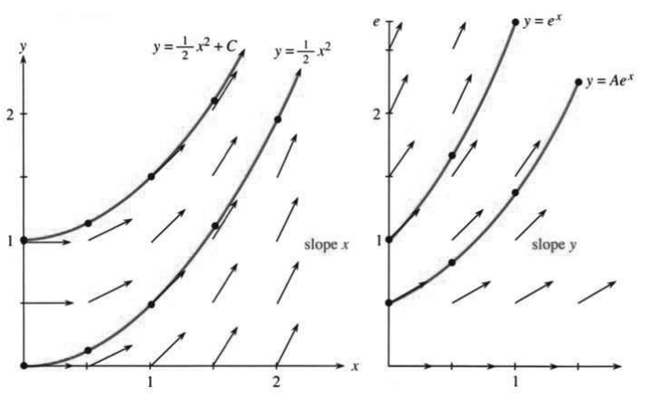
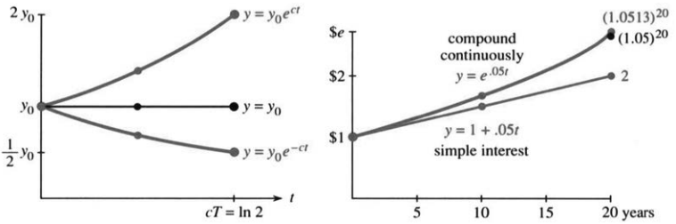
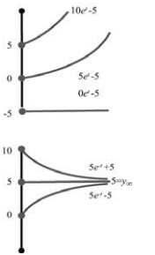
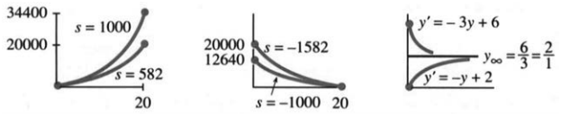

# 6.3 科学与经济学中的增长和衰减

> 来源：PDF第312—322页，印刷页299—309。状态：初译；已逐页对照原图，尚未完成全书复审。

<!-- PDF 312 / 印刷页 299 -->

求 $y=e^{cx}$ 的导数，花了不少工夫。结果 $y'=ce^{cx}$，也就是说 $y'=cy$。这一算还捎带着给出了 $b^x$、$x^x$、$e^{u(x)}$ 的导数，几乎没多花力气。不过我想留在 $y'=cy$ 上——这是应用数学里最重要的微分方程。

拿 $y'=x$ 和 $y'=y$ 比一比。前一个只要求出 $x$ 的原函数，几步就得到 $y=x^2/2+C$。后一个要求 $dy/dx$ 就等于 $y$ 本身。把它改写成 $dy/y=dx$，积分得 $\ln y=x+C$，于是 $y=e^xe^C$。看差别：第一个解是 $x^2/2$ 再加一个常数，第二个解是 $e^x$ 再乘一个常数。

图6.7 用“切向箭头”画出了这两种斜率规律：每个位置上的箭头，就是那里要求的斜率。抛物线那一支，箭头随 $x$ 增大而变陡，因为斜率 $y'=x$；指数曲线那一支，箭头随 $y$ 增大而变陡，因为斜率 $y'=y$。后一组箭头，由曲线 $y=Ae^x$ 串起来。**微分方程给出一个方向场；解曲线在每一点都与相应的箭头相切，也就有了方程要求的斜率。**

图6.7 斜率分别为 $y'=x$ 和 $y'=y$，解曲线与这些斜率贴合。slope：斜率。

一个方向场能一次摆出许多条解；这件事留到微分方程课再细说。通常，单独一个初值 $y_0$ 并不神圣。要理解方程，就该从许多初值出发。左图的抛物线彼此只差一个竖直平移，右图的高度成比例。对 $y'=-y$，所有解都在 $x\to\infty$ 时趋于0。

从 $y'=y$ 走到 $y'=cy$，只差一步：把 $c$ 放进指数，求导时就会掉出一个因子 $c$。$y=e^{cx}$ 的导数就是 $ce^{cx}=cy$。关键方程到手了，还得配一个初始条件，即起始值 $y_0$：

$$
\frac{dy}{dt}=cy,\qquad y(0)=y_0.\tag{1}
$$

一处小改动：自变量由 $x$ 换成了 $t$。多数应用里，时间才是自然的变量，空间不是。常数 $c$ 就此成为“增长率”或“衰减率”，$e^{cx}$ 也相应写成 $e^{ct}$。

<!-- PDF 313 / 印刷页 300 -->

最后一步是对上初始条件。$e^{ct}$ 在 $t=0$ 时等于1，所以要补一个常数乘子：$y=Ae^{ct}$。取 $A=y_0$，初始条件就对上了。

> **6I** 指数规律 $y=y_0e^{ct}$ 是初值问题 $y'=cy$、$y(0)=y_0$ 的解。

增长还是衰减，由 $c$ 决定。请留意一件基本事实：公式里有 $y_0,c,t$ 三个量；知道其中两个，再补上一条合适的观测值或条件，第三个就定了。许多应用都落在三种问法里：求 $t$、求 $c$、求 $y_0$。

**1. 已知 $c=1/10$，求倍增时间 $T$。** 到那一刻，$y_0e^{cT}=2y_0$：

$$
e^{cT}=2\ \Longrightarrow\ cT=\ln2
\ \Longrightarrow\ T=\frac{\ln2}{c}\approx\frac{0.7}{0.1}.\tag{2}
$$

问的是指数里的 $T$，答案自然要牵出对数。细胞若按每天10%的连续增长率生长，大小翻倍约需7天；储蓄账户若按每年10%的连续利率计息，金额翻倍约需7年。

**2. 若 $y$ 在 $T=5568$ 年后变成 $y_0/2$，求碳14的衰减系数 $c$。**

$$
e^{cT}=\frac12\ \Longrightarrow\ cT=\ln\frac12
\ \Longrightarrow\ c=\frac{\ln(1/2)}{5568}.\tag{3}
$$

过了半衰期 $T=5568$ 年，乘数落到 $1/2$。这里 $c<0$，因为 $\ln(1/2)=-\ln2$。

第一问讲增长，第二问讲衰减；两问都先把 $e^{cT}=y(T)/y(0)$ 求出来，再取对数得 $cT$。留意量纲：$T$ 的单位是时间，$c$ 的单位是时间的倒数。

要点在这里：$c>0$ 时，倍增时间是 $(\ln2)/c$，涨到原来的 $e$ 倍要 $1/c$，涨到10倍要 $(\ln10)/c$。$c<0$ 时，缩到原来的 $1/e$ 要 $-1/c$。

**3. 已知 $c=2$、$y(1)=5$，求初值 $y_0$。**

$$
y(t)=y_0e^{ct}\ \Longrightarrow\ y_0=y(t)e^{-ct}=5e^{-2}.
$$

图6.8 指数增长与衰减；倍增时间 $T=(\ln2)/c$；5%利率下的终值。compound continuously：连续复利；simple interest：单利；years：年。

<!-- PDF 314 / 印刷页 301 -->

这一步只是把过程倒着走：从5退回 $y_0$。时间一倒，$e^{ct}$ 就成了 $e^{-ct}$；$e^2e^{-2}=1$，向前的增长与向后的回推正好抵消。

同样要紧的，是从时刻 $T$ 再往前走到 $T+t$：

$$
y(T+t)=y_0e^{c(T+t)}=(y_0e^{cT})e^{ct}.\tag{4}
$$

不管从哪一步出发，往前走同样长的时间 $t$，乘的都是同一个因子 $e^{ct}$。这用到的正是指数函数的基本性质。

**例1：人口增长，来自恒定的出生率 $b$ 和死亡率 $d$。**

$$
\frac{dy}{dt}=by-dy=cy,\qquad c=b-d.
$$

这个模型里的人口是 $y_0e^{ct}=y_0e^{bt}e^{-dt}$。$b>d$ 时人口增长，因为那使 $c>0$。增长率的一种估计是 $c=0.02/\text{年}$：地球人口的倍增时间约为

$$
T=\frac{\ln2}{0.02}\approx35\text{年}.
$$

第一点：我们用 $c$ 预测未来，又回头去数过去的人口，好定出 $c$。可 $c$ 一旦变了，这个模型就麻烦大了。

第二点：$y_0e^{ct}$ 未必是整数，所以把对象想成细菌，可能比想成人更自然。本节正开启数学在经济学和生命科学里的一大应用。马尔萨斯把人口理论建在 $y'=cy$ 上；数量一多，多出或少掉零点几个人也就无所谓了。要用微积分，就从离散模型转到连续模型。可 $t$ 足够大时，这套理论必然失效——人口不可能永远指数增长。第6.5节会介绍逻辑斯谛方程 $y'=cy-by^2$，用竞争项 $-by^2$ 把增长拖慢。

第三点：$b,c,d$ 的量纲都是时间的倒数。出生率指的是单位时间内平均每人贡献多少新生儿，是一种相对变化率——人除以人，再除以时间。乘积 $ct$ 无量纲，$e^{ct}$ 才说得通，而且同样无量纲。有些教材用 $\lambda$ 代替 $c$；那么 $1/\lambda$ 就是增长时间、衰减时间、药物消除时间或扩散时间。

**例2：放射性定年。** 法国拉斯科洞穴壁画的一克木炭，每分钟衰变0.97次；一克活木，每分钟衰变6.68次。求这些拉斯科壁画的年代。

木炭在烧成时（$t=0$）就停止补充放射性碳，此后其含量已衰减到 $y_0e^{ct}$。活木中的含量仍为 $y_0$，因为宇宙射线维持着平衡。于是 $e^{ct}=0.97/6.68$。用上面算出的衰减系数，可得

$$
ct=\ln\frac{0.97}{6.68},\qquad
t=\frac{5568}{-0.7}\ln\frac{0.97}{6.68}=14400\text{年}.
$$

另一个相关的问题是铀的年代。如今铀238的量是铀235的140倍，形成之初两者数量近似相等；半衰期分别为 $4.5\times10^9$ 年和 $0.7\times10^9$ 年。设

$$
c=\frac{\ln(1/2)}{4.5\times10^9},\qquad
C=\frac{\ln(1/2)}{0.7\times10^9},
$$

则

$$
\frac{e^{ct}}{e^{Ct}}=140
\ \Longrightarrow\ (c-C)t=\ln140
\ \Longrightarrow\ t=\frac{\ln140}{c-C}\approx6\times10^9\text{年}.
$$

<!-- PDF 315 / 印刷页 302 -->

**例3：经济学中的微积分——价格上涨与货币价值。**

先分清两种增长率：连续的与年度的。整整一年里的价格变化 $\Delta y$，用年度增长率来算：

$$
\Delta y=(\text{年度增长率})\,y\,\Delta t.\tag{5}
$$

微积分则把连续增长率用到每一个瞬时变化上：

$$
dy=(\text{连续增长率})\,y\,dt.\tag{6}
$$

两边除以 $dt$，若连续增长率为每年5%，得到 $dy/dt=0.05y$，解是 $y_0e^{0.05t}$。取 $t=1$，$e^{0.05}\approx1.0513$，对应的年度增长率约5.13%。

问银行付多少利息时，他们会给出两个利率：8%和8.33%。高的那个叫“有效年利率”，是复利算出来的，还取决于多久计一次息。连续复利时，每个时间微元都算进增长，一年后的因子就是 $e^{0.08}\approx1.0833$。

第6.6节会回到复利：计息间隔从一个月缩到一天，再缩到一秒，一路通向 $(1+1/n)^n$，取极限就是 $e$。眼下先算每年5%的连续利率：

- **终值：** 现在的1美元，相当于 $T$ 年后的 $e^{0.05T}$ 美元。
- **现值：** $T$ 年后的1美元，相当于现在的 $e^{-0.05T}$ 美元。
- **倍增时间：** 由 $e^{0.05T}=2$ 得 $T=\ln2/0.05\approx14$ 年。

若按单利算，翻倍要20年，因为 $20\times5\%=100\%$。换成连续复利，时间缩到 $\ln2\approx0.7$ 倍，与利率大小无关。

**例4。** 1626年，印第安人以24美元卖掉了曼哈顿。我们的计算说明，他们知道自己在做什么。假设按8%的复利计息，最初的24美元乘以 $e^{0.08t}$。在 $t=365$ 年后，乘数为 $e^{29.2}$，24美元长到了115万亿美元。有这么多钱，你可以买回土地，还能还清国债。

这听着很不现实。模型可能有个大漏洞。不过有件事千真万确：富兰克林留给波士顿和费城的钱，指定要投资200年。1990年，它带来了数百万美元（不是万亿，那需要更久）。下一步，我们换个新模型。

问：手上只有一台24美元的计算器，只有常用对数键、没有自然对数键，怎样估计 $e^{29.2}$？

答：把29.2乘以 $\log_{10}e\approx0.434$，得约12.7，这就是以10为底的指数。换了底，$e^{29.2}\approx10^{12.7}$，超过一万亿。

### 带源项的增长或衰减

现在给 $y'=y$ 添一项。此前的增长或衰减全由初始值 $y_0$ 造成，之后既没存进也没取出，投资全靠自己长——是纯指数的过程。新加的 $s$ 则允许账户余额持续增加或减少。

<!-- PDF 316 / 印刷页 303 -->

正的 $s$ 叫“源”，负的 $s$ 叫“汇”。比如 $s=5$，在时间 $dt$ 内给账户添上 $5dt$，它与 $dt$ 成正比，却不与 $y$ 成正比：

$$
\text{常源项：}\qquad \frac{dy}{dt}=y+5,\qquad y(0)=y_0.
$$

注意，等号两边都有 $y$！我先猜 $y=e^{t+5}$，彻底行不通：它的导数还是 $e^{t+5}=y$，偏偏不是 $y+5$。学生提议 $y=e^t+5t$，导数倒成了 $e^t+5$，可仍不等于 $y+5$。我们接着换别的办法，想让导数里冒出5，最后想到

$$
y=Ae^t-5,
$$

它确实满足 $y'=Ae^t=y+5$。

要紧的是：$A$ 不等于 $y_0$。令 $t=0$，得 $y_0=A-5$，所以

$$
y=(y_0+5)e^t-5=y_0e^t+5(e^t-1).
$$

源项5贡献的是 $5(e^t-1)$，从0起算；初值那一份 $y_0e^t$ 照旧增长。

**例5。** 对 $dy/dt=-y+5$，解为

$$
y=(y_0-5)e^{-t}+5=y_0e^{-t}+5(1-e^{-t}).
$$

源项那一项仍然为正，初值那一项则衰减到0。于是 $t\to\infty$ 时，$y\to y_\infty=5$。可见负的 $c$ 能让解趋向稳态。

图6.9 上图对应 $y'=y+5$，下图对应 $y'=-y+5$。

看过 $c=1$ 和 $c=-1$ 这两个例子，就可以去找一般常数 $c,s$ 下的解了：

$$
\frac{dy}{dt}=cy+s,\qquad y(0)=y_0.\tag{7}
$$

比如先存进8000美元，此后按每年1000美元的速率持续存入，即 $s=1000$；也可以每年取出200美元，即 $s=-200$。$s$ 的单位是美元/年，正好对上 $dy/dt$。钱是连续流进流出的，不是一年一次存、一次取。

$y=e^{(c+s)t}$ 不是解，它的导数是 $(c+s)y$；$y=e^{ct}+s$ 也不是解（但更接近了）。把 $y'=cy+s$ 分析透，是本节微分方程部分的主要成果。这个方程远远不止用于金融——金融只是提供了很好的例子。

我打算用四种方法求 $y$。你也许觉得一种就够了；最快的方法只要几行，可还是请给别的方法一个机会。为实际问题做准备，却不真动手解，那就没意义了。

† 我的学生说，一种方法已经太多了。他们只要答案。有时我就认输，直接写下公式：$y$ 是初值带来的 $y_0e^{ct}$，加上源项带来的 $s(e^{ct}-1)/c$。

**方法1（快的方法）。** 试“指数加常数”这种形式：$y=Ae^{ct}+B$。代入方程，再代入初值，得到

$$
cAe^{ct}=c(Ae^{ct}+B)+s,\qquad A+B=y_0.
$$

第一式两边都有 $cAe^{ct}$，抵消后剩 $cB+s=0$，于是 $B=-s/c$，再由第二式得 $A=y_0+s/c$。

> **关键公式**
>
> $$y=\left(y_0+\frac sc\right)e^{ct}-\frac sc
> =y_0e^{ct}+\frac sc(e^{ct}-1).\tag{8}$$

$s=0$ 时就退回没有源项的 $y_0e^{ct}$；$c=1,s=5$ 时，得到 $(y_0+5)e^t-5$。

<!-- PDF 317 / 印刷页 304 -->

**方法2（慢的方法）。** 最初投入的 $y_0$，到 $t$ 年后成了 $y_0e^{ct}$。开户之后存进去的钱，也照同样的规矩长：时刻 $T$ 的投入走到时刻 $t$，只长了 $t-T$ 年，增长因子就是 $e^{c(t-T)}$。$[T,T+dT]$ 这一段里存进去的小钱 $s\,dT$，到时刻 $t$ 贡献 $e^{c(t-T)}s\,dT$。

现在把所有贡献加起来：

$$
y(t)=y_0e^{ct}+\int_0^te^{c(t-T)}s\,dT.\tag{9}
$$

这就是杜阿梅尔原理的一例。即使源项随时刻变化，把 $s$ 换成 $s(T)$，这套思路照样管用。这里 $s$ 是常数：

$$
s\int_0^te^{c(t-T)}\,dT
=\left[-\frac sc e^{c(t-T)}\right]_{T=0}^{T=t}
=-\frac sc+\frac sc e^{ct}.\tag{10}
$$

这与方法1算出的源项贡献一致。方法1更容易。它之所以成功，是因为我们知道 $Ae^{ct}+B$ 这个形式，其中含有“待定系数”。方法2更加完整。$y$ 的形式是输出的一部分，不是输入。源项 $s$ 是连续不断的新存款，每一笔各自增长。第6.5节还会从直接积分的角度重做 $y'=cy+s$。

**积分因子怎么说。** 方法2也常借积分因子来表达。先把方程写成 $y'-cy=s$，再乘上 $e^{-ct}$：

$$
(y'-cy)e^{-ct}=se^{-ct}
\quad\Longleftrightarrow\quad
\frac d{dt}(ye^{-ct})=se^{-ct}.
$$

从0积分到 $t$，得

$$
ye^{-ct}-y_0=-\frac sc(e^{-ct}-1),
$$

再解出 $y$，还是式(8)。积分因子的妙处，是把左边凑成一个完整的导数。我自己更喜欢杜阿梅尔的想法：初值和后来的每一笔输入，都按同一条规律生长。两种方法，答案一致。

### 连续利率下的金融数学

金融上的问题就一句话：什么样的投入，换来什么样的回报？投入可以是开头的 $y_0$，也可以是持续的现金流 $s$；回报可以最后一次性领，也可以一路领。下面六个基本问题，前两个已经答完：存入 $y_0$，终值是 $y_0e^{ct}$；将来想要 $y$，现在就存它的现值 $ye^{-ct}$。

第3—6问要动用源项。连续年利率取 $c=0.05$，第3、4问从 $y_0=0$ 出发。

**问题3。** 以每年1000美元的速率持续存入，20年后有多少？

$$
y=\frac sc(e^{ct}-1)=\frac{1000}{0.05}(e^{0.05\times20}-1)
=20000(e-1)\approx34400\text{美元}.
$$

若一开始一次存进20000美元，终值约为 $20000e\approx54000$ 美元。

<!-- PDF 318 / 印刷页 305 -->

顺带还有个小收获（给偏好数学的人）：$c=0$ 时，式 $s(e^{ct}-1)/c$ 形式上成了 $0/0$。没有利息，每年存1000美元，20年当然有20000美元；可这个式子一点看不出来。用洛必达法则对 $c$ 求导，就能验证：

$$
\lim_{c\to0}\frac{s(e^{ct}-1)}c
=\lim_{c\to0}st e^{ct}=st.\tag{11}
$$

**问题4。** 每年以多大的连续速率 $s$ 存入，才能在20年后得到20000美元？

$$
20000=\frac{s}{0.05}(e-1)
\quad\Longrightarrow\quad s=\frac{1000}{e-1}\approx582\text{美元/年}.
$$

20年里陆续存进去的，总共约11640美元。若一开始就存 $20000/e\approx7360$ 美元，终点也一样。最好在 $t=0$ 时就有钱。

前两问没有源项，第3、4问没有初始投入。接下来是期末余额为0的情形：第5问把本金连利息当成年金领光，第6问把贷款还清。

**问题5。** 现在存入多少 $y_0$，才能连续20年每年领取1000美元，期末恰好用完？

$$
0=y_0e^{ct}+\frac sc(e^{ct}-1)
\quad\Longrightarrow\quad y_0=-\frac sc(1-e^{-ct}).
$$

代入 $s=-1000,c=0.05,t=20$，得 $y_0\approx12640$ 美元。所以说，面值20000美元、分20年发完的奖金，只需备下约12640美元；利率若高于5%，要备的还更少。

**问题6。** 贷款20000美元，如何按恒定连续支付速率在20年内还清？

不幸的是，$s$ 超过每年1000美元。银行给你的钱不止是用来买车（和交学费）的20000美元。**它还放弃了这笔钱的利息。**你要把它还回去，但不用每时每刻都持平，而是以恒定速率还20年。开头几笔付款，大头用来付利息；越往后，还本的比例越高。20年后，债务余额为0。

这与问题5相似（同样 $y=0$），但这里已知 $y_0$ 而求 $s$：

$$
0=y_0e^{ct}+\frac sc(e^{ct}-1)
\quad\Longrightarrow\quad s=-\frac{cy_0e^{ct}}{e^{ct}-1}.
$$

代入 $y_0=20000,c=0.05,t=20$，得每年支付1582美元。

留个小谜题：还款1582，存款582，为什么恰好差1000？1582和582来自

$$
\frac{1000e}{e-1}\quad\text{与}\quad\frac{1000}{e-1},
$$

差正好是1000。真正的道理在这里：每年只需拿出1000美元，恰好抵住20000美元的利息；剩下的582美元/年，存进另一个独立账户。20年后，这个账户连本带息恰好长到20000美元，正好拿来还本。

<!-- PDF 319 / 印刷页 306 -->

第6.6节讨论按日计息——它与连续计息只差几美分。按年计息则差几美元。

图6.10 第3—4问：持续存款；第5—6问：支付年金或偿还贷款；右图是稳态 $-s/c$。

### 暂态与稳态

若 $c<0$，指数项会随着 $t\to\infty$ 消失，这部分称为暂态项，剩下的是稳态，记为 $y_\infty$。没有源项时，稳态为0；有常源项时，稳态为 $-s/c$。

> **6J** 当 $c<0$ 时，
>
> $$y=\left(y_0+\frac sc\right)e^{ct}-\frac sc
> \longrightarrow y_\infty=-\frac sc.$$

到了稳态，源项与衰减恰好抵消：$cy+s=0$，于是 $dy/dt=0$，数值不再变。请看，$y_\infty$ 只由 $s,c$ 决定，与初值无关。

**例6。** 假设百慕大的出生率是每年0.02，死亡率是每年0.03，净增长率便是 $c=-0.01\ \text{年}^{-1}$。再假设每年从外面净移入1200人。初始人口是5000也好，500万也罢，都不影响稳态：

$$
y_\infty=-\frac sc=\frac{1200}{0.01}=120000.
$$

初始人口少于12万，人口就往上长到12万；多于12万，就往下落到12万。

**例7：牛顿冷却定律。**

$$
\frac{dy}{dt}=c(y-y_\infty),\qquad c<0.\tag{12}
$$

$y$ 是物体温度，$y_\infty$ 是四周恒定的温度。物体从 $y_0$ 出发，慢慢靠近 $y_\infty$。变化率与温差成正比：温差越大，热流越快。

方程里的 $-cy_\infty$ 顶替了先前的 $s$，正好对上 $y_\infty=-s/c$。求解时，把式(8)里的 $s$ 换成 $-cy_\infty$ 就行；也可以用下面这一招。

**方法3：新的想法是看温差 $y-y_\infty$。** 眼睛只盯温差 $y-y_\infty$。环境温度是常数，所以它的导数仍是 $dy/dt$，于是

$$
\frac d{dt}(y-y_\infty)=c(y-y_\infty),
\qquad y-y_\infty=(y_0-y_\infty)e^{ct}.\tag{13}
$$

这就解出了冷却方程。换回 $s,c$ 的符号：

$$
\frac d{dt}\left(y+\frac sc\right)=c\left(y+\frac sc\right),
\qquad y+\frac sc=\left(y_0+\frac sc\right)e^{ct}.\tag{14}
$$

<!-- PDF 320 / 印刷页 307 -->

把 $s/c$ 移到右边，就回到式(8)。式中有常数项和指数项，微分方程课把它们分别叫作特解与齐次解。到这里，微积分课该收手了。

**例8。** 在70°的房间里，发现牛顿的遗体，温度为90°。一天后，遗体的温度为80°。他是什么时候停止积分的（温度为98.6°时）？

解：取发现时刻为 $t=0$，以天为单位。$y_\infty=70,y_0=90$，于是 $y=20e^{ct}+70$。由 $y(1)=80$ 得 $e^c=1/2$，即 $c=\ln(1/2)$。再令 $20e^{ct}+70=98.6$，得 $e^{ct}=1.43$，于是

$$
t=\frac{\ln1.43}{\ln(1/2)},
$$

即发现前约半天。

### 6.3 习题

**通读填空。**

若 $y'=cy$、$y(0)=y_0$，则 $y(t)=$ **a**。若 $dy/dt=7y$ 且 $y_0=4$，则 $y(t)=$ **b**，在 $t=$ **c** 时达到8。若倍增时间为 $T$，则 $c=$ **d**。若 $y'=3y$、$y(1)=9$，则 $y_0=$ **e**。$c<0$ 时，解随 $t\to\infty$ 趋于 **f**。

$dy/dt=y+6$ 的常数解为 **g**，通解为 $y=Ae^t-6$。若 $y_0=4$，则 $A=$ **h**。$dy/dt=cy+s$ 从 $y_0$ 出发的解为 $Ae^{ct}+B=$ **i**，其中源项贡献为 **j**。时刻 $T$ 的投入到时刻 $t$ 乘以因子 **k**。

连续年利率 $c=10\%$ 时，时间 $dt$ 内的利息 $dy=$ **l**，从而 $y(t)=$ **m**。若初始余额为0，而以 $s=4000$ 美元/年持续存入，则10年后 $y=$ **n**。为了10年后得到10000美元，所需存款速率 $s=$ **o**。要永久连续领取4000美元/年，初始投入应为 **p**；若只领取20年，则初始投入为 **q**。为在10年内还清10000美元贷款，支付速率 $s=$ **r**。

$y'=-3y+s$ 的解趋于 $y_\infty=$ **s**。

第1—4题分别从初值1和 $-1$ 出发求解，两个解画在同一坐标系里。

1. $dy/dt=2t$。
2. $dy/dt=-t$。
3. $dy/dt=2y$。
4. $dy/dt=-y$。

第5—8题取 $y_0=10$ 求解。求何时增到100、何时降到1。

5. $dy/dt=4y$。
6. $dy/dt=4t$。
7. $dy/dt=e^{4t}$。
8. $dy/dt=e^{-4t}$。
9. 画出 $y'=-y$ 的方向场，以及解曲线 $y=e^{-x}$、$y=-e^{-x}$。
10. 画出 $y'=y-1$ 的方向场，以及解曲线 $y=e^x+1$、$y=1$。

第11—27题围绕 $y_0e^{ct}$，求 $c,t$ 或 $y_0$。

11. 某细菌培养物两小时翻倍。先求 $c$，再求增加到原来10倍需多少小时。
12. 某细菌数量十小时增至10倍。增至100倍需多久？$c$ 是多少？
13. 某头骨所含放射性碳为同类现代样本的 $1/5$。它有多大年代？
14. 某遗物的放射性碳含量为新材料的90%。它可能来自基督的时代吗？
15. 开罗人口20年间从500万增至1000万。由 $y'=cy$ 求 $c$，并求人口何时为800万。
16. 纽约、洛杉矶的人口分别按每年1%、1.4%的速率增长，初始人口分别为800万、600万。何时相等？
17. 假设1美元对应的日元数每年下降2%，从1美元兑240日元开始，何时变成1美元兑1日元？
18. 假设广告记忆率指数衰减，三天后，40%的人记得某个新产品。求 $c$；何时只剩20%记得？
19. 指数增长满足 $y(3)=1000,y(4)=3000$，求 $y_0$。
20. 指数衰减满足 $y(4)=100,y(8)=10$，何时 $y=1$？$y_0$ 是多少？
21. 气压随高度满足 $dp/dh=cp$。海平面 $h=0$ 与 $h=20$ km处的气压分别为1013、50毫巴。求 $c$，并解释为什么在 $h=10$ km处 $p=\sqrt{1013\cdot50}$。
22. 对指数衰减，证明 $y(t)=\sqrt{y(0)y(2t)}$。怎样由 $y(t),y(2t)$ 求 $y(3t)$？

<!-- PDF 321 / 印刷页 308 -->

23. 血液中的大多数药物按 $y'=cy$ 衰减（一阶动力学）。(a) 吗啡的半衰期是3小时，求衰减常数 $c$（带单位）。(b) 尼古丁的半衰期是2小时。飞行六小时后，剩余比例是多少？
24. 若某药每次剂量为3 mg，消除率为 $c=0.01/\text{小时}$，且要求血液中始终保持1 mg，应隔多久服药一次？（医生根据体型确定这个水平。）
25. 抗癫痫药苯妥英在达到 $y=y_1$ 前，具有恒定消除率 $y'=-a$；随后 $y'=-ay/y_1$。从 $y_0$ 出发，分两段求 $y(t)$。何时达到 $y_1$？
26. 尼古丁的实际消除是多指数的： $y=Ae^{ct}+Be^{Ct}$。一阶方程 $(d/dt-c)y=0$ 相应推广为 $(d/dt-c)(d/dt-C)y=0$。展开为含 $y''$ 的方程，并验证给定的 $y$ 满足它。
27. 判断正误，错误则改正：(a) $e^{ct}$ 的倍增时间是 $(\ln2)/(\ln c)$；(b) 若 $y'=cy,z'=cz$，则 $(y+z)'=2c(y+z)$；(c) 同样条件下 $(y/z)'=0$；(d) 若 $y'=cy,z'=Cz$，则 $(yz)'=(c+C)yz$。
28. 火箭速度为 $v$，喷出的燃料质量为 $\Delta m$、速度为 $v-7$。总动量保持不变： $mv=(m-\Delta m)(v+\Delta v)+\Delta m(v-7)$。导出剩余质量 $m$ 与速度 $v$ 的微分方程，求 $v(m)$ 而不是 $v(t)$，初值为 $v_0=20,m_0=4$。

第29—36题讨论 $y'=cy+s$。

29. 设 $y=Ae^{3t}+B$，确定 $A,B$，解 $y'=3y+1$、$y_0=0$。
30. 设 $y=Ae^{-t}+B$，解 $y'=8-y$、$y(0)=y_0$。

第31—34题取 $y_0=0$ 求解并画图。

31. $y'=y+1$。
32. $y'=y-1$。
33. $y'=-y+1$。
34. $y'=-y-1$。
35. 对 $y'=-2y+12$：(a) 求常数解；(b) 求含任意常数 $A$ 的通解；(c) 求 $y_0=0$ 和10时的解；(d) 求稳态 $y_\infty$。
36. 在 $y'=\pm3y\pm6$ 中选择符号，使从 $y_0=1$ 出发的解：(a) 增至 $+\infty$；(b) 增长趋于2；(c) 减少趋于 $-2$；(d) 降至 $-\infty$。分别画图。
37. 求 $y'=4-y$ 的常数解，验证 $y=Ae^{-t}+4$ 也是解。若 $y_0=3$，求 $y(1)$ 和 $y_\infty$。
38. 用方法2解 $y'=y+e^t$、$y_0=0$。时刻 $T$ 的输入 $e^T$ 到时刻 $t$ 乘以 $e^{t-T}$，所以 $y(t)=\int_0^te^Te^{t-T}\,dT=$ ______。代回验证。
39. 把上一方程写成 $y'-y=e^t$，乘以 $e^{-t}$，左边是 ______ 的导数。利用 $y_0=0$ 积分求解。
40. 将 $y'=-y+1$ 改写为 $y'+y=1$，乘以 $e^t$，从初值0出发积分求解。
41. 假设 $y=Ae^t+Bt+C$，解 $y'=y+t$、$y_0=0$。

第42—57题讨论金融数学。

42. 因通货膨胀，纸币购买力按 $c=-0.04\ \text{年}^{-1}$ 衰减。持有1000美元对应的购买力，在 $dt$ 年内减少多少？要抵消这种减少，需按多大的速率 $s$ 补入资金？
43. 有效年利率 $7\tfrac12\%$ 与连续年利率 $7\tfrac14\%$，哪一种终值更高？
44. 与有效年利率9%等价的连续年利率是多少？加分题：给银行打电话，询问两种利率，并检查计算。
45. 连续年利率100%，即 $c=1$ 时，每年持续存入 $s$，一年后有多少？怎样的初始存款 $y_0$ 能产生相同终值？
46. 20年后需50000美元学费，假设连续年利率10%。祖父母现在应一次性赠入多少 $y_0$？父母若持续存款，年速率应是多少？若每年持续存1000美元，何时达到50000美元？
47. 人均收入增长3%，人口增长2%，总收入增长多少？分别按(a)年度增长率，(b)连续增长率计算。
48. 在 $y'=cy+4$ 中，时刻 $T$ 存入的 $4dT$ 在较晚时刻 $t$ 值多少？从 $T=0$ 到1的全部存款，在 $t=2$ 时值多少？
49. 问题3中，每年持续存1000美元，20年后约有34400美元。若改为一次存20000美元，应在何时存入，才能在相同终点达到相同结果？
50. 初始存入5000美元，按连续年利率8%计息，每年持续取500美元，多久会取完？
51. 若贷款1000美元，按每天1%的连续利率计息，要在60天内还清，连续支付速率应为多少？
52. 你就是放高利贷的人。按每天1%连续复利计算，1美元一年后值多少？
53. 可以连续支付100美元/月，共48个月。若连续年利率为6%，最多可借多少？
54. 年收入速率为 $I_0e^{2ct}$，年支出速率为 $E_0e^{ct}$。(a) 何时相等？(b) 如果在那之前都借钱补足差额，到那时你借了多少钱？

<!-- PDF 322 / 印刷页 309 -->

55. 大一时借入助学贷款，四年后还本并额外支付20%，其有效年利率是多少？
56. 20年内连续浮动利率 $c(t)=0.09+0.001t$ 与固定连续利率10%相比，哪一种更有利？
57. 例4中24美元若按10%而非8%的连续年利率计息，365年后为多少？

第58—65题讨论 $t\to\infty$ 时的稳态 $y_\infty$。

58. 若 $y'=-y+7$，求 $y_\infty$，再求 $y-y_\infty$ 的导数。于是 $y-y_\infty$ 等于 $y_0-y_\infty$ 乘以 ______。
59. 对 $y'=3y-12$，分别在 $y_0<4$、$y_0=4$、$y_0>4$ 时画出解曲线。
60. $y'=c(y-12)$ 的所有解趋于 $y_\infty=$ ______，条件是 $c$ 为 ______。
61. 在 $y'=cy$ 中把时间单位从分钟改为小时，方程如何改变？$y'=-y+5$ 如何改变？稳态如何改变？
62. 若 $y_1,y_2$ 都满足 $y'=cy+s$，判断：(a) $y_1+y_2$ 也满足原方程；(b) $(y_1+y_2)/2$ 满足原方程；(c) $y_1'$ 满足原方程。
63. 咖啡在室温20°的环境中，12分钟内从80°降到60°。求冷却系数 $c$。咖啡何时是100°？
64. 若 $y_0=100,y(1)=90,y(2)=84$，求 $y_\infty$。
65. 若 $y_0=100,y(1)=90,y(2)=81$，求 $y_\infty$。
66. 要使咖啡冷却，应现在加奶还是稍后加奶？咖啡70°C，牛奶10°C，室温20°C。(a) 一份牛奶加入五份咖啡，混合温度为60°C。取环境温度20°C，混合饮品温度 $y(t)=$ ______。(b) 黑咖啡温度 $y_c(t)=$ ______，牛奶温度 $y_m(t)=$ ______。在时刻 $t$ 混合，温度 $(5y_c+y_m)/6=$ ______。
