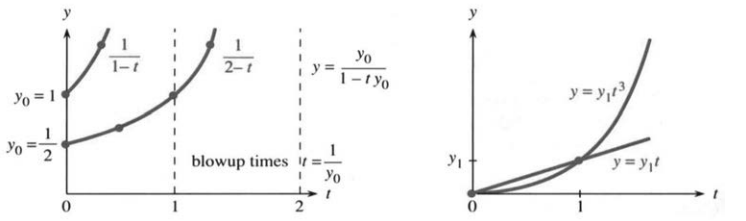
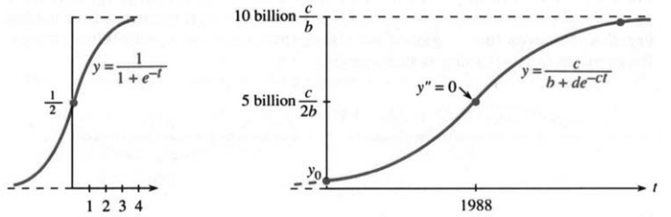
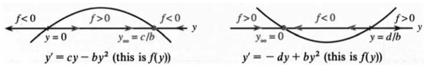
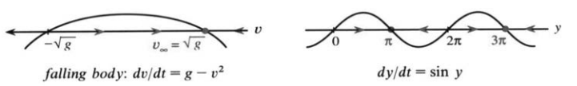

# 6.5 可分离变量方程与逻辑斯谛方程

原书 PDF 第330—338页，印刷页317—325。状态：初译，尚未完成全书统一复审。

<!-- PDF 330 / 印刷页 317 -->

本节首先用积分求解两个基本的微分方程：

$$
\frac{dy}{dt}=cy,\qquad \frac{dy}{dt}=cy+s. \tag{1}
$$

我们已经知道它们的解，却还不知道：如果没有人提示“试一试 $e^{ct}$”，该怎样找到这些解？包括这两个方程在内，许多重要方程都能拆成两个积分：一个关于 $y$，一个关于 $t$。分别积分便得到答案。微分方程一旦化成已知或可查表求得的积分，求解就有了着落。

本节着重讨论**逻辑斯谛方程**。它描述增长先加快、后减慢的过程，其解是一条 **S形曲线**：开始时缓慢上升，随后迅速增长，最后趋于平缓。按照原书当时采用的世界人口预测，20世纪90年代接近这条S形曲线的中部。S形曲线来自非线性方程，这是我们即将求解的第一个非线性模型，在生物学和其他生命科学中十分重要。

## 可分离变量方程

$dy/dt=cy$ 和带常数源项 $s$ 的 $dy/dt=cy+s$，都有一个直接解法：**把 $y$ 与 $t$ 分开**。当所除的量不为零、且第二式中 $c\ne0$ 时，

$$
\frac{dy}{y}=c\,dt,\qquad \frac{dy}{y+s/c}=c\,dt. \tag{2}
$$

所有含 $y$ 的量放在左边，所有含 $t$ 的量放在右边；常数 $c$ 放在哪边都可以。方程 $dy/dt=y+t$ 则不能直接这样分离。

式(2)含有微分，提示我们对两边积分。关于 $t$ 的积分给出 $ct$，关于 $y$ 的积分给出对数：

$$
\ln|y|=ct+C,\qquad \ln\left|y+\frac{s}{c}\right|=ct+C. \tag{3}
$$

**积分常数由初始条件确定。** 令 $t=0$ 时 $y=y_0$，得到

$$
\ln|y|=ct+\ln|y_0|,\qquad
\ln\left|y+\frac{s}{c}\right|=ct+\ln\left|y_0+\frac{s}{c}\right|. \tag{4}
$$

最后解出 $y$。我们需要的是 $y$ 本身，而不是它的对数。两边取指数，并利用非零解在其存在区间内保持符号，便有

$$
y=y_0e^{ct},\qquad y+\frac{s}{c}=\left(y_0+\frac{s}{c}\right)e^{ct}. \tag{5}
$$

把结果代回原微分方程检验，是一个好习惯。分离时除掉的平衡解 $y=0$ 或 $y=-s/c$ 要另行检查，它们也包含在式(5)中；当 $c=0$ 时，第二个方程直接给出 $y=y_0+st$。

这是求解 $y'=cy+s$ 的第四种方法。方法一从一开始就设 $y=Ae^{ct}+B$；方法二把各时刻的输入乘以相应增长因子 $e^{c(t-T)}$，再把贡献相加；方法三求解 $y-y_\infty$；方法四就是**分离变量法**。这些方法给出同一个答案。分离变量法用途很广。下面再说一遍它的基本思想，然后举例演示。

<!-- PDF 331 / 印刷页 318 -->

图6.15 方程 $dy/dt=y^2$ 与 $dy/dt=ny/t$ 的解。左图标出解发散的时刻；右图为幂函数解。

**求解 $dy/dt=u(y)v(t)$ 时，在 $u(y)\ne0$ 的区间内分离变量，再对两边积分：**

$$
\int\frac{dy}{u(y)}=\int v(t)\,dt+C. \tag{6}
$$

**代入初始条件确定 $C$，然后尽可能解出 $y(t)$。同时检查 $u(y)=0$ 所给出的常值解。**

**例1** $dy/dt=y^2$ 可分离为 $dy/y^2=dt$。积分得到 $-1/y=t+C$。代入 $t=0$、$y=y_0\ne0$，有 $C=-1/y_0$，因此

$$
-\frac1y=t-\frac1{y_0},\qquad y=\frac{y_0}{1-ty_0}.
$$

当 $y_0>0$ 时，解在 $t\to(1/y_0)^-$ 时趋于无穷大，见图6.15(a)。假如银行按存款的平方支付利息，即 $y'=y^2$，你很快就会拥有全世界的钱。这里显然是在说明模型的有限时间发散；$y_0=0$ 则给出零解。

**例2** $dy/dt=ty$ 可分离为 $dy/y=t\,dt$。积分得 $\ln|y|=t^2/2+C$。代入初值并取指数，得到

$$y=y_0e^{t^2/2}.$$

当利率为 $c=t$ 时，指数是 $t^2/2$。

**例3** $dy/dt=y+t$ 不是可分离变量方程。方法一仍然适用：设 $y=Ae^t+B+Dt$，比以前多引入一个系数 $D$，见习题35。方法二也适用，但不能直接使用上述分离变量法。

**例4** 将 $dy/dt=ny/t$ 分离为 $dy/y=n\,dt/t$。在 $t>0$ 上积分，得 $\ln|y|=n\ln t+C$。不能把 $t=0$ 代入，因为原方程本身要除以 $t$。不过，可以在 $t=1$ 给定初值 $y_1$，于是得到幂函数解

$$y=y_1t^n.$$

这就是第2.2节介绍的本书第一个微分方程。相对变化 $dy/y$ 与 $dt/t$ 之比，在经济学中称为“弹性”。这些相对变化的单位形如“美元/美元”，因而没有量纲。函数 $y=t^n$ 的弹性恒为 $n$。解为正时，$\ln y=n\ln t+C$ 在双对数坐标纸上是一条斜率为 $n$ 的直线。

## 逻辑斯谛方程

最简单的人口增长模型是 $dy/dt=cy$，其中 $c$ 为出生率与死亡率之差。如果 $c$ 是正常数，模型便预言人口会无限增长，最终超出模型适用的范围。人口不可能无限增加：食物和空间的竞争终将出现，指数增长必须放缓。

<!-- PDF 332 / 印刷页 319 -->

**实际的单位人口增长率依赖于人口规模 $y$。** 它应当是函数 $c(y)$，而不只是常数。把模型建对。这至少占问题的一半：

- 生物学或生态学的问题：确定 $c(y)$。
- 数学的问题：求解 $dy/dt=c(y)y$。

在足够小的范围内，许多光滑模型都可以用线性近似描述，但不能把这种近似的适用范围一直扩大下去。增长率下降时，有两个特别重要的模型：米氏模型采用 $c(y)=c/(y+K)$，逻辑斯谛模型采用 $c(y)=c-by$。先讨论后者。

非线性效应来自“相互作用”。设两个群体的规模分别为 $y$ 和 $z$，它们的相互作用次数就可以建模成与 $yz$ 成正比。**质量作用定律给出二次项 $byz$**，这是相互作用与竞争的一种基本模型。这里是同一群体内部的竞争，故令 $z=y$。方程中的负项 $-by^2$ 使增长减慢。

描述增长与竞争的基本模型称为**逻辑斯谛方程**：

$$\frac{dy}{dt}=cy-by^2. \tag{7}$$

通常取 $b,c>0$。人口较少、$by\ll c$ 时，竞争项 $by^2$ 远小于增长项 $cy$，增长近似为指数增长；人口变大后，负的竞争项使增长逐渐放缓。在适当初值下，解沿着一条可以精确求出的S形曲线变化。

换成人类人口，$b$ 和 $c$ 应取多少？原书采用的生态学估计为自然增长率 $c=0.029/\text{年}$。由于竞争项的存在，这不是实际的净增长率。原书写道：“约1930年，世界人口为30亿。”按该人口数计算，$cy$ 给出的年增长量为 $0.029\times30\text{亿}=8700\text{万}$，而所采用的实际年增长量约为6000万。两者相差的2700万就是 $by^2$：

$$
2700\text{万人/年}=b(30\text{亿人})^2,
\qquad b=3\times10^{-12}\,\text{人}^{-1}\text{年}^{-1}.
$$

$b$ 的数值虽小，作用却不小：它把8700万减少到6000万。更值得注意的是平衡状态：当 $by^2=cy$ 时，$dy/dt=0$，竞争损失与增长收益恰好抵消。正的平衡人口为

$$
y_\infty=\frac cb=\frac{0.029}{3}\times10^{12}\text{人}\approx100\text{亿人}.
$$

按照这个韦尔许尔斯特逻辑斯谛模型，世界人口将趋近100亿。这是模型的结论。原书接着写道，从当时的情况看，实际增长更快，很可能超过100亿；第3.3节引用的当时联合国报告给出了110亿到140亿的预测。这里保留这些历史性论述，不把它们视为当前预测。

还有个特殊点：$y_\infty=c/b$ 的一半处，按上述近似约为50亿。它是增长型S形曲线由上凹转为下凹的**拐点**，此处 $y''=0$，而增长速度 $y'$ 最大。直接从微分方程求这个点，比先求 $y(t)$ 更方便。再求一次导数：

$$y''=(cy-by^2)'=cy'-2byy'=(c-2by)y'. \tag{8}$$

在非平衡的增长解上，拐点处 $c-2by=0$，故 $y=c/(2b)$，恰在S形曲线高度的一半处。

<!-- PDF 333 / 印刷页 320 -->

## S形曲线

分离变量可解逻辑斯谛方程：

$$
\frac{dy}{dt}=cy-by^2
\quad\Longrightarrow\quad
\int\frac{dy}{cy-by^2}=\int dt. \tag{9}
$$

这里先考虑 $0<y_0<c/b$ 的增长解。第一个问题：这个关于 $y$ 的积分我们认得吗？不认得。第二个问题：封面的积分表是否列出了它？没有。最接近的是 $\int dx/(a^2-x^2)$，经过一些变形可以使用，见习题36。第三个问题：有没有一般方法？有。**部分分式法**正适合处理 $1/(cy-by^2)$，第7.4节将介绍该方法。积分并把等式乘以 $c$，有

$$
\ln\frac{y}{c-by}=ct+C,\qquad C=\ln\frac{y_0}{c-by_0}. \tag{10}
$$

这个常数保证解满足 $t=0$ 时的初值。两边取指数，消去对数：

$$\frac{y}{c-by}=e^{ct}\frac{y_0}{c-by_0}. \tag{11}$$

这里出现了与线性方程相同的增长因子 $e^{ct}$。但逻辑斯谛方程是非线性的：快速增长的不是 $y$，而是 $y/(c-by)$。当 $c-by\to0^+$ 时，这个比值趋于无穷大，而 $y$ 趋于 $c/b$。在这个模型中，增长最终趋于停止——世界人口的极限会是100亿吗？

还需要一个显式的 $y$ 公式。标准S形曲线是

$$y=\frac1{1+e^{-t}}.$$

当 $t\to+\infty$ 时，它趋于1；$t=0$ 时等于 $1/2$；$t\to-\infty$ 时趋于0。它满足 $y'=y-y^2$，即 $c=b=1$。一般公式要允许不同的 $c,b,y_0$，因此稍显复杂。把式(11)乘以 $c-by$ 并解出 $y$，得

$$
y=\frac{c}{b+e^{-ct}(c-by_0)/y_0}
=\frac{c}{b+de^{-ct}},\qquad d=\frac{c-by_0}{y_0}. \tag{12}
$$

当 $t\to+\infty$ 时，$e^{-ct}\to0$，公式中复杂的部分消失，$y$ 趋于平衡值 $c/b$，即图6.16中的水平渐近线。曲线的S形来自高度一半处的拐点。

图6.16 左：标准S形曲线 $y=1/(1+e^{-t})$。右：原书的人口S形曲线及当时预测；图中 billion 为十亿。

<!-- PDF 334 / 印刷页 321 -->

有个意外的观察：**$z=1/y$ 满足线性方程。** 因为 $z'=-y'/y^2$，所以

$$z'=\frac{-cy+by^2}{y^2}=-\frac cy+b=-cz+b. \tag{13}$$

这个方程的解是指数函数 $e^{-ct}$ 的倍数加一个常数：

$$z=Ae^{-ct}+\frac bc=\left(\frac1{y_0}-\frac bc\right)e^{-ct}+\frac bc. \tag{14}$$

取倒数 $y=1/z$，便得到式(12)的S形曲线。$z$ 从 $1/y_0$ 出发，趋于 $b/c$；$y$ 则趋于 $c/b$。

**例（美国人口；原书此处编号为“例1”）** 下表比较实际人口与模型人口，单位均为百万人。珀尔和里德用1790年、1850年和1910年的人口普查数据确定模型参数。在这些年份之间，拟合还不错，却并不完美。战争、经济萧条以及可能更重要的移民都会影响结果。事实上，他们模型的平衡值 $c/b$ 不到2亿，而原书写作时美国人口已超过这一数值。模型当然可以改进，也确实已有改进。原书还提到，据1990年人口普查的预测，人口会在达到3亿之前停止增长。

| 年份 | 美国人口 | 模型人口 |
|---|---:|---:|
| 1790 | 3.9 | 3.9 |
| 1800 | 5.3 | 5.3 |
| 1810 | 7.2 | 7.2 |
| 1820 | 9.6 | 9.8 |
| 1830 | 12.9 | 13.1 |
| 1840 | 17.1 | 17.5 |
| 1850 | 23.2 | 23.2 |
| 1860 | 31.4 | 30.4 |
| 1870 | 38.6 | 39.4 |
| 1880 | 50.2 | 50.2 |
| 1890 | 62.9 | 62.8 |
| 1900 | 76.0 | 76.9 |
| 1910 | 92.0 | 92.0 |
| 1920 | 105.7 | 107.6 |
| 1930 | 122.8 | 123.1 |
| 1940 | 131.7 | 136.7 |
| 1950 | 150.7 | 149.1 |

若移民流入量为常数 $s$，仍可以用部分分式法求解 $y'=cy-by^2+s$；不过，在实际工作中，计算机已经承担了大量求解任务。表格引自布劳恩的《微分方程》（Springer，1975）。原书脚注补充：世界人口模型不涉及移民——至少目前如此。

**说明。** 严肃的科学建模需要解释并论证 $y^2$ 项。它确实使我们得到一个可以完全求解的非线性模型，但简单并不必然意味着真实。基本理由是：规模为 $y$ 的群体中，个体相遇次数与 $y^2$ 成正比。如果相遇意味着争斗，就采用 $-by^2$；如果相遇促进人口增长，符号就要改变，产生合作项 $+by^2$，人口将增长得很快。

**例5** $y'=cy+by^2$。当 $b,c,y_0>0$ 时，$y$ 在有限时间内趋于无穷大。

**例6** $y'=-dy+by^2$。当 $b,d>0$ 且 $0<y_0<d/b$ 时，$y\to0$。

在例6中，死亡作用占上风。小种群尚未得到合作项 $by^2$ 的足够支持，便逐渐消亡。模型把低于阈值 $d/b$ 的种群视为有灭绝风险的一类。

逻辑斯谛方程不能产生周期振荡；在通常的存在唯一性条件下，一维自治方程 $dy/dt=f(y)$ 也没有非常数周期解。

**$y$ 相线。** 要理解 $y'=f(y)$，有个办法：画一条“$y$ 数轴”，用箭头标出 $f(y)$ 的符号。$f(y)>0$ 时，$y$ 增大，沿箭头向右运动；$f(y)<0$ 时向左运动；$f(y)=0$ 的点对应常值平衡解。

箭头显示解向左还是向右运动，是趋向平衡点还是趋向无穷远。箭头从两侧指向的平衡点是稳定吸引的；从两侧背离的平衡点是不稳定的。相线说明 $y$ 向哪里变化、可能趋于何处。

<!-- PDF 335 / 印刷页 322 -->

习题6.7.54的归一化落体模型中，终端速度为 $v_\infty=\sqrt g$。$f(y)=\sin y$ 则有好几个平衡点：

左：$dv/dt=g-v^2$；右：$dy/dt=\sin y$。

**例7 化学反应动力学：$mA+nB\to pC$。**

反应把 $m$ 个 $A$ 分子与 $n$ 个 $B$ 分子结合，生成 $p$ 个 $C$ 分子。例如 $\mathrm H_2+\mathrm{Cl}_2\to2\mathrm{HCl}$ 的化学计量数为 $m=n=1,p=2$。在本例采用的双线性质量作用模型中，反应速率与浓度 $[A]$、$[B]$ 的乘积成正比，因而 $[A]$ 减少而 $[C]$ 增大：

$$\frac{d[A]}{dt}=-r[A][B],\qquad \frac{d[C]}{dt}=k[A][B]. \tag{15}$$

化学实验测定 $r,k$，数学则求解浓度随时间的变化。用 $y$ 表示 $[C]$，即单位体积中的 $C$ 分子数，并设初始时 $[C]=0$。形成浓度为 $y$ 的产物后，$[A]$ 从 $a_0$ 降为 $a_0-(m/p)y$，$[B]$ 从 $b_0$ 降为 $b_0-(n/p)y$。式(15)因而含有 $y^2$ 项：

$$\frac{dy}{dt}=k\left(a_0-\frac mp y\right)\left(b_0-\frac np y\right). \tag{16}$$

这属于前面的非线性模型，见习题33—34。生物学中也有同样形式的质量作用关系；见到两个浓度相乘，就该想到质量作用。

## 米氏方程 $dy/dt=-cy/(y+K)$

生化反应是生命的关键，在每个生物体中不断发生，但它们的数学描述并不容易。工程学和物理学靠着线性模型已经走得很远，生物学却很快就会遇到非线性。虽然 $y'=cy$ 对一级反应动力学十分有效（见第6.3节），自然界还是内置了非线性调节机制。

酶能加快反应。没有酶，生命活动就像慢动作：按作者的夸张说法，血液凝固要等上许多年，消化牛排要几十年，学习微积分要几百年。整个系统十分精妙：DNA指导氨基酸组合成有用的蛋白质，于是有了酶、大象和艾萨克·牛顿。

简单说，酶参加反应，随后又释放出来。它就是催化剂。酶与底物形成不稳定的中间复合物，后者分解为新产物与酶；酶便可再次参与反应。

原书列举了以下催化作用及相关过程，有益的和有害的都有：

1. 汽车催化转化器中的铂参与发动机污染物的转化。不过，铅会使铂催化剂失活；原书用“十加仑含铅汽油就足以毁掉它”来强调这一点。
2. 喷雾推进剂中的氯氟烃（CFC）涉及使臭氧 $\mathrm O_3$ 转变为普通氧气 $\mathrm O_2$ 的催化破坏过程，削弱大气中的臭氧保护层。
3. 牛奶变成酸奶，葡萄汁变成葡萄酒。

<!-- PDF 336 / 印刷页 323 -->

4. 凝血需要一连串反应，在各步放大效应。原书以被称为“沙皇病”的血友病为例，称缺少凝血因子VIII会使一次小意外也导致难以止住的出血。
5. Adolph牌嫩肉粉使用从番木瓜取得的蛋白质，对牛排起预消化作用。原书还提及木瓜凝乳蛋白酶用于突出椎间盘的注射治疗。
6. 酵母使面包发起；酶参与形成酸面团的酸味。

当然，制造酶本身也需要酶。母体卵细胞包含细胞物质以及一半遗传信息；受精卵获得完整的遗传指令。以上是原书的科普叙述，相关医学表述的范围与年代问题见译注。

现在考察描述这类反应的**米哈埃利斯—门滕方程**，简称**米氏方程（MM方程）**。它基于质量作用定律：浓度为 $z$ 的酶使浓度为 $y$ 的底物转化，速率满足 $dy/dt=-byz$。这里 $b$ 为速率常数，右边含有“酶浓度乘底物浓度”。其他反应，包括某些逆反应，也遵循类似关系。完整方程组是非线性的，通常不能直接写出简单的精确解；不过，应用数学和自然现象中经常能从复杂系统中找出规律。

按这里采用的近似，游离酶浓度很快接近 $z_0K/(y+K)$。**米氏常数** $K$ 取决于质量作用方程中的各速率常数。随后底物耗尽，游离酶浓度又趋于 $z_0$。有效的反应方程是

$$\frac{dy}{dt}=-byz=-\frac{cy}{y+K},\qquad c=bz_0K. \tag{17}$$

这就是生物化学中的基本方程——米氏方程。速率在生物学中非常重要。观察 $cy/(y+K)$ 可见

$$
y\gg K:\quad \frac{dy}{dt}\approx-c;
\qquad y\ll K:\quad \frac{dy}{dt}\approx-\frac cK y.
$$

起步和收尾两个阶段速率不同，取决于 $y$ 与 $K$ 谁占优势。底物消耗速率的上限为 $c$。

分离变量可得

$$
\int\frac{y+K}{y}\,dy=-\int c\,dt
\quad\Longrightarrow\quad y+K\ln y=-ct+C. \tag{18}
$$

这里 $y>0$。令 $t=0$，有 $C=y_0+K\ln y_0$。按固定单位下的数值写法，两边取指数得到

$$e^y y^K=e^{-ct}e^{y_0}y_0^K. \tag{19}$$

我们没能用初等函数写出简单的显式公式，但已经取得很大进展。计算机可以很快画出 $y(t)$，显示酶反应的动态过程。

习题27—32继续讨论米氏理论。科学中的浓度和速率常数带有单位，数学处理时则可以引入无量纲变量，把若干常数化为1。令 $y=KY$、$ct=KT$，便得到

$$\frac{dY}{dT}=-\frac{Y}{Y+1}.$$

求解后再换回 $y,t,c,K$。无量纲化也适用于其他方程。

**要点：微积分的许多应用，都通过微分方程展开。** 这是描述变化的数学语言：人口、化学反应与传染过程可能遵循形式相同的方程。下一节要讨论的差分方程，也与 $dy/dt=cy$ 相对应。

<!-- PDF 337 / 印刷页 324 -->

## 6.5 习题

### 阅读填空

方程 $dy/dt=cy$、$dy/dt=cy+s$ 和 $dy/dt=u(y)v(t)$ 称为 **a**，因为可以把 $y$ 与 $t$ 分离。对 $\int dy/y=\int c\,dt$ 积分，得到 **b**；对 $\int dy/(y+s/c)=\int c\,dt$ 积分，得到 **c**。方程 $dy/dx=-x/y$ 导出 **d**，进而有 $y^2+x^2=\text{**e**}$，解的轨迹位于圆上。

逻辑斯谛方程为 $dy/dt=\text{**f**}$。$cy$ 表示增长，新增项 $-by^2$ 表示 **g**。分离变量得 $\int dy/(cy-by^2)=\int dt$，其中关于 $y$ 的积分为 $1/c$ 乘以 $\ln\text{**h**}$。在 $t=0$ 代入 $y_0$ 并取指数，得到 $y/(c-by)=e^{ct}(\text{**i**})$。当 $t\to\infty$ 时，$y$ 趋于 **j**，这是使 $cy-by^2=\text{**k**}$ 的平衡状态。在本节的增长初值条件下，$y$ 的图像呈 **l** 形，在 $y=\text{**m**}$ 处有拐点。

生物学和化学中，浓度为 $y,z$ 的物质按与 $y$ 乘 **n** 成正比的速率反应，这就是 **o** 定律。在模型 $dy/dt=c(y)y$ 中，增长率 $c$ 依赖于 **p**。米氏方程为 $dy/dt=\text{**q**}$。分离变量得到 $\int\text{**r**}\,dy=\text{**s**}=-ct+C$。

**1—8：分离变量、积分并求解。初值 $y_0$ 指自变量为0时的值。**

1. $dy/dt=y+5,\ y_0=2$。
2. $dy/dt=1/y,\ y_0=1$。
3. $dy/dx=x/y^2,\ y_0=1$。
4. $dy/dx=y^2+1,\ y_0=0$。
5. $dy/dx=(y+1)/(x+1),\ y_0=0$。
6. $dy/dx=\tan y\cos x,\ y_0=1$。
7. $dy/dt=y\sin t,\ y_0=1$。
8. $dy/dt=e^{t-y},\ y_0=e$。
9. 假设增长速度与 $\sqrt y$ 而非 $y$ 成正比。从 $y_0$ 出发，求解 $dy/dt=c\sqrt y$。
10. 恒定弹性方程 $dy/dx=ny/x$ 等价于 $d(\ln y)/d(\ln x)=\underline{\qquad}$；其解为 $\ln y=\underline{\qquad}$。
11. 当逻辑斯谛方程中 $c=0$ 时，仅余 $y'=-by^2$。平衡极限 $y_\infty$ 是多少？从 $y_0$ 降为 $y_0/2$ 需要多久？
12. 把第11题的符号反转，令 $y'=by^2$。从 $y_0=2$（亚当与夏娃）出发，人口在什么时刻趋于无穷大？

**13—26讨论逻辑斯谛方程及其变式。**

13. 证明 $y=1/(1+e^{-t})$ 满足 $y'=y-y^2$。分别画出初值为 $1/2$ 和 $1/3$ 的解曲线。
14. (a) $y=2/(1+e^{-t})$ 满足哪个逻辑斯谛方程？(b) 对于解 $y=1/(1+e^{-3t})$，求相应方程中的 $c,b$。
15. 求解 $z'=-z+1,\ z_0=2$。如式(13)那样取倒数，$y=1/z$ 是什么？
16. 从式(14)的 $y=1/z$ 出发，用代数变形得到式(12)。
17. 从 $y_0=c/(2b)$ 增长到 $y=3c/(4b)$ 需要多少年？使用式(10)，以1988年的拐点为时间起点。何时达到 $90\text{亿}=0.9c/b$？
18. 对 $u=y/(c-by)$ 求导，证明：若 $y'=cy-by^2$，则 $u'=cu$。这解释了式(11)：$u=u_0e^{ct}$。
19. 假设匹兹堡人口从1900年的100万增加到2000年的300万，两个年份的增长速度分别为每年12000人和30000人。代入逻辑斯谛方程求 $c,b$，并求平衡人口。附加题：何时达到 $y=y_\infty/2=c/(2b)$？
20. 令 $c=1,b=-1$，得到合作模型 $y'=y+y^2$。在 $y_0=1$ 时求 $y(t)$。何时趋于无穷大？
21. 画一条经过 $(0,0)$、水平渐近线为 $y=-1$ 与 $y=1$ 的S形曲线。证明 $y=(e^t-e^{-t})/(e^t+e^{-t})$ 具备这三个性质。$y^2$ 的图像形状像什么？
22. 为求解 $y'=cy-by^3$，令 $u=1/y^2$，在 $u'=-2y'/y^3$ 中代入 $y'$，得到关于 $u$ 的线性方程。仿照式(14)求解，初值为 $u_0=1/y_0^2$。当 $y_0>0$ 时，再取 $y=1/\sqrt u$。
23. 令 $y=rY,t=sT$，使 $dy/dt=cy-by^2$ 化为 $dY/dT=Y-Y^2$。求 $r,s$。
24. 在变换 $y=rY,t=sT$ 下，初值 $y_0,y'_0$ 与 $Y_0,Y'_0$ 有何关系？
25. 谣言按 $y'=y(N-y)$ 传播。已有 $y$ 人知道，另有 $N-y$ 人不知道，乘积 $y(N-y)$ 衡量可能传播谣言的相遇次数。(a) 从 $y_0=1$ 出发求解。(b) 何时有 $N/2$ 人听说谣言？记该时刻为 $T$。(c) 当 $N\to\infty$ 时，$T\to\underline{\qquad}$，所以原书认为这个模型不理想。较合理的模型写为 $y'=by(N-y)$；还应考虑 $b$ 如何随接触方式与人口规模变化。
26. 若把 $b,c$ 同时乘以10，S形曲线中部会变得更陡还是更平缓？

**27—34讨论质量作用关系与米氏方程 $y'=-cy/(y+K)$。**

27. 原书以“多数药物按 $y'=-cy$ 清除，阿司匹林则用米氏方程描述”为模型背景。令 $c=K=y_0=1$，米氏模型中的衰减更快吗？
28. 若以恒定速率 $d$ 输入阿司匹林，求满足 $d=cy/(y+K)$ 的平衡水平，此时 $y'=0$。

<!-- PDF 338 / 印刷页 325 -->

29. 证明米氏模型的消耗速率 $R=cy/(y+K)$ 随 $y$ 增大而增大，并求 $y\to\infty$ 时的极限上界。
30. 取 $c=1$，分别在 $K=1$ 和 $K=10$ 时画出 $R$ 关于 $y$ 的图像。米氏常数增大时，速率如何变化？$y$ 取多少时 $R=c/2$？
31. 令 $y=KY,ct=KT$，求关于 $dY/dT$ 的无量纲米氏方程。从解 $e^Y Y=e^{-T}e^{Y_0}Y_0$ 恢复式(19)。
32. 用计算机对不同的 $c,K$ 画出式(19)给出的 $y(t)$。
33. 对反应 $A+B\to C$，质量作用模型为 $y'=k(a_0-y)(b_0-y)$。设 $y_0=0,a_0=b_0=3,k=1$，求 $y$，并求达到 $y=2$ 的时刻。
34. 除了 $d[C]/dt$ 的方程，质量作用模型还给出 $d[A]/dt=\underline{\qquad}$。
35. 设 $y=Ae^t+B+Dt$，求解 $y'=y+t,\ y_0=0$，确定 $A,B,D$。
36. 令 $x=\sqrt b\,y-c/(2\sqrt b)$，把 $cy-by^2$ 写为 $a^2-x^2$，其中 $a=\underline{\qquad}$。在下列查表积分中代入 $a,x$，得到正文的积分（假设 $b,c>0$，并在适用区间内计算）：

$$
\int\frac{dx}{a^2-x^2}=\frac1{2a}\ln\left|\frac{a+x}{a-x}\right|+C,
\qquad
\int\frac{dy}{cy-by^2}=\frac1c\ln\left|\frac{y}{c-by}\right|+C.
$$

37. **重要。** 如正文那样画出 $y'=y/(1-y)$ 与 $y'=y-y^3$ 的相线并标箭头。各初值 $y_0$ 对应的解分别趋于哪些平衡点？注意第一个方程在 $y=1$ 处没有定义。
38. 用自己的话解释相线怎样发挥作用。
39. (a) 从 $y_0=\pi/6$ 出发求解 $y'=\tan y$，得到 $\sin y=e^t/2$。(b) 为什么解不能延伸到 $t=1$？(c) 在相线上标箭头，说明 $y$ 趋于 $\pi/2$；对应的终止时刻是多少？
40. 把逻辑斯谛方程写为 $y'=cy(1-y/K)$。对于正的增长型解，当 $y'\to0$ 时，$y\to\underline{\qquad}$。求拐点处的 $y,y',y''$。

## 译注与待复核事项

1. 原书式(3)—(4)未写对数绝对值；译文补齐，并补充除法遗漏的平衡解与 $c=0$ 情形。一般的分离变量积分首先只描述 $u(y)\ne0$ 的区间；非唯一性情形还可能存在拼接解，不能声称仅凭除法获得所有解。例1的正时间发散需要 $y_0>0$，例4在 $t>0$ 上讨论。
2. 原书例3指向习题23，实为习题35；积分表变换指向习题21，实为习题36。式(14)第一处常数误印为 $a/b$，应为 $b/c$。本译稿已改正，保留原书重复的美国人口例号并作说明。
3. 人口模型中 $b,c$ 量纲不同，不能直接比较大小；应比较 $by$ 与 $c$。原书给 $b$ 的单位仅写每年，若 $y$ 以人数计，还应含人数的倒数。所给参数的 $c/b$ 为约96.67亿，而非精确100亿；习题17沿用100亿的取整模型。原书“1930年30亿世界人口”的年份疑误，译文保留并明确归于原书，未把它当作已核实史实。
4. 完整的增长型S曲线要求 $b,c>0$、$0<y_0<c/b$；在只考察 $t\ge0$ 时，若初值已高于 $c/(2b)$，拐点在过去。$y_0>c/b$ 的正解向下趋于平衡值，并非这里的增长型S曲线。无穷远处的数值应表述为极限，原书“在 $t=\infty$ 时等于”已规范化。
5. 化学计量方程不能单独决定一般反应的速率方程。式(15)—(16)采用的是双线性速率假设；一般基元反应常见质量作用形式含 $[A]^m[B]^n$，复杂反应的级数则须依据机理或实验。氢氯反应的总反应式本身不能证明所给速率式。封闭体系中 $r,k$ 还须与化学计量关系相容，并非任意独立。
6. 米氏关系采用近似，不能把游离酶浓度写成无条件精确等式。原书无量纲方程漏写负号，已按式(17)与习题31改为负号。带量纲时宜使用 $Y=y/K,T=ct/K$，避免直接对浓度取对数或指数；等价的量纲一致隐式式为 $y-y_0+K\ln(y/y_0)=-ct$。原式(19)按所选单位下的数值形式保留。$R<c$ 对有限正 $y$ 成立，$c$ 是上确界而非有限点取得的最大值。
7. 酶、血友病、历史疗法与药物清除的段落是原书科普和建模背景，不构成当前临床说明。原书把因子VIII统称为酶、把所有血友病归于其缺失、把嫩肉粉酶与木瓜凝乳蛋白酶直接等同，均属需要专业复核的简化或可疑表述。本译稿未据此推导治疗建议；习题27—28仅按给定数学模型理解。
8. 习题9在 $y_0=0$ 时涉及不满足局部利普希茨条件导致的非唯一性；一般增长叙述默认 $c>0,y_0>0$。习题22取正平方根只适用于正初值；负初值应取负根，零解另列。习题28的有限非负平衡还要求 $0\le d<c$。习题39中 $y$ 仅在终止时刻趋于 $\pi/2$，方程在那里无定义，不能称为可继续的平衡状态。
9. 习题19给定两个人口数和对应增长速度可确定 $c,b$，但还须检验同一解是否恰好在100年内连接两个人口数；不能未经核验把四个数据都视为完全相容。习题25仅添加常数 $b$ 并不能自动修复大人口极限，参数应与接触结构相匹配。习题40也不能仅由 $y'\to0$ 不加条件地断言趋于正平衡，因为零解同样满足 $y'=0$。
