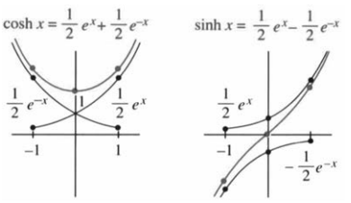
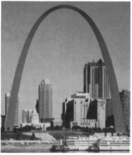
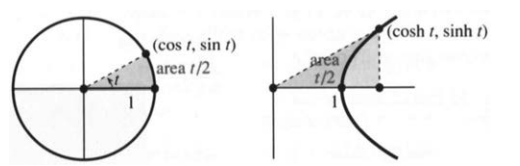

# 6.7 双曲函数

原书 PDF 第349—353页，印刷页336—340。状态：初译，尚未完成全书统一复审。

<!-- PDF 349 / 印刷页 336 -->

本节把 $e^x$ 与 $e^{-x}$ 组合起来。此前它们各走各的路：一个递增，一个递减。有两种特殊组合获得了专门的名称与记号：

$$
\text{双曲余弦}\quad\cosh x=\frac{e^x+e^{-x}}2,
\qquad
\text{双曲正弦}\quad\sinh x=\frac{e^x-e^{-x}}2.
$$

英语中，cosh 常读得与 gosh 押韵，sinh 常读近 cinch。图6.18表明 $\cosh x>\sinh x$。当 $x$ 很大且为正时，两者都非常接近 $e^x/2$；当 $x$ 为绝对值很大的负数时，$e^{-x}$ 占主导，$\cosh x\to+\infty$，而 $\sinh x\to-\infty$，因为后者的 $e^{-x}$ 前带负号。

图6.18 双曲函数由 $e^x/2$ 与 $e^{-x}/2$ 组合而成。

图6.19 圣路易斯大拱门。原图由圣路易斯游客委员会提供。

由定义直接得到

$$\cosh(-x)=\cosh x,\qquad\cosh0=1;$$

$$\sinh(-x)=-\sinh x,\qquad\sinh0=0.$$

因此，双曲余弦与余弦一样是偶函数，双曲正弦与正弦一样是奇函数。

$\cosh x$ 的图像与缆索在自重作用下的悬垂形状有关。把曲线倒过来，形状类似圣路易斯大拱门；作者称赞它可能是人们建造过的最大的“倒置双曲余弦”。缆索比拱门容易形成，因为重力会完成这项工作。在习题55中适当选择坐标轴，缆索的高度是经过伸缩的双曲余弦函数，称为**悬链线**：

$$y=a\cosh(x/a).$$

这里 $a$ 为张力的水平分量与单位弧长重量之比。原书还提到圣路易斯布施体育场有96条与大拱门呼应的悬链线形曲线。

双曲函数的性质可直接从定义导出。性质太多，没有必要逐条死记。一条重要线索是：许多关于正弦、余弦的恒等式，都有相应的双曲函数形式，常常只相差一个符号。先看四条性质。

<!-- PDF 350 / 印刷页 337 -->

1. $\cosh^2x-\sinh^2x=1$，对应于 $\cos^2x+\sin^2x=1$。验证如下：

$$\left(\frac{e^x+e^{-x}}2\right)^2-\left(\frac{e^x-e^{-x}}2\right)^2
=\frac{e^{2x}+2+e^{-2x}-e^{2x}+2-e^{-2x}}4=1.$$

2. $\displaystyle\frac d{dx}\cosh x=\sinh x$；与余弦求导相比，少了负号。
3. $\displaystyle\frac d{dx}\sinh x=\cosh x$；形式与正弦求导相同。
4. $\displaystyle\int\sinh x\,dx=\cosh x+C$，$\displaystyle\int\cosh x\,dx=\sinh x+C$。

图6.20 左：单位圆 $\cos^2t+\sin^2t=1$；右：单位双曲线 $\cosh^2t-\sinh^2t=1$。图中对应的扇形区域面积均为 $t/2$（按图取 $t\ge0$）。

性质1揭示了这些函数与双曲线的联系，也解释了记号中的字母h。$\cos^2x+\sin^2x=1$ 使点 $(\cos x,\sin x)$ 位于单位圆上，随 $x$ 变化绕圆运动，因此普通正弦、余弦也称圆函数。类似地，点 $(\cosh x,\sinh x)$ 位于单位双曲线 $X^2-Y^2=1$ 的右支。

另外四个双曲函数的定义也很自然：

$$
\begin{aligned}
\tanh x&=\frac{\sinh x}{\cosh x}=\frac{e^x-e^{-x}}{e^x+e^{-x}},
&\coth x&=\frac{\cosh x}{\sinh x}=\frac{e^x+e^{-x}}{e^x-e^{-x}},\\
\operatorname{sech}x&=\frac1{\cosh x}=\frac2{e^x+e^{-x}},
&\operatorname{csch}x&=\frac1{\sinh x}=\frac2{e^x-e^{-x}}.
\end{aligned}
$$

它们分别称为双曲正切、双曲余切、双曲正割与双曲余割。后两种以 $\sinh x$ 为分母的函数，即 $\coth x$ 与 $\operatorname{csch}x$，要求 $x\ne0$。作者认为 tanh 与 sech 的英文读音还算容易，其余记号更难读些。

把 $\cosh^2x-\sinh^2x=1$ 分别除以 $\cosh^2x$ 与 $\sinh^2x$，得到

$$1-\tanh^2x=\operatorname{sech}^2x,\qquad\coth^2x-1=\operatorname{csch}^2x.$$

进一步有

$$ (\tanh x)'=\operatorname{sech}^2x,\qquad
(\operatorname{sech}x)'=-\operatorname{sech}x\tanh x,$$

$$\int\tanh x\,dx=\int\frac{\sinh x}{\cosh x}\,dx=\ln(\cosh x)+C.$$

## 反双曲函数

还记得反三角函数 $\arcsin x,\arctan x,\operatorname{arcsec}x$ 吗？第4.4节用链式法则求出了它们的导数，主要应用之一是积分，例如 $\int dx/(1+x^2)=\arctan x+C$。

<!-- PDF 351 / 印刷页 338 -->

反双曲正弦、反双曲正切与反双曲正割的情形相似，但有符号差别。为避免“负一次方”与倒数混淆，分别记为 $\operatorname{arsinh}$、$\operatorname{artanh}$、$\operatorname{arsech}$；原书使用 $\sinh^{-1}$ 等记号。

$$y=\operatorname{arsinh}x\quad(x=\sinh y),\qquad\frac{dy}{dx}=\frac1{\sqrt{x^2+1}}\quad(x\in\mathbb R). \tag{1}$$

$$y=\operatorname{artanh}x\quad(x=\tanh y),\qquad\frac{dy}{dx}=\frac1{1-x^2}\quad(|x|<1). \tag{2}$$

$$y=\operatorname{arsech}x\quad(x=\operatorname{sech}y,\ y\ge0),\qquad
\frac{dy}{dx}=-\frac1{x\sqrt{1-x^2}}\quad(0<x<1). \tag{3}$$

习题44—46利用 $dy/dx=1/(dx/dy)$ 推导这些公式。另一条路是使用对数。因为 $\ln x$ 是 $e^x$ 的反函数，反双曲函数也可写成对数。例如

$$
y=\frac12\ln\frac{1+x}{1-x},\qquad
\frac{dy}{dx}=\frac1{2(1+x)}+\frac1{2(1-x)}=\frac1{1-x^2}. \tag{4}
$$

求导只是对 $\tfrac12\ln(1+x)-\tfrac12\ln(1-x)$ 使用常规法则。新的只是答案。对数从何而来？若 $x=\tanh y$，把中间分式的分子、分母同乘 $\cosh y$：

$$\frac{1+x}{1-x}=\frac{1+\tanh y}{1-\tanh y}
=\frac{\cosh y+\sinh y}{\cosh y-\sinh y}
=\frac{e^y}{e^{-y}}=e^{2y}.$$

因此 $2y$ 就是左边的自然对数，这给出式(4)。常用对数表达式如下：

$$
\begin{aligned}
\operatorname{arsinh}x&=\ln\left(x+\sqrt{x^2+1}\right),&&x\in\mathbb R,\\
\operatorname{arcosh}x&=\ln\left(x+\sqrt{x^2-1}\right),&&x\ge1,\\
\operatorname{artanh}x&=\frac12\ln\frac{1+x}{1-x},&&|x|<1,\\
\operatorname{arsech}x&=\ln\frac{1+\sqrt{1-x^2}}x,&&0<x\le1.
\end{aligned}
$$

这里 $\operatorname{arcosh}$ 与 $\operatorname{arsech}$ 都取非负值分支。

**说明1。** 列出这些公式是为了查阅，不必刻意死记。式(1)—(3)使原函数有两种写法：反双曲函数或对数。多数积分表使用对数，例如

$$\int\frac{dx}{1-x^2}=\frac12\ln\left|\frac{1+x}{1-x}\right|+C.$$

在 $|x|<1$ 上也可写为 $\operatorname{artanh}x+C$；对数形式还适用于不跨越 $x=\pm1$ 的其他区间。

**说明2。** 反正弦、反正切、反正割此前没有出现对数表达式，这是为什么？既然 $\operatorname{artanh}x$ 能用对数表示，反正切是否也有类似公式？确实有，不过要引入复数，并选择适当的对数分支。

这背后是数学中一个重要的公式。双曲余弦与双曲正弦分别是 $(e^x+e^{-x})/2$ 与 $(e^x-e^{-x})/2$，普通余弦、正弦是否也有对应形式？有，而且相当简单，只是要使用虚数。

<!-- PDF 352 / 印刷页 339 -->

$$\cos x=\frac12(e^{ix}+e^{-ix}),\qquad\sin x=\frac1{2i}(e^{ix}-e^{-ix}). \tag{5}$$

此前没有写出这些恒等式，是因为其中有虚指数。把第二式乘以 $i$，再与第一式相加，便得到优美的**欧拉公式**：

$$\cos x+i\sin x=e^{ix}. \tag{6}$$

它与 $\cosh x+\sinh x=e^x$ 相呼应。作者认为，欧拉公式的重要性远超本节讨论的双曲函数关系，正弦与余弦的应用也更加广泛。本节主要性质的介绍就到这里，下面通过习题展示应用。

## 6.7 习题

### 阅读填空

$\cosh x=\text{**a**}$，$\sinh x=\text{**b**}$，$\cosh^2x-\sinh^2x=\text{**c**}$；这三个表达式的导数分别为 **d**、**e**、**f**。点 $(x,y)=(\cosh t,\sinh t)$ 沿双曲线 **g** 运动。悬垂缆索的悬链线方程为 $y=\text{**h**}$。

反函数 $\operatorname{arsinh}x$ 与 $\operatorname{artanh}x$ 分别等于 $\ln(x+\sqrt{x^2+1})$ 与 $\tfrac12\ln\text{**i**}$。它们的导数为 **j** 与 **k**，因而相应的 **l** 有两种写法。

与 $\cosh x+\sinh x=e^x$ 对应的是欧拉公式 **m**。$\cos x=(e^{ix}+e^{-ix})/2$ 使用了 **n** 指数；$\sin x$ 的对应公式为 **o**。

1. 求 $\cosh x+\sinh x$、$\cosh x-\sinh x$ 和 $\cosh x\sinh x$。
2. 由定义求双曲余弦与双曲正弦的导数。
3. 证明这两个函数都满足 $y''=y$。
4. 用商法则验证 $(\tanh x)'=\operatorname{sech}^2x$。
5. 由定义证明 $\cosh^2x+\sinh^2x=\cosh2x$。
6. 对第5题的恒等式求导，得到 $\sinh2x$ 的公式。
7. 与 $(\cos x+i\sin x)^n=\cos nx+i\sin nx$ 对应的双曲函数公式为 $(\cosh x+\sinh x)^n=\cosh nx+\underline{\qquad}$。
8. 化为指数形式，证明 $\sinh(x+y)=\sinh x\cosh y+\cosh x\sinh y$。再对 $x$ 求导，得到 $\cosh(x+y)=\underline{\qquad}$。

**9—18：求导。**

9. $\cosh(3x+1)$。
10. $\sinh(x^2)$。
11. $1/\cosh x$。
12. $\sinh(\ln x)$。
13. $\cosh^2x+\sinh^2x$。
14. $\cosh^2x-\sinh^2x$。
15. $\tanh\sqrt{x^2+1}$。
16. $(1+\tanh x)/(1-\tanh x)$。
17. $\sinh^6x$。
18. $\ln(\operatorname{sech}x+\tanh x)$，在实对数定义域内求导。
19. 在 $x>0$ 上求 $\cosh(\ln x)$ 的最小值。
20. 已知 $\tanh x=3/5$，求 $\operatorname{sech}x,\cosh x,\sinh x,\coth x,\operatorname{csch}x$。
21. 若 $\tanh x=-12/13$，完成同样的计算。
22. 已知 $\sinh x=2$，求其他五个双曲函数值。
23. 已知 $\cosh x=1$，求其他五个函数值；没有定义的须说明。
24. 计算 $\sinh(\ln5)$ 与 $\tanh(2\ln4)$。

**25—32：求原函数。**

25. $\cosh(2x+1)$。
26. $x\cosh(x^2)$。
27. $\cosh^2x\sinh x$。
28. $\tanh^2x\operatorname{sech}^2x$。
29. $\sinh x/(1+\cosh x)$。
30. $\coth x=(e^x+e^{-x})/(e^x-e^{-x})$。
31. $\sinh x+\cosh x$。
32. $(\sinh x+\cosh x)^n$。
33. 图6.20右图的直角三角形面积为 $\tfrac12\cosh t\sinh t$。(a) 用积分求双曲线下方的阴影面积。(b) 对双曲扇形区域面积 $A$，验证 $dA/dt=1/2$。(c) 推出 $A=t/2+C$，并证明 $C=0$。按图取 $t\ge0$。

**34—40：画图。**

34. $y=\tanh x$，标出拐点。
35. $y=\coth x$，考察 $x\to\infty$ 时的极限。
36. $y=\operatorname{sech}x$。

<!-- PDF 353 / 印刷页 340 -->

37. $y=\operatorname{arsinh}x$。
38. $y=\operatorname{arcosh}x,\ x\ge1$。
39. $y=\operatorname{arsech}x,\ 0<x\le1$。
40. $y=\operatorname{artanh}x=\tfrac12\ln((1+x)/(1-x)),\ |x|<1$。
41. (a) 将 $x=\sinh y=(e^y-e^{-y})/2$ 乘以 $2e^y$，得到 $(e^y)^2-2x(e^y)-1=0$，视为关于 $e^y$ 的二次方程求解。(b) 取对数得到 $y=\operatorname{arsinh}x$，与正文比较。
42. (a) 将 $x=\cosh y=(e^y+e^{-y})/2$ 乘以 $2e^y$，得到 $(e^y)^2-2x(e^y)+1=0$，求 $e^y$。(b) 在 $y\ge0$ 分支上取对数，得到 $y=\operatorname{arcosh}x$，与正文比较。
43. 仿照式(4)，对 $y=\operatorname{arcoth}x$ 求导，证明 $y'=1/(1-x^2)$，其中 $|x|>1$。
44. 对 $x=\sinh y$ 求导，并利用 $\cosh^2y-\sinh^2y=1$，求得 $dy/dx=1/\sqrt{x^2+1}$。
45. 对 $x=\tanh y$ 求导，并利用 $\operatorname{sech}^2y+\tanh^2y=1$，求得 $dy/dx=1/(1-x^2)$。
46. 在 $y\ge0$ 分支上对 $x=\operatorname{sech}y$ 求导，得到 $dy/dx=-1/(x\sqrt{1-x^2})$，其中 $0<x<1$。

**47—52：利用式(1)—(3)或其他方法求不定积分。**

47. $\displaystyle\int\frac{dx}{4-x^2}$。
48. $\displaystyle\int\frac{dx}{a^2-x^2}$，可先设 $a>0$。
49. $\displaystyle\int\frac{dx}{\sqrt{x^2+1}}$。
50. $\displaystyle\int\frac{x\,dx}{\sqrt{x^2+1}}$。
51. $\displaystyle\int\frac{dx}{x\sqrt{1-x^2}}$。
52. $\displaystyle\int\frac{dx}{\sqrt{1-x^2}}$。
53. 计算 $\displaystyle\int_0^{1/2}\frac{dx}{1-x^2}$ 与 $\displaystyle\int_0^1\frac{dx}{1-x^2}$；后一积分按反常积分理解。
54. 取向下为正，在归一化二次阻力模型中，落体满足 $dv/dt=g-v^2$。(a) 证明 $v(t)=\sqrt g\tanh(\sqrt g\,t)$ 满足方程。(b) 从 $v(0)=0$ 出发，分离并积分 $dv/(g-v^2)=dt$，自行推导这个解。(c) 对速度积分，求从释放点起的下降距离 $f(t)$。
55. 缆索在自重下悬垂，其斜率 $S=dy/dx$ 满足 $dS/dx=c\sqrt{1+S^2}$，其中 $c$ 是单位弧长重量与张力水平分量之比。(a) 证明 $S=\sinh(cx)$ 满足方程。(b) 积分 $dy/dx=\sinh(cx)$，在 $y(0)=1/c$ 条件下求高度 $y(x)$。(c) 画出两端位于 $x=-L,L$ 的缆索，求中心相对两端的下垂量。
56. 一种最简单的非线性波方程——伯格斯方程——经行波化简可给出满足 $W''=WW'-W'$ 的波形。一积分并取积分常数为零，得 $W'=W^2/2-W$。(a) 分离变量并积分：$dx=dW/(W^2/2-W)=-dW/(2-W)-dW/W$。(b) 验证所得解满足 $W'=W^2/2-W$。
57. 孤立水波的形状经KdV方程的行波化简可满足 $y'''=y'-6yy'$。(a) 积分一次求得 $y''$，再把等式乘以 $y'$。(b) 再积分一次，求出关于 $y'$ 的关系；积分常数均取零。(c) 证明 $y=\tfrac12\operatorname{sech}^2(x/2)$ 给出这个孤立波的形状。
58. 利用式(5)推导 $\cos(ix)=\cosh x$。虚角 $i=\sqrt{-1}$ 的余弦是多少？
59. 利用式(5)推导 $\sin(ix)=i\sinh x$。$\sin i$ 是多少？
60. $e^{ix}=\cos x+i\sin x$ 的导数为多少？

## 译注与待复核事项

1. 原书没有集中说明反函数的实定义域与分支。双曲余弦和双曲正割在全实轴上并非单射，须先限制到 $y\ge0$；反双曲正割在 $x=1$ 有函数值，但没有有限的普通导数。译文补全这些条件，并改用明确的反函数记号。
2. 原书式(4)中间的求导结果误写减号，正确结果为两项相加。习题43的导数又多出一个负号；$\operatorname{arcoth}x=\tfrac12\ln((x+1)/(x-1))$ 的导数为 $1/(1-x^2)$，在 $|x|>1$ 上为负。两处均已纠正。
3. 原书对 $\int dx/(1-x^2)$ 未写绝对值。译文补齐，并说明不能跨越奇点；反双曲正切的实表达式只适用于 $|x|<1$。习题51若考虑负 $x$，也须使用适当对数表达式或分支，不可直接套正定义域的反双曲正割。
4. 悬链线参数中的“张力”应指恒定的水平分量，“密度”应指单位弧长重量；若采用质量线密度，还需乘重力加速度。理想均匀柔索的悬链线不能直接证明实物拱门精确遵循同一公式；大拱门与体育场的段落按原书作形状联系，未作结构或现状核验。
5. 习题54省略质量与阻力系数，是经过归一化的模型；$-v^2$ 的方向只适用于向下运动的所述情形，一般有向速度模型常写为 $-k v|v|$。式中的双曲正切自变量为 $\sqrt g\,t$，不是 $\sqrt{gt}$。从指定解反推可见需要 $v(0)=0$，译文补明。
6. 习题56积分时存在任意常数，所给一阶式已选择其为零；分离变量还须另查 $W=0,2$ 两个常值解。习题57原页首式为三阶导数 $y'''$，文本抽取容易误读为二阶；已按页图核对。积分所得 $(y')^2$ 的关系有正负分支，孤立波两侧并非同一个固定平方根符号。
7. “每条三角函数事实都有双曲对应”是帮助记忆的概括，不意味着周期性、有界性等性质直接照搬。复数形式需使用复指数、复三角函数的定义；涉及复对数时尤其要说明分支。本节没有据形式类比宣称实定义域外的反函数仍为实数。
