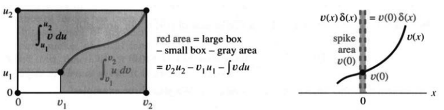
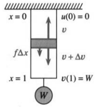

# 第7章 积分方法

原书 PDF 第354—360页，印刷页341—347；含章引言与第7.1节。状态：初译，尚未完成全书统一复审。

<!-- PDF 354 / 印刷页 341 -->

第5章把积分定义为和的极限，并开始用手算或计算机求面积。第6章打开了另一扇门：新函数 $e^x$ 与 $\ln x$ 把我们带进微分方程。其实，一直以来我们都在求解特殊的微分方程 $df/dx=v(x)$，其解为 $f=\int v(x)\,dx$；但走到 $dy/dx=cy$ 这一步，仍是一次重要突破。

我们已经能够做许多了不起的事。**数学有自己的语言，而你正在学会使用它。** 不久之前，$dy/dx$ 与 $\int v(x)\,dx$ 这些符号还很神秘；我班上的同学甚至对函数记号 $v(x)$ 本身也不十分熟悉。可光顾着看下一步，就容易忘记自己已经走了多远。

当然，还要继续向前。积分方面有两个方向：处理更多函数，探索更多应用。运用数学，才能使它鲜活起来。能求出积分，往往能让应用分析更加完整。这个短章将大大扩展我们能够积分的函数范围；符号计算软件还能进一步扩展它。

此前，积分主要依靠识别导数。若 $v(x)=\sec^2x$，可以取 $f(x)=\tan x$。对 $\tan x$ 积分则使用换元 $u=\cos x$：

$$\int\frac{\sin x}{\cos x}\,dx=-\int\frac{du}{u}=-\ln|u|+C=-\ln|\cos x|+C.$$

现在需要别的办法：把暂时处理不了的积分变个形，直到能下手。例如 $\int x\cos x\,dx$ 与 $\int\sqrt{1-x^2}\,dx$，都不能立即识别出原函数；分别使用分部积分和新的换元，它们就会简单起来。

这两个例子也表明本章的范围。花些合理的工夫，再查查表，就能求出许多重要积分；若投入更多时间，还能计算更复杂的积分。旧式教材常把大量篇幅用于这些技巧，例如 $\int(x+1)\,dx/\sqrt{2x^2-6x+4}$。必要时我们也能做，但时间宝贵。像长除法一样，基本思想应当理解，繁琐展开可以交给计算机。

本章先讲分部积分，再讲新的换元方法。部分分式也很有用，我们已经在逻辑斯谛方程 $y'=cy-by^2$ 中见过它。最后一节要处理这样一种情形：区间无界，或者被积函数无界，积分值却仍可能有限。这种**反常积分**很常见。第8章再展开应用。

<!-- PDF 355 / 印刷页 342 -->

# 7.1 分部积分法

为了简化积分，有两种主要的变形方法。换元法来自链式法则，后面还会继续讨论；这里介绍另一种方法，它来自乘积求导法则。把乘积法则反过来用于求积分，就是**分部积分法**。

此前提到过 $\int\cos^2x\,dx$ 与 $\int\ln x\,dx$，现在正好求出它们。你会看到 $\int\ln x\,dx$ 被换成 $\int1\,dx$，确实容易得多；$\int xe^x\,dx$ 则被换成 $\int e^x\,dx$。较难的积分与较易的积分，差的只是一个已知项——这正是关键。

开始前先说一句：分部积分并不只是空洞的技巧。它能体现力平衡这类基本物理关系，是微分方程理论乃至δ分布理论的一项基础。最后的选读部分将展示这些联系。

从乘积 $u(x)v(x)$ 的求导法则开始：

$$u(x)\frac{dv}{dx}+v(x)\frac{du}{dx}=\frac d{dx}[u(x)v(x)]. \tag{1}$$

两边积分。右边恢复为乘积，左边的一个积分移到右边并变号：

$$\int u(x)\frac{dv}{dx}\,dx=u(x)v(x)-\int v(x)\frac{du}{dx}\,dx. \tag{2}$$

这就是本节的核心。实际计算中常略去自变量，写成

**7A 分部积分公式：**

$$\int u\,dv=uv-\int v\,du. \tag{3}$$

等式按不定积分相差常数的意义理解。原来求 $\int uv'\,dx$ 的问题变为求 $\int vu'\,dx$。要记住负号，以及显式的乘积项 $uv$。定积分里，这个乘积要在端点求值：

$$\int_a^b u\frac{dv}{dx}\,dx=u(b)v(b)-u(a)v(a)-\int_a^b v\frac{du}{dx}\,dx. \tag{4}$$

**关键是选择 $u$ 与 $v$，使新的积分比原来的容易。** 看例子最清楚。

**例1** 对 $\int\ln x\,dx$，取 $u=\ln x,dv=dx$，故 $v=x$：

$$\int\ln x\,dx=x\ln x-\int x\frac1x\,dx.$$

不必再直接寻找 $\ln x$ 的原函数；右边的被积函数 $x(1/x)=1$，其积分为 $x$。计入负号、乘积项和积分常数，有

$$\int\ln x\,dx=x\ln x-x+C,\qquad x>0. \tag{5}$$

求导检验：$\ln x+x(1/x)-1=\ln x$。从2到3，曲线 $y=\ln x$ 下的面积为 $3\ln3-3-2\ln2+2$。

<!-- PDF 356 / 印刷页 343 -->

再说一次：我们把 $\ln x$ 的积分换成了1的积分。

**例2** 对 $\int x\cos x\,dx$，取 $u=x,dv=\cos x\,dx$，故 $v=\sin x$：

$$\int x\cos x\,dx=x\sin x-\int\sin x\,dx, \tag{6}$$

因此

$$\int x\cos x\,dx=x\sin x+\cos x+C. \tag{7}$$

**注意。** 新积分未必更简单。若改取 $u=\cos x,dv=x\,dx$，则 $v=x^2/2$，得到

$$\int x\cos x\,dx=\frac{x^2}2\cos x+\int\frac{x^2}2\sin x\,dx.$$

这个等式没错，可对眼前的求解帮助不大：$x^2$ 比 $x$ 更复杂。不过反过来使用它，就能简化 $\int(x^2/2)\sin x\,dx$。选择的原则是：**尽量让 $u$ 容易求导，让 $dv$ 容易积分。**

**例3** 对 $\int\cos^2x\,dx$，取 $u=\cos x,dv=\cos x\,dx$，故 $v=\sin x$：

$$\int\cos^2x\,dx=\cos x\sin x+\int\sin^2x\,dx.$$

新的积分既没有更容易，也没有更难；但一看到 $\sin^2x$，就应想到 $1-\cos^2x$。代入得

$$\int\cos^2x\,dx=\cos x\sin x+x-\int\cos^2x\,dx.$$

把右边的积分移到左边，再除以2：

$$\int\cos^2x\,dx=\frac12(\cos x\sin x+x)+C. \tag{8}$$

答案绝不是 $\cos^3x/3$。

**问题。** 从0到 $2\pi$ 对 $\cos^2x$ 积分，为什么面积等于 $\pi$？

**解答。** 将端点代入式(8)，得到 $\pi$。也可以利用对称性：$\cos^2x+\sin^2x=1$，两者在一个完整周期内的积分相等，而常数1的积分为 $2\pi$，所以各为 $\pi$。

**例4** 求 $\int\arctan x\,dx$，取 $u=\arctan x,v=x$：

$$\int\arctan x\,dx=x\arctan x-\int\frac{x}{1+x^2}\,dx. \tag{9}$$

令 $w=1+x^2,dw=2x\,dx$，则

$$\int\frac{x}{1+x^2}\,dx=\frac12\int\frac{dw}{w}=\frac12\ln(1+x^2)+C.$$

因此原积分为 $x\arctan x-\tfrac12\ln(1+x^2)+C$。本书常见的反函数都可以尝试这种方法：取 $v=x$，最后补上积分常数。

最后一个例子需要两次分部积分，因为第一次只完成了一半的简化。

<!-- PDF 357 / 印刷页 344 -->

**例5** 对 $\int x^2e^x\,dx$，取 $u=x^2,dv=e^x\,dx$，故 $v=e^x$：

$$\int x^2e^x\,dx=x^2e^x-2\int xe^x\,dx. \tag{10}$$

新的被积函数 $xe^x$ 已比 $x^2e^x$ 简单，但仍需再做一次，改取 $u=x$：

$$\int xe^x\,dx=xe^x-\int e^x\,dx=xe^x-e^x+C. \tag{11}$$

代回式(10)：

$$\int x^2e^x\,dx=x^2e^x-2(xe^x-e^x)+C. \tag{12}$$

这些例子属于适合分部积分的一组典型函数：

$$x^ne^x,\quad x^n\sin x,\quad x^n\cos x,\quad x^n\ln x,\quad e^x\sin x,\quad e^x\cos x,\quad\arcsin x,\quad\arctan x,\ldots$$

方法本身的介绍至此结束，简短而直接。图7.1(a)用几何说明：$\int u\,dv$ 与 $\int v\,du$ 两块面积合起来，等于大矩形 $u(b)v(b)$ 与小矩形 $u(a)v(a)$ 的面积之差。

图7.1 左：分部积分的几何意义。右：集中在 $x=0$、总质量为1的δ分布与光滑函数 $v$ 相乘后，总质量为 $v(0)$。

电影《为人师表》（Stand and Deliver）中，洛杉矶教师海梅·埃斯卡兰特用两次分部积分求出 $\int x^2\sin x\,dx$。成功来自练习，也来自选择 $u,v$ 的判断力。注意它与 $\int x\sin(x^2)\,dx$ 不同，后者用换元即可。他的学生在大学先修课程考试中表现优异。看过电影的人会记得，考官起初不相信这样的成绩可能实现；很久以后我跟他谈过一次，他确认关键就在练习。

## δ函数（选读）

现在从最熟悉的函数转向一种不太熟悉的对象。**狄拉克δ是单位阶跃函数的分布导数。** 阶跃函数 $U(x)$ 在 $x=0$ 从0跳到1。我们写 $\delta=dU/dx$，但必须知道：跳跃点处没有普通导数。在分布意义下，δ可以由一串尖峰逼近：尖峰越来越高，越来越窄，积分保持为1，类似第1.2节讨论的瞬时速度脉冲。

这个“非普通函数”属于选读内容，却很重要。离开0点，$U$ 的导数为零；δ的作用集中在跳跃位置。不能给 $\delta(0)$ 指定一个普通数值，但可以确定跨越0点时的积分。对每个 $A>0$，

$$\int_{-A}^{A}\delta(x)\,dx=U(A)-U(-A)=1. \tag{13}$$

直观地说：“无限高、无限窄的尖峰下面积为1。”严格含义是一个集中于0点、总质量为1的测度，或它所定义的分布，而不是普通函数图像的面积。

<!-- PDF 358 / 印刷页 345 -->

δ的一个分布原函数是 $U$。现在用分部积分求 $v(x)\delta(x)$ 的积分，其中 $v$ 是光滑函数。分布意义下，$v(x)\delta(x)=v(0)\delta(x)$：δ只取0点处的函数值。例如 $e^x\delta=\delta$，$\sin x\,\delta=0$。

**7B 若 $v$ 光滑且 $A>0$，则**

$$\int_{-A}^{A}v(x)\delta(x)\,dx=v(0).$$

不能把这个结论解释为直接与“无穷大”相乘；δ只能靠它对函数的作用来认识。分部积分给出

$$\int_{-A}^{A}v(x)\delta(x)\,dx=[v(x)U(x)]_{-A}^{A}-\int_{-A}^{A}U(x)v'(x)\,dx. \tag{14}$$

因为 $x<0$ 时 $U=0$，$x>0$ 时 $U=1$，右边等于

$$v(A)-\int_0^A v'(x)\,dx=v(A)-[v(A)-v(0)]=v(0). \tag{15}$$

取 $v=1$，便恢复 $\int\delta\,dx=1$。原书给出三个示例，前两个为

$$\int_{-2}^{2}\cos x\,\delta(x)\,dx=1,\qquad
\int_{-5}^{6}[U(x)+\delta(x)]\,dx=7.$$

第三个原书写为 $\int_{-1}^{1}\delta(x)^2\,dx=\infty$。**这不能作为通常分布理论中的等式：$\delta^2$ 没有一般定义。** 若选取常见的单位面积收缩尖峰，其平方积分的确会发散；这只是该逼近过程的陈述，不能用来定义δ的平方。相关区别见译注。

我自己又冒出一个更棘手的问题：δ的导数是什么？

## 工程中的分部积分

物理、工程和经济学常常出现乘积：力与位移、电压与电流、价格与数量。多种贡献要相加，连续分布的贡献则用积分表示，而分部积分往往能揭示它们的关系。

考虑杆在位置 $x$ 处的位移 $u$，满足

$$-\frac{dv}{dx}=f(x),\qquad v(x)=k\frac{du}{dx}. \tag{16}$$

这说的是悬杆被分布力 $f(x)$ 往下拉。位置 $x$ 处位移为 $u(x)$；上端固定，故 $u(0)=0$。$u'$ 为轴向应变，内力 $v=ku'$ 来自胡克定律，这里 $k$ 是轴向刚度。式(16)表达图7.2中一小段杆的力平衡。

<!-- PDF 359 / 印刷页 346 -->

图7.2 内力之差平衡分布外力：$-\Delta v=f\Delta x$，极限形式为 $-v'=f$；下端 $x=1$ 处 $v(1)=W$，平衡悬挂重物。

**例6** 设 $f(x)=F$ 为单位长度上的恒定外力，$k$ 也为常数。积分可得

$$v(x)=-Fx+C,\qquad ku(x)=-\frac12Fx^2+Cx+D. \tag{17}$$

积分常数由端点条件决定。$u(0)=0$ 给出 $D=0$，$v(1)=W$ 给出 $C=W+F$。于是得到了杆内力与位移。

为了看出分部积分的意义，把 $-v'=f$ 乘以 $u$ 并积分：

$$\int_0^1 f(x)u(x)\,dx=-\int_0^1v'(x)u(x)\,dx
=-[uv]_0^1+\int_0^1v(x)u'(x)\,dx. \tag{18}$$

由于 $u(0)=0,v(1)=W$，整理为

$$\int_0^1fu\,dx+Wu(1)=\int_0^1vu'\,dx.$$

左边是外力与位移的配对，右边是内力与应变的配对；固定支座位移为零，所以没有对应的功项。力平衡转化为功的平衡形式。

这只是工程数学的一点介绍，核心在于：**分部积分具有物理意义。** 若把平衡方程乘以别的满足支承条件的函数，即试函数或虚位移，再照样积分一遍，就得到**虚功原理**，这是力学的基本原理之一。实际加载功与应变能还要结合加载过程区分，见译注。

## 7.1 习题

### 阅读填空

分部积分是 **a** 法则的逆用，把 $\int u\,dv$ 变为 **b** 减 **c**。若 $u=x,dv=e^{2x}\,dx$，$\int xe^{2x}\,dx$ 变为 **d** 减 **e**。定积分 $\int_0^2xe^{2x}\,dx$ 变为 **f** 减 **g**。

选取 $u,dv$ 时，希望 $u$ 的 **h** 与 $dv/dx$ 的 **i** 尽量简单。通常把 $\ln x$ 选为 **j**，把 $e^x\,dx$ 选为 **k**。常见选择有 $u=x$ 或 $x^2$，$v=\sin x$ 或 **l** 或 **m**。当多项式因子为 $x^2$ 时，典型例子需要 **n** 次分部积分。对 $\int\arcsin x\,dx$ 取 $dv=dx$，得到 **o** 减 **p**。

若 $U$ 为单位阶跃函数，则分布导数 $U'=\delta$ 为单位 **q**。从 $-A$ 到 $A$ 的积分为 $U(A)-U(-A)=\text{**r**}$。$v(x)\delta(x)$ 的积分等于 **s**，$\int_{-1}^{1}\cos x\,\delta(x)\,dx=\text{**t**}$。工程中，把力平衡方程 $-v'=f$ 乘以位移再积分，得到 **u** 的平衡形式。

**1—26：求积分；多数使用分部积分，有时需要两次。**

1. $\int x\sin x\,dx$。
2. $\int xe^{4x}\,dx$。
3. $\int xe^{-x}\,dx$。
4. $\int x\cos3x\,dx$。
5. $\int x^2\cos x\,dx$，利用第1题。
6. $\int x\ln x\,dx$。
7. $\int\ln(2x+1)\,dx$。
8. $\int x^2e^{4x}\,dx$，利用第2题。
9. $\int e^x\sin x\,dx$。
10. $\int e^x\cos x\,dx$。

第9、10题通常做两次分部积分；$e^x$ 可选作 $u$，也可选作 $v$。

<!-- PDF 360 / 印刷页 347 -->

11. $\int e^{ax}\sin bx\,dx$。
12. $\int xe^{-x^2}\,dx$。
13. $\int\sin(\ln x)\,dx$。
14. $\int\cos(\ln x)\,dx$。
15. $\int(\ln x)^2\,dx$。
16. $\int x^2\ln x\,dx$。
17. $\int\arcsin x\,dx$。
18. $\int\arccos(2x)\,dx$。
19. $\int x\arctan x\,dx$。
20. $\int x^2\sin x\,dx$，即电影中的例子。
21. $\int x^3\cos x\,dx$。
22. $\int x^3\sin x\,dx$。
23. $\int x^3e^x\,dx$。
24. $\int x\operatorname{arcsec}x\,dx$，沿用第4.4节的分支约定。
25. $\int x\sec^2x\,dx$。
26. $\int x\cosh x\,dx$。

**27—34：求定积分。**

27. $\int_0^1\ln x\,dx$，按反常积分理解。
28. $\int_0^1e^{\sqrt x}\,dx$，令 $u=\sqrt x$。
29. $\int_0^1xe^{-2x}\,dx$。
30. $\int_1^e\ln(x^2)\,dx$。
31. $\int_0^\pi x\cos x\,dx$。
32. $\int_{-\pi}^\pi x\sin x\,dx$。
33. $\int_0^3\ln(x^2+1)\,dx$。
34. $\int_0^{\pi/2}x^2\sin x\,dx$。

**35—40：推导降低幂次的递推公式。**

35. $\int x^ne^x\,dx=x^ne^x-n\int x^{n-1}e^x\,dx$。
36. $\int x^ne^{ax}\,dx=\underline{\qquad}$。
37. $\int x^n\cos x\,dx=x^n\sin x-n\int x^{n-1}\sin x\,dx$。
38. $\int x^n\sin x\,dx=\underline{\qquad}$。
39. $\int(\ln x)^n\,dx=x(\ln x)^n-n\int(\ln x)^{n-1}\,dx$。
40. $\int x(\ln x)^n\,dx=\underline{\qquad}$。
41. 如何利用第9题计算 $\int x\sin x\,e^x\,dx$？只说明方法，不必算出结果。
42. 如何着手处理 $\int xe^x\arctan x\,dx$？不必完成计算。
43. (a) 结合换元与分部积分，计算 $\int x^3\sin(x^2)\,dx$。(b) 对非负整数 $n$，当 $n$ 具有何种奇偶性时，这种方法能得到 $\int x^n\sin(x^2)\,dx$ 的初等原函数？

**44—54涉及本节末尾的选读内容。涉及δ的运算按分布或注明的正则化解释。**

44. 求：(a) $\int_{-1}^{1}e^{2x}\delta(x)\,dx$；(b) $\int_{-1}^{3}v(x)\delta(x)\,dx$；(c) $\int_2^4\cos x\,\delta(x)\,dx$。
45. 求解 $y'=3\delta(x)$ 与 $y'=3\delta(x)+y(x)$，按分布意义理解。
46. $\delta(2x)$ 与 $\delta(x)$ 不同。分别计算它们从−1到1的积分。
47. δ的一个原函数是单位阶跃 $U$。画出后续积分 $R(x)=\int U(x)\,dx$ 与 $Q(x)=\int R(x)\,dx$ 的图像，并取 $R(0)=Q(0)=0$。$R$ 称为斜坡函数，$Q$ 为二次样条。
48. $\delta(x-1/2)$ 的集中点移到 $x=1/2$，它是 $U(x-1/2)$ 的分布导数。求：(a) $\int_0^1\delta(x-1/2)\,dx$；(b) $\int_0^1e^x\delta(x-1/2)\,dx$；(c) $\int_{-1}^{1}\delta(x)\delta(x-1/2)\,dx$，利用两者支集分离这一特殊情形。
49. δ的导数十分奇异，可看作“偶极子”，通过它对试函数的作用来定义。在(b)、(c)中用分部积分：(a) $\int_{-1}^{1}\delta'(x)\,dx$；(b) $\int_{-1}^{1}x\delta'(x)\,dx$；(c) 证明 $\int_{-1}^{1}v(x)\delta'(x)\,dx=-v'(0)$。
50. 原书要求用分部积分说明 $\int_{-1}^{1}U(x)\delta(x)\,dx=1/2$。请在采用同一光滑近似 $U_\varepsilon$、$\delta_\varepsilon=U_\varepsilon'$ 的约定下解释这一结果；通常分布理论并不自动定义这个乘积。
51. 为 $v(x)$ 选择关于 $f$ 的定积分上下限，使 $v'=-f$ 且 $v(1)=0$。
52. 在 $v(1)=0,-v'=f$ 时画出 $v$：(a) $f=x$；(b) $f=U(x-1/2)$；(c) $f=\delta(x-1/2)$。
53. 哪个积分表达式给出 $ku'=v,u(0)=0$ 的解？对第52题的三个 $v$（注意不是 $f$）分别求 $u$ 并画图。
54. 画出 $[U(x+\Delta x)-U(x)]/\Delta x$ 的图像，取 $\Delta x>0$。图下面积是多少？

**55—62需要多次积分或综合运用。**

55. 设 $V'=v$，两次分部积分给出 $\int uv'\,dx=uv-Vu'+\int Vu''\,dx$。用 $\int x^2\sin x\,dx$ 检验。
56. 记 $v_0=v$，$v_j'=v_{j-1}$，即 $v_j$ 是 $v$ 的第 $j$ 次原函数。$n$ 次分部积分给出

$$\int uv'\,dx=\sum_{j=0}^{n-1}(-1)^j u^{(j)}v_j+(-1)^n\int u^{(n)}v_{n-1}\,dx.$$

对最后一项再分部积分，把公式延伸到 $n+1$ 次。

57. 用第56题计算 $\int x^3e^x\,dx$。
58. 从 $f(x)-f(0)=\int_0^xf'(t)\,dt$ 出发，分部积分，注意积分变量是 $t$，得到

$$f(x)=f(0)+f'(0)x+\int_0^xf''(t)(x-t)\,dt.$$

继续使用第56题的方法，可得带积分余项的泰勒公式：

$$f(x)=\sum_{k=0}^{n}\frac{f^{(k)}(0)}{k!}x^k+\int_0^x\frac{f^{(n+1)}(t)(x-t)^n}{n!}\,dt.$$

59. $\int_0^1uw''\,dx$ 与 $\int_0^1u''w\,dx$ 之差是什么？
60. 计算 $A=\int_1^e\ln x\,dx$ 与 $B=\int_0^1e^y\,dy$，并在顶点为 $(0,0),(e,0),(e,1),(0,1)$ 的矩形中标出对应区域。
61. 找出下列推理的问题；它似乎会推出 $e^x\cosh x=e^x\sinh x$：

$$\begin{aligned}
\int e^x\sinh x\,dx
&=e^x\cosh x-\int e^x\cosh x\,dx\\
&=e^x\cosh x-e^x\sinh x+\int e^x\sinh x\,dx.
\end{aligned}$$

62. 选择常数 $C,D$，使 $Ce^{ax}\cos bx+De^{ax}\sin bx$ 的导数等于 $e^{ax}\cos bx$。这是否比两次分部积分更容易？须注意参数同时为零的退化情形。

## 译注与待复核事项

1. 章引言中 $\tan x$ 的积分缺少绝对值与积分常数，已补齐。不定积分公式均按原函数相差常数理解；正式运算时可选定原函数或使用定积分，避免把不同常数不加区分地抵消。第61题正是这一问题的练习。
2. 普通分部积分在 $u,v\in C^1([a,b])$ 时成立，也有更弱正则性的版本。δ部分使用分布导数或测度积分，是不同于普通黎曼积分的框架，不可把尖峰的点态极限直接当作面积极限。
3. 原书 $\int\delta^2=\infty$ 仅是直观类比，不是通常分布等式。若 $\delta_\varepsilon(x)=\varepsilon^{-1}\rho(x/\varepsilon)$ 且 $\int\rho=1$，则 $\int\delta_\varepsilon^2=\varepsilon^{-1}\int\rho^2$，在常见非零平方可积核下发散。这不提供规范的 $\delta^2$ 定义。
4. $U\delta$ 也不是通常允许的“光滑函数乘分布”。若同步取 $\delta_\varepsilon=U_\varepsilon'$，则 $\int U_\varepsilon\delta_\varepsilon=\tfrac12[U_\varepsilon^2]$，极限为 $1/2$。若只把δ当测度并任意指定 $U(0)$，积分却取该指定值；两种解释不能混同。第50题已标明所需约定。第48(c)的两个集中点不同，支集分离，可局部定义乘积为零。
5. δ的导数通过 $\langle\delta',v\rangle=-v'(0)$ 定义；有限区间记号只要边界远离支集即可理解为取光滑截断后的作用。第45题没有给初值，应保留齐次解常数，并通过跳跃条件解释δ源项。
6. 工程式(18)是平衡方程的加权积分恒等式。线弹性杆从零载荷准静态加载到最终状态时，储能为 $\tfrac12\int ku'^2\,dx$，不能把 $\int vu'\,dx$ 无条件称为实际累计做功。以任意虚位移替代 $u$ 后才是标准虚功表述。译文保留原书的物理联系，同时明确这一差别。
7. 第42题虽可用分部积分把反正切求导掉，但剩余积分一般仍非初等；题意宜理解为说明处理步骤，不能保证本章初等技巧完成求积。第43题按非负整数 $n$ 理解；第36题含 $1/a$ 的递推需 $a\ne0$。第58题的积分余项可在 $f\in C^{n+1}$ 等足够条件下使用。第62题若 $a=b=0$，所给试探形式为常数，不能得到导数1。
