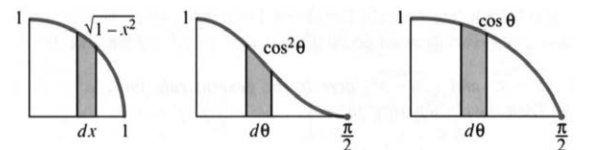
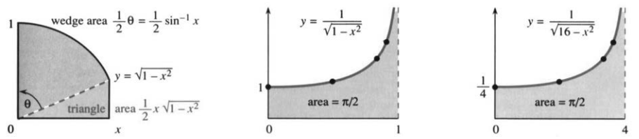
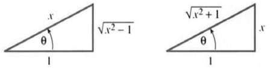

# 7.3 三角换元

原书 PDF 第368—374页，印刷页355—361。状态：初译，尚未完成全书统一复审。

<!-- PDF 368 / 印刷页 355 -->

用纸笔和脑子求积分时，我们最有力的工具是换元法。要让它奏效，就要想出能简化积分的好换元。本节集中介绍最有价值的一组换元。它们是唯一需要记住的换元，马上给出两个例子。

遇到含 $\sqrt{1-x^2}$ 的积分，就试 $x=\sin\theta$。不要令 $u=1-x^2$（缺少 $du/dx$）。

$$\int\sqrt{1-x^2}\,dx\longrightarrow\int\cos\theta(\cos\theta\,d\theta),$$

$$\int\frac{dx}{\sqrt{1-x^2}}\longrightarrow\int\frac{\cos\theta\,d\theta}{\cos\theta}.$$

$\sqrt{1-x^2}$ 作为 $x$ 的函数不太好处理，作为 $\theta$ 的函数却很简单。恒等式 $1-\sin^2\theta=\cos^2\theta$ 几乎是在邀请我们这样做。只要余弦为正，平方根就是 $\cos\theta$。

**注意 $dx$ 也要改变。** 当 $x=\sin\theta$，$dx=\cos\theta\,d\theta$。图7.4(a)用新字母画出原来的面积，图7.4(b)则把积分改写为 $\int\cos^2\theta\,d\theta$：高度换了，底宽也换了，面积没有变。

直说吧：若把 $\sqrt{1-x^2}$ 换成 $\cos\theta$，却忘了 $dx$ 和 $d\theta$ 并不一样，只算 $\int\cos\theta\,d\theta$，答案就全错了。

图7.4 $\sqrt{1-x^2}\,dx$ 与 $\cos^2\theta\,d\theta$ 的面积相同。第三个面积错误：$dx\ne d\theta$。

接下来要积 $\cos^2\theta$。这个积分在第7.1节例3和第7.2节式(6)里都求过，值得记住。

**例1**

$$\int\cos^2\theta\,d\theta=\frac12\sin\theta\cos\theta+\frac\theta2,$$

换回 $x$ 得

$$\int\sqrt{1-x^2}\,dx=\frac x2\sqrt{1-x^2}+\frac12\arcsin x.$$

这里 $\sin\theta=x$，$\cos\theta=\sqrt{1-x^2}$，$\theta=\arcsin x$。圆弧下的面积，答案比想象中稍复杂；图7.5说明，这两项分别是三角形和扇形的面积。

**例2**

$$\int\frac{dx}{\sqrt{1-x^2}}=\int d\theta=\theta+C=\arcsin x+C.$$

记住，我们已经知道 $\arcsin x$。它的导数 $1/\sqrt{1-x^2}$ 已在第4.4节算出，这就解出了例题。但换元 $x=\sin\theta$ 让解法自动完成，而不必凭第4章的记忆认出这个特殊问题。由 $\int d\theta=\theta$，我们回到 $\arcsin x$。

<!-- PDF 369 / 印刷页 356 -->

图7.5 $\int\sqrt{1-x^2}\,dx$ 是较简单面积的和。图像无穷，面积却有限。

下面讨论与 $x=\sin\theta$ 密切相关的其他换元，并用表格汇总三种主要选择：正弦、正切、正割。

## 三角换元的基本形式

从 $\sqrt{1-x^2}$ 推进到 $\sqrt{4-x^2}$。单用 $x=\sin\theta$ 会留下 $\sqrt{4-\sin^2\theta}$，没有帮助；只需加入一个因子2，令 $x=2\sin\theta$，便有

$$\sqrt{4-x^2}=2\cos\theta,\qquad dx=2\cos\theta\,d\theta.$$

两个因子2都要保留，所以积分变为 $4\int\cos^2\theta\,d\theta$。但换回 $x$ 后，不能简单把例1的答案乘以4，因为这次 $\theta=\arcsin(x/2)$。

**例3**

$$\int\sqrt{4-x^2}\,dx=4\int\cos^2\theta\,d\theta
=x\sqrt{1-(x/2)^2} +2\arcsin(x/2).$$

一般地，遇到 $\sqrt{a^2-x^2}$，就试 $x=a\sin\theta$，于是

$$\sqrt{a^2-x^2}=a\cos\theta,\qquad dx=a\cos\theta\,d\theta.$$

**例4**

$$\int_0^4\frac{dx}{\sqrt{16-x^2}}
=\int_0^{\pi/2}\frac{4\cos\theta\,d\theta}{4\cos\theta}
=\frac\pi2.$$

这里 $a=4,x=4\sin\theta$，上下限随之变为0与 $\pi/2$。积分表会直接给出 $\arcsin(x/4)$，而换元说清了它为什么来自 $\int d\theta=\theta$。

如果把 $16-x^2$ 改为 $x^2-16$ 呢？

**例5** 求 $\displaystyle\int_4^8\frac{dx}{\sqrt{x^2-16}}$。

根号内的符号以及积分区间都变了。例4的区间在 $|x|\le4$ 之内，例5却在它外面，不能再用 $x=4\sin\theta$。

<!-- PDF 370 / 印刷页 357 -->

改用 **$x=4\sec\theta$**：

$$dx=4\sec\theta\tan\theta\,d\theta,\qquad x^2-16=16\tan^2\theta.$$

根号就成了 $4\tan\theta$，上下限变为0与 $\pi/3$，得到

$$\int_4^8\frac{dx}{\sqrt{x^2-16}}
=\int_0^{\pi/3}\sec\theta\,d\theta
=[\ln(\sec\theta+\tan\theta)]_0^{\pi/3}
=\ln(2+\sqrt3).$$

我想强调这三个步骤。首先作换元 $x=4\sec\theta$，一个认不出的积分变成了 $\int\sec\theta\,d\theta$。其次改变上下限（$x=4$ 时 $\theta=0$，$x=8$ 时 $\theta=\pi/3$）。然后我对 $\sec\theta$ 积分。

**例6** 同样令 $x=4\sec\theta$：

$$\int_8^\infty\frac{16\,dx}{(x^2-16)^{3/2}}
=\int_{\pi/3}^{\pi/2}\frac{64\sec\theta\tan\theta}{(4\tan\theta)^3}\,d\theta
=\int_{\pi/3}^{\pi/2}\frac{\cos\theta}{\sin^2\theta}\,d\theta.$$

$x\to\infty$ 对应 $\theta\to\pi/2$，$x=8$ 对应 $\theta=\pi/3$。这个积分还需要再换元！（或者认出 $\cot\theta\csc\theta$。）令 $u=\sin\theta$，得到 $\int du/u^2=-1/u=-1/\sin\theta$：

$$\int_{\pi/3}^{\pi/2}\frac{\cos\theta}{\sin^2\theta}\,d\theta
=\left[-\frac1{\sin\theta}\right]_{\pi/3}^{\pi/2}=-1+\frac2{\sqrt3}.$$

若把下限改为 $\theta=0$，即 $x=4$，此积分就发散。不过例5的被积函数也在4处趋于无穷，积分却有限。最直接的比较是

$$\int_0^1x^{-1/2}\,dx=2,\qquad\int_0^1x^{-3/2}\,dx=+\infty.$$

两者在0处都无界，但增长程度不同。第7.5节将系统区分这类收敛与发散。

最后还有 $16+x^2$。你也许想问 $\sqrt{-16-x^2}$：不过理由很明显，我们不取它的平方根。前者则用第三种换元 $x=4\tan\theta$，因为 $16+x^2=16\sec^2\theta$。

**例7**

$$\int_0^\infty\frac{dx}{16+x^2}
=\int_0^{\pi/2}\frac{4\sec^2\theta}{16\sec^2\theta}\,d\theta
=\frac\pi8.$$

三种基本换元汇总如下：

| 换元 | 二次式的变化 | 微分 |
|---|---|---|
| $x=a\sin\theta$ | $a^2-x^2=a^2\cos^2\theta$ | $dx=a\cos\theta\,d\theta$ |
| $x=a\tan\theta$ | $a^2+x^2=a^2\sec^2\theta$ | $dx=a\sec^2\theta\,d\theta$ |
| $x=a\sec\theta$ | $x^2-a^2=a^2\tan^2\theta$ | $dx=a\sec\theta\tan\theta\,d\theta$ |

<!-- PDF 371 / 印刷页 358 -->

**注意。** “把 $x$ 写成 $\sin\theta$”与“把已有的 $\sin\theta$ 写成 $u$”有一点不同：例1中主动把 $dx$ 替换为 $\cos\theta\,d\theta$；例6中则已有 $\cos\theta\,d\theta$，把它识别为 $du$。一个引入微分因子，一个利用现成的微分因子。

我要说的是，第5章需要积分中有 $du/dx$，然后 $(du/dx)dx$ 变成 $du$。现在不必看得那么远。我们可以试任何换元；只要奏效就赢了。本节中，$x=\sin\theta$、$\sec\theta$ 或 $\tan\theta$ 必定成功。例如

$$\int\frac{dx}{1+x^2}=\int d\theta\quad(x=\tan\theta),$$

而旧式识别法为

$$\int\frac{x\,dx}{1+x^2}=\frac12\int\frac{du}{u}\quad(u=1+x^2).$$

也可以使用双曲函数换元。它们给同一个积分带来另一种形式；你要是熟悉双曲函数，这种形式有时反而更简单。

| 换元 | 二次式的变化 | 微分 |
|---|---|---|
| $x=a\tanh\theta$ | $a^2-x^2=a^2\operatorname{sech}^2\theta$ | $dx=a\operatorname{sech}^2\theta\,d\theta$ |
| $x=a\sinh\theta$ | $a^2+x^2=a^2\cosh^2\theta$ | $dx=a\cosh\theta\,d\theta$ |
| $x=a\cosh\theta$ | $x^2-a^2=a^2\sinh^2\theta$ | $dx=a\sinh\theta\,d\theta$ |

**例8** 令 $x=\cosh\theta$：

$$\int\frac{dx}{\sqrt{x^2-1}}=\int\frac{\sinh\theta\,d\theta}{\sinh\theta}
=\theta+C=\cosh^{-1}x+C.$$

$\int d\theta$ 很简单。糟糕的是最后的 $\cosh^{-1}x$。比较一下 $x=\sec\theta$，则

$$\int\frac{dx}{\sqrt{x^2-1}}=\int\sec\theta\,d\theta
=\ln(\sec\theta+\tan\theta)+C
=\ln(x+\sqrt{x^2-1})+C.$$

这条路看起来更难，不过大多数积分表更喜欢最后的对数。它比 $\cosh^{-1}x$ 更清楚，即使占的地方更多。如果习题35正确，所有答案都一致。

## 配方法

碰到 $\sqrt{x^2-2x+2}$ 或 $\sqrt{-x^2+2x}$，根号下就多了一次项。消去一次项的办法叫作**配方**：

$$x^2-2x+2=(x-1)^2+1=u^2+1,$$

$$-x^2+2x=-(x-1)^2+1=1-u^2.$$

先把二次项、一次项组合进平方，再调整常数项，最后令 $u=x-1$。于是

$$\int\frac{dx}{\sqrt{x^2-2x+1}}=\int\frac{du}{\sqrt{u^2+1}},\qquad
\int\frac{dx}{\sqrt{2x-x^2}}=\int\frac{du}{\sqrt{1-u^2}}.$$

<!-- PDF 372 / 印刷页 359 -->

一般公式为

$$x^2+2bx+c=(x+b)^2+(c-b^2),$$

$$-x^2+2bx+c=-(x-b)^2+(c+b^2).$$

例如

$$x^2+10x+16=(x+5)^2-9,\qquad-x^2+10x+16=-(x-5)^2+41.$$

**例9** 令 $u=x+5$：

$$\int\frac{dx}{x^2+10x+16}=\int\frac{dx}{(x+5)^2-9}=\int\frac{du}{u^2-9}.$$

现在可以选择——继续用 $u=3\sec\theta$ 费力计算，或者在前封面内侧查找 $\int du/(u^2-a^2)$。然后令 $a=3$：

$$\int\frac{du}{u^2-9}=\frac16\ln\left|\frac{u-3}{u+3}\right|+C
=\frac16\ln\left|\frac{x+2}{x+8}\right|+C.$$

若二次项系数是5或−5，先提出5。例如

$$5x^2-10x+25=5(x^2-2x+5)=5[(x-1)^2+4].$$

令 $u=x-1$ 后得到 $5(u^2+4)$，可以查表或令 $u=2\tan\theta$。

**例10**

$$\int\frac{dx}{5x^2-10x+25}
=\int\frac{du}{5(u^2+4)}
=\int\frac{2\sec^2\theta\,d\theta}{20\sec^2\theta}
=\frac\theta{10}+C
=\frac1{10}\arctan\frac{x-1}{2}+C.$$

从 $x$ 到 $u$ 再到 $\theta$ 的两次换元需要练习；求出积分后再沿相反方向回代。

最后，配方后的常数符号决定形式：$u^2+a^2$ 可用 $u=a\tan\theta$，$u^2-a^2$ 用 $u=a\sec\theta$。回到原式 $x^2+2bx+c$，分界就在 $c>b^2$ 与 $c<b^2$。若恰有 $c=b^2$，原式是完全平方 $(x+b)^2$，完全不需要三角换元。

## 7.3 习题

### 阅读填空

$\sqrt{1-x^2}$ 提示换元 $x=\text{**a**}$。平方根变为 **b**，$dx$ 变为 **c**，$\int(1-x^2)^{3/2}\,dx$ 变为 $\int\text{**d**}\,d\theta$。区间 $1/2\le x\le1$ 变为 $\text{**e**}\le\theta\le\text{**f**}$。

对 $\sqrt{a^2-x^2}$，令 $x=\text{**g**}$，$dx=\text{**h**}$。对 $x^2-a^2$，令 $x=\text{**i**}$，$dx=\text{**j**}$。另用 $x=\tan\theta$ 时，$\int dx/(1+x^2)=\int d\theta$，因为 $1+\tan^2\theta=\text{**k**}$。结果是 $\theta=\arctan x$，其导数为 **l**。

$x^2+2bx+c$ 中的 $2bx$ 是 **m** 项，为消去它，要作 **n**，得到 $(x+b)^2+C$，其中 $C=\text{**o**}$。例如 $x^2+4x+9=\text{**p**}$，再令 $u=x+2$。而 $-x^2+4x+9=(\text{**q**})^2+\text{**r**}$。若二次项为 $4x^2$，先提出 **s**。

**1—20：换元求积分，最后换回 $x$。**

1. $\int dx/\sqrt{4-x^2}$。
2. $\int dx/\sqrt{x^2-a^2}$。

<!-- PDF 373 / 印刷页 360 -->

3. $\int\sqrt{4-x^2}\,dx$。
4. $\int dx/\sqrt{1+9x^2}$。
5. $\int x^2\,dx/\sqrt{1-x^2}$。
6. $\int dx/(x^2\sqrt{1-x^2})$。
7. $\int dx/(1+x^2)^2$。
8. $\int\sqrt{x^2+a^2}\,dx$，见习题7.2.62。
9. $\int\sqrt{x^2-25}\,dx/x$。
10. $\int x^3\,dx/\sqrt{9-x^2}$。
11. $\int dx/\sqrt{x^6-x^4}$。
12. $\int\sqrt{x^6-x^8}\,dx$。
13. $\int dx/(1+x^2)^{3/2}$。
14. $\int dx/(1-x^2)^{3/2}$。
15. $\int dx/(x^2-9)^{3/2}$。
16. ★ $\int\sqrt{1+x^2}\,dx/x$。
17. ★ $\int x^2\,dx/\sqrt{x^2-1}$。
18. $\int x^2\,dx/(x^2+4)$。
19. $\int dx/(x^2\sqrt{x^2+1})$。
20. ★ $\int x^2\,dx/\sqrt{1+x^2}$。
21. **重要。** 本节通过 $x=\sin\theta$ 得到 $\int dx/\sqrt{1-x^2}=\arcsin x+C$。(a) 改用 $x=\cos\theta$ 得到另一种写法。(b) 同一个积分为什么能有两种答案？
22. 用 $x=\sec\theta$ 求 $\int dx/(x\sqrt{x^2-1})$，再用 $x=\csc\theta$ 重算。为什么两个答案都正确？
23. 用 $x=\tan\theta$ 积分 $x/(x^2+1)$，再直接用对数求积，说明两者一致。
24. 证明 $\int dx/(x\sqrt{x^4-1})=\tfrac12\operatorname{arcsec}(x^2)+C$。

**25—32：求定积分。**

25. $\int_{-a}^{a}\sqrt{a^2-x^2}\,dx$，它是哪种图形的面积？
26. $\int_{-1}^{1}(1-x^2)^{3/2}\,dx$。
27. $\int_{1/2}^{1}dx/\sqrt{1-x^2}$。
28. $\int_1^4dx/\sqrt{x^2-1}$。
29. $\int_2^\infty dx/(x^2-1)^{3/2}$。
30. $\int_{-1}^{1}x\,dx/(x^2+1)$。
31. $\int_{-\infty}^{\infty}dx/(x^2+9)$。
32. $\int_{1/2}^{1}\sqrt{1-x^2}\,dx$，它表示哪个区域的面积？
33. 合并积分，证明对 $n\ne0$有

$$\int\frac{x^{n+1}}{x^2+1}\,dx=\frac{x^n}{n}-\int\frac{x^{n-1}}{x^2+1}\,dx.$$

34. 分别积分 $1/\cos x$、$1/(1+\cos x)$ 与 $\sqrt{1+\cos x}$。
35. (a) 换元 $x=\underline{\qquad}$ 可使 $\int dx/\sqrt{x^2-1}$ 化为 $\ln(\sec\theta+\tan\theta)+C$。(b) 由图中三角形换回 $f=\ln(x+\sqrt{x^2-1})$，检验 $f'=1/\sqrt{x^2-1}$。(c) 验证 $\cosh f=(e^f+e^{-f})/2=x$，故 $f=\cosh^{-1}x$。
36. (a) 换元 $x=\underline{\qquad}$ 可将 $\int dx/\sqrt{x^2+1}$ 化为正割积分。(b) 由第二个三角形得到 $g=\ln(x+\sqrt{x^2+1})$，验证 $g'=1/\sqrt{x^2+1}$。(c) 验证 $\sinh g=x$，故 $g=\sinh^{-1}x$。(d) 直接令 $x=\sinh g$ 求同一积分。

**37—42：用 $\sinh\theta,\cosh\theta$ 或 $\tanh\theta$ 换元，积分后换回 $x$。**

37. $\int dx/\sqrt{x^2-1}$。
38. $\int dx/(x\sqrt{1-x^2})$。
39. $\int\sqrt{x^2-1}\,dx$。
40. $\int\sqrt{x^2-1}\,dx/x^2$。
41. $\int dx/(1-x^2)$。
42. $\int\sqrt{1+x^2}\,dx/x^2$。

**43—48：配方，写为平方加常数或负的平方加常数。**

43. $x^2-4x+8$。
44. $-x^2+2x+8$。
45. $x^2-6x$。
46. $-x^2+10$。
47. $x^2+2x+1$。
48. $x^2+4x-12$。
49. 对第43、45、47题的三个函数 $f(x)$，分别求 $\int dx/f(x)$。
50. 对第44、46、48题的三个函数 $g(x)$，分别求 $\int dx/\sqrt{g(x)}$。
51. $\int dx/(x^2+2bx+c)$ 的答案为何在 $b^2>c$ 与 $b^2<c$ 时具有不同形式？$b^2=c$ 时是什么？
52. 分别选取平移换元以消去一次项：(a) $\int dx/(x^2-4x+c)$；(b) $\int dx/(3x^2+6x)$；(c) $\int dx/(-x^2+10x+c)$；(d) $\int dx/(2x^2-x)$。
53. 找出错误：令 $x=\sin\theta$，写成 $\sqrt{1-x^2}=\cos\theta$，并代入 $dx=\cos\theta\,d\theta$，似乎把 $\int_0^{2\pi}\cos^2\theta\,d\theta$ 变成了 $\int_0^0\sqrt{1-x^2}\,dx$。

<!-- PDF 374 / 印刷页 361 -->

54. (a) 若 $x=\tan\theta$，则 $\int\sqrt{1+x^2}\,dx=\int\underline{\qquad}\,d\theta$。(b) 将 $\tfrac12[\sec\theta\tan\theta+\ln(\sec\theta+\tan\theta)]$ 换回 $x$。(c) 若 $x=\sinh\theta$，则 $\int\sqrt{1+x^2}\,dx=\int\underline{\qquad}\,d\theta$。(d) 将 $\tfrac12[\sinh\theta\cosh\theta+\theta]$ 换回 $x$。两种答案相同；第8.2节将用它们求抛物线弧长。与第7.2节第62题比较。
55. 对图7.5(b)中的 $x,y$ 作尺度变换，使之成为图7.5(c)且保持面积 $\int y\,dx$ 不变。$y$ 和 $dx$ 分别怎样变化？
56. 用相同的坐标比例画 $y=1/\sqrt{1-x^2}$ 与 $y=1/\sqrt{16-x^2}$：前者横向、纵向各取1英寸；后者横向取4英寸，纵向取 $1/4$ 英寸。
57. 下式是否有错？若有，错在哪里？$\displaystyle\int_0^2\frac{dx}{\sqrt{1-x^2}}=\arcsin2$。
