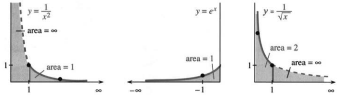
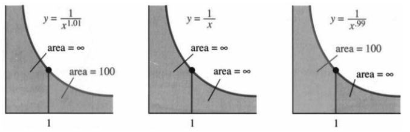
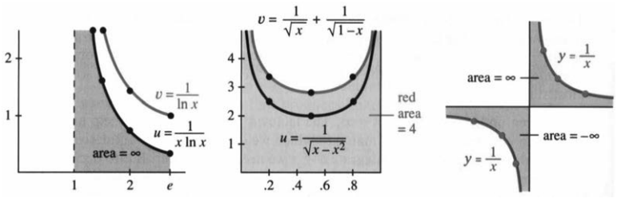

# 7.5 反常积分

原书 PDF 第380—384页，印刷页367—371。状态：初译，尚未完成全书统一复审。

<!-- PDF 380 / 印刷页 367 -->

积分 $\int_a^b y(x)\,dx$ 称为**反常积分**，是因为积分区间无界，或被积函数在区间内某处无界。可能是 $b=+\infty$、$a=-\infty$，也可能是 $y$ 趋于正无穷或负无穷。图像与横轴之间的区域向右、向左、向上或向下无限延伸，但积分仍可能**收敛**。区域无界，并不意味着面积必定无限。本节要判断：何时反常积分有有限的值？

先看三个有限面积的例子：上限为 $+\infty$，下限为 $-\infty$，以及 $y=1/\sqrt x$ 在 $x=0$ 附近无界。图7.6中的面积分别为1、1、2：

$$
\int_1^\infty\frac{dx}{x^2}=\left[-\frac1x\right]_1^\infty=1,\qquad
\int_{-\infty}^0 e^x\,dx=[e^x]_{-\infty}^0=1,\qquad
\int_0^1\frac{dx}{\sqrt x}=[2\sqrt x]_0^1=2.
$$

图7.6　阴影区域虽无界，面积却有限。图中 area 表示面积；三个有限面积依次为1、1、2。

实际计算常把危险的端点形式上代入，再观察结果。例如原函数为 $-1/x$ 时写“$-1/\infty=0$”，原函数为 $e^x$ 时写“$e^{-\infty}=0$”。这些写法可以提示正确计算，但并非严格的数值代入。

严格的定义离不开极限。整个无界区域没法一口吞下，只能用有限区间一点点逼近：

$$
\boxed{\int_a^\infty y(x)\,dx=\lim_{b\to\infty}\int_a^b y(x)\,dx,\qquad
\int_{-\infty}^b y(x)\,dx=\lim_{a\to-\infty}\int_a^b y(x)\,dx.}
$$

前提是每个有限子区间上的积分都存在；极限存在且有限，就说这个反常积分收敛。上述三个例子仍分别得到1、1、2。再看两个上限为 $+\infty$ 的例子：

$$\int_1^\infty\frac{dx}x=[\ln x]_1^\infty=+\infty,\tag{1}$$

$$\int_1^\infty\frac{dx}{x^p}=\left[\frac{x^{1-p}}{1-p}\right]_1^\infty=\frac1{p-1}\quad(p>1).\tag{2}$$

$1/x$ 下方的面积与 $1+1/2+1/3+1/4+\cdots$ 类似，都趋于无穷。矩形面积的和近似曲线下的面积，两者一起缓慢增长而无界。

$p$ 越大，图像趋于零越快。图7.7(a)取 $p=1.01$，有限面积为 $1/(p-1)=100$。区域仍无界，却有可能把它整个盖住：拿一块面积有限的正方形，裁成条带铺上去。幂函数这一族的分界参数是 $p=1$，而边界值本身落在发散一侧。

<!-- PDF 381 / 印刷页 368 -->

**在零点附近向上无界时，分界参数也为 $p=1$。** 对 $p>0$，$x\to0^+$ 时 $1/x^p\to\infty$。$p=1$ 的面积仍无限；不过在这一端，给出有限积分的是较小的 $p$，即 $p<1$：

$$
\int_0^1\frac{dx}x=+\infty,\qquad
\int_0^1\frac{dx}{x^p}=\left[\frac{x^{1-p}}{1-p}\right]_0^1=\frac1{1-p}\quad(p<1).\tag{3}
$$

非严格地说是“$-\ln0=\infty$”；严格地说，先从靠近零的 $a>0$ 积到1，得到 $-\ln a$，再令 $a\to0^+$，结果趋于正无穷。$1/x^2$ 在零点附近增长更快，相应面积也无限。

对 $1/\sqrt x$，$p=1/2$，从0到1的面积为2。若 $p=99/100$，面积为 $1/(1-p)=100$。图7.7中 $p=1$ 的分界看似鲜明，但在更广的函数类别中，情况还可以细分。

图7.7　$p=1$ 两侧的 $1/x^p$。作者特意把三条示意曲线画得几乎一样；它们的远端与近零端面积却有不同的收敛性。area 表示面积。

**更细的分界。** $1/x$ 从 $e$ 到无穷的积分发散；再除以 $\ln x$ 或 $(\ln x)^2$，则一者发散，一者收敛：

$$
\int_e^\infty\frac{dx}{x\ln x}=[\ln(\ln x)]_e^\infty=+\infty,\qquad
\int_e^\infty\frac{dx}{x(\ln x)^2}=\left[-\frac1{\ln x}\right]_e^\infty=1.\tag{4}
$$

令 $u=\ln x$，第一个积分变为 $\int du/u$。$\ln(\ln x)$ 最终仍趋于无穷，不过很慢：$x=10^{10}$ 时，$\ln x$ 约为23，而 $\ln(\ln x)$ 约为3。第11题中的 $\ln(\ln(\ln x))$ 更慢。所以，没有哪个函数能当所有收敛与发散情形的最终界线。

式(4)的第二个积分化为 $\int du/u^2$，收敛于1。若贸然把积分范围改为从0到无穷，就会得到这个可疑结果：

$$\int_0^\infty\frac{dx}{x(\ln x)^2}\ \overset{\text{错误}}=\ \left[-\frac1{\ln x}\right]_0^\infty=0.$$

被积函数为正，面积怎么可能为零？虽然 $b\to\infty$ 时 $1/\ln b\to0$，$a\to0^+$ 时 $1/\ln a\to0$，但区间内部还藏着奇点 $x=1$。那里 $\ln x=0$，邻近面积无限，不能越过奇点直接相减。

**例1**　指数衰减因子 $e^{-x}$ 在 $x\to\infty$ 时能压过任何固定幂 $x^p$，但在零点附近并非如此：

$$\int_0^\infty x^{50}e^{-x}\,dx=50!,\qquad
\int_0^\infty x^{-1}e^{-x}\,dx=+\infty.$$

第一个积分为 $50\cdot49\cdot48\cdots1$，连续分部积分50次可得，但不建议真把这50步全写出来。把50换成 $1/2$，这个积分可用于定义“$1/2$ 的阶乘”。

<!-- PDF 382 / 印刷页 369 -->

形式乘积 $(1/2)(-1/2)(-3/2)\cdots$ 没有自然的终点，不能照搬整数阶乘的乘法定义；积分定义却给出 $(1/2)!=\sqrt\pi/2$，见第28题。而 $\int_0^\infty x^0e^{-x}\,dx=1$ 与 $0!=1$ 一致。

$e^{-x}/x$ 下的面积无限，说明这一定义在 $p=-1$ 处给不出有限的阶乘值。$e^{-x}$ 对零点处的发散毫无帮助。即使没有初等原函数，也照样能判定这个积分发散。有限区间上的数值积分，可以交给计算机；判断反常积分是有限还是无限，则得靠比较判别法。

**7C　比较判别法。** 设同一积分区间内 $0\le u(x)\le v(x)$，并且在避开反常端点的子区间上可积，则 $u$ 下的面积不超过 $v$ 下的面积。因此

$$
\int v(x)\,dx<\infty\ \Longrightarrow\ \int u(x)\,dx<\infty;
\qquad
\int u(x)\,dx=+\infty\ \Longrightarrow\ \int v(x)\,dx=+\infty.
$$

比较法未必给出确切面积，却能判断是否有限。诀窍是构造一个简单函数，比如 $1/x^p$，让它落在待考察函数的一侧——而且要一直贴着它。

**例2**　$\int_1^\infty dx/(x^2+4x)$ 收敛，因为被积函数不超过 $1/x^2$，而 $\int_1^\infty dx/x^2=1$。

**例3**　$\int_1^\infty dx/(\sqrt x+1)$ 发散，因为 $x\ge1$ 时 $\sqrt x+1\le2\sqrt x$，而 $\int_1^\infty dx/(2\sqrt x)=+\infty$。

**例4**　$\int_0^1 dx/(x^2+4x)$ 发散，因为 $0<x\le1$ 时 $x^2+4x\le5x$，而 $\int_0^1 dx/(5x)=+\infty$。

**例5**　$\int_0^1 dx/(\sqrt x+1)$ 有限，因为被积函数不超过1，且 $\int_0^1 1\,dx=1$。

例2、例5里，把分母中的 $4x$ 或 $\sqrt x$ 拿掉，函数就变大，所得积分为1，所以原积分夹在0和1之间。例3、4则增大分母，得到较小但仍发散的积分，原积分自然也发散。以下例子和图7.8进一步展示比较法。

**例6**

$$\int_0^\infty e^{-x^2}\,dx
\le\int_0^1 1\,dx+\int_1^\infty e^{-x}\,dx=1+e^{-1}<2.$$

**例7**

$$\int_1^e\frac{dx}{\ln x}\ge\int_1^e\frac{dx}{x\ln x}=+\infty.$$

**例8**

$$\int_0^1\frac{dx}{\sqrt{x-x^2}}
\le\int_0^1\frac{dx}{\sqrt x}+\int_0^1\frac{dx}{\sqrt{1-x}}=2+2.$$

<!-- PDF 383 / 印刷页 370 -->

图7.8　比较 $u(x)$ 与 $v(x)$：$\int_1^e dx/\ln x$ 发散，$\int_0^1 dx/\sqrt{x-x^2}<4$。右图提醒我们：不能把 $\infty-\infty$ 当作0。area 表示面积，red area 表示原图着色区域的面积。

还有两种常见情况。第一种是积分区间从 $-\infty$ 到 $+\infty$，必须拆成两部分，且**每部分都须收敛**。按定义，两端的极限是分开取的：

$$
\begin{aligned}
\int_{-\infty}^{\infty}y(x)\,dx
&=\int_{-\infty}^0y(x)\,dx+\int_0^\infty y(x)\,dx\\
&=\lim_{a\to-\infty}\int_a^0y(x)\,dx+\lim_{b\to\infty}\int_0^b y(x)\,dx.
\end{aligned}
$$

钟形曲线 $y=e^{-x^2}$ 下的面积有限，恰为 $\sqrt\pi$；区域向两侧无限延伸，但每一侧的面积都是 $\sqrt\pi/2$。相反，虽然任意 $b>0$ 都有 $\int_{-b}^b x\,dx=0$，**$\int_{-\infty}^{\infty}x\,dx$ 仍不收敛**。零点右侧的带符号积分趋于 $+\infty$，左侧趋于 $-\infty$，不能相消。两侧都必须分别有有限值。

**例9**　$1/x$ 在零点两侧的图形对称，求 $\int_{-1}^1 dx/x$。

通常意义下，这个反常积分不存在。因 $1/x$ 是奇函数，两侧区域关于原点对称，似乎合起来应为零。柯西主值确实为零，但主值使用对称截断，是另一个概念；它并不能把一个两边各自发散的反常积分变成收敛的。

## 7.5 习题

**阅读填空**

反常积分 $\int_a^b y(x)\,dx$ 的下限可能为 $a=\text{(a)}$，上限可能为 $b=\text{(b)}$，或者 $y$ 在区间上变得 **(c)**。$\int_1^\infty dx/x^3$ 是反常积分，因为 **(d)**。应研究 **(e)** 时 $\int_1^b dx/x^3$ 的极限。计算中常简记为 $[-\tfrac12x^{-2}]_1^\infty=\text{(f)}$。$p>1$ 时反常积分 **(g)** 有限，$p<1$ 时反常积分 **(h)** 有限。$y=e^{-x}$ 从0到无穷的积分为 **(i)**。

设 $0\le u(x)\le v(x)$。积分 **(j)** 收敛可推出积分 **(k)** 收敛；$\int u(x)\,dx$ 发散 **(l)** $\int v(x)\,dx$ 发散。$1/(e^x+e^{-x})$ 从 $-\infty$ 到 $+\infty$ 的积分可与 **(m)** 比较以证明收敛。严格地说，要把区间拆为 $(\text{(n)},0)$ 和 $(0,\text{(o)})$。若改为 $1/(e^x-e^{-x})$，则发散，因为 **(p)**。$\int_{-\pi}^{\pi}dx/\sin x$ 也可通过与 **(q)** 比较判定发散；零点左右不能相消，因为 $\infty-\infty$ **(r)**。

<!-- PDF 384 / 印刷页 371 -->

**1—16：判断收敛或发散；若收敛，求积分值。**

1. $\int_1^\infty dx/x^e$。
2. $\int_0^1 dx/x^\pi$。
3. $\int_0^1 dx/\sqrt{1-x}$。
4. $\int_0^1 dx/(1-x)$。
5. $\int_{-\infty}^0 dx/(x^2+1)$。
6. $\int_{-1}^1 dx/\sqrt{1-x^2}$。
7. $\int_0^1(\ln x)/x\,dx$。
8. $\int_{-\infty}^{\infty}\sin x\,dx$。
9. $\int_0^e\ln x\,dx$（分部积分）。
10. $\int_0^\infty xe^{-x}\,dx$（分部积分）。
11. $\int_{100}^\infty dx/[x(\ln x)(\ln\ln x)]$。
12. $\int_{-\infty}^{\infty}x\,dx/(x^2-1)^2$。
13. $\int_0^\infty\cos^2x\,dx$。
14. $\int_0^{\pi/2}\tan x\,dx$。
15. $\int_0^\infty dx/x^p$。
16. $\int_0^\infty e^x\,dx/(e^x-1)^p$。

**17—26：找出较大且收敛的比较积分，或较小且发散的比较积分；变号函数可考察其绝对值。**

17. $\int_1^\infty dx/(x^6+1)$。
18. $\int_0^1 dx/(x^6+1)$。
19. $\int_0^\infty\sqrt x\,dx/(x^2+1)$。
20. $\int_0^1 e^{-x}\,dx/(1-x)$。
21. $\int_1^\infty e^{-x}\sin x\,dx$。
22. $\int_1^\infty x^{-x}\,dx$。
23. $\int_0^\infty e^{2x}e^{-x^2}\,dx$。
24. $\int_0^1\sqrt{-\ln x}\,dx$。
25. $\int_0^\infty(\sin^2x)/x^2\,dx$。
26. $\int_1^\infty[1/x-1/(1+x)]\,dx$。
27. 对 $p>0$，用分部积分证明 $\int_0^\infty x^pe^{-x}\,dx=p\int_0^\infty x^{p-1}e^{-x}\,dx$。第一个积分定义 $p!$，所以该式为 $p!=\underline{\qquad}$。特别地，$0!=\underline{\qquad}$。$p!$ 也记为 $\Gamma(p+1)$；使用伽马函数记号强调 $p$ 不必是整数。
28. 令 $x=u^2$，求 $(-1/2)!$：$\int_0^\infty x^{-1/2}e^{-x}\,dx=\underline{\qquad}=\sqrt\pi$（最后的高斯积分值已知）。再用第27题求 $(1/2)!$。
29. 用分部积分求 $\int_0^\infty x^2e^{-x^2}\,dx$。
30. 贝塔函数 $B(m,n)=\int_0^1x^{m-1}(1-x)^{n-1}\,dx$ 在实参数 $m,n$ 均大于 **______** 时有限。
31. 永续年金以每年 $s$ 美元的速率连续支付。连续复利率为 $c$ 时，现值为 $y_0=\int_0^\infty se^{-ct}\,dt$。若每年收取1000美元、$c=10\%$，则应存入 $y_0=\underline{\qquad}$。
32. 每年末支付一次的永续年金，现值为 $y_0=s/a+s/a^2+\cdots=\underline{\qquad}$。年利率10%，即 $a=1.1$，每年收取1000美元，也应存入 $y_0=\underline{\qquad}$。无穷级数与反常积分很相似。
33. 将质量为 $m$ 的卫星从地球表面移到无限远处，克服引力做功 $W=\int_R^\infty GMm\,dx/x^2$，其中 $R,M$ 为地球半径、质量。求 $W$。发射时多大的逃逸速度 $v_0$，能使动能 $mv_0^2/2$ 等于 $W$？
34. 按原书采用的逃逸速度估算，若逃逸速度超过 $3\times10^8\,\mathrm{m/s}$，则达到黑洞情形。给定地球 $GM=4\times10^{14}\,\mathrm{m^3/s^2}$，将地球压缩至临界半径 $R=\underline{\qquad}$，对应这一界限。
35. 画图说明，$y=1/2^x$ 从0到无穷下方的区域可以用总面积为 $1+1/2+1/4+\cdots=2$ 的矩形覆盖。精确面积是多少？
36. 解释看似矛盾的现象：任意 $b>0$ 都有 $\int_{-b}^b x\,dx/(1+x^2)=0$，但 $\int_{-\infty}^{\infty}x\,dx/(1+x^2)$ 发散。
37. 求 $0\le x<\pi/2$ 上 $y=\sec x$ 与 $y=\tan x$ 之间的面积。这里哪里涉及反常性？
38. ★任选下列由杰出数学家求出的积分，验证其值：$\int_0^\infty x^{-1/2}\,dx/(1+x)=\pi$；$\int_0^\infty(e^{-x}-e^{-2x})\,dx/x=\ln2$；$\int_0^\infty xe^{-x}\cos x\,dx=0$；$\int_0^\infty\cos(x^2)\,dx=\sqrt{\pi/8}$。
39. 哪些实数 $p$ 使 $\int_0^\infty dx/(x^p+x^{-p})=+\infty$？
40. 图7.6(a)着色面积为1，由此解释图7.6(c)为什么为2。

## 译注与待复核事项

1. 反常积分的收敛要求极限有限；写“等于 $+\infty$”只是标明向正无穷发散，不把无穷当作实数积分值。无界函数不一定趋于无穷，故开头采用一般的“无界”表述。零点处 $p\le0$ 时并无无界奇点，但式(3)的有限积分公式仍成立。
2. 内部奇点须分开处理：若 $c\in(a,b)$ 为奇点，必须分别考察 $\lim_{t\to c^-}\int_a^t$ 与 $\lim_{s\to c^+}\int_s^b$，二者均有限才收敛；多处奇点也逐一分开。例9的柯西主值为 $\lim_{\varepsilon\to0^+}(\int_{-1}^{-\varepsilon}dx/x+\int_{\varepsilon}^1dx/x)=0$，不等于通常反常积分收敛。
3. 原书把发散积分写成 $(-1)!=\infty$，容易误解为阶乘的定义值。译文明确：$p!=\Gamma(p+1)$ 的此积分表达式只在实数 $p>-1$ 时有限，$\Gamma(0)$ 不是有限定义值。没有初等原函数也不意味着只能用计算机，仍可用特殊函数、级数或其他分析方法。
4. 例6原书把 $\int_1^\infty e^{-x}\,dx$ 写成1，实际为 $e^{-1}$；已修正。例8的逐点比较可由 $1\le\sqrt x+\sqrt{1-x}$ 验证。比较法中的“较小”应允许相等，已使用非严格不等号。
5. 原书第38题第一个积分漏写上下限，已依据所给结果补为 $0$ 到 $+\infty$。第21题被积函数变号，不能只用一个正的上界就断定收敛，应对绝对值比较，故题组提示补明这一点。第12题除无穷端点外，还须检查 $x=\pm1$。
6. 第34题保留原书的牛顿引力启发式估算，临界值以逃逸速度等于光速计算；这不是一般相对论中黑洞的完整定义或推导。第31、32题分别为连续与离散现金流模型；相同的数字结果不表示两种10%利率的复利方式相同。
7. 第37题应先合并 $\sec x-\tan x$ 后研究极限，不能把两个分别发散的积分直接相减。第40题可利用反函数图形的面积关系解释，原PDF为灰度扫描，“红色”译为“着色”。
