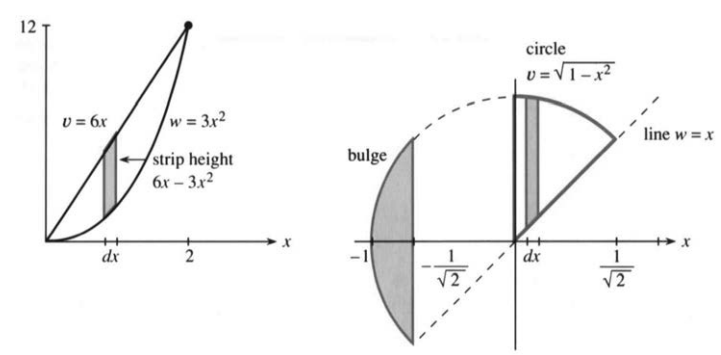
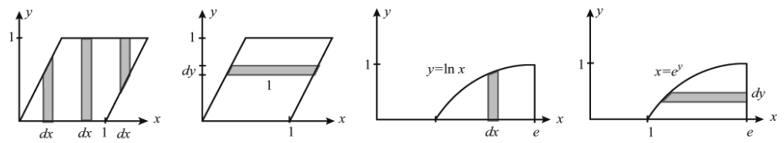
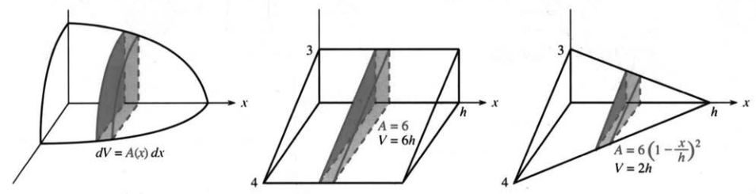
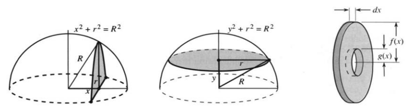
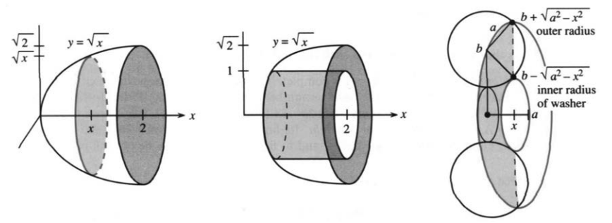
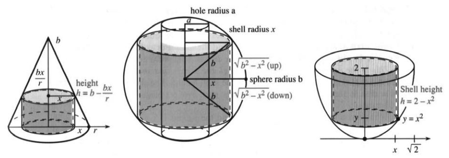
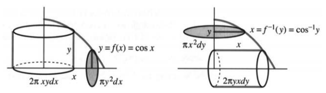
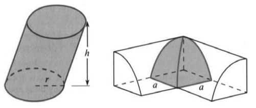
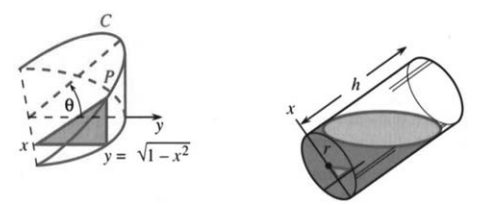

# 第8章　积分的应用

来源：原书 PDF 第385—395页（印刷页372—382）。状态：中文初译；已逐页对照原图，尚未经独立复核。

<!-- PDF 385 / 印刷页 372 -->

对于积分的一项应用——求曲线下的面积——我们已经很熟悉了。曲线是函数 $y=v(x)$ 的图像，左端为 $x=a$，右端为 $x=b$。当 $v(x)\ge0$ 时，曲线与 $x$ 轴之间的面积就是相应的定积分。

我喜欢这样理解这个积分：把区域分成许多细条。每条的宽为 $dx$，高为 $v(x)$，面积便是 $v(x)\,dx$。把所有细条的面积加起来，就得到 $\int_a^b v(x)\,dx$。严格说来，这里所说的一条“宽为 $dx$ 的细条”并不是通常意义下的矩形；真正的矩形有一个非零宽度 $\Delta x$。这里要强调的是，细条的图像能帮助我们建立正确的积分。

从图形中，我们知道应当对哪个函数积分；通过本课程所学的方法或计算器，我们也知道怎样计算。接下来求体积、长度和表面积时，要以新的方式分割区域。仍然是这些小块告诉我们该怎么做。本章中，**确定被积函数比计算积分更重要**。

<!-- PDF 386 / 印刷页 373 -->

## 8.1　用切片求面积和体积

本节先讨论两条曲线之间的面积，然后转向体积；此时，平面的细条变成了立体的薄片。这就好比把一条面包切成片，再把各片的重量相加，求出整条面包的重量。以下主要借助例题和图形展开，理论论述尽量从简。真正的问题在于建立正确的积分。最后还将介绍另一种分割立体的方法：把它分成薄壳。所有公式汇总在本节末尾的表中。

图8.1表示两条曲线之间的面积。上方曲线为 $y=v(x)$，下方曲线为 $y=w(x)$。细条的高是两条曲线之间的竖直距离 $v(x)-w(x)$，宽仍非正式地记作 $dx$。总面积是“上减下”的积分：

$$
\boxed{\text{两曲线之间的面积}=\int_a^b[v(x)-w(x)]\,dx.} \tag{1}
$$

**例1**　上方曲线是直线 $y=6x$，下方曲线是抛物线 $y=3x^2$，所求区域位于两曲线的交点之间。

先解方程 $v(x)=w(x)$，即 $6x=3x^2$，求交点。

图8.1　两曲线之间的面积为 $v-w$ 的积分。例2先考察 $x\ge0$ 的部分。图中 strip height 为细条高度，circle 为圆，line 为直线，bulge 为左侧突出部分。

两交点的横坐标分别为 $0$ 和 $2$，所以

$$
A=\int_0^2(6x-3x^2)\,dx
=[3x^2-x^3]_0^2=4.
$$

**例2**　求上半圆 $v(x)=\sqrt{1-x^2}$ 与倾角为 $45^\circ$ 的直线 $w(x)=x$ 之间图示区域的面积。

首先要确定：求哪个区域？积分上下限是什么？先看图8.1b中扇形的一部分：区域从 $y$ 轴开始，到上半圆与直线的交点结束。交点满足

$$
\sqrt{1-x^2}=x
\quad\Longrightarrow\quad
1-x^2=x^2
\quad\Longrightarrow\quad 2x^2=1.
$$

<!-- PDF 387 / 印刷页 374 -->

于是 $x^2=1/2$；由于交点在第一象限，取 $x=1/\sqrt2$。对细条的高度 $v-w$ 积分：

$$
\begin{aligned}
A&=\int_0^{1/\sqrt2}(\sqrt{1-x^2}-x)\,dx\\
&=\left[\frac12\arcsin x+\frac12x\sqrt{1-x^2}-\frac12x^2\right]_0^{1/\sqrt2}\\
&=\frac12\arcsin\frac1{\sqrt2}+\frac14-\frac14
=\frac12\cdot\frac\pi4=\frac\pi8.
\end{aligned}
$$

面积为 $\pi/8$，即单位圆面积的八分之一。求 $\int\sqrt{1-x^2}\,dx$ 时，我们使用第7章的方法：令 $x=\sin\theta$，化成 $\int\cos^2\theta\,d\theta=\tfrac12(\theta+\sin\theta\cos\theta)+C$，再用 $\theta=\arcsin x$ 换回。对于这样熟悉的图形，积分计算比预想的繁一些。

**说明**　假如要求的是直线与整圆围成的、位于直线上方的整个半圆区域，情况就不同了。直线与整圆相交于横坐标为 $1/\sqrt2$ 和 $-1/\sqrt2$ 的两点。刚才从 $x=0$ 开始只得到了圆面积的八分之一，现在还要计入左侧区域。

关键在于：**仅把 $v-w$ 从 $-1/\sqrt2$ 积分到 $1/\sqrt2$，不能得到正确答案。** 这样会漏掉最左侧向外突出的部分。在那里，细条的高度为 $2v$，而不是 $v-w$。要正确求出这个半圆的面积，必须看清图形。

### 用水平细条代替竖直细条

分割区域的方法不止一种。竖直细条对应关于 $x$ 的积分，水平细条对应关于 $y$ 的积分。我们可以自由选择，有时对 $y$ 积分更方便。

图8.2　竖直切分给出关于 $x$ 的积分，水平切分给出关于 $y$ 的积分。

图8.2中的平行四边形底为 $1$，高也为 $1$。用竖直细条求面积，需要分成三个积分。请从图中看出原因！若采用长为 $1$、宽为 $dy$ 的水平细条，只需计算 $\int_0^1dy=1$。

**例3**　求曲线 $y=\ln x$ 下方、$x$ 轴上方、截至 $x=e$ 的区域面积；也可以把它看成曲线 $x=e^y$ 右侧的区域。

图8.2c给出竖直切分，图8.2d给出水平切分。下面两个积分相等，可以任选其一（我更愿意选 $y$）：

$$
\int_1^e\ln x\,dx=[x\ln x-x]_1^e=1,
\qquad
\int_0^1(e-e^y)\,dy=[ey-e^y]_0^1=1.
$$

<!-- PDF 388 / 印刷页 375 -->

### 用切片求体积

现在是本书第一次专门讨论体积。所考察的区域是三维立体，有三个坐标 $x,y,z$，也有许多种分割方式。

图8.3展示一种基本方法：切片。薄片厚度记作 $dx$，与平面细条的宽度类似。细条的高 $y$ 现在换成了截面积 $A$。不同位置的截面积可以不同，即 $A$ 依赖于 $x$。薄片的体积微元为面积乘厚度：$dV=A(x)\,dx$。整个立体的体积为

$$
\boxed{V=\int A(x)\,dx.} \tag{2}
$$

**注意**　真正切下来的一片，其两侧截面的面积一般并不相同！它的厚度为 $\Delta x$，体积近似等于 $A(x)\Delta x$，而非恰好相等。在极限过程中，薄片厚度趋于零，各薄片近似体积之和趋于积分。

对于柱体，各截面相同。图8.3b是一个底面非圆形的柱体。截面积是常数 $A$，所以积分很简单，体积为 $Ah$。这里 $h$ 表示高度，提醒我们也可以把柱体竖起来，使切片水平，此时关于 $y$ 或 $z$ 的积分从 $0$ 到 $h$。圆柱的截面是半径为 $r$ 的圆，因此体积为 $\pi r^2h$。

图8.3　截面积为 $A(x)$，体积为 $\int A(x)\,dx$。

**例4**　图8.3b中的三棱柱具有相同的三角形截面，面积为 $A=\tfrac12(3)(4)=6$，体积为 $6h$。

**例5**　图8.3c中的三棱锥，截面积 $A(x)$ 从 $6$ 减小到 $0$。一般地，同底同高的棱锥或圆锥，其体积是柱体的三分之一。因此这里的体积为 $2h$，而非 $6h$。底面积为 $\pi r^2$ 的圆锥，体积为 $\tfrac13\pi r^2h$。沿高度逐渐收缩到顶点，只留下同底同高柱体体积的三分之一。

为什么出现 $1/3$？从棱锥中切出的三角形，其边长逐渐缩短。两条直角边从 $3$ 和 $4$ 变为 $3(1-x/h)$ 和 $4(1-x/h)$，并在 $x=h$ 时减为零。因此

$$
A(x)=6(1-x/h)^2.
$$

注意：边长按一次关系减小，面积则按二次关系减小。系数 $1/3$ 本质上来自 $x^2$ 的积分是 $x^3/3$：

$$
\int_0^h A(x)\,dx
=\int_0^h6\left(1-\frac xh\right)^2dx
=\left[-2h\left(1-\frac xh\right)^3\right]_0^h=2h.
$$

<!-- PDF 389 / 印刷页 376 -->

**例6**　半径为 $R$ 的半球，其已知体积为 $\tfrac12(\tfrac43\pi R^3)$。采用图8.4a中的竖直切片，截面是半圆。图中直角三角形给出关键关系 $x^2+r^2=R^2$，所以截面积为

$$
A(x)=\frac12\pi r^2=\frac12\pi(R^2-x^2).
$$

对截面积积分，得到

$$
V=\int_{-R}^RA(x)\,dx
=\frac\pi2\left[R^2x-\frac{x^3}3\right]_{-R}^R
=\frac23\pi R^3.
$$

**例7**　用水平切片求同一半球的体积（图8.4b）。

新的直角三角形给出 $y^2+r^2=R^2$。截面是整圆，面积为 $\pi r^2=\pi(R^2-y^2)$。注意，这次使用的是 $A(y)$，积分下限是 $0$：

$$
V=\int_0^RA(y)\,dy
=\pi\left[R^2y-\frac{y^3}3\right]_0^R
=\frac23\pi R^3.
$$

图8.4　半球的两种切片方式；圆环形截面的面积为 $\pi f^2-\pi g^2$。

### 旋转体

圆锥、球和圆柱都是旋转体。水平线段绕 $x$ 轴旋转形成圆柱的侧面，适当的斜线段形成圆锥的侧面，半圆弧形成球面。若将一个圆移离旋转轴，旋转后会形成环面，形似甜甜圈。曲线 $y=f(x)$ 绕轴旋转所围成的立体，称为旋转体。

当每个垂直于旋转轴的截面都是圆盘时，体积容易计算：薄片就像煎饼或比萨。曲线 $y=f(x)$ 与 $x$ 轴之间的区域绕 $x$ 轴旋转，所得截面的半径为 $|y|$，面积为 $A=\pi y^2=\pi[f(x)]^2$。把薄片体积相加：

$$
\boxed{V=\int_a^b\pi y^2\,dx=\int_a^b\pi[f(x)]^2\,dx.}
$$

**例8**　将 $y=\sqrt x$ 下方、$0\le x\le2$ 的区域绕 $x$ 轴旋转，形成车灯反射罩形状的立体（图8.5a）。截面积 $A=\pi(\sqrt x)^2=\pi x$，故

$$
V=\int_0^2\pi x\,dx=\left[\frac12\pi x^2\right]_0^2=2\pi.
$$

若将同一条曲线绕 $y$ 轴旋转，它围出的形状像香槟杯。此时切片水平，所求为曲线与 $y$ 轴之间、$0\le y\le\sqrt2$ 的空间体积。截面积为 $\pi x^2$；由 $y=\sqrt x$ 得 $x=y^2$，所以截面积为 $\pi y^4$。积分结果为 $\pi(\sqrt2)^5/5$。一般而言，圆盘法绕 $y$ 轴旋转时使用

$$
V=\int\pi x^2\,dy.
$$

<!-- PDF 390 / 印刷页 377 -->

**例9**　在车灯形立体的中心沿轴钻一个孔（图8.5b），剩余体积是多少？

孔的半径为 $1$。在 $\sqrt x$ 达到 $1$ 以前，立体被全部挖去。从 $x=1$ 到 $x=2$，每个截面都是挖去中心圆盘后的圆环。外半径为 $f=\sqrt x$，内半径为 $g=1$，截面积为

$$
A(x)=\pi f^2-\pi g^2=\pi(\sqrt x)^2-\pi(1)^2=\pi x-\pi.
$$

这就是圆环法所用的截面积。积分得到

$$
V=\int_1^2(\pi x-\pi)\,dx
=\left[\frac12\pi x^2-\pi x\right]_1^2=\frac\pi2.
$$

请注意：圆环的面积不是 $\pi(f-g)^2$，而是 $\pi f^2-\pi g^2$。

图8.5　$y=\sqrt x$ 绕轴旋转；其内部的 $y=1$ 绕轴旋转；圆绕轴旋转形成圆环体。outer radius、inner radius 分别为外半径、内半径。

**例10（把甜甜圈切成圆环）**　把半径为 $a$ 的圆绕 $x$ 轴旋转，圆心到旋转轴的距离为 $b>a$。证明所得圆环体的体积为 $2\pi^2a^2b$。

圆上离轴较远的半部形成外侧表面，较近的半部形成内孔表面。经过圆心的最大截面，其外半径为 $b+a$，内半径为 $b-a$。

沿轴移动 $x$ 后，外半径和内半径分别为

$$
f=b+\sqrt{a^2-x^2},\qquad g=b-\sqrt{a^2-x^2}.
$$

图8.5c中的圆环截面积为

$$
\begin{aligned}
A(x)&=\pi\left(b+\sqrt{a^2-x^2}\right)^2
-\pi\left(b-\sqrt{a^2-x^2}\right)^2\\
&=4\pi b\sqrt{a^2-x^2}.
\end{aligned}
$$

因此

$$
V=\int_{-a}^a A(x)\,dx
=4\pi b\int_{-a}^a\sqrt{a^2-x^2}\,dx
=(4\pi b)\left(\frac12\pi a^2\right)=2\pi^2a^2b.
$$

其中的积分就是半径为 $a$ 的半圆面积。若令 $x=a\sin\theta$，也可化为 $\int a^2\cos^2\theta\,d\theta$。以后还会遇到 $\cos^2\theta$。

最难的是想象这些圆环切片，因为我们平时往往沿另一方向掰开甜甜圈。不妨想象将百吉饼沿圆环所在的平面切开，以便涂抹黄油。

<!-- PDF 391 / 印刷页 378 -->

### 用圆柱壳求体积

最后介绍旋转体的另一种分割方法。前面用的切片垂直于旋转轴；现在沿平行于轴的方向切分，使每一部分成为薄圆柱壳。新公式得到相同的体积，但所需积分有时更简单。

图8.6a中的圆锥内部有一个圆柱壳。设内半径为 $x$，外半径为 $x+\Delta x$，高度暂取为 $h$。外圆柱减去内圆柱，得到

$$
\pi(x+\Delta x)^2h-\pi x^2h
=2\pi xh\,\Delta x+\pi h(\Delta x)^2. \tag{3}
$$

主要项是 $2\pi xh\,\Delta x$。也就是说，薄壳体积近似等于周长 $2\pi x$、厚度 $\Delta x$ 与高度 $h$ 的乘积。把薄壳合在一起，就得到

$$
\boxed{V=\int2\pi xh\,dx.} \tag{4}
$$

这是圆柱壳法的核心公式。下面通过例题说明。

**关于体积公式的说明**　在积分的极限过程中，二阶小量的贡献消失，这是很典型的现象。等厚薄壳的个数约与 $1/\Delta x$ 成正比，而每壳中 $O((\Delta x)^2)$ 的项相加后为 $O(\Delta x)$，趋于零。因此要正确找出含 $\Delta x$ 的一次项，其和的极限给出 $\int2\pi xh\,dx$。关键是把立体分成壳，并写出每个小块的近似体积。

**例11**　用圆柱壳法求底面积为 $\pi r^2$、高为 $b$ 的圆锥体积。

靠近轴的壳较高，$h$ 接近 $b$；外缘的壳较矮，$h$ 接近零。壳高随 $x$ 线性减小，在 $x=r$ 时为零。图8.6a给出 $h=b-bx/r$。于是

$$
V=\int_0^r2\pi x\left(b-\frac{bx}r\right)dx
=\left[\pi bx^2-\frac{2\pi bx^3}{3r}\right]_0^r
=\frac13\pi r^2b.
$$

图8.6　圆柱壳的体积微元为 $2\pi xh\,dx$。hole radius 为孔半径，shell radius 为壳半径，sphere radius 为球半径，shell height 为壳高。

<!-- PDF 392 / 印刷页 379 -->

**例12**　在半径为 $b$ 的球体中心钻一个半径为 $a<b$ 的通孔。

孔移去了距轴小于 $a$ 的所有点，剩余圆柱壳从 $x=a$ 开始。壳高为 $h=2\sqrt{b^2-x^2}$。关键仍是图8.6b中的直角三角形：轴向向上的距离 $\sqrt{b^2-x^2}$ 只是壳高的一半。因此剩余体积为

$$
V=\int_a^b2\pi xh\,dx=\int_a^b4\pi x\sqrt{b^2-x^2}\,dx.
$$

令 $u=b^2-x^2$，则 $du=-2x\,dx$；被积式还需乘上 $-2\pi$。可直接换积分上下限，也可先求原函数再换回：

$$
V=-2\pi\int_{b^2-a^2}^0\sqrt u\,du
=\left[-\frac{4\pi}3(b^2-x^2)^{3/2}\right]_a^b
=\frac{4\pi}3(b^2-a^2)^{3/2}.
$$

若 $a=b$，孔与球一样大，体积为零；若 $a=0$，没有钻孔，体积为完整球体的 $4\pi b^3/3$。

**问：**若改用切片法，而非圆柱壳法，会怎样？

**答：**水平切片是圆环，见习题66；竖直切片不太方便。

**例13**　把抛物线 $y=x^2$ 绕 $y$ 轴旋转，形成碗状立体。

取到 $x=\sqrt2$，即 $y=2$。图8.6c中，壳高为 $h=2-x^2$。这个抛物面体与例8的车灯形立体全等，只是现在用壳法：

$$
V=\int_0^{\sqrt2}2\pi x(2-x^2)\,dx
=\left[2\pi x^2-\frac{2\pi x^4}4\right]_0^{\sqrt2}=2\pi.
$$

**面积与体积公式表**（积分均取遍相应区域）：

| 情形 | 公式 |
|---|---|
| 上曲线 $v$ 与下曲线 $w$ 之间的面积 | $A=\int(v(x)-w(x))\,dx$ |
| 切片法求体积 | $V=\int A(x)\,dx$ 或 $V=\int A(y)\,dy$ |
| 旋转体的圆盘截面积 | $A=\pi y^2$ 或 $A=\pi x^2$ |
| 有内孔的圆环截面积 | $A=\pi f^2-\pi g^2$，其中 $f\ge g\ge0$ |
| 圆柱壳法求体积 | $V=\int2\pi xh\,dx$，其中 $x$ 为到轴的距离 |

究竟选切片还是壳？从一条由 $x$ 轴向上延伸到 $y=\cos x$ 的竖直线段出发。绕 $x$ 轴旋转，它形成半径为 $\cos x$ 的圆盘；绕 $y$ 轴旋转，它形成高度为 $\cos x$ 的圆柱壳侧面。图8.7展示这两种情形。求体积时，分别积分 $\pi\cos^2x\,dx$ 或 $2\pi x\cos x\,dx$。

这是常用的选择：绕 $x$ 轴时用垂直于轴的切片，绕 $y$ 轴时用壳。此时 $y=f(x)$ 直接给出圆盘半径或壳高。若还有内半径 $g(x)$，圆盘就变成圆环，仍然只需积分小块的体积。

如果绕 $y$ 轴旋转却采用切片法呢？图8.7b中的圆盘半径是 $x$，本例中为 $x=\arccos y$；一般要写成适当分支的 $x=f^{-1}(y)$。也就是说，必须从 $y=f(x)$ 解出 $x$。类似地，绕 $x$ 轴采用壳法时，也要这样表示壳长。

<!-- PDF 393 / 印刷页 380 -->

壳长为 $x=f^{-1}(y)$，所得积分可能难以用初等函数计算。

将第一象限中 $y=\cos x$ 下的区域绕 $x$ 轴旋转，可选

$$
\underbrace{\int_0^{\pi/2}\pi\cos^2x\,dx}_{\text{切片法较方便}},
\qquad
\underbrace{\int_0^1 2\pi y\arccos y\,dy}_{\text{壳法较繁}}.
$$

图8.7　绕 $x$ 轴用圆盘、绕 $y$ 轴用壳较方便；反过来通常要用 $f^{-1}(y)$。

### 8.1　习题

**通读填空**

曲线 $y=x^3$ 与 $y=x^4$ 之间的面积等于对 **a** 积分。若区域止于两曲线的交点，求 $x$ 的积分上下限时，应解方程 **b**，所得面积为 **c**。将 $y=\sqrt x$ 与 $y$ 轴之间的区域水平切分，所需积分为 **d**。

在三维空间中，薄片的体积近似为厚度 $dx$ 乘 **e**。若截面是边长为 $1-x$ 的正方形，体积由 $\int\text{**f**}$ 给出。取 $x$ 从 $0$ 到 $1$，得到一个正四 **h** 的体积 **g**。若截面是半径为 $1-x$ 的圆，体积由 $\int\text{**i**}$ 给出，得到圆 **k** 的体积 **j**。

用垂直于轴的截面考察本段的无孔旋转体，截面是 **l**。$y=f(x)$ 绕 $x$ 轴所围成立体的体积为 $\int\text{**m**}$；绕 $y$ 轴时可写成 $\int\text{**n**}$。将 $y=f(x)$ 与 $y=g(x)$ 之间的区域绕 $x$ 轴旋转，薄片形似 **o**，其面积为 **p**，所以体积为 $\int\text{**q**}$。

另一种方法是把立体切成薄圆柱 **r**。把 $y=f(x)$ 下方的区域绕 $y$ 轴旋转，壳高为 **s**、厚度为 $dx$，体积微元为 **t**，总体积为 $\int\text{**u**}$。

**1—12题：求曲线交点，画出大致图形，并计算所围区域的面积。**

1. $y=x^2-3$ 与 $y=1$。
2. $y=x^2-2$ 与 $y=0$。
3. $y^2=x$ 与 $x=9$。
4. $y^2=x$ 与 $x=y+2$。
5. $y=x^4-2x^2$ 与 $y=2x^2$。
6. $x=y^5$ 与 $y=x^4$。
7. $y=x^2$ 与 $y=-x^2+18x$。
8. $y=1/x$、$y=1/x^2$ 与 $x=3$。
9. $y=\cos x$ 与 $y=\cos^2x$。
10. $y=\sin\pi x$、$y=2x$ 与 $x=0$。
11. $y=e^x$、$y=e^{2x-1}$ 与 $x=0$。
12. $y=e$、$y=e^x$ 与 $y=e^{-x}$。
13. 求三条直线 $y=4-x$、$y=3x$、$y=x$ 所围区域的面积。
14. 求 $y=12-x$、$y=\sqrt x$、$y=1$ 所围区域的面积。
15. 抛物线 $y=1-x^2$ 在截至 $x=1$ 的所考察部分位于单位圆 $x^2+y^2=1$ 内侧还是外侧？求二者之间“薄皮”区域的面积。
16. 求底边在 $x$ 轴上、能够放入下列区域的最大三角形面积：(a)单位圆内；(b)上题抛物线与 $x$ 轴所围区域内。
17. 将椭圆 $x^2/a^2+y^2/b^2=1$ 绕 $x$ 轴旋转，求所得橄榄球形立体的体积。绕 $y$ 轴旋转时体积又是多少？若 $a=2,b=1$，找出一个点 $(x,y,z)$，使其在其中一个立体内部而不在另一个内部。
18. 把 $y=\sin x$ 在 $0\le x\le\pi$ 的图像与 $x$ 轴所围区域绕 $x$ 轴旋转，所得面包形立体的体积是多少？
19. 把同一区域绕 $y$ 轴旋转，所得飞碟形立体的体积是多少？
20. 先按第18题绕 $x$ 轴旋转，再把整个立体绕 $y$ 轴旋转，求所得“星系”形立体的体积。

**21—28题：画出给定曲线围成的区域，求其分别绕 (a)$x$轴、(b)$y$轴旋转所得立体的体积。**

21. $x+y=8$，$x=0$，$y=0$。
22. $y-e^x=1$，$x=1$，$y=0$，$x=0$。
23. $y=x^4$，$y=1$，$x=0$。

<!-- PDF 394 / 印刷页 381 -->

24. $y=\sin x$，$y=\cos x$，$x=0$。
25. $xy=1$，$x=2$，$y=3$。
26. $x^2-y^2=9$，$x+y=9$（旋转 $y\ge0$ 的区域）。
27. $x^2=y^3$，$x^3=y^2$。
28. $(x-2)^2+(y-1)^2=1$。

**29—34题：求体积，并画出一个典型截面。**

29. 从半径为 $R$ 的球顶切下高为 $h$ 的球冠。从 $y=R-h$ 开始作水平切片。
30. 棱锥 $P$ 高为 $6$，底面是边长为 $2$ 的正方形，体积为 $\tfrac13(6)(2)^2=8$。(a)用水平切片求从底面到高度 $3$ 的体积。高度 $y$ 处的截面边长是多少？(b)从 $P$ 中减去一个小棱锥，重新计算。
31. 底面是半径为 $a$ 的圆盘，沿某一直径方向作垂直于底面的平行截面，每个截面均为正方形。
32. 底面是抛物线 $y=1-x^2$ 与 $x$ 轴所围区域；垂直于 $x$ 轴的截面是正方形。
33. 底面同上；垂直于 $y$ 轴的截面是正方形。
34. 底面是顶点为 $(0,0),(1,0),(0,1)$ 的三角形；垂直于 $x$ 轴的截面是半圆。
35. **面积的卡瓦列里原理：**若两个区域在相同高度上的水平截线等长，则面积相等。画一个平行四边形和一个曲边区域，使它们都与单位正方形具有相同的水平截线长度。为什么面积相等？
36. **体积的卡瓦列里原理：**若两个立体在相同高度上的截面积相等，则体积相等。求图中斜圆柱的体积。
37. 再画一个立体，使其截面积与图中斜圆柱相同。当所有相应的 $A(x)$ 相同时，体积 $\int\underline{\qquad}$ 也相同。
38. 求两个半径均为 $a$、轴线相交且相互垂直的圆柱的公共部分体积。图中画出了公共部分的八分之一；水平截面为正方形。

39. 从圆柱形树干中切下图示楔块。一刀沿地面切到 $x$ 轴，另一刀与地面成角 $\theta$，也切到 $x$ 轴。(a)曲线 $C$ 是（圆／椭圆／抛物线）的一部分。(b)用 $x$ 表示点 $P$ 的高度：______。(c)三角形截面的面积 $A(x)=$______。(d)楔块的体积为______。

40. 对同一楔块，改作垂直于 $y$ 轴的切片。(a)截面现在是（三角形／矩形／曲边图形）。(b)截面积为______，其中截面高为 $y\tan\theta$。(c)体积的积分式为______。(d)若圆柱半径由 $1$ 变为 $r$，体积乘以______。
41. 半径为 $r$、高为 $h$ 的圆柱容器中装有一半体积的水。将它倾斜，直到水面恰好覆盖底面。(a)凭常识求水的体积。(b)垂直于图中 $x$ 轴的截面是（矩形／梯形／曲边图形）。（作者说：我得拿一个真杯子来倾斜一下。）
42. ★求第41题中的截面积。原书给出的倾角关系为 $\tan\theta=2h/r$。积分求水的体积。（此角度关系有误，见译注。）

**43—46题的截面为圆环。求截面积和体积。**

43. 将由 $x=1,x=3,y=2,y=5$ 围成的矩形绕 $x$ 轴旋转。
44. 将同一矩形绕 $y$ 轴旋转。
45. 将同一矩形绕直线 $y=1$ 旋转。
46. 画出顶点为 $(1,0),(1,1),(0,1)$ 的三角形。绕 $x$ 轴旋转后，描述所得立体并求体积。
47. 沿圆锥轴钻一个半径为 $a$ 的通孔，穿过半径为 $b$ 的底面。若为 $45^\circ$ 圆锥，即高也为 $b$，剩余体积是多少？检验 $a=0$ 和 $a=b$。
48. 两个半径均为 $r$ 的球体，其球心距离为 $2(r-h)$，求公共部分的体积。可利用第29题的球冠结果。
49. **壳法与圆盘法：**将 $y=3-x$ 在 $0\le x\le2$ 下方的区域绕 $x$ 轴旋转。分别写出圆盘法和壳法的体积积分。
50. **壳法与圆盘法：**将 $y=x^3$ 与 $y$ 轴之间、$0\le y\le8$ 的区域绕 $y$ 轴旋转。分别写出壳法和圆盘法的体积积分，并用两种方法计算。

<!-- PDF 395 / 印刷页 382 -->

51. 酸奶杯可看成旋转体。将直线 $y=mx$ 绕 $y$ 轴旋转，求 $y=a$ 与 $y=b$ 之间围成的体积。
52. 设 $y=f(x)$ 从 $f(0)=b$ 递减到 $f(1)=0$，并满足所用反函数及换元的条件。曲线绕 $y$ 轴旋转，比较壳法与圆盘法：

    $$\int_0^1 2\pi xf(x)\,dx=\int_0^b\pi[f^{-1}(y)]^2\,dy.$$

    在右侧令 $y=f(x)$、$dy=f'(x)\,dx$，再用分部积分得到左侧。
53. 一卷纸的内半径为 $2\text{ cm}$，外半径为 $10\text{ cm}$；每厘米径向厚度约有10层纸。展开后纸有多长？
54. 估算你的脑部体积。可以把眼睛以上的部分全都算进去，包括颅骨。

**55—63题：用壳法求体积。旋转区域均位于给定曲线与 $x$ 轴之间，并受所列竖直边界限制。**

55. $y=1-x^2$，$0\le x\le1$，绕 $y$ 轴。
56. $y=1/x$，$1\le x\le100$，绕 $y$ 轴。
57. $y=\sqrt{1-x^2}$，$0\le x\le1$，分别绕两坐标轴。
58. $y=1/(1+x^2)$，$0\le x\le3$，绕 $y$ 轴。
59. $y=\sin(x^2)$，$0\le x\le\sqrt\pi$，绕 $y$ 轴。
60. $y=1/\sqrt{1-x^2}$，$0\le x<1$，绕 $y$ 轴。
61. $y=x^2$，$0\le x\le2$，绕 $x$ 轴。
62. $y=e^x$，$0\le x\le1$，绕 $x$ 轴。
63. $y=\ln x$，$1\le x\le e$，绕 $x$ 轴。
64. 将 $y=x^2$ 与 $y=x$ 所围区域绕 $y$ 轴旋转。(a)用圆柱壳法求体积；(b)用圆环法求体积。
65. 将 $y=f(x)$ 与 $y=1+f(x)$ 之间、$0\le x\le a$ 的区域绕 $y$ 轴旋转。壳高为______，体积为______。它与一个______的体积相等，因为对应壳的高度相同。
66. 图8.6b中钻孔球体的水平截面是圆环，其面积为 $\pi x^2-\pi a^2=\pi(b^2-y^2-a^2)$。(a)求 $y$ 的上限，即孔的上端高度；(b)对截面积积分，验证例12的体积公式。
67. 若球中通孔的轴向长度为 $2$，证明不论半径 $a,b$ 取何值，剩余体积都为 $4\pi/3$。
68. ★一个半径为 $r$ 的直立圆柱，被两个与水平面成角 $\alpha$ 的平行平面截取；两平面的竖直高度差为 $h$。(a)画图说明截得体积为 $\pi r^2h$。(b)将整幅图转过 $\alpha$，使上下底面水平。底面是什么形状？面积 $A$ 是多少？此时斜柱体的垂直高度 $H$ 是多少？
69. **判断正误并说明理由。** (a)立方体只能切出正方形截面。(b)立方体不能分割成圆柱壳。(c)内、外半径为 $r,R$ 的圆环，其面积为 $\pi(R-r)^2$。(d)平面 $w=1/2$ 从四维空间中的球面 $x^2+y^2+z^2+w^2=1$ 截出一个位于三维空间中的球面。

### 译注与原文核对

1. 几何面积等于 $\int v$ 需要 $v\ge0$；一般应为 $\int|v|$。两曲线面积公式要求区间内 $v\ge w$，否则须换序或分段。本章导言与式(1)按此明确表述。
2. 例2原文说 $v=w$ 在 $x=\pm1/\sqrt2$ 两处成立，但 $v=\sqrt{1-x^2}\ge0$，负的交点属于下半圆。译文将其校为“直线与整圆的两个交点”。整个上侧半圆区域的面积应按 $\int_{-1}^{-1/\sqrt2}2\sqrt{1-x^2}\,dx+\int_{-1/\sqrt2}^{1/\sqrt2}(\sqrt{1-x^2}-x)\,dx$ 计算。
3. 单独旋转一条曲线通常得到曲面；旋转平面区域才得到有体积的实体。原文多次用“曲线旋转”简称所围旋转体，译文在容易误解处补出区域。圆环法的内、外半径必须是非负距离；区域跨越旋转轴时，不能不加分析地套用差平方公式。
4. 例8原图正文印为 $A=\pi(\sqrt{x^2})^2$，与前后 $y=\sqrt x$ 及后续积分不符，校为 $A=\pi(\sqrt x)^2$。同一曲线改绕另一轴围出的“杯内空间”与将例8原平面区域整体绕另一轴旋转，不是同一问题，译文已明确其区域。
5. 式(3)原文用 $dx$ 直接展开圆柱体积。为区分有限厚度与微分，译文改用 $\Delta x$；一般壳高也随半径变化，实际曲边薄壳仍以该主项近似，而非精确的等高圆柱之差。式(4)取极限后成立。
6. 习题9的周期曲线围成无穷多个区域，原文没有指定区间，应先说明选取哪一瓣或哪一周期；不能给出唯一的全局有限面积。习题10在原点两侧都有有界区域，习题15未明确只取 $0\le x\le1$ 还是完整上半圆中的对称部分，习题24也有多种远端交点；作答时需明确区域。译文保留这些原题范围问题。
7. 习题26的“$y\ge0$ 区域”仍须以 $y=0$ 补齐第一象限的有界区域；原文两条曲线单独围成的区域并非全部位于 $y\ge0$。习题31补明平行截面沿一个固定直径方向，习题32—33补明与 $x$ 轴围成的有界底面。
8. 习题42原给 $\tan\theta=2h/r$ 不符合半满圆柱倾斜至水面恰好经过底面最高点的几何关系。若 $\theta$ 为圆柱轴与水平面的夹角，则由水面过容器中心及底面最高点可得 $\tan\theta=2r/h$；若为轴与竖直方向的夹角，则为 $h/(2r)$。原题未画明 $\theta$，故保留原式并指出问题。
9. 习题52若直接使用普通反函数，应假设 $f$ 连续且严格递减；按题给换元与分部积分证明，还需相应的可微性，例如 $f\in C^1[0,1]$。原印式中的大写 $Y$ 与微分 $dy$ 不一致，统一为 $y$。习题51默认 $m>0$、$0\le a<b$，习题48默认 $0\le h\le r$。
10. 习题60在 $x=1$ 无定义，译文改写为 $x<1$；体积以反常积分求取。习题67原文为 $4\pi/3$，与 $2\sqrt{b^2-a^2}=2$ 代入例12一致，无须校正。
11. 习题69(d)原文的“3-dimensional sphere / 4-dimensional sphere”按所在欧氏空间维数称呼，容易与流形维数混淆。译文明确为空间中的球面；截面方程实际为 $x^2+y^2+z^2=3/4$，是三维空间内的二维球面。
