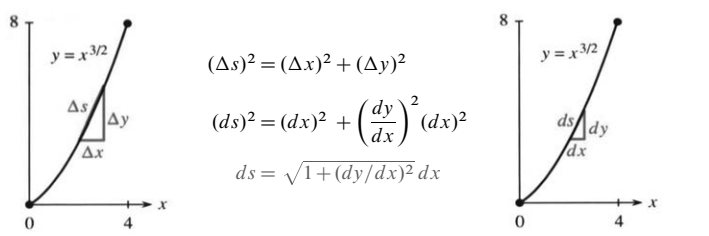
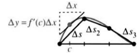
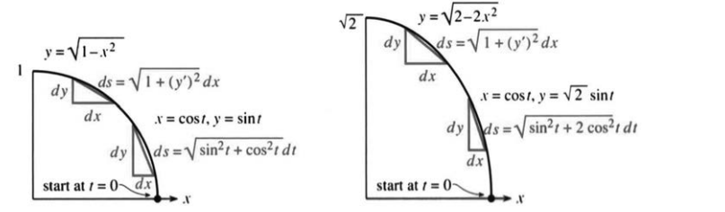

# 8.2　平面曲线的弧长

来源：原书 PDF 第396—400页（印刷页383—387）。状态：中文初译；已逐页对照原图，尚未经独立复核。

<!-- PDF 396 / 印刷页 383 -->

函数 $y=x^{3/2}$ 的图像是 $xy$ 平面内的一条曲线。它有多长？定积分需要指定端点，这里取 $x=0$ 和 $x=4$。首先要知道，应当对哪个“长度函数”积分。

沿曲线量得的长度叫作**弧长**。为建立积分，我们把曲线分成小段。粗略地说，光滑曲线的一小段近似于直线。短线段的长度 $\Delta s$ 可以精确计算；图8.8说明它如何逼近相应曲线段的长度。

图8.8　左图中短直线段长为 $\Delta s$；右图表示弧长微元 $ds$。

先作一个非正式推导。短线段满足 $(\Delta s)^2=(\Delta x)^2+(\Delta y)^2$。对应直角三角形的高为 $\Delta y=(\Delta y/\Delta x)\Delta x$。割线斜率近似等于切线斜率，因此 $\Delta y\approx(dy/dx)\Delta x$，从而

$$
\Delta s\approx\sqrt{(\Delta x)^2+(dy/dx)^2(\Delta x)^2}
=\sqrt{1+(dy/dx)^2}\,\Delta x. \tag{1}
$$

把各段相加，并不断缩小每段。微分形式的勾股关系为 $(ds)^2=(dx)^2+(dy)^2$。沿 $x$ 增大的方向，可写 $ds=\sqrt{1+(dy/dx)^2}\,dx$，于是

$$
\boxed{\text{曲线弧长}=\int ds=\int\sqrt{1+(dy/dx)^2}\,dx.} \tag{2}
$$

**例1**　仍取 $y=x^{3/2}$，其导数为 $dy/dx=\tfrac32x^{1/2}$。注意系数 $3/2$ 平方后成为 $9/4$：

$$
L=\int_0^4\sqrt{1+\frac94x}\,dx
=\left[\frac23\cdot\frac49\left(1+\frac94x\right)^{3/2}\right]_0^4
=\frac8{27}(10^{3/2}-1). \tag{3}
$$

结果略大于 $9$。连接 $(0,0)$ 与 $(4,8)$ 的直线段长度为 $\sqrt{80}$，因为 $4^2+8^2=80$。$\sqrt{80}$ 略小于 $9$，可见这段曲线相当接近直线。

你或许不喜欢这些数字，或不满意前面的推导。推导可以补严密，数字却没办法变得更漂亮。选择 $y=x^{3/2}$ 是经过考虑的，目的是使积分能用初等方法求出。弧长积分因为含有平方根，通常不好算，许多情形需要数值积分。

**例2**　直线 $y=2x$ 从 $x=0$ 到 $x=4$，导数为 $2$。于是

$$
L=\int_0^4\sqrt{1+4}\,dx=4\sqrt5=\sqrt{80},
$$

与刚才相同，只是作一次检验。

现在回到推导。设曲线为 $y=f(x)$。由中值定理，每个小区间内都存在一点 $c$，使割线斜率等于切线斜率：$\Delta y/\Delta x=f'(c)$。

<!-- PDF 397 / 印刷页 384 -->

这里假设 $f'$ 连续，从而所考察的图像足够光滑，中值定理也适用。短弦的长度恰为 $\sqrt{(\Delta x)^2+[f'(c)\Delta x]^2}$。将 $n$ 段相加，得到逼近曲线的折线长度：

$$
\sum_{i=1}^n\Delta s_i
=\sum_{i=1}^n\sqrt{1+[f'(c_i)]^2}\,\Delta x_i.
$$

当分割的最大长度 $\Delta x_{\max}\to0$ 时，这个和趋于给出弧长的积分。

**8A　设 $f\in C^1[a,b]$。曲线 $y=f(x)$ 从 $x=a$ 到 $x=b$ 的弧长为**

$$
\boxed{L=\int ds=\int_a^b\sqrt{1+[f'(x)]^2}\,dx
=\int_a^b\sqrt{1+(dy/dx)^2}\,dx.} \tag{4}
$$

**例3**　求单位圆第一象限部分 $y=\sqrt{1-x^2}$ 的弧长。

导数为 $dy/dx=-x/\sqrt{1-x^2}$。图8.9a给出范围 $0\le x\le1$，于是

$$
L=\int_0^1\sqrt{1+\frac{x^2}{1-x^2}}\,dx
=\int_0^1\frac{dx}{\sqrt{1-x^2}}=\frac\pi2.
$$

原函数为 $\arcsin x$。在右端以极限取值，得到 $\pi/2$，正是整个圆周长 $2\pi$ 的四分之一。

**例4**　求椭圆 $y^2+2x^2=2$ 在第一象限部分的弧长。

由 $y=\sqrt{2-2x^2}$，得 $dy/dx=-2x/\sqrt{2-2x^2}$，所以

$$
L=\int_0^1\sqrt{1+\frac{4x^2}{2-2x^2}}\,dx
=\int_0^1\sqrt{\frac{2+2x^2}{2-2x^2}}\,dx
=\int_0^1\sqrt{\frac{1+x^2}{1-x^2}}\,dx. \tag{5}
$$

这个积分不能用初等函数表示，一般要数值计算椭圆的弧长。在 $x=1$ 处分母为零；若不作处理就直接套用需要端点函数值的梯形法或辛普森法，会因端点无穷大而无法得到正确结果。原书指出，使用数千个小区间的中点法可得到约 $1.91$。

图8.9　圆与椭圆既可用 $y=f(x)$ 表示局部曲线，也可用参数方程 $x(t),y(t)$ 表示。

<!-- PDF 398 / 印刷页 385 -->

### 用参数方程求弧长：$x(t)$ 与 $y(t)$

我们见过单位圆的两种表示：$x^2+y^2=1$，以及 $x=\cos t,y=\sin t$。因为 $\cos^2t+\sin^2t=1$，参数方程中的点确实沿单位圆运动。参数 $t$ 的一个优点是能提供额外信息：不仅告诉我们点在哪里，还告诉我们何时到达那里。第1章中，$t$ 既是时间也是角度，因为点以单位速率绕单位圆运动。

用时间 $t$ 表示质点或航天器的位置十分自然。若知道每个时刻的 $x,y$，就能求出速度。方程 $y=f(x)$ 只描述路径的形状，不说明沿路径运动的快慢。

第12章将讨论曲线的参数方程。这里仅着眼于路径长度，使你先了解参数的想法，不必涉及过多细节。给定 $x=x(t)$ 和 $y=y(t)$，仍用短线段逼近曲线，每段满足 $(\Delta s)^2=(\Delta x)^2+(\Delta y)^2$。但这次分别近似两个坐标增量：

$$
\Delta x\approx\frac{dx}{dt}\Delta t,\qquad
\Delta y\approx\frac{dy}{dt}\Delta t,\qquad
\Delta s\approx\sqrt{\left(\frac{dx}{dt}\right)^2+\left(\frac{dy}{dt}\right)^2}\,\Delta t.
$$

**8B　参数曲线的弧长由关于 $t$ 的积分给出：**

$$
\boxed{\int ds=\int\frac{ds}{dt}\,dt
=\int\sqrt{\left(\frac{dx}{dt}\right)^2+\left(\frac{dy}{dt}\right)^2}\,dt.} \tag{6}
$$

积分上下限为所考察的参数区间端点；这里假设坐标函数连续可微，分段连续可微时分段相加。

**例5**　用 $x=\cos t,y=\sin t$ 求四分之一圆的弧长：

$$
L=\int_0^{\pi/2}\sqrt{\sin^2t+\cos^2t}\,dt
=\int_0^{\pi/2}dt=\frac\pi2.
$$

这比积分 $1/\sqrt{1-x^2}$ 简单，而且还有新优点：可以轻松积分整个圆周。参数方程允许路径闭合，甚至自交。时间 $t$ 不断前进，点 $(x(t),y(t))$ 不断运动；而 $y=f(x)$ 必须让每个 $x$ 只对应一个 $y$。

**例6**　求参数曲线 $x=\cos t,y=\sqrt2\sin t$ 的四分之一椭圆弧长。

在这条路径上，$y^2+2x^2=2\sin^2t+2\cos^2t=2$，仍是同一个椭圆。消去 $t$ 可得 $y=\sqrt{2-2x^2}$，但现在保留参数：

$$
L=\int_0^{\pi/2}\sqrt{\sin^2t+2\cos^2t}\,dt. \tag{7}
$$

式(7)与式(5)必定相等，二者由 $x=\cos t$ 联系；一个不能用初等函数积分，另一个也一样。但式(7)的被积函数在端点不发散。原书给出的数值结果是：不到100个小区间，梯形法便可得到约 $1.9101$。第5.8节提过，某些计算器会自动作换元，把式(5)变成类似式(7)的形式。

**例7**　路径 $x=t^2,y=t^3$ 从 $(0,0)$ 出发，在 $t=2$ 时到达 $(4,8)$。

为了消去参数，在 $t\ge0$ 上先解出 $t=\sqrt x$，再代入 $y=t^3$，得到 $y=x^{3/2}$。这正是例1中的曲线。关于 $t$ 与关于 $x$ 的两个弧长积分相等，习题22要求验证这一点。

<!-- PDF 399 / 印刷页 386 -->

**例8**　参数的一种特殊选择是直接令 $t=x$。此时曲线为 $x=t,y=t^{3/2}$。

由于 $dx/dt=1$，式(6)根号中的表达式变成式(4)中的表达式。因此普通形式 $y=f(x)$ 是参数形式的特例，只要取 $t=x$ 即可。

比较 $x=t,y=t^{3/2}$ 与 $x=t^2,y=t^3$：在分别遍历同一曲线段时，它们的曲线相同、弧长相同，运动速率却不同。

**例9**　速率是短时间内路程与时间之比的极限，即

$$
\frac{ds}{dt}=\sqrt{\left(\frac{dx}{dt}\right)^2+\left(\frac{dy}{dt}\right)^2}.
$$

把球竖直向上抛出时，$dx/dt=0$，但速率不是 $dy/dt$，而是 $|dy/dt|$。无论向上还是向下运动，速率均非负。

### 8.2　习题

**通读填空**

水平增量为 $\Delta x$、竖直增量为 $\Delta y$ 的直线段，长度为 $\Delta s=$**a**。在 $y=y(x)$ 图像的两相邻点之间，$\Delta y$ 近似为 $dy/dx$ 乘 **b**。相应短弦长度近似为 $\sqrt{(\Delta x)^2+\text{**c**}}$。曲线的弧长微元为 $ds=$**d**，因此弧长积分为 $\int\text{**e**}$。

直线 $y=4-x$ 从 $x=0$ 到 $x=3$ 的弧长为 $\int\text{**f**}=$**g**。曲线 $y=x^3$ 的弧长积分为 **h**。参数方程 $x=\cos t,y=\sin t$ 所表示的曲线是 **i**。由 $x(t),y(t)$ 给出的路径，其长度为 $\int\sqrt{\text{**j**}}\,dt$。例如 $x=\cos t,y=\sin t$ 从 $t=\pi/3$ 到 $t=\pi/2$ 的弧长为 **k**。速率 $ds/dt=$**l**。特殊地，令 $x=t,y=f(t)$，弧长公式又变成 $\int\sqrt{\text{**m**}}\,dx$。

**1—8题：求曲线的弧长。**

1. $y=x^{3/2}$，从 $(0,0)$ 到 $(1,1)$。
2. $y=x^{2/3}$，从 $(0,0)$ 到 $(1,1)$。与第1题比较，或在弧长积分中令 $u=4/9+x^{2/3}$。
3. $y=\tfrac13(x^2+2)^{3/2}$，$0\le x\le1$。
4. $y=\tfrac13(x^2-2)^{3/2}$，$2\le x\le4$。
5. $y=x^3/3+1/(4x)$，$1\le x\le3$。
6. $y=x^4/4+1/(8x^2)$，$1\le x\le2$。
7. $y=\tfrac23x^{3/2}-\tfrac12x^{1/2}$，$1\le x\le4$。
8. $y=x^2$，从 $(0,0)$ 到 $(1,1)$。
9. 曲线 $x=\cos^3t,y=\sin^3t$ 称为星形线，是一种内摆线。消去参数后为 $x^{2/3}+y^{2/3}=1$。画出 $0\le t\le\pi/2$ 的曲线段，并求弧长。
10. 求 $x=\cos t+\sin t,y=\cos t-\sin t$ 在 $0\le t\le\pi$ 上的弧长。证明轨迹是圆，并求半径。
11. 求 $x=\cos t,y=t-\sin t$ 在 $0\le t\le\pi/2$ 上的弧长。
12. 哪个积分给出阿基米德螺线 $x=t\cos t,y=t\sin t$ 的弧长？
13. 若 $x=\tfrac12t^2,y=\tfrac13(2t+1)^{3/2}$，求第一秒内，即从 $t=0$ 到 $t=1$ 所走的路程。
14. 参数式 $x=(1-\tfrac12\cos2t)\cos t$、$y=(1+\tfrac12\cos2t)\sin t$ 给出关系 $4(1-x^2-y^2)^3=27(x^2-y^2)^2$。求 $0\le t\le\pi/4$ 的弧长。

**15—18题：用数值积分求弧长。**

15. $y=\sin x$ 的一拱，$0\le x\le\pi$。
16. $y=e^x$，$0\le x\le1$。
17. $y=\ln x$，$1\le x\le e$。
18. $x=\cos t,y=3\sin t$，$0\le t\le2\pi$。
19. 画出 $y=x^{10}$ 的大致图像。不直接计算 $y=x^n$ 从 $(0,0)$ 到 $(1,1)$ 的弧长，求该弧长在 $n\to\infty$ 时的极限。
20. 从 $(1,1)$ 到 $(2,1/2)$，双曲线 $y=1/x$ 与直线 $x+2y=3$，哪一段更长？
21. 求圆周运动 $x=2\cos3t,y=2\sin3t$ 的速率 $ds/dt$。
22. 例1和例7分别使用 $y=x^{3/2}$ 与 $x=t^2,y=t^3$，给出的弧长积分为

    $$\int_0^4\sqrt{1+\frac94x}\,dx,\qquad\int_0^2\sqrt{4t^2+9t^4}\,dt.$$

    通过换元 $x=$______，说明二者相等。

<!-- PDF 400 / 印刷页 387 -->

23. 曲线除可写成 $y=f(x)$ 外，也可以写成 $x=g(y)$。此时沿 $y$ 增大的方向，

    $$ds=\sqrt{(dx)^2+(dy)^2}=\sqrt{(dx/dy)^2+1}\,dy.$$

    画出 $x=5y$ 在 $0\le y\le1$ 的部分，并求长度。
24. 曲线 $x=y^{3/2}$ 从 $(0,0)$ 到 $(1,1)$ 的弧长为 $\int_0^1\sqrt{\tfrac94y+1}\,dy$。与第1题比较：长度相同吗？曲线相同吗？
25. 求 $x=\tfrac12(e^y+e^{-y})$ 在 $-1\le y\le1$ 的弧长，并画出曲线。
26. $x=g(y)$ 的弧长公式是式(6)中 $y=t,x=g(t)$ 的特例。弧长积分变为______。
27. 标出 $x=3\cos t,y=4\sin t$ 在 $t=0,\pi/2,\pi,3\pi/2,2\pi$ 五个时刻的位置。曲线方程为 $(x/3)^2+(y/4)^2=1$，它不是圆，而是______。整条曲线不能写成 $y=f(x)$，因为______。
28. (a)求 $x=\cos^2t,y=\sin^2t$ 在 $0\le t\le\pi$ 上的路径长度。(b)为什么路径始终位于直线 $x+y=1$ 上？(c)为什么路径长度不是 $\sqrt2$？
29. **重要：**直线 $y=x$ 可以由水平段与竖直段组成的阶梯逼近。从 $(0,0)$ 到 $(1,1)$，作100级阶梯，每级的水平段长 $\Delta x=1/100$，竖直段长 $\Delta y=1/100$。求沿阶梯铺设的地毯长度。倾角为 $45^\circ$ 的直线段长度是 $\sqrt2$。阶梯在位置上可以很接近直线，长度却不接近。
30. 椭圆的面积为 $\pi ab$。若把其周围宽为 $\Delta$ 的带状区域面积写成 $\pi(a+\Delta)(b+\Delta)-\pi ab\approx\pi(a+b)\Delta$，似乎得到椭圆周长为 $\pi(a+b)$。但一般椭圆的周长不能用这种简单公式求出。上述推理错在哪里？
31. 点 $x=\cos t,y=\sin t,z=t$ 沿空间曲线运动。(a)三维空间中 $(ds)^2=(dx)^2+$______，所以式(6)中的 $ds=$______$\,dt$。(b)对此曲线，$ds=$______，求从 $t=0$ 到 $t=2\pi$ 的弧长。(c)描述曲线及其在 $xy$ 平面上的投影。
32. 用一小段话（原书要求约50个英文词）说明普通方程 $y=f(x)$ 与两个参数方程 $x=x(t),y=y(t)$ 的区别。
33. 写出 $y=x^2$ 从 $(0,0)$ 到 $(1,1)$ 的弧长积分 $L$。证明 $y=\tfrac12x^2$ 从 $(0,0)$ 到 $(2,2)$ 的弧长恰为 $2L$。若可能，从图形上解释。
34. **给教师的题：**比较抛物线 $y=x^2$ 和直线 $y=bx$ 从 $(0,0)$ 到 $(b,b^2)$ 的长度。两者之差在 $b\to\infty$ 时趋于有限极限吗？

### 译注与原文核对

1. 弧长可定义为曲线上按参数顺序取点所成内接折线长度的上确界。对于 $C^1$ 曲线，上述黎曼和推导给出弧长公式。任意空间位置接近的折线，其长度未必接近原曲线，习题29正说明这一点；不能把“看起来接近”单独当作弧长收敛的证明。
2. 中值定理本身不要求导函数连续；这里的 $C^1$ 假设保证后续被积函数连续，是一个方便的充分条件。原书8A中的终点印为 $x=6$，由积分上限及上下文校为 $x=b$；参数方程小标题印作 $x(f),y(f)$，统一为 $x(t),y(t)$。
3. 例3—4的图像导数在右端点发散，不能直接套用闭区间 $C^1$ 版本；译文按截短区间后取极限，即反常积分解释。椭圆弧长可由第二类椭圆积分或收敛级数精确表示；原文“不能用闭式、只能数值求出”应限定为一般不能用初等函数表示，不代表没有严格表达式。
4. 参数弧长积分计入路径被重复遍历的次数。若要求几何图形本身的长度，应选择只遍历一次的参数区间。式(6)的 $s$ 表示从初始时刻累积的路程，故 $ds/dt\ge0$；运动暂时停止时速率可为零。$ds=\sqrt{1+(y')^2}\,dx$ 的写法取 $dx\ge0$ 的积分方向，一般无向线元应写 $\sqrt{1+(y')^2}|dx|$。
5. 习题18把参数范围误印为 $0\le x\le2\pi$，习题28误印为 $0\le y\le\pi$，均据参数与题意校为 $t$ 的范围。习题29原文仅说100段、每段长 $1/100$，这不能连接 $(0,0)$ 与 $(1,1)$；按其比较 $\sqrt2$ 的意图改为100级、水平与竖直各100段，并保留这里的校正说明。
6. 习题30中把两条半轴各增加 $\Delta$，并不会产生法向宽度处处等于 $\Delta$ 的平行带。该题的错误正在于此，译文仍以待辨析的推理呈现。习题15—18要求数值法，并不意味着其中每题都没有初等原函数。
