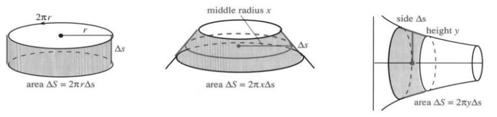
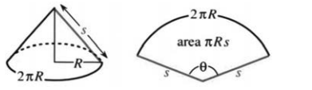
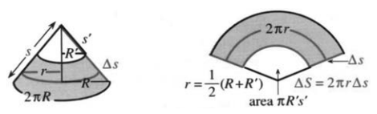

# 8.3　旋转曲面的面积

来源：原书 PDF 第401—403页（印刷页388—390）。状态：中文初译；已逐页对照原图，尚未经独立复核。

<!-- PDF 401 / 印刷页 388 -->

本节先从构造曲面说起。将曲线 $y=f(x)$ 绕一条轴旋转，就得到一个**旋转曲面**，它关于这条轴对称。旋转斜线段可得到圆锥面；若线段平行于轴，就得到圆柱面，形如一段管子。旋转曲线还可以得到台灯底座、灯罩，甚至灯泡的表面。

第8.1节计算曲面内部的体积，本节计算曲面的面积。此前我们把立体分成薄片或薄壳，现在得找个好办法，把曲面切开。

关键是旋转短直线段，其斜率为 $\Delta y/\Delta x$。上一节求弧长用的那些短线段就能派上用场，长度同为 $\Delta s$；这回拿它们算面积。每段旋转后形成一条窄环带（图8.10），这些环带逼近 $y=f(x)$ 旋转所得的曲面。第一步是求出一条环带的面积。

补充说明：也可以把曲面分成许多近似平坦的小片，像小正方形一样。小片面积一相加，就引出二重积分，例如含 $dx\,dy$ 的积分。但这里仍只需一维积分，使用 $dx$、$dy$ 或 $dt$。旋转曲面有其特殊性：可以用围绕轴一整圈的环带来逼近。环带就是一条倾斜的腰带，而倾斜程度会影响面积。

图8.10　直线段和曲线分别绕 $y$ 轴与 $x$ 轴旋转。

旋转一条短直线段，注意它的长度是 $\Delta s$，不是 $\Delta x$。线段中点沿半径为 $r$ 的圆运动。形成的环带是圆锥侧面的一部分，将它展开（习题11—13）即可求面积：母线段长 $\Delta s$ 乘中点圆周长 $2\pi r$，即

$$
\Delta S=2\pi r\,\Delta s
=2\pi r\sqrt{1+(\Delta y/\Delta x)^2}\,\Delta x.
$$

绕 $y$ 轴时，半径 $r=x$；绕 $x$ 轴时，半径 $r=y=f(x)$。图8.10画出了这两种环带；该用哪个，题目会告诉我们。各环带面积之和逼近曲面面积 $S$，极限给出 $\int2\pi r\,ds$。

**8C　曲线 $y=f(x)$ 在 $a\le x\le b$ 的部分旋转所成曲面的面积为**

$$
S=\int_a^b2\pi y\sqrt{1+(dy/dx)^2}\,dx,
\quad\text{绕 $x$ 轴；} \tag{1}
$$

$$
S=\int_a^b2\pi x\sqrt{1+(dy/dx)^2}\,dx,
\quad\text{绕 $y$ 轴。} \tag{2}
$$

<!-- PDF 402 / 印刷页 389 -->

**例1**　把整个上半圆 $y=\sqrt{R^2-x^2}$ 绕 $x$ 轴旋转。

所得曲面是球面，其已知面积为 $4\pi R^2$。积分范围为 $[-R,R]$，导数为 $dy/dx=-x/\sqrt{R^2-x^2}$。因此

$$
S=\int_{-R}^R2\pi\sqrt{R^2-x^2}
\sqrt{1+\frac{x^2}{R^2-x^2}}\,dx
=\int_{-R}^R2\pi R\,dx=4\pi R^2.
$$

**例2**　将直线 $y=2x$ 的一段绕 $x$ 轴旋转。

所得曲面为圆锥侧面，且 $(dy/dx)^2=4$。从 $x=0$ 到 $x=1$ 生成的部分，面积为

$$
S=\int2\pi y\,ds=\int_0^12\pi(2x)\sqrt{1+4}\,dx=2\pi\sqrt5.
$$

这个结果必须和最初的公式 $2\pi r\Delta s$ 对得上。连接 $(0,0)$ 和 $(1,2)$ 的线段长 $\Delta s=\sqrt5$，中点为 $(1/2,1)$。绕 $x$ 轴时，中点半径为 $r=1$，所以面积确为 $2\pi\sqrt5$。

**例3**　把同一线段绕 $y$ 轴旋转。

半径现在是 $x$，而不是 $y=2x$，所以面积减为例2的一半：

$$
S=\int2\pi x\,ds=\int_0^12\pi x\sqrt{1+4}\,dx=\pi\sqrt5.
$$

与弧长一样，曲面面积也只有少数例子能得到方便的答案。习题中有西瓜、篮球和灯泡。本节不再拉长篇幅，最后给出一个面积公式，并说明用法。

这个公式适用于参数曲线。曲线上的点不再写成 $(x,f(x))$，改写成 $(x(t),y(t))$。随着 $t$ 变化，点沿曲线运动。把弧长关系 $(ds)^2=(dx)^2+(dy)^2$ 用 $t$ 表示，绕 $x$ 轴的面积就成为关于 $t$ 的积分。

**8D　曲面面积为**

$$
\boxed{S=\int2\pi y\,ds
=\int2\pi y(t)\sqrt{\left(\frac{dx}{dt}\right)^2+\left(\frac{dy}{dt}\right)^2}\,dt.} \tag{3}
$$

**例4**　点 $x=\cos t,y=5+\sin t$ 沿圆心为 $(0,5)$ 的圆运动。把此圆绕 $x$ 轴旋转，形成环面，求其面积。

**解：**$(dx/dt)^2+(dy/dt)^2=\sin^2t+\cos^2t=1$。参数从 $0$ 到 $2\pi$ 时，圆恰好走一周。因此

$$
S=\int_0^{2\pi}2\pi(5+\sin t)\,dt
=[2\pi(5t-\cos t)]_0^{2\pi}=20\pi^2.
$$

<!-- PDF 403 / 印刷页 390 -->

### 8.3　习题

**通读填空**

旋转曲面由 **a** 绕 **b** 旋转而成。本节计算 **c**。若曲线是一条长为 $\Delta s$ 的短直线段，生成的曲面是 **d**，面积 $\Delta S=$**e**。此公式中的 $r$ 是 **f** 的半径，见习题13。从 $(0,0)$ 到 $(1,1)$ 的线段长为 **g**，绕坐标轴旋转所成曲面面积为 **h**。

曲线 $y=f(x)$ 绕 $x$ 轴旋转时，曲面面积积分为 **i**。对 $y=x^2$，所求积分为 **j**。若 $y=x^2$ 绕 $y$ 轴旋转，面积为 $S=$**k**。对参数曲线 $x=2t,y=t^2$，将 $ds$ 换成 **l**$\,dt$。

**1—6题：求曲线绕 $x$ 轴旋转所得曲面的面积。**

1. $y=\sqrt x$，$2\le x\le6$。
2. $y=x^3$，$0\le x\le1$。
3. $y=7x$，$-1\le x\le1$（注意符号）。
4. $y=\sqrt{4-x^2}$，$0\le x\le2$。
5. $y=\sqrt{4-x^2}$，$-1\le x\le1$。
6. $y=\cosh x$，$0\le x\le1$。

**7—10题：求曲线绕 $y$ 轴旋转所得曲面的面积。**

7. $y=x^2$，$0\le x\le2$。
8. $y=\tfrac12x^2+\tfrac12$，$0\le x\le1$。
9. $y=x+1$，$0\le x\le3$。
10. $y=x^{1/3}$，$0\le x\le1$。
11. 将底面半径为 $R$、母线长为 $s$ 的圆锥侧面展开成平面扇形。说明为什么扇形圆心角为 $\theta=2\pi R/s$（弧度）。其面积为整个圆面积的一部分：

    $$S=\frac\theta{2\pi}\pi s^2=\frac Rs\pi s^2=\pi Rs.$$

    

12. 将母线长为 $\Delta s=s-s'$、两端半径为 $R,R'$ 的圆台环带展开。用一句话说明其面积为什么是 $\pi Rs-\pi R's'$。

    

13. 由相似三角形，$R/s=R'/s'$，即 $Rs'=R's$。中点半径 $r=(R+R')/2$。把 $r$ 与 $\Delta s$ 代入面积公式 $2\pi r\Delta s$，验证结果是 $\pi Rs-\pi R's'$。
14. 把篮球表面用相互平行的平面分成球带，只要两平面间的距离相同，球带面积就相同。(a)将 $y=\sqrt{1-x^2}$ 绕 $x$ 轴旋转，证明 $dS=2\pi\,dx$。(b)$x=a$ 与 $x=a+h$ 之间的球带面积为______。(c)地球总面积的四分之一位于哪条纬线以北？
15. 把例4的圆改为 $x=a\cos t,y=b+a\sin t$。其半径为______，圆心为______。将此圆绕 $x$ 轴旋转，求所得环面的面积。
16. 要生成上半球面，应把圆 $x=R\cos t,y=R\sin t$ 的哪一部分绕 $y$ 轴旋转？选定 $t$ 的上下限，并验证面积。
17. 将四分之一圆弧 $y=\sqrt{2x-x^2}$、$1\le x\le2$ 绕 $y$ 轴旋转，形成台灯底座表面。画出圆弧，列出面积积分并计算。
18. 灯泡是一个半径为 $1/2$ 的球，底部切去一小块，好接到半径为 $1/4$、长为 $1/3$ 的圆柱上。画出灯泡并求表面积，不计圆柱两端面。
19. 灯罩由 $y=1/x$ 绕 $y$ 轴旋转并保留 $1\le y\le2$ 的部分得到。列出其面积的定积分。
20. 计算上题灯罩的面积。
21. 说明当 $y=1/x$、$1\le x<\infty$ 绕 $x$ 轴旋转时，曲面面积为什么是无穷大；但所围“加百列号角”的体积为______。它不能足够的油漆来涂其表面。
22. 一个半径为1英寸的圆盘，可以用四条宽各为 $1/2$ 英寸的胶带覆盖。证明：若四条胶带不相互平行，就不能覆盖该圆盘。提示：考虑单位球，被间距为 $1/2$ 的平行平面截取的球带；由习题14，每条球带的面积为 $\pi$。
23. 西瓜，也可能是橄榄球，可由椭圆 $x=\sqrt2\cos t,y=\sin t$（即 $x^2+2y^2=2$）的一半旋转得到。用参数式或普通方程求曲面面积。
24. 估算一个鸡蛋的表面积。
