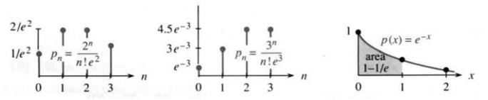
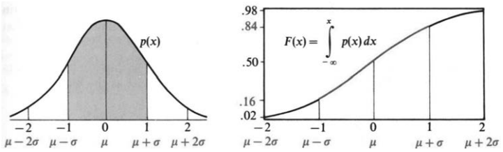

# 8.4 概率与微积分

来源：原书 PDF 第404—411页（印刷页391—398）。状态：初译，已逐页对照原图；尚未完成全书统校。

<!-- PDF 404 / 印刷页 391 -->

离散概率通常需要仔细计数：样本不多，试验次数也不多，可以列出所有可能结果，并知道每种结果的概率。不过，概率问题远不止抽到红牌还是黑牌。实际问题往往是：

1. 一个航班出现到场乘客超过座位数的情况，有多大可能？
2. 你在一次测验中会犯多少个随机错误？
3. 一次大型彩票活动恰有一名中奖者的概率是多少？

我们将建立模型来回答这些重要问题。还有一点：上述离散模型本身不需要微积分。错误数、无法登机的乘客数、中奖人数都是整数。**连续概率则要用到微积分。**我们不再只问结果是否恰好等于1、2或3，而是问结果是否落在某个数值范围内。连续概率至少会在两种情形里出现：

（A）多次重复一个试验，并取结果的平均值；

（B）结果可以落在一个数值区间内的任意位置。

在这些带概率密度的连续模型里，随机变量恰好取某个指定值的概率为零。取而代之的是**概率密度** $p(x)$，这是关键概念。随机变量 $X$ 落在 $a$ 与 $b$ 之间的概率，是密度 $p(x)$ 在该区间上的积分：

$$
\Pr\{a\le X\le b\}=\int_a^b p(x)\,dx. \tag{1}
$$

粗略地说，$p(x)\,dx$ 表示落在 $x$ 与 $x+dx$ 之间的概率。当然，$p(x)\ge0$。如果积分覆盖所有可能结果，即从 $-\infty$ 到 $+\infty$，总概率必为1：

$$
\Pr\{-\infty<X<+\infty\}=\int_{-\infty}^{\infty}p(x)\,dx=1. \tag{2}
$$

在这里，无穷积分限十分自然。概率里的无穷区间并不总会增加计算困难；有时候，面积一路算到无穷，反而更容易。以下是需要连续概率与微积分的典型问题：

4. 对2500名选民的调查得出 $53\%$ 对 $47\%$ 的结果，这个结果有多大说服力？
5. 随机选出的16名橄榄球运动员，乘坐限载3600磅的电梯，是否会超载？
6. 距离你的汽车下一次发生事故，还有多长时间？

传统微积分课程不常讨论这些问题。这些问题光算积分还不够，还得多想一步，所以本节比一般章节难一些。不过，概率比某些传统内容更重要，也更有趣。药物检验、基因鉴定和市场调查都是重要应用。比较问题1—3与问题4—6，可以看出离散概率与连续概率的差异和联系。

这里不可能全面讲授概率论。我希望这些例子足以说明基本思想，以及微积分的用途。弗兰克·摩根的讲义为本节提供了很有价值的参考。

<!-- PDF 405 / 印刷页 392 -->

## 离散随机变量

**离散随机变量** $X$ 的可能取值可以逐一列出。例如，两个骰子的点数和可以取 $X=2,3,\ldots,12$。下面掷硬币的试验，取值列表就是无限的：$X=1,2,3,\ldots$。连续随机变量则可以在一个区间内取值。

**例1**　重复独立地抛掷一枚均匀硬币，直到第一次出现正面。用 $X$ 表示抛掷次数。$X$ 可以等于1、2、3等。第一次就出现正面的概率为 $p_1=1/2$；先反面、后正面的概率为 $p_2=1/4$。一般地，

$$p_n=\Pr\{X=n\}=\left(\frac12\right)^n,$$

因为这要求先连续出现 $n-1$ 次反面，再出现一次正面。所有概率之和为1：

$$p_1+p_2+p_3+\cdots=\frac12+\frac14+\frac18+\cdots=1.$$

**例2**　假设某位学生（不是你）在一小时考试中平均犯2个本可避免的错误。下一次考试的实际错误数可以是 $X=0,1,2,\ldots$。若把错误看作按稳定速率独立发生的随机事件，可以采用**泊松模型**（Poisson）：

$$p_n=\Pr\{X=n\}=\frac{2^n}{n!}e^{-2}.$$

没有错误、一个错误和两个错误的概率分别为

$$p_0=\frac{2^0}{0!}e^{-2}\approx0.135,\qquad p_1=\frac{2^1}{1!}e^{-2}\approx0.27,\qquad p_2=\frac{2^2}{2!}e^{-2}\approx0.27.$$

按这些已四舍五入的数值估算，超过两个错误的概率约为 $1-0.135-0.27-0.27=0.325$；直接使用公式得到约 $0.3233$。

泊松模型既可以在适当假设下推导，也可以通过实验检验。利用第6.6节中 $e^2$ 的无穷级数，总概率仍为1：

$$
p_0+p_1+p_2+\cdots=\left(\frac{2^0}{0!}+\frac{2^1}{1!}+\frac{2^2}{2!}+\cdots\right)e^{-2}=e^2e^{-2}=1. \tag{3}
$$

**例3**　假设每100名订座乘客平均有3人不到场。飞机只能容纳98人，那么至少一人不能登机的概率是多少？

把不到场人数记为 $X$。在乘客独立到场的假设下，以参数3的泊松分布作近似，得到

$$p_n=\frac{3^n}{n!}e^{-3},\qquad p_0=e^{-3},\qquad p_1=3e^{-3}.$$

100人订座、98个座位，只要 $X=0$ 或 $X=1$ 就有人无法登机。因此

$$\Pr\{\text{至少一人无法登机}\}\approx p_0+p_1=4e^{-3}\approx\frac4{20}.$$

我们即将定义 $X$ 的平均值，也叫**期望**或**均值**。这个泊松模型的均值是 $\mu=3$。

> 译注：若每位乘客独立地以 $0.03$ 的概率不到场，准确模型是二项分布 $\operatorname{Bin}(100,0.03)$；泊松模型是近似。仅知道“平均3人不到场”，还不足以唯一决定其分布。

<!-- PDF 406 / 印刷页 393 -->

## 连续随机变量

如果 $X$ 是一台录像机的寿命，则所有非负数都可能。如果 $X$ 是书中所用SAT考试的分数，则 $200\le X\le800$。如果 $X$ 是600人调查样本中拥有计算机者的比例，那么 $0\le X\le1$。你可能会说：考试分数是整数，调查比例也只能取 $0,1/600,2/600,\ldots$。确实如此。不过，与逐一处理许多离散取值相比，用连续随机变量近似往往更方便。于是我们让 $X$ 在相应区间内取值。当然，各个取值的概率一般并不相同。

**例4**　录像机的平均寿命为4年。假设故障时间服从**指数分布**，概率密度为

$$p(x)=\frac14e^{-x/4},\qquad 0\le x<\infty,$$

在 $x<0$ 时密度为零。在这个模型中，它最终发生故障的概率为1：

$$
\int_0^\infty\frac14e^{-x/4}\,dx=\left[-e^{-x/4}\right]_0^\infty=0-(-1)=1. \tag{4}
$$

12年内发生故障的概率约为 $0.95$：

$$
\int_0^{12}\frac14e^{-x/4}\,dx=\left[-e^{-x/4}\right]_0^{12}=1-e^{-3}\approx0.95. \tag{5}
$$

一般的指数密度是 $p(x)=ae^{-ax}$（$a>0,x\ge0$）。从0到 $x$ 积分，得到 $F(x)=1-e^{-ax}$。图8.11画出 $a=1$ 的情形，并标出 $x=1$ 左侧的面积。

再强调一次：**$X$ 落在 $a$ 与 $b$ 之间的概率，就是 $p(x)$ 从 $a$ 到 $b$ 的积分。**

图8.11　离散概率之和为 $\sum p_n=1$；连续密度的积分为 $\int p(x)\,dx=1$。右图阴影面积为 $1-1/e$。

**例5**　现在定义最重要的一类概率密度。假设SAT成绩均值为500，标准差为200。标准差将在下文定义，它衡量数据在均值附近的分散程度。对应的**正态分布**密度为

$$p(x)=\frac1{200\sqrt{2\pi}}e^{-(x-500)^2/[2(200)^2]},\qquad -\infty<x<\infty.$$

这也称为**高斯分布**，均值500，标准差200。图8.12中的著名**钟形曲线**就是其密度图像。

这里又有一个问题：真实成绩在200到800之间，而正态密度却延伸到整个实数轴。作者推测，考试机构会把超过800的分数计为800。这个推测只应看作原书对模型的解释。按照本例给定的参数，超过800的概率实际为

$$
\Pr\{X\ge800\}=\int_{800}^\infty\frac1{200\sqrt{2\pi}}e^{-(x-500)^2/[2(200)^2]}\,dx\approx0.0668. \tag{6}
$$

> 译注：原文把结果写成 $0.0013$，与给定参数不符。这里的标准化值是 $(800-500)/200=1.5$，故尾概率约为 $0.0668$。$0.0013$ 约为标准正态分布在3右侧的尾概率。正态模型在成绩范围之外分配了不可忽略的概率，若要严格限制成绩范围，须另行规定截断或封顶规则。

<!-- PDF 407 / 印刷页 394 -->

图8.12　左：正态分布的钟形密度曲线；右：相应的累积分布函数 $F(x)$。

遗憾的是，$e^{-x^2}$ 没有初等原函数，因此通常用数值积分求值。这并没有什么问题！相关积分可以用**误差函数**表示，专门的数表也能提供高精度数值。$e^{-x^2/2}$ 在整个实数轴上的积分恰好是 $\sqrt{2\pi}$，所以除以 $\sqrt{2\pi}$ 后，总概率就是1。

正态分布有两个参数：均值 $\mu$ 和标准差 $\sigma$。本例分别是500和200。特别地，$\mu=0,\sigma=1$ 给出**标准正态分布**：

$$p(x)=\frac1{\sigma\sqrt{2\pi}}e^{-(x-\mu)^2/(2\sigma^2)}\quad\longrightarrow\quad p(x)=\frac1{\sqrt{2\pi}}e^{-x^2/2}.$$

钟形图像关于 $x=\mu$ 对称。参数 $\sigma$ 控制宽度：横向拉伸时，纵向相应压缩，使总面积保持1。图中既标出标准情形的坐标，也标出一般 $\mu,\sigma$ 的坐标。

现在给密度的积分命名。积分下限为 $-\infty$，上限为 $x$，得到随机变量不超过 $x$ 的概率：

$$
\Pr\{X\le x\}=\int_{-\infty}^x p(t)\,dt=F(x). \tag{7}
$$

$F$ 称为**累积分布函数**，简称**分布函数**。它把密度给出的概率累积起来；在密度连续处，$F'(x)=p(x)$。总概率满足 $F(+\infty)=1$，这里表示 $x\to+\infty$ 时的极限。

图8.12右图是正态密度的积分。由对称性，$F(\mu)=1/2$，结果落在均值左右两侧的概率各为一半。在 $\mu-\sigma$ 处，$F$ 约为 $0.16$；在 $\mu+\sigma$ 处，约为 $0.84$。因此落在两者之间的概率约为 $0.84-0.16=0.68$，也就是约 $68\%$ 的结果与均值相差不到一个标准差。

扩大到 $\mu-2\sigma$ 与 $\mu+2\sigma$，其中包含约 $95\%$ 的面积。正态随机变量约有 $95\%$ 的概率与均值相差不到两个标准差。落在外侧的概率约为二十分之一，每侧略低于四十分之一。

注意，$\sigma=200$ 只是本例设定，并非SAT成绩标准差的精确实际值。

## 均值、方差与标准差

例1中，$X$ 是第一次出现正面所需的抛掷次数，各概率为 $p_1=1/2,p_2=1/4,p_3=1/8,\ldots$。平均需要抛掷多少次？现在我们定义一般分布的均值 $\mu$，而不只讨论正态分布——这种分布靠对称性就能认出均值。

**将每个结果乘以它的概率，再求和：**

$$
\mu=\sum_n np_n=1p_1+2p_2+3p_3+\cdots. \tag{8}
$$

<!-- PDF 408 / 印刷页 395 -->

平均抛掷次数为 $1(1/2)+2(1/4)+3(1/8)+\cdots$。第10.1节将证明，这个级数的和是 $\mu=2$。你可以把整个试验独立做10次，看看平均次数离2有多远；样本小，波动仍可能很明显。

当平均错误数为 $\lambda=2$，或平均不到场人数为 $\lambda=3$ 时，泊松概率为 $p_n=\lambda^ne^{-\lambda}/n!$。检验式(8)确实给出均值 $\lambda$：

$$\left(1\frac\lambda{1!}+2\frac{\lambda^2}{2!}+3\frac{\lambda^3}{3!}+\cdots\right)e^{-\lambda}=\lambda\left(1+\frac\lambda{1!}+\frac{\lambda^2}{2!}+\cdots\right)e^{-\lambda}=\lambda.$$

在连续情形中，求和改为积分：$\mu=\int xp(x)\,dx$。将数值 $x$ 乘以密度，再积分。在录像机模型中，用分部积分得到平均故障时间为4年：

$$
\int_0^\infty x\left(\frac14e^{-x/4}\right)dx=\left[-xe^{-x/4}-4e^{-x/4}\right]_0^\infty=4. \tag{9}
$$

和均值一起，我们还要引入**方差**，记作 $\sigma^2$。在正态分布中，它衡量曲线的宽度。方差为 $200^2$ 时，成绩分布很分散。如果改成 $1^2$，约 $95\%$ 的成绩都会挤在均值上下2分以内，几乎没有区分度。教师宣布平均分72时，最好也宣布方差：如果方差很大，得60分的学生至少知道，离平均分远的，不止他一个。

> **8E 均值与方差**　在相应期望存在的条件下，均值 $\mu$ 是 $X$ 的期望；方差 $\sigma^2$ 是 $(X-\mu)^2$ 的期望。
>
> 离散情形（取值为 $n$）：
> $$\mu=\sum_n np_n,\qquad \sigma^2=\sum_n(n-\mu)^2p_n.$$
>
> 连续情形：
> $$\mu=\int_{-\infty}^{\infty}xp(x)\,dx,\qquad \sigma^2=\int_{-\infty}^{\infty}(x-\mu)^2p(x)\,dx.$$

**标准差** $\sigma$ 是方差的非负平方根。一般离散变量若取值为 $x_n$，上述求和中的 $n$ 应换成 $x_n$。

**例6（只调查一人的“是—否”民调）**　回答“是”和“否”的概率分别为 $p$ 和 $1-p$。假设总体中 $p=1/3$ 的人赞成，其余 $2/3$ 的人反对。只随机询问一人，令“是”对应 $X=1$，“否”对应 $X=0$。则

$$\mu=0\left(\frac23\right)+1\left(\frac13\right)=\frac13,$$

$$\sigma^2=\left(0-\frac13\right)^2\frac23+\left(1-\frac13\right)^2\frac13=\frac29.$$

标准差为 $\sqrt{2/9}$。当 $p$ 接近0或1时，分散程度较小，随机选一人的回答更可能与多数人一致。方差 $p(1-p)$ 在 $p=1/2$ 处取最大值，此时 $\sigma=1/2$。

下表列出几个重要分布的均值与方差。

| 模型 | 均值 | 方差 | 应用 |
|---|---|---|---|
| $p_1=p,\ p_0=1-p$ | $p$ | $p(1-p)$ | 是—否结果 |
| 泊松分布 $p_n=\lambda^ne^{-\lambda}/n!$ | $\lambda$ | $\lambda$ | 随机事件次数 |
| 指数密度 $p(x)=ae^{-ax},\ x\ge0$ | $1/a$ | $1/a^2$ | 等待时间 |
| 正态密度 $p(x)=e^{-(x-\mu)^2/(2\sigma^2)}/(\sigma\sqrt{2\pi})$ | $\mu$ | $\sigma^2$ | 均值附近的分布 |

<!-- PDF 409 / 印刷页 396 -->

## 大数定律与中心极限定理

现在来到概率论的核心，但不在这里给出证明。关键思想是把一个试验重复许多次，例如调查许多选民、掷许多次骰子，或者打上许多局牌戏。设每次独立试验产生结果 $X_i$。$N$ 次结果的平均值记为 $\overline X_N$，读作“X拔”：

$$\overline X_N=\frac{X_1+X_2+\cdots+X_N}{N}.$$

假设各次试验独立同分布，共有均值 $\mu$ 和有限方差 $\sigma^2$。只知道这两个参数，就能得到关于样本均值的许多信息。

> **8F 大数定律与中心极限定理**
>
> **大数定律：**当 $N\to\infty$ 时，$\overline X_N$ 几乎必然趋于 $\mu$。
>
> **中心极限定理：**若 $0<\sigma^2<\infty$，则标准化后的样本均值
> $$\frac{\sqrt N(\overline X_N-\mu)}\sigma$$
> 的分布趋于标准正态分布。因此，对于足够大的 $N$，可以用均值为 $\mu$、方差为 $\sigma^2/N$ 的正态分布近似 $\overline X_N$ 的分布。

只要满足这些条件，无论单次结果原来的分布是什么，标准化平均值的分布都会趋向正态钟形曲线。样本均值的标准差**恰为** $\sigma/\sqrt N$；“近似”指分布形状，而不是这个方差公式。

大数定律中的“几乎必然”表示：不收敛到 $\mu$ 的样本序列集合，其概率为零。这不等于说该集合一定为空。

**评注1**　作者批评《波士顿环球报》误解了大数定律，并引用其1988年9月的报道：如果红袜队突然陷入低潮，会发生什么？如果传说中的“大数定律”开始起作用，使连胜时那些不会失手的决定接连出错，又会怎样？这种说法把大数定律误当成了自动补偿机制，仿佛连续反面后，正面就更容易出现。参见习题20。

**例7**　调查 $N=2500$ 名选民，结果为 $53\%$ 对 $47\%$，能否说明问题？

总体中赞成者的比例 $p$ 未知，否则就不必调查。单个回答的标准差 $\sqrt{p(1-p)}$ 也未知，但它不超过 $1/2$。所以对2500个独立回答，样本比例的标准差不超过

$$\frac{1/2}{\sqrt{2500}}=1\%.$$

观察到 $\overline X_N=53\%$。采用正态近似，以两个标准差作为约 $95\%$ 的误差范围，可给出总体赞成比例约在 $51\%$ 与 $55\%$ 之间的置信区间。在这个随机抽样模型下，区间完全位于 $50\%$ 以上，所以结果支持赞成者占多数。

如果真正的总体比例是 $50\%$，那么正态近似给出样本比例达到或超过 $53\%$ 的概率约为 $0.0013$。本节用的保守近似误差界简单得惊人：两侧各是 $1/\sqrt N$。它来自 $2\sigma/\sqrt N\le1/\sqrt N$，不是对任何调查都无条件成立的精确公式。

**评注2**　作者认为《纽约时报》的数学表述较好。布什击败杜卡基斯两天后，该报公布对11645名选民的调查，并解释：理论上，20次调查中约有19次，其结果与问遍全体美国选民的结果相差不超过一个百分点。这里分别对应约 $95\%$ 的覆盖率，以及 $1/\sqrt N$ 量级的误差界。

**例8**　假设加州理工学院橄榄球运动员的平均体重为210磅，标准差为30磅。16名随机选出的运动员乘坐限载3600磅的电梯，会不会超载？平均总重为 $16\times210=3360$ 磅。

<!-- PDF 410 / 印刷页 397 -->

若把各人体重看作独立同分布，并采用正态近似，平均体重 $\overline X_{16}$ 的均值为210，标准差为 $30/\sqrt{16}=7.5$。平均体重超过 $210+2(7.5)=225$ 磅的概率约为 $2\%$（更准确约 $2.28\%$）。因为 $16\times225=3600$，这个模型给出约 $98\%$ 的概率不超载。作者评论说：这里 $98\%$ 还不够，他不会乘这趟电梯。

**例9（著名的韦尔登掷骰子试验）**　韦尔登每次掷12枚骰子，共掷26306次，记录出现5点或6点的次数。在315672个单骰结果中，这两种点数占 $33.77\%$。样本比例为 $\overline X_N=0.3377$，而均匀骰子的理论比例是 $p=1/3$。这些骰子均匀吗？

每次是否出现5或6的指示变量，其方差为 $p(1-p)=2/9$。样本比例的标准差为

$$\sigma_N=\frac{\sqrt{2/9}}{\sqrt{315672}}\approx0.00084.$$

在独立、均匀的骰子模型下，样本比例约有 $95\%$ 的概率与 $1/3$ 相差不到 $2\sigma_N$。这里的正态性是大样本近似，并非精确分布。实际的 $0.3377$ 与 $1/3$ 相差超过 $5\sigma_N$。标准正态变量偏离均值至少5个标准差的双侧概率约为 $5.7\times10^{-7}$，非常小。

因此，数据强烈反对“所有掷骰子结果独立且骰子均匀”的假设。原书将原因归结为：刻有5个或6个凹点的面较轻，因而更容易朝上，并称后来的骰子会补偿这种差异，韦尔登却没有重新做实验。

原书脚注还评论，乔·迪马乔连续56场击出安打的纪录更加罕见，作者认为它在主要体育运动中是统计上最突出的纪录。这是作者的评价。

## 8.4 习题

### 阅读填空

离散概率使用计数，___（a）概率使用微积分。函数 $p(x)$ 是概率___（b）。随机变量落在 $a$ 与 $b$ 之间的概率为___（c）。总概率 $\int_{-\infty}^{\infty}p(x)\,dx=$ ___（d）；离散情形中 $\sum p_n=$ ___（e）。连续情形下，均值或期望为 $\mu=\int$ ___（f）；在___（g）情形下，$\mu=\sum np_n$。

均值为 $\lambda$ 的泊松分布有 $p_n=$ ___（h）。$\sum p_n=1$ 可由___（i）级数得到。指数密度可以是 $e^{-x}$、$2e^{-2x}$ 或___（j）。标准高斯分布，也称标准___（k）分布，满足 $\sqrt{2\pi}p(x)=e^{-x^2/2}$，其图像是著名的___（l）曲线。变量不超过 $x$ 的概率为 $F(x)=$ ___（m）。$F$ 是___（n）函数。差 $F(x+dx)-F(x)$ 近似等于___（o），表示 $X$ 落在 $x$ 与 $x+dx$ 之间的概率。

方差衡量结果在均值附近的分散程度。连续情形下 $\sigma^2=\int$ ___（p），离散情形下 $\sigma^2=\sum$ ___（q）。其平方根 $\sigma$ 是___（r）。正态密度为 $p(x)=$ ___（s）。若 $\overline X_N$ 是来自均值 $\mu$、有限方差 $\sigma^2$ 的同一总体的 $N$ 个独立样本的___（t），大数定律说明它趋于___（u）。中心极限定理说明，其分布可用___（v）近似，均值为___（w），方差为___（x）。

在赞成与反对各占一半的总体中，单个回答的均值为 $\mu=0(1/2)+1(1/2)=$ ___（y），方差为 $(0-\mu)^2p_0+(1-\mu)^2p_1=$ ___（z）。若调查 $N=100$ 人，$\sigma_N=$ ___（A）。按正态近似，样本赞成比例约有 $95\%$ 的概率在___（B）与___（C）之间。

1. 若 $p_1=1/2,p_2=1/4,p_3=1/8,\ldots$，求 $X<4$、$X=4$ 和 $X>4$ 的概率。
2. 仍取 $p_n=(1/2)^n$，求 $X$ 为奇数的概率。为什么 $p_n=(1/3)^n$（$n\ge1$）不可能构成概率分布？乘以什么常数 $c$ 后可以？
3. 为什么 $p(x)=e^{-2x}$ 不能作为 $x\ge0$ 上的概率密度？为什么 $p(x)=4e^{-2x}-e^{-x}$ 也不能？
4. ★ 若 $p_n=(1/2)^n$，证明 $X$ 为素数的概率 $P$ 满足 $6/16\le P\le7/16$。
5. 若 $p(x)=e^{-x}$（$x\ge0$），求 $X\ge2$ 的概率，并近似求 $1\le X\le1.01$ 的概率。
6. 若 $p(x)=C/x^3$ 是 $x\ge1$ 上的概率密度，求常数 $C$ 和 $X\le2$ 的概率。
7. 在 $[0,\pi]$ 上均匀随机选取一个数，写出概率密度 $p(x)$ 和分布函数 $F(x)$。

**第8—13题求均值 $\mu=\sum np_n$ 或 $\mu=\int xp(x)\,dx$；若积分发散，说明这一点。**

8. $p_0=1/2,p_1=1/4,p_2=1/4$。
9. $p_1=p_2=\cdots=p_7=1/7$。
10. $p_n=1/(n!e)$，$n=0,1,2,\ldots$。

<!-- PDF 411 / 印刷页 398 -->

11. $p(x)=2/[\pi(1+x^2)]$，$x\ge0$。
12. $p(x)=e^{-x}$，$x\ge0$。（使用分部积分。）
13. $p(x)=ae^{-ax}$，$x\ge0,a>0$。（使用分部积分。）
14. 设 $\sigma>0$，用换元证明

    $$\int_{-\infty}^{\infty}e^{-x^2/(2\sigma^2)}\,dx=\sqrt2\sigma\int_{-\infty}^{\infty}e^{-u^2}\,du=\sqrt{2\pi}\sigma.$$

15. 求第11、12、13题中的分布函数 $F$。如何用 $F$ 表示随机变量落在 $a$ 与 $b$ 之间的概率？
16. “能行航空公司”的飞机只有98个座位，却接受100人订座。若平均有2人不到场，用泊松模型求至少一人无法登机的概率。
17. 等公交车的时间密度为 $(1/10)e^{-x/10}$，均值为10分钟。等待超过10分钟的概率是多少？
18. 你打一个3分钟的电话。如果从开始通话起到下一次来电的等待时间密度为 $p(x)=e^{-x}$（时间以分钟计），这次来电遇到占线的概率是多少？
19. 假设超新星事件平均每100年发生一次。估计你在余生中遇到下一次事件的概率。使用年发生率 $0.01$ 的泊松模型，并估计自己的剩余寿命。（原书列举1054年蟹状星云事件，以及1572、1604、1987年的超新星。模型中未来事件的等待时间分布不依赖上一次事件的日期。）
20. （a）均匀硬币连续10次出现正面。下次正面或反面，哪一个更可能？（b）前 $N$ 次抛掷的正面比例为 $\alpha$。已知这一结果，抛到 $2N$ 次时正面比例的条件期望为___。
21. 通过换元 $y=$ ___，说明正态密度在 $\mu$ 到 $\mu+\sigma$ 之间的面积是固定常数（接近 $1/3$）：

    $$\int_\mu^{\mu+\sigma}\frac1{\sigma\sqrt{2\pi}}e^{-(x-\mu)^2/(2\sigma^2)}\,dx=\int_0^1\frac1{\sqrt{2\pi}}e^{-y^2/2}\,dy.$$

    $\mu-\sigma$ 到 $\mu$ 之间的面积是多少？区间 $(\mu-\sigma,\mu+\sigma)$ 外的总面积是多少？

22. 对两位独立随机选民做是—否调查，令 $X$ 为赞成人数。说明为什么 $p_0=(1-p)^2,p_1=2p-2p^2,p_2=p^2$。求 $\mu$ 和 $\sigma^2$。调查 $N$ 人时，相应计数服从“二项分布”。
23. 解释下面方差公式变形的最后一步（各积分均遍及实数轴，且二阶矩有限）：

    $$\begin{aligned}\sigma^2&=\int(x-\mu)^2p(x)\,dx\\&=\int(x^2-2x\mu+\mu^2)p(x)\,dx\\&=\int x^2p(x)\,dx-2\mu\int xp(x)\,dx+\mu^2\int p(x)\,dx\\&=\int x^2p(x)\,dx-\mu^2.\end{aligned}$$

24. 对均匀分布 $p(x)=1$（$0\le x\le1$），分别用 $\int(x-\mu)^2p(x)\,dx$ 和 $\int x^2p(x)\,dx-\mu^2$ 求方差。
25. 若 $p_0=p_1=p_2=1/3$，分别用 $\sum(n-\mu)^2p_n$ 和 $\sum n^2p_n-\mu^2$ 求方差。
26. 指数密度 $p(x)=2e^{-2x}$（$x\ge0$）的均值为 $1/2$。用习题23和分部积分（第7.1节式(10)）求方差。
27. 假设距离下一次汽车事故的等待时间密度为 $p(x)=\tfrac12e^{-x/2}$（$x\ge0$，时间以年计）。均值是多少？未来4年不发生事故的概率是多少？
28. 对 $p_1=1/2,p_2=1/4,p_3=1/8,\ldots$，将 $p_1+2p_2+3p_3+\cdots$ 改写成 $(p_1+p_2+p_3+\cdots)+(p_2+p_3+p_4+\cdots)+(p_3+p_4+p_5+\cdots)+\cdots$，由此求第一次出现正面所需抛掷次数的均值。
29. 调查900名美国人，其中30人赞成战争。按照本节的随机抽样模型，给出不赞成战争者比例的约 $95\%$ 置信区间。
30. 分别粗略画出均匀硬币抛4次、抛16次时，正面比例 $x$ 的概率分布图。两者均值都是 $1/2$。
31. 一位法官抛硬币2500次。正面次数达到什么程度，可以在 $5\%$ 显著性水平下拒绝“硬币均匀”的假设？采用双侧检验。
32. 长寿命灯泡的平均寿命为2000小时，标准差为150小时。**若另假设寿命服从正态分布**，则可给出约 $95\%$ 概率的寿命范围：___小时到___小时。
33. 成绩服从均值70、标准差10的正态分布。300名学生参加考试，及格线为55，预计多少人不及格？由图8.12右图估计。若希望不及格率为 $1/10$，及格线应设为多少？
34. 行李重量均值为30磅，标准差为8磅。假设各件独立同分布，用正态近似估计64名乘客的行李总重超过2000磅的概率。如果改成256名乘客、总重上限8000磅，答案如何变化？
35. 1000人各自独立、等概率地猜一个1到1000之间的整数，目标数固定。这类似彩票。（a）第一个人没猜中的概率是多少？（b）所有人都没猜中的概率 $P_0$ 是多少？（c）解释为什么 $P_0$ 近似为 $1/e$。
36. （a）在习题35中，第一个人猜中、其余人全猜错的概率是多少？（b）证明恰有一名中奖者的概率 $P_1$ 也接近 $1/e$。（c）猜想恰有 $n$ 名中奖者的近似概率 $P_n$。（原文用“fishy question”作提示，呼应 Poisson 与法语“鱼”的双关。）

## 译注与数学核对

1. 本节“连续概率”实际讨论具有概率密度的绝对连续分布。无原子的连续分布未必都有密度；此处不扩展到该一般情形。有限次离散试验的平均值仍是离散变量，连续分布只是近似。
2. 只有给定平均寿命，不能推导指数分布；它是额外模型假设，具有恒定风险率。泊松计数同样需要独立增量、稳定发生率等模型条件，不能由均值单独决定。
3. 原文标准正态密度误印为 $e^{-e^2/2}/\sqrt{2\pi}$，已改成 $e^{-x^2/2}/\sqrt{2\pi}$。原文把 $F$ 称为 cumulative density function，按通行术语译为“累积分布函数”，不称“累积密度函数”。误差函数的标准定义是 $\operatorname{erf}(z)=\frac2{\sqrt\pi}\int_0^z e^{-t^2}\,dt$，任意未归一化积分本身不直接等于该函数。
4. 式(6)的 $0.0013$ 已订正为 $0.0668$。例9原文把偏离5个标准差的概率写成约万分之一；标准正态双侧尾概率实际约为 $5.73\times10^{-7}$。不能仅凭拒绝均匀模型就证明具体物理成因，故将原文的骰子凹点解释保留为作者归因。
5. 原文中心极限定理表述为“样本均值的密度趋于正态密度”，对离散样本并不成立；已改为标准化随机变量的依分布收敛，并补上独立同分布和有限非零方差条件。有限方差下样本均值方差 $\sigma^2/N$ 是精确值。大数定律本身可在更弱的有限一阶绝对矩条件下成立。
6. 约 $95\%$ 的正态范围用 $\pm2\sigma$ 表示，精确覆盖率约为 $95.45\%$。置信区间的置信水平描述反复抽样时程序的覆盖率，不是给固定未知参数分配后验概率。民调例子只计随机抽样误差，结论以模型假设为限。16人的体重分布是否适合正态近似，不能仅凭样本量保证。
7. 习题11的非负分布有合法密度，但均值积分发散到 $+\infty$；因此不能假定所有分布都有有限均值。习题30要求画的是离散概率质量图，原文称其为 $p(x)$ 不意味着存在连续密度。习题31把原文“证明不均匀”改为统计检验意义的“拒绝均匀假设”。习题32仅给均值与标准差不足以保证 $95\%$ 的正态范围，已明确补上正态假设。
8. 习题19将 $0.01$ 解释为每年的事件率，时间段长 $T$ 年时的泊松参数应为 $0.01T$。原文的天文事件列表与发生率只保留为历史例题设定，并未建立同一观测范围内的现代经验发生率。
