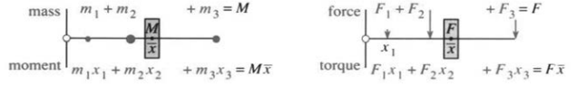
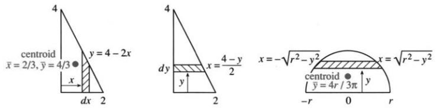
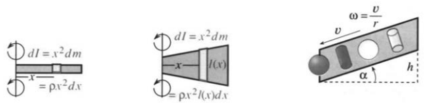
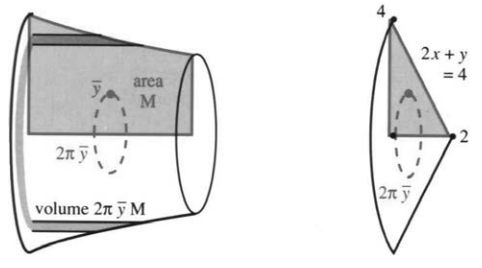
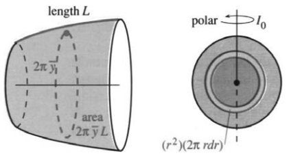

# 8.5 质量与矩

原书 PDF 第412—418页，印刷页399—405。状态：初译，已对照原页；尚未完成全书统一审校。

<!-- PDF 412 / 印刷页 399 -->

本章最后两节与工程和物理有关。每一种应用都从有限个质量或力出发，把它们相加，得到总质量或合力。接着转入“连续情形”：质量不再集中于若干点，而是分布在一片区域中。分布由**密度函数** $\rho$（希腊字母 rho）给出，求和也随之变成积分。

第一步（也许是最难的一步）是弄清物理量。第二步是从和过渡到积分，即从离散过渡到连续、从集中分布过渡到连续分布。如今我们几乎不再停下来思考这一步，尽管它正是积分学的关键思想。第三步是计算积分，可以使用换元法、分部积分法、积分表或计算机。

图8.13表示一维情形：质量分布在 $x$ 轴上。总质量就是各质量之和。这里的新概念是**矩**：用质量或力乘以距离。例如，

$$
\text{对 }y\text{ 轴的质量矩}=mx=(\text{质量})\times(\text{到轴的有向距离}).
$$

图8.13　质心位于 $\bar x=(\text{总质量矩})/(\text{总质量})$，即质量加权的平均位置。图中 mass 为质量，moment 为质量矩，force 为力，torque 为力矩。

图中的三个质量分别为 $1,3,2$，总质量为 $6$。相应的“力臂”位置为 $x=1,3,7$，质量矩分别为 $1,9,14$，总质量矩为 $24$。于是平衡点为 $\bar x=M_y/M=24/6=4$。

总质量是各个 $m$ 之和；总质量矩是各个 $m_nx_n$ 之和，位于 $x=0$ 另一侧的坐标为负。如果这些质量是坐在跷跷板上的孩子，那么平衡点就是**重心** $\bar x$，也称**质心**（这里假定重力场均匀）。

**定义**

$$
\boxed{\bar x=\frac{\sum m_nx_n}{\sum m_n}=\frac{\text{总质量矩}}{\text{总质量}}.}\tag{1}
$$

若把所有质量移到 $\bar x$，总质量矩仍为 $6\times4=24$，即总质量 $\sum m_n$ 乘以 $\bar x$。就总质量和质量矩而言，它们等效于集中在 $\bar x$ 的一个质量。

反过来，若孩子们保持原位，把支点移到 $\bar x$，跷跷板也会平衡。$\bar x=4$ 左边的质量与右边的质量相互平衡。因为相对新轴的有向距离是 $x_n-\bar x$，由式(1)，

$$
\text{对新轴的质量矩}=\sum m_n(x_n-\bar x)
=\sum m_nx_n-\sum m_n\bar x=0.
$$

现在考虑质量沿直线分布的连续情形。每段长度 $\Delta x$ 的平均密度为 $\rho_n=\Delta m/\Delta x$。当小段不断缩短时，这个比值趋于该点的密度 $dm/dx$。也就是说，**小段质量与小段长度之比的极限，就是密度** $\rho(x)$。

把导数 $\rho=dm/dx$ 积分，便得到总质量：$\sum\rho_n\Delta x$ 变为

$$
\boxed{M=\int\rho(x)\,dx.}\tag{2}
$$

这里及下文未写限的积分，都在物体占据的范围上计算。质量均匀分布时，$\rho$ 为常数，因而 $M=\rho L=\text{密度}\times\text{长度}$。

<!-- PDF 413 / 印刷页 400 -->

质量矩的公式类似：每小段的质量 $\rho_n\Delta x$ 乘以位置 $x$，然后相加。在连续极限中，以 $x$ 乘 $\rho(x)\,dx$ 再积分：

$$
\boxed{M_y=\int x\rho(x)\,dx.}\tag{3}
$$

质量矩是质量乘以有向距离。除以总质量 $M$，便得到“平均位置”：

$$
\boxed{\bar x=\frac{M_y}{M}=\frac{\int x\rho(x)\,dx}{\int\rho(x)\,dx}.}\tag{4}
$$

**说明**　读过第8.4节概率的读者会发现，这些公式彼此对应。质量 $\int\rho(x)\,dx$ 对应总概率 $\int p(x)\,dx$；质量矩 $\int x\rho(x)\,dx$ 对应均值积分 $\int xp(x)\,dx$；关于质心的转动惯量 $\int(x-\bar x)^2\rho(x)\,dx$ 则对应方差。数学总在反复运用相同的基本思想！区别在于总概率总是 $1$。严格地说，均值对应质心，方差对应除以总质量后的转动惯量；概率公式中除以 $\int p(x)\,dx=1$ 的步骤不显眼罢了。

**例1**　在 $0$ 到 $L$ 上密度为常数 $\rho$，则 $M=\rho L$，而

$$
M_y=\int_0^Lx\rho\,dx=\left[\frac12\rho x^2\right]_0^L=\frac12\rho L^2.
$$

质心 $\bar x=M_y/M=L/2$，就在中点。

**例2**　在 $[0,\infty)$ 上密度为 $e^{-x}$，则质量、质量矩和质心坐标都为 $1$：

$$
\int_0^\infty e^{-x}\,dx=[-e^{-x}]_0^\infty=1,
\qquad
\int_0^\infty xe^{-x}\,dx=[-xe^{-x}-e^{-x}]_0^\infty=1.
$$

## 平面上的质量与质量矩

不再把质量放在 $x$ 轴上，而设质量 $m_1$ 位于平面内的点 $(x_1,y_1)$，一般地，$m_n$ 位于 $(x_n,y_n)$。现在要考虑两个质量矩：对 $y$ 轴有 $M_y=\sum m_nx_n$，对 $x$ 轴有 $M_x=\sum m_ny_n$。**注意，$x$ 坐标出现在 $M_y$ 中**，因为它给出到 $y$ 轴的有向距离！

对 $x$ 轴，有向距离为 $y$，相应的质量矩为 $M_x$。质心是使物体平衡的点 $(\bar x,\bar y)$：

$$
\boxed{\bar x=\frac{M_y}{M}=\frac{\sum m_nx_n}{\sum m_n},
\qquad \bar y=\frac{M_x}{M}=\frac{\sum m_ny_n}{\sum m_n}.}\tag{5}
$$

连续情形中的求和变成二维积分。如果 $\rho(x,y)$ 表示单位面积的质量，总质量就是 $\iint\rho(x,y)\,dx\,dy$。这些“二重积分”留待第14.1节讨论。这里先考虑重要的常密度情形。设有一块均匀薄板，并取 $\rho=1$。为计算质量和质量矩，将薄板分割成条带（图8.14）：

$$
M=\text{薄板面积},\tag{6}
$$

$$
M_y=\int x(\text{竖直条带的长度})\,dx,\tag{7}
$$

$$
M_x=\int y(\text{水平条带的长度})\,dy.\tag{8}
$$

<!-- PDF 414 / 印刷页 401 -->

图8.14　把薄板分割成条带，以计算质量、质量矩和形心。centroid 为形心。

由于 $\rho=1$，质量在所选单位下等于面积。对于竖直微元条带，其中各点到 $y$ 轴的有向距离都是 $x$，所以质量矩为 $x$ 乘以面积，即 $x$ 乘以条带长度再乘 $dx$；积分把所有条带加起来。类似地，水平条带对 $x$ 轴的质量矩为 $y$ 乘以条带长度再乘 $dy$。

**例3**　薄板的边界为 $x=0,y=0,y=4-2x$。求 $M,M_y,M_x$。

$$
M=\text{面积}=\int_0^2y\,dx=\int_0^2(4-2x)\,dx=[4x-x^2]_0^2=4.
$$

竖直条带的上端是 $y=4-2x$，水平条带的右端是 $x=(4-y)/2$，因此

$$
M_y=\int_0^2x(4-2x)\,dx=\left[2x^2-\frac23x^3\right]_0^2=\frac83,
$$

$$
M_x=\int_0^4\frac12y(4-y)\,dy=\left[y^2-\frac16y^3\right]_0^4=\frac{16}3.
$$

质心坐标为 $\bar x=2/3,\bar y=4/3$。它也是三角形的**形心**，并且在均匀重力场中也是重心。对这块均匀薄板，这几个名称指同一个平衡点。用该点支撑薄板，薄板就能平衡。

**例4**　求上半圆板 $x^2+y^2\le r^2,\ y\ge0$ 的 $M_y$ 和 $M_x$。

由对称性，$M_y=0$：图8.14中的区域关于 $y$ 轴平衡。计算 $M_x$ 时，用 $y$ 乘水平条带长度再积分，注意因子 $2$：

$$
M_x=\int_0^ry\cdot2\sqrt{r^2-y^2}\,dy
=\left[-\frac23(r^2-y^2)^{3/2}\right]_0^r=\frac23r^3.
$$

除以质量，即面积 $\pi r^2/2$，得到形心的高度 $\bar y=4r/(3\pi)$。它小于 $r/2$，因为半圆板下部比上部宽。

## 转动惯量

把每个质量乘以到转轴距离的**平方**，再相加，就得到转动惯量。对于 $y$ 轴，距离的平方为 $x^2$；对于通过原点且垂直于平面的轴，距离为 $r$：

$$
I_y=\sum x_n^2m_n,\qquad I_x=\sum y_n^2m_n,\qquad I_0=\sum r_n^2m_n.
$$

注意 $I_x+I_y=I_0$，因为 $x_n^2+y_n^2=r_n^2$。连续情形则用积分。

<!-- PDF 415 / 印刷页 402 -->

对 $y$ 轴的转动惯量为 $I_y=\iint x^2\rho(x,y)\,dx\,dy$。若 $\rho=1$，仍可按条带分组：竖直条带有共同的 $x$，水平条带有共同的 $y$，于是

$$
I_y=\int x^2(\text{竖直条带长度})\,dx,
\qquad I_x=\int y^2(\text{水平条带长度})\,dy.
$$

在工程和物理中，转动惯量来自**转动**问题。质量为 $m$ 的质点沿半径 $r$ 的圆运动，其 $I_0=mr^2$，动能为

$$
\frac12mv^2=\frac12m(r\omega)^2=\frac12I_0\omega^2.\tag{9}
$$

角速度 $\omega$ 的单位是弧度每秒，速率 $v=r\omega$ 的单位是米每秒。

滑冰者把伸向两侧的双臂收向转轴、向上举起，会减小 $I_0$，因为质量更靠近转轴，$r$ 变小。在外力矩可忽略时，角动量 $I_0\omega$ 守恒，因此 $I_0$ 减小，$\omega$ 增大，旋转就加快。**译注：原文把原因写成“转动动能不变”，这是物理错误；收臂时人体做功，转动动能一般增大。这里据角动量守恒订正。**

再看旋转门。推动旋转门需要力，更准确地说，需要**力矩**。力乘以力臂得到 $T=Fx$，所以沿相同方向推门时，离轴越远越有效。这里的 $x$ 指转轴到力的作用线的垂直距离。

牛顿定律 $F=ma=m\,dv/dt$ 对应的定轴转动形式为 $T=I\,d\omega/dt$（转动惯量恒定时）。力改变平动，力矩改变转动；质量衡量改变平动速度的难易，转动惯量衡量改变角速度的难易。

**例5**　求均匀细杆绕(a)端点及(b)中点的转动惯量。两条转轴均垂直于杆，线密度取 $\rho=1$。

相对端点的坐标从 $0$ 到 $L$，相对中点的坐标从 $-L/2$ 到 $L/2$。绕中点转动较容易，因为转动惯量较小：

$$
I_{\text{端点}}=\int_0^Lx^2\,dx=\frac13L^3,
\qquad
I_{\text{中点}}=\int_{-L/2}^{L/2}x^2\,dx=\frac1{12}L^3.\tag{10}
$$

图8.15　细杆与桨叶的转动惯量，以及斜面滚动实验。原图图注概括为“滚动的球胜过圆柱”；具体先后须由各物体的惯量比决定。

## 转动惯量实验

**实验：**让实心圆柱（硬币）、空心圆柱（圆环）、实心球（弹珠）和空心球（原书特别注明不要用乒乓球）沿斜面滚下。作者借伽利略斜塔落体的故事开玩笑：这项实验需要的是一张“斜桌”。自由落下时一起到达的物体，沿斜桌滚动时未必一起到达。

**问题1**　它们到达终点的先后次序怎样？先记录你的预测！

**问题2**　形状和密度相同时，尺寸会影响结果吗？

**问题3**　尺寸和形状相同时，密度会影响结果吗？

<!-- PDF 416 / 印刷页 403 -->

**问题4**　求速率 $v$ 和到达终点所需时间 $T$ 的公式。

计算 $v$ 的关键是势能与动能之和近似不变，滚动阻力造成的能量损失很小。设物体质量为 $m$，从静止开始，质心竖直下降的高度为 $h$，则起点的能量为重力势能 $mgh$。终点的动能由两部分组成：沿斜面平移的 $mv^2/2$，以及绕质心转动的 $I\omega^2/2$。关键关系是：半径为 $r$ 的圆柱或球在**无滑动滚动**时，$v=\omega r$。令始末能量相等并代入 $\omega=v/r$，得到

$$
mgh=\frac12mv^2+\frac12I\omega^2
=\frac12mv^2\left(1+\frac{I}{mr^2}\right).\tag{11}
$$

比值 $I/(mr^2)$ 至关重要。记它为 $J$，由式(11)解得

$$
\boxed{v^2=\frac{2gh}{1+J}}\qquad(J\text{ 越小，速率越大}).\tag{12}
$$

不同形状与尺寸所对应的 $J$ 决定比赛结果。对于密度均匀、几何形状固定的物体，密度同时作为 $I$ 和 $m$ 的因子，在 $J=I/(mr^2)$ 中约去。薄壁空心圆柱的 $J=1$；对于质量都位于距轴不超过 $r$ 的物体，这是最大值，因为此时质量全部处在半径 $r$ 上。因此理论上薄壁空心圆柱最后到达。这个实验由 Daniel Drucker 设计。

第35—37题求另外三种物体的 $J$，第40题通过积分求时间 $T$。实际实验将表明理论值与测量值有多接近。

## 8.5 习题

### 通读填空

若质量 $m_n$ 位于坐标 $x_n$，总质量 $M=\text{a}\underline{\qquad}$，对 $x=0$ 的总质量矩 $M_y=\text{b}\underline{\qquad}$，质心 $\bar x=\text{c}\underline{\qquad}$。连续情形中，质量分布由 $\text{d}\underline{\qquad}\ \rho(x)$ 给出，总质量 $M=\text{e}\underline{\qquad}$，质心 $\bar x=\text{f}\underline{\qquad}$。取 $\rho=x$，从 $0$ 积分到 $L$，得到 $M=\text{g}\underline{\qquad}$，$\int x\rho(x)\,dx=\text{h}\underline{\qquad}$，$\bar x=\text{i}\underline{\qquad}$。把全部质量 $M$ 集中在 $\text{j}\underline{\qquad}$，总质量矩不变。

在平面内，若质量 $m_n$ 位于 $(x_n,y_n)$，对 $y$ 轴的质量矩为 $\text{k}\underline{\qquad}$，质心坐标为 $\bar x=\text{l}\underline{\qquad}$、$\bar y=\text{m}\underline{\qquad}$。密度 $\rho=1$ 的薄板，其质量 $M$ 等于 $\text{n}\underline{\qquad}$。若把薄板分成高度为 $y(x)$ 的竖直条带，则 $M=\int y(x)\,dx$，$M_y=\int\text{o}\underline{\qquad}\,dx$。对正方形薄板 $0\le x,y\le L$，$M=\text{p}\underline{\qquad}$，$M_y=\text{q}\underline{\qquad}$，$(\bar x,\bar y)=\text{r}\underline{\qquad}$。这个点称为 $\text{s}\underline{\qquad}$，薄板在此平衡。

质量 $m$ 距转轴为 $x$ 时，转动惯量 $I=\text{t}\underline{\qquad}$。密度 $\rho=1$、从 $x=a$ 延伸到 $x=b$ 的杆有 $I_y=\text{u}\underline{\qquad}$。密度 $\rho=1$、竖直条带高度为 $y(x)$ 的薄板则有 $I_y=\int\text{v}\underline{\qquad}$。力矩 $T$ 等于 $\text{w}\underline{\qquad}$ 乘以 $\text{x}\underline{\qquad}$。

### 练习

第1—6题，求 $x$ 轴上分布的总质量 $M$、对 $x=0$ 的质量矩 $M_y$ 和质心 $\bar x=M_y/M$。

1. $m_1=2$ 位于 $x_1=1$；$m_2=4$ 位于 $x_2=2$。
2. 在 $x=0,1,2,6$ 各有一个质量 $m=3$。
3. $-1\le x\le3$ 上，$\rho=1$。
4. $0\le x\le L$ 上，$\rho=x^2$。
5. $0\le x<1$ 上，$\rho=1$；$1\le x\le2$ 上，$\rho=2$。
6. $0\le x\le\pi$ 上，$\rho=\sin x$。

第7—10题，求质量 $M$、质量矩 $M_y,M_x$ 及质心 $(\bar x,\bar y)$。

7. 在 $(1,0),(0,1),(1,1)$ 各放一个单位质量。
8. 在 $(1,0)$ 放质量 $m_1=1$，在 $(0,1)$ 放质量 $m_2=4$。
9. 正方形 $0\le x\le1,0\le y\le1$ 上，$\rho=7$。
10. 顶点为 $(0,0),(a,0),(0,b)$ 的三角形内，$\rho=3$。

第11—16题，求所给曲线围成区域的面积 $M$ 和形心 $(\bar x,\bar y)$。

11. $y=\sqrt{1-x^2},y=0,x=0$（四分之一圆板，取第一象限）。
12. $y=x,y=2-x,y=0$（三角形）。

<!-- PDF 417 / 印刷页 404 -->

13. $y=e^{-2x},y=0,x=0$（向右无限延伸的匕首形区域）。
14. $y=x^2,y=x$（透镜形区域）。
15. $x^2+y^2=1,x^2+y^2=4$（圆环）。
16. $x^2+y^2=1,x^2+y^2=4,y=0$（半圆环，取上半部）。

第17—20题，验证密度 $\rho=1$ 时下列工程公式。

17. 矩形的边界为 $x=0,x=a,y=0,y=b$：$I_y=a^3b/3$。
18. 正方形的边界为 $x=-a/2,x=a/2,y=-a/2,y=a/2$：$I_y=a^4/12$。
19. 三角形的边界为 $x=0,y=0,x+y=a$：$I_y=a^4/12$。
20. 以原点为圆心、半径为 $a$ 的圆板：$I_y=\pi a^4/4$。
21. 密度为 $\rho(x)$ 的细杆，绕通过 $x=t$ 且垂直于杆的轴的转动惯量为 $I=\int(x-t)^2\rho(x)\,dx$。将 $(x-t)^2$ 和 $I$ 分别展开为三项。证明 $t=\bar x$ 时 $dI/dt=0$。绕质心的转动惯量最小。
22. 若 $M_y=\int x(\text{条带高度})\,dx=0$，则区域的 $\bar x=0$。对任意平行轴 $x=c$，转动惯量为 $I=\int(x-c)^2(\text{条带高度})\,dx$。证明 $I=I_y+(\text{面积})c^2$。这就是**平行轴定理**：关于平衡轴 $c=0$ 的转动惯量最小。
23. （感谢智力问答游戏 Trivial Pursuit。）美国的重心，即“地理中心”或形心，位于哪个州？【译注：题目未说明只计本土48州还是包括其他州；答案依所选地理范围而异。】
24. 古希腊数学家帕普斯发现：面积为 $M$ 的区域绕 $x$ 轴旋转时，体积为

$$
V=\int2\pi y(\text{条带宽度})\,dy=2\pi M_x=2\pi\bar yM.
$$

第一步把旋转体切分成了 $\underline{\qquad}$。

25. 用帕普斯定理求圆环体的体积：把半径为 $a$、圆心高度为 $\bar y=b>a$ 的圆板绕 $x$ 轴旋转。
26. 将例3的三角形绕 $x$ 轴旋转，求所得圆锥的体积。先用 $V=2\pi\bar yM$，再用 $V=\pi r^2h/3$。
27. 求沿半圆弧 $y=\sqrt{1-x^2}$ 分布的细线的 $M_x,M_y$。取线密度 $\rho=1$，故质量等于弧长，即 $M=\pi$。
28. 帕普斯的另一条定理指出：长度为 $L$ 的细线绕 $x$ 轴旋转，所得曲面面积为 $A=2\pi\bar yL$。分别对水平细线 $y=3,0\le x\le L$，以及从 $y=1$ 到 $y=L+1$ 的竖直细线验证此公式。

图示：长度为 $L$ 的曲线旋转，其面积为 $2\pi\bar yL$；右图表示圆板关于垂直中心轴的转动惯量 $I_0$，polar 指极惯量。

29. 单位球面的面积为 $A=4\pi$。结合 $A=2\pi\bar yL$，可得第27题半圆弧的 $\bar y=\underline{\qquad}$。
30. 将 $y=mx$ 在 $0\le x\le1$ 的部分绕 $x$ 轴旋转，所得曲面面积 $A=\underline{\qquad}$。
31. 把质量 $m$ 放在 $(x,0)$。重力对原点的力矩大小为力 $mg$ 乘以距离 $x$（这里取 $x\ge0$），它等于 $g$ 乘以 $\underline{\qquad}\ mx$。
32. 在 $x=1,2,\ldots,10$ 处施加十个大小均为 $F$ 的力，方向依次向下、向上交替。求它们对原点的总力矩，并说明采用的正方向。
33. 原书把太阳系简化为九个质量 $m_n$，与太阳的距离为 $r_n$，角速度为 $\omega_n$。它们绕太阳的转动惯量是多少？转动动能是多少？太阳所提供的力矩是多少？【按共同平面内的圆周运动和指向太阳的中心引力模型讨论；“九个”保留原书设定。】
34. 圆板 $x^2+y^2\le a^2$ 有 $I_0=\int_0^ar^2\,2\pi r\,dr=\pi a^4/2$。它为什么不同于第20题的 $I_y$？求**回转半径** $\bar r=\sqrt{I_0/M}$。因为 $I_0\omega^2/2=M\bar r^2\omega^2/2$，所以把全部质量放在半径 $\bar r$ 上转动，会得到相同的转动动能。

第35—42题与转动惯量实验有关。

35. 半径为 $r$ 的实心圆柱可看作由圆柱薄壳组成。每层长度为 $l$，半径为 $x$，体积为 $(2\pi x)l\,dx$。因此

$$
M=\int_0^r2\pi xl\rho\,dx,\qquad I=\int_0^rx^2\,2\pi xl\rho\,dx.
$$

取 $\rho=7$，求 $M,I,J=I/(Mr^2)$。

36. 第14.4节第40题求得实心球的 $J=2/5$。它比实心圆柱的 $J$ 小，因为球的质量更集中在 $\underline{\qquad}$ 附近。
37. 第14.4节第39题求得薄壁空心球的 $J=\frac12\int_0^\pi\sin^3\phi\,d\phi=\underline{\qquad}$。四个滚动物体到达终点的顺序为 $\underline{\qquad}$。
38. 怎样改变球内的密度分布，才能使它比上述各种均匀物体滚得都快？

<!-- PDF 418 / 印刷页 405 -->

39. 回答实验的问题2。
40. 竖直下降 $y$ 时，式(12)给出沿斜面的速率 $v^2=2gy/(1+J)$。因而 $v=c\sqrt y$，其中 $c=\underline{\qquad}$。设斜面倾角为 $\alpha$，竖直向下的速度为 $dy/dt=v\sin\alpha$，所以

$$
\frac{dy}{dt}=c\sqrt y\sin\alpha,
\qquad \int y^{-1/2}\,dy=\int c\sin\alpha\,dt.
$$

积分求 $y(t)$，并证明从静止释放后立即滚动，到达 $y=h$ 所需的时间为 $T=2\sqrt h/(c\sin\alpha)$。

41. 四种物体到达终点所需时间的理论比值是多少？
42. 判断正误：
   - (a) 篮球沿斜面滚下时比棒球快。
   - (b) 质心总是在形心处。
   - (c) 把双臂举起会减小 $I_x$ 和 $I_y$。
   - (d) 跳高运动员成功越杆时，质心必定从横杆上方越过。

## 译注与核对记录

1. 原页399的平衡点公式误写 $M_x/M$，根据全节定义订正为 $M_y/M$。一次质量矩使用有向坐标，转动惯量使用距离平方，不应混淆。
2. 例4原积分根号内误印 $x^2-y^2$，改为 $r^2-y^2$。原文对区域的描述不清，已按图和积分限明确为上半圆板。
3. 原文的滑冰解释误用能量守恒，正文已明确订正为角动量守恒。$T=I\,d\omega/dt$ 适用于此处转动惯量恒定的定轴模型；一般不能直接用于收臂过程。图8.15“球胜过圆柱”的概括不适用于任意实心、空心组合。
4. 本节形心与质心重合需要均匀密度，重心与质心重合需要均匀重力场。相关积分还须收敛，且总质量有限并大于零。
5. 帕普斯定理按旋转轴与区域内部不相交、旋转不发生重复计数的情形使用；此处位于上半平面，$\bar y\ge0$。第16题原文未指定上下半环，译文选上半部；选下半部时纵坐标变号。第30题若允许负斜率，面积中应使用 $|m|$。
6. 滚动模型假定从静止释放、刚体无滑动滚动、能量损失可忽略；空心圆柱与空心球采用薄壁理想模型。几何相似且密度分布相似时，整体尺度和统一密度因子不改变 $J$。实际物体的形变和滚动阻力可能使实验偏离理论。
7. 第40题原排版的时间分母有歧义，按推导明确写作 $c\sin\alpha$。分离变量除以 $\sqrt y$ 只在 $y>0$ 时成立；仅凭该一阶方程及 $y(0)=0$ 还允许静止或延迟启动的数学解，这里由释放后立即向下加速的物理条件选定运动分支。
8. 第42题(c)必须指定坐标轴及姿态，不能在轴未定义时作普遍判断；原题的简略表述保留，供结合具体模型讨论。
