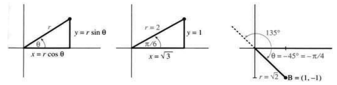
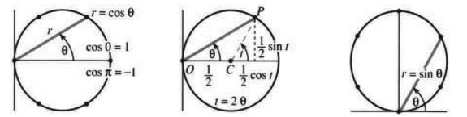
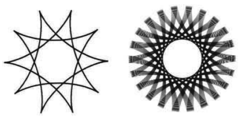

# 第9章　极坐标与复数

# 9.1 极坐标

原书 PDF 第425—428页，印刷页412—415。状态：初译，已对照原页自校；尚未完成全书统一复审。

<!-- PDF 425 / 印刷页 412 -->

到目前为止，我们一直用 $x$ 坐标和 $y$ 坐标确定点的位置。但如果你是一名空中交通管制员，屏幕上出现一架飞机，你就不会用这种方式给出它的位置。你会读出飞机的**方向**和**距离**，而不是 $x$ 和 $y$。方向用角 $\theta$ 表示，距离用正数 $r$ 表示。这两个量就是点的**极坐标**，而 $x$ 和 $y$ 则是它的**直角坐标**。

角 $\theta$ 从水平方向量起。假设距离为2，方向为 $30^\circ$，也就是 $\pi/6$（空中交通管制员喜欢用角度，数学家喜欢用弧度）。一个沿 $x$ 轴方向观察的飞行员会把飞机的方向说成“11点钟方向”。这用小时来度量方向，完全打乱了我们的单位制。不过，角度和距离确实能确定飞机的位置。

它离位于 $r=1$、$\theta=-\pi/2$ 的跑道有多远？对于这个问题，极坐标并不好用。它非常适合表示到原点的距离（就是 $r$），但对于大多数其他距离，我会改用 $x$ 和 $y$。由 $r$ 和 $\theta$ 确定 $x$ 和 $y$ 极其简单，我们会经常这样做。本章最常用的公式来自图9.1，其中直角三角形的一个角为 $\theta$，斜边长为 $r$；两条直角边为 $x$ 和 $y$：

$$
x=r\cos\theta,\qquad y=r\sin\theta.\tag{1}
$$

对于 $r=2$、$\theta=\pi/6$ 的点，有 $x=2\cos(\pi/6)$、$y=2\sin(\pi/6)$。$\pi/6$ 的余弦为 $\sqrt3/2$，正弦为 $\frac12$，所以 $x=\sqrt3$、$y=1$。极坐标很容易转换为 $xy$ 坐标；现在我们反过来转换。

**总有 $x^2+y^2=r^2$。** 在这个例子中，$(\sqrt3)^2+(1)^2=(2)^2$。勾股定理使我们能够从 $x$ 和 $y$ 求出 $r$。方向 $\theta$ 也能求出，不过公式就没有那么漂亮了：

$$
r=\sqrt{x^2+y^2},\qquad \tan\theta=\frac yx,
\qquad\text{并且（几乎可以说）}\quad\theta=\tan^{-1}\frac yx.\tag{2}
$$

我们这个点满足 $y/x=1/\sqrt3$。具有这一正切值的一个角是 $\theta=\tan^{-1}(1/\sqrt3)=\pi/6$。

<!-- PDF 426 / 印刷页 413 -->

图9.1　极坐标 $r,\theta$ 与直角坐标 $x=r\cos\theta$、$y=r\sin\theta$。三幅图依次示出一般的坐标关系、$r=2$ 且 $\theta=\pi/6$ 的点，以及 $B=(1,-1)$ 的角度表示。

**例1**　图9.1c中的点 $B$ 对应一个负角 $\theta=-\pi/4$。它的 $x$ 坐标 $r\cos(-\pi/4)$ 与 $r\cos(\pi/4)$ 相同（余弦函数是偶函数），但 $y$ 坐标 $r\sin(-\pi/4)$ 为负。由 $x=1$、$y=-1$ 计算 $r$ 和 $\theta$，得距离 $r=\sqrt{1+1}$，而 $\tan\theta=-1/1$。〔译注：原文此处写成 $y=1$；根据图示及紧接着的计算，应为 $y=-1$。〕

**注意**　对于任意角 $\theta$，都可以加上或减去 $2\pi$；这相当于转过完整的 $360^\circ$，方向不变。因此，$-\pi/4$ 或 $-45^\circ$ 与 $7\pi/4$ 或 $315^\circ$ 是同终边角；$15\pi/4$ 或 $675^\circ$ 也是如此。

如果加上或减去 $180^\circ$，正切值不会改变。点 $(1,-1)$ 位于 $-45^\circ$ 方向上，$r=\sqrt2$；点 $(-1,1)$ 位于 $135^\circ$ 方向上，也有 $r=\sqrt2$。两者都满足 $\tan\theta=-1$。式(2)中不得不加上“几乎可以说”，因为一个点可以对应许多个 $\theta$，而两个不同的点也可以具有相同的 $r$ 和 $\tan\theta$。

更复杂的是，我们还可以说，$B=(1,-1)$ 位于 $135^\circ$ 方向上，但“距离”为负：$r=-\sqrt2$。负的 $r$ 使我们沿 $135^\circ$ 方向反向移动，从而到达 $B$。在给出 $B$ 的位置时，我总会保持 $r>0$；但在绘制极坐标方程的图像时，允许 $r<0$。现在我们转向这些图像。

## 圆 $r=\cos\theta$

第1—8章以 $y=f(x)$ 为基础；本章的关键则是 $r=F(\theta)$。这是极坐标之间的关系。满足 $r=\cos\theta$ 这样一个方程的点，构成一条**极坐标曲线**。

为什么 $r=\cos\theta$ 给出一个圆，并不是一眼就能看出来的。方程 $r=\cos2\theta$、$r=\cos^2\theta$ 和 $r=1+\cos\theta$ 给出的图像完全不同——都不是圆。直接的办法是取 $\theta=0^\circ,30^\circ,60^\circ,\ldots$，沿每条射线取有向距离 $r=\cos\theta$。图9.2a标出了这些点，并把它们连接成一条曲线。它看起来是一个半径为 $\frac12$、圆心为 $(\frac12,0)$ 的圆。我们必须能够从数学上证明，$r=\cos\theta$ 确实表示一个经过平移的圆。

有一点必须说明：**角度从0变化到 $\pi$，就能描出整个圆。** 超过 $\pi/2$ 后，$r=\cos\theta$ 变为负数，于是我们沿每条射线反向移动。

图9.2　圆 $r=\cos\theta$ 及其向 $x,y$ 坐标的转换；圆 $r=\sin\theta$。中图中 $O$ 为原点，$C$ 为圆心，$P$ 为圆上一点；所标圆心角 $t=2\theta$。

<!-- PDF 427 / 印刷页 414 -->

当 $\theta=\pi$（指向原点左方）时，余弦为 $-1$。反向移动会把我们带到与 $\theta=0$、$r=+1$ 相同的点，至此正好绕圆一周。

当 $\theta$ 继续从 $\pi$ 变到 $2\pi$ 时，我们又绕了一周。这个极坐标方程把同一个圆描了两遍。（如果 $\theta$ 继续超过 $2\pi$，还会再描更多遍。）如果你不喜欢负的 $r$ 和重复描圆，可以把 $\theta$ 限制在 $-\pi/2$ 到 $\pi/2$ 之间。我们仍需说明，为什么 $r=\cos\theta$ 的图像是一个圆。

**方法5**　两边乘以 $r$，再转换为直角坐标 $x,y$：

$$
r=\cos\theta\quad\Longrightarrow\quad r^2=r\cos\theta
\quad\Longrightarrow\quad x^2+y^2=x.\tag{3}
$$

由于出现了 $x^2+y^2$，这表示一个圆。把它改写成 $(x-\frac12)^2+y^2=(\frac12)^2$，就能认出它的圆心和半径：圆心为 $x=\frac12$、$y=0$，半径为 $\frac12$。证明完毕。

**方法6**　分别把 $x$ 和 $y$ 写成 $\theta$ 的函数。此时，$\theta$ 是一个“参数”：

$$
x=r\cos\theta=\cos^2\theta,\qquad
 y=r\sin\theta=\sin\theta\cos\theta.\tag{4}
$$

这不是极坐标方程，而是**参数方程**。参数 $\theta$ 是角度，但它也可以代表时间，曲线仍是同一条。第12章会详细研究参数方程；这里我们继续讨论这个圆。

把 $x$ 和 $y$ 分别平方再相加，就能得到圆的方程。第26题会由此得到 $x^2+y^2=x$。不过，这里我们换一个新做法：**从圆出发，求出式(4)。** 即使你还没有读到第12章，也可以先了解这个想法：把指向圆心的向量 $\overrightarrow{OC}$ 与沿半径向外的向量 $\overrightarrow{CP}$ 相加：

$$
\text{图9.2中的点 }P\text{ 满足}\quad
(x,y)=\overrightarrow{OC}+\overrightarrow{CP}
=\left(\frac12,0\right)+\left(\frac12\cos t,\frac12\sin t\right).
$$

参数 $t$ 是圆心处的角。相应的方程为 $x=\frac12+\frac12\cos t$、$y=\frac12\sin t$。熟悉三角学的人会看出这里可以用倍角公式，并令 $t=2\theta$。于是就得到圆的式(4)：

$$
x=\frac12+\frac12\cos2\theta=\cos^2\theta,\qquad
 y=\frac12\sin2\theta=\sin\theta\cos\theta.\tag{5}
$$

这一步重新发现了几何学的一个基本定理：**圆心角 $t$ 是圆周角 $\theta$ 的两倍。** 关于参数的简短介绍就到这里。

第二个圆是 $r=\sin\theta$，画在图9.2c中。第三个圆是 $r=\cos\theta+\sin\theta$，图中没有画出。第27题要求你求它的 $xy$ 方程和半径。所有计算都要回到 $x=r\cos\theta$ 和 $y=r\sin\theta$——这就是极坐标的基本关系！最后一道习题给出了能产生优美图像的参数方程，因为现在你也许已经能够绘制它们了。下一节将集中讨论 $r=F(\theta)$，研究的曲线将远远不限于圆。

## 9.1 习题

### 阅读填空

极坐标 $r$ 和 $\theta$ 对应于 $x=$ **a** ______ 和 $y=$ **b** ______。满足 $r>0$、$\theta=\pi$ 的点位于 **c** ______。满足 $r=1$、$0\le\theta\le\pi$ 的点位于 **d** ______。把 $\theta$ 的符号反过来，会把点 $(x,y)$ 移到 **e** ______。

给定 $x$ 和 $y$，到原点的距离为 $r=$ **f** ______。$\theta$ 的正切为 **g** ______。点 $(6,8)$ 满足 $r=$ **h** ______、$\theta=$ **i** ______。具有相同 $\theta$ 的另一个点是 **j** ______；具有相同 $r$ 的另一个点是 **k** ______；同时具有相同 $r$ 和 $\tan\theta$ 的另一个点是 **l** ______。

极坐标方程 $r=\cos\theta$ 给出一个经过平移的 **m** ______。最高点对应于 $\theta=$ **n** ______，从而 $r=$ **o** ______。当 $\theta$ 从0变到 $2\pi$ 时，我们沿图像绕行 **p** ______ 周。把方程改写为 $r^2=r\cos\theta$，可得 $xy$ 方程 **q** ______。将 $r=\cos\theta$ 代入 $x=r\cos\theta$，得 $x=$ **r** ______；类似地，$y=$ **s** ______。在这种形式下，$x$ 和 $y$ 都是 **t** ______ $\theta$ 的函数。

<!-- PDF 428 / 印刷页 415 -->

**求第1—6题各点的极坐标，要求 $r\ge0$、$0\le\theta<2\pi$。**

1. $(x,y)=(0,1)$。

2. $(x,y)=(-4,0)$。

3. $(x,y)=(\sqrt2,\sqrt2)$。

4. $(x,y)=(-1,\sqrt3)$。

5. $(x,y)=(-1,-1)$。

6. $(x,y)=(3,4)$。

**由第7—12题的极坐标求直角坐标 $(x,y)$。**

7. $(r,\theta)=(2,\pi/2)$。

8. $(r,\theta)=(1,3\pi/2)$。

9. $(r,\theta)=(\sqrt{20},\pi/4)$。

10. $(r,\theta)=(3\pi,3\pi)$。

11. $(r,\theta)=(2,-\pi/6)$。

12. $(r,\theta)=(2,5\pi/6)$。

13. 从 $(x,y)=(\sqrt3,1)$ 到 $(1,-\sqrt3)$ 的距离是多少？

14. 点 $r=3$、$\theta=\pi/2$ 与点 $r=4$、$\theta=\pi$ 相距多远？

15. 点 $(x,y)=(r\cos\theta,r\sin\theta)$ 与点 $(X,Y)=(R\cos\phi,R\sin\phi)$ 相距多远？利用 $\cos(\theta-\phi)=\cos\theta\cos\phi+\sin\theta\sin\phi$ 化简 $(x-X)^2+(y-Y)^2$。

16. 对于下列各点，另求一组极坐标（取不同的 $r$ 或 $\theta$）：

    $$
    (r,\theta)=(-1,\pi/2),\quad(-1,3\pi/4),\quad(1,-\pi/2),\quad(0,0).
    $$

17. 用极坐标描述：  
    (a) 半平面 $x>0$；  
    (b) 半平面 $y\le0$；  
    (c) $x^2+y^2$ 介于4与5之间的圆环；  
    (d) 楔形区域 $x\ge|y|$。

18. 判断正误，并说明理由或举例：  
    (a) 把 $r,\theta$ 换成 $-r,-\theta$，得到的还是同一个点。  
    (b) 若不允许 $r<0$，每个点就只有一组 $r$ 和 $\theta$。  
    (c) $r=1/\sin\theta$ 的图像是一条直线。

19. 已知 $x$ 和 $\theta$，求 $y$ 和 $r$。

20. 哪个不同的点与图9.1b中的 $x=\sqrt3$、$y=1$ 具有相同的 $r$ 和 $\tan\theta$？

21. 把下列直角坐标方程转换为极坐标方程：  
    (a) $y=x$；  
    (b) $x+y=1$；  
    (c) $x^2+y^2=x+y$。

22. 证明：三个顶点的极坐标为 $(0,0)$、$(r_1,\theta_1)$ 和 $(r_2,\theta_2)$ 的三角形，其面积为 $A=\frac12r_1r_2\sin(\theta_2-\theta_1)$。假设 $0\le\theta_1\le\theta_2\le\pi$，求它的底和高。

**第23—28题讨论表示圆的极坐标方程。**

23. 把 $r=\sin\theta$ 转换为 $xy$ 方程。先把两边乘以 $r$。

24. 取 $\theta=0^\circ,30^\circ,60^\circ,\ldots,360^\circ$，绘制 $r=\sin\theta$ 的图像。这13个 $\theta$ 值在图像上给出 ______ 个不同的点。$\theta$ 在什么范围内变化时，恰好沿圆绕行一周？

25. 把 $r=\sin\theta$ 代入 $x=r\cos\theta$ 和 $y=r\sin\theta$，把 $x,y$ 表示为参数 $\theta$ 的函数。再计算 $x^2+y^2$，得到 $xy$ 方程。

26. 从式(4)的参数方程 $x=\cos^2\theta$、$y=\sin\theta\cos\theta$ 恢复出 $xy$ 方程：平方、相加，消去 $\theta$。

27. (a) 把 $r=\cos\theta+\sin\theta$ 两边乘以 $r$，转换成 $xy$ 方程。  
    (b) 把方程改写成 $(x-\frac12)^2+(y-\frac12)^2=R^2$，求半径 $R$。  
    (c) 画出图像。

28. 求 $r=a\cos\theta+b\sin\theta$ 所表示的圆的半径。（两边乘以 $r$。）

29. 把 $x+y=1$ 转换成 $r,\theta$ 的方程，并解出 $r$。再把这个 $r$ 代入 $x=r\cos\theta$ 和 $y=r\sin\theta$，求出这条直线的参数方程。

30. 方程 $x=\cos^2\theta$ 和 $y=\sin^2\theta$ 也能推出 $x+y=1$，但它们与第29题的答案不同。解释是：这里的 $\theta$ 已不再是极角，本来应该写成 $t$。找出一个点 $x=\cos^2\theta$、$y=\sin^2\theta$，使其实际极角不是 $\theta$。

31. 把 $r=\cos^2\theta$ 转换为 $xy$ 方程（这是一个六次方程！）。

32. 如果你有能够绘制参数曲线的软件，画出几条**内摆线**。它们的方程为

    $$
    x=(1-b)\cos t+b\cos\left(\frac{(1-b)t}{b}\right),\qquad
    y=(1-b)\sin t-b\sin\left(\frac{(1-b)t}{b}\right).
    $$

    下图给出 $b=\frac3{10}$ 的曲线，以及 $b=0.31831$ 时曲线的一部分。

习题32配图　左图对应 $b=3/10$，右图为 $b=0.31831$ 时的部分轨迹。原图没有另编图号。

## 译注与待复审事项

1. **极径与距离。** 开头的 $r$ 为非负距离；允许负极径后，点到原点的实际距离是 $|r|$。式(2)中的 $r=\sqrt{x^2+y^2}$ 是选择非负极径时的表达式，不能同时用于负极径表示。$(r,\theta)$ 与 $(-r,\theta+\pi)$ 表示同一个点。
2. **反正切与特殊位置。** $\tan\theta=y/x$ 要求 $x\ne0$，且反正切主值不能单独确定点所在的象限；还须结合 $x,y$ 的符号选角。原点的角度不唯一。第19题若 $\cos\theta=0$，不能直接用 $r=x/\cos\theta$ 求解：$x\ne0$ 时无相容点，$x=0$ 时给定信息不足以唯一确定 $r,y$。
3. **例1的原文笔误。** PDF第426页把点 $B$ 的已知纵坐标写为 $y=1$，但该页图9.1c、负角和 $\tan\theta=-1$ 均说明应为 $y=-1$。正文作了带标记的订正，没有静默改动。
4. **角度与几何关系。** 相差整圈的角是同终边角，数值并不相等。圆心角为圆周角两倍的结论，须指向同一段弧，并按图示或一致的有向角约定理解。用钟面表示方位的叙述按原文保留，其参照方向不同于通常以正 $x$ 轴为零角的数学约定。
5. **消元与轨迹范围。** 从极坐标方程两边乘以 $r$ 得到直角坐标方程时，要检查原点是否属于原轨迹；本节几个圆确实包含原点。仅看到 $x^2+y^2$ 不足以判断任意方程都表示圆，式(3)是通过配方确认。第30题的参数方程只描出第一象限中的线段，并非整条 $x+y=1$。第31题的平方消元要核对是否引入额外点，不能把一般的平方操作当作自动等价。
6. **习题的适用条件。** 第22题的非负面积公式还默认 $r_1,r_2\ge0$；一般情形需用绝对值并考虑角的取值。第28题若 $a=b=0$，所得轨迹退化为原点。第32题描述单位圆内滚动所产生的通常内摆线时，取 $0<b<1$；$b=0$ 时公式无定义。
7. **编号与空格。** 原书确实将两种证明方法标为“Method 5”和“Method 6”，译稿保留这一编号。习题24中“______ 个不同的点”是原题填空，不能把它误译成13个点彼此不同。所有习题仅翻译，不补写解答。
