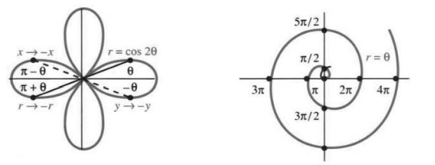
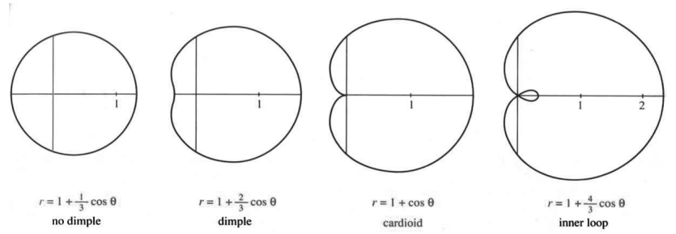
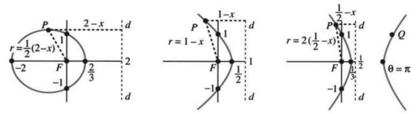

# 9.2 极坐标方程与图像

原书 PDF 第429—433页，印刷页416—420。状态：初译，已对照原页自校；待统一复审。

<!-- PDF 429 / 印刷页 416 -->

极坐标里最重要的方程是 $r=1$，其他方程都差得远。角 $\theta$ 甚至没有出现。这个方程看起来过于简单，但这恰恰就是它的妙处！它的图像是以原点为圆心的圆，即单位圆。请把它与直线 $x=1$ 比一比；更要紧的是，把 $r=1$ 的简洁和 $y=\pm\sqrt{1-x^2}$ 的复杂比一比。圆在应用里太常见了，正是因为它们，人们才需要极坐标。

本节研究极坐标曲线 $r=F(\theta)$。心形线是大家感情上的偏爱；不过抛物线也许更实用。心形线是 $r=1+\cos\theta$，抛物线是 $r=1/(1+\cos\theta)$。第12.2节还将介绍摆线和星形线。绘图软件能画出这些曲线，我们也能。

有 $r=\text{常数}$ 的圆，也就有直线 $\theta=\text{常数}$。方程 $\theta=\pi/4$ 表示从原点出发、方向固定的射线。如果像绘图时那样允许 $r<0$，单向射线就变成整条直线。关键在于：**圆与射线垂直相交。** 我们得到了“正交坐标”，它比 $x,y$ 网格（互相垂直的两族直线）更有趣。原则上，可以把 $x$ 与 $\theta$ 混合使用（这样不正交），但实际中从不这样做。

其他曲线在极坐标中也很有吸引力。先看五个例子。有时我们会转回 $x=r\cos\theta$ 和 $y=r\sin\theta$，以辨认图像。

**例1**　$r=1/\cos\theta$ 的图像是**直线** $x=1$，因为 $r\cos\theta=1$。

**例2**　$r=\cos2\theta$ 的图像是图9.3中的**四瓣玫瑰线**。

图中标出了 $\theta=30^\circ,-30^\circ,150^\circ,-150^\circ$ 对应的点，它们都满足 $r=\cos2\theta=\frac12$。**有三种重要的对称性：关于 $x$ 轴、关于 $y$ 轴、关于原点。** 这条四瓣曲线三者兼具。竖向的花形曲线 $r=\sin2\theta$ 也如此，但令人意外的是，两者通过的检验却不一样。

*关于 $x$ 轴（把 $y$ 换成 $-y$）：* 有两种实现方式。第一，把 $\theta$ 换成 $-\theta$，方程 $r=\cos2\theta$ 不变。第二，把 $\theta$ 换成 $\pi-\theta$，同时把 $r$ 换成 $-r$，方程 $r=\sin2\theta$ 不变。两条花形曲线都关于 $x$ 轴对称。

*关于 $y$ 轴（把 $x$ 换成 $-x$）：* 也有两种方式。第一，把 $\theta$ 换成 $\pi-\theta$，方程 $r=\cos2\theta$ 不变。第二，把 $\theta$ 换成 $-\theta$、$r$ 换成 $-r$；此时 $r=\sin2\theta$ 不变，因为正弦函数是奇函数。两条曲线都关于 $y$ 轴对称。

*关于原点：* 把 $r$ 换成 $-r$，或者把 $\theta$ 换成 $\theta+\pi$。这两个花形方程只通过第二种检验：$\cos2(\theta+\pi)=\cos2\theta$，$\sin2(\theta+\pi)=\sin2\theta$。所有形如 $r^2=F(\theta)$ 的方程都通过第一种检验，因为 $(-r)^2=r^2$。

圆 $r=\cos\theta$ 关于 $x$ 轴对称，但不关于 $y$ 轴或原点对称。螺线 $r=\theta^3$ 关于 $y$ 轴对称，因为 $-r=(-\theta)^3$ 仍是原来的方程。

**问题**　如果把 $r$ 换成 $-r$，同时把 $\theta$ 换成 $\theta+\pi$，会怎样？  
**回答**　什么也没有改变，因为 $(r,\theta)$ 与 $(-r,\theta+\pi)$ 总表示同一个点。

**例3**　$r=\theta$ 的图像是**阿基米德螺线**，也可以说是两条螺线。

$\theta$ 增大越过 $2\pi$ 时，螺线还会添出新的点。其他例子都是“周期性的”：$\theta=2\pi$ 与 $\theta=0$ 给出同一点。周期曲线会重复自身，而螺线每绕一周就向外延伸 $2\pi$。如果允许负角以及负的 $r=\theta$，就出现第二条螺线。

<!-- PDF 430 / 印刷页 417 -->

图9.3　四瓣玫瑰线 $r=\cos2\theta$ 与螺线 $r=\theta$（原图注称 $r>0$ 的部分为红色；本PDF中的图像为灰度）。

**例4**　$r=1+\cos\theta$ 的图像是**心形线**，见图9.4c。

心形线没有简单的 $xy$ 方程，但这条曲线仍很漂亮。它在原点有一个尖点，整体呈心形，因而得名。作图时，每隔 $30^\circ$ 标出 $r=1+\cos\theta$ 对应的点，再将它们连接起来。因为 $\cos\theta$ 不会小于 $-1$，这条曲线的 $r$ 从不为负。

有个有趣的事实：你心脏里的电向量描出的轨迹，近似一条心形线。有关心电图，参见第11.1节。如果它恰好是一条完美的心形线，你可就有点麻烦了。

图9.4　蚶线 $r=1+b\cos\theta$，包括心形线，以及从地球看火星画出的曲线。图中从左到右为 $b=1/3,2/3,1,4/3$；no dimple 为无凹陷，dimple 为有凹陷，cardioid 为心形线，inner loop 为内环。

**例5**　$r=1+b\cos\theta$ 的图像是**蚶线**（limaçon）；当 $b=1$ 时，它就是心形线。

Limaçon 中的 c 发软音，是法语中“蜗牛”的意思。它没有 escargot 那么有名，但同样不能吃。（我说的只是蜗牛壳。Excusez-moi——请原谅！）图9.4显示，随着 $b$ 增大，曲线出现凹陷；当 $b>1$ 时，又出现内环（$b=1$ 的心形线正在孕育一个环）。$b$ 很大时，曲线越来越像两个圆。极限情形是重合的圆：内环与外环相同。请记住，$r=\cos\theta$ 会沿同一个圆走两遍。

我们可以把蚶线放大 $c$ 倍，得到 $r=c(1+b\cos\theta)$，也可以把它旋转 $180^\circ$，得到 $r=1-b\cos\theta$。但真正有趣的是，这些图形是否出现在应用中。唐纳德·萨里（Donald Saari）给我看过一个很好的例子。

<!-- PDF 431 / 印刷页 418 -->

**从地球看火星**　地球绕太阳公转，火星也是如此。粗略地说，火星到太阳的距离是地球的 $1\frac12$ 倍，每两个地球年绕行一周。把轨道看作圆：地球为 $r=2$，火星为 $r=3$。这些方程告诉我们轨道在哪里，却没有告诉我们何时到达何处。以时间为参数，每个时刻 $t$ 的坐标为

$$
x_E=2\cos2\pi t,\quad y_E=2\sin2\pi t,
\qquad x_M=3\cos\pi t,\quad y_M=3\sin\pi t.
$$

当 $t=1$ 年时，地球绕行了一周（角度为 $2\pi$），火星则绕行了半周。关键的一步是相减，求出**火星相对于地球的位置**：

$$
x_{M-E}=3\cos\pi t-2\cos2\pi t,\qquad
 y_{M-E}=3\sin\pi t-2\sin2\pi t.
$$

将 $\cos2\pi t$ 换成 $2\cos^2\pi t-1$，将 $\sin2\pi t$ 换成 $2\sin\pi t\cos\pi t$，得到

$$
x_{M-E}=(3-4\cos\pi t)\cos\pi t+2,\qquad
 y_{M-E}=(3-4\cos\pi t)\sin\pi t.
$$

从地球看来，火星在天空中绕出了一个环！有两个时刻 $t$ 满足 $3-4\cos\pi t=0$，即 $\cos\pi t=\frac34$。这两个时刻，火星到地球的距离都是2个单位，$x_{M-E}=2$、$y_{M-E}=0$。把原点移到这一点，就能减掉那个2。相应坐标成为 $x=r\cos\pi t$、$y=r\sin\pi t$，其中 $r=3-4\cos\pi t$。这是一条有内环的蚶线，与图9.4d类似。

**校样补记**　我原先不知道，3比2的比值还让水星上相对两侧的两个区域格外受热。以下摘自1990年6月13日的报纸：

> 天文学家今天报告了首次观测结果，表明水星上有两个极热区域。这是因为水星这颗离太阳最近的行星，每59.6天自转一周，这就是水星上的一天；它每88天绕太阳公转一周，这就是水星上的一年。由于自转与公转之间的这种3比2的比例，太阳看起来会在天空中停下来，再向后移动，在每个热区上空描出一个环。

## 圆锥曲线的极坐标方程

习题还包含其他极坐标曲线，例如双纽线和200瓣的花形曲线。不过，还是说正经的。最重要的曲线是**椭圆、抛物线和双曲线**。第3.5节中，它们的方程含有 $1,x,y,x^2,xy,y^2$。当一个焦点位于原点时，它们的极坐标方程更加简洁。

**9A**　$r=A/(1+e\cos\theta)$ 的图像是“离心率”为 $e$ 的圆锥曲线：

$$
\begin{array}{c|c}
e=0&\text{圆}\\
0<e<1&\text{椭圆}\\
e=1&\text{抛物线}\\
e>1&\text{双曲线}
\end{array}
$$

**例6**　$(e=1)$　$r=1/(1+\cos\theta)$ 的图像是一条抛物线。方程可写为 $r+r\cos\theta=1$，即 $r=1-x$。两边平方得 $x^2+y^2=1-2x+x^2$。约去 $x^2$，留下 $y^2=1-2x$，就是图9.5b中的抛物线。

放大因子 $A$ 把所有这些曲线放大，形状却不变。

**例7**　$(e=2)$　同样的步骤把 $r(1+2\cos\theta)=1$ 化为 $r=1-2x$。平方得 $x^2+y^2=1-4x+4x^2$。这次 $x^2$ 项不能抵消，得到的是 $y^2-3x^2=1-4x$。这是图9.5c中的双曲线，一个焦点位于 $(0,0)$。如果没有 $-4x$ 项，双曲线 $y^2-3x^2=1$ 的中心就在 $(0,0)$。

<!-- PDF 432 / 印刷页 419 -->

**例8**　$(e=\frac12)$　同样的步骤把 $r(1+\frac12\cos\theta)=1$ 化为 $r=1-\frac12x$，平方得到椭圆 $x^2+y^2=1-x+\frac14x^2$。极坐标方程让人从新的角度看圆锥曲线，而这恰好与太阳和行星的情形吻合：**位于 $(0,0)$ 的太阳不是轨道系统的中心，而是一个焦点。**

最后，$e=0$ 给出圆 $r=1$。圆心与两个焦点都重合于 $(0,0)$。

图9.5　$r=1/(1+e\cos\theta)$：$e=\frac12$ 时为椭圆，$e=1$ 时为抛物线，$e=2$ 时为双曲线。$F$ 表示焦点，$d$ 表示准线。

**准线**　图中每条曲线都画了一条直线 $d$，也就是“准线”。曲线上所有点 $P$ 都满足 $r=|PF|=e|Pd|$：**到焦点的距离是到准线距离的 $e$ 倍。**（这里的 $e$ 仍是离心率，与指数函数无关。）

几何学家会从性质 $r=e|Pd|$ 出发构造曲线。我们则从方程推出这一性质：

$$
r=\frac A{1+e\cos\theta}
\quad\Longrightarrow\quad r+ex=A
\quad\Longrightarrow\quad r=e\left(\frac Ae-x\right).\tag{1}
$$

准线是 $x=A/e$。最后一个等式正是 $|PF|=e|Pd|$。〔译注：双曲线负极径分支须取绝对值，见节末。〕

注意，只需两个数就能确定这些曲线。这里是 $A$ 和 $e$；第3.5节中则是 $a$ 和 $b$，椭圆方程为 $x^2/a^2+y^2/b^2=1$。使用 $A,e$，可以从椭圆平滑地过渡到抛物线（$e=1$），再到双曲线。再加三个数，就能把焦点移到任意位置，并将曲线旋转任意角度。**圆锥曲线由五个数确定。**

## 9.2 习题

### 阅读填空

以原点为圆心、半径为3的圆，其极坐标方程为 **a** ______。$45^\circ$ 直线的极坐标方程为 **b** ______。这两条曲线以 **c** ______ 的角相交。把 $r=4\cos\theta$ 两边乘以 $r$，得到 $xy$ 方程 **d** ______。它的图像是一个 **e** ______，中心位于 **f** ______。$r=4/\cos\theta$ 的图像是直线 $x=$ **g** ______。将 $\theta$ 换为 $-\theta$，方程 $r^2=\cos2\theta$ 不变，所以图像关于 **h** ______ 对称；把 $\theta$ 换为 $\pi+\theta$，或者把 $r$ 换为 **i** ______，方程也不变。$r=1+\cos\theta$ 的图像是 **j** ______。

$r=A/($ **k** ______ $)$ 的图像是一个焦点位于 **l** ______ 的圆锥曲线。当 **m** ______ 时，它是椭圆；当 **n** ______ 时，它是双曲线。方程 $r=1/(1+\cos\theta)$ 可化为 $r+x=1$，给出一条 **o** ______。此时，$r$ 是到原点的距离，等于 $1-x$，即到 **p** ______ 的距离。方程 $r=3(1-x)$ 与 $r=\frac13(1-x)$ 分别表示 **q** ______ 和 **r** ______。包括平移和旋转在内，圆锥曲线由 **s** ______ 个数确定。

**第1—6题：转换为 $xy$ 坐标，画出并辨认曲线。**

1. $r\sin\theta=1$。

2. $r(\cos\theta-\sin\theta)=2$。

3. $r=2\cos\theta$。

4. $r=-2\sin\theta$。

5. $r=1/(2+\cos\theta)$。

6. $r=1/(1+2\cos\theta)$。

**第7—14题：画出曲线草图，并检验它关于 $x$ 轴、$y$ 轴及原点的对称性。**

7. $r^2=4\cos2\theta$（双纽线）。

8. $r^2=4\sin2\theta$（双纽线）。

9. $r=\cos3\theta$（三瓣曲线）。

<!-- PDF 433 / 印刷页 420 -->

10. $r^2=10+6\cos4\theta$。

11. $r=e^\theta$（对数螺线）。

12. $r=1/\theta$（双曲螺线）。

13. $r=\tan\theta$。

14. $r=1-2\sin3\theta$（玫瑰线内嵌玫瑰线）。

15. 把 $r=6\sin\theta+8\cos\theta$ 转换成圆的 $xy$ 方程。半径和圆心分别是什么？

16. ★ 将火星与地球的相对位置方程平方相加，得到 $x_{M-E}^2+y_{M-E}^2=13-12\cos\pi t$。$r^2=13-12\cos\theta$ 的图像却完全不像图9.4d。哪里出了问题？

**第17—23题：求两条曲线的全部交点。**

17. $r=2\cos\theta$ 与 $r=1+\cos\theta$。  
    注意：你可能会令 $2\cos\theta=1+\cos\theta$，得到 $\cos\theta=1$。但两条曲线还有另一个交点，它们在不同的 $\theta$ 值到达该点。请画图找出全部交点。

18. $r^2=\sin2\theta$ 与 $r^2=\cos2\theta$。

19. $r=1+\cos\theta$ 与 $r=1-\sin\theta$。

20. $r=1+\cos\theta$ 与 $r=1-\cos\theta$。

21. $r=2$ 与 $r=4\sin2\theta$。

22. $r^2=4\cos\theta$ 与 $r=1-\cos\theta$。

23. $r\sin\theta=1$ 与 $r\cos(\theta-\pi/4)=\sqrt2$（两条直线）。

24. $r=1+b\cos\theta$ 什么时候出现凹陷？从 $x=(1+b\cos\theta)\cos\theta$ 求 $\theta=\pi$ 处的 $dx/d\theta$ 和 $d^2x/d\theta^2$。当二阶导数为负时，蚶线有凹陷。

25. $r=\cos5\theta$ 有多少瓣？$r=\cos\theta$ 有一瓣，$r=\cos2\theta$ 有四瓣。

26. 解释为什么 $r=\cos100\theta$ 有200瓣，而 $r=\cos101\theta$ 只有101瓣。另外101瓣 ______。$r=\cos(\theta/2)$ 的情形又如何？

27. 求心形线 $r=1+\cos\theta$ 的一个 $xy$ 方程。

28. (a) 花形曲线 $r=\cos2\theta$ 关于 $x$ 轴和 $y$ 轴对称。这是否使它也关于原点对称？两个对称性是否蕴含第三个，从而 $-r=\cos2\theta$ 给出同一条曲线？  
    (b) 为什么 $r=1$、$\theta=\pi/2$ 对应的点可以在曲线上，却不满足该方程？

29. 求花形曲线 $r=\cos2\theta$ 的一个 $xy$ 方程。

30. 求满足下列性质的曲线方程：  
    (a) 关于原点对称，但不关于 $x$ 轴对称；  
    (b) 关于 $45^\circ$ 直线对称，但不关于 $x$ 轴、$y$ 轴或原点对称；  
    (c) 像花形曲线那样关于 $x$ 轴、$y$ 轴和原点对称，但交换 $x,y$ 后发生变化，即不关于 $45^\circ$ 直线对称。

**第31—37题讨论圆锥曲线，尤其是椭圆。**

31. 求 $y=r\sin\theta=\sin\theta/(1+\frac12\cos\theta)$ 的最大值，找出图9.5a中椭圆的最高点。

32. (a) 证明，所有圆锥曲线 $r=1/(1+e\cos\theta)$ 都经过 $x=0,y=1$。  
    (b) 求椭圆和双曲线的另一个焦点。抛物线（$e=1$）的另一个焦点在哪里？

33. 图9.5c中的点 $Q$ 满足 $y=1$。利用对称性求 $x$，再求 $r$（它是负数！）。检验 $x^2+y^2=r^2$ 和 $|QF|=2|Qd|$。

34. 当 $C=$ ______、$D=$ ______ 时，方程 $r=A/(1+e\cos\theta)$ 与 $r=1/(C+D\cos\theta)$ 相同。要得到关于 $y$ 轴的镜像，应把 $\theta$ 换成 ______。这样得到 $r=1/(C-D\cos\theta)$，如图12.10中绕太阳运行的行星。

35. 椭圆 $r=A/(1+e\cos\theta)$ 沿 $x$ 轴的全长为 $2a$。把 $\theta=0$ 与 $\theta=\pi$ 时的 $r$ 相加，证明 $a=A/(1-e^2)$。地球轨道的 $a=92,600,000$ 英里，等于一个天文单位（AU）。

36. 当 $y=r\sin\theta=A\sin\theta/(1+e\cos\theta)$ 满足 $dy/d\theta=0$ 时，达到最大高度 $b$。证明 $b=y_{\max}=A/\sqrt{1-e^2}$。

37. 综合第35—36题中的 $a,b$，求得 $c=\sqrt{a^2-b^2}=Ae/(1-e^2)$。于是离心率 $e=c/a$。哈雷彗星的轨道为椭圆，其中 $a=18.1\ \mathrm{AU}$、$b=4.6\ \mathrm{AU}$，所以 $e=$ ______。

    **彗星的离心率较大，行星的 $e$ 则小得多：** 水星0.21，金星0.01，地球0.02，火星0.09，木星0.05，土星0.05，天王星0.05，海王星0.01，冥王星0.25，科胡特克彗星0.9999。

38. 如果你有能绘制极坐标图像的计算机软件，可以从以下曲线开始：  
    (1) 花形曲线：$r=A+\cos n\theta$，取 $n=\frac12,3,7,8$，$A=0,1,2$；  
    (2) 花瓣：$r=(\cos m\theta+4\cos n\theta)/\cos\theta$，取 $(m,n)=(5,3),(3,5),(9,1),(2,3)$；  
    (3) 对数螺线：$r=e^{\theta/(2\pi)}$；  
    (4) 茶杯底部产生的肾形线：$r=1+2\sin(\theta/2)$；  
    (5) 费伊博士的蝴蝶曲线：$r=e^{\cos\theta}-2\cos4\theta+\sin^5(\theta/12)$。  
    然后创造你自己的曲线，并为它命名。

## 译注与待复审事项

1. 负极径使同一点有不同坐标表示，因此方程在某种代换下不保持原形式，并不自动否定曲线的相应对称性。求交点时也不能只比较相同角度下的 $r$，应检查原点和负极径表示。
2. 9A通常假定 $A>0$、$e\ge0$，并排除分母为零的角。若只允许 $r\ge0$，双曲线只得到一支；本节允许负极径以描出两支。准线推导对 $e>0$ 有效；$e=0$ 的圆不能使用有限准线 $x=A/e$。双曲线负极径分支应写 $|PF|=|r|=e|A/e-x|$，不能把有符号的 $r$ 直接当作距离。
3. 例5所称“大 $b$ 时极限为重圆”须结合比例缩放理解；固定常数项1而让 $b\to\infty$ 时，曲线本身没有有限大小的极限。把 $r$ 除以 $b$ 后，方程趋于 $r=\cos\theta$。第24题的凹陷说明主要针对正参数、尚未形成内环的蚶线，不能把局部二阶导数检验等同于完整的全局分类。
4. 火星示例采用圆轨道和近似公转周期，是数学模型，不是精密星历；“两个时刻”指一个共同周期内。平移后的参数 $\pi t$ 不应直接当作地球原点下的极角，这正是第16题讨论的问题。
5. 水星引文、天文单位数值及行星分类按原书历史文字保留，未作为当前资料核实。引文中的59.6天与88天也只是原文数值，所谓3比2需区分自转频率比和周期比。心电图段落为作者的直观描述与幽默，不是医学判据。
6. 第32题提及抛物线的“另一个焦点”，只能作极限意义的讨论：通常欧氏平面中的抛物线只有一个有限焦点。圆锥曲线一般可用五个参数描述，但特殊对称情形可能参数冗余。第38题的曲线名称按原文保留，绘制时仍需检查角度范围、重复描迹与分母零点。
