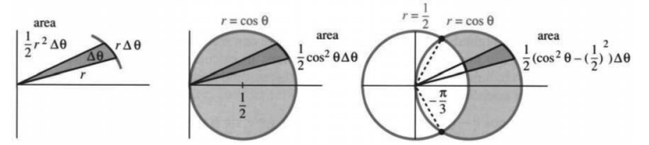
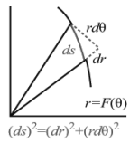

# 9.3 极坐标曲线的斜率、弧长与面积

原书 PDF 第434—437页，印刷页421—424。状态：初译，已对照原页自校；待统一复审。

<!-- PDF 434 / 印刷页 421 -->

前几节介绍了极坐标、极坐标方程及其图像，却还没有用到微积分！现在，当方程为 $r=F(\theta)$ 时，我们来处理面积问题（积分学）和斜率问题（微分学）。这里用 $F$ 而不用 $f$，是为了提醒我们：斜率不是 $dF/d\theta$，面积也不是 $\int F(\theta)\,d\theta$。

先看面积。我们总是把区域分成许多小块，这次小块是什么形状？观察图9.6a中角度 $\theta$ 与 $\theta+\Delta\theta$ 之间的部分。曲线内部是一块狭窄的楔形区域，近似一个小角为 $\Delta\theta$ 的三角形。如果半径恒定，楔形区域就是圆的扇形，相当于以极小角度 $\Delta\theta$ 切下来的一小块馅饼。它的面积占整个圆面积 $\pi r^2$ 的比例，就是角 $\Delta\theta$ 与周角 $2\pi$ 的比：

图9.6　楔形区域的面积、圆的面积，以及两个圆相交时的面积。图中 area 为面积；右图阴影位于 $r=\cos\theta$ 的圆内、$r=1/2$ 的圆外。

$$
\text{楔形面积}=\frac{\Delta\theta}{2\pi}\pi r^2
=\frac12r^2\Delta\theta=\frac12[F(\theta)]^2\Delta\theta.\tag{1}
$$

当然，实际边界并不是圆弧。真实的半径 $F(\theta)$ 随 $\theta$ 变化，但在很窄的角度范围内，变化很小。把这些楔形面积相加，再令 $\Delta\theta$ 趋于零，面积就成为积分。

**9B**　极坐标曲线 $r=F(\theta)$ 内部的面积是和 $\sum\frac12r^2\Delta\theta=\sum\frac12F^2\Delta\theta$ 的极限：

$$
\text{面积}=\int\frac12r^2\,d\theta
=\int\frac12[F(\theta)]^2\,d\theta.\tag{2}
$$

**例1**　求圆 $r=\cos\theta$ 内部的面积。它的半径为 $\frac12$，见图9.6。

$$
\text{面积}=\int_0^{2\pi}\frac12\cos^2\theta\,d\theta
=\left[\frac{\cos\theta\sin\theta+\theta}{4}\right]_0^{2\pi}
=\frac{2\pi}{4}.
$$

**这是错的！** 半径为 $\frac12$ 的圆，其正确面积是 $\pi/4$。错误在于，$\theta$ 增加到 $2\pi$ 时，我们沿圆绕了两周。从0积分到 $\pi$，才得到 $\pi/4$。〔译注：原页此处下限误排为 $\theta$，依据前后文明确订正为0。〕

**例2**　求圆 $r=\cos\theta$ 与圆 $r=\frac12$ 之间的面积。

两圆在 $r=\cos\theta$ 与 $r=\frac12$ 相等的位置相交。图9.6显示，交点对应于 $\pm60^\circ$，即 $\theta=\pm\pi/3$。这些就是积分限，此时 $\cos\theta=\frac12$。

<!-- PDF 435 / 印刷页 422 -->

积分把两个楔形区域的面积差累加起来：较大的一个延伸到 $r=\cos\theta$，较小的一个延伸到 $r=\frac12$：

$$
\text{面积}=\int_{-\pi/3}^{\pi/3}\frac12
\left[(\cos\theta)^2-\left(\frac12\right)^2\right]d\theta.\tag{3}
$$

注意，截去内侧部分后的楔形面积是 $\frac12(F_1^2-F_2^2)\Delta\theta$，而不是 $\frac12(F_1-F_2)^2\Delta\theta$。

**例3**　求心形线 $r=1+\cos\theta$ 与圆 $r=1$ 之间的面积。

$$
\text{面积}=\int_{-\pi/2}^{\pi/2}\frac12[(1+\cos\theta)^2-1^2]\,d\theta,
\qquad\left(1+\cos\theta=1\text{ 时，积分限为 }\theta=\pm\frac\pi2\right).
$$

## 极坐标曲线的斜率

心形线 $r=1+\cos\theta$ 的最高点在哪里？$\theta=\pi/4$ 时的斜率是多少？这些虽不是微积分中最重要的问题，我们仍应知道如何回答。转换为直角坐标，就能迅速说明方法：

$$
x=r\cos\theta=(1+\cos\theta)\cos\theta,\qquad
 y=r\sin\theta=(1+\cos\theta)\sin\theta.
$$

要求最高点，就令 $y$ 的导数为零，寻找其最大值：

$$
\frac{dy}{d\theta}=(1+\cos\theta)\cos\theta+(-\sin\theta)\sin\theta=0.\tag{3}
$$

于是 $\cos\theta+\cos2\theta=0$，$60^\circ$ 时满足这个等式。高度为 $y=(1+\frac12)(\sqrt3/2)$。

求斜率时，使用链式法则 $dy/d\theta=(dy/dx)(dx/d\theta)$：

$$
\frac{dy}{dx}=\frac{dy/d\theta}{dx/d\theta}
=\frac{(1+\cos\theta)\cos\theta+(-\sin\theta)\sin\theta}
{(1+\cos\theta)(-\sin\theta)+(-\sin\theta)\cos\theta}.\tag{4}
$$

式(3)和式(4)避开了消去 $\theta$ 这一步，因为消元可能很麻烦，甚至无法做到。我们不必设法把 $y$ 写成 $x$ 的函数，而是保留 $x,y$ 作为 $\theta$ 的函数。当 $\theta=\pi/4$ 时，式(4)给出 $dy/dx=-1/(1+\sqrt2)$。

第18题用 $dy/dx=(dy/d\theta)/(dx/d\theta)$ 求出斜率的一般公式。第20题从另一个角度看待问题，得到一个更优美的公式。

## 极坐标曲线的弧长

弧长积分总是从 $ds=\sqrt{(dx)^2+(dy)^2}$ 出发。极坐标曲线满足 $x=r\cos\theta=F(\theta)\cos\theta$、$y=F(\theta)\sin\theta$。用乘积法则求导：

$$
dx=[F'(\theta)\cos\theta-F(\theta)\sin\theta]d\theta,
\qquad dy=[F'(\theta)\sin\theta+F(\theta)\cos\theta]d\theta.
$$

<!-- PDF 436 / 印刷页 423 -->

平方后相加，注意 $\cos^2\theta+\sin^2\theta$，就得到弧长微元 $ds$：

$$
ds=\sqrt{[F'(\theta)]^2+[F(\theta)]^2}\,d\theta.\tag{5}
$$

图中给出 $(ds)^2=(dr)^2+(r\,d\theta)^2$，这是同一公式的另一种写法。总弧长为 $\int ds$。

图9.7　极坐标中的弧长微元：径向分量为 $dr$，切向分量为 $r\,d\theta$。

旋转曲面的面积为 $\int2\pi y\,ds$（绕 $x$ 轴），或 $\int2\pi x\,ds$（绕 $y$ 轴）。把 $x,y,ds$ 都用 $\theta,d\theta$ 表示，再积分即可。

**例4**　圆 $r=\cos\theta$ 满足 $ds=\sqrt1\,d\theta$，所以周长为 $\pi$，不是 $2\pi$——不要绕两遍！把这个圆绕 $y$ 轴旋转，得到一个没有孔的面包圈形曲面。由于 $x=r\cos\theta=\cos^2\theta$，其面积为

$$
\int2\pi x\,ds=\int_0^\pi2\pi\cos^2\theta\,d\theta=\pi^2.
$$

**例5**　利用对称性，$r=1+\cos\theta$ 的弧长等于从0到 $\pi$ 的积分的两倍：

$$
\begin{aligned}
\text{心形线的弧长}
&=2\int_0^\pi\sqrt{(-\sin\theta)^2+(1+\cos\theta)^2}\,d\theta\\
&=2\int_0^\pi\sqrt{2+2\cos\theta}\,d\theta
=4\int_0^\pi\cos\frac\theta2\,d\theta=8.
\end{aligned}
$$

我们把根号内的 $2+2\cos\theta$ 换成了 $4\cos^2(\theta/2)$。也可以不利用对称性，直接从0积分到 $2\pi$，但那就必须使用绝对值 $|\cos(\theta/2)|$，以保持平方根非负。

**例6**　对数螺线 $r=e^{-\theta}$ 满足 $ds=\sqrt{e^{-2\theta}+e^{-2\theta}}\,d\theta$。当 $\theta$ 趋于无穷大时，螺线向原点盘旋，其总弧长却有限：

$$
\int ds=\int_0^\infty\sqrt2\,e^{-\theta}\,d\theta
=\left[-\sqrt2\,e^{-\theta}\right]_0^\infty=\sqrt2.
$$

把这条螺线旋转，就得到一个数学上的贝壳，其面积为 $\int_0^\infty(2\pi e^{-\theta}\cos\theta)\sqrt2\,e^{-\theta}\,d\theta$。〔译注：原文此式按原样保留，但作为曲面面积缺少旋转半径的绝对值，见节末译注。〕

## 9.3 习题

### 阅读填空

圆扇形的角为 $\Delta\theta$，它占整个圆的 **a** ______。如果半径为 $r$，扇形面积为 **b** ______。因此，$r=F(\theta)$ 内部的面积为 $\int$ **c** ______。$r=\theta^2$ 从0到 $\pi$ 所扫过的面积为 **d** ______。这条螺线在 $\theta=$ **e** ______ 处与圆 $r=1$ 相交。圆内、螺线外的面积为 **f** ______。介于 $r_1$ 与 $r_2$ 之间、角为 $\Delta\theta$ 的截短扇形，其面积为 **g** ______。

曲线 $r=F(\theta)$ 满足 $x=r\cos\theta=$ **h** ______，$y=$ **i** ______。斜率 $dy/dx$ 等于 $dy/d\theta$ 除以 **j** ______。对于弧长，$(ds)^2=(dx)^2+(dy)^2=$ **k** ______。螺线 $r=\theta$ 从起点到 $\theta=\pi$ 的弧长为 $\int$ **l** ______（不必计算积分）。把 $r=\theta$ 绕 $x$ 轴旋转所得的曲面面积为 $\int2\pi y\,ds=\int$ **m** ______。相应旋转体的体积为 $\int\pi y^2\,dx=\int$ **n** ______。

**第1—6题：画出曲线，求其内部的面积。**

1. $r=1+\cos\theta$。

2. $r=\sin\theta+\cos\theta$，$\theta$ 从0到 $\pi$。

3. $r=2+\cos\theta$。

4. $r=1+2\cos\theta$，只计算内环。

5. $r=\cos2\theta$，只计算一瓣。

6. $r=\cos3\theta$，只计算一瓣。

<!-- PDF 437 / 印刷页 424 -->

**第7—12题：先作图并找出交点，再求曲线之间指定区域的面积。**

7. 圆 $r=\cos\theta$ 与圆 $r=\sin\theta$。

8. 螺线 $r=\theta$ 与 $y$ 轴（第一段弧）。

9. 心形线 $r=1+\cos\theta$ 外、圆 $r=3\cos\theta$ 内。

10. 双纽线 $r^2=4\cos2\theta$ 内、$r=\sqrt2$ 外。

11. 圆 $r=8\cos\theta$ 内、直线 $r\cos\theta=4$ 远离原点的一侧。

12. 圆 $r=10$ 内、直线 $r\cos\theta=6$ 远离原点的一侧。

13. 找出以下计算中的错误，并求双纽线 $r^2=\cos2\theta$ 的正确面积：

    $$
    \text{面积}=\int_0^\pi\frac12r^2\,d\theta
    =\int_0^\pi\frac12\cos2\theta\,d\theta=0.
    $$

14. 求例2中两个圆之间指定区域的面积。

15. 计算例3中心形线与圆之间指定区域的面积。

16. 仔细求出螺线 $r=e^{-\theta}$（$\theta\ge0$）与原点之间的全部面积。

17. 心形线 $r=1+\cos\theta$ 在哪些 $\theta$ 值处有无穷大斜率？哪些点最靠左，即 $x$ 最小？

18. 对 $x=F(\theta)\cos\theta$、$y=F(\theta)\sin\theta$ 使用链式法则 $dy/dx=(dy/d\theta)/(dx/d\theta)$，化简得到

    $$
    \frac{dy}{dx}=\frac{F+\tan\theta\,dF/d\theta}{-F\tan\theta+dF/d\theta}.
    $$

19. 唱片上的沟槽近似螺线 $r=c\theta$：

    $$
    \text{弧长}=\int\sqrt{r^2+(dr/d\theta)^2}\,d\theta
    =\int_6^{14}\sqrt{r^2+c^2}\,\frac{dr}{c}.
    $$

    取 $c=0.002$，在外半径14厘米与内半径6厘米之间约有636圈（$14-6$ 等于 $0.002(636)2\pi$）。  
    (a) 略去 $c^2$，只对 $r\,dr/c$ 积分。  
    (b) 计算完整的弧长积分。可以使用积分表和计算器。你会再也不相信积分了。

20. 证明：从原点引出的射线与切线之间的角 $\psi$ 满足 $\tan\psi=F/(dF/d\theta)$。  
    提示：若切线与水平方向的夹角为 $\phi$，那么 $\tan\phi$ 就是第18题中的斜率 $dy/dx$。因此

    $$
    \tan\psi=\tan(\phi-\theta)
    =\frac{\tan\phi-\tan\theta}{1+\tan\phi\tan\theta}.
    $$

    代入 $\tan\phi$，然后尽力化简。

21. 圆 $r=F(\theta)=4\sin\theta$ 满足 $\psi=\theta$。画一张标出 $\theta,\phi,\psi$ 的图，并检验 $\tan\psi$。

22. 画出心形线 $r=1-\cos\theta$，注意这里是减号。标出角 $\theta,\phi,\psi$，并证明 $\psi=\theta/2$。

23. 图9.4中的第一条蚶线看起来像以 $(\frac13,0)$ 为圆心的圆。证明它不是圆。

24. 求圆 $r=\cos\theta$ 在 $\theta=\pi/6$ 处的切线方程。

**第25—28题：计算曲线的弧长。**

25. $r=\theta$，$\theta$ 从0到 $2\pi$。

26. $r=\sec\theta$，$\theta$ 从0到 $\pi/4$。

27. $r=\sin^3(\theta/3)$，$\theta$ 从0到 $3\pi$。

28. $r=\theta^2$，$\theta$ 从0到 $\pi$。

29. 图9.6中的狭窄楔形区域近似一个三角形。我们把它作为圆扇形处理，但三角形更熟悉。为什么其面积近似为 $\frac12r^2\Delta\theta$？

30. 把例4中的圆绕 $x$ 轴旋转，求曲面面积。实际上，只需旋转一个半圆。

31. 用两次分部积分计算贝壳面积 $2\pi\sqrt2\int_0^\infty e^{-2\theta}\cos\theta\,d\theta$。

32. 求心形线 $r=1+\cos\theta$ 绕 $x$ 轴旋转所得的曲面面积。

33. 求双纽线 $r^2=\cos2\theta$ 绕 $x$ 轴旋转所得的曲面面积。描完一瓣后，$\theta$ 是多少？

34. 当 $y=f(x)$ 绕 $x$ 轴旋转时，体积为 $\int\pi y^2\,dx$。把圆 $r=\cos\theta$ 旋转时，将其转换为从0到 $\pi/2$ 的 $\theta$ 积分，并核对球的体积。

35. 求心形线 $r=1+\cos\theta$ 绕 $x$ 轴旋转所得旋转体的体积。

36. 求 $r=1/\cos\theta$ 的图像在 $0\le\theta\le\pi/4$ 范围内绕 $y$ 轴旋转时的曲面面积和旋转体体积。

37. 证明螺线 $r=\theta$ 与 $r=1/\theta$ 在 $\theta=1$ 相交时互相垂直。

38. 画出三个半径为1、两两相切的圆，求它们之间曲边三角形的面积。

39. 画出单位正方形 $0\le x\le1$、$0\le y\le1$。用极坐标表示，其右边界为 $r=$ ______。用 $\int\frac12r^2\,d\theta$ 求面积。

40. （解开这个悖论）椭圆 $x=4\cos\theta$、$y=3\sin\theta$ 的面积为 $\pi\cdot4\cdot3=12\pi$，但 $\frac12r^2\,d\theta$ 的积分却是

    $$
    \int_0^{2\pi}\frac12(16\cos^2\theta+9\sin^2\theta)\,d\theta
    =12\frac12\pi.
    $$

## 译注与待复审事项

1. 面积公式须选取恰好扫过目标区域一次的角度范围；重复描迹会重复计数，不能在 $r^2<0$ 的角度范围内把代数表达式当作实曲线积分。例2、例3的积分指各自明确指定的外侧区域，不是两条曲线所有对称差区域的总面积。第7题未明确“之间”指公共部分还是其他区域，复审时应结合原书答案核实，不擅自补定。
2. 原书先把例2的面积积分标为(3)，又把求最高点的导数式标为(3)，本稿保留重复编号。例1末句原页为“从 $\theta$ 到 $\pi$ 积分”，依上下文应为从0到 $\pi$，已带注订正。9B编号在后续9.4节原书中再次出现，仍按原书保留。
3. 斜率比值要求 $dx/d\theta\ne0$。若分子分母同时为零，须另求极限或检查尖点，不能直接判为竖直切线。第18题化为含 $\tan\theta$ 的形式还要求 $\cos\theta\ne0$；更一般的正弦、余弦形式没有这一额外限制。角度均以弧度计。
4. 弧长微元更一般地写为 $ds=\sqrt{F'^2+F^2}\,|d\theta|$，本节积分按参数递增取限。旋转面积中的半径须为非负距离，故一般为 $2\pi|y|$ 或 $2\pi|x|$，并避免重复覆盖同一曲面。
5. 例6末尾及第31题给出的贝壳面积积分缺少 $|\cos\theta|$，其有符号积分不能作为几何曲面面积。正文和题目保留原式并明确指出问题，不静默替换或代做题目。
6. 体积公式 $\int\pi y^2\,dx$ 默认相应区域可按垂直于旋转轴的截面描述。参数变换必须顾及 $x$ 的单调性、积分方向、孔洞和重叠。阅读填空及第34—35题不能不加区分地把整条参数曲线代入同一个圆盘积分；第34题从0到 $\pi/2$ 时 $x$ 递减，需正确处理符号。第16题也需区分按绕行次数累计的面积与平面区域的实际面积。
7. 第19题636圈为取整近似，$0.002\times636\times2\pi$ 并不精确等于8。第20—22题的角度关系须按图示的有向角或模 $\pi$ 约定理解，并排除切线未定义的特殊点。第40题故意把椭圆参数角与极角混用，是题目要求识别的问题，不能在译文中替它改正。
