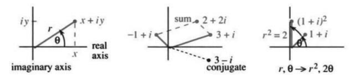
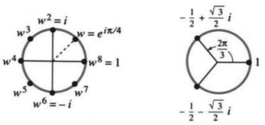
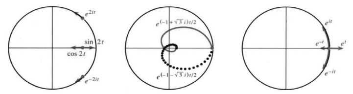

# 9.4 复数

原书 PDF 第438—443页，印刷页425—430。状态：初译，已对照原页自校；待统一复审。

<!-- PDF 438 / 印刷页 425 -->

微积分的大部分内容只用实数就足够了。从 $x^2+4$ 出发，它的积分 $\frac13x^3+4x+C$ 仍是实数。给定 $x^3-1$，它的导数 $3x^2$ 也是实数。但这些多项式的**根或零点**会涉及复数：

$$
x^2+4=0\qquad\text{和}\qquad x^3-1=0\qquad\text{都有复数解。}
$$

我们期待 $-4$ 有两个平方根，1有三个立方根。要使每个 $n$ 次多项式都有 $n$ 个根，就不可避免地要引入复数。

本节说明怎样进行复数运算。你会看到它们与极坐标的联系，最后我们还会用它们求解微分方程。

**从虚数单位 $i$ 开始。** 大家都知道，$x^2=-1$ 没有实数解。实数的平方不可能为负，所以人们约定用 $i$ 表示一个解。（不过，电气工程师把它叫作 $j$。）虚数遵守通常的加、减、乘、除法则，只有一点不同：**每当出现 $i^2$，就把它换成 $-1$。** 特别地，$-i$ 乘以 $-i$ 得到 $+i^2=-1$。换句话说，$-i$ 也是 $-1$ 的平方根。方程 $x^2+1=0$ 有两个解：$i$ 和 $-i$。

求1的立方根，会把我们的思路推得更远。我们需要复数，也就是实数部分加上虚数部分。

**9B**　一个**复数**（例如 $1+3i$）是一个实数（1）与一个纯虚数（$3i$）之和。相加时，这两部分分别相加；相乘时，使用 $i^2=-1$：

$$
\begin{aligned}
\text{加法：}\quad &(1+3i)+(1+3i)=1+1+i(3+3)=2+6i,\\
\text{乘法：}\quad &(1+3i)(1+3i)=1+3i+3i+9i^2=-8+6i.
\end{aligned}
$$

把 $1+3i$ 与 $5-i$ 相加很容易，结果是 $6+2i$。乘法稍长一些，但法则仍然清楚：

$$
(1+3i)(5-i)=5+15i-i-3i^2=8+14i.
$$

要点是：我们不必再设想其他新种类的数。接受了 $i$，其余运算就顺理成章。实数不过是虚部为零的复数！把 $1+3i$ 与它的**共轭复数** $1-3i$ 相加或相乘，结果都是实数：

$$
\begin{aligned}
(1+3i)+(1-3i)&=2\quad\text{（实数）},\\
(1+3i)(1-3i)&=1-3i+3i-9i^2=10\quad\text{（实数）}.
\end{aligned}\tag{1}
$$

利用共轭复数使分母变成实数，就能进行除法：

$$
\frac1{1+3i}=\frac1{1+3i}\frac{1-3i}{1-3i}=\frac{1-3i}{10},
\qquad
\frac1{x+iy}=\frac1{x+iy}\frac{x-iy}{x-iy}=\frac{x-iy}{x^2+y^2}.
$$

**9C**　复数 $x+iy$ 的实部为 $x$，虚部为 $y$；它的共轭复数为 $x-iy$。乘积 $(x+iy)(x-iy)$ 等于 $x^2+y^2=r^2$。其**绝对值或模**为

$$
r=|x+iy|=\sqrt{x^2+y^2}.
$$

<!-- PDF 439 / 印刷页 426 -->

## 复平面

**复数对应于平面上的点。** 数 $1+3i$ 对应于点 $(1,3)$。类似地，$x+iy$ 对应于 $(x,y)$，即沿“实轴”移动 $x$ 个单位、沿“虚轴”向上移动 $y$ 个单位。普通平面由此成为**复平面**。绝对值 $r$ 与极坐标中的非负极径 $r$ 相同，见图9.8a。

图中还画了另外两个复平面。中间的图用于加减，采用直角坐标；右边的图用于乘除和平方，采用极坐标。将一个复数平方时，$r$ 变为平方，$\theta$ 变为两倍；右图和式(3)都表明这一点。

图9.8　复平面显示 $x,y,r,\theta$。用 $x,y$ 做加法，用 $r,\theta$ 做乘法。real axis 为实轴，imaginary axis 为虚轴，sum 为和，conjugate 为共轭。

复数相加就像向量相加（第11章）。实部相加得 $3-1$，虚部相加得 $1+1$。向量和 $(2,2)$ 对应于复数和 $2+2i$。共轭复数 $3-i$ 是 $3+i$ 关于实轴的镜像，即把 $i$ 换成 $-i$。它们与 $r,\theta$ 的关系和以前相同，可以从直角三角形中看出：

$$
x=r\cos\theta,\qquad y=r\sin\theta,
\quad\text{因此}\quad x+iy=r(\cos\theta+i\sin\theta).\tag{2}
$$

第三幅图中的 $1+i$ 满足 $r=\sqrt2$、$\theta=\pi/4$。极坐标形式是 $\sqrt2\cos(\pi/4)+\sqrt2i\sin(\pi/4)$。平方后，原来的 $45^\circ$ 变成 $90^\circ$：$(1+i)^2=1+2i-1=2i$。它的极坐标形式为 $2\cos(\pi/2)+2i\sin(\pi/2)$。

**9D**　相乘时角度相加，相除时角度相减，平方时角度加倍。模则分别相乘、相除或平方：

$$
(r\cos\theta+ir\sin\theta)^2
=r^2\cos2\theta+ir^2\sin2\theta.\tag{3}
$$

取 $n$ 次幂，得到 $r^n$ 与 $n\theta$；开平方时，$r$ 变为 $\sqrt r$，$\theta$ 变为 $\theta/2$。数 $-1$ 位于 $180^\circ$ 方向，所以它的一个平方根 $i$ 位于 $90^\circ$ 方向。

要看清式(3)为何使角度加倍，提取 $r^2$，按通常方式相乘：

$$
(\cos\theta+i\sin\theta)(\cos\theta+i\sin\theta)
=\cos^2\theta-\sin^2\theta+2i\sin\theta\cos\theta.
$$

右边正是 $\cos2\theta+i\sin2\theta$。三角学的倍角公式与复数平方完全吻合。立方会得到 $\cos3\theta+i\sin3\theta$，因为 $2\theta+\theta=3\theta$，而 $r$ 仍为1。$n$ 次幂由**棣莫弗公式**给出：

$$
(\cos\theta+i\sin\theta)^n=\cos n\theta+i\sin n\theta.\tag{4}
$$

<!-- PDF 440 / 印刷页 427 -->

取 $n=-1$，得到 $\cos(-\theta)+i\sin(-\theta)$，即共轭复数 $\cos\theta-i\sin\theta$：

$$
\frac1{\cos\theta+i\sin\theta}
=\frac1{\cos\theta+i\sin\theta}\frac{\cos\theta-i\sin\theta}{\cos\theta-i\sin\theta}
=\frac{\cos\theta-i\sin\theta}{1}.\tag{5}
$$

我们已十分接近**欧拉公式**，它是描述单位圆上一切复数的关键：

$$
\text{欧拉公式：}\qquad\cos\theta+i\sin\theta=e^{i\theta}.\tag{6}
$$

两边平方，得 $(e^{i\theta})(e^{i\theta})=e^{2i\theta}$，这就是式(3)。取 $-1$ 次幂，得 $1/e^{i\theta}=e^{-i\theta}$，这就是式(5)。任意 $e^{i\theta}$ 与 $e^{i\phi}$ 相乘，都得到 $e^{i(\theta+\phi)}$。$\phi=\theta$ 的特例给出平方，$\phi=-\theta$ 的特例给出 $e^{i\theta}e^{-i\theta}=1$。

欧拉公式已在第6.7节出现过：把 $e^x$ 级数中的 $x$ 换为 $i\theta$，

$$
e^x=1+x+\frac{x^2}{2}+\frac{x^3}{6}+\cdots
\quad\text{变为}\quad
e^{i\theta}=1+i\theta-\frac{\theta^2}{2}-i\frac{\theta^3}{6}+\cdots.
$$

第10章的一个精彩之处，就是认出右侧的两个新级数。实数项 $1-\frac12\theta^2+\cdots$ 相加等于 $\cos\theta$；虚部 $\theta-\frac16\theta^3+\cdots$ 相加等于 $\sin\theta$。所以 $e^{i\theta}=\cos\theta+i\sin\theta$。数学中最重要的周期函数竟以如此优美的方式结合在一起，实在令人赞叹。

欧拉（Euler，读音近似“欧伊勒”）告诉我们，$e^{2\pi i}=1$。$2\pi$ 的余弦是1，正弦是0。若把 $x=2\pi i$ 代入无穷级数，所有项不知怎的都抵消了，只剩下1，简直像奇迹。从角度来看，$\theta=2\pi$ 让我们绕完整的一周，回到 $e^{2\pi i}=1$。

欧拉公式乘以 $r$，便得到表示复数的第三种方式：

$$
\text{每个复数都可写为}\quad
x+iy=r\cos\theta+ir\sin\theta=re^{i\theta}.\tag{7}
$$

**例1**　$2e^{i\theta}$ 乘以 $3e^{i\theta}$ 等于 $6e^{2i\theta}$。当 $\theta=\pi/2$ 时，$2i$ 乘以 $3i$ 就是 $-6$。

**例2**　当 $w=e^{i\pi/4}$ 时，求 $w^2,w^4,w^8,w^{25}$。

**解**　$e^{i\pi/4}=1/\sqrt2+i/\sqrt2$。注意 $r^2=\frac12+\frac12=1$。现在观察角度：

$$
w^2=e^{i\pi/2}=i,\qquad w^4=e^{i\pi}=-1,\qquad
w^8=1,\qquad w^{25}=w^8w^8w^8w=w.
$$

图9.9显示 $w$ 的八个幂，它们就是**1的八次方根**。

图9.9　$w$ 的八个幂与1的三个立方根。

**例3**　$(x^2+4=0)$　$-4$ 的平方根是 $2i$ 和 $-2i$。与 $(i)(i)=-1$ 对应，有 $(2i)(2i)=-4$。如果欧拉坚持要求，我们就把 $2i$ 和 $-2i$ 写成 $2e^{i\pi/2}$ 和 $2e^{3i\pi/2}$。

<!-- PDF 441 / 印刷页 428 -->

**例4（1的立方根）**　在直角坐标中，需要解 $(x+iy)^3=1$，这并不容易。在极坐标中，同一个方程变成 $r^3e^{3i\theta}=1$，立即得到 $r=1$。角 $\theta$ 可以取 $2\pi/3,4\pi/3,6\pi/3$，图中的三个立方根等距分布：

$$
(e^{2\pi i/3})^3=e^{2\pi i}=1,\quad
(e^{4\pi i/3})^3=e^{4\pi i}=1,\quad
(e^{6\pi i/3})^3=e^{6\pi i}=1.
$$

你可以看出，角 $8\pi/3$ 不会给出新结果，因为它转过一整周，又回到 $2\pi/3$ 的方向。

**1的 $n$ 次方根为 $e^{2\pi i/n},e^{4\pi i/n},\ldots,1$，共 $n$ 个。它们位于单位圆上，角度分别为 $2\pi/n,4\pi/n,\ldots,2\pi$。**

## 微分方程的解

现在把复数代数应用于复值函数的微积分。复数是 $c$，复值函数是 $e^{ct}$。把 $y''=-4y$ 与 $y'''=y$ 分别联系到 $c^2=-4$ 与 $c^3=1$，就能求解这两个方程。第16章会对所有常系数线性微分方程采用同样的思路；这里是选读的预览。

请记住唯一的关键想法：**把 $y=e^{ct}$ 代入微分方程，并解出 $c$。** 每求一次导数就多一个因子 $c$，所以 $y'=ce^{ct}$、$y''=c^2e^{ct}$：

$$
\frac{d^2y}{dt^2}=-4y\quad\Longrightarrow\quad c^2e^{ct}=-4e^{ct}
\quad\Longrightarrow\quad c^2=-4.\tag{8}
$$

对于这个微分方程，$c$ 必须是 $-4$ 的平方根，候选值为 $c=2i$ 和 $c=-2i$。方程有两个“纯指数解” $e^{ct}$：

$$
y=e^{2it},\qquad y=e^{-2it}.\tag{9}
$$

它们的线性组合 $y=Ae^{2it}+Be^{-2it}$ 给出全部解。在第16章，我们将选择 $A,B$，使解满足 $t=0$ 时的两个初始条件。

解 $y=e^{2it}=\cos2t+i\sin2t$ 是复值的，而微分方程的系数是实数。要得到实值的 $y$，只需取复数解的实部和虚部：

$$
y_{\mathrm{real}}=\cos2t,\qquad y_{\mathrm{imaginary}}=\sin2t.\tag{10}
$$

它们是“纯振荡解”。当 $y=e^{2it}$ 沿单位圆运动时，虚部 $\sin2t$ 上下运动；就像第1.4节中的小球与投影，但因为是 $2t$，速度加倍。实部 $\cos2t$ 则来回运动。由链式法则，$\cos2t$ 的二阶导数是 $-4\cos2t$，因此 $d^2y/dt^2=-4y$，确实得到了实数解。

**例5**　求 $d^3y/dt^3=y$ 的三个解，再求三个实数解。

**关键步骤：代入 $y=e^{ct}$。** 得 $c^3e^{ct}=e^{ct}$，所以 $c^3=1$，$c$ 是1的立方根。$c=1$ 给出第一个解 $y=e^t$。下一个 $c$ 是复数：

$$
c=e^{2\pi i/3}=-\frac12+i\frac{\sqrt3}{2}
\quad\Longrightarrow\quad y=e^{ct}=e^{-t/2}e^{i\sqrt3t/2}.\tag{11}
$$

**指数的实部决定了模 $|y|=e^{-t/2}$。** 随着 $t$ 增大，它逐渐减小，使 $y$ 向零靠近。同时，因子 $e^{i\sqrt3t/2}$ 沿单位圆旋转，所以 $y$ 沿螺线趋于零，见图9.10。它的共轭复数也如此；

<!-- PDF 442 / 印刷页 429 -->

这就是第三个指数解。把式(11)中的 $i$ 换为 $-i$，就得到1的第三个立方根，以及第三个解 $e^{-t/2}e^{-i\sqrt3t/2}$。

第一个实数解为 $y=e^t$，另外两个来自螺线的实部和虚部：

$$
y_{\mathrm{real}}=e^{-t/2}\cos\left(\frac{\sqrt3t}{2}\right),\qquad
 y_{\mathrm{imaginary}}=e^{-t/2}\sin\left(\frac{\sqrt3t}{2}\right).\tag{12}
$$

它们就是 $r\cos\theta$ 与 $r\sin\theta$。这是在第16章之前，极坐标与复数最深入的一次应用。对于 $y''=-4y$，即使没有帮助，我们也可能发现 $\cos2t$ 和 $\sin2t$；但我不认为我们能轻易发现 $y'''=y$ 的这些解。

**例6**　代入 $y=e^{ct}$，求 $d^4y/dt^4=y$ 的四个解。

求四次导数得到 $c^4=1$，所以 $c$ 为 $i,-1,-i,1$。相应的解为 $y=e^{it},e^{-t},e^{-it},e^t$。若需要实数解，就把 $e^{it}$ 与 $e^{-it}$ 组合成 $\cos t$ 和 $\sin t$。所有情形都满足 $y''''=y$。

图9.10　解在复平面中运动：依次对应 $y''=-4y$、$y'''=y$ 和 $y''''=y$。

## 9.4 习题

### 阅读填空

复数 $3+4i$ 的实部是 **a** ______，虚部是 **b** ______。它的模为 $r=$ **c** ______，共轭复数为 **d** ______，在复平面中的位置为（**e** ______）。极坐标形式为 $r\cos\theta+ir\sin\theta=$ **f** ______ $e^{i\theta}$。它的平方为 **g** ______ $+i$ **h** ______，$n$ 次幂为 **i** ______ $e^{in\theta}$。

$1+i$ 与 $1-i$ 的和为 **j** ______，乘积为 **k** ______。在极坐标形式中，这个乘积是 $\sqrt2e^{i\pi/4}$ 乘以 **l** ______。商 $(1+i)/(1-i)$ 等于虚数 **m** ______。$(1+i)^8=$ **n** ______。1的一个八次方根为 $w=$ **o** ______，其余八次方根为 **p** ______。

求解 $d^8y/dt^8=y$ 时，寻找形如 $y=$ **q** ______ 的解。代入并约去 $e^{ct}$，得到方程 **r** ______。$c$ 有 **s** ______ 种选择，其中一种是 $(-1+i)/\sqrt2$。取这个值时，$|e^{ct}|=$ **t** ______，实数解为 $\operatorname{Re}e^{ct}=$ **u** ______ 与 $\operatorname{Im}e^{ct}=$ **v** ______。

**第1—6题：在复平面中标出各个数。**

1. $2+i$，它的共轭复数 $2-i$，以及它们的和与积。

2. $1+i$，它的平方 $(1+i)^2$，以及倒数 $1/(1+i)$。

3. $2e^{i\pi/6}$，它的倒数 $\frac12e^{-i\pi/6}$，以及两者的平方。

4. 1的六次方根，共六个。

5. $\cos(3\pi/4)+i\sin(3\pi/4)$，以及它的平方和立方。

6. $4e^{i\pi/3}$ 及其平方根。

7. 对复数 $c=x+iy=re^{i\theta}$ 及其共轭复数 $\bar c=x-iy=re^{-i\theta}$，求下列各式在复平面中所有可能的位置：(1) $c+\bar c$；(2) $c-\bar c$；(3) $c\bar c$；(4) $c/\bar c$。

8. 求单位圆上角度为 $45^\circ,90^\circ,135^\circ$ 的复数 $x+iy$ 所对应的 $x,y$。直接验证，第一个数的平方是第二个数，立方是第三个数。

9. 若 $c=2+i$、$d=4+3i$，求 $cd$ 和 $c/d$。验证 $|cd|=|c||d|$，且 $|c/d|=|c|/|d|$。

10. 分别求 $e^{ix}=i$ 和 $e^{ix}=1/e$ 的一个解 $x$，再各求第二个解。

<!-- PDF 443 / 印刷页 430 -->

**第11—14题：求各组数的和与积。**

11. $e^{i\theta}$ 与 $e^{-i\theta}$；另求 $e^{2\pi i/3}$ 与 $e^{4\pi i/3}$ 的和与积。

12. $e^{i\theta}$ 与 $e^{i\phi}$；另求 $e^{\pi i/4}$ 与 $e^{-\pi i/4}$ 的和与积。

13. 1的六个六次方根，全部相加与全部相乘。

14. 方程 $c^2-4c+5=0$ 的两个根。

15. 若 $c=re^{i\theta}\ne0$，$c^4,c^{-1},c^{-4}$ 分别是什么？

16. 展开 $(\cos\theta+i\sin\theta)^3=e^{i3\theta}$，用 $\cos\theta$ 和 $\sin\theta$ 表示实部 $\cos3\theta$ 及虚部 $\sin3\theta$。

17. 在复平面中标出一般复数 $re^{i\theta}$ 的三个立方根，并说明为什么它们的和为零。其中一个立方根为 $r^{1/3}e^{i\theta/3}$。

18. 证明 $re^{i\theta}$ 的四个四次方根的乘积为 $-re^{i\theta}$。

**第19—22题：求所有形如 $y=e^{ct}$ 的解。**

19. $y''+y=0$。

20. $y'''+y=0$。

21. $y'''-y'=0$。

22. $y''+6y'+5y=0$。

**由 $e^{ct}$ 的实部和虚部构造两个实数解，先求 $c$。**

23. $y''+49y=0$。

24. $y''-2y'+2y=0$。

**画出 $t$ 从0增大时 $y=e^{ct}$ 的运动轨迹，并标出 $y=e^c$。**

25. $c=1-i$。

26. $c=-1+i$。

27. $c=\pi i/4$。

28. 从 $y_0=1$ 出发，$dy/dt=iy$ 的解是什么？对于这个解，比较 $dy/dt=iy$ 两边的实部和虚部，可得 ______ 和 ______。

29. 图9.10b中，螺线在什么时刻 $t$ 经过实轴上最靠左的交点？这时 $y$ 等于什么？

30. 证明 $\cos\theta=\frac12(e^{i\theta}+e^{-i\theta})$，并求 $\sin\theta$ 的类似公式。

31. 判断正误或选择适当的选项，并举例说明：  
    (a) 若 $c_1+c_2$ 为实数，$c_1,c_2$ 就互为共轭。  
    (b) 若 $|c_1|=2$、$|c_2|=4$，则 $c_1c_2$ 的模为8。  
    (c) 若 $|c_1|=1$、$|c_2|=1$，则 $|c_1+c_2|$（至少为1）（至多为2）（等于2）。  
    (d) 若 $e^{ct}$ 在 $t\to\infty$ 时趋于零，则（$c$ 为负）（$c$ 的实部为负）（$|c|$ 小于1）。

32. $re^{i\theta}$ 与 $Re^{i\phi}$ 的乘积，其极坐标形式为 ______，直角坐标形式为 ______。圈出组成 $rR\cos(\theta+\phi)$ 的各项。

33. 复数 $1/(re^{i\theta})$ 的极坐标形式为 ______，直角坐标形式为 ______，平方根为 ______。

34. 证明 $\cos(ix)=\cosh x$、$\sin(ix)=i\sinh x$。$i$ 的余弦是多少？

## 译注与待复审事项

1. $n$ 次非零多项式在复数域内有 $n$ 个根，须按重数计数；并非必有 $n$ 个互异根。实数属于复数，本节所说“复数解”不排除实根。复数的虚部是实数 $y$，不是 $iy$。
2. 除法、倒数和负整数次幂要求除数或底数非零；本节相应公式及第7、15、33题须遵守此条件。零的模为零，辐角不唯一。非零数的辐角也只在模 $2\pi$ 意义下确定。
3. 棣莫弗公式(4)在这里用于整数 $n$。取平方根时仅把一个选定辐角减半只能得到一个根，还要包括相反数；一般 $n$ 次方根须把辐角加上 $2k\pi$ 后再除以 $n$。非零数有 $n$ 个互异的 $n$ 次方根，零只对应零。
4. 本节微分方程均为实系数齐次线性方程，因而复解的实部、虚部分别为实解。不能把这一结论直接推广到任意非线性或非齐次方程。$Ae^{2it}+Be^{-2it}$ 表示实值通解时，$A,B$ 不能任意独立取实数，而须满足适当的共轭关系；等价地使用任意实系数的正弦、余弦组合。
5. 第10题中的 $x$ 允许为复数；若强制 $x$ 为实数，第二个方程没有解。第29题所问的是螺线与负实轴的交点，不是整个螺线横坐标的全局最小点。
6. 本节原书再次使用框文编号9B，与第9.3节面积公式的9B重复，本稿保留原编号。指数中的 $\sqrt3t/2$ 按 $\sqrt3\,t/2$ 理解，根号不包括 $t$。
