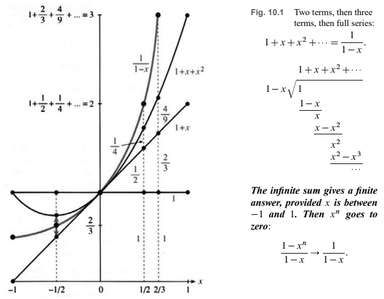

# 第10章　无穷级数

# 10.1 几何级数

原书 PDF 第444—452页，印刷页431—439，含第10章引言。状态：初译，已对照原页自校；待统一复审。

<!-- PDF 444 / 印刷页 431 -->

无穷级数有时能带来乐趣。它们优美地照亮了 $\sin x$ 和 $\cos x$，给出 $\pi$ 和 $e$ 这样的著名常数，也常常产生完全陌生的函数——这也许是件好事。但令人头疼的是，无穷级数包含无穷多项。

这些项的和不容易求出，甚至不能保证这个和存在。我们需要判别方法，确定级数是否收敛；也需要巧妙的想法，找出它收敛到什么。看三个例子——收敛、发散到无穷大、振荡：

$$
1+\frac12+\frac14+\cdots=2,\qquad
1+1+1+\cdots=\infty,\qquad
1-1+1-1+\cdots\,=?
$$

第一个级数收敛。下一项是 $1/8$，再下一项是 $1/16$；每一步都把与2的差距缩短一半。第二个级数是无穷多个1的和，显然发散到无穷大。由1与 $-1$ 交替组成的例子也不收敛。

这些例子，还有更多，都是同一个无穷级数的特例——所有级数里最重要的那一个：

$$
\text{几何级数为}\quad 1+x+x^2+x^3+\cdots=\frac1{1-x}.
$$

这是函数项级数，也是一个“幂级数”。把数代入 $x$，左侧级数可能收敛到右侧的和；可我们还得知道，什么时候它不收敛。取 $x=\frac12,1,-1$：

$$
1+\frac12+\left(\frac12\right)^2+\cdots
\quad\text{收敛，其和为 }\frac1{1-1/2}=2;
$$

$$
1+1+1+\cdots\quad\text{发散；形式上写成 }\frac1{1-1}=\frac10=\infty;
$$

$$
1+(-1)+(-1)^2+\cdots\quad\text{振荡；形式上似乎应有和 }
\frac1{1-(-1)}=\frac12.
$$

最后一个级数的部分和在1与0之间来回跳动，所以至少它们的平均值为 $\frac12$。当 $x=2$ 时，$1+2+4+8+\cdots$ 无论如何都不可能等于 $1/(1-2)$。

这种表现是幂级数的典型特征：在某个区间内收敛，当 $x$ 很大时发散。几何级数就是如此：$x$ 在 $-1$ 与1之间是安全的，超出这一范围就发散。

<!-- PDF 445 / 印刷页 432 -->

下一个例子是循环小数 $1.111\ldots$。令 $x=1/10$：

$$
1+\frac1{10}+\left(\frac1{10}\right)^2+\left(\frac1{10}\right)^3+\cdots.
$$

小数 $1.111\ldots$ 也是分数 $1/(1-1/10)=10/9$。**每个分数都可以写成循环小数；每个循环小数也都能用几何级数求和，化成分数。**

要得到 $3.333\ldots$，只需乘以3，结果为 $10/3$。要得到 $1.0101\ldots$，令 $x=1/100$，相应的分数为 $1/(1-1/100)=100/99$。

下面是一个不寻常的小数，它最终也会循环。我实在说不清它为什么这样：

$$
\frac1{243}=0.004\ 115\ 226\ 337\ 448\ldots.
$$

大多数数不是分数，也不是循环小数。$\pi$ 就是一个好例子：

$$
\pi=3+\frac1{10}+\frac4{100}+\frac1{1000}+\frac5{10000}+\cdots.
$$

这就是 $3.1415\ldots$，它当然收敛。我们碰巧知道前十亿项（第十亿位后面会给出），第二十亿项却没人知道。请把它与下面同样等于 $\pi$ 的级数比较：

$$
\pi=4-\frac43+\frac45-\frac47+\cdots.
$$

这个交错级数确实非同寻常。它的规律十分清楚，正是本章典型的研究对象。我们知道第二十亿项，而且知道它带负号。它不是几何级数，但第10.1节会从几何级数推出它。

**问题**　这个级数真的收敛吗？如果所有符号都换成加号，又怎样？  
**回答**　交错级数收敛到 $\pi$，见第10.3节；正项级数发散到无穷大，见第10.2节。项本身趋于零，但它们的和却是无穷大。

这个例子开始说明本章要做什么。一部分内容讨论特殊级数，它们的和为 $10/9,\pi,e^x$；另一部分讨论一般级数，它们的和可能是没人听说过的数或函数。积分也一样：有时给出 $\ln x$ 这样熟悉的答案，有时给出 $\int x^x\,dx$ 这样的陌生答案。$1+1/8+1/27+\cdots$ 的和也还未知，尽管许多数学家都试过求它。

本章不长，但内容充实。后半章研究幂级数。先从 $1+x$ 这样的线性近似开始，再考虑 $1+x+x^2$ 这样的二次近似，最后让它与 $f(x)$ 的所有阶导数匹配。这就是“泰勒级数”，构造函数的新路子：不靠公式，也不靠积分，靠的是无穷级数。

没有比 $1/(1-x)$ 更好的例子了，它贯穿第10.1节。接着定义收敛，并讨论收敛判别法；多数判别法，其实都是拿几何级数去比。数学中第二重要的级数是指数级数 $e^x=1+x+\frac12x^2+\frac16x^3+\cdots$。由于 $e^{ix}=\cos x+i\sin x$，它还包含正弦和余弦的级数。最后，大量新旧函数都将从泰勒级数中出现。

到最后，微积分中所有关键函数都会以“无穷多项式”的面貌出现，阶跃函数除外。这是一趟从线性函数 $y=mx+b$ 出发的漫长旅程，终点就在这里。

<!-- PDF 446 / 印刷页 433 -->

## 10.1 几何级数

先看几何级数等式的两边：

$$
1+x+x^2+x^3+\cdots=\frac1{1-x}.\tag{1}
$$

左边的级数怎样产生右边的函数？$1/(1-x)$ 又怎样产生这个级数？先把前两项相加，再加前三项，最后加前 $n$ 项：

$$
1+x=\frac{1-x^2}{1-x},\qquad
1+x+x^2=\frac{1-x^3}{1-x},\qquad
1+\cdots+x^{n-1}=\frac{1-x^n}{1-x}.\tag{2}
$$

第一个等式来自普通代数：$(1+x)(1-x)=1-x^2$。第二个开始显出规律：$(1+x+x^2)(1-x)=1-x+x-x^2+x^2-x^3$。除了开头的1与结尾的 $-x^3$，其余全部抵消。一般情形也一样：$(1+\cdots+x^{n-1})(1-x)$ 只剩下开头的1和结尾的 $-x^n$。这就证明了前 $n$ 项和公式(2)。

整个级数呢，就要让 $n$ 趋于无穷大。这一步发生了什么，看图就清楚。图10.1画出了 $n=1,2,3,\infty$ 的情形。

图10.1　先取两项，再取三项，最后取整个级数：$1+x+x^2+\cdots=1/(1-x)$。图旁还示出用 $1-x$ 除1的长除法。

**只要 $x$ 在 $-1$ 与1之间，无穷和就给出有限的答案。** 此时 $x^n$ 趋于零，所以

$$
\frac{1-x^n}{1-x}\longrightarrow\frac1{1-x}.
$$

**现在从函数 $1/(1-x)$ 出发。** 它怎样产生级数？一种初等但费力的方法，是像图旁那样做长除法。另一种是查 $(1-x)^{-1}$ 的二项式公式，但这等于作弊：我们想发现级数，而不只是记住它。真正管用的办法是微积分——算出 $f(x)=1/(1-x)$ 的各阶导数：

$$
f'=(1-x)^{-2},\qquad f''=2(1-x)^{-3},\qquad
f'''=6(1-x)^{-4},\quad\ldots.\tag{3}
$$

<!-- PDF 447 / 印刷页 434 -->

在 $x=0$ 处，这些导数为 $1,2,6,24,\ldots$。注意，链式法则产生的 $-1$ 使结果始终为正。$x=0$ 处的 $n$ 阶导数为 $n$ 的阶乘：

$$
f(0)=1,\quad f'(0)=1,\quad f''(0)=2,\quad f'''(0)=6,\quad\ldots,\quad f^{(n)}(0)=n!.
$$

想法来了：**要让级数与 $1/(1-x)$ 匹配，就让它们在 $x=0$ 处的所有阶导数匹配。** 每个幂 $x^n$ 恰好匹配一个导数。它在0处的 $n$ 阶导数是 $n!$，其余各阶导数都为零。把所有幂相加，就能匹配每一阶导数：

$$
1+x+x^2+x^3+\cdots\quad\text{与 }1/(1-x)\text{ 在0处有相同的各阶导数。}
$$

线性近似是 $1+x$，下一项是 $\frac12f''(0)x^2=x^2$。三阶导数应当为6，$x^3$ 恰好满足要求。函数就这样借导数造出了自己的级数。

这个例子已经展现了主题的一部分。当 $|x|\ge1$ 时，几何级数发散；否则，它的和就是产生它的那个函数（$-1<x<1$ 时）。为了熟悉其他级数，我们现在对级数做代数或微积分运算，得到 $1/(1-x)$ 的平方、导数或积分。

我能想到的最好办法，是给你看八种运算，每一种都能算出点有用的东西。最后，我们会发现 $\ln2$ 和 $\pi$ 的级数。

**1. 将几何级数乘以 $a$ 或 $ax$：**

$$
a+ax+ax^2+\cdots=\frac a{1-x},\qquad
ax+ax^2+ax^3+\cdots=\frac{ax}{1-x}.\tag{4}
$$

第一个级数适用于小数 $3.333\ldots$，此时 $a=3$。$x=1/10$ 时的几何级数给出 $1.111\ldots=10/9$，而这里是它的三倍，所以和是 $10/3$。

第二个级数适用于其他伪装成小数的分数。要得到 $12/99$，取 $a=12$、$x=1/100$：

$$
0.121212\ldots=\frac{12}{100}+\frac{12}{100^2}+\frac{12}{100^3}+\cdots
=\frac{12/100}{1-1/100}=\frac{12}{99}.
$$

第13题讨论 $0.8787\ldots$ 与 $0.123123\ldots$。在微积分预备课程里，这个式子通常写成 $a+ar+ar^2+\cdots=a/(1-r)$。这里改用 $x$ 代替 $r$，为的是强调它是一个函数——现在可以对它求导了。

**2. 几何级数 $1+x+x^2+\cdots$ 的导数是 $1/(1-x)^2$：**

$$
1+2x+3x^2+4x^3+\cdots
=\frac d{dx}\left(\frac1{1-x}\right)=\frac1{(1-x)^2}.\tag{5}
$$

在 $x=1/10$ 时，左边开始呈现 $1.23456789$；右边为 $1/(1-1/10)^2=1/(9/10)^2=100/81$。如果有计算器，请算一算100除以81。答案也应接近 $(1.11111111)^2=1.2345678987654321$。

**3. 像函数相减一样，从 $1+2x+3x^2+\cdots$ 中减去 $1+x+x^2+\cdots$：**

$$
x+2x^2+3x^3+\cdots=\frac1{(1-x)^2}-\frac1{1-x}
=\frac x{(1-x)^2}.\tag{6}
$$

有趣的是，式(5)乘以 $x$ 也给出相同的级数。它回答了第8.4节留下的问题：直到首次出现正面，平均要抛多少次硬币？取 $x=\frac12$，这就是概率里的和 $1p_1+2p_2+\cdots$：

<!-- PDF 448 / 印刷页 435 -->

$$
1\left(\frac12\right)+2\left(\frac12\right)^2+3\left(\frac12\right)^3+\cdots
=\frac{1/2}{(1-1/2)^2}=2.\tag{7}
$$

直到第 $n$ 次才出现正面的概率为 $p_n=(1/2)^n$，所以期望为两次。我曾建议做实验，而现在这个平均值是精确算出来的。

**4. 级数相乘：几何级数与自身相乘，就是 $1/(1-x)$ 的平方：**

$$
(1+x+x^2+\cdots)(1+x+x^2+\cdots)=1+2x+3x^2+\cdots.\tag{8}
$$

右边并不陌生！在式(5)中，它是 $y=1/(1-x)$ 的导数；现在又是同一个 $y$ 的平方。几何级数满足 $dy/dx=y^2$，对应的函数也满足。我们无意间碰到了一个微分方程。

注意级数如何平方。例如，式(8)中的 $3x^2$ 来自左边的 $1\cdot x^2$、$x\cdot x$ 和 $x^2\cdot1$。直接将 $1/(1-x)$ 平方当然快得多，可即使不知道其他级数加出来是什么函数，照样能把它们相乘。

**5. 从任意初值求解 $dy/dx=y^2$：级数的新应用。**

假设 $x=0$ 时初值为 $y=1$。方程 $y'=y^2$ 给出初始导数 $1^2$。关键步骤是对方程求导，得到 $y''=2yy'$；在0处为 $2\cdot1\cdot1$。继续求导，$2yy'$ 的导数是 $2yy''+2(y')^2$，在0处得 $y'''=4+2=6$。

所有阶导数都是阶乘：$1,2,6,24,\ldots$。它们与几何级数 $1+x+x^2+x^3+\cdots$ 的导数匹配。逐项计算，我们重新发现了 $y'=y^2$ 的解：从 $y(0)=1$ 出发，解为 $y=1/(1-x)$。

另一个初值是 $-1$。这时仍有 $y'=(-1)^2=1$，链式法则给出 $y''=2yy'=-2$，继而 $y'''=6$。用交错符号匹配这些导数，从 $-1$ 出发的解为

$$
y=-1+x-x^2+x^3+\cdots=-\frac1{1+x}.\tag{9}
$$

从左边级数认出右边函数，是个小挑战：先用 $-x$ 代替 $x$，再乘以 $-1$。和函数 $y=-1/(1+x)$ 也满足 $y'=y^2$。我们可以用无穷级数求出不同初值对应的解：本质上，是把未知级数代入方程，再逐项算出系数。

**6. $1+x+x^2+\cdots$ 与 $1-x+x^2-\cdots$ 的积分是对数：**

$$
x+\frac12x^2+\frac13x^3+\cdots=\int_0^x\frac{dx}{1-x}=-\ln(1-x),\tag{10a}
$$

$$
x-\frac12x^2+\frac13x^3-\cdots=\int_0^x\frac{dx}{1+x}=+\ln(1+x).\tag{10b}
$$

对式(10a)求导，就恢复几何级数。对数的系数是 $1/n$，不是 $1/n!$。第一项 $x$ 和第二项 $\frac12x^2$ 给出线性及二次近似；现在我们有了整个级数。我当然忍不住要代入1和 $\frac12$，考察 $\ln(1-1)$、$\ln(1+1)$ 和 $\ln(1-\frac12)$：

$$
x=1:\quad1+\frac12+\frac13+\frac14+\cdots=-\ln0=+\infty,\tag{11a}
$$

$$
x=1:\quad1-\frac12+\frac13-\frac14+\cdots=\ln2=0.693,\tag{11b}
$$

$$
x=\frac12:\quad\frac12+\frac18+\frac1{24}+\frac1{64}+\cdots
=-\ln\frac12=\ln2.\tag{12}
$$

<!-- PDF 449 / 印刷页 436 -->

第一个级数发散到无穷大。这个**调和级数** $1+\frac12+\frac13+\cdots$ 曾在第2.6节头一回讲极限时就出现过。第二个级数符号交错，收敛到 $\ln2$；第三个全部为正，也收敛到 $\ln2$。往后讲到无穷级数的一大主题——收敛判别法——时，就要用它们当例子。

这是本书第一次能够计算一个对数！其中有件值得注意的事：式(11)、(12)里那些数项级数的和，是从式(10)里函数项级数的和看出来的。你也许以为，只跟数字打交道，算 $\ln2$ 会更容易；但那样我们就不会对 $1/(1-x)$ 的级数积分，也不会发现式(10)。先使用变量 $x$，最后才代入 $\frac12$ 这样的特殊值，反而更好。

这些级数有两个实际问题：计算 $\ln2$ 时收敛较慢；计算 $\ln e$ 时会发散。正确答案是 $\ln e=1$，但那个级数得不到它。把(10a)与(10b)相加，消去偶次幂，就能解决这两个问题：

$$
2\left(x+\frac{x^3}{3}+\frac{x^5}{5}+\cdots\right)
=\ln(1+x)-\ln(1-x)=\ln\frac{1+x}{1-x}.\tag{13}
$$

在 $x=\frac13$ 时，右边为 $\ln\frac43-\ln\frac23=\ln2$。$\frac13$ 的各次幂远小于1或 $\frac12$ 的相应幂，所以 $\ln2$ 算得很快。所有对数都能用改进的式(13)求出。

**7. 在几何级数中换变量，用 $x^2$ 或 $-x^2$ 代替 $x$：**

$$
1+x^2+x^4+x^6+\cdots=\frac1{1-x^2},\tag{14}
$$

$$
1-x^2+x^4-x^6+\cdots=\frac1{1+x^2}.\tag{15}
$$

这产生了新的函数，正是我们一直追求的目标。它们只含 $x$ 的偶次幂。第二个级数很快就会用于计算 $\pi$。其他替换也有用：

$$
\text{用 }x/2\text{ 代替 }x:\quad
1+\frac x2+\left(\frac x2\right)^2+\cdots
=\frac1{1-x/2}=\frac2{2-x},\tag{16}
$$

$$
\text{用 }1/x\text{ 代替 }x:\quad
1+\frac1x+\frac1{x^2}+\cdots=\frac1{1-1/x}=\frac x{x-1}.\tag{17}
$$

式(17)是负幂 $x^{-n}$ 的级数，当 $|x|>1$ 时收敛——也就是说，$|x|$ 要够大；式(16)则要求 $|x|<2$。

**8. 对 $1-x^2+x^4-x^6+\cdots$ 积分，得到 $x$ 的反正切：**

$$
x-\frac13x^3+\frac15x^5-\frac17x^7+\cdots
=\int\frac{dx}{1+x^2}=\tan^{-1}x.\tag{18}
$$

对式(15)积分后得到奇次幂。令 $x=1$，就得到莱布尼茨发现的神奇的 $\pi$ 公式。正切为1的主值角是 $\pi/4$：

$$
1-\frac13+\frac15-\frac17+\cdots=\frac\pi4.\tag{19}
$$

前三项给出 $\pi\approx3.47$，还不太接近。第5000项仍约为0.0001，所以小数点后第四位仍未确定。天文学家哈雷和助手在等彗星的时候，改取 $x=1/\sqrt3$，求出了 $\pi/6$ 的71位正确数字。这只是漫长而惊人的圆周率计算史中的一步。

<!-- PDF 450 / 印刷页 437 -->

丘德诺夫斯基兄弟最近借助超级计算机又向前迈了一步，求出了 $\pi$ 的十亿多位小数，见1989年6月的《科学》。正如大家预期的那样，这些数字看起来完全随机，但目前仍未证明十个数字各以十分之一的频率出现。

**历史说明**　阿基米德把 $\pi$ 夹在3.14与 $3\frac17$ 之间。他的办法是在圆里画多边形；这套办法的各种变式，过了1800年才把位数推到34位。后来，哈雷用式(18)求得 $\pi/6$ 的71位数字。为了收敛更快，人们改用别的反正切，取的 $x$ 更小：

$$
\frac\pi4=\tan^{-1}\frac12+\tan^{-1}\frac13
=4\tan^{-1}\frac15-\tan^{-1}\frac1{239}.\tag{20}
$$

一位名叫达泽（Dase）的计算奇才，能够在8小时内心算两个100位数的乘积，终于把 $\pi$ 算到了200位以上。手算的高潮出现在尚克斯（Shanks）发表607位数字时。很遗憾，其中只有527位正确；又经过多年计算，他继续算到707位，但正确的仍只有527位。这个错误直到1945年才被发现！后来，弗格森（Ferguson）用台式计算器算到了808位。

接下来轮到计算机。1949年，ENIAC花三天算出2000位；1958年，IBM 704花100分钟算出10,000位。另一位与前者无关的尚克斯算到了100,000位。终于在1973年，CDC 7600用一天求出一百万位。这些计算都使用了式(20)的变式。

此后，纪录在Cray、日立之间交替，后来又到了IBM手中。不过方法变了。计算依赖于一种精度惊人的算法，以高斯的“算术—几何平均迭代”为基础。综合来看，它也惊人地简单：

$$
a_{n+1}=\frac{a_n+b_n}{2},\qquad b_{n+1}=\sqrt{a_nb_n},\qquad
\pi_n=\frac{2a_{n+1}^2}{1-\sum_{k=0}^{n}2^k(a_k^2-b_k^2)}.
$$

每一步后，正确位数都会增加一倍以上。到 $n=9$ 时，已经远远超过手算的尚克斯。我们还看不到终点。几乎任何人都能越过十亿位，因为采用丘德诺夫斯基方法，不必从头算起。

该停下来了。你也许觉得，或者希望，几何级数已不可能再做更多事情。我们从 $1/(1-x)$ 出发已经走了很远，但有些函数，靠这些办法怎么也够不着。一个是 $e^x$，以及它的亲属 $\sin x,\cos x,\sinh x,\cosh x$；另一个是 $\sqrt{1-x}$，及其亲属 $1/\sqrt{1-x^2},\sin^{-1}x,\sec^{-1}x,\ldots$。第10.4节讨论指数函数，它的级数对所有 $x$ 都收敛。第10.5节讨论平方根，那类级数更像几何级数，在 $|x|<1$ 时收敛。在此之前，我们必须先说明收敛是什么意思。

级数一个接一个地出现，希望你已看到可以做哪些运算：相减、相乘、求导、积分。加法容易，除法较难，这些运算都可以进行。某些意想不到的数，正是无穷级数的和。

**校样补记**　我刚从电子邮件得知，$\pi$ 的纪录又回到日本：$2^{30}$ 位，也就是超过10.7亿位。实际耗时100小时，其中NEC机器的CPU时间为75小时。小数点后第十亿位数字是9。

<!-- PDF 451 / 印刷页 438 -->

## 10.1 习题

### 阅读填空

几何级数 $1+x+x^2+\cdots$ 的和为 **a** ______。只要 $|x|<$ **b** ______，它就收敛。前 $n$ 项和为 **c** ______。在 $x=$ **d** ______ 处，级数的各阶导数与 $1/(1-x)$ 的导数匹配，其中 $n$ 阶导数为 **e** ______。小数 $1.111\ldots$ 是取 $x=$ **f** ______ 时的几何级数，等于分数 **g** ______。小数 $0.666\ldots$ 是它乘以 **h** ______。小数 $0.999\ldots$ 与 **i** ______ 相同。

几何级数的导数为 **j** ______ $=$ **k** ______。它也可以由 **l** ______ 级数平方得到。取 $x=0.01$ 时，小数 $1.02030405$ 接近 **m** ______。微分方程 $dy/dx=y^2$ 可由几何级数求解，从 $y(0)=$ **n** ______ 开始逐项求出。

几何级数的积分为 **o** ______ $=$ **p** ______。取 $x=1$，得到发散的 **q** ______ 级数。取 $x=$ **r** ______，得到 $\ln2=$ **s** ______。将 $x$ 换成 $-x$，得 $1/(1+x)=$ **t** ______ 及 $\ln(1+x)=$ **u** ______。

把几何级数中的 $x$ 换成 $x^2$ 或 $-x^2$，得到 $1/(1-x^2)=$ **v** ______，以及 $1/(1+x^2)=$ **w** ______。对后者积分，得 $x-\frac13x^3+\frac15x^5-\cdots=$ **x** ______。正切为 $x=1$ 的主值角是 $\tan^{-1}1=$ **y** ______。代入 $x=1$，得到级数 $\pi=$ **z** ______。

1. 几何级数 $1+x+x^2+\cdots=G$。求 $G$ 还有另一个办法：先乘以 $x$，得 $x+x^2+x^3+\cdots=xG$，再从原级数中减去它。剩下什么？$G$ 是多少？

2. 一个篮球从10英尺高处落下，反弹到6英尺。每次落下后，它都能反弹到原高度的 $3/5$。如果永远弹跳，总共走过多长的路程？

3. 求下列各和：$\frac13+\frac19+\frac1{27}+\cdots$；$1-\frac14+\frac1{16}-\cdots$；$10-1+0.1-0.01+\cdots$；$3.040404\ldots$。

4. 把几何级数中的 $x$ 换成 $1-x$，求 $1/x$ 的级数；再积分，求 $\ln x$ 的级数。这些是“以 $x=1$ 为中心”的幂级数。它们在 $x=0$ 处的和是什么？

5. 几何级数的二阶导数是什么？它在 $x=\frac12$ 处的和是多少？

6. 将级数 $(1+x+x^2+\cdots)(1-x+x^2-\cdots)$ 相乘，并与式(14)比较，求其乘积。

7. 从分数 $1/7$ 开始，用长除法或计算器把1.000…除以7，直到数字开始重复。最先重复的是什么？为什么接下来的数字会与前面的相同？

    **关于分数 $1/q,10/q,100/q,\ldots$ 的说明**　所有余数都小于 $q$，所以最终必有两个余数相同。相减可知，$q$ 整除某个较大的10的幂与较小的10的幂之差 $10^N-10^{N-n}$。因此，存在 $c$ 使 $qc=10^N-10^{N-n}$，而 $1/q$ 有循环小数表示：

    $$
    \frac1q=\frac c{10^N-10^{N-n}}
    =\frac c{10^N}\frac1{1-10^{-n}}
    =\frac c{10^N}\left(1+\frac1{10^n}+\frac1{10^{2n}}+\cdots\right).
    $$

    **结论：每个分数都等于一个循环小数。**

8. 求 $1/13$ 的循环小数，并读出 $c$。循环节有多少位，即 $n$ 是多少？

9. 利用每个 $q$ 都整除某个 $10^N$ 与较小的10的幂之差，证明除2和5之外的所有素数都整除 $9,99,999,\ldots$ 中的某一个。

10. 解释为什么 $0.010010001\ldots$ 不能是分数，其中相邻两个1之间的零越来越多。

11. 证明 $0.123456789101112\ldots$ 不是分数。

12. 用几何级数说明循环小数 $1.065065\ldots$ 等于哪个分数。解释为什么每个循环小数都等于分数。

13. 把 $0.878787\ldots$ 和 $0.123123\ldots$ 分别写成分数与几何级数。

14. 将 $1.111\ldots$ 的平方写成无穷级数。

**第15—24题：求各级数的和函数。**

15. $x+x^3+x^5+\cdots$。

16. $1-2x+4x^2-\cdots$。

17. $x^3+x^6+x^9+\cdots$。

18. $\frac12x-\frac14x^2+\frac18x^3-\cdots$。

19. $\ln x+(\ln x)^2+(\ln x)^3+\cdots$。

20. $x-2x^2+3x^3-\cdots$。

21. $\frac1x+\frac1{x^2}+\frac1{x^3}+\cdots$。

22. $x+\frac x{1+x}+\frac x{(1+x)^2}+\cdots$。

23. $\tan x-\frac13\tan^3x+\frac15\tan^5x-\cdots$。

24. $e^x+e^{2x}+e^{3x}+\cdots$。

25. 把 $1/(1-x)$ 与 $1/(1+x)$ 的级数相乘，求 $x,x^2,x^3,x^n$ 的系数。

26. 将 $1+x^2+x^4+\cdots$ 的积分与式(13)比较，求 $\int dx/(1-x^2)$。

27. 哪些分数接近 $0.2468$ 和 $0.987654321$？

28. 求 $1/(1-x)^3$ 的级数的前三项。

**第29—34题：求级数的和。第34题来自式(18)。**

29. $\frac23+\frac2{3^2}+\frac2{3^3}+\cdots$。

30. $0.1+0.02+0.003+\cdots$。

31. $0.1+\frac12(0.01)+\frac13(0.001)+\cdots$。

32. $0.1-\frac12(0.01)+\frac13(0.001)-\cdots$。

33. $0.1+\frac13(0.001)+\frac15(0.00001)+\cdots$。

34. $1-\frac1{3\cdot3}+\frac1{5\cdot3^2}-\cdots$。

<!-- PDF 452 / 印刷页 439 -->

35. 求 $1+2x+3x^2+\cdots$ 在 $x=0$ 处的 $n$ 阶导数，并求 $(1-x)^{-2}$ 的 $n$ 阶导数。

36. 微分方程 $dy/dx=y^2$ 的初值为 $y(0)=b$。从方程及其导数求出0处的 $y',y'',y'''$，构造一个匹配这些导数的级数的开头几项。你能认出 $y(x)$ 吗？

37. 方程 $dy/dx=y^2$ 的微分形式为 $dy/y^2=dx$。两边积分，选择常数，使 $x=0$ 时 $y=b$。解出 $y(x)$，并与第36题比较。

38. 桥牌游戏中，平均要发多少次牌才轮到你拿到最好的手牌？记这个平均值为 $\mu$。第一轮的概率为 $p_1=\frac14$；$p_2=(\frac34)(\frac14)$，即第一轮没拿到的概率乘以第二轮拿到的概率。一般地，$p_n=(\frac34)^{n-1}(\frac14)$。均值 $\mu=p_1+2p_2+3p_3+\cdots=$ ______。

39. 说明 $(\sum a_n)(\sum b_n)=\sum a_nb_n$ 为什么荒谬。

40. 在式(10b)中选取 $x$，求 $\ln\frac13$ 的级数；在式(13)中选取 $x$，求 $\ln3$ 的级数。$\ln\frac13$ 与 $\ln3$ 有什么关系？哪个级数收敛更快？

41. 不用计算器，将 $\ln3$ 算到小数点后第二位；可以用计算器核对。

42. 求正切为 $x=1/10$ 的角，精确到小数点后四位。

43. 两名网球运动员一边对打，一边向球网移动。他们同时出发，各自以13英尺/秒的速度向前走39英尺；球以26英尺/秒来回飞行。在球网处相遇之前，球共飞行多远？请找一种简单方法，也用无穷级数求解。

44. 级数 $1-\frac12+\frac13-\frac14+\cdots$ 需要多少项，才能使小数点后第一位不再改变？$1/4$ 的几次幂等于 $1/2$ 的100次幂？哪个幂 $1/a^n$ 等于 $1/2^{100}$？

45. 若 $\tan y=\frac12$、$\tan z=\frac13$，则 $\tan(y+z)=(\tan y+\tan z)/(1-\tan y\tan z)=1$。若 $\tan y=\frac15$、$\tan z=$ ______，仍有 $\tan(y+z)=1$。为什么用它计算 $\pi/4$ 不如式(20)？

46. 用 $4\tan^{-1}(1/2)$ 和 $4\tan^{-1}(1/3)$ 的级数，在3.14之后再求出 $\pi$ 的一位小数。每个级数各需要多少项？

47. （计算器）用同样的方法，在3.14159之后再求出 $\pi$ 的一位小数。你各取了多少项？

48. 根据式(10a)，$\sum e^{in}/n$ 是多少？

49. 芝诺悖论说：如果你先走一半，再走剩下的一半，然后再走剩下的一半，如此继续，你永远到不了终点。你认为 $\frac12+\frac14+\frac18+\cdots$ 到底等不等于1？

## 译注与待复审事项

1. 几何级数的和公式只在 $|x|<1$ 时成立；有限和公式(2)要求 $x\ne1$，$x=1$ 时前 $n$ 项和直接为 $n$。引言中的 $1/0=\infty$、式(11a)中的 $-\ln0=+\infty$ 是描述发散趋势的非正式写法，不是通常实数运算。$1-1+1-\cdots$ 的部分和平均趋于 $1/2$，不表示原级数通常意义下收敛。
2. 一点处所有阶导数相同，并不对任意光滑函数保证函数相同。这里几何级数与和函数的等价已经由有限和极限证明；后文泰勒级数还需余项或解析性条件。逐项求导、积分和乘除也各有收敛条件，不能把正文的“都可以进行”理解为无条件允许。
3. 有限小数也可看作最终循环0的小数。“每个分数都是循环小数”应包含最终循环而非必须从小数点后第一位就循环。引言称 $\sum1/n^3$ 的和“未知”，指缺少这里期望的简单求和表达式，并非它没有确定值或无法数值计算。
4. 文中圆周率已知位数、计算纪录及“无人知道第二十亿位”等均为写作年代的历史叙述，未按现状改写。算术—几何平均算法的原文没有给出初值，不能仅凭所列迭代直接复现数值结果；此处保留原式，不补写未经核对的算法。
5. 式(11b)原书写 $\ln2=0.693$，0.693只是近似值。$100/81$ 的十进制展开也不能机械地逐项拼接成1.23456789…，高阶系数会进位；正文是在展示有限项的图案。式(18)的积分取常数为零，等价于从0到 $x$ 的积分。
6. 对数级数在端点 $x=1$ 的处理及反正切级数在 $x=\pm1$ 的处理，不能仅凭开区间内的逐项积分直接推出，需另外证明收敛及端点值。正文“计算 $\ln e$ 会发散”针对直接把 $x=e-1$ 代入(10b)；使用(10a)计算同一值则可取区间内的另一参数。所谓“所有对数”在实数范围指正数的自然对数。
7. 第37题除以 $y^2$ 会漏掉 $b=0$ 对应的零解，须单独保留。第38题假定各轮独立、四人的手牌机会对称，并按给定模型处理最好的手牌；实际规则及并列不在题内展开。第44题“第一位不变”须区分截断与四舍五入，题末 $a,n$ 未进一步限定，译稿不擅自补设。
8. 第48题涉及单位圆边界上的复数级数，不能无条件直接把 $x=e^i$ 代入仅在 $|x|<1$ 推得的公式；还需边界收敛和复对数分支的说明。第23题所得反正切是主值，不能在所有 $x$ 上都直接把 $\arctan(\tan x)$ 当作 $x$。
