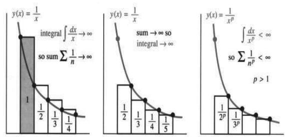

# 10.2 收敛判别法：正项级数

原书 PDF 第453—460页，印刷页440—447。状态：初译，已对照原页自校；待统一复审。

<!-- PDF 453 / 印刷页 440 -->

这是我们第三次暂停计算，来处理定义。第2章说明了什么是导数，第5章说明了什么是积分。现在要说明级数的和是什么——如果这个和存在。这三种情形都涉及极限。这是数学中形式严谨、细致谨慎的一面，用来判断那些积极推进的运算是否有意义。

级数 $\frac12+\frac14+\frac18+\cdots$ 收敛到1，$1+\frac12+\frac13+\cdots$ 发散到无穷大，$1-\frac12+\frac13-\cdots$ 收敛到 $\ln2$。谈到级数收敛或发散时，实际上谈的是它的“部分和”收敛或发散。

**定义1**　级数 $a_1+a_2+a_3+\cdots$ 的部分和 $s_n$ 截止于 $a_n$：

$$
s_n=\text{前 }n\text{ 项的和}=a_1+a_2+\cdots+a_n.
$$

所以，$s_n$ 只是整个和的一部分。例子 $\frac12+\frac14+\frac18+\cdots$ 的部分和为

$$
s_1=\frac12,\qquad s_2=\frac34,\qquad s_3=\frac78,\qquad s_n=1-\frac1{2^n}.
$$

它们累加的项越来越多，整个级数的和又是什么？回答是：**级数 $\frac12+\frac14+\cdots$ 收敛到1，因为它的部分和 $s_n$ 收敛到1。** 当 $a_1+a_2+a_3+\cdots$ 的部分和越加越长、趋于极限 $s$ 时，就说级数收敛到 $s$。相加的是各个 $a$，不是各个 $s$。

**定义2　级数的和，是其部分和 $s_n$ 的极限。**

再强调一次：前提是极限存在。数列 $s_n$ 可能没有极限。部分和若不断跳动，整个级数就没有和，也就是不收敛。若部分和趋于 $s$，那么足够靠后的项 $a_n$ 必须趋于零；不仅如此，尾部各项的和也必须趋于零。

新概念 $\sum a_n=s$ 已转换成旧概念 $s_n\to s$。

**例1**　几何级数 $\frac1{10}+\frac1{100}+\frac1{1000}+\cdots$ 收敛到 $s=\frac19$。

部分和 $s_1,s_2,s_3,s_4$ 为 $0.1,0.11,0.111,0.1111$，趋于 $s=\frac19$。再次注意，$a$ 构成的级数与 $s$ 构成的数列不同。级数 $1+1+1+\cdots$ 发散，因为部分和数列为 $1,2,3,\ldots$。更能说明问题的是调和级数：$1+\frac12+\frac13+\cdots$ 发散，因为部分和 $1,1\frac12,\ldots$ 最终会超过任意给定的数 $s$。第2.6节已经看过这一点，这里还会再看。

不要混淆 $a_n\to0$ 与 $s_n\to s$。仅凭 $a_n\to0$，不能确定级数收敛。调和级数就是最好的例子：$a_n=1/n\to0$，但 $s_n\to\infty$。这让无穷级数成为一场精细的游戏，数学家对此乐在其中。收敛与发散的边界很难找到，却很容易跨过。稍微推一把，让 $a_n$ 趋于零的速度快一点，$s_n$ 就可能收敛。虽然 $a_n\to0$ 本身不保证收敛，但它是首要的必要条件。

**10A**　若级数收敛，即 $s_n\to s$，则其通项必须趋于零，即 $a_n\to0$。

**证明**　假设 $s_n\to s$。则 $s_{n-1}$ 也趋于 $s$，两者之差 $s_n-s_{n-1}$ 趋于零。这个差就是 $a_n$，故 $a_n\to0$。

<!-- PDF 454 / 印刷页 441 -->

**例1（续）**　对于几何级数 $1+x+x^2+\cdots$，检验 $a_n\to0$ 就是检验 $x^n\to0$。若 $|x|\ge1$，$x$ 的各次幂不趋于零，未通过检验，级数必发散。若 $-1<x<1$，则通过检验。但要证明收敛，不能只依靠通项趋于零，必须证明部分和收敛：

$$
s_n=1+x+\cdots+x^{n-1}=\frac{1-x^n}{1-x},
\qquad s_n\longrightarrow\frac1{1-x}=s.
$$

换成别的级数，先检查 $a_n\to0$，否则根本没有收敛的可能。一般的 $a_n$ 不具备 $x^n$ 的特殊形式，所以需要更有力的判别方法。我们一直记着几何级数，是因为许多收敛判别法都在与它比较。合适的比较能给出足够的信息：

$$
|a_1|<\frac12,\quad |a_2|<\frac14,\quad\ldots
\quad\Longrightarrow\quad
 a_1+a_2+\cdots\text{ 比 }\frac12+\frac14+\cdots\text{ 收敛得更快。}
$$

更一般地，$a_1+a_2+a_3+\cdots$ 的各项可以小于 $ax+ax^2+ax^3+\cdots$ 的对应项。只要 $x<1$，第二个级数收敛，第一个也收敛。现在转入比较：用比较判收敛，也用比较判发散。本节余下部分，假定各项 $a_n$ 均为正数。

## 比较判别法与积分判别法

实际中，很少能直接算出部分和 $s_n=a_1+\cdots+a_n$，通常找不到简单的公式。我们也许永远不知道精确的极限 $s$，但仍可以拿一个已知收敛的级数来比一比，判断有没有和。

**10B（比较判别法）**　若 $0\le a_n\le b_n$，且 $\sum b_n$ 收敛，则 $\sum a_n$ 收敛。

较小的项加成较小的和：$\sum a_n$ 不超过 $\sum b_n$，所以必收敛。反过来，若 $a_n\ge c_n$ 且 $\sum c_n=\infty$，比较就迫使 $\sum a_n=\infty$。**一个正项级数若逐项不小于另一个发散级数，也必发散。**

注意，正项级数只能发散到无穷大，不能振荡，因为每一项都使部分和增大。$s_n$ 要么逐渐逼近某个 $s$，超过所有小于 $s$ 的数；要么超过一切界限而发散。递增数列 $s_n$ 若有上界，就必收敛。实数轴是完备的，没有空缺。

**调和级数 $1+\frac12+\frac13+\frac14+\cdots$ 发散到无穷大。**

用来比较的级数为 $1+\frac12+\frac14+\frac14+\frac18+\frac18+\frac18+\frac18+\cdots$。调和级数逐项不小于它。而比较级数按组相加，实际就是 $1+\frac12+\frac12+\frac12+\cdots$，因为 $\frac12=\frac24=\frac48$。比较级数发散，在它上面的调和级数也必发散。

要用比较判别法，就要找到比较对象。这里想到了另一个级数，成组的 $\frac12$ 让它很方便。但不同级数需要不同的比较对象，到哪里找？积分判别法给出了一条自动生成比较对象的路子。

让我对同一个例子再用一次积分判别法。要理解它，请看图10.2中的面积：我们比较矩形面积与曲线下的面积。

<!-- PDF 455 / 印刷页 442 -->

图10.2　积分判别法：$p=1$ 时，和与积分都发散；$p>1$ 时，两者都收敛。图中 integral 为积分，sum 为和。

**例2（再次讨论）**　把 $1+\frac12+\frac13+\cdots$ 与 $y=1/x$ 下方的面积比较。

每一项 $a_n=1/n$ 都是一个矩形的面积。将它与曲边区域面积 $c_n$ 比较，两者都位于 $x=n$ 与 $x=n+1$ 之间，而矩形在曲线上方，所以 $a_n>c_n$：

$$
\text{矩形面积 }a_n=\frac1n
\quad>\quad \text{曲边区域面积 }c_n=\int_n^{n+1}\frac{dx}{x}.
$$

要点在于，$c_n$ 看起来复杂，却可以加起来。$c_1+\cdots+c_n$ 是从1到 $n+1$ 的整个面积，等于 $\ln(n+1)$，因为我们知道 $1/x$ 的积分，也知道对数趋于无穷大。

矩形面积 $1+1/2+\cdots+1/n$ 大于曲线下面积。比较可知，调和级数发散到无穷大，其部分和略大于 $\ln(n+1)$。

**说明**　用 $1/x$ 积分，比起拿一组组 $\frac12$ 来凑，还有别的优势。首先，积分判别法很自然：级数中的 $1/n$ 直接对应积分中的 $1/x$。其次，比较更精确。项数翻倍时，先前的比较只保证多出 $\frac12$；真正的部分和却像 $\ln n$ 那样增长。要证明这一点，把矩形放到曲线下方。

曲线下方的矩形面积小于积分。图10.2b略去第一个矩形，使其余矩形位于曲线下方。现在得到反向的比较：

$$
\frac12+\frac13+\cdots+\frac1n<\int_1^n\frac{dx}{x}=\ln n.
$$

两边加1，得 $s_n<1+\ln n$。之前又有 $s_n>\ln(n+1)$。这是个很窄的范围，给出了很好的估计。$1/n$ 的和与 $1/x$ 的积分一起发散。第43题会证明，$s_n-\ln n$ 趋于“欧拉常数” $\gamma=0.577\ldots$。

**要点：** 矩形总面积是 $s_n$，曲线下面积与它接近。我们现在用积分帮助求和，以前则相反。

**问题**　假设计算机每秒加一百万项，连续加一百万年，调和级数的部分和有多大？  
**回答**　项数为 $n=60^2\cdot24\cdot365\cdot10^{12}<3.2\cdot10^{19}$。所以 $\ln n<\ln3.2+19\ln10<45$。由 $s_n<1+\ln n$，一百万年后的部分和仍不到46。

<!-- PDF 456 / 印刷页 443 -->

碰上别的级数，就把 $1/x$ 换成另一个函数 $y(x)$。在 $x=n$ 时，须有 $y(n)=a_n$，并且 $y(x)$ 递减。于是，高为 $a_n$ 的那个矩形，在 $x=n$ 右边位于曲线上方，在左边位于曲线下方。**级数与积分彼此夹住：左端点和 $\ge$ 积分 $\ge$ 右端点和。** 推理与 $a_n=1/n$、$y(x)=1/x$ 相同：曲线下方面积有限，当且仅当矩形总面积有限。

各项不能直接相加时，就对 $y(x)$ 积分，比较面积。

**10C（积分判别法）**　若 $y(x)$ 递减，且 $y(n)=a_n$，则

$$
a_1+a_2+a_3+\cdots\qquad\text{与}\qquad\int_1^\infty y(x)\,dx
$$

同时收敛或同时发散。

**例3**　$p$ 级数 $\frac1{2^p}+\frac1{3^p}+\frac1{4^p}+\cdots$ 在 $p>1$ 时收敛。对 $y=1/x^p$ 积分：

$$
\frac1{n^p}<\int_{n-1}^n\frac{dx}{x^p},
\quad\text{所以}\quad\sum_{n=2}^\infty\frac1{n^p}<\int_1^\infty\frac{dx}{x^p}.
$$

图10.2c中，$p>1$ 时面积有限。积分为 $[x^{1-p}/(1-p)]_1^\infty=1/(p-1)$。**面积有限意味着级数收敛。** 如果第一项是 $1/1^p$，在曲线下面积上加1：

$$
\frac1{1^p}+\frac1{2^p}+\frac1{3^p}+\cdots
<1+\frac1{p-1}=\frac p{p-1}.
$$

临界情形 $p=1$ 就是发散的调和级数。由比较判别法，每个 $p<1$ 也给出一个发散级数。因此，$\sum1/\sqrt n$ 与 $\int dx/\sqrt x$ 一比即判为发散，与 $\sum1/n$ 比也一样。第7.5节的反常积分，与这里的“反常和”——无穷级数——相互对应。

注意 $p=2$ 和 $p=3$ 的特殊情形。$1+\frac14+\frac19+\cdots$ 收敛，欧拉求得其和为 $\pi^2/6$。$1+\frac18+\frac1{27}+\cdots$ 也收敛，可以将 $\sum1/n^3$ 与 $\sum1/n^2$ 或 $\int dx/x^3$ 比较来证明，但 $p=3$ 的和仍未知。

**加分问题**　$p$ 级数的和引向纯数学中极重要的问题。“泽塔函数”为 $Z(p)=\sum1/n^p$，所以 $Z(2)=\pi^2/6$，而 $Z(3)$ 未知。黎曼研究满足 $Z(p)=0$ 的复数 $p$，这样的零点有无穷多个。他猜想，这些 $p$ 的实部总是 $\frac12$。这一点已在前十亿个零点上验过，但还没有证明。〔译注：此段省略了解析延拓及非平凡零点的限定，见节末。〕

## 与几何级数比较

可以把任何新的级数 $a_1+a_2+\cdots$ 与 $1+x+\cdots$ 比较。记住，前一百万项与收敛性无关。比较站不站得住，要看更远处，即 $n\to\infty$ 时的表现。仍假定 $a_n>0$。

**10D（比值判别法）**　若 $a_{n+1}/a_n$ 趋于极限 $L<1$，则级数收敛。

**10E（根值判别法）**　若 $n$ 次方根 $(a_n)^{1/n}$ 趋于 $L<1$，则级数收敛。

粗略地说，这些判别法把 $a_n$ 与 $L^n$ 联系起来，因此得到收敛。若 $L>1$，它们也能判定发散；若 $L=1$，就判断不了。不巧，$L=1$ 恰恰是最重要、最困难的情形。

<!-- PDF 457 / 印刷页 444 -->

不过，你马上会看到，比值判别法用起来相当容易。

**例4**　几何级数 $x+x^2+\cdots$ 的相邻项比恰好为 $x$，通项的 $n$ 次方根也恰好为 $x$，所以 $L=x$。$x<1$ 时收敛，$x>1$ 时发散，这些我们已知。$1+1+\cdots$ 的发散居然“太精细”，比值判别法与根值判别法都处理不了，因为 $L=1$。

**例5**　$p$ 级数满足 $a_n=1/n^p$、$a_{n+1}/a_n=n^p/(n+1)^p$。无论 $p$ 为何，$n\to\infty$ 时的极限都为1。比值判别法察觉不出它们的差别：$p=2$ 时收敛，$p=1$ 时发散，甚至 $p=-1$ 时强烈发散。根值判别法也一样；这里积分判别法更有力。

**例6**　现在可以判断 $p$ 级数与几何级数的组合：

$$
\frac x{1^p}+\frac{x^2}{2^p}+\cdots+\frac{x^n}{n^p}+\cdots,
\qquad \frac{a_{n+1}}{a_n}=\frac{x^{n+1}}{(n+1)^p}\frac{n^p}{x^n}\longrightarrow L=x.
$$

决定收敛的是 $|x|<1$，而不是 $p$。**指数幂 $x^n$ 的作用强于任意固定幂 $n^p$。** 接着轮到阶乘 $n!$：它会证明自己比任何 $x^n$ 都强。

**例7　指数级数 $e^x=1+x+\frac12x^2+\frac16x^3+\cdots$ 对所有 $x$ 都收敛。**

通项为 $x^n/n!$，相邻项之比为

$$
\frac{x^{n+1}/(n+1)!}{x^n/n!}=\frac x{n+1}\longrightarrow0.
$$

取 $x=1$，比值判别法给出 $\sum1/n!$ 收敛，其和为 $e$。取 $x=4$，更大的级数 $\sum4^n/n!$ 也收敛，和为 $e^4$。而且，$\sum x^nn^p/n!$ 对任意 $x,p$ 都收敛，仍有 $L=0$，离临界情况远得很。阶乘占了上风，保证收敛。

下面证明这件事：相邻项之比趋于 $L<1$ 时，级数就收敛。在 $L$ 与1的中点选一个 $x$，所以 $x<1$。最终，各个比值都小于 $x$，并始终如此：

$$
a_{N+1}/a_N<x,\quad a_{N+2}/a_{N+1}<x,\quad a_{N+3}/a_{N+2}<x,\quad\ldots.
$$

先将前两个不等式相乘，再将前三个相乘：

$$
a_{N+1}/a_N<x,\qquad a_{N+2}/a_N<x^2,\qquad a_{N+3}/a_N<x^3,\quad\ldots.
$$

因此，$a_{N+1}+a_{N+2}+\cdots<a_N(x+x^2+x^3+\cdots)$。由于 $x<1$，与几何级数比较即得收敛。

**例8**　级数 $\sum1/n^n$ 很适合根值判别法。通项的 $n$ 次方根为 $1/n$，极限为0。它甚至比 $e=\sum1/n!$ 收敛得更快。根值判别法也很容易解释：$(a_n)^{1/n}<x$ 推出 $a_n<x^n$，而 $x$ 可取为接近 $L$ 且小于1的数，仍是与几何级数比较。

## 正项级数小结

几何级数、$p$ 级数、指数级数的收敛性已经确定。把它们的通项排成一列，从发散最强到收敛最快：

<!-- PDF 458 / 印刷页 445 -->

$$
1,\quad \frac1{n^p}\ (p<1),\quad \frac1n,\quad
\frac1{n^p}\ (p>1),\quad \frac n{2^n},\quad\frac1{2^n},\quad
\frac{4^n}{n!},\quad\frac1{n!},\quad\frac1{n^n}.
$$

由发散转为收敛的位置在 $1/n$ 之后。前面常用10A的通项不趋零检验；幂函数附近用10B、10C的比较及积分判别法；后面用10D、10E的比值及根值判别法。

但这条分界并不像看起来那么鲜明。在收敛一侧，$1/[n(\ln n)^2]$ 排在所有 $p>1$ 的 $p$ 级数前面。在发散一侧，$1/(n\ln n)$ 和 $1/[n(\ln n)(\ln\ln n)]$ 都应排在 $1/n$ 之后。不管级数发散还是收敛，总能找到另一个发散或收敛更慢的级数。

因此，不可能期待一种最终的、包办所有问题的比较判别法。但比较仍是最有用的方法。这一列中的每个级数都能与相邻者比较，其他级数也能插入其间。理解这个主题，最好的办法是看例子。

**例9**　$\sum1/\ln n$ 发散，因为 $\sum1/n$ 发散；比较使用 $\ln n<n$。

**例10**

$$
\sum\frac1{n(\ln n)^2}\approx\int\frac{dx}{x(\ln x)^2}<\infty,
\qquad
\sum\frac1{n\ln n}\approx\int\frac{dx}{x\ln x}=\infty.
$$

两个不定积分分别为 $-1/\ln x$ 与 $\ln(\ln x)$。前者在 $x\to\infty$ 时趋于零，反常积分与级数都收敛。后者虽然增长极慢，最终仍趋于无穷大，所以第二个级数发散。这些例子把新级数挤进这一列，进一步靠近分界。

**例11**

$$
\frac1{n^2+1}<\frac1{n^2},\quad\text{所以}\quad
\frac12+\frac15+\frac1{10}+\cdots<1+\frac14+\frac19+\cdots\quad\text{（收敛）}.
$$

分母中的常数1不影响收敛性，下一个例子也一样。

**例12**

$$
\frac1{2n-1}>\frac1{2n},\quad\text{所以}\quad
1+\frac13+\frac15+\cdots>\frac12+\frac14+\frac16+\cdots.
$$

$\sum1/(2n)$ 是 $\sum1/n$ 的一半，所以两者都发散。若比值 $a_n/b_n$ 趋于 $L>0$，两个级数就具有相同的收敛性。例11、12中，$n^2/(n^2+1)\to1$，$2n/(2n-1)\to1$。这引出最后一个判别法。

**10F（极限比较判别法）**　若 $a_n/b_n$ 趋于正的有限极限 $L$，则 $\sum a_n$ 与 $\sum b_n$ 同时收敛或同时发散。

理由是：至少对充分大的 $n$，有 $\frac12Lb_n<a_n<2Lb_n$，所以两者收敛性相同。例如，$\sum\sin(7/n^p)$ 在 $p>1$ 时收敛，在 $p\le1$ 时不收敛；它表现得像 $\sum1/n^p$，这里 $L=7$。级数的尾部，即大 $n$，决定收敛性；前部，即小 $n$，则通常决定和的主要部分。

还有许多级数值得用比较法研究。

<!-- PDF 459 / 印刷页 446 -->

## 10.2 习题

### 阅读填空

$a_1+a_2+\cdots$ 的收敛性由部分和 $s_n=$ **a** ______ 决定。若 $s_n\to s$，则 $\sum a_n=$ **b** ______。对于 **c** ______ 级数 $1+x+\cdots$，部分和为 $s_n=$ **d** ______。此时 $s_n\to1/(1-x)$ 当且仅当 **e** ______。所有情况下，$s_n\to s$ 都要求 $a_n\to$ **f** ______。但调和级数 $a_n=1/n$ 表明，可以有 $a_n\to$ **g** ______，而级数仍然 **h** ______。

比较判别法指出，若 $0\le a_n\le b_n$，则 **i** ______。若递减函数 $y(x)$ 在 $x=n$ 时等于 $a_n$，可用 **j** ______ 判别法；$\sum a_n$ 收敛当且仅当 **k** ______。由此，$p$ 级数 $\sum1/n^p$ 收敛当且仅当 $p$ **l** ______。对于调和级数，即 $p=1$，部分和 $s_n=1+\cdots+1/n$ 接近积分 $f(n)=$ **m** ______。

当 $a_{n+1}/a_n\to L$ 时，可用 **n** ______ 判别法；若 **o** ______ 则收敛，若 **p** ______ 则发散，若 **q** ______ 则无法判断。当 $(a_n)^{1/n}\to L$ 时，**r** ______ 判别法也有相同结论。

对几何级数与 $p$ 级数组合的 $a_n=x^n/n^p$，比值 $a_{n+1}/a_n=$ **s** ______，极限 $L=$ **t** ______，所以当 **u** ______ 时收敛。对于指数级数 $e^x=\sum x^n/n!$，比值极限为 $L=$ **v** ______。该级数总是 **w** ______，因为 $n!$ 比任何固定的 $x^n$ 或 $n^p$ 增长更快。

**x** ______ 与 **y** ______ 之间没有一条简单鲜明的界线。但若 $\sum b_n$ 收敛且 $a_n/b_n\to L$，就可由 **z** ______ 判别法推出 $\sum a_n$ 收敛。

1. 下面迅速证明 $1+\frac12+\frac13+\cdots$ 不可能有有限和 $s$。除以2应有 $\frac12+\frac14+\frac16+\cdots=\frac12s$；相减则留下 $1+\frac13+\frac15+\cdots=\frac12s$。这两个级数不可能都等于 $\frac12s$，因为 ______。

2. 每个小数 $s=0.abc\ldots$ 都对应一个收敛级数 $a/10+b/100+$ ______ $+\cdots$。用比较判别法证明它收敛。

3. 从下列部分和 $s_n$ 求通项 $a_n$ 及 $s=\sum_{n=1}^\infty a_n$：  
   (a) $s_n=1-1/n$；(b) $s_n=4n$；(c) $s_n=\ln[2n/(n+1)]$。

4. 求部分和 $s_n=a_1+\cdots+a_n$：  
   (a) $a_n=1/3^{n-1}$；(b) $a_n=\ln[n/(n+1)]$；(c) $a_n=n$。

5. 假设 $0<a_n<b_n$ 且 $\sum a_n$ 收敛。关于 $\sum b_n$ 能推断什么？举例说明。

6. (a) 假设 $b_n+c_n<a_n$，各项均正，且 $\sum a_n$ 收敛。关于 $\sum b_n$ 和 $\sum c_n$ 能说什么？  
   (b) 假设 $a_n<b_n+c_n$，各项均正，且 $\sum a_n$ 发散。关于 $\sum b_n$ 和 $\sum c_n$ 能说什么？

**第7—10题：判断收敛或发散，并说明理由。**

7. $\frac1{100}+\frac1{200}+\frac1{300}+\cdots$。

8. $\frac1{100}+\frac1{105}+\frac1{110}+\cdots$。

9. $\frac1{101}+\frac1{104}+\frac1{109}+\cdots$。

10. $\frac1{101}+\frac2{108}+\frac3{127}+\cdots$。

**第11—20题：用比较判别法确定收敛或发散。**

11. $\sum\frac1{n^2+10}$。

12. $\sum\frac1{\sqrt{n^2+10}}$。

13. $\sum\frac1{n+\sqrt n}$。

14. $\sum\frac{\sqrt n}{n^2+4}$。

15. $\sum\frac{n^3}{n^2+n^4}$。

16. $\sum\frac1{n^2}\cos\frac1n$。

17. $\sum\frac1{2^n-1}$。

18. $\sum\sin^2\frac1n$。

19. $\sum\frac1{3^n-2^n}$。

20. $\sum\frac1{e^n-n^e}$。

**第21—28题：求比值判别法或根值判别法中的极限 $L$。**

21. $\sum\frac{3^n}{n!}$。

22. $\sum\frac1{n^2}$。

23. $\sum\frac{n^22^n}{n!}$。

24. $\sum\left(\frac{n-1}{n}\right)^n$。

25. $\sum\frac n{2^n}$。

26. $\sum\frac{n!}{e^{n^2}}$。

27. $\sum\left(\frac{n-1}{n}\right)^{n^2}$。

28. $\sum\frac{n!}{n^n}$。

29. $(1-\frac12)+(\frac12-\frac13)+(\frac13-\frac14)$ 称为“望远镜式相消”，因为 $\frac12,\frac13$ 分别与 $-\frac12,-\frac13$ 抵消。求无穷望远镜级数的和：

    $$s=\sum_{n=1}^\infty\left(\frac1n-\frac1{n+1}\right)
    =\sum_{n=1}^\infty\frac1{n(n+1)}.$$

30. 求其他望远镜级数的和 $s$：  
    (a) $(1-\frac13)+(\frac12-\frac14)+(\frac13-\frac15)+\cdots$；  
    (b) $\ln\frac12+\ln\frac23+\ln\frac34+\cdots$。

31. 在积分判别法中，哪个和大于 $\int_1^n y(x)\,dx$，哪个和小于它？画图说明。

32. 把和与积分比一比，分别给出以下部分和的上、下界：

    $$s_n=1+\frac13+\cdots+\frac1{2n-1},\qquad
    s_n=1+\frac18+\cdots+\frac1{n^3}.$$

33. 哪个积分判别法能说明 $\sum_{n=1}^\infty1/e^n$ 收敛？其和是多少？

34. 哪个积分判别法能说明 $\sum_{n=1}^\infty n/e^n$ 收敛？其和是多少？

<!-- PDF 460 / 印刷页 447 -->

**第35—42题：根据 $\int y(x)\,dx$ 判定收敛性。**

35. $\sum\frac1{n^2+1}$。

36. $\sum\frac1{3n+5}$。

37. $\sum\frac n{n^2+1}$。

38. $\sum\frac{\ln n}{n}$。（$\ln x/x$ 递减吗？）

39. $\sum n^e/n^\pi$。

40. $\sum_{n=2}^\infty\frac1{n(\ln n)(\ln\ln n)}$。

41. $\sum e^n/\pi^n$。

42. $\sum n/e^{n^2}$。

43. (a) 像图10.2那样使用矩形，说明 $D_n=(1+\frac12+\cdots+\frac1n)-\ln n$ 为正。  
    (b) 证明 $1/(n+1)<\int_n^{n+1}dx/x$，从而说明 $D_{n+1}<D_n$。  
    (c) （计算器）递减的 $D_n$ 必趋于一个极限。计算到它们低于0.6和0.58，分别在什么时候？其极限就是欧拉常数 $\gamma=0.577\ldots$。

44. 对调和级数，使用 $s_n\approx0.577+\ln n$，说明 $s_n=1+\frac12+\cdots+\frac1n$ 需要超过600项才有 $s_n>7$。要使 $s_n>10$，需要多少项？

45. (a) 在两边加上 $2(\frac12+\frac14+\cdots+\frac1{2n})$，证明

    $$1-\frac12+\frac13-\frac14+\cdots-\frac1{2n}
    =\frac1{n+1}+\cdots+\frac1{2n}.$$

    (b) 为什么右边接近 $\ln(2n)-\ln n$？据此推出 $1-\frac12+\frac13-\frac14+\cdots$ 收敛到 $\ln2$。

46. 计算机每秒对 $\sum1/(n\ln n)$ 累加一百万项。与 $\int dx/(x\ln x)$ 比较，估计一百万年后的部分和，参见正文问题。

47. 通过与积分比较，估计 $\sum_{n=100}^{1000}1/n^2$。

48. 若 $\sum a_n$ 收敛且 $a_n>0$，证明 $\sum a_n^2$ 收敛。

49. 若 $\sum a_n$ 收敛且 $a_n>0$，证明 $\sum\sin a_n$ 收敛。怎样才能出现 $\sum a_n$ 发散而 $\sum\sin a_n$ 收敛的情形？

50. 第 $n$ 个素数 $p_n$ 满足 $p_n/(n\ln n)\to1$。证明

    $$\sum\frac1{p_n}=\frac12+\frac13+\frac15+\frac17+\frac1{11}+\cdots$$

    发散。

**构造级数 $\sum a_n$，使它比 $\sum b_n$ 收敛快，但比 $\sum c_n$ 收敛慢，即 $a_n/b_n\to0$、$a_n/c_n\to\infty$。**

51. $b_n=1/n^2$，$c_n=1/n^3$。

52. $b_n=n(\frac12)^n$，$c_n=(\frac12)^n$。

53. $b_n=1/n!$，$c_n=1/n^n$。

54. $b_n=1/n^e$，$c_n=1/e^n$。

第53题使用斯特林公式 $\sqrt{2\pi n}\,n^n/(e^nn!)\to1$。

55. 对级数 $\frac12+\frac12+\frac14+\frac14+\frac18+\frac18+\cdots$，说明比值判别法失效。但 $(a_n)^{1/n}$ 确实趋于极限 $L$。从偶数项 $a_{2k}=1/2^k$ 求 $L$。级数收敛吗？

56. （供教师参考）若 $a_{n+1}/a_n$ 趋于正的极限 $L$，证明 $(a_n)^{1/n}$ 也趋于 $L$。

**第57—66题：判断收敛性，并说明所用判别法。**

57. $\sum\frac1{(\ln n)^n}$。

58. $\sum\frac1{n^{\ln n}}$。

59. $\sum\frac1{10^n}$。

60. $\sum\frac1{\ln(10^n)}$。

61. $\sum\ln\frac{n+2}{n+1}$。

62. $\sum n^{-1/n}$。

63. $\sum\frac1{(\ln n)^p}$，讨论所有 $p$。

64. $\sum\frac{\ln n}{n^p}$，讨论所有 $p$。

65. $\sum\frac{3^n}{4^n-2^n}$。

66. $\sum\frac{n^p}{(n!)^q}$，讨论所有 $p,q$。

67. 在极限比较判别法中，假设 $a_n/b_n\to0$。证明若 $\sum b_n$ 收敛，则 $\sum a_n$ 收敛。

68. 你能构造一个连你和老师都无法判断收敛性的级数吗？

## 译注与待复审事项

1. 级数收敛要求部分和趋于有限极限；趋于无穷大属于发散。比较判别法用于非负项或最终非负项，有限个前置项不影响收敛性。与几何级数比较时，本文实际需要正的比较项及 $0<x<1$；对一般实数或复数项，先比较绝对值。
2. 积分判别法需在某个起点以后有非负、递减且可积的函数，满足 $y(n)=a_n$。对数、重对数例子须选取避开奇点且最终为正的起点；第40题从2开始的首项为负，可单独分离。若对应积分从2跨过 $x=e$，则遇到奇点，不能用它代表级数尾部。
3. 比值与根值判别法的极限应存在；对可变号项使用绝对值。$L=1$ 时不作判断。例6中 $|x|=1$ 的边界仍与 $p$ 有关，正文“不是 $p$”仅描述 $|x|<1$ 或 $|x|>1$ 的非边界情况。$x=0$ 可直接判断，不能在零项之间计算比值。
4. 极限比较判别法要求 $0<L<\infty$。结尾例子 $\sin(7/n^p)\sim7/n^p$ 需要 $p>0$；原文把此论证扩展到所有 $p\le1$ 的说法缺少条件，特别是 $p<0$ 时不能使用小角近似。译稿保留原说法并指出其证明范围。
5. $\sum1/n^3$ 的和“未知”不是说其数值不存在或不能计算，而是指这里没有简单求和表达式。黎曼猜想段落省略了泽塔函数的解析延拓与“非平凡零点”限定；原级数仅在相应收敛域定义函数，不能直接用它讨论实部为 $1/2$ 的零点。零点验证数量是原书年代的叙述，未作为当前纪录核实。
6. 第3题求 $a_n=s_n-s_{n-1}$ 时，首项须单独用 $a_1=s_1$，不能把给定公式在无定义的 $n=0$ 处机械代入。第24、27题初项为零不妨碍对尾部作比值或根值检验。第44题的近似式用于估计，若要严格证明精确项数，还须误差界或直接核算。
7. 原书PDF第459页第10题实际印为 $1/101+2/108+3/127+\cdots$，已对照图片恢复，不能误认成分母的指数。第50题的素数渐近关系按 $p_n/(n\ln n)\to1$ 理解。
